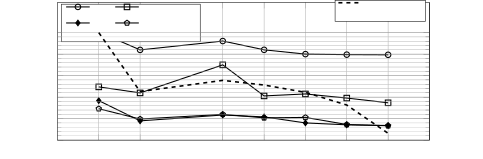

# From 2.1M Hours of Raw Broadcast Audio to Finnish Speech SSL: Confidence Filtering and Architectural Analysis at Scale

Yaroslav Getman Affiliation: Dept. lnformation and Communications
Engineering  
Aalto University  
Espoo, Finland  
yaroslav.getman@aalto.fi    Tamás Grósz Affiliation: Walton Institute,
South East Technological University, Ireland  
Aalto University  
Espoo, Finland  
tamas.grosz@setu.ie    Tommi Lehtonen Affiliation: Finnish National
Audiovisual Institute (KAVI)  
Helsinki, Finland  
tommi.lehtonen@kavi.fi    Mikko Kurimo Affiliation: Dept. lnformation
and Communications Engineering  
Aalto University  
Espoo, Finland  
mikko.kurimo@aalto.fi

###### Abstract

Broadcast archives offer scale and diversity for self-supervised
learning (SSL) but contain substantial noisy, non-speech, and
multilingual content. Prior work typically relies on voice activity
detection or language identification (LID) to extract speech, ensuring
presence rather than quality. Whether and how to filter unlabeled speech
by quality for SSL, particularly from noisy broadcasts, remains
underexplored. We present a large-scale Finnish SSL study starting from
2.1M hours of unconstrained broadcast audio. We propose automatic speech
recognition (ASR) confidence as a proxy for pretraining data quality and
show 3-7% relative WER improvements over LID-based filtering despite a
smaller training set. We further address the lack of controlled
architectural comparisons in speech SSL by evaluating Transformer,
Macaron-Net, Conformer, and E-Branchformer at matched parameter budgets.
Our models improve upon prior Finnish SSL baselines, particularly at
Base scale and out-of-domain.

###### Index Terms: 

Self-supervised learning, wav2vec 2.0, audio data filtering, speech
foundation models

## I Introduction

Self-supervised learning (SSL) has enabled effective speech
representation learning, improving downstream automatic speech
recognition (ASR) performance particularly in low-resource settings \[5,
3\]. While multilingual SSL models support hundreds of languages \[8,
39\], language-specific pretraining has been shown to achieve superior
performance on target language tasks \[24, 14\]. However, publicly
available corpora are dominated by English \[36, 27\], while resources
for other languages remain considerably smaller in scale and typically
consist of formal or read speech \[43, 37\], offering limited diversity.

To increase available pretraining data for less-resourced languages,
recent work has turned to large-scale broadcast archives \[29, 14, 40\].
Such sources offer volume and variability but introduce significant
challenges: limited metadata, substantial non-speech content, and
multilingual segments.

Prior monolingual SSL studies have either used all available data to
maximize scale or relied on selected broadcast programs and curated
datasets \[12, 32, 26, 13\], typically complemented by voice activity
detection (VAD) segmentation \[29, 14\] or Whisper-based \[38\]
utterance extraction \[40\]. These approaches primarily target speech
extraction rather than systematic selection based on speech quality.
While pretraining data composition has been shown to substantially
affect downstream SSL performance \[19\], whether and how to filter it
by quality remains underexplored, especially for noisy broadcast
archives.

Confidence-based data selection is well established in semi-supervised
and self-training pipelines, with model scores used to filter
pseudo-labels \[22, 33\]. \[45\] applied diarization confidence to
filter data for self-supervised speaker representation learning.
However, to our knowledge, ASR confidence has not been investigated for
SSL pretraining data selection.

While Transformer \[41\] encoders are widely used in SSL frameworks \[5,
18, 7, 4\], alternatives such as Conformer \[17\] and
E-Branchformer \[23\] have been adopted in self-supervised
settings \[10, 9, 8\]. Controlled comparisons across encoder
architectures exist for supervised ASR \[34\], yet prior SSL studies
have varied in both architecture and model size. For instance,
Conformer-based and Transformer-based wav2vec 2.0 \[5\] variants in
\[44\] used 618M and 317M parameters respectively, making it unclear
whether gains stem from architecture or capacity.

In this work, we present a large-scale study of speech SSL for Finnish,
addressing both data filtering and encoder architecture. Starting from
2.1M hours of raw, unconstrained broadcast material, we apply a
multi-stage pipeline combining VAD, deduplication, and ASR
confidence-based filtering, yielding 471K hours of pretraining data. To
our knowledge, this represents the largest academic effort in
monolingual SSL pretraining to date. We make the following
contributions:

1.  1.  We propose and systematically evaluate ASR confidence-based
        filtering for SSL pretraining data selection from unconstrained
        broadcast archives, showing 3-7% relative WER improvements over
        language-identification-based filtering despite a smaller retained
        training set.
2.  2.  We conduct, to our knowledge, the first parameter-controlled
        comparison of Transformer, Macaron-Net \[28\], Conformer, and
        E-Branchformer encoders within a unified SSL framework, scaling from
        95M to 965M parameters. Convolution-augmented encoders yield up to
        37% relative WER reduction (WERR) over Transformer at Base scale,
        where architectural choice has the greatest impact.
3.  3.  While the broadcast archives cannot be redistributed due to
        copyright and broadcast licensing restrictions, we release our
        models publicly¹¹ 1
        [https://github.com/aalto-speech/large-scale-monolingual-speech-foundation-models](https://github.com/aalto-speech/large-scale-monolingual-speech-foundation-models)
        , which improve upon previous Finnish SSL baselines, particularly in
        parameter-constrained and out-of-domain scenarios.

|                    |                    |                  |                       |
| ------------------ | ------------------ | ---------------- | --------------------- |
| Transformer \[41\] | Macaron-Net \[28\] | Conformer \[17\] | E-Branchformer \[23\] |

| $`\begin{aligned} x^{\prime}_{i}&=x_{i}+\mathrm{MHSA}(x_{i})\\
y_{i}&=x^{\prime}_{i}+\mathrm{FFN}(x^{\prime}_{i})\end{aligned}`$ | $`\begin{aligned} \tilde{x}_{i}&=x_{i}+\tfrac{1}{2}\mathrm{FFN}(x_{i})\\
x^{\prime}_{i}&=\tilde{x}_{i}+\mathrm{MHSA}(\tilde{x}_{i})\\
y_{i}&=x^{\prime}_{i}+\tfrac{1}{2}\mathrm{FFN}(x^{\prime}_{i})\end{aligned}`$ | $`\begin{aligned} \tilde{x}_{i}&=x_{i}+\tfrac{1}{2}\mathrm{FFN}(x_{i})\\
x^{\prime}_{i}&=\tilde{x}_{i}+\mathrm{MHSA}(\tilde{x}_{i})\\
x^{\prime\prime}_{i}&=x^{\prime}_{i}+\mathrm{Conv}(x^{\prime}_{i})\\
y_{i}&=x^{\prime\prime}_{i}+\tfrac{1}{2}\mathrm{FFN}(x^{\prime\prime}_{i})\end{aligned}`$ | $`\begin{aligned} \tilde{x}_{i}&=x_{i}+\tfrac{1}{2}\mathrm{FFN}(x_{i})\\
x^{\prime}_{ig}&=\mathrm{MHSA}(\tilde{x}_{i}),\quad x^{\prime}_{il}=\mathrm{cgMLP}(\tilde{x}_{i})\\
x^{\prime\prime}_{i}&=\tilde{x}_{i}+\mathrm{Merge}(x^{\prime}_{ig},x^{\prime}_{il})\\
y_{i}&=x^{\prime\prime}_{i}+\tfrac{1}{2}\mathrm{FFN}(x^{\prime\prime}_{i})\end{aligned}`$ |

TABLE I: Comparison of encoder architectures. Equations illustrate the
sequence of sub-modules and residual connections within a single encoder
block. $`\mathrm{Merge}(\cdot)`$ denotes the depth-wise convolutional
fusion module. Layer normalizations are omitted for clarity.

## II Data

We use the Radio and Television Archive (RTVA) of the Finnish National
Audiovisual Institute (KAVI), comprising broadcasts from 26 TV channels,
85 radio stations, and online media content, totaling 2.1M hours. The
recordings span 2009-2025, with some sources recorded continuously and
others sampled periodically. Content is highly variable, ranging from
formal news broadcasts to entertainment programs, advertisements, and
music, and metadata is limited.

We also include the training sets of three publicly available Finnish
speech datasets: the Finnish subset of VoxPopuli \[43\] (14.3K hours),
the Finnish Parliament \[42\] (FP, 3.1K hours, fully transcribed), and
Lahjoita puhetta \[30\] (LP, 3.2K hours, partially transcribed). These
datasets are processed using the same filtering pipeline as the archival
data for consistency. The transcribed portions of FP and LP (4.6K hours
in total) are also used for supervised fine-tuning. For evaluation on
real-world broadcast conditions, we created a manually transcribed test
set from KAVI, comprising two one-hour radio broadcasts from stations
Nova and Basso.

## III Methodology

### III-A Self-supervised pretraining framework

We adopt the wav2vec 2.0 framework \[5\], which remains widely used for
non-English monolingual SSL \[12, 29, 26, 32, 2, 25, 13, 14, 40\],
enabling direct comparison with prior work. We opt for three model
scales following \[3\]: Base (95M parameters), Large (317M parameters),
and X-Large (965M parameters). Within each scale, we explore alternative
encoder backends at matched parameter counts to ensure performance gains
stem from architectural design rather than raw capacity. We additionally
fix the pretraining data across backends to isolate architectural
effects and evaluate across six test sets spanning in-domain and
out-of-domain conditions to ensure conclusions are not specific to a
single domain.

### III-B Encoder architectures

We explore four encoder backends for wav2vec 2.0, summarized in Table I.
The standard wav2vec 2.0 uses the Transformer \[41\], where each layer
consists of a multi-head self-attention (MHSA) module followed by a
feed-forward network (FFN), each with residual connections and layer
normalization.

Macaron-Net \[28\] modifies the Transformer by replacing the single FFN
with two half-step FFNs before and after MHSA, with inner dimensionality
halved to maintain parameter parity. This sandwich structure is
incorporated in architectures such as Conformer \[17\] and
E-Branchformer \[23\], yet we evaluate Macaron-Net as a standalone
encoder to isolate the effect of the dual-FFN configuration from other
architectural changes.

Conformer \[17\] augments the Macaron structure by inserting a
convolution module between self-attention and the final FFN. This
sequential design captures both global dependencies via attention and
local patterns through convolution.

In contrast, E-Branchformer \[23\] processes global (MHSA) and local
(convolutional gated MLP) features in parallel branches. These
representations are merged via a depthwise convolutional fusion module,
allowing the encoder to extract complementary acoustic information
independently.

### III-C Filtering pipeline

We apply a multi-stage filtering pipeline to address challenges inherent
to broadcast data. First, we apply voice activity detection (VAD) using
pyannote.audio \[6\], yielding 1.2M hours of speech segments, split into
maximum 30-second chunks.

Since broadcasts contain substantial repetitive content, including
jingles, advertisements, and rebroadcast programs, VAD alone is
insufficient. We next perform transcript-based deduplication using ASR
transcripts generated by the Finnish wav2vec 2.0 Large model \[14\],
retaining a single instance per unique transcript, as identical
transcripts reliably capture rebroadcast content regardless of minor
acoustic variations. Analysis of the ASR transcripts revealed that some
phrases repeat tens of thousands of times across channels and time
periods, confirming the necessity of this step. While this may reduce
acoustic diversity for repeated phrases spoken by different speakers, we
prioritize removing extreme redundancy. This reduces the total data from
1.2M to 890K hours.

Beyond deduplication, we use ASR confidence as a proxy for pretraining
data quality. The intuition is that a well-trained ASR model assigns
higher CTC log-probabilities to acoustically clear speech rather than to
noisy or irrelevant audio. We define the confidence metric
$`C_{\text{char}}`$ as the mean log-probability of the predicted
frame-wise character sequence, excluding blank tokens ($`\epsilon`$), as
blank exclusion with mean aggregation has been shown to yield more
robust confidence estimates \[15\]:

```math
C_{\text{char}}=\frac{1}{|S|}\sum_{t\in S}\log P(\hat{y}_{t}\mid X),\quad S=\{t\mid\hat{y}_{t}\neq\epsilon\} \tag{1}
```

where $`\hat{y}_{t}=\arg\max_{y}P(y\mid X)`$ denotes the predicted label
at frame $`t`$ without collapsing repeats. A sample is retained if
$`C_{\text{char}}\geq\tau`$ for threshold $`\tau`$ (selected in
Section IV-B).

For comparison, we also implement language-identification-based (LID)
filtering using an ECAPA-TDNN model²² 2
https://huggingface.co/speechbrain/lang-id-voxlingua107-ecapa for
audio-based LID and fastText \[21, 20\] on ASR transcripts for
text-based LID, with segments retained if identified as Finnish by both
models. Analysis of the LID results confirmed substantial multilingual
content in the archives, with English as the second most common language
($`\sim`$80K hours).

## IV Experiments

### IV-A Experimental setup

We pretrain models on 512 AMD MI250X GPUs and fine-tune them on 128 GPUs
using Fairseq \[31\]. Since Macaron-Net and E-Branchformer are not
natively supported in Fairseq, we implement them as extensions following
their original architectural specifications.

Base models are pretrained with a learning rate of 6e-4 and a dynamic
batch size of 3 minutes per GPU for 125K steps. Large models use
learning rate 4e-4 and batch size 2 minutes per GPU for 167K steps.
X-Large models use learning rate 1e-4 and batch size of 1 minute per GPU
for 400K steps.

Models are fine-tuned for ASR using CTC loss \[16\], with the CNN
feature encoder frozen. We select learning rates from 1e-5 to 1e-4 based
on validation performance. Base models use a batch size of 2.5 minutes
per GPU and 16K updates. Large models are fine-tuned with a batch size
of 2 minutes per GPU for 25K steps. X-Large models use approximately 1
minute per GPU and train for 40-45K steps (exact batch size and step
count vary by architecture due to memory constraints).

We evaluate ASR performance using word error rate (WER). For in-domain
evaluation, we report results on the test splits of the two fine-tuning
corpora, Finnish Parliament (FP) \[42\], which includes two distinct
test sets, and Lahjoita puhetta (LP) \[30\]. To assess generalization
beyond the fine-tuning domains, we evaluate on Common Voice 16.1 \[1\]
and FLEURS \[11\] benchmarks. Finally, we evaluate performance under
challenging real-world broadcast conditions using the KAVI test set.

### IV-B Data filtering experiments

Given the unconstrained nature of the broadcast archives, selecting an
effective filtering pipeline is critical for successful SSL pretraining.
To analyze the impact of filtering choices, we train wav2vec 2.0 Base
Transformer models on subsets of the deduplicated VAD data with: (i) no
further filtering; (ii) LID-based filtering; and (iii) ASR
confidence-based filtering with thresholds
$`\tau\in\{-0.3,-0.25,-0.2,-0.15,-0.1\}`$. Models are fine-tuned on the
4.6K-hour supervised set and evaluated on the validation splits of FP,
LP, Common Voice, and FLEURS.

Figure 1 shows the impact of filtering on downstream ASR performance and
data retention. At similar retention rates (~72%), confidence filtering
with $`\tau=-0.2`$ achieves lower WER than LID-only filtering on 3 of 4
benchmarks. Performance generally stabilizes in the range
$`\tau\in[-0.15,-0.1]`$, with $`\tau=-0.1`$ consistently yielding the
lowest WER, particularly on FP. We therefore select $`\tau=-0.1`$ for
subsequent experiments as the strictest threshold that avoids
performance degradation while still retaining sufficient data volume
(471K hours, or 53% of deduplicated data). Notably, confidence-based
filtering naturally removes both low-quality target language segments
and most non-target language content: LID analysis of the final
471K-hour set shows $`\sim`$99% Finnish content, eliminating the need
for explicit language filtering. The final data preparation pipeline is
summarized in Figure 2.



Fig. 1: Impact of filtering criteria on downstream validation WER and
pretraining data retention rate. All confidence thresholds
($`C_{\text{char}}\geq\tau`$) are applied to deduplicated VAD segments.


Fig. 2: Pretraining data preparation pipeline. We reduce 2.1M hours of
raw broadcast archives to a high-quality 471K-hour subset through VAD,
transcript-based deduplication, and the confidence-based filtering
threshold $`\tau=-0.1`$ optimized in Figure 1.

|             |     |      |      |        |           |       |       |               |        |       |
| ----------- | --- | ---- | ---- | ------ | --------- | ----- | ----- | ------------- | ------ | ----- |
| Backend     | L   | Enc. | FFN  | Params | In-domain |       |       | Out-of-domain |        |       |
|             |     |      |      |        | LP        | FP’16 | FP’20 | CV            | FLEURS | KAVI  |
| Transformer | 6   | 1024 | 4096 | 90.6M  | 28.30     | 14.08 | 11.58 | 15.60         | 17.13  | 31.49 |
|             | 12  | 768  | 3072 | 95.0M  | 22.28     | 10.72 | 8.70  | 9.74          | 13.02  | 24.85 |
|             | 18  | 768  | 1536 | 95.1M  | 21.33     | 10.64 | 8.66  | 8.99          | 12.71  | 23.91 |
|             | 24  | 576  | 2048 | 96.4M  | 21.66     | 10.69 | 8.73  | 8.77          | 12.85  | 24.57 |
| Macaron-Net | 12  | 768  | 1536 | 95.1M  | 21.80     | 10.58 | 9.10  | 8.62          | 12.54  | 25.22 |
|             | 22  | 576  | 1152 | 95.6M  | 19.41     | 9.62  | 7.92  | 7.12          | 11.07  | 23.51 |
| Conformer   | 12  | 576  | 2048 | 96.7M  | 18.89     | 10.08 | 8.07  | 6.46          | 11.20  | 23.71 |
|             | 17  | 512  | 1536 | 96.5M  | 18.50     | 9.83  | 7.94  | 5.69          | 10.56  | 22.71 |
| E-Branch.   | 12  | 576  | 1280 | 98.4M  | 19.14     | 10.10 | 7.80  | 6.91          | 11.53  | 22.89 |
|             | 17  | 512  | 1024 | 96.6M  | 18.80     | 9.54  | 7.85  | 6.19          | 11.09  | 22.44 |

TABLE II: WER (%) for wav2vec 2.0 Base variants across Finnish
benchmarks. The best results within the same encoder backend are
underlined, and the best overall results are shown in bold.

|                               |                  |        |           |       |       |               |        |       |
| ----------------------------- | ---------------- | ------ | --------- | ----- | ----- | ------------- | ------ | ----- |
| Backend                       | Config           | Params | In-domain |       |       | Out-of-domain |        |       |
|                               | (L / Enc. / FFN) |        | LP        | FP’16 | FP’20 | CV            | FLEURS | KAVI  |
| Base models                   |                  |        |           |       |       |               |        |       |
| Transformer \[14\] (baseline) | 12 / 768 / 3072  | 95.0M  | 22.27     | 10.92 | 8.42  | 10.61         | 13.27  | 27.45 |
| Transformer (ours)            | 12 / 768 / 3072  | 95.0M  | 22.28     | 10.72 | 8.70  | 9.74          | 13.02  | 24.85 |
|                               | 18 / 768 / 1536  | 95.1M  | 21.33     | 10.64 | 8.66  | 8.99          | 12.71  | 23.91 |
| Conformer                     | 12 / 576 / 2048  | 96.7M  | 18.89     | 10.08 | 8.07  | 6.46          | 11.20  | 23.71 |
|                               | 17 / 512 / 1536  | 96.5M  | 18.50     | 9.83  | 7.94  | 5.69          | 10.56  | 22.71 |
| E-Branchformer                | 12 / 576 / 1280  | 98.4M  | 19.14     | 10.10 | 7.80  | 6.91          | 11.53  | 22.89 |
|                               | 17 / 512 / 1024  | 96.6M  | 18.80     | 9.54  | 7.85  | 6.19          | 11.09  | 22.44 |
| Large models                  |                  |        |           |       |       |               |        |       |
| Transformer \[14\] (baseline) | 24 / 1024 / 4096 | 317.4M | 16.86     | 8.29  | 6.94  | 5.86          | 10.69  | 23.60 |
| Transformer (ours)            | 24 / 1024 / 4096 | 317.4M | 16.78     | 8.41  | 6.77  | 6.20          | 10.42  | 21.02 |
| Conformer                     | 24 / 768 / 2608  | 317.2M | 16.46     | 8.58  | 6.71  | 4.52          | 9.69   | 19.86 |
|                               | 36 / 640 / 2048  | 317.1M | 16.36     | 8.16  | 6.81  | 4.28          | 9.43   | 21.02 |
| E-Branchformer                | 24 / 768 / 1592  | 317.1M | 16.30     | 8.22  | 6.84  | 4.33          | 9.59   | 20.01 |
|                               | 36 / 640 / 1280  | 317.4M | 16.11     | 8.15  | 6.88  | 5.24          | 9.30   | 20.09 |
| X-Large models                |                  |        |           |       |       |               |        |       |
| Transformer \[14\] (baseline) | 48 / 1280 / 4096 | 965.5M | 16.37     | 7.81  | 6.43  | 5.42          | 9.96   | 22.42 |
| Transformer (ours)            | 48 / 1280 / 4096 | 965.5M | 16.27     | 7.83  | 6.26  | 3.85          | 9.37   | 19.54 |
| Conformer                     | 48 / 1024 / 2768 | 964.7M | 17.13     | 7.78  | 6.45  | 3.68          | 9.08   | 20.75 |
| E-Branchformer                | 48 / 1024 / 2048 | 965.6M | 16.74     | 7.63  | 6.38  | 4.45          | 9.13   | 19.96 |

TABLE III: WER (%) across scales and encoder backends. Best results per
scale are underlined and best overall in bold. LP = Lahjoita puhetta
(colloquial Finnish), FP = Finnish Parliament, CV = Common Voice, KAVI =
real-world broadcast speech.

### IV-C Architecture comparison and depth-width trade-offs

Beyond data filtering, we analyze architectural modifications to improve
parameter efficiency, evaluating alternative backends and depth-width
configurations at fixed parameter budgets.

Table II presents the results for Base-sized models. Increasing depth
generally improves performance at this scale. For Transformers, we
observe a saturation point at 18 layers. Further increase to 24 layers
with reduced width for parameter parity yields no improvement on 5 of 6
sets. Similar saturation patterns have been observed in language
models \[35\], suggesting that at fixed parameter budgets, the benefits
of increased depth may be offset by the corresponding reduction in model
width.

Macaron-Net consistently outperforms Transformers. The 12-layer Macaron
variant achieves lower WERs than the equivalent Transformer, while the
22-layer model further reduces error rates, outperforming all
Transformer variants.

Convolution-augmented architectures achieve the largest improvements,
particularly in out-of-domain generalization. Conformer yields the
lowest error rates on cleaner read-speech benchmarks (CV: 5.69%, FLEURS:
10.56%), while E-Branchformer performs best on challenging broadcast
data (KAVI: 22.44%). As neither Conformer nor E-Branchformer
consistently dominates, we opt to scale both to Large and X-Large sizes.
We additionally train Transformer models at all scales to enable direct
comparison with prior work \[14\].

### IV-D Scaling experiments

Table III presents results across all scales and benchmarks. Direct
comparison with the prior Finnish wav2vec 2.0 baseline \[14\] using
identical Transformer configurations isolates the contribution of
pretraining data. While the baseline used 158K hours primarily from
clean talk radio with VAD segmentation, we retain 471K hours from 2.1M
hours of raw, unconstrained broadcast archives through extensive
confidence-based filtering.

Our Transformer models achieve comparable in-domain performance to the
baseline across all scales. Out-of-domain performance is generally
improved, with most consistent gains on challenging broadcast data
(KAVI), yielding 9.5-12.8% relative WERR. These results show that our
confidence-based filtering of unconstrained archives yields more
effective pretraining than manually selecting cleaner sources with
minimal preprocessing, improving generalization to real-world conditions
without degrading in-domain performance.

While Base models benefit from deeper configurations at matched
parameter count, this advantage does not persist at Large scale. The
36-layer variants achieve competitive or improved in-domain performance
but yield inconsistent generalization: Conformer degrades 5.8% relative
on KAVI, and E-Branchformer underperforms 21% relative on Common Voice
compared to their 24-layer counterparts. This indicates that balancing
model width with depth becomes critical for consistent stability and
generalization at larger scales.

A complementary pattern is observed across encoder backends. At Base and
Large scales, convolution-augmented encoders consistently outperform
Transformer on out-of-domain benchmarks, with particularly large gains
on Common Voice (31.0-36.7% WERR). At X-Large scale, however,
Transformer achieves the best KAVI result (19.54%) and the most
consistent scaling behavior, improving over Large across all benchmarks.
In contrast, convolution-augmented encoders scale less uniformly, with
domain-specific degradations (E-Branchformer on LP, Conformer on KAVI)
relative to their Large counterparts. Overall, these findings indicate
that architectural advantages provided by convolutional components are
most pronounced in capacity-constrained regimes but attenuate as model
scale approaches 1B parameters, where increased capacity narrows the
performance gap between architectures.

## V Conclusion

We present a large-scale study of self-supervised speech representation
learning for Finnish, retaining a high-quality 471K-hour subset from
2.1M hours of unconstrained broadcast archives. We show that raw
broadcast material is a viable source for speech SSL when extensively
filtered. Our confidence-based filtering pipeline achieves 3-7% WER
improvements over LID-based filtering while naturally removing
low-quality speech and foreign content. For practitioners working with
noisy multilingual broadcast data, our results support prioritizing
strict filtering thresholds that favor quality over quantity.

Our systematic architectural analysis reveals that optimal design
choices depend on parameter budgets. While deeper configurations and
convolution-augmented encoders provide substantial improvements at Base
scale (up to 37% WERR), these advantages diminish as models approach 1B
parameters, where standard Transformers scale most consistently.

Our optimized Base models substantially narrow the performance gap to
larger variants relative to the prior Finnish SSL baselines, enabling
effective ASR in resource-constrained settings. Out-of-domain
performance continues improving through 1B parameters, suggesting larger
models remain beneficial for diverse real-world conditions. While
focused on Finnish, our findings provide guidance for SSL research on
other languages with unconstrained audio sources.

## VI Acknowledgements

The computational resources were provided by LUMI (project 462000971)
and Aalto ScienceIT. We are grateful for the Business Finland project
LAREINA under Grant 7817/31/2022.

## References

- \[1\] R. Ardila, M. Branson, K. Davis, M. Kohler, J. Meyer, M.
  Henretty, R. Morais, L. Saunders, F. Tyers, and G. Weber (2020) Common
  voice: a massively-multilingual speech corpus. In Proceedings of the
  Twelfth Language Resources and Evaluation Conference, N. Calzolari, F.
  Béchet, P. Blache, K. Choukri, C. Cieri, T. Declerck, S. Goggi, H.
  Isahara, B. Maegaard, J. Mariani, H. Mazo, A. Moreno, J. Odijk, and S.
  Piperidis (Eds.), pp. 4218–4222 (English). External Links: ISBN
  979-10-95546-34-4 Cited by: §IV-A.
- \[2\] T. Ashihara, T. Moriya, K. Matsuura, and T. Tanaka (2023)
  Exploration of language dependency for japanese self-supervised speech
  representation models. In ICASSP 2023 - 2023 IEEE International
  Conference on Acoustics, Speech and Signal Processing (ICASSP), Vol. ,
  pp. 1–5. External Links:
  [Document](https://dx.doi.org/10.1109/ICASSP49357.2023.10096318) Cited
  by: §III-A.
- \[3\] A. Babu, C. Wang, A. Tjandra, K. Lakhotia, Q. Xu, N. Goyal, K.
  Singh, P. von Platen, Y. Saraf, J. Pino, A. Baevski, A. Conneau,
  and M. Auli (2022) XLS-r: self-supervised cross-lingual speech
  representation learning at scale. In Interspeech 2022, pp. 2278–2282.
  External Links:
  [Document](https://dx.doi.org/10.21437/Interspeech.2022-143), ISSN
  2958-1796 Cited by: §I, §III-A.
- \[4\] A. Baevski, W. Hsu, Q. Xu, A. Babu, J. Gu, and M. Auli (2022)
  Data2vec: a general framework for self-supervised learning in speech,
  vision and language. In Proceedings of the 39th International
  Conference on Machine Learning, K. Chaudhuri, S. Jegelka, L. Song, C.
  Szepesvari, G. Niu, and S. Sabato (Eds.), Proceedings of Machine
  Learning Research, Vol. 162, pp. 1298–1312. Cited by: §I.
- \[5\] A. Baevski, Y. Zhou, A. Mohamed, and M. Auli (2020) Wav2vec 2.0:
  a framework for self-supervised learning of speech representations.
  Advances in neural information processing systems 33, pp. 12449–12460.
  Cited by: §I, §I, §III-A.
- \[6\] H. Bredin (2023) pyannote.audio 2.1 speaker diarization
  pipeline: principle, benchmark, and recipe. In Interspeech 2023,
  pp. 1983–1987. External Links:
  [Document](https://dx.doi.org/10.21437/Interspeech.2023-105), ISSN
  2958-1796 Cited by: §III-C.
- \[7\] S. Chen, C. Wang, Z. Chen, Y. Wu, S. Liu, Z. Chen, J. Li, N.
  Kanda, T. Yoshioka, X. Xiao, J. Wu, L. Zhou, S. Ren, Y. Qian, Y.
  Qian, J. Wu, M. Zeng, X. Yu, and F. Wei (2022) WavLM: large-scale
  self-supervised pre-training for full stack speech processing. IEEE
  Journal of Selected Topics in Signal Processing 16 (6), pp. 1505–1518.
  External Links:
  [Document](https://dx.doi.org/10.1109/JSTSP.2022.3188113) Cited by:
  §I.
- \[8\] W. Chen, W. Zhang, Y. Peng, X. Li, J. Tian, J. Shi, X. Chang, S.
  Maiti, K. Livescu, and S. Watanabe (2024) Towards robust speech
  representation learning for thousands of languages. In Proceedings of
  the 2024 Conference on Empirical Methods in Natural Language
  Processing, Y. Al-Onaizan, M. Bansal, and Y. Chen (Eds.),
  pp. 10205–10224. External Links:
  [Document](https://dx.doi.org/10.18653/v1/2024.emnlp-main.570) Cited
  by: §I, §I.
- \[9\] C. Chiu, J. Qin, Y. Zhang, J. Yu, and Y. Wu (2022)
  Self-supervised learning with random-projection quantizer for speech
  recognition. In Proceedings of the 39th International Conference on
  Machine Learning, K. Chaudhuri, S. Jegelka, L. Song, C. Szepesvari, G.
  Niu, and S. Sabato (Eds.), Proceedings of Machine Learning Research,
  Vol. 162, pp. 3915–3924. Cited by: §I.
- \[10\] Y. Chung, Y. Zhang, W. Han, C. Chiu, J. Qin, R. Pang, and Y.
  Wu (2021) W2v-bert: combining contrastive learning and masked language
  modeling for self-supervised speech pre-training. In 2021 IEEE
  Automatic Speech Recognition and Understanding Workshop (ASRU), Vol. ,
  pp. 244–250. External Links:
  [Document](https://dx.doi.org/10.1109/ASRU51503.2021.9688253) Cited
  by: §I.
- \[11\] A. Conneau, M. Ma, S. Khanuja, Y. Zhang, V. Axelrod, S.
  Dalmia, J. Riesa, C. Rivera, and A. Bapna (2023) FLEURS: few-shot
  learning evaluation of universal representations of speech. In 2022
  IEEE Spoken Language Technology Workshop (SLT), Vol. , pp. 798–805.
  External Links:
  [Document](https://dx.doi.org/10.1109/SLT54892.2023.10023141) Cited
  by: §IV-A.
- \[12\] S. Evain, H. Nguyen, H. Le, M. Z. Boito, S. Mdhaffar, S.
  Alisamir, Z. Tong, N. Tomashenko, M. Dinarelli, T. Parcollet, A.
  Allauzen, Y. Estève, B. Lecouteux, F. Portet, S. Rossato, F.
  Ringeval, D. Schwab, and L. Besacier (2021) LeBenchmark: A
  Reproducible Framework for Assessing Self-Supervised Representation
  Learning from Speech. In Proc. Interspeech 2021, pp. 1439–1443.
  External Links:
  [Document](https://dx.doi.org/10.21437/Interspeech.2021-556) Cited by:
  §I, §III-A.
- \[13\] Y. Getman, T. Grosz, and M. Kurimo (2024) What happens in
  continued pre-training? analysis of self-supervised speech models with
  continued pre-training for colloquial finnish asr. In Interspeech
  2024, pp. 5043–5047. External Links:
  [Document](https://dx.doi.org/10.21437/Interspeech.2024-476) Cited by:
  §I, §III-A.
- \[14\] Y. Getman, T. Grósz, T. Lehtonen, and M. Kurimo (2025) Is your
  model big enough? Training and interpreting large-scale monolingual
  speech foundation models. In Interspeech 2025, pp. 231–235. External
  Links: [Document](https://dx.doi.org/10.21437/Interspeech.2025-46),
  ISSN 2958-1796 Cited by: §I, §I, §I, §III-A, §III-C, §IV-C, §IV-D,
  TABLE III, TABLE III, TABLE III.
- \[15\] I. Gitman, V. Lavrukhin, A. Laptev, and B. Ginsburg (2023)
  Confidence-based Ensembles of End-to-End Speech Recognition Models. In
  Interspeech 2023, pp. 1414–1418. External Links:
  [Document](https://dx.doi.org/10.21437/Interspeech.2023-1281), ISSN
  2958-1796 Cited by: §III-C.
- \[16\] A. Graves, S. Fernández, F. Gomez, and J. Schmidhuber (2006)
  Connectionist temporal classification: labelling unsegmented sequence
  data with recurrent neural networks. Proceedings of the 23rd
  International Conference on Machine Learning, pp. 369–376. External
  Links: ISBN 1595933832,
  [Document](https://dx.doi.org/10.1145/1143844.1143891) Cited by:
  §IV-A.
- \[17\] A. Gulati, J. Qin, C. Chiu, N. Parmar, Y. Zhang, J. Yu, W.
  Han, S. Wang, Z. Zhang, Y. Wu, and R. Pang (2020) Conformer:
  convolution-augmented transformer for speech recognition. In
  Interspeech 2020, pp. 5036–5040. External Links:
  [Document](https://dx.doi.org/10.21437/Interspeech.2020-3015), ISSN
  2958-1796 Cited by: TABLE I, §I, §III-B, §III-B.
- \[18\] W. Hsu, B. Bolte, Y. H. Tsai, K. Lakhotia, R. Salakhutdinov,
  and A. Mohamed (2021) HuBERT: self-supervised speech representation
  learning by masked prediction of hidden units. IEEE/ACM Transactions
  on Audio, Speech, and Language Processing 29 (), pp. 3451–3460.
  External Links:
  [Document](https://dx.doi.org/10.1109/TASLP.2021.3122291) Cited by:
  §I.
- \[19\] W. Hsu, A. Sriram, A. Baevski, T. Likhomanenko, Q. Xu, V.
  Pratap, J. Kahn, A. Lee, R. Collobert, G. Synnaeve, and M. Auli (2021)
  Robust wav2vec 2.0: Analyzing Domain Shift in Self-Supervised
  Pre-Training. In Interspeech 2021, pp. 721–725. External Links:
  [Document](https://dx.doi.org/10.21437/Interspeech.2021-236), ISSN
  2958-1796 Cited by: §I.
- \[20\] A. Joulin, E. Grave, P. Bojanowski, M. Douze, H. Jégou, and T.
  Mikolov (2016) FastText.zip: compressing text classification models.
  arXiv preprint arXiv:1612.03651. Cited by: §III-C.
- \[21\] A. Joulin, E. Grave, P. Bojanowski, and T. Mikolov (2017) Bag
  of tricks for efficient text classification. In Proceedings of the
  15th Conference of the European Chapter of the Association for
  Computational Linguistics: Volume 2, Short Papers, M. Lapata, P.
  Blunsom, and A. Koller (Eds.), pp. 427–431. Cited by: §III-C.
- \[22\] J. Kahn, A. Lee, and A. Hannun (2020) Self-training for
  end-to-end speech recognition. In ICASSP 2020 - 2020 IEEE
  International Conference on Acoustics, Speech and Signal Processing
  (ICASSP), Vol. , pp. 7084–7088. External Links:
  [Document](https://dx.doi.org/10.1109/ICASSP40776.2020.9054295) Cited
  by: §I.
- \[23\] K. Kim, F. Wu, Y. Peng, J. Pan, P. Sridhar, K. J. Han, and S.
  Watanabe (2023) E-branchformer: branchformer with enhanced merging for
  speech recognition. In 2022 IEEE Spoken Language Technology Workshop
  (SLT), Vol. , pp. 84–91. External Links:
  [Document](https://dx.doi.org/10.1109/SLT54892.2023.10022656) Cited
  by: TABLE I, §I, §III-B, §III-B.
- \[24\] J. Lehečka, J. V. Psutka, L. Smidl, P. Ircing, and J.
  Psutka (2024) A comparative analysis of bilingual and trilingual
  wav2vec models for automatic speech recognition in multilingual oral
  history archives. In Interspeech 2024, pp. 1285–1289. External Links:
  [Document](https://dx.doi.org/10.21437/Interspeech.2024-472) Cited by:
  §I.
- \[25\] J. Lehečka, J. V. Psutka, L. Smidl, P. Ircing, and J.
  Psutka (2024) A Comparative Analysis of Bilingual and Trilingual
  Wav2Vec Models for Automatic Speech Recognition in Multilingual Oral
  History Archives. In Interspeech 2024, pp. 1285–1289. External Links:
  [Document](https://dx.doi.org/10.21437/Interspeech.2024-472), ISSN
  2958-1796 Cited by: §III-A.
- \[26\] J. Lehečka, J. Švec, A. Prazak, and J. Psutka (2022) Exploring
  Capabilities of Monolingual Audio Transformers using Large Datasets in
  Automatic Speech Recognition of Czech. In Proc. Interspeech 2022,
  pp. 1831–1835. External Links:
  [Document](https://dx.doi.org/10.21437/Interspeech.2022-10439) Cited
  by: §I, §III-A.
- \[27\] X. Li, S. Takamichi, T. Saeki, W. Chen, S. Shiota, and S.
  Watanabe (2023) Yodas: youtube-oriented dataset for audio and speech.
  In 2023 IEEE Automatic Speech Recognition and Understanding Workshop
  (ASRU), Vol. , pp. 1–8. External Links:
  [Document](https://dx.doi.org/10.1109/ASRU57964.2023.10389689) Cited
  by: §I.
- \[28\] Y. Lu\*, Z. Li\*, D. He, Z. Sun, B. Dong, T. Qin, L. Wang,
  and T. Liu (2019) Understanding and improving transformer from a
  multi-particle dynamic system point of view.. In ICLR 2020 Workshop on
  Integration of Deep Neural Models and Differential Equations, Cited
  by: item 2, TABLE I, §III-B.
- \[29\] M. Malmsten, C. Haffenden, and L. Börjeson (2022) Hearing
  voices at the national library – a speech corpus and acoustic model
  for the swedish language. External Links: 2205.03026 Cited by: §I, §I,
  §III-A.
- \[30\] A. Moisio, D. Porjazovski, A. Rouhe, Y. Getman, A.
  Virkkunen, R. AlGhezi, M. Lennes, T. Grósz, K. Lindén, and M.
  Kurimo (2022) Lahjoita puhetta: a large-scale corpus of spoken finnish
  with some benchmarks. Language Resources and Evaluation 57,
  pp. 1295–1327 (English). External Links:
  [Document](https://dx.doi.org/10.1007/s10579-022-09606-3), ISSN
  1574-020X Cited by: §II, §IV-A.
- \[31\] M. Ott, S. Edunov, A. Baevski, A. Fan, S. Gross, N. Ng, D.
  Grangier, and M. Auli (2019) Fairseq: a fast, extensible toolkit for
  sequence modeling. In Proceedings of NAACL-HLT 2019: Demonstrations,
  Cited by: §IV-A.
- \[32\] T. Parcollet, H. Nguyen, S. Evain, M. Zanon Boito, A.
  Pupier, S. Mdhaffar, H. Le, S. Alisamir, N. Tomashenko, M.
  Dinarelli, S. Zhang, A. Allauzen, M. Coavoux, Y. Estève, M.
  Rouvier, J. Goulian, B. Lecouteux, F. Portet, S. Rossato, F.
  Ringeval, D. Schwab, and L. Besacier (2024) LeBenchmark 2.0: a
  standardized, replicable and enhanced framework for self-supervised
  representations of french speech. Computer Speech & Language 86,
  pp. 101622. External Links: ISSN 0885-2308,
  [Document](https://dx.doi.org/https%3A//doi.org/10.1016/j.csl.2024.101622)
  Cited by: §I, §III-A.
- \[33\] D. S. Park, Y. Zhang, Y. Jia, W. Han, C. Chiu, B. Li, Y. Wu,
  and Q. V. Le (2020) Improved Noisy Student Training for Automatic
  Speech Recognition. In Interspeech 2020, pp. 2817–2821. External
  Links: [Document](https://dx.doi.org/10.21437/Interspeech.2020-1470),
  ISSN 2958-1796 Cited by: §I.
- \[34\] Y. Peng, K. Kim, F. Wu, B. Yan, S. Arora, W. Chen, J. Tang, S.
  Shon, P. Sridhar, and S. Watanabe (2023) A Comparative Study on
  E-Branchformer vs Conformer in Speech Recognition, Translation, and
  Understanding Tasks. In Interspeech 2023, pp. 2208–2212. External
  Links: [Document](https://dx.doi.org/10.21437/Interspeech.2023-1194),
  ISSN 2958-1796 Cited by: §I.
- \[35\] J. Petty, S. Steenkiste, I. Dasgupta, F. Sha, D. Garrette,
  and T. Linzen (2024) The impact of depth on compositional
  generalization in transformer language models. In Proceedings of the
  2024 Conference of the North American Chapter of the Association for
  Computational Linguistics: Human Language Technologies (Volume 1: Long
  Papers), K. Duh, H. Gomez, and S. Bethard (Eds.), pp. 7239–7252.
  External Links:
  [Document](https://dx.doi.org/10.18653/v1/2024.naacl-long.402) Cited
  by: §IV-C.
- \[36\] Pleias (2025) Youtube-commons: a massive open corpus for
  conversational and multimodal data. Vol. . External Links:
  [Link](https://huggingface.co/blog/Pclanglais/youtube-commons) Cited
  by: §I.
- \[37\] V. Pratap, Q. Xu, A. Sriram, G. Synnaeve, and R.
  Collobert (2020) MLS: A Large-Scale Multilingual Dataset for Speech
  Research. In Interspeech 2020, pp. 2757–2761. External Links:
  [Document](https://dx.doi.org/10.21437/Interspeech.2020-2826), ISSN
  2958-1796 Cited by: §I.
- \[38\] A. Radford, J. W. Kim, T. Xu, G. Brockman, C. Mcleavey, and I.
  Sutskever (2023) Robust speech recognition via large-scale weak
  supervision. In Proceedings of the 40th International Conference on
  Machine Learning, A. Krause, E. Brunskill, K. Cho, B. Engelhardt, S.
  Sabato, and J. Scarlett (Eds.), Proceedings of Machine Learning
  Research, Vol. 202, pp. 28492–28518. Cited by: §I.
- \[39\] O. A. team, G. Keren, A. Kozhevnikov, Y. Meng, C. Ropers, M.
  Setzler, S. Wang, I. Adebara, M. Auli, C. Balioglu, K. Chan, C.
  Cheng, J. Chuang, C. Droof, M. Duppenthaler, P. Duquenne, A. Erben, C.
  Gao, G. M. Gonzalez, K. Lyu, S. Miglani, V. Pratap, K. R.
  Sadagopan, S. Saleem, A. Turkatenko, A. Ventayol-Boada, Z. Yong, Y.
  Chung, J. Maillard, R. Moritz, A. Mourachko, M. Williamson, and S.
  Yates (2025) Omnilingual asr: open-source multilingual speech
  recognition for 1600+ languages. External Links: 2511.09690 Cited by:
  §I.
- \[40\] N. Vaessen, R. Ordelman, and D. A. van Leeuwen (2025)
  Self-supervised learning of speech representations with Dutch archival
  data. In Interspeech 2025, pp. 1208–1212. External Links:
  [Document](https://dx.doi.org/10.21437/Interspeech.2025-463), ISSN
  2958-1796 Cited by: §I, §I, §III-A.
- \[41\] A. Vaswani, N. Shazeer, N. Parmar, J. Uszkoreit, L.
  Jones, A. N. Gomez, Ł. Kaiser, and I. Polosukhin (2017) Attention is
  all you need. In Proceedings of the 31st International Conference on
  Neural Information Processing Systems, NIPS’17, pp. 6000–6010.
  External Links: ISBN 9781510860964 Cited by: TABLE I, §I, §III-B.
- \[42\] A. Virkkunen, A. Rouhe, N. Phan, and M. Kurimo (2023) Finnish
  parliament asr corpus: analysis, benchmarks and statistics. Language
  Resources and Evaluation 57 (4), pp. 1645–1670 (English). External
  Links: [Document](https://dx.doi.org/10.1007/s10579-023-09650-7), ISSN
  1574-020X Cited by: §II, §IV-A.
- \[43\] C. Wang, M. Riviere, A. Lee, A. Wu, C. Talnikar, D. Haziza, M.
  Williamson, J. Pino, and E. Dupoux (2021) VoxPopuli: a large-scale
  multilingual speech corpus for representation learning,
  semi-supervised learning and interpretation. In Proceedings of the
  59th Annual Meeting of the ACL and the 11th ICNLP (Volume 1: Long
  Papers), pp. 993–1003. External Links:
  [Document](https://dx.doi.org/10.18653/v1/2021.acl-long.80) Cited by:
  §I, §II.
- \[44\] C. Wang, Y. Tang, X. Ma, A. Wu, D. Okhonko, and J. Pino (2020)
  Fairseq S2T: fast speech-to-text modeling with fairseq. In Proceedings
  of the 1st Conference of the Asia-Pacific Chapter of the Association
  for Computational Linguistics and the 10th International Joint
  Conference on Natural Language Processing: System Demonstrations, D.
  Wong and D. Kiela (Eds.), pp. 33–39. External Links:
  [Document](https://dx.doi.org/10.18653/v1/2020.aacl-demo.6) Cited by:
  §I.
- \[45\] S. Wang, Q. Bai, Q. Liu, J. Yu, Z. Chen, B. Han, Y. Qian,
  and H. Li (2024) Leveraging in-the-wild data for effective
  self-supervised pretraining in speaker recognition. In ICASSP 2024 -
  2024 IEEE International Conference on Acoustics, Speech and Signal
  Processing (ICASSP), Vol. , pp. 10901–10905. External Links:
  [Document](https://dx.doi.org/10.1109/ICASSP48485.2024.10447489) Cited
  by: §I.
