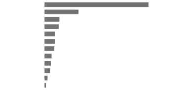

# Oído: Open-Vocabulary Speech Recognition on a \$5 Microcontroller without a Neural Accelerator

Daniel Varela Sánchez    Guillermo Martín-Coello Juárez
Affiliation: Lokutor (Hashing Works, S.L.L.), Madrid, Spain
Email: [contact@lokutor.com](mailto:)

###### Abstract

Speech recognition on low-cost microcontrollers is, in practice, limited
to keyword spotting or a fixed list of commands. We present Oído, an
inference engine that runs open-vocabulary English speech recognition
entirely on an ESP32-S3 (240 MHz dual-core Xtensa LX7, 512 KB of SRAM,
8 MB of PSRAM, 16 MB of flash, no neural accelerator). Oído executes a
13 M-parameter Conformer-CTC model with int8 weights, per-frame dynamic
int8 activations and int8 attention on the chip’s SIMD instructions,
with a schedule designed around flash and PSRAM bandwidth. On
LibriSpeech test-clean/test-other the on-device arithmetic reaches
3.70%/8.23% word error rate (wer), within 0.12 points of full precision,
and 3.33%/7.15% with an on-chip 1.3 M-parameter language model; a
transducer head gives 2.99%/6.67% and an int4 variant fits in 8.3 MB.
This is 2.3–2.8$`\times`$ fewer errors than the vendor’s recognizer on
the same chip, and fewer than Whisper tiny.en and Moonshine tiny in full
precision on a laptop, including in real noise and reverberation.
Measured on a physical board, the firmware runs at 1.97$`\times`$ the
duration of the audio on one core, with transcripts identical to an
instruction-exact emulator: accurate, but not yet real time (a 4 s
command is transcribed about 8.7 s after it ends). The two-core schedule
gives wrong results on silicon and is disabled. A streaming variant
shows partial text while the speaker talks and delivers the final text
4.1–11.1 s after clips of 3.6–10.6 s (7.2–22.4 s in utterance mode) at
4.86%/11.03% wer; a Spanish model makes 34–60% fewer errors than
multilingual Whisper tiny. Code and models are released.

## 1 Introduction

Voice is the natural interface for speakers, appliances, toys, wearables
and vehicles, but most of these devices are built around
microcontrollers that cost a few dollars and cannot run the speech
recognizers used on phones and servers. Today such products either
stream audio to the cloud, paying for inference for the lifetime of
every unit and exposing users’ audio, or they recognize a small, fixed
set of wake words and commands on device \[45\]. Even the most capable
vendor solution for the popular ESP32-S3 accepts only predefined command
lists \[14\].


Figure 1: Oído on the ESP32-S3: pipeline and memory placement. Weights
are streamed from flash or PSRAM once per 64-frame block. The
activations of the current block and the int32 accumulation tiles stay
in on-chip SRAM.

Accurate small speech models do exist. A 10–15 M-parameter
Conformer \[20, 30\] reaches 2.7–3.7% wer on LibriSpeech test-clean,
better than Whisper tiny \[35\], which has three times as many
parameters. The obstacle to running such a model on a microcontroller is
not only its arithmetic. Flash is read through a small cache at tens of
MB/s, and a model of this size occupies most of the flash and more than
all of the on-chip SRAM. In addition, existing microcontroller
runtimes \[10\] target static graphs with small activations, not an
attention model that runs over whole utterances.

This paper shows that such a model fits and runs on a commodity
microcontroller with no neural accelerator, accurately but, so far,
slower than real time. Our contributions:

- •
  An int8 inference engine for Conformer speech recognition on the
  ESP32-S3. It loses 0.02 and 0.12 absolute wer points on LibriSpeech
  test-clean and test-other relative to full precision, without
  retraining (Section 5.1).
- •
  A bandwidth-aware execution schedule: utterance-level row blocking,
  K-split accumulation and a batched front end. It reduces the modelled
  weight traffic from flash and PSRAM by 2.4$`\times`$, and a set of
  kernel optimizations removes 9% of executed instructions
  (Section 5.3).
- •
  On-chip decoding with a recurrent language model, and an RNN-T head
  whose joint network is evaluated for several frames at once while
  remaining exactly equivalent to greedy search (Section 5.4).
- •
  A streaming mode: a Conformer fine-tuned for chunked attention and
  noise-robust, and an engine that caches int8 keys, values and
  convolution state per layer so that only the last partial chunk
  remains when the speaker stops. We measure on silicon what it buys at
  the chip’s present speed (Sections 5.5 and 7.3).
- •
  An evaluation on seven test sets, fourteen noise and reverberation
  conditions, voice-command latency and memory, against laptop-class
  models and the vendor’s on-chip recognizer (Section 7).

The engine, firmware, tools and models are open source.¹¹ 1
[https://github.com/lokutor-ai/oido](https://github.com/lokutor-ai/oido);
models at
[https://huggingface.co/lokutor-ai](https://huggingface.co/lokutor-ai).

## 2 Related Work

#### Small speech recognition models.

Conformer \[20\] combines self-attention with convolution. Its
10.3 M-parameter variant reaches 2.7%/6.3% on LibriSpeech \[32\] with an
RNN-T decoder. Squeezeformer \[25\] and Zipformer \[43\] improve the
accuracy–compute trade-off. Whisper tiny \[35\] (39 M) and Moonshine
tiny \[23\] (27 M) target laptops, phones and single-board computers. We
use NVIDIA’s openly licensed Conformer-CTC Small \[26, 30\], which
reaches 3.7%/8.1% greedy in full precision, and its transducer
counterpart \[29\].

#### Quantization for speech recognition.

Integer-only inference \[22\] is standard for edge deployment. For
Conformers, Ding et al. \[13\] report native 4-bit quantization-aware
training without accuracy loss on LibriSpeech, and Rybakov et al. \[36\]
push to 2 bits (3.1%/7.0% at 10.5 MB, against 2.5%/6.1% in floating
point). Zhen et al. \[46\] study sub-8-bit RNN-T and Conformer models.
These works quantize with training and target accelerators or mobile
CPUs. We show that post-training int8 with per-frame activation scales
is essentially lossless for this architecture, and we use
quantization-aware training only for int4.

#### Machine learning on microcontrollers.

TensorFlow Lite Micro \[10\] and MLPerf Tiny \[5\] established the
tooling and benchmarks for keyword spotting \[45\], visual wake words
and anomaly detection, with models of tens to hundreds of kilobytes. For
speech recognition, Arm has shown a wav2letter model on a Cortex-M55
with an Ethos-U55 neural accelerator \[4, 3\], and an int8 Conformer-S
on the Ethos-U85 accelerator \[40\], simulated on Arm’s Corstone-320
platform and deployed by Alif on an Ensemble E8 board (Cortex-M55 with
Ethos-U85). The latter reports 6.4% wer on test-clean for the
full-precision model. Espressif reports 8.5%/21.3% for its MultiNet7
recognizer on the ESP32-S3 \[14\], which in deployment decodes against a
fixed command list. To our knowledge, no published microcontroller
result, with or without a neural accelerator, reports a lower
LibriSpeech wer.

## 3 Platform

The ESP32-S3 \[16\] integrates two Xtensa LX7 cores at 240 MHz with a
single-precision FPU and the PIE 128-bit SIMD extension. The
instructions we rely on are:

- •
  EE.VMULAS.S8.ACCX, which multiplies two vectors of 16 int8 values and
  adds the 16 products into a 40-bit accumulator, optionally loading the
  next operand in the same instruction;
- •
  EE.VSMULAS.S8.QACC, which multiplies a vector by a broadcast scalar
  into sixteen 20-bit lanes.

Our module (ESP32-S3-WROOM-1-N16R8)²² 2 US\$5.19 in single units and
US\$3.41 in reels at LCSC (part C2913202), September 2026. The module
includes the chip, PSRAM, flash and antenna. has 512 KB of internal
SRAM, 8 MB of octal PSRAM and 16 MB of quad-SPI flash. PSRAM and flash
are accessed through a shared 64 KB data cache (configured size, taken
from internal SRAM) with 64-byte lines. A cache miss to quad-SPI flash
at 80 MHz transfers a line in roughly 2 $`\mu`$s, so sustained streaming
from flash is on the order of 30–40 MB/s, and octal PSRAM is several
times faster.

A 13 M-parameter model therefore has three placement options. At int8 it
does not fit in SRAM at all. It fits in PSRAM only partially, because
PSRAM also has to hold the working buffers. It fits in flash, but flash
is slow to stream. The engine keeps the model in a flash partition
mapped into the address space, copies the most frequently read matrices
to PSRAM, and keeps per-block activations in SRAM.

## 4 Model

Oído runs the architecture of NVIDIA’s Conformer-CTC Small \[30\],
summarized in Table 1. We re-implemented it in PyTorch from the released
weights and matched the reference implementation: features agree to
within $`2\times 10^{-5}`$, and frame-level argmax labels agree exactly
on the test utterances we checked.

|             |                                                                 |
| ----------- | --------------------------------------------------------------- |
| Features    | 80 log-mel, 25 ms window, 10 ms hop                             |
| Subsampling | 2$`\times`$ conv $`3{\times}3`$, stride 2, 176 ch $`\to`$ 25 Hz |
| Encoder     | 16 Conformer blocks, $`d{=}176`$, FF 704                        |
| Attention   | 4 heads, relative position \[9\]                                |
| Convolution | depthwise, kernel 31, BatchNorm                                 |
| Output      | CTC \[19\], 1024 SentencePiece \[27\] + blank                   |
| Parameters  | 13 M (int8: 14.0 MB; int4: 8.3 MB)                              |

Table 1: Model architecture (Conformer-CTC Small).

Processing is utterance-level. A voice activity detector (Section 5.6)
delimits each utterance, and the encoder then runs over all of its
frames with full attention. This matches the model’s training and avoids
the accuracy cost of chunked streaming, at the price of latency: text
appears after the speaker stops (Section 7.6).

## 5 Engine

### 5.1 Quantization

Every linear layer uses symmetric int8 weights with one scale per output
channel, $`W_{q}=\mathrm{round}(W/s_{w})`$ with
$`s_{w}=\max_{k}|W_{nk}|/127`$. Activations are quantized dynamically,
with one scale per frame (row), computed at run time just before each
matrix product:

```math
\displaystyle x_{q}=\mathrm{round}(x/s_{x}),\qquad s_{x}=\tfrac{1}{127}\max_{k}|x_{k}|, \tag{1}
```

```math
\displaystyle y_{n}=s_{x}\,s_{w,n}\textstyle\sum_{k}x_{q,k}W_{q,nk}+b_{n}. \tag{2}
```

Accumulation is exact in int32. The rescaling and bias use fp32.
Per-frame scales matter because activation magnitudes vary strongly
between speech and silence frames; a single static scale per tensor
would waste precision on quiet frames.

Self-attention is also integer. For head $`h`$, the content and position
terms of Transformer-XL-style attention \[9\] are computed as two int8
dot products: $`(q_{i}{+}u)\cdot k_{j}`$ and
$`(q_{i}{+}v)\cdot p_{j-i}`$. Queries (with the bias vectors $`u,v`$
added), keys and projected positions each get per-(frame, head) scales.
After the row maximum is subtracted, the softmax numerators are
multiplied by the per-frame scales of the values $`s_{v,j}`$ and
quantized relative to their row maximum. The value matrix is stored
transposed in int8, so both the scores and the probability–value product
are SIMD dot products, and the normalization by the softmax sum is
applied once per output.

LayerNorm, SiLU, GLU gating and the depthwise convolution (with
BatchNorm folded into its weights) run in fp32 on the FPU. The first
convolution has a single input channel and also stays in fp32. The
second is executed as an int8 GEMM over im2col patches with one scale
per patch. Because the input to that layer is post-ReLU and
non-negative, each patch’s maximum is the maximum over a $`3{\times}3`$
neighbourhood of per-column channel maxima, which the first convolution
tracks as it writes its output. The patch quantization is therefore
fused into the gather, with arithmetic identical to a separate pass.

### 5.2 Kernels

Matrix products use EE.VMULAS.S8.ACCX. For reduction lengths
$`K\leq 256`$ (most layers, $`K{=}176`$) an _x-stationary_ kernel keeps
up to six 16-byte chunks of an activation row in vector registers while
weight rows stream through the load slot of the multiply-accumulate
instruction, which gives 16 MACs per instruction in steady state. For
$`K{=}704`$ a row-streaming kernel is used, and for $`K>1024`$ the
K-split kernel of Section 5.3. The int4 variant unpacks nibbles with
vector masks and uses EE.VSMULAS.S8.QACC as an outer product that
produces 16 outputs per instruction; with int4 weights the 20-bit lanes
cannot overflow for $`K\leq 512`$. The softmax uses a 1/64-step lookup
table for $`e^{-x}`$, whose worst-case relative error (0.8%) is below
the int8 probability step. Work can be split over both cores with a
parallel-for over output channels, heads or frames; in the emulator, 93%
of executed instructions fall in parallel regions. On silicon this mode
currently gives wrong transcripts (Section 8.1), so every measurement in
this paper uses one core.

### 5.3 Bandwidth-aware schedule

Each layer processes the utterance in blocks of 64 frames (2.56 s of
audio). A weight row is loaded once per block and reused for all 64
frames while the block’s int8 activations stay in SRAM. Two cases break
this pattern in a naive implementation.

- •
  Long reductions. Layers with $`K>1024`$ read activations from PSRAM.
  Row-streaming kernels must shrink the block so that the activations
  stay cache-resident, which multiplies weight reads. We instead split
  $`K`$ into chunks of at most 512 and accumulate int32 partial sums for
  16 outputs $`\times`$ 64 frames in SRAM, so every weight byte is
  fetched once per block.
- •
  The front-end convolution. It produces 20 patch rows per output frame.
  We batch three frames per GEMM.

With a simple traffic model (bytes of each weight matrix times reads per
second of audio), these changes reduce weight streaming from about
18 MB/s to 7.5 MB/s, at a cost of 2.9% more executed instructions for
the split accumulation.

Memory is budgeted per utterance:

- •
  The positional-encoding table is quantized to int8 once and shared by
  all layers.
- •
  The attention output buffer aliases the convolution-module buffer,
  since their lifetimes do not overlap.
- •
  Front-end rows are quantized as they are produced.

The PSRAM working-set peak, measured in the emulator, is 1.9 MB for a
15 s utterance and 2.4 MB for 20 s, the maximum utterance length. The
remaining PSRAM holds the most frequently read weights, starting with
the front end.

### 5.4 Decoding

#### CTC.

Greedy decoding takes the per-frame argmax. With a language model, we
run CTC prefix beam search \[21\] (beam 4, top-6 tokens per frame) with
shallow fusion \[24\]: weight 0.3 and a token bonus of 0.5, tuned on
dev-clean. The language model is a GRU \[7\] (embedding 192, hidden 384,
1.3 M parameters, int8 per-row weights) over the same 1024 tokens. We
train two versions. The released one uses only the LibriSpeech
language-model corpus \[32\] of public-domain books. A second one adds
transcripts of our training corpora; it is not released because some of
those transcripts carry share-alike terms. Language-model steps for all
live beams are batched into one matrix product per frame.

#### Transducer.

The same engine runs NVIDIA’s Conformer-Transducer Small \[29, 18\]. The
encoder is architecturally identical; the head adds a 320-unit LSTM
prediction network and a joint network with an output matrix of
$`1025\times 320`$ (328 KB). Greedy transducer search evaluates the
joint network at least once per frame, which would stream that matrix
from memory 25 times per second. Because the prediction state changes
only when a token is emitted, and most frames emit only blank, we
evaluate the joint network for up to $`B{=}8`$ frames at once with the
current prediction state (Figure 2). Rows after the first frame that
emits a token are discarded and recomputed with the updated state. Each
row’s arithmetic is unchanged, so the output is identical to sequential
greedy search. We verified this on the full LibriSpeech test sets: word
errors, substitutions, deletions and insertions are identical.

Input: joint encoder projections $`F_{1..T}`$; prediction state $`g`$
$`t\leftarrow 1`$ while $`t\leq T`$:
$`Z\leftarrow\mathrm{relu}(F_{t..t+B-1}+g)`$;
$`L\leftarrow\mathrm{quant}(Z)\,W_{\mathrm{out}}^{\top}`$ (one pass over
$`W_{\mathrm{out}}`$) $`i\leftarrow`$ first row of $`L`$ whose argmax
$`\neq`$ blank if none: $`t\leftarrow t+B`$; continue  
 emit argmax; update $`g`$ with the LSTM; continue frame $`t{+}i`$
symbol by symbol (at most 5) $`t\leftarrow t+i+1`$

Figure 2: Batched greedy transducer search. It is exactly equivalent to
sequential greedy search, but reads the joint output matrix once per
$`B`$ blank frames instead of once per frame.

#### int4 variant.

For applications that need flash space, we fine-tuned the model with
4-bit quantization-aware training for 8,000 steps. Conformer-block
linear layers use int4 per-channel weights. The front end, output head
and positional projections stay int8, and activations and attention stay
int8, as in the engine. Training used public corpora: Common Voice,
VoxPopuli, LibriSpeech, MLS \[34\], AMI, VCTK \[42\], People’s Speech
with transcripts regenerated by a larger model \[31\], and two small
accent corpora from OpenSLR (Nigerian English, SLR70, and English
accents of the British Isles, SLR83 \[12\]).

### 5.5 Streaming

Utterance mode must wait for the speaker to finish, then run the whole
encoder. To remove that wait we fine-tune the same network for chunked
processing, in the spirit of dynamic-chunk training \[44\] and
cache-based streaming Conformers \[28\], with three changes that keep
the pretrained weights usable. (i) _Chunked attention_: a frame attends
to the frames of its own chunk and of the previous chunks within a left
context; chunk sizes (8–32 frames of 40 ms) and left contexts (unlimited
to 256 frames) are drawn per batch, and full context with probability
0.3, so one model runs in both modes. (ii) _Chunk-limited depthwise
convolution_: the symmetric 31-tap kernel sees any past frame but
nothing after the end of its chunk. Shifting the kernel to be causal
instead needs far more retraining; this keeps the pretrained kernel.
(iii) _Fixed feature normalization_: global per-mel statistics replace
per-utterance statistics, which are unavailable before the utterance
ends, with random gain augmentation. We also train with additive noise,
music and babble from MUSAN \[38\] and simulated room impulse
responses \[37\] (Section 6), which proved necessary: a first model
fine-tuned on clean read speech lost much of the original’s robustness
(Table 5).

The engine runs every $`C`$ encoder frames through all layers with
exactly the training masks. Per layer it caches the int8 keys, per-key
scales and transposed values of the last $`\lceil L/C\rceil`$ chunks
($`L`$ is the left context), the last 15 convolution inputs, and the
positional projections, which depend only on a bounded range of relative
offsets and are computed once. The caches have a fixed size (about 2 MB
at $`C{=}32`$, $`L{=}128`$, kept in PSRAM) whatever the utterance
length, and the transcript does not depend on how the audio is split
into feeds (verified). When the speaker stops, only the last partial
chunk is left.

This has a price in weight traffic. A chunk re-reads every weight, so
traffic grows by $`64/C`$ relative to the 64-frame blocks of utterance
mode (Section 5.3): $`2\times`$ at $`C{=}32`$ and $`4\times`$ at
$`C{=}16`$. At the chip’s present speed this does not show: on the board
the streaming engine runs at 1.96$`\times`$ real time at $`C{=}32`$ on
one core, slightly faster than the same model in utterance mode
(2.04$`\times`$), because instruction issue rather than weight bandwidth
limits a single core (Section 7.5). It may matter once both cores work.
We default to $`C{=}32`$ (1.28 s).

### 5.6 System

Figure 1 shows the complete pipeline. The firmware captures 16 kHz audio
from an I2S MEMS microphone into an 8 s PSRAM ring buffer. A segmenter
applies a slow AGC and an energy voice activity detector against a
tracked noise floor, which falls quickly and rises slowly, with 9/4.8 dB
on/off hysteresis. An utterance ends after 0.8 s of silence or at 20 s.
Each utterance is transcribed while capture continues, and the
transcript is printed and optionally drawn on an I2C OLED display. The
same C code builds for the host with -ffp-contract=off on both targets.
The firmware on the board and in the emulator produce identical
transcripts on all 27 clips we ran, and the activations of the two clips
we traced layer by layer are bit-identical. The host build links a
laptop’s math library, which rounds the last bit of the log-mel features
differently; that changes a word on some hard clips (the host agrees
with the board on 22 of the 27, Section 7.5). All accuracy numbers in
this paper come from the host build.

## 6 Evaluation Methodology

#### Data.

We evaluate on the full LibriSpeech test-clean and test-other sets
(2,620 and 2,939 utterances), and on held-out sets not used for training
any model in this paper:

- •
  Common Voice \[2\]: 1,500 utterances;
- •
  VoxPopuli \[41\]: 1,200;
- •
  AMI individual headset microphones \[6\]: 1,000;
- •
  People’s Speech \[17\]: 1,000, with the corpus’s own, noisy
  references;
- •
  Earnings-22 \[11\]: 4,179 segments.

NVIDIA’s training data includes Common Voice 7.0 and VoxPopuli \[30\],
and Moonshine’s includes Common Voice, AMI and People’s Speech \[23\],
so these models may have seen some of our held-out utterances in
training. Laptop baselines are evaluated on up to 500 evenly spaced
utterances per set. All systems share one segmentation and one text
normalization (lowercasing, punctuation and filler removal), so some
baseline numbers differ from those published by their authors, most
visibly Moonshine tiny on Earnings-22.

#### Robustness.

We mix 300 test-clean utterances with real noise recordings from
DEMAND \[39\] (car, kitchen, living room, cafeteria) at 10 and 5 dB SNR,
and with four-talker babble drawn from dev-clean. We also convolve them
with simulated room impulse responses \[37\]: a
$`5{\times}4{\times}3`$ m room, talker 2 m from the microphone, RT60 of
0.4 and 0.8 s. A far-field condition combines 0.6 s reverberation with
kitchen noise at 10 dB.

#### Speed.

We run the firmware on an ESP32-S3-WROOM-1-N16R8 module on a
DevKitC-1-class board, with ESP-IDF 5.5.1, the CPU at 240 MHz, flash in
QIO mode and octal PSRAM at 80 MHz, on one core (Section 8.1). Clips are
stored in flash and transcribed one after another, each timed with the
64-bit microsecond timer; the real-time factor (RTF) is compute time
divided by audio duration, so it includes the language-model beam search
but not audio capture. (The 32-bit CPU cycle counter wraps every 17.9 s
at 240 MHz and under-reports clips whose compute takes longer.) For the
streaming engine we also feed each clip at the rate of speech and
measure when the final text appears (Section 7.3). In addition we run
the unmodified firmware in Espressif’s QEMU \[15\] with -icount 0, which
advances virtual time by one nanosecond per executed instruction, summed
over both emulated cores, so that the emulated cycle counter reads
exactly 1/25 of the executed instructions. We use it for exact
instruction counts and as a functional reference: its transcripts equal
the board’s, and dividing the board’s cycles by the emulator’s
instructions gives the cycles per instruction of the real chip.

#### Baselines.

Laptop baselines, all in full precision:

- •
  Whisper tiny.en \[35\] (39 M parameters);
- •
  Moonshine tiny \[23\] (27 M);
- •
  Vosk small, a 40 MB Kaldi model for embedded Linux \[33, 1\].

For the ESP32-S3 we quote Espressif’s published MultiNet7
figures \[14\]; its evaluation protocol is not detailed.

## 7 Results

### 7.1 Accuracy and quantization

Table 2 shows that int8 post-training quantization with per-frame
activation scales costs 0.02 (clean) and 0.12 (other) absolute wer
points. The GRU language model reduces LibriSpeech errors by 10–13%
relative. The transducer head brings the on-chip result to 2.99%/6.67%,
in line with NVIDIA’s published full-precision 2.9%/6.6%. Plain int4
post-training quantization degraded accuracy substantially (to
14.1%/22.0% on the full test sets); after quantization-aware
fine-tuning, the int4 model reaches 4.61%/9.98% greedy. On test-clean,
every on-chip configuration makes 1.8–2.8$`\times`$ fewer errors than
MultiNet7, and all int8 configurations make fewer errors than the laptop
baselines.

|                                   |           |       |       |
| --------------------------------- | --------- | ----- | ----- |
| System                            | Size      | clean | other |
| Conformer-CTC S, fp32 (reference) | 52 MB     | 3.68  | 8.11  |
| Oído int8, greedy                 | 14.0 MB   | 3.70  | 8.23  |
| Oído int8 + GRU LM                | 15.3 MB   | 3.33  | 7.15  |
| Oído int4 (QAT), greedy           | 8.3 MB    | 4.61  | 9.98  |
| Oído int4 + GRU LM                | 9.6 MB    | 3.78  | 8.43  |
| Oído Transducer int8, greedy      | 15.5 MB   | 2.99  | 6.67  |
| MultiNet7 (ESP32-S3)^(†)          | 2.7 MB    | 8.5   | 21.3  |
| Whisper tiny.en (laptop)          | 39 M par. | 6.26  | 15.93 |
| Moonshine tiny (laptop)           | 27 M par. | 5.00  | 12.13 |
| Vosk small (laptop)               | 40 MB     | 9.95  | 21.61 |

Table 2: LibriSpeech wer (%). “Chip” rows use the on-device engine,
compiled for the host (same int8 arithmetic; on the board a few hard
clips differ in a word, Section 7.5). Laptop rows are full precision on
500-utterance subsets. ^(†)wer published by the vendor; size of the
model files in ESP-SR.

Table 3 extends the comparison to other domains. The on-chip int8 models
make fewer errors than all laptop baselines on Common Voice, VoxPopuli
and AMI. On Earnings-22 they trail Whisper tiny.en slightly (20.8–22.4%
vs 20.3%). Conversational meeting speech (AMI) and earnings calls remain
hard for all models of this size.

The language model’s domain matters. The book-only model improves
LibriSpeech, Common Voice and Earnings-22, leaves VoxPopuli unchanged,
and slightly _hurts_ AMI and People’s Speech relative to greedy
decoding. The model that also saw speech transcripts helps on every set.
For conversational products, the language model should be trained on
conversational text.

|                                          |      |      |      |      |      |
| ---------------------------------------- | ---- | ---- | ---- | ---- | ---- |
| System                                   | CV   | Vox  | AMI  | PS   | E22  |
| _Oído, host build of the on-chip engine_ |      |      |      |      |      |
| int8, greedy                             | 11.4 | 9.3  | 20.2 | 11.6 | 22.4 |
| int8 + LM (books)                        | 10.4 | 9.2  | 20.4 | 12.2 | 21.6 |
| int8 + LM (books + transcripts)          | 10.1 | 9.0  | 19.0 | 11.0 | 20.8 |
| int4 + LM (books)                        | 11.8 | 11.1 | 20.2 | 10.7 | 21.1 |
| Transducer int8                          | 9.6  | 8.2  | 19.2 | 11.6 | 21.0 |
| _Laptop baselines (fp32)_                |      |      |      |      |      |
| Whisper tiny.en                          | 19.7 | 13.5 | 21.5 | 14.3 | 20.3 |
| Moonshine tiny                           | 17.5 | 13.4 | 24.2 | 8.1  | 32.4 |
| Vosk small                               | 27.1 | 20.6 | 34.1 | 12.9 | 38.0 |

Table 3: wer (%) on held-out sets. CV: Common Voice; Vox: VoxPopuli; PS:
People’s Speech (noisy references); E22: Earnings-22. “Books”: LM
trained on public-domain books only (released).

### 7.2 Robustness

Table 4 reports wer under noise and reverberation. Car noise at 5 dB SNR
costs the on-chip models less than 0.3 points, kitchen and living-room
noise at 5 dB roughly 1–2 points, and cafeteria noise, which contains
competing speech, 4.7–6.0 points. Averaged over the 14 conditions, the
on-chip int8 models make 31–45% fewer errors than Whisper tiny.en and
Moonshine tiny. The most difficult conditions are four-talker babble at
5 dB, strong reverberation and far-field use; at those distances,
microphone arrays with beamforming would help more than a different
recognizer.

| Condition            | T    | C    | C+LM | M    | W    | V    |
| -------------------- | ---- | ---- | ---- | ---- | ---- | ---- |
| Clean                | 2.5  | 3.5  | 3.3  | 4.3  | 5.6  | 9.1  |
| Car, 10 dB           | 2.6  | 3.6  | 3.3  | 4.3  | 5.8  | 9.1  |
| Car, 5 dB            | 2.7  | 3.6  | 3.2  | 4.4  | 5.9  | 9.3  |
| Kitchen, 10 dB       | 3.0  | 4.0  | 3.6  | 5.1  | 6.6  | 10.7 |
| Kitchen, 5 dB        | 3.3  | 4.7  | 4.2  | 6.1  | 7.5  | 12.4 |
| Living room, 10 dB   | 3.2  | 4.4  | 4.0  | 5.8  | 6.7  | 11.5 |
| Living room, 5 dB    | 4.2  | 5.7  | 4.8  | 7.0  | 7.9  | 15.1 |
| Cafeteria, 10 dB     | 3.9  | 5.3  | 4.9  | 7.3  | 8.3  | 14.4 |
| Cafeteria, 5 dB      | 7.2  | 9.5  | 8.6  | 12.2 | 12.3 | 24.7 |
| Babble, 10 dB        | 8.4  | 10.9 | 9.7  | 14.1 | 14.5 | 36.7 |
| Babble, 5 dB         | 25.9 | 27.6 | 24.7 | 37.3 | 35.9 | 70.9 |
| Reverb, RT60 0.4 s   | 4.6  | 5.8  | 4.9  | 9.8  | 10.2 | 15.3 |
| Reverb, RT60 0.8 s   | 12.4 | 16.0 | 14.1 | 28.6 | 22.5 | 33.6 |
| Far-field kitchen    | 10.4 | 13.5 | 11.4 | 24.3 | 19.8 | 30.4 |
| Mean (14 conditions) | 6.7  | 8.4  | 7.5  | 12.2 | 12.1 | 21.7 |

Table 4: wer (%) on 300 test-clean utterances under real noise (DEMAND),
babble and simulated reverberation. T: Oído Transducer int8; C: Oído CTC
int8 greedy; C+LM: with GRU LM; M: Moonshine tiny; W: Whisper tiny.en;
V: Vosk small.

### 7.3 Streaming

Table 5 compares the modes of one streaming-trained model with the
utterance-mode model. Chunking costs accuracy, because the encoder
cannot see what follows the chunk: with the language model, $`C{=}32`$
reaches 4.86%/11.03% on LibriSpeech test-clean/test-other against
3.33%/7.15% in utterance mode, and $`C{=}16`$ is worse still
(6.14%/13.23%). The streaming model is still more accurate than the
vendor’s recognizer (8.5%/21.3%) and than Whisper tiny.en (6.3%/15.9%)
on a laptop. Its full-context mode (3.43%/7.78%) loses about 0.1–0.3
points to the original, the price of noise-robust fine-tuning on read
speech.

Noise augmentation matters more than anything else we tried. Averaged
over the 14 conditions of Table 4, the first streaming model, fine-tuned
on clean speech with fixed normalization, scored 8.9% in full-context
mode and 12.0% with $`C{=}32`$ (both with the language model), worse
than the original model’s 7.5%. After adding MUSAN noise, music, babble
and simulated reverberation (8,000 further steps), the numbers fall to
6.2% and 9.0%: the streaming model is _more_ robust than the original
and, at $`C{=}32`$, about as robust as Whisper tiny.en (12.1%) is
accurate.

| Mode                          | clean | other | robust. | final text^(‡) |
| ----------------------------- | ----- | ----- | ------- | -------------- |
| Utterance mode (original)     | 3.33  | 7.15  | 7.5     | 6.9–21.3 s     |
| Streaming, $`C{=}32`$, greedy | 6.27  | 13.06 | –       | –              |
| Streaming, $`C{=}32`$         | 4.86  | 11.03 | 9.0     | 4.1–11.1 s     |
| Streaming, $`C{=}16`$         | 6.14  | 13.23 | –       | –              |
| Same model, full context      | 3.43  | 7.78  | 6.2     | 7.2–22.4 s     |

Table 5: One streaming-trained model on the ESP32-S3 engine (int8, with
the language model unless stated), against the original utterance-mode
model. Robust.: mean wer over the 14 conditions of Table 4. ^(‡)Measured
on the board, one core, six clips of 3.6–10.6 s: time from the last
sample of the clip to the final text, with the streaming rows fed at the
rate of speech and the utterance rows compute only. The 0.8 s
end-of-speech wait comes on top.

#### Latency.

Two numbers matter. When the chip has kept up with the audio, only the
last partial chunk is left, and the final step takes 1.1 s on average on
the board (0.8–1.6 s over 12 clips); in the emulator its instruction
count is well described by $`17\,\mathrm{M}+5.5\,\mathrm{M}\times`$
(remaining encoder frames), summed over both cores. But the chip does
not keep up: at 1.96$`\times`$ real time the backlog grows with the
utterance. We therefore also fed six clips at the rate of speech, one
20 ms block when its last sample would have been spoken, and measured
when the final text appears after the last sample: 4.1–11.1 s (mean
6.7 s) for clips of 3.6–10.6 s, against 7.2–22.4 s for the same clips in
utterance mode (the 0.8 s end-of-speech wait comes on top of both). The
delay grows with the length of the utterance, roughly as
$`(\mathrm{RTF}-1)\,T`$ plus the final step. Streaming roughly halves
the wait but does not give the 1.1–1.4 s we had estimated from
instruction counts; that needs a real-time factor below one.

### 7.4 Spanish

The engine is language-agnostic: a new language needs a new 1024-piece
vocabulary, a re-initialized CTC head and fine-tuning of the whole
network from the English weights. We trained a Spanish model on 2,492 h
of Common Voice, VoxPopuli, MLS and FLEURS \[8\] (all CC0 or CC-BY),
including 1,029 h of Common Voice’s unvalidated clips kept only where
NVIDIA’s large Spanish Conformer \[30\] agrees with the reference within
15% wer, with the noise and reverberation augmentation of Section 5.5,
and a Spanish GRU language model trained on public-domain books, Common
Voice sentences and VoxPopuli transcripts with all development and test
sentences removed. The model needs no engine change; the language model
stores its own beam-search weights.

Table 6 compares it with multilingual Whisper tiny on the same
utterances (400 evenly spaced per set, 333 for FLEURS after dropping
references with digits; same normalization, numerals in Whisper’s output
spelled out). With the language model it makes 34–60% fewer errors on
all four sets, and streaming at $`C{=}32`$ costs about 2 points. The
comparison favors our model on these domains, since we trained on the
training splits of the corpora and Whisper is zero-shot, and we have no
Spanish noise benchmark. On the complete test sets (60 h) the numbers
are 13.75/10.90/15.68/11.32% with the language model. The language-model
weights were chosen from a small grid on subsets of the test sets, on a
flat optimum (all settings within 0.2 points of each other).

| System                         | CV   | MLS  | Vox  | FLEURS |
| ------------------------------ | ---- | ---- | ---- | ------ |
| Oído + LM (host build)         | 13.3 | 10.6 | 15.5 | 11.3   |
| Oído greedy                    | 20.3 | 14.2 | 20.0 | 16.9   |
| Oído streaming $`C{=}32`$ + LM | 15.2 | 12.1 | 16.3 | 12.8   |
| Whisper tiny (laptop)          | 33.0 | 21.5 | 28.7 | 17.1   |

Table 6: Spanish wer (%) on 400-utterance subsets (Common Voice 17, MLS,
VoxPopuli, FLEURS es_419).

### 7.5 Speed and memory on the board

Table 7 gives the measured real-time factor. With one core, the int8 CTC
model with the language model runs at 1.97$`\times`$ real time on 27
clips of 3.6–10.6 s (1.91–2.02), the int4 model at 1.76, the transducer
at 1.89 and the Spanish model at 2.06. The RTF barely depends on the
clip, so compute time is proportional to the length of the audio.
Figure 3 shows the executed instructions per second of audio in the
emulator, measured on 39.7 s of test-other speech: 220 M across both
cores, 46% of them in matrix products and 15% in attention. The board
spends 461 M cycles per second of audio, 2.0 cycles per executed
instruction; Table 8 shows that every stage costs between 1.3 and 2.4
cycles per instruction except the im2col gather (3.7). The time is thus
spread evenly rather than concentrated in a memory-bound stage, and on
one core the cost is set by how many instructions the kernels issue, not
by waiting for weights. Beam search with the language model takes 8.7%
of the cycles. If both cores were perfectly parallel, the 55% of
instructions on the critical path would give an RTF of about 1.1; this
is a projection, and the one build we could time with both cores ran at
0.78 times the one-core time (Section 8.1).

| Model                     | clips | RTF  | range     | = host |
| ------------------------- | ----- | ---- | --------- | ------ |
| CTC int8 (released)       | 27    | 1.97 | 1.91–2.02 | 22/27  |
| CTC int4                  | 10    | 1.76 | 1.73–1.83 | 8/10   |
| Transducer int8, no LM    | 10    | 1.89 | 1.88–1.91 | 10/10  |
| Stream. model, utterance  | 12    | 2.04 | 1.98–2.11 | 12/12  |
| Stream. model, $`C{=}32`$ | 12    | 1.96 | –         | 10/12  |
| Spanish, utterance        | 12    | 2.06 | 1.98–2.13 | 9/12   |
| Spanish, $`C{=}32`$       | 12    | 1.97 | –         | –      |

Table 7: Measured on the board, one core, 240 MHz, with the language
model unless noted. RTF: compute time divided by audio duration (mean,
and range over clips). “= host”: clips whose transcript equals the host
build’s. The firmware’s transcripts equal the emulator’s on all 27 clips
of the first row. Clips: 214.8 s of audio in the first row, 59–103 s in
the others.

| Stage                      | Minstr/s | Mcyc/s | cyc/instr |
| -------------------------- | -------- | ------ | --------- |
| log-mel                    | 10       | 14     | 1.48      |
| conv0                      | 14       | 20     | 1.45      |
| im2col                     | 6        | 20     | 3.66      |
| matrix products            | 103      | 216    | 2.09      |
| layernorm                  | 7        | 15     | 2.07      |
| activation quant           | 15       | 32     | 2.16      |
| SiLU / GLU                 | 11       | 25     | 2.35      |
| q/k/v int8                 | 6        | 13     | 2.04      |
| pos. enc.                  | 3        | 6      | 2.03      |
| attention                  | 34       | 44     | 1.30      |
| depthwise conv             | 10       | 15     | 1.40      |
| head + beam search with LM | 21       | 40     | 1.90      |

Table 8: Cycles on the board against instructions in the emulator, per
second of audio (int8 CTC model, 27 clips on the board, 39.7 s of speech
in the emulator).



Figure 3: Executed instructions per second of audio, by stage, for the
int8 CTC model (both cores, exact counts from instruction-counting
emulation).

Table 9 lists the engine optimizations and their effect on executed
instructions. The bandwidth-aware tiling deliberately increases
instructions, by 2.9%, to cut weight traffic 2.4$`\times`$. Its benefit
is invisible to an instruction-counting emulator, and we did not measure
it on silicon (that needs a build without the tiling).

| Step                                     | G instr. | $`\Delta`$ |
| ---------------------------------------- | -------- | ---------- |
| Baseline int8 engine                     | 9.82     | –          |
| + merged attention score pass            | 9.63     | $`-`$1.9%  |
| + x-stationary GEMM for $`K{\leq}256`$   | 9.39     | $`-`$2.5%  |
| + K-split, batched front end^(†)         | 9.66     | +2.9%      |
| + int8 positional table, buffer aliasing | 9.58     | $`-`$0.8%  |
| + fused im2col quantization              | 9.29     | $`-`$3.0%  |
| + softmax lookup table                   | 8.99     | $`-`$3.2%  |
| + two-frame depthwise convolution        | 8.95     | $`-`$0.4%  |
| Total                                    |          | $`-`$8.9%  |

Table 9: Engine optimizations: executed instructions for 39.7 s of audio
(int8 CTC, greedy), cumulative. ^(†)Adds instructions but cuts weight
traffic from flash from 18 to 7.5 MB/s.

Flash holds 14.0 MB (int8), 8.3 MB (int4) or 15.5 MB (transducer), plus
1.3 MB for the optional language model. With int4, a 16 MB module leaves
a 6 MB partition for application code. At the maximum utterance length
the PSRAM working set is 2.4 MB (emulator), and on the board at least
125 KB of internal SRAM stays free for the rest of the system (72 KB
with the streaming caches).

### 7.6 Latency

Table 10 gives the time from the last sample of a short voice command to
its text, in each mode. In utterance mode it is the compute time, which
scales with the length of the clip at the measured RTF; the 0.8 s
end-of-speech wait comes on top. The streaming rows come from the run
fed at the rate of speech (Section 7.3). At present, a 3.7 s command
takes about 7 s in utterance mode and 4 s in streaming mode, and neither
is conversational.

| Profile                               | RTF  | text after clip |
| ------------------------------------- | ---- | --------------- |
| CTC int8 + LM, utterance mode         | 1.97 | 6.9–7.4 s       |
| CTC int4 + LM, utterance mode         | 1.76 | 6.2–6.7 s       |
| Transducer int8, utterance mode       | 1.89 | 7.0 s^(†)       |
| Streaming model, utterance mode       | 2.04 | 7.2–7.6 s       |
| Streaming model, streaming $`C{=}32`$ | 1.96 | 4.1–4.2 s       |

Table 10: Time from the last sample of a 3.6–3.8 s command to its text,
measured on the board (one core). ^(†)Computed from the measured RTF
(this model was not run on a clip of that length).

## 8 Discussion and Limitations

#### Where the accuracy comes from.

The acoustic models are NVIDIA’s, trained on NeMo ASRSET, a composite of
public English corpora that NVIDIA’s model cards put at about 16,000
hours \[30\]. Our contribution is to run them on a microcontroller
without an accelerator and with almost no loss: per-frame dynamic
quantization keeps int8 essentially lossless without retraining, and
whole-utterance, block-wise execution lets a 14 MB model run from flash.
We designed the schedule around memory traffic, amortizing every weight
fetch over 64 frames. The board shows, however, that once the model fits
and runs, the remaining cost on one core is instruction issue: about two
cycles for each instruction in every stage, with the matrix kernels
spending most of their instructions on loads, accumulator reads and loop
overhead rather than on multiply-accumulates. Faster kernels, and the
second core, are where the next factor of two lies.

### 8.1 The two-core mode

In the emulator the two-core schedule is correct, and its instruction
counts suggested a real-time factor of 0.7–0.95. On the board, at
240 MHz, it gives wrong transcripts and sometimes crashes. We traced it
with a hash of every layer’s output on one 3.8 s clip (each
configuration was run three times). One core is exactly reproducible:
all 166 hashes are identical in every run and identical to the
emulator’s. With two cores the activations are corrupted at random
places, always first in layer 1 or 2 and almost always in the
feed-forward block of layer 1, and in roughly one run in eight the
firmware crashes with an IllegalInstruction exception and a corrupted
backtrace, which suggests corrupted instruction or data fetches rather
than a logic error. Two cores at 160 MHz are correct (166 of 166 hashes
identical, in all three runs), but no faster than one core at 240 MHz.

Parallelizing every part of the model except the matrix products is
correct, and parallelizing only the matrix products fails. Among them,
the $`K{=}176`$ products and the $`K{=}3520`$ front-end products are
correct on two cores, and the $`K{=}704`$ products (the second linear
layer of each feed-forward block), which move the most weight data per
cycle, corrupt. Neither PSRAM speed (80 to 40 MHz), data-cache line size
(64 to 32 B), the location of the weights (flash or PSRAM), FreeRTOS
semaphores (a spin-wait barrier behaves the same), interrupts (masked
while a job runs), the location or sharing of the activation tile,
instruction fetch (kernel in IRAM, or a separate copy per core), nor the
split itself (by rows instead of by output channels) removes the errors.
We do not know the cause. A hardware margin problem at 240 MHz (supply
droop or timing) fits the 160 MHz result, the random values and the
crashes, but an unrelated engine of ours (a text-to-speech engine, not
described here) running a synthetic two-core stress of the same shape on
the same board at 240 MHz (K$`{=}704`$, 64 rows, a shared 45 KB tile in
internal SRAM, an 88/88 split, $`3\times 90`$ s, plus other shapes,
about 21 minutes in all, every call checked against a one-core
reference) saw no mismatch and no crash, and its real firmware passed a
600-iteration soak. A plain supply problem on this board therefore looks
unlikely; something specific to our kernel, to how the two cores are
started and joined, or to streaming weights from external memory in
lock-step is more likely, and we have not found it. Even a correct
two-core mode would not reach real time on this evidence: the incorrect
spin-wait build ran at 0.78 times the one-core time, not the 0.55 that
the instruction counts promised, because the cores contend for memory.

### 8.2 Limitations

- •
  Not real time yet. On one core the recognizer runs at about twice real
  time (1.97$`\times`$): the text of a 4 s command appears about 8.7 s
  after it ends in utterance mode (including the 0.8 s end-of-speech
  wait) and about 5 s after it in streaming mode. The two-core mode that
  would roughly halve this is not correct on silicon (Section 8.1).
- •
  Streaming costs accuracy and, at this speed, buys a factor of two in
  latency, not more. Chunked processing loses about 1.5 points on
  test-clean against utterance mode, and the final text still arrives
  roughly $`(\mathrm{RTF}-1)\,T`$ after an utterance of length $`T`$.
- •
  Small board study. We measured one board. The RTF figures cover 27
  clips (CTC int8) and 10–12 clips for the other models, all of at most
  10.6 s; the 2.4 MB PSRAM peak for a 20 s utterance comes from the
  emulator. Accuracy numbers come from the host build; the board’s
  transcripts equal the emulator’s, and the host differs from them on
  some hard clips (22 of 27 identical), most visibly for Spanish (the
  board scores 9.3% against 7.3% for the host build on 12 clips, 205
  words).
- •
  Two languages. English and Spanish; other languages need a new
  vocabulary and fine-tuning.
- •
  Transducer license. The transducer weights are distributed under
  NVIDIA’s NGC terms and are not redistributed with our release.
- •
  Comparisons. The laptop baselines use 500-utterance subsets, and
  MultiNet7 numbers are vendor-reported.
- •
  Framework comparison. We did not compare against TensorFlow Lite Micro
  or ESP-DL deployments of the same model.

## 9 Conclusion

Oído runs open-vocabulary English speech recognition entirely on a \$5
microcontroller with no neural accelerator, at 3.70%/8.23% LibriSpeech
wer (2.99%/6.67% with a transducer head). That is within 0.12 points of
full precision and more accurate than full-precision laptop models of
two to three times the size. On the board it runs at about twice real
time on one core, so today it suits short commands where several seconds
of delay are acceptable, not live transcription or conversation. A
streaming variant roughly halves the wait after the speaker stops, at a
cost in accuracy, and the two-core mode, which is not yet correct on
silicon, and faster kernels are the open routes to real time. We release
the engine, firmware, models and the board measurements so that others
can build on them and check them. The code is licensed under GPLv3; the
models are CC-BY-4.0 (int8 and Spanish) or CC-BY-SA-4.0 (int4 and
streaming), as derivatives of NVIDIA’s CC-BY-4.0 model.

## Acknowledgments

We thank NVIDIA for releasing the NeMo Conformer models under open
terms, and the creators of the datasets used for evaluation. Parts of
the engine code, the experiment scripts and this manuscript were drafted
with the help of an AI assistant (Claude, Anthropic). The authors
directed the work, checked the results and the text, and take full
responsibility for the content.

## References

- \[1\] Alpha Cephei. Vosk speech recognition toolkit:
  vosk-model-small-en-us-0.15.
  [https://alphacephei.com/vosk/models](https://alphacephei.com/vosk/models), 2020.
  Accessed September 2026.
- \[2\] Rosana Ardila, Megan Branson, Kelly Davis, Michael Kohler, Josh
  Meyer, Michael Henretty, Reuben Morais, Lindsay Saunders, Francis
  Tyers, and Gregor Weber. Common voice: A massively-multilingual speech
  corpus. In _Proc. LREC_, 2020.
- \[3\] Arm. ML embedded evaluation kit: Automatic speech recognition
  use case.
  [https://gitlab.arm.com/artificial-intelligence/ethos-u/ml-embedded-evaluation-kit](https://gitlab.arm.com/artificial-intelligence/ethos-u/ml-embedded-evaluation-kit),
  2026a. Accessed September 2026.
- \[4\] Arm. Arm ML-Zoo: Wav2letter.
  [https://github.com/Arm-Examples/ML-zoo/tree/master/models/speech_recognition/wav2letter](https://github.com/Arm-Examples/ML-zoo/tree/master/models/speech_recognition/wav2letter),
  2026b. Accessed September 2026.
- \[5\] Colby Banbury, Vijay Janapa Reddi, Peter Torelli, Jeremy
  Holleman, Nat Jeffries, Csaba Kiraly, Pietro Montino, David Kanter,
  Sebastian Ahmed, Danilo Pau, et al. MLPerf Tiny benchmark. In _Proc.
  NeurIPS Datasets and Benchmarks Track_, 2021.
- \[6\] Jean Carletta et al. The AMI meeting corpus: A pre-announcement.
  In _Machine Learning for Multimodal Interaction (MLMI 2005)_, volume
  3869 of _Lecture Notes in Computer Science_, pages 28–39.
  Springer, 2006. doi: 10.1007/11677482_3.
- \[7\] Kyunghyun Cho, Bart van Merriënboer, Caglar Gulcehre, Dzmitry
  Bahdanau, Fethi Bougares, Holger Schwenk, and Yoshua Bengio. Learning
  phrase representations using RNN encoder-decoder for statistical
  machine translation. In _Proc. EMNLP_, 2014.
- \[8\] Alexis Conneau, Min Ma, Simran Khanuja, Yu Zhang, Vera Axelrod,
  Siddharth Dalmia, Jason Riesa, Clara Rivera, and Ankur Bapna. FLEURS:
  Few-shot learning evaluation of universal representations of speech.
  In _Proc. IEEE SLT_, 2022.
- \[9\] Zihang Dai, Zhilin Yang, Yiming Yang, Jaime Carbonell, Quoc V.
  Le, and Ruslan Salakhutdinov. Transformer-XL: Attentive language
  models beyond a fixed-length context. In _Proc. ACL_, 2019.
- \[10\] Robert David, Jared Duke, Advait Jain, Vijay Janapa Reddi, Nat
  Jeffries, Jian Li, Nick Kreeger, Ian Nappier, Meghna Natraj, Shlomi
  Regev, Rocky Rhodes, Tiezhen Wang, and Pete Warden. TensorFlow Lite
  Micro: Embedded machine learning for TinyML systems. In _Proc.
  MLSys_, 2021.
- \[11\] Miguel Del Rio, Peter Ha, Quinten McNamara, Corey Miller, and
  Shipra Chandra. Earnings-22: A practical benchmark for accents in the
  wild. _arXiv preprint arXiv:2203.15591_, 2022.
- \[12\] Isin Demirsahin, Oddur Kjartansson, Alexander Gutkin, and Clara
  Rivera. Open-source multi-speaker corpora of the English accents in
  the British isles. In _Proc. LREC_, pages 6532–6541, 2020.
- \[13\] Shaojin Ding, Phoenix Meadowlark, Yanzhang He, Lukasz Lew,
  Shivani Agrawal, and Oleg Rybakov. 4-bit conformer with native
  quantization aware training for speech recognition. In _Proc.
  Interspeech_, 2022.
- \[14\] Espressif Systems. ESP-SR benchmark (ESP32-S3).
  [https://docs.espressif.com/projects/esp-sr/en/latest/esp32s3/benchmark/README.html](https://docs.espressif.com/projects/esp-sr/en/latest/esp32s3/benchmark/README.html),
  2026a. Accessed September 2026.
- \[15\] Espressif Systems. Espressif QEMU.
  [https://github.com/espressif/qemu](https://github.com/espressif/qemu),
  2026b. Release esp_develop_9.2.2_20260417. Accessed September 2026.
- \[16\] Espressif Systems. ESP32-S3 technical reference manual.
  [https://documentation.espressif.com/esp32-s3_technical_reference_manual_en.pdf](https://documentation.espressif.com/esp32-s3_technical_reference_manual_en.pdf),
  2026c. Version 1.8. Accessed September 2026.
- \[17\] Daniel Galvez, Greg Diamos, Juan Ciro, Juan Felipe Cerón, Keith
  Achorn, Anjali Gopi, David Kanter, Maximilian Lam, Mark Mazumder, and
  Vijay Janapa Reddi. The people’s speech: A large-scale diverse English
  speech recognition dataset for commercial usage. In _Proc. NeurIPS
  Datasets and Benchmarks Track_, 2021.
- \[18\] Alex Graves. Sequence transduction with recurrent neural
  networks. _arXiv preprint arXiv:1211.3711_, 2012.
- \[19\] Alex Graves, Santiago Fernández, Faustino Gomez, and Jürgen
  Schmidhuber. Connectionist temporal classification: Labelling
  unsegmented sequence data with recurrent neural networks. In _Proc.
  ICML_, 2006.
- \[20\] Anmol Gulati, James Qin, Chung-Cheng Chiu, Niki Parmar,
  Yu Zhang, Jiahui Yu, Wei Han, Shibo Wang, Zhengdong Zhang, Yonghui Wu,
  and Ruoming Pang. Conformer: Convolution-augmented transformer for
  speech recognition. In _Proc. Interspeech_, 2020.
- \[21\] Awni Y. Hannun, Andrew L. Maas, Daniel Jurafsky, and Andrew Y.
  Ng. First-pass large vocabulary continuous speech recognition using
  bi-directional recurrent DNNs. _arXiv preprint arXiv:1408.2873_, 2014.
- \[22\] Benoit Jacob, Skirmantas Kligys, Bo Chen, Menglong Zhu, Matthew
  Tang, Andrew Howard, Hartwig Adam, and Dmitry Kalenichenko.
  Quantization and training of neural networks for efficient
  integer-arithmetic-only inference. In _Proc. CVPR_, 2018.
- \[23\] Nat Jeffries, Evan King, Manjunath Kudlur, Guy Nicholson, James
  Wang, and Pete Warden. Moonshine: Speech recognition for live
  transcription and voice commands. _arXiv preprint
  arXiv:2410.15608_, 2024.
- \[24\] Anjuli Kannan, Yonghui Wu, Patrick Nguyen, Tara N. Sainath,
  Zhifeng Chen, and Rohit Prabhavalkar. An analysis of incorporating an
  external language model into a sequence-to-sequence model. In _Proc.
  ICASSP_, 2018.
- \[25\] Sehoon Kim, Amir Gholami, Albert Shaw, Nicholas Lee, Karttikeya
  Mangalam, Jitendra Malik, Michael W. Mahoney, and Kurt Keutzer.
  Squeezeformer: An efficient transformer for automatic speech
  recognition. In _Proc. NeurIPS_, 2022.
- \[26\] Oleksii Kuchaiev, Jason Li, Huyen Nguyen, Oleksii Hrinchuk,
  Ryan Leary, Boris Ginsburg, Samuel Kriman, Stanislav Beliaev, Vitaly
  Lavrukhin, Jack Cook, Patrice Castonguay, Mariya Popova, Jocelyn
  Huang, and Jonathan M. Cohen. NeMo: a toolkit for building AI
  applications using neural modules. _arXiv preprint
  arXiv:1909.09577_, 2019.
- \[27\] Taku Kudo and John Richardson. SentencePiece: A simple and
  language independent subword tokenizer and detokenizer for neural text
  processing. In _Proc. EMNLP: System Demonstrations_, 2018.
- \[28\] Vahid Noroozi, Somshubra Majumdar, Ankur Kumar, Jagadeesh
  Balam, and Boris Ginsburg. Stateful Conformer with cache-based
  inference for streaming automatic speech recognition. In _Proc.
  ICASSP_, 2024.
- \[29\] NVIDIA. STT en conformer-transducer small, version 1.6.0.
  [https://catalog.ngc.nvidia.com/orgs/nvidia/teams/nemo/models/stt_en_conformer_transducer_small](https://catalog.ngc.nvidia.com/orgs/nvidia/teams/nemo/models/stt_en_conformer_transducer_small), 2022.
  Accessed September 2026.
- \[30\] NVIDIA. NVIDIA Conformer-CTC small (en-US).
  [https://huggingface.co/nvidia/stt_en_conformer_ctc_small](https://huggingface.co/nvidia/stt_en_conformer_ctc_small), 2023.
  CC-BY-4.0. Accessed September 2026.
- \[31\] NVIDIA. parakeet-tdt-0.6b-v2.
  [https://huggingface.co/nvidia/parakeet-tdt-0.6b-v2](https://huggingface.co/nvidia/parakeet-tdt-0.6b-v2), 2025.
  CC-BY-4.0. Accessed September 2026.
- \[32\] Vassil Panayotov, Guoguo Chen, Daniel Povey, and Sanjeev
  Khudanpur. Librispeech: An ASR corpus based on public domain audio
  books. In _Proc. ICASSP_, 2015.
- \[33\] Daniel Povey, Arnab Ghoshal, Gilles Boulianne, Lukas Burget,
  Ondrej Glembek, Nagendra Goel, Mirko Hannemann, Petr Motlicek, Yanmin
  Qian, Petr Schwarz, Jan Silovsky, Georg Stemmer, and Karel Vesely. The
  Kaldi speech recognition toolkit. In _Proc. IEEE ASRU_, 2011.
- \[34\] Vineel Pratap, Qiantong Xu, Anuroop Sriram, Gabriel Synnaeve,
  and Ronan Collobert. MLS: A large-scale multilingual dataset for
  speech research. In _Proc. Interspeech_, 2020.
- \[35\] Alec Radford, Jong Wook Kim, Tao Xu, Greg Brockman, Christine
  McLeavey, and Ilya Sutskever. Robust speech recognition via
  large-scale weak supervision. In _Proc. ICML_, 2023.
- \[36\] Oleg Rybakov, Phoenix Meadowlark, Shaojin Ding, David Qiu, Jian
  Li, David Rim, and Yanzhang He. 2-bit conformer quantization for
  automatic speech recognition. In _Proc. Interspeech_, 2023.
- \[37\] Robin Scheibler, Eric Bezzam, and Ivan Dokmanić.
  Pyroomacoustics: A python package for audio room simulation and array
  processing algorithms. In _Proc. ICASSP_, pages 351–355, 2018. doi:
  10.1109/ICASSP.2018.8461310.
- \[38\] David Snyder, Guoguo Chen, and Daniel Povey. MUSAN: A music,
  speech, and noise corpus. _arXiv preprint arXiv:1510.08484_, 2015.
- \[39\] Joachim Thiemann, Nobutaka Ito, and Emmanuel Vincent. The
  diverse environments multi-channel acoustic noise database (DEMAND): A
  database of multichannel environmental noise recordings. In _Proc.
  Meetings on Acoustics_, volume 19, page 035081, 2013. doi:
  10.1121/1.4799597.
- \[40\] Alexey Vilkin, Alex Tawse, Kshitij Sisodia, and George Gekov.
  End-to-end int8 Conformer on Arm: Training, quantization, and
  deployment on Ethos-U85.
  [https://developer.arm.com/community/arm-community-blogs/b/internet-of-things-blog/posts/end-to-end-int8-conformer-on-arm-training-quantization-and-deployment-on-ethos-u85](https://developer.arm.com/community/arm-community-blogs/b/internet-of-things-blog/posts/end-to-end-int8-conformer-on-arm-training-quantization-and-deployment-on-ethos-u85), 2026.
  Arm Community blog, 21 January 2026. Accessed September 2026.
- \[41\] Changhan Wang, Morgane Riviere, Ann Lee, Anne Wu, Chaitanya
  Talnikar, Daniel Haziza, Mary Williamson, Juan Pino, and Emmanuel
  Dupoux. VoxPopuli: A large-scale multilingual speech corpus for
  representation learning, semi-supervised learning and interpretation.
  In _Proc. ACL_, 2021.
- \[42\] Junichi Yamagishi, Christophe Veaux, and Kirsten MacDonald.
  CSTR VCTK corpus: English multi-speaker corpus for CSTR voice cloning
  toolkit (version 0.92). University of Edinburgh, The Centre for Speech
  Technology Research (CSTR), 2019.
- \[43\] Zengwei Yao, Liyong Guo, Xiaoyu Yang, Wei Kang, Fangjun Kuang,
  Yifan Yang, Zengrui Jin, Long Lin, and Daniel Povey. Zipformer: A
  faster and better encoder for automatic speech recognition. In _Proc.
  ICLR_, 2024.
- \[44\] Binbin Zhang, Di Wu, Zhuoyuan Yao, Xiong Wang, Fan Yu, Chao
  Yang, Liyong Guo, Yaguang Hu, Lei Xie, and Xin Lei. Unified streaming
  and non-streaming two-pass end-to-end model for speech recognition.
  _arXiv preprint arXiv:2012.05481_, 2020.
- \[45\] Yundong Zhang, Naveen Suda, Liangzhen Lai, and Vikas Chandra.
  Hello edge: Keyword spotting on microcontrollers. _arXiv preprint
  arXiv:1711.07128_, 2017.
- \[46\] Kai Zhen, Martin Radfar, Hieu Duy Nguyen, Grant P. Strimel,
  Nathan Susanj, and Athanasios Mouchtaris. Sub-8-bit quantization for
  on-device speech recognition: A regularization-free approach. In
  _Proc. IEEE SLT_, 2022.
