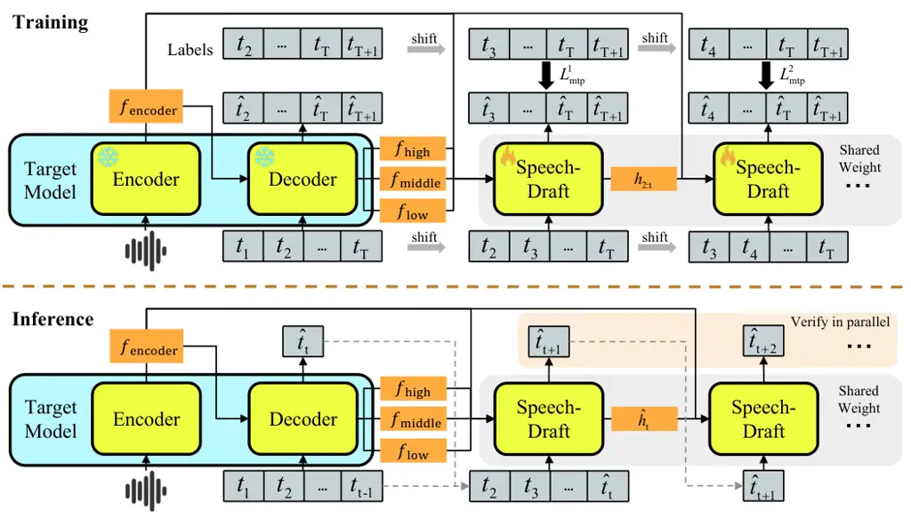
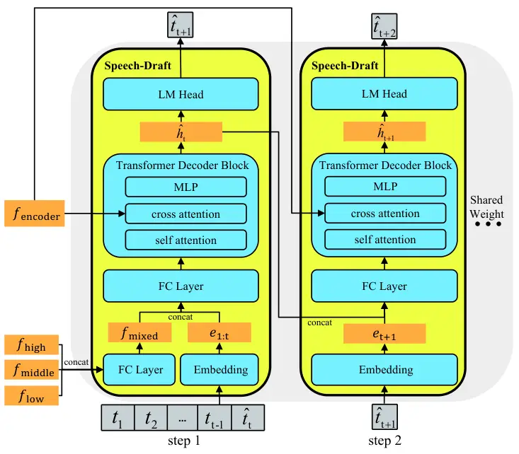
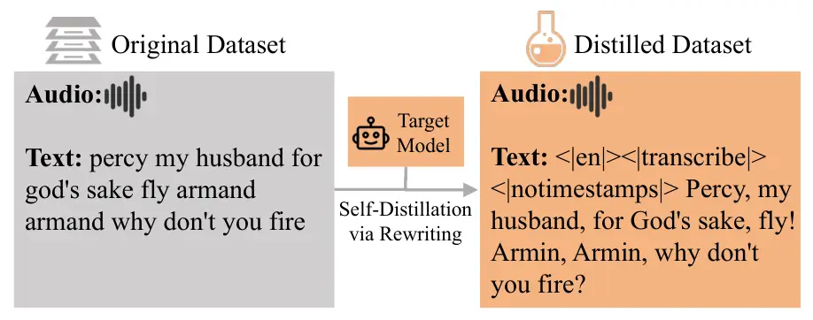
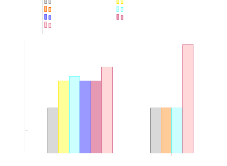

# Lossless Inference Acceleration for ASR via EAGLE-Style Speculative DecodingThanks: Sen Zhang, Xianghu Yue, Wenhuan Lu, and Jianguo Wei are with the College of Intelligence and Computing, Tianjin University, Tianjin 300350, China (email: zhangsen@tju.edu.cn; yuexianghu@tju.edu.cn; wenhuan@tju.edu.cn; jianguo@tju.edu.cn)Thanks: Yiming Chen is with ASUS Intelligent Cloud Services, Singapore 486030 (email: mattymchen@gmail.com).Thanks: Haizhou Li is with the School of Artificial Intelligence, The Chinese University of Hong Kong, Shenzhen, Guangdong 518172, China, also with the Department of Electrical and Computer Engineering, National University of Singapore, Singapore 117583 (email: haizhouli@cuhk.edu.cn).

Sen Zhang    Xianghu Yue    Yiming Chen    Wenhuan Lu    Jianguo Wei
Affiliation: Haizhou Li, 

###### Abstract

Autoregressive Transformer and Conformer models have achieved
state-of-the-art performance in automatic speech recognition (ASR).
However, their sequential token generation mechanism imposes a
significant bottleneck during decoding, resulting in substantial
inference latency. While speculative decoding has emerged as a promising
lossless acceleration technique, existing ASR-oriented approaches either
suffer from low draft acceptance rates due to suboptimal draft quality
or rely on specially designed external draft models, which limit their
generality and practicality. To overcome these limitations, we propose
EAGLE-ASR, a novel framework that accelerates ASR inference via
EAGLE-style speculative decoding while strictly preserving lossless
output quality. Specifically, we introduce Speech-Draft, a lightweight
autoregressive module that serves as a universal draft model by jointly
leveraging encoder acoustic features and hierarchical decoder
representations from the target ASR model. Furthermore, we adopt a
multi-step generation strategy with self-distilled data to train the
Speech-Draft, enabling it to better approximate the target model’s
output distribution and maintain causal consistency during multi-token
generation. Extensive experiments on representative Whisper and
Conformer AED models demonstrate that EAGLE-ASR achieves significant
lossless speedups of up to 1.9$`\times`$ and 2.4$`\times`$,
respectively, consistently outperforming existing speculative decoding
baselines for ASR. Our proposed framework further generalizes
effectively to multilingual ASR and speech translation tasks,
establishing EAGLE-ASR as a practical and universally applicable
solution for accelerating modern ASR systems without compromising
recognition accuracy. Our code is publicly available at
[https://github.com/ssss-sen/eagle-asr](https://github.com/ssss-sen/eagle-asr).

###### Index Terms: 

Automatic speech recognition, inference acceleration, speculative
decoding, EAGLE

## I Introduction

Neural network models based on Transformer or Conformer architectures
have recently achieved state-of-the-art performance in automatic speech
recognition (ASR) \[1, 2, 3, 4\]. However, these accuracy improvements
in transcription are often accompanied by increasingly large model sizes
and more complex decoding procedures. In particular, autoregressive ASR
models generate output tokens sequentially, which bottlenecks the
decoding stage and introduces substantial inference latency. As ASR
systems are increasingly deployed on resource-constrained edge devices
and in high-throughput server environments, reducing per-utterance
decoding latency without sacrificing recognition accuracy has become a
critical challenge for the speech processing community \[5\], \[6\],
\[7\].

Streaming ASR techniques have demonstrated effectiveness in reducing
end-to-end latency by emitting partial results before processing the
entire audio utterance\[8, 9, 10, 11\]. In this work, however, we focus
on accelerating the decoding stage of autoregressive ASR models under
the standard full-utterance inference setting, which remains crucial for
offline transcription. To improve decoding efficiency in this setting,
various acceleration strategies have been explored, including model
compression \[12, 13, 14, 15\] and non-autoregressive (NAR) decoding
\[16, 17, 18, 19, 20\]. Model compression techniques aim to reduce
computational cost and memory footprint by constructing smaller or more
efficient variants of large-scale models. On the other hand, NAR
decoding attempts to mitigate the latency of sequential generation by
predicting multiple tokens in parallel. Although these methods can
reduce inference cost, they often require architectural modification or
may sacrifice recognition accuracy for decoding speed. Therefore,
lossless acceleration techniques for autoregressive ASR models remain
highly desirable.

Speculative decoding has recently emerged as an effective inference
acceleration technique for autoregressive models in natural language
processing (NLP)\[21\], \[22\], \[23\]. It typically uses a lightweight
draft model to generate multiple candidate tokens, which are then
verified in parallel by the target model. By reducing the number of
expensive target-model decoding steps, speculative decoding can
substantially improve inference speed while preserving the output
distribution of the original model.

Recent studies have explored speculative decoding for ASR acceleration,
but face critical limitations. Some approaches \[12, 24\] rely on
specially designed external draft models that must be well aligned with
the target ASR model, increasing implementation complexity and limiting
generalizability. Others \[25\], \[26\] generate low-quality drafts,
resulting in poor acceptance rates that constrain achievable speedups.
These limitations motivate the need for an ASR-oriented speculative
decoding framework that generates high-quality drafts while remaining
lightweight and adaptable. EAGLE-style speculative decoding constructs
lightweight draft modules by leveraging the target model’s internal
representations, thereby eliminating the need for external models \[27,
28, 29, 30\]. While this design is highly attractive for ASR, its direct
application poses non-trivial challenges. Unlike pure text generation
tasks, ASR involves cross-modal conditioning on continuous acoustic
features, where the decoder’s behavior is inherently coupled with
encoder representations. A naive adaptation that ignores acoustic
context or decoder–encoder interactions can result in poor draft quality
and reduced acceptance rates, ultimately undermining the efficiency
gains of speculative decoding \[31\], \[32\], \[33\].

To address these challenges, we propose EAGLE-ASR, a speculative
decoding framework tailored to autoregressive ASR models. The key
component of EAGLE-ASR is Speech-Draft, a lightweight autoregressive
draft module that leverages both encoder-side acoustic features and
hierarchical decoder representations from the target ASR model. By
incorporating acoustic and decoder-context information, Speech-Draft
better approximates the target model’s token prediction behavior while
maintaining low computational cost, thereby improving draft acceptance
and inference efficiency. Furthermore, we design a self-distillation and
multi-step generation strategy to train Speech-Draft. This training
strategy enables the draft module to model dependencies among
consecutive future tokens and maintain causal consistency during
multi-token drafting. As a result, EAGLE-ASR can generate multiple
high-quality draft tokens at each decoding step and verify them
efficiently with the target ASR model. We evaluate EAGLE-ASR on
representative Whisper and Conformer attention-based encoder-decoder
(AED) models. Experimental results show that EAGLE-ASR achieves average
accepted draft lengths of 3.67 on Whisper and 4.74 on the Conformer AED
model, demonstrating effective draft generation. It further achieves
lossless inference speedups of up to 1.9$`\times`$ and 2.4$`\times`$,
respectively, outperforming existing ASR speculative decoding baselines.
Additional experiments also demonstrate the effectiveness of the
proposed framework on multilingual ASR and speech translation tasks.

The main contribution of this paper can be summarized as follows.

- •
  We propose EAGLE-ASR, an EAGLE-style speculative decoding framework
  for accelerating autoregressive ASR inference while preserving
  recognition accuracy.
- •
  We introduce Speech-Draft, a lightweight autoregressive draft module
  that leverages encoder acoustic features and hierarchical decoder
  representations to generate high-quality draft tokens for
  attention-based encoder-decoder ASR models.
- •
  We develop a self-distillation and multi-step generation training
  strategy that improves draft quality and maintains causal consistency
  during multi-token speculative decoding.
- •
  Extensive experiments on Whisper and Conformer AED models demonstrate
  that EAGLE-ASR achieves significant lossless speedups of up to
  1.9$`\times`$ and 2.4$`\times`$, respectively, consistently
  outperforming existing ASR speculative decoding baselines.

The remainder of this paper is organized as follows: Section II
summarizes related work. Section III presents the architecture of
Speech-Draft, along with the training and inference framework of
EAGLE-ASR. Section IV describes the experimental setup, with results
provided in Section V. The paper concludes in Section VI.

## II Related Work

### II-A Traditional Inference Acceleration Techniques in ASR

Traditional approaches for accelerating ASR inference mainly focus on
model compression and non-autoregressive ASR (NAR-ASR). Model
compression techniques, such as knowledge distillation\[34\],
quantization\[35\], and pruning\[36\], reduce computational overhead by
decreasing model size and complexity. Representative works, including
Distil-Whisper\[12\] and DQ-Whisper\[13\] achieve faster inference by
using compressed model variants of large ASR models. However, these
approaches often introduce some degree of information loss, which may
lead to degradation in Word Error Rate (WER). Concurrently, NAR-ASR
models\[37\] attempt to eliminate the latency inherent in autoregressive
decoding by generating multiple tokens in parallel. Notable approaches
include Mask-CTC\[16\], Paraformer\[17\], \[18\], Align-refine\[19\] and
A-CMLM\[20\] models. Despite their improved decoding efficiency, NAR-ASR
approaches generally exhibit a performance gap compared to
autoregressive models in terms of recognition accuracy. Overall, while
these strategies demonstrate effectiveness in reducing inference
latency, they typically sacrifice recognition performance for speed.
This limitation highlights the need for lossless acceleration methods
that are specifically tailored to autoregressive ASR models.

### II-B Speculative Decoding

Speculative decoding is a lossless acceleration technique for large
language models that employs a “draft-then-verify” paradigm. Early
speculative decoding methods\[38\], \[39\] accelerated generation in
greedy settings, while recent advances\[21, 22\] introduced speculative
sampling to extend this framework to non-greedy generation. In this
paradigm, the drafting phase incurs minimal computational overhead,
while the verification phase is executed in parallel, corresponding to
draft generation and validation, respectively. In the drafting phase, a
lightweight draft model is employed to autoregressively generate tokens,
forming a draft sequence while recording the probability $`\hat{p}`$ for
each token. In the verification phase, the target model is invoked to
evaluate the draft and record the probability $`p`$ for each drafted
token. Speculative decoding then sequentially determines the acceptance
of each drafted token with an acceptance probability of
$`\min(1,p/\hat{p})`$. If the current token is accepted, the process
proceeds to the next token; otherwise, a replacement token is sampled
from the distribution $`\text{norm}(\max(0,p-\hat{p}))`$, and subsequent
tokens in the draft are discarded\[40\], \[41\]. Crucially, Leviathan et
al.\[21\] proved that speculative decoding is consistent with the
distribution of vanilla autoregressive decoding. Building upon this
foundation, numerous variants have emerged in the NLP domain, including
CS Drafting\[42\], BiLD\[43\], LLMA\[44\], and REST\[45\], each
exploring different strategies for draft generation and verification.

Unlike conventional speculative decoding approaches that rely on
separate, independent draft models, Medusa\[46\] and EAGLE\[27\],
\[28\], \[29\] adopt an internally integrated speculative decoding
strategy, which aims to directly leverage the feature extraction
capability of the target model itself for draft generation.

Specifically, Medusa attaches multiple lightweight MLP heads on top of
the frozen target model, utilizing the hidden states at the current time
step to predict candidate tokens for the subsequent $`k`$ positions in
parallel. However, because these heads predict each position
independently, the approach fails to capture the sequential dependencies
among the drafted tokens. Consequently, each later token is generated
without conditioning on its immediate predecessor, resulting in less
coherent draft sequences and a diminished acceptance rate during the
verification phase.

In contrast to Medusa’s multi-head design, EAGLE attaches only a single
lightweight autoregressive module to the frozen target model, leveraging
semantic information from different layers of the target model for
prediction. By maintaining an explicit autoregressive structure, this
design preserves temporal dependencies during draft generation while
more effectively leveraging the target model’s learned representations.
Empirically, EAGLE has been reported to achieve state-of-the-art
decoding speed among existing speculative decoding approaches.

### II-C Speculative Decoding in ASR

Current research on accelerating ASR models through speculative decoding
still largely focuses on selecting or training a separate draft model.
For instance, the Hugging Face team employs Distil-Whisper and
Whisper-tiny as draft models to accelerate the inference of the
Whisper-large target model\[12\]. However, such approaches rely heavily
on strict distribution alignment between the draft and target models,
typically requiring them to belong to the same model family or the draft
model to be a distilled variant of the target. This constraint
significantly limits architectural flexibility and practical deployment.
When this assumption is violated, such as when pairing a Distil-Whisper
draft model with a Conformer-based target model, the token acceptance
rate can degrade substantially, thereby diminishing or even negating the
anticipated speedup.

Whisper-Medusa partially alleviates the cost of obtaining a well-aligned
draft model by appending multiple MLP heads on top of a Whisper
model\[25\]. However, constrained by the inherent limitations of the
Medusa framework, this approach similarly neglects temporal dependencies
and underutilizes the rich intermediate representations extracted by the
target model, particularly the acoustic features derived from the
encoder. Consequently, its overall acceleration ratio remains limited.
Moreover, since Whisper-Medusa fine-tunes the final decoder layer during
training rather than freezing all parameters of the target model, its
WER exhibits noticeable degradation, thus failing to achieve lossless
acceleration.

To address these limitations, we propose EAGLE-ASR, an EAGLE-style
speculative decoding framework tailored for accelerating the inference
of the ASR model. Unlike existing approaches, EAGLE-ASR eliminates the
need for an independently trained draft model while delivering superior
decoding speedups and strictly preserving lossless output quality.



Fig. 1: Pipeline of EAGLE-ASR. Training phase (upper): The Speech-Draft
model is trained using a multi-token generation strategy together with a
weighted cross-entropy loss with exponential decay. During training,
only the FC layers and the Transformer decoder block of the Speech-Draft
are fine-tuned, while remaining parameters of the Speech-Draft, as well
as all parameters of the target model, are kept frozen. Inference phase
(lower): The target model predicts the next token, which feeds into the
Speech-Draft serving as the draft model, thereby recursively generating
draft tokens for subsequent parallel verification.

## III Methodology

### III-A Overview

In this work, we propose EAGLE-ASR, an EAGLE-style speculative decoding
framework designed to accelerate autoregressive ASR inference while
maintaining lossless recognition accuracy. As illustrated in Figure 1,
EAGLE-ASR is built upon a frozen target ASR model consisting of an
encoder and an autoregressive decoder, augmented with a lightweight
autoregressive module termed Speech-Draft and a dedicated speculative
decoding pipeline. Unlike conventional speculative decoding methods that
rely on standalone external draft models, Speech-Draft directly
leverages the internal representations of the target ASR model for draft
generation, thereby improving target-draft consistency while maintaining
low computational overhead. Similar to standard speculative decoding,
EAGLE-ASR alternates between a drafting stage and a verification stage
during inference. Specifically, given the input audio and the sequence
prefix $`t_{1:t-1}`$, to generate multiple tokens in parallel, the
inference process of EAGLE-ASR proceeds as follows, as depicted in the
lower part of Figure 1.

Drafting stage: During draft generation, the target ASR model first
processes the input audio to predict the next token $`\hat{t}_{t}`$.
Meanwhile, the encoder features $`f_{\text{encoder}}`$ are cached, and
decoder representations at different levels, denoted as
$`f_{\text{low}}`$, $`f_{\text{middle}}`$, and $`f_{\text{high}}`$, are
extracted from the target decoder. These multi-granularity features,
together with the predicted token $`\hat{t}_{t}`$ and the sequence
prefix $`t_{1:t-1}`$, are then fed into the Speech-Draft, which
autoregressively generates $`K`$ draft tokens following the EAGLE
framework \[27\].

- •
  In the initial draft step $`k=1`$, the Speech-Draft takes as input
  $`f_{\text{encoder}}`$, $`f_{\text{low}}`$, $`f_{\text{middle}}`$,
  $`f_{\text{high}}`$, and the concatenated sequence
  $`[t_{2:t-1},\hat{t}_{t}]`$, where the newly predicted token from the
  target model is appended to the input sequence shifted one step ahead.
  Based on this information, Speech-Draft generates the first draft
  token $`\hat{t}_{t+1}`$.
- •
  In the subsequent draft step $`k>1`$, the Speech-Draft operates in an
  autoregressive manner. Specifically, it predicts the $`k`$-th draft
  token conditioned on the encoder representations
  $`f_{\text{encoder}}`$, the hidden state output from the previous
  drafting step $`\hat{h}_{t+k-2}`$, and the previously generated
  drafted token $`\hat{t}_{t+k-1}`$.

After $`K`$ recursive steps, a complete draft sequence
$`\hat{t}_{t+1:t+K}`$ is obtained.

Verification stage: During verification, all drafted tokens are fed into
the target decoder in parallel, which simultaneously computes the logits
for positions $`t+1`$ through $`t+K`$. We adopt the standard speculative
decoding acceptance criterion to determine the accepted draft tokens,
where drafted tokens are accepted sequentially until the first position
at which the draft token differs from what the target model would have
sampled. Through this parallel verification without approximate
strategies, Eagle-ASR ensures that the output distribution remains
identical to that of the target model, thereby achieving acceleration in
a lossless manner. In subsection V-D, we further investigate the impact
of different verification strategies on acceleration performance.
Experimental results show that linear verification yields a better
speedup than tree-based verification in the ASR setting.

### III-B Speech-Draft Module

Unlike standard language models, the autoregressive decoding in ASR
exhibits a dual dependency, requiring both historical text context and
acoustic representations produced by the encoder. Motivated by this
observation, we propose Speech-Draft, a lightweight autoregressive
module that effectively integrates acoustic and textual information to
serve as the draft model in EAGLE-ASR. The overall architecture of the
Speech-Draft is illustrated in Figure 2. The Speech-Draft module
consists of two fully connected (FC) layers, an embedding layer, a
single Transformer decoder block, and an LM head. Notably, the embedding
layer and the LM head directly reuse the corresponding parameters of the
target model and require no additional training.



Fig. 2: The overall architecture of the Speech-Draft, which consists of
two fully connected (FC) layers, an embedding layer, a Transformer
decoder block, and an LM head.

The first FC layer is activated only at the first decoding step
($`\text{step}=1`$), where it fuses the multi-level decoder
representations ($`f_{\text{low}}`$, $`f_{\text{middle}}`$, and
$`f_{\text{high}}`$) extracted from the target model into a unified
representation $`f_{\text{mixed}}`$, thereby aggregating hierarchical
information from different depths. The second FC layer then combines
$`f_{\text{mixed}}`$ (or the hidden states from the preceding step when
$`\text{step}>1`$) with the embeddings of previously generated tokens,
producing the input representation for the Transformer decoder block. To
maintain strict alignment with the input speech signal, the encoder
acoustic representation $`f_{\text{encoder}}`$ is incorporated into the
drafting process through the cross-attention mechanism of the
Transformer decoder block. This design enables Speech-Draft to jointly
leverage rich decoder-side semantic representations and fine-grained
encoder-side acoustic information, thereby improving draft quality for
subsequent verification. It is worth noting that, owing to its
lightweight and model-agnostic architecture, the Speech-Draft module can
be seamlessly integrated into any autoregressive ASR system that employs
a Transformer-based decoder, including state-of-the-art models such as
Whisper and Conformer AED models.

### III-C Self-Distilled Training Data

As illustrated in Figure 3, there is a distribution discrepancy between
the output distribution of the target ASR model and the original
distribution of the training data transcriptions. This discrepancy
arises from factors such as prediction errors, inaccurate annotations,
and inconsistencies in transcription conventions. Training Speech-Draft
directly on the original transcriptions may therefore lead to suboptimal
target-draft alignment, ultimately limiting speculative decoding
performance.



Fig. 3: An illustration of self-distilled training data generation,
designed to mitigate the distributional discrepancy between the original
transcripts and the target model outputs.

To address the above issue, we adopt a self-distillation approach for
training data generation\[47\]. Specifically, the target ASR model is
first used to generate transcriptions for all training audio samples,
and these generated transcriptions are subsequently used as the training
targets for Speech-Draft. For the Whisper model, we explicitly preserve
its special tokens, such as \<\|en\|\>, \<\|transcribe\|\>, and
\<\|notimestamps\|\>. The resulting self-distilled training data
effectively captures the generation patterns and preferences of the
target model. By training Speech-Draft on these self-distilled
transcriptions rather than on the original annotations, the draft module
learns to produce draft tokens that are consistent with the behavior of
the target model, instead of attempting to imitate transcriptions from
external sources that may exhibit a different distribution. As a result,
Speech-Draft can better match the target model during speculative
decoding, leading to a higher token acceptance rate and a more effective
drafting process.

### III-D Training Strategy

During training, EAGLE-ASR updates only the trainable components of
Speech-Draft, namely the FC layers and the Transformer decoder block.
The remaining parameters of Speech-Draft, including the reused embedding
layer and LM head, as well as all parameters of the target ASR model,
are kept frozen. This strategy ensures computational efficiency during
training while fully preserving the capabilities of the target model.

During actual speculative decoding, however, Speech-Draft faces a
training–inference mismatch. Specifically, at the second and subsequent
drafting steps, Speech-Draft must rely on its own predicted hidden
states rather than the ground-truth hidden states produced by the target
model. This discrepancy can lead to error accumulation during recursive
drafting, resulting in a degradation in acceptance rate. To alleviate
this issue, EAGLE-ASR adopts a multi-step generation strategy for
training Speech-Draft, as illustrated in the upper part of Figure 1.
Specifically, suppose that EAGLE-ASR employs Speech-Draft to perform
$`K`$-step generation during training. Given an input speech audio and
its corresponding transcription token sequence $`t_{1:T}`$ (where $`T`$
denotes the sequence length), the training procedure of EAGLE-ASR is
illustrated as follows.

- •
  At step $`k=1`$, the Speech-Draft leverages $`f_{\text{encoder}}`$,
  $`f_{\text{low}}`$, $`f_{\text{middle}}`$, and $`f_{\text{high}}`$
  from the target model, along with the shifted token sequence
  $`t_{2:T}`$ (shifted by one position), to predict
  $`\hat{t}_{3:(T+1)}`$.
- •
  At step $`k>1`$, the Speech-Draft utilizes $`f_{\text{encoder}}`$ and
  the output hidden states $`\hat{h}_{k:T}`$ from the preceding step,
  together with the shifted token sequence $`t_{(k+1):T}`$ (shifted by
  $`k`$ positions), to predict $`\hat{t}_{(k+2):(T+1)}`$.

As the generation depth increases, distant tokens condition on a growing
number of intermediate decisions, resulting in progressively higher
prediction difficulty. Consequently, the prediction uncertainty
accumulates with each successive step. To mitigate this issue, we
optimize the Speech-Draft using a weighted cross-entropy loss with
exponential decay:

```math
{L}_{\text{mtp}}=\sum_{k=1}^{K}\alpha_{k}\cdot{L}_{\text{mtp}}^{k}=\sum_{k=1}^{K}\alpha_{k}\cdot\text{CE}\left(\hat{t}_{1+k:T+1}^{k},\ t_{1+k:T+1}\right) \tag{1}
```

where $`L_{k}^{\text{mtp}}`$ represents the loss at the $`k`$-th step,
and $`\text{CE}(\cdot,\cdot)`$ denotes the cross-entropy loss between
the predicted token and the ground-truth label. The position-dependent
weight $`\alpha_{k}`$ follows an exponential decay, formulated as:

```math
\alpha_{k}=\frac{\beta^{k-1}}{\sum_{j=1}^{K}\beta^{j-1}} \tag{2}
```

where $`\beta`$ denotes the decay factor. Through this loss formulation,
EAGLE-ASR prioritizes the accuracy of near-term predictions while
simultaneously enhancing its ability to generate multiple consecutive
future tokens.

## IV Experimental Setup

### IV-A Datasets

We use two datasets to train and evaluate the proposed EAGLE-ASR
framework. First, we adopt LibriSpeech, a widely used benchmark in ASR
research\[48\]. LibriSpeech contains approximately 1,000 hours of read
English speech derived from audiobooks in the public domain. In this
work, we use the full 960-hour LibriSpeech training split to train the
Speech-Draft module and report evaluation results on the standard
test-clean and test-other subsets. Moreover, to further evaluate the
generalizability of EAGLE-ASR on both multilingual ASR and speech
translation (ST) tasks, we conduct additional experiments on the
VoxPopuli dataset\[49\]. VoxPopuli is a large-scale multilingual speech
corpus derived from European Parliament event recordings between 2009
and 2020. It comprises approximately 400,000 hours of unlabeled speech
data covering 23 languages, as well as around 1,800 hours of transcribed
speech data in 16 languages. For multilingual ASR evaluation, we use the
English, German, Spanish, French, and Italian subsets. For the ST task,
we conduct experiments on four translation directions:
German-to-English, Spanish-to-English, French-to-English, and
Italian-to-English.

It is worth noting that, although both LibriSpeech and VoxPopuli subsets
used in our experiments provide paired reference transcripts for all
audio samples, we do not directly use these human-annotated
transcriptions for training. Instead, we train the Speech-Draft
exclusively on self-distilled data generated by the target model, as
described in subsection III-C.

### IV-B Model Configurations

To validate the effectiveness and generality of EAGLE-ASR, we adopt two
representative autoregressive ASR models, Whisper and Conformer AED, as
our target models\[1\], \[2\]. Whisper is a Transformer-based ASR model
developed by OpenAI, trained on approximately 680,000 hours of audio
data. Owing to its strong robustness and competitive recognition
performance across diverse speech conditions, Whisper has become a
widely adopted backbone for ASR research. In this work, we adopt
Whisper-large-v3 as the target model for EAGLE-ASR. This model consists
of a 32-layer Transformer encoder and a 32-layer Transformer decoder,
with approximately 1550M parameters in total. Conformer AED is a hybrid
encoder-decoder model based on the CTC/attention architecture. In this
work, we adopt the Conformer AED implementation provided by the FunASR
toolkit\[50\] as the target model for EAGLE-ASR. This model is trained
on approximately 50,000 hours of English audio data and comprises a
32-layer Conformer encoder and a 16-layer Transformer decoder, with
approximately 220M parameters in total. Since our study focuses on
autoregressive decoding, the CTC branch is not used in inference.

### IV-C Training Details

For the Whisper model, Speech-Draft is trained for 200K and 400K steps
on the LibriSpeech and VoxPopuli datasets, respectively. For the
Conformer AED model, Speech-Draft is trained for 150K steps on
LibriSpeech and 300K steps on VoxPopuli. Across all experiments, we
employed the AdamW optimizer\[51\] with beta values
$`(\beta_{1},\beta_{2})=(0.9,0.95)`$, together with a gradient clipping
of $`0.5`$. A cosine learning rate schedule is adopted with a peak
learning rate of $`5\times 10^{-5}`$ and a warmup ratio of
$`0.05`$\[52\]. The batch size is set to $`2`$ with $`4`$ gradient
accumulation steps, yielding an effective batch size of $`8`$. For the
multi-step generation training strategy, we adopt a weight decay factor
$`\beta=0.8`$ and prediction depth $`K=7`$. All evaluations were
conducted on a single NVIDIA RTX 4090 GPU with 24 GB of memory.

### IV-D Evaluation Metrics

Since EAGLE-ASR does not modify the parameters of the target model and
adopts strict speculative decoding acceptance conditions\[23\], \[53\],
its decoded outputs are theoretically identical to those produced by the
original target model. To empirically verify this lossless property in
practice, we report $`\Delta`$WER, which measures the change in WER of
EAGLE-ASR relative to the original target model. A $`\Delta`$WER greater
than $`0`$ indicates that the decoding method incurs a degradation in
recognition accuracy. Similarly, for ST tasks, we report the change in
BLEU score\[54\], denoted as $`\Delta`$BLEU, to measure the change in
translation quality relative to the original model.

In addition to $`\Delta`$WER, we further adopt the following metrics to
evaluate the acceleration performance:

\(1\) Speedup ratio: The relative inference speedup compared to the
baseline (vanilla autoregressive decoding).

\(2\) Mean accepted length ($`\tau`$): The average number of draft
tokens accepted during each verification step, which reflects the
effectiveness of the draft generation process and is directly related to
the achievable acceleration.

## V Results and Analysis

### V-A Main Results

In this section, we evaluate the performance of EAGLE-ASR and other
speculative decoding methods on the LibriSpeech benchmark using both
Whisper and Conformer AED models. To ensure a fair comparison, all
methods are re-implemented and evaluated under the same hardware
configuration and experimental environment. Unless otherwise specified,
the decoding hyperparameters for evaluation are set to a draft length of
$`K=5`$ and $`\text{top-}k=1`$. For the standard Speculative Decoding
(SpD) baselines with Whisper-large-v3, we employ Distil-large-v3 and
Whisper-tiny as draft models. For the Conformer AED model, we use
Distil-small and Whisper-tiny to ensure the draft model remains
substantially smaller than the target.¹¹ 1 Due to the discrepancy
between the tokenizers of Conformer AED and Whisper, direct token
verification is infeasible. We address this vocabulary mismatch by
decoding the Whisper draft tokens into text and then re-encoding them
using the Conformer tokenizer before verification. Regarding the Medusa
baseline, we evaluate two implementations from Whisper-Medusa on the
Whisper model: Medusa-Linear and Medusa-Block. It is crucial to note
that neither of these approaches achieves lossless acceleration, as they
modify the original parameters of the target model and do not adhere to
strict speculative decoding acceptance criteria. In addition, we do not
report Medusa’s acceleration results on the Conformer AED model as no
public implementation is currently available.

|                   |              |                 |              |                |          |               |                |          |               |
| ----------------- | ------------ | --------------- | ------------ | -------------- | -------- | ------------- | -------------- | -------- | ------------- |
| Target model      | Method       | Draft Model     | Draft Params | Test Clean     |          |               | Test Other     |          |               |
|                   |              |                 |              | Speedup        | $`\tau`$ | $`\Delta`$WER | Speedup        | $`\tau`$ | $`\Delta`$WER |
| Whisper (1550 M)  | SpD\[12\]    | Distil-large-v3 | 756 M        | 1.72$`\times`$ | 4.14     | 0.00          | 1.52$`\times`$ | 3.76     | 0.00          |
|                   | SpD\[12\]    | Whisper-tiny    | 39 M         | 1.76$`\times`$ | 3.04     | 0.00          | 1.58$`\times`$ | 2.56     | 0.00          |
|                   | Medusa\[25\] | Medusa-Linear   | 68 M         | 1.67$`\times`$ | 3.51     | +1.88         | 1.59$`\times`$ | 3.32     | +3.61         |
|                   | Medusa\[25\] | Medusa-Block    | 92 M         | 1.65$`\times`$ | 3.16     | +1.17         | 1.54$`\times`$ | 3.01     | +1.50         |
|                   | EAGLE-ASR    | Speech-Draft    | 117 M        | 1.91$`\times`$ | 3.79     | 0.00          | 1.79$`\times`$ | 3.55     | 0.00          |
| Conformer (220 M) | SpD\[12\]    | Distil-small    | 166 M        | 1.18$`\times`$ | 2.85     | 0.00          | 0.90$`\times`$ | 2.35     | 0.00          |
|                   | SpD\[12\]    | Whisper-tiny    | 39 M         | 1.13$`\times`$ | 2.56     | 0.00          | 0.88$`\times`$ | 1.97     | 0.00          |
|                   | EAGLE-ASR    | Speech-Draft    | 10 M         | 2.43$`\times`$ | 4.98     | 0.00          | 2.30$`\times`$ | 4.50     | 0.00          |

TABLE I: Comparison of acceleration performance across different
speculative decoding approaches on the LibriSpeech dataset.



Fig. 4: Speedup comparison across different decoding methods. EAGLE-ASR
consistently outperforms all baseline methods for both target models
while guaranteeing lossless decoding.

We present the results in Table I and Figure 4. For the Whisper-large-v3
target model, EAGLE-ASR achieves the highest speedup, reaching
1.91$`\times`$ on test-clean and 1.79$`\times`$ on test-other,
outperforming all baselines while maintaining strictly lossless decoding
($`\Delta\text{WER}=0.00`$). Notably, SpD with Distil-large-v3 attains
the highest acceptance length, yet its speedup ratio is lower than that
of our EAGLE-ASR. This is due to the fact that the Distil-large-v3 draft
model contains 756M parameters, comprising nearly half the size of the
target model, which incurs substantial computational overhead during the
drafting stage and consequently offsets the benefits gained from its
high acceptance rate. In contrast, while other speculative decoding
methods employ more lightweight draft models compared to EAGLE-ASR, the
mean accepted lengths $`\tau`$ values are significantly lower than those
of EAGLE-ASR, thus resulting in lower speedup ratios. These results
suggest that EAGLE-ASR achieves a more effective balance between draft
quality and computational efficiency.

The advantage of EAGLE-ASR is more pronounced on the Conformer AED
model. EAGLE-ASR achieves a remarkable 2.43$`\times`$ speedup on
test-clean and 2.30$`\times`$ on test-other, substantially outperforming
SpD with Distil-small and SpD with Whisper-tiny. In fact, both SpD
baselines fail to accelerate, even resulting in a slowdown on the more
challenging test-other set. This poor performance can be attributed to a
combination of factors. First, the Conformer AED target model is
relatively small (220M parameters), which makes the computational
overhead of executing a separate draft model comparatively high. Second,
a significant distributional mismatch exists between the Conformer AED
target and the Whisper-based draft models. This includes discrepancies
in transcription style, leading to low acceptance rates for the draft
sequences (evidenced by low $`\tau`$ values for both SpD methods).
Finally, due to the tokenizer mismatch between Conformer AED and Whisper
models, we are compelled to perform token mapping through ground-truth
text during the verification phase, which further exacerbates the time
overhead. These results highlight the practical challenges of applying
conventional speculative decoding across heterogeneous ASR model
families.

Across both target models and evaluation sets, EAGLE-ASR consistently
achieves the highest speedup while maintaining lossless transcription
quality. These results highlight two key strengths of our proposed
framework. First, our proposed Speech-Draft module effectively leverages
the hidden features of the target model to generate high-quality draft
tokens while maintaining a lightweight architecture. This design
achieves an effective trade-off between generation quality and
computational cost, ultimately leading to superior acceleration
performance. Second, EAGLE-ASR demonstrates strong generalizability
across target models with different architectures and parameter scales
without requiring architecture-specific modifications or same-family
distilled draft models. This makes EAGLE-ASR a practical and flexible
acceleration solution for a broad range of autoregressive
attention-based ASR systems, particularly for models that lack the
same-family smaller variants or distilled lightweight variants.

### V-B Performance on Multilingual Speech Recognition

To further evaluate the generalizability of EAGLE-ASR across diverse
languages, we report the acceleration performance of EAGLE-ASR on the
VoxPopuli multilingual ASR benchmark using Whisper as the target model.
Specifically, the evaluation covers five languages: English, German,
Spanish, French, and Italian. The decoding hyperparameters for the
multilingual ASR task remain identical to those used in the monolingual
ASR experiments as described above.

| Subset            | Speedup        | $`\tau`$ | $`\Delta`$WER |
| ----------------- | -------------- | -------- | ------------- |
| VoxPopuli English | 1.96$`\times`$ | 4.06     | 0.00          |
| VoxPopuli German  | 2.14$`\times`$ | 4.50     | 0.00          |
| VoxPopuli Spanish | 2.10$`\times`$ | 4.46     | 0.00          |
| VoxPopuli French  | 2.15$`\times`$ | 4.64     | 0.00          |
| VoxPopuli Italian | 2.10$`\times`$ | 4.46     | 0.00          |
| Average           | 2.09$`\times`$ | 4.42     | 0.00          |

TABLE II: Acceleration performance of EAGLE-ASR across diverse languages
for ASR.

As shown in Table II, EAGLE-ASR delivers consistent and substantial
acceleration across all five languages, achieving a 2.09$`\times`$
average acceleration while remaining strictly lossless
($`\Delta`$WER$`=0.00`$ for every subset). This performance is
underpinned by the high quality of the generated draft tokens, as
evidenced by the consistently high average acceptance lengths
($`\tau`$), which average 4.41 across the languages. Notably, EAGLE-ASR
exhibits highly consistent performance across different languages, with
speedup ratios ranging from 1.96$`\times`$ to 2.15$`\times`$. The
relatively small performance variation suggests that the Speech-Draft
module effectively captures language-agnostic patterns from the target
model’s hidden representations, enabling it to generalize well across
diverse languages. Overall, these multilingual evaluations confirm that
the acceleration benefits of EAGLE-ASR extend well beyond English,
confirming its strong generalizability across diverse languages while
strictly preserving lossless decoding accuracy.

### V-C Performance on Speech Translation

To further evaluate the generalization ability and robustness of
EAGLE-ASR beyond ASR, we extend our investigation to the speech
translation (ST) task. Specifically, by leveraging Whisper’s inherent
capability to directly translate non-English speech into English text,
we conduct additional experiments on the VoxPopuli dataset. Unlike its
earlier use in multilingual ASR, VoxPopuli is repurposed in this section
to benchmark the acceleration performance of EAGLE-ASR across four
diverse X-to-English translation directions. For the ST task, we report
the acceleration results with a draft length of $`K=5`$ and a sampling
size of $`\text{top-}k=2`$, which helps accommodate the increased output
uncertainty compared with standard transcription task.

| ST task            | Speedup        | $`\tau`$ | $`\Delta`$BLEU |
| ------------------ | -------------- | -------- | -------------- |
| German-to-English  | 1.49$`\times`$ | 3.44     | 0.00           |
| Spanish-to-English | 1.73$`\times`$ | 3.75     | 0.00           |
| French-to-English  | 1.66$`\times`$ | 3.60     | 0.00           |
| Italian-to-English | 1.59$`\times`$ | 3.49     | 0.00           |
| Average            | 1.62$`\times`$ | 3.57     | 0.00           |

TABLE III: Acceleration performance of EAGLE-ASR across various speech
translation tasks.

As shown in Table III, EAGLE-ASR consistently improves inference
efficiency across all four translation tasks, achieving an average
speedup of 1.62$`\times`$ and a mean acceptance length $`\tau`$ of 3.57.
Importantly, this acceleration remains strictly lossless, with a
$`\Delta`$BLEU score of 0.00 for every task, confirming that EAGLE-ASR
fully preserves the translation quality of the original Whisper model. A
notable observation is that, despite using a larger $`\text{top-}k`$
value, EAGLE-ASR achieves a lower mean accepted length on speech
translation ($`\tau=3.57`$) than on multilingual ASR task
($`\tau=4.42`$). This behavior is expected due to the inherently higher
complexity of the ST task. Unlike ASR, ST involves a more intricate
cross-lingual mapping from source speech to target text, where the
increased output uncertainty poses greater challenges for draft model
predictions to be accepted. As a result, fewer draft tokens are accepted
during verification. Together with the additional computational overhead
introduced by the larger top-k setting, this explains the relatively
lower speedup observed for the ST task (1.62$`\times`$) compared with
multilingual ASR task (2.09$`\times`$). Nevertheless, despite the
increased task difficulty, EAGLE-ASR demonstrates remarkable robustness
and effectiveness by delivering substantial, lossless acceleration for
speech translation. These results indicate that the benefits of
EAGLE-ASR extend beyond monolingual and multilingual ASR and transfer
effectively to challenging speech translation scenarios. This consistent
acceleration across diverse cross-lingual generation tasks further
underscores the strong generalization ability and robustness of our
proposed framework.

### V-D Impact of Decoding Hyperparameters

In this section, we investigate the impact of decoding hyperparameters
on the acceleration performance of EAGLE-ASR. Specifically, we focus on
two key parameters: the draft length $`K`$, which controls the number of
tokens generated by the draft model at each speculative step, and the
$`\text{top-}k`$ sampling size, which determines the number of candidate
tokens considered during the sampling process.


Fig. 5: Effect of the draft length $`K`$ on the acceleration performance
of EAGLE-ASR. Left: Speedup ratio. Right: Mean accepted length $`\tau`$.

Figure 5illustrates how the draft length $`K`$ affects both the speedup
ratio and the mean accepted length $`\tau`$ when $`\text{top-}k`$ is
fixed to 1. As shown in the right panel, the mean accepted length
$`\tau`$ increases monotonically as $`K`$ increases, rising from 1.82 at
$`K{=}2`$ to 4.57 at $`K{=}8`$. This is expected, since a longer draft
sequence provides more candidate tokens for verification, and thus more
tokens can be accepted on average in a single forward pass.

However, the speedup ratio does not exhibit the same monotonic trend. As
shown in the left panel, the speedup first increases with $`K`$, reaches
a peak of approximately 1.85$`\times`$ at $`K{=}5`$, and then gradually
declines as $`K{=}5`$ increases further. This discrepancy can be
explained by the trade-off between two competing factors: the number of
accepted tokens and the computational cost of drafting. On the one hand,
a larger $`K`$ leads to a higher $`\tau`$, meaning that fewer
verification steps are needed to generate a complete sequence, thereby
reducing the number of expensive forward passes through the target
model. On the other hand, each draft step requires the draft model to
run $`K`$ autoregressive iterations, and the subsequent verification
pass must process the entire draft sequence, both of which incur
additional computational overhead that scales roughly with $`K`$. When
$`K`$ is small, the gain from accepting more tokens per step outweighs
the extra drafting cost, leading to improved acceleration. However, the
marginal gain in accepted tokens gradually diminishes as $`K`$ grows.
For example, $`\tau`$ increases by 0.84 when $`K`$ goes from 2 to 3, but
only by 0.22 when $`K`$ increases from 7 to 8. This sublinear growth of
$`\tau`$ suggests that draft tokens predicted further are more likely to
be rejected due to error accumulation. Beyond the optimal point
($`K=5`$), the additional drafting overhead outweighs the modest gain in
accepted length, leading to reduced overall speedup.


Fig. 6: Effect of $`\text{top-}k`$ on the acceleration performance of
EAGLE-ASR. Left: Speedup ratio. Right: Mean accepted length $`\tau`$.

Figure 6further presents the impact of the draft $`\text{top-}k`$ when
the draft length is fixed at $`K{=}5`$. As shown in the right panel, the
mean accepted length $`\tau`$ increases monotonically as
$`\text{top-}k`$ increases, rising from 3.67 at $`\text{top-}k{=}1`$ to
4.56 at $`\text{top-}k{=}4`$. This trend is expected, since enlarging
the candidate set at each drafting step increases the likelihood that
the target token is included among the proposed candidates, thereby
improving the acceptance rate during verification. However, the speedup
ratio exhibits the opposite trend. As shown in the left panel, the
speedup decreases monotonically from 1.85$`\times`$ at
$`\text{top-}k{=}1`$ to 1.54$`\times`$ at $`\text{top-}k{=}4`$. This
indicates that, for ASR tasks, EAGLE-ASR achieves greater acceleration
when adopting linear verification ($`\text{top-}k=1`$) compared to
tree-based verification ($`\text{top-}k>1`$). Notably, this finding
contrasts with prior empirical observations in natural language
processing, where speculative decoding typically benefits more from
tree-based verification strategies. We attribute this phenomenon to the
simplicity and deterministic nature of ASR tasks. As $`\text{top-}k`$
increases, the gain in the accepted token length $`\tau`$ is marginal.
For example, when $`\text{top-}k`$ increases from 1 to 2, $`\tau`$
improves by only 0.46. Concurrently, a larger $`\text{top-}k`$ leads the
draft model to generate more candidate tokens at each step, thereby
increasing the number of tokens that must be verified by the target
model and consequently raising the computational cost per verification
step. The modest improvement in $`\tau`$ brought by increasing
$`\text{top-}k`$ is insufficient to offset the steadily growing
verification overhead, ultimately resulting in a consistent decline in
the overall speedup ratio.

To validate this hypothesis, we further investigate the impact of
$`\text{top-}k`$ on the acceleration performance of EAGLE-ASR in the ST
task. Compared with ASR, ST is inherently more complex and exhibits
greater output diversity, as a single source utterance can have multiple
valid translations. We present the results for the German-to-English
task as a representative example.


Fig. 7: Effect of $`\text{top-}k`$ on the acceleration performance of
EAGLE-ASR on the ST (German-to-English) task. Left: Speedup ratio.
Right: Mean accepted length $`\tau`$.

Figure 7shows the effect of $`\text{top-}k`$ on EAGLE-ASR for the ST
task. In contrast to the ASR results, the speedup on ST does not
decrease monotonically as $`\text{top-}k`$ increases. Instead, the
speedup first improves from 1.44$`\times`$ at $`\text{top-}k{=}1`$ to
1.48$`\times`$ at $`\text{top-}k{=}2`$, and then gradually declines to
1.38$`\times`$ at $`\text{top-}k{=}4`$. Meanwhile, the mean accepted
length $`\tau`$ increases steadily from 2.70 to 3.90. This result
supports our hypothesis that the effectiveness of tree-based
verification is task dependent. For the ST task, increasing the
$`\text{top-}k`$ value enables the draft model to explore a broader
range of translation hypotheses, thereby increasing the likelihood that
the target model accepts at least one branch within the expanded tree.
Consequently, the growth in $`\tau`$ induced by larger $`\text{top-}k`$
is substantially more pronounced in ST than in ASR. In particular, when
$`\text{top-}k`$ increases from 1 to 2, $`\tau`$ rises by 0.74, which is
substantially higher than the corresponding gain of 0.46 observed in the
ASR task. This improvement is sufficient to offset the additional
verification overhead, thereby yielding a speedup. However, the benefit
quickly saturates when $`\text{top-}k`$ becomes larger. When
$`\text{top-}k`$ exceeds 2, the verification overhead begins to
dominate: the marginal increase in $`\tau`$ diminishes, while the number
of candidates requiring verification continues to grow, leading to
degraded speedup. We conjecture that this is because ST tasks, despite
being more complex than ASR, remain relatively simple and deterministic
compared to dialogue or comprehension tasks, which typically employ
$`\text{top-}k=4`$ or $`8`$ in speculative decoding settings\[28\],
\[46\].

### V-E Ablation Studies

In this section, we conduct a comprehensive ablation study to
systematically evaluate the contribution of each component in EAGLE-ASR.
Our analysis focuses on three primary aspects: the architecture of the
Speech-Draft module, the training data, and the employed training
strategies.

| Method                     | Speedup        | $`\tau`$ | $`\Delta`$WER |
| -------------------------- | -------------- | -------- | ------------- |
| w/o encoder feature        | 0.89$`\times`$ | 0.08     | 0.00          |
| w/o fused decoder features | 1.35$`\times`$ | 1.84     | 0.00          |
| w/o self-distilled data    | 1.43$`\times`$ | 2.02     | 0.00          |
| w/o multi-step generation  | 1.17$`\times`$ | 1.00     | 0.00          |
| w/o $`{L}_{\text{mtp}}`$   | 1.66$`\times`$ | 3.28     | 0.00          |
| EAGLE-ASR                  | 1.85$`\times`$ | 3.67     | 0.00          |

TABLE IV: Ablation study results of EAGLE-ASR on the Whisper model.

We first investigate the impact of different architectural components
within the Speech-Draft module. As shown in the first two rows of
Table IV, both encoder features and fused decoder features play critical
roles in achieving effective speculative decoding. When the encoder
features are removed by replacing the cross-attention mechanism with
self-attention, the model suffers from catastrophic performance
degradation. Instead of achieving acceleration, the system exhibits a
slowdown (0.89$`\times`$) and a drastically reduced mean accepted length
($`\tau=0.08`$). This indicates that the acoustic information from the
encoder is indispensable for the Speech-Draft module to generate
plausible draft tokens that align with the target ASR model’s
predictions. Without direct access to encoder representations, the draft
model lacks sufficient acoustic grounding, leading to poor-quality
predictions that are rarely accepted by the target model.

Next, when replacing the fused decoder features with only the
second-top-layer decoder features, the model still achieves acceleration
(1.35$`\times`$ speedup), but the improvement is substantially lower
than that of the full EAGLE-ASR framework. The results demonstrate that
the fusion of multi-layer decoder features provides richer contextual
representations. By integrating information from different levels of the
decoding process, the fused features enable the Speech-Draft module to
more accurately approximate the behavior of the target model and to
generate higher-quality draft tokens, thereby improving the overall
acceleration performance.

Then we analyze the effect of the training data. The third row of
Table IV presents the results when the Speech-Draft module is trained on
the original ground-truth transcripts rather than on self-distilled data
generated by the target ASR model. This change leads to a noticeable
degradation in acceleration performance, with the speedup dropping to
1.43$`\times`$ and the mean accepted length $`\tau`$ falling to 2.02.
This result highlights a fundamental principle of speculative decoding:
the draft model’s primary goal is to predict the target model’s output,
not necessarily the ground truth. When trained on self-distilled data,
the Speech-Draft module directly learns to approximate the token
distribution produced by the target ASR model, including transcription
style characteristics such as punctuation and capitalization. Such
distributional alignment increases the likelihood that the drafted
tokens will be accepted during the verification stage. In contrast,
training on ground-truth transcripts forces the draft model to learn an
“ideal” distribution, which may diverge from the target model’s. This
distributional mismatch causes more rejections, as predictions that are
correct with respect to the ground truth may nonetheless differ from the
tokens that the target model would generate. Moreover, in the case of
the Whisper model, the original transcriptions lack special token
prefixes, which further constrains the acceptance rate of draft tokens
generated by the Speech-Draft at the initial decoding step.

Finally, we examine the impact of our proposed training strategies. The
fourth and fifth rows of Table IV show the results of ablating the
multi-step generation training and the weighted cross-entropy loss with
exponential decay $`L_{\text{mtp}}`$. When the number of iterative
generation steps during training is set to one, a dramatic performance
collapse is observed, with the speedup plummeting to $`1.17\times`$ and
the mean accepted length $`\tau`$ reducing to 1.00. The result of
$`\tau=1.00`$ indicates that, on average, only the first token of each
drafted sequence is accepted. This outcome aligns with our expectations:
during training, Speech-Draft is optimized solely to generate
predictions conditioned on the hidden representations of the target
model, rather than on its own previously predicted hidden states.
Consequently, this module is only capable of predicting the immediate
next token and lacks the ability to autoregressively generate subsequent
tokens. This observation highlights that a multi-step generation
training strategy is essential for enabling Speech-Draft to produce
multiple plausible tokens simultaneously, thereby enhancing its
effectiveness in speculative decoding. When the exponential decay
weighting in $`L_{\text{mtp}}`$ is removed (setting $`\beta=1`$), the
model achieves a speedup of 1.66$`\times`$ with $`\tau=3.28`$. Although
this still provides a noticeable acceleration, it remains inferior to
the full EAGLE-ASR configuration. This degradation occurs because
predicting tokens further into the future is inherently more challenging
due to increased uncertainty. The exponential decay mechanism in
$`{L}_{\text{mtp}}`$ strategically prioritizes the accuracy of the
initial tokens in the drafted sequence, which are more critical for the
acceptance of the entire sequence. By assigning equal weights across all
positions, the model is forced to allocate its capacity to optimizing
for harder, more distant predictions, potentially at the cost of
accuracy on the more crucial initial tokens. Since an incorrect early
token leads to the rejection of the entire draft, this targeted
optimization leads to improved draft quality and higher acceptance rates
during verification. Since an error early token leads to the rejection
of the entire draft sequence, uniform weighting can ultimately lead to a
lower overall acceptance rate.

## VI Conclusion

In this paper, we propose EAGLE-ASR, a novel and general framework for
lossless inference acceleration of autoregressive ASR models through
EAGLE-style speculative decoding. By introducing a lightweight and
model-agnostic Speech-Draft module that jointly leverages hierarchical
decoder representations and encoder acoustic features, the proposed
framework effectively balances draft quality and computational overhead.
Through self-distilled training data and a multi-step generation
strategy, Speech-Draft is optimized to closely approximate the output
distribution of the target model while maintaining stable and reliable
multi-token prediction capability. Extensive experiments conducted on
Whisper and Conformer-based AED models demonstrate that EAGLE-ASR
achieves substantial inference speedups. It consistently outperforms
existing speculative decoding baselines, while strictly preserving
output quality without any degradation. Furthermore, additional
experiments on multilingual ASR and speech translation tasks confirm the
robustness and generalizability of EAGLE-ASR across diverse languages
and cross-lingual generation settings. Overall, EAGLE-ASR provides a
practical and universally applicable solution for accelerating modern
ASR systems without sacrificing accuracy.

## References

- \[1\] A. Radford, J. W. Kim, T. Xu, G. Brockman, C. McLeavey, and I.
  Sutskever (2023) Robust speech recognition via large-scale weak
  supervision. In International conference on machine learning,
  pp. 28492–28518. Cited by: §I, §IV-B.
- \[2\] A. Gulati, J. Qin, C. Chiu, N. Parmar, Y. Zhang, J. Yu, W.
  Han, S. Wang, Z. Zhang, Y. Wu, et al. (2020) Conformer:
  convolution-augmented transformer for speech recognition. In Proc.
  Interspeech 2020, pp. 5036–5040. Cited by: §I, §IV-B.
- \[3\] A. Baevski, Y. Zhou, A. Mohamed, and M. Auli (2020) Wav2vec 2.0:
  a framework for self-supervised learning of speech representations.
  Advances in neural information processing systems 33, pp. 12449–12460.
  Cited by: §I.
- \[4\] A. Vaswani, N. Shazeer, N. Parmar, J. Uszkoreit, L. Jones, A. N.
  Gomez, Ł. Kaiser, and I. Polosukhin (2017) Attention is all you need.
  Advances in neural information processing systems 30. Cited by: §I.
- \[5\] R. Prabhavalkar, T. Hori, T. N. Sainath, R. Schlüter, and S.
  Watanabe (2023) End-to-end speech recognition: a survey. IEEE/ACM
  Transactions on Audio, Speech, and Language Processing 32,
  pp. 325–351. Cited by: §I.
- \[6\] S. Gondi and V. Pratap (2021) Performance and efficiency
  evaluation of asr inference on the edge. Sustainability 13 (22),
  pp. 12392. Cited by: §I.
- \[7\] M. Nayeem, M. S. Tabrej, K. J. Deb, S. Goswami, and M. A.
  Hakim (2025) Automatic speech recognition in the modern era:
  architectures, training, and evaluation. arXiv preprint
  arXiv:2510.12827. Cited by: §I.
- \[8\] A. Graves (2012) Sequence transduction with recurrent neural
  networks. arXiv preprint arXiv:1211.3711. Cited by: §I.
- \[9\] Y. He, T. N. Sainath, R. Prabhavalkar, I. McGraw, R. Alvarez, D.
  Zhao, D. Rybach, A. Kannan, Y. Wu, R. Pang, et al. (2019) Streaming
  end-to-end speech recognition for mobile devices. In ICASSP 2019-2019
  IEEE International Conference on Acoustics, Speech and Signal
  Processing (ICASSP), pp. 6381–6385. Cited by: §I.
- \[10\] Y. Shi, Y. Wang, C. Wu, C. Yeh, J. Chan, F. Zhang, D. Le,
  and M. Seltzer (2021) Emformer: efficient memory transformer based
  acoustic model for low latency streaming speech recognition. In ICASSP
  2021-2021 IEEE International Conference on Acoustics, Speech and
  Signal Processing (ICASSP), pp. 6783–6787. Cited by: §I.
- \[11\] Q. Zhang, H. Lu, H. Sak, A. Tripathi, E. McDermott, S. Koo,
  and S. Kumar (2020) Transformer transducer: a streamable speech
  recognition model with transformer encoders and rnn-t loss. In ICASSP
  2020-2020 IEEE International Conference on Acoustics, Speech and
  Signal Processing (ICASSP), pp. 7829–7833. Cited by: §I.
- \[12\] S. Gandhi, P. Von Platen, and A. M. Rush (2023) Distil-whisper:
  robust knowledge distillation via large-scale pseudo labelling. arXiv
  preprint arXiv:2311.00430. Cited by: §I, §I, §II-A, §II-C, TABLE I,
  TABLE I, TABLE I, TABLE I.
- \[13\] H. Shao, B. Liu, W. Wang, X. Gong, and Y. Qian (2024)
  DQ-whisper: joint distillation and quantization for efficient
  multilingual speech recognition. In 2024 IEEE Spoken Language
  Technology Workshop (SLT), pp. 240–246. Cited by: §I, §II-A.
- \[14\] T. Gu, B. Liu, and Y. Qian (2025) Efficient pruning for
  large-scale seq2seq speech models without back-propagation. In ICASSP
  2025-2025 IEEE International Conference on Acoustics, Speech and
  Signal Processing (ICASSP), pp. 1–5. Cited by: §I.
- \[15\] K. Kamahori, J. Kasai, N. Kojima, and B. Kasikci (2025)
  Liteasr: efficient automatic speech recognition with low-rank
  approximation. In Proceedings of the 2025 Conference on Empirical
  Methods in Natural Language Processing, pp. 3430–3442. Cited by: §I.
- \[16\] Y. Higuchi, S. Watanabe, N. Chen, T. Ogawa, and T.
  Kobayashi (2020) Mask ctc: non-autoregressive end-to-end asr with ctc
  and mask predict. In 21st Annual Conference of the International
  Speech Communication Association, INTERSPEECH 2020, pp. 3655–3659.
  Cited by: §I, §II-A.
- \[17\] Z. Gao, S. Zhang, I. McLoughlin, and Z. Yan (2022) Paraformer:
  fast and accurate parallel transformer for non-autoregressive
  end-to-end speech recognition. arXiv preprint arXiv:2206.08317. Cited
  by: §I, §II-A.
- \[18\] K. An, Z. Li, Z. Gao, and S. Zhang (2024) Paraformer-v2: an
  improved non-autoregressive transformer for noise-robust speech
  recognition. arXiv preprint arXiv:2409.17746. Cited by: §I, §II-A.
- \[19\] E. A. Chi, J. Salazar, and K. Kirchhoff (2021) Align-refine:
  non-autoregressive speech recognition via iterative realignment. In
  Proceedings of the 2021 Conference of the North American Chapter of
  the Association for Computational Linguistics: Human Language
  Technologies, pp. 1920–1927. Cited by: §I, §II-A.
- \[20\] N. Chen, S. Watanabe, J. Villalba, P. Żelasko, and N.
  Dehak (2020) Non-autoregressive transformer for speech recognition.
  IEEE Signal Processing Letters 28, pp. 121–125. Cited by: §I, §II-A.
- \[21\] Y. Leviathan, M. Kalman, and Y. Matias (2023) Fast inference
  from transformers via speculative decoding. In International
  Conference on Machine Learning, pp. 19274–19286. Cited by: §I, §II-B.
- \[22\] C. Chen, S. Borgeaud, G. Irving, J. Lespiau, L. Sifre, and J.
  Jumper (2023) Accelerating large language model decoding with
  speculative sampling. arXiv preprint arXiv:2302.01318. Cited by: §I,
  §II-B.
- \[23\] H. Xia, Z. Yang, Q. Dong, P. Wang, Y. Li, T. Ge, T. Liu, W. Li,
  and Z. Sui (2024) Unlocking efficiency in large language model
  inference: a comprehensive survey of speculative decoding. Findings of
  the Association for Computational Linguistics: ACL 2024,
  pp. 7655–7671. Cited by: §I, §IV-D.
- \[24\] L. Wei, S. Zhong, S. Xu, R. Wang, R. Huang, and M. Li (2025)
  SpecASR: accelerating llm-based automatic speech recognition via
  speculative decoding. In 2025 62nd ACM/IEEE Design Automation
  Conference (DAC), pp. 1–7. Cited by: §I.
- \[25\] Y. Segal-Feldman, A. Shamsian, A. Navon, G. Hetz, and J.
  Keshet (2025) Whisper in medusa’s ear: multi-head efficient decoding
  for transformer-based asr. In ICASSP 2025-2025 IEEE International
  Conference on Acoustics, Speech and Signal Processing (ICASSP),
  pp. 1–5. Cited by: §I, §II-C, TABLE I, TABLE I.
- \[26\] T. V. Ho, H. Kokubo, M. Yamamoto, and Y. Kawaguchi (2025)
  Model-free speculative decoding for transformer-based asr with token
  map drafting. In 2025 33rd European Signal Processing Conference
  (EUSIPCO), pp. 361–365. Cited by: §I.
- \[27\] Y. Li, F. Wei, C. Zhang, and H. Zhang (2024) EAGLE: speculative
  sampling requires rethinking feature uncertainty. In Proceedings of
  the 41st International Conference on Machine Learning,
  pp. 28935–28948. Cited by: §I, §II-B, §III-A.
- \[28\] Li, Yuhui and Wei, Fangyun and Zhang, Chao and Zhang,
  Hongyang (2024) Eagle-2: faster inference of language models with
  dynamic draft trees. In Proceedings of the 2024 conference on
  empirical methods in natural language processing, pp. 7421–7432. Cited
  by: §I, §II-B, §V-D.
- \[29\] Li, Yuhui and Wei, Fangyun and Zhang, Chao and Zhang,
  Hongyang (2025) Eagle-3: scaling up inference acceleration of large
  language models via training-time test. arXiv preprint
  arXiv:2503.01840. Cited by: §I, §II-B.
- \[30\] Y. Cai, X. Liang, X. Wang, J. Ma, H. Liang, J. Luo, X. Zuo, L.
  Duan, Y. Yin, and X. Chen (2025) Fastmtp: accelerating llm inference
  with enhanced multi-token prediction. arXiv preprint arXiv:2509.18362.
  Cited by: §I.
- \[31\] G. Saon, S. Thomas, T. Fukuda, T. Nagano, A. Dekel, and L.
  Lastras (2026) Self-speculative decoding for llm-based asr with ctc
  encoder drafts. arXiv preprint arXiv:2603.11243. Cited by: §I.
- \[32\] H. Huang, F. Yang, Z. Liu, X. Yin, D. Li, P. Ren, and E.
  Barsoum (2025) SpecVLM: fast speculative decoding in vision-language
  models. arXiv preprint arXiv:2509.11815. Cited by: §I.
- \[33\] J. Kang, H. Shu, W. Li, Y. Zhai, and X. Chen (2026) Vispec:
  accelerating vision-language models with vision-aware speculative
  decoding. Advances in Neural Information Processing Systems 38,
  pp. 115511–115532. Cited by: §I.
- \[34\] G. Hinton, O. Vinyals, and J. Dean (2015) Distilling the
  knowledge in a neural network. arXiv preprint arXiv:1503.02531. Cited
  by: §II-A.
- \[35\] A. Gholami, S. Kim, Z. Dong, Z. Yao, M. W. Mahoney, and K.
  Keutzer (2022) A survey of quantization methods for efficient neural
  network inference. In Low-power computer vision, pp. 291–326. Cited
  by: §II-A.
- \[36\] S. Han, J. Pool, J. Tran, and W. Dally (2015) Learning both
  weights and connections for efficient neural network. Advances in
  neural information processing systems 28. Cited by: §II-A.
- \[37\] J. Gu, J. Bradbury, C. Xiong, V. O. Li, and R. Socher (2018)
  Non-autoregressive neural machine translation. In International
  Conference on Learning Representations, Cited by: §II-A.
- \[38\] M. Stern, N. Shazeer, and J. Uszkoreit (2018) Blockwise
  parallel decoding for deep autoregressive models. Advances in Neural
  Information Processing Systems 31. Cited by: §II-B.
- \[39\] X. Sun, T. Ge, F. Wei, and H. Wang (2021) Instantaneous
  grammatical error correction with shallow aggressive decoding. In
  Proceedings of the 59th Annual Meeting of the Association for
  Computational Linguistics and the 11th International Joint Conference
  on Natural Language Processing (Volume 1: Long Papers), pp. 5937–5947.
  Cited by: §II-B.
- \[40\] X. Miao, G. Oliaro, Z. Zhang, X. Cheng, Z. Wang, Z.
  Zhang, R. Y. Y. Wong, A. Zhu, L. Yang, X. Shi, et al. (2024)
  Specinfer: accelerating large language model serving with tree-based
  speculative inference and verification. In Proceedings of the 29th ACM
  International Conference on Architectural Support for Programming
  Languages and Operating Systems, Volume 3, pp. 932–949. Cited by:
  §II-B.
- \[41\] B. Spector and C. Re (2023) Accelerating llm inference with
  staged speculative decoding. arXiv preprint arXiv:2308.04623. Cited
  by: §II-B.
- \[42\] Z. Chen, X. Yang, J. Lin, C. Sun, K. C. Chang, and J.
  Huang (2024) Cascade speculative drafting for even faster llm
  inference. Advances in Neural Information Processing Systems 37,
  pp. 86226–86242. Cited by: §II-B.
- \[43\] S. Kim, K. Mangalam, S. Moon, J. Malik, M. W. Mahoney, A.
  Gholami, and K. Keutzer (2023) Speculative decoding with big little
  decoder. Advances in Neural Information Processing Systems 36,
  pp. 39236–39256. Cited by: §II-B.
- \[44\] N. Yang, T. Ge, L. Wang, B. Jiao, D. Jiang, L. Yang, R.
  Majumder, and F. Wei (2023) Inference with reference: lossless
  acceleration of large language models. arXiv preprint
  arXiv:2304.04487. Cited by: §II-B.
- \[45\] Z. He, Z. Zhong, T. Cai, J. Lee, and D. He (2024) Rest:
  retrieval-based speculative decoding. In Proceedings of the 2024
  Conference of the North American Chapter of the Association for
  Computational Linguistics: Human Language Technologies (Volume 1: Long
  Papers), pp. 1582–1595. Cited by: §II-B.
- \[46\] T. Cai, Y. Li, Z. Geng, H. Peng, J. D. Lee, D. Chen, and T.
  Dao (2024) MEDUSA: simple llm inference acceleration framework with
  multiple decoding heads. Proceedings of Machine Learning Research 235,
  pp. 5209–5235. Cited by: §II-B, §V-D.
- \[47\] Z. Yang, T. Pang, H. Feng, H. Wang, W. Chen, M. Zhu, and Q.
  Liu (2024) Self-distillation bridges distribution gap in language
  model fine-tuning. In Proceedings of the 62nd Annual Meeting of the
  Association for Computational Linguistics (Volume 1: Long Papers),
  pp. 1028–1043. Cited by: §III-C.
- \[48\] V. Panayotov, G. Chen, D. Povey, and S. Khudanpur (2015)
  Librispeech: an asr corpus based on public domain audio books. In 2015
  IEEE international conference on acoustics, speech and signal
  processing (ICASSP), pp. 5206–5210. Cited by: §IV-A.
- \[49\] C. Wang, M. Riviere, A. Lee, A. Wu, C. Talnikar, D. Haziza, M.
  Williamson, J. Pino, and E. Dupoux (2021) VoxPopuli: a large-scale
  multilingual speech corpus for representation learning,
  semi-supervised learning and interpretation. In Proceedings of the
  59th Annual Meeting of the Association for Computational Linguistics
  and the 11th International Joint Conference on Natural Language
  Processing (Volume 1: Long Papers), pp. 993–1003. Cited by: §IV-A.
- \[50\] Z. Gao, Z. Li, J. Wang, H. Luo, X. Shi, M. Chen, Y. Li, L.
  Zuo, Z. Du, Z. Xiao, and S. Zhang (2023) FunASR: a fundamental
  end-to-end speech recognition toolkit. In INTERSPEECH, Cited by:
  §IV-B.
- \[51\] I. Loshchilov and F. Hutter (2017) Decoupled weight decay
  regularization. arXiv preprint arXiv:1711.05101. Cited by: §IV-C.
- \[52\] Loshchilov, Ilya and Hutter, Frank (2016) Sgdr: stochastic
  gradient descent with warm restarts. arXiv preprint arXiv:1608.03983.
  Cited by: §IV-C.
- \[53\] H. Xia, T. Ge, P. Wang, S. Chen, F. Wei, and Z. Sui (2023)
  Speculative decoding: exploiting speculative execution for
  accelerating seq2seq generation. In Findings of the Association for
  Computational Linguistics: EMNLP 2023, pp. 3909–3925. Cited by: §IV-D.
- \[54\] K. Papineni, S. Roukos, T. Ward, and W. Zhu (2002) Bleu: a
  method for automatic evaluation of machine translation. In Proceedings
  of the 40th annual meeting of the Association for Computational
  Linguistics, pp. 311–318. Cited by: §IV-D.
