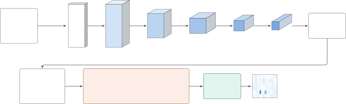
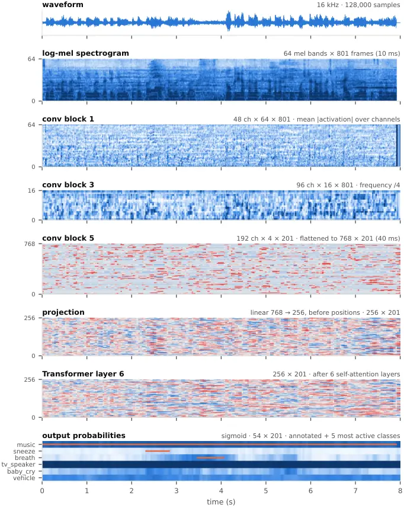
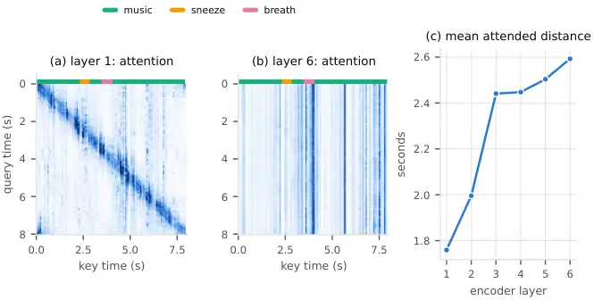
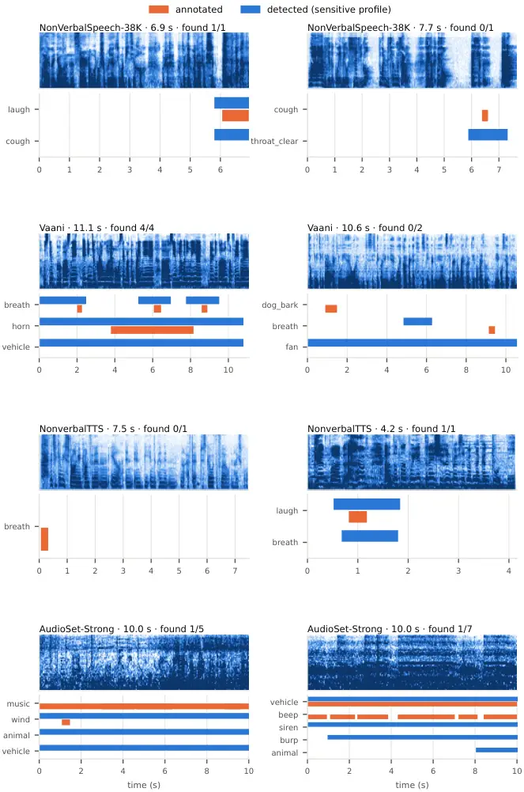
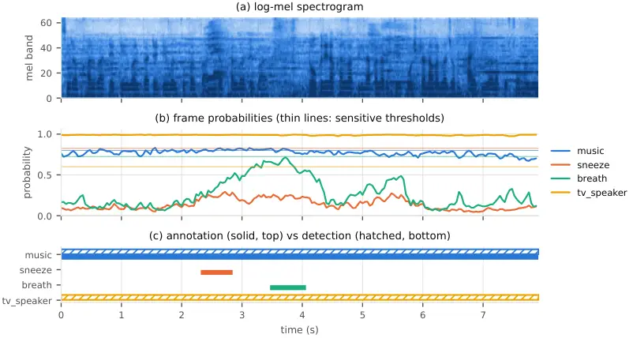

# Speech Event Detector: Timestamped Detection of Non-Verbal Vocalizations and Background Sounds for Rich Speech Transcription

 Ayush Kumar Bar

 Promila Ghosh  
[
 github.com/theboringai-work/surround-sound](https://github.com/theboringai-work/surround-sound)  
[
 huggingface.co/theboringai-work/surround-sound](https://huggingface.co/theboringai-work/surround-sound)

###### Abstract

Automatic speech recognition produces words but drops the non-verbal
content of a recording: the breaths, coughs, sighs and laughter of the
speaker, and the horns, music or barking around them. We describe
_Speech Event Detector_, a 5.8 M-parameter convolutional–Transformer
model that outputs, every 40 ms, probabilities for 54 event classes (20
speaker vocalizations and 34 background sounds), together with the
post-processing that turns these probabilities into timestamped events
and a procedure that merges the events into a Whisper transcript. The
model is trained on material drawn from seven public datasets whose
labels come in incompatible forms: single detected regions, free-text
tags with timestamps, temporally strong ontology labels, symbols
embedded in transcripts, isolated recordings and environment recordings.
We unify them with rule-based label mapping, recover timestamps for
transcript-embedded labels by CTC forced alignment (6,360 of 8,620
sounds located), and combine about 168 h of real annotated training
recordings with synthetic mixtures and augmentation using real
background noise. Per-class thresholds for two operating profiles are
tuned on real held-out recordings, and their performance is estimated by
two-fold cross-validation. On whole held-out recordings from four
datasets, over the 48 classes with at least ten held-out events, the
sensitive profile finds on average 49 % of a class’s events (67 % of all
9,367 events) at a macro precision of 0.30, and the balanced profile
reaches a macro recall of 0.37 at a precision of 0.36 (macro event F1
0.32 and 0.33). The detector runs about 39 times faster than real time
on eight CPU threads. We document the evaluation’s limitations, in
particular that thresholds were tuned on held-out data overlapping the
evaluation clips and that no standard benchmark was run, and the
non-commercial terms of three training sources.

   

A Preprint

|     |
| --- |
|     |

*Keywords* sound event detection $`\cdot`$ non-verbal vocalizations
$`\cdot`$ rich transcription $`\cdot`$ synthetic mixtures $`\cdot`$
forced alignment

## 1 Introduction

Transcripts produced by modern speech recognizers such as Whisper \[30\]
are optimized for the words. Much of what a listener hears is not words:
a speaker’s sigh before an answer, laughter, a cough that interrupts a
sentence, or a horn, music or a barking dog in the background. These
events carry meaning for conversation analysis, for captioning, for
curating expressive speech corpora, and for filtering training data.
Recent corpora for expressive and non-verbal speech, such as
NonverbalTTS \[3\] and NonVerbalSpeech-38K \[39\], show the demand for
transcripts that include such events.

Sound event detection (SED), the task of recognizing sound classes
together with their onset and offset times, is well studied \[21, 4\],
but most systems target environmental or domestic sounds \[35\], and
general-purpose audio models are usually trained for clip-level
tagging \[19, 6, 12\]. Detecting the non-verbal sounds that occur
_inside_ speech, at a time resolution useful for placing a tag between
two words, raises three practical problems:

1.  1.  Fragmented, heterogeneous labels. Public data with timestamps for
        these sounds is scarce and spread across corpora that label them in
        incompatible ways: one detected region per clip, free-text tags with
        timestamps, ontology labels, symbols embedded in transcripts without
        timing, or whole recordings of a single sound or environment.
2.  2.  Events overlap speech. Vocalizations are short, often overlap words,
        and resemble speech acoustically; background events are long and
        loosely bounded.
3.  3.  Operating point. A transcript tag is useful only if false tags are
        rare enough to be ignored, while in our own early use missed events
        were the main complaint; a single global threshold serves neither
        need.

This report describes a practical system that addresses these problems
with modest compute (one NVIDIA T4 GPU), and documents it in detail
(exact reproduction also requires an unreleased preliminary checkpoint;
Appendix D). Our contributions are:

- •
  a label-unification pipeline that maps seven public sources into one
  taxonomy of 54 timestamped classes (Sections 3 and 4), including the
  recovery of timestamps for transcript-embedded labels by CTC forced
  alignment (Section 4.2);
- •
  a training recipe that combines real annotated recordings with
  synthetic mixtures whose event positions are known by construction,
  augments both with real background noise, and selects the model by
  average precision on real held-out audio, under a memory budget that
  fits a single GPU machine (Sections 5 and 6);
- •
  per-class calibration into two operating profiles by cross-validation
  on real held-out audio, and a transcript merge that inserts tags
  without ever reordering the recognizer’s words (Section 7);
- •
  an evaluation on held-out real recordings from four datasets with an
  honest account of its limitations (Sections 8 and 9).

Figure 1 gives an overview. Code is available at
[https://github.com/theboringai-work/surround-sound](https://github.com/theboringai-work/surround-sound)
and pre-trained weights are hosted at
[https://huggingface.co/theboringai-work/surround-sound](https://huggingface.co/theboringai-work/surround-sound);
the weights are restricted to non-commercial use by the terms of the
training data (Section 9).


Figure 1: System overview. (a) Training: real annotated windows,
synthetic mixtures and augmented copies (thumbnails are log-mel
spectrograms of actual training examples) become 8 s windows with 40 ms
frame targets; the network is trained with a frame-level loss plus a
clip-level term. (b) Inference: audio of any length is processed in 8 s
windows (thumbnails show a held-out clip, its spectrogram and the
resulting class probabilities); per-class thresholds and post-processing
give timestamped events, which are merged with the word timestamps of a
Whisper transcript. (c) The two repeated building blocks. marks trained
parts, fixed ones. Section references: data §4, model §5, training §6,
inference §7.

## 2 Related work

#### Sound event detection.

SED assigns class activity to short frames and derives events with
onsets and offsets from them \[21\]. Convolutional–recurrent networks
that combine spectro-temporal convolution with sequence modelling became
a standard design \[4, 35\]; our model follows the same pattern with a
Transformer encoder \[36\] in place of the recurrent layers. Evaluation
uses segment- and event-based metrics with collars \[22\] or
threshold-free measures such as the polyphonic sound detection
score \[2\]. Our event-level evaluation is a lenient overlap-based
variant (Section 8.1).

#### Synthetic mixtures.

Because strongly labelled recordings are expensive, SED systems are
routinely trained on synthetic soundscapes in which isolated events are
mixed into backgrounds at known times, for example with Scaper \[31\] in
the DESED setup \[35\]. We use the same idea with speech as the
background, because our target events occur inside speech.

#### Large-scale audio tagging.

AudioSet \[10\] provides an ontology of sound classes and millions of
weakly labelled clips; a subset was later annotated with temporally
strong labels, which improve event classification \[15\]. Pretrained
taggers such as PANNs \[19\] and BEATs \[6\], and datasets such as
FSD50K \[9\] and ESC-50 \[27\], target general sounds. Whisper-AT \[12\]
shows that the representations of a speech recognizer can support
clip-level audio tagging with little extra cost. Self-supervised speech
models such as WavLM \[5\] capture paralinguistic information. Our model
is trained from log-mel features without such a backbone, which keeps it
small; we return to this choice in Section 9.

#### Non-verbal vocalizations.

Laughter detection in noisy recordings has been studied with precise
segmentations on AudioSet \[11\]. Recent corpora annotate several
vocalization types: NonverbalTTS \[3\] marks ten types inside English
transcripts derived from VoxCeleb \[23\] and Expresso \[24\];
NonVerbalSpeech-38K \[39\] provides one detected region for each of
38,718 mostly Mandarin clips; the Deeply Nonverbal Vocalization
dataset \[7\] contains isolated recordings of 16 types; and the Vaani
noise-event release \[1, 32, 29\] labels both vocal and background
events in Indic speech across 58 Indian languages with timestamps. Our
contribution lies in combining these sources into one timestamped
detector and in calibrating and evaluating it, rather than in the
network architecture.

## 3 Task and label taxonomy

Given audio $`x`$ resampled to 16 kHz mono, the model outputs a
probability $`p_{t,c}\in[0,1]`$ for every class $`c`$ and every frame
$`t`$ of 40 ms. Post-processing (Section 7.1) turns the probability
tracks into events $`(c,t_{\text{start}},t_{\text{end}},\bar{p})`$,
where $`\bar{p}`$ is the mean frame probability over the event.

#### Event list.

We listed 55 events in two groups. The _speaker sounds_ are sounds a
talker makes: breath, sigh, sniff, laugh, cough, throat_clear, cry,
gasp, yawn, snore, sneeze, nose_blow, lip_smack, groan, scream, whisper,
shout, chew, burp, hiccup and click. The _background sounds_ are horn,
vehicle, siren, bird, insect, dog_bark, animal, child_voice, baby_cry,
music, tv_speaker, machine, fan, phone_ring, phone_vibrate, beep, bell,
whistle, buzzer, applause, cheer, crowd, footsteps, wind, rain, thunder,
water, knock, door, dishes, glass_break, gunshot, explosion and
construction. A class is trained only if the sources provide at least 80
annotated events for it. This excludes click, which has 47 (all from
OpenSLR 99), and leaves 54 classes: 20 speaker sounds and 34 background
sounds. Table 10 in the appendix lists the annotated events per class
and source.

#### Rendering.

In a transcript, a speaker sound is written inline as \[tag\] at the
position where it starts. A background sound opens with \<tag\> at its
onset and, if words fall inside it and it ends at least 0.3 s before the
end of the transcript’s last word, closes with \</tag\> after the last
word it overlaps; otherwise it is written as a lone \<tag\>. For
example: so I was saying \[cough\] that the \<horn\> road was blocked
\</horn\> anyway.

## 4 Data

| Source                           | Size                                                                | Labels and use                                                                                                               | Held-out part                     | License                                               |
| -------------------------------- | ------------------------------------------------------------------- | ---------------------------------------------------------------------------------------------------------------------------- | --------------------------------- | ----------------------------------------------------- |
| NonVerbalSpeech-38K \[39\]       | 38,718 clips, 130.6 h; 36,925 Mandarin, 1,793 English               | one non-verbal event per clip with a detected region; event crops, speech beds, real windows                                 | 10 % by stable hash (3,828 clips) | CC BY-NC 4.0                                          |
| Vaani noise events \[1, 32, 29\] | 90,637 clips, 154.6 h; 58 Indian languages + English, 162 districts | 319 free-text noise tags with start/end (11,111 verified, 61,642 unverified, 17,884 without timestamps); crops, real windows | 14 districts, verified clips only | CC BY 4.0                                             |
| NonverbalTTS \[3\]               | 6,256 clips, 17.6 h, English (VoxCeleb, Expresso)                   | 8,620 sounds marked inside transcripts, no timestamps; forced alignment (Section 4.2); real windows, crops, speech beds      | official dev + test (405 clips)   | annotations CC BY-NC-SA 4.0; audio per source corpora |
| AudioSet-Strong \[15, 8\]        | 93,609 10 s clips (79,564 train, 14,045 eval), 260 h                | 455 event names with start/end (220 mapped); streamed subset; real windows, crops                                            | official evaluation split         | not stated on the mirror                              |
| OpenSLR 99 \[7\]                 | 727 clips, 410 speakers, 16 classes                                 | isolated phone-recorded vocalizations; trimmed crops                                                                         | 15 % of speakers                  | CC BY-NC-ND 4.0                                       |
| DNC \[40\]                       | 4,377 home recordings                                               | noise type; ambient crops (TV/radio, music, cars, appliances) and a background-noise pool                                    | 10 % of sessions                  | MIT                                                   |
| DEMAND \[34\]                    | 18 environments, 16 channels                                        | environment; channels 1 and 9; ambient crops (transport, washing room) and noise pool                                        | last 20 % of each recording       | CC BY 4.0 (record text also states CC BY-SA 3.0)      |

Table 1: Training and evaluation sources. Sizes are those of the full
releases as indexed for this work. Licenses are quoted from each
source’s own page; see Section 9 for their consequences.

Table 1 lists the seven sources. All statistics in this section were
recomputed from the cached indices and audio banks of the training run
(the released data/stats.json).

### 4.1 Label unification

Every source is mapped to the taxonomy of Section 3; the complete rules
are reproduced in Appendix C.

- •
  NonVerbalSpeech-38K (NVS-38K) labels are mapped one to one; laughing
  becomes laugh, throatclearing becomes throat_clear, and so on.
- •
  Vaani has 319 distinct free-text tags such as \<horn\>, \<honking\> or
  \<vehicle horn\>. An ordered list of regular expressions (first match
  wins) maps each tag to a class, to _ignore_ for tags that denote
  speech (e.g. \<child talking\>), or to _drop_ for the rest. Of the
  106,892 tag occurrences, 99,320 map to a class, 7,502 are ignored and
  70 are dropped; a clip that contains a dropped tag is not used as a
  real annotated window, since one of its sounds would be unlabelled.
- •
  AudioSet-Strong uses 455 event names; a second ordered rule list maps
  220 of them to our classes. The rest (speech, generic impacts and
  other classes outside the taxonomy) are not targets.
- •
  NonverbalTTS marks each sound with one emoji inside the transcript;
  the ten emoji map to nine classes, with grunting merged into groan.
- •
  OpenSLR 99 folder names map to classes (panting $`\rightarrow`$
  breath, lip-popping $`\rightarrow`$ lip_smack, moaning $`\rightarrow`$
  groan); teeth chattering and grinding are not used.
- •
  DNC recordings of TV and radio map to tv_speaker, music to music, cars
  to vehicle, and appliances (washing machine, water heater, dishwasher,
  coffee machine, vacuum cleaner, microwave) to machine. DEMAND traffic,
  bus, car and metro map to vehicle and the washing room to machine. The
  remaining DNC recordings (quiet rooms, people) and DEMAND environments
  (kitchen, living room, field, park, river, hallway, meeting, office,
  cafeteria, restaurant, station, café, square) become an unlabelled
  background-noise pool used only for augmentation.

### 4.2 Timestamps for NonverbalTTS by forced alignment

NonverbalTTS gives the position of each sound in the transcript (between
two words) but no times. We recover times in three steps.

1.  1.  Word alignment. The normalized words are aligned to the audio with
        the MMS forced-alignment model \[28\] as packaged in
        TorchAudio \[38, 16\], using a Viterbi search over the CTC \[13\]
        emissions implemented in plain PyTorch \[26\]; it is written to
        reproduce TorchAudio’s own aligner. A wildcard token at both ends
        absorbs untranscribed speech. Clips whose mean alignment probability
        is below 0.35 are skipped.
2.  2.  Event placement. A sound is searched for in the pause between the
        word before and the word after its symbol, shrunk by 60 ms at each
        side. In 20 ms frames, the event is the run of frames more than 4 dB
        above the clip’s noise floor (its 10th-percentile frame energy) with
        the highest total energy, joining runs less than 100 ms apart and
        padding by 40 ms. If no frame rises above the floor, the whole pause
        is used when its length is plausible. Each class has a maximum
        duration (from 1.0 s for sniff to 4.0 s for laugh); longer spans are
        cut around the loudest frame. Pauses shorter than about 0.2 s, as
        when laughing while talking, are not located.
3.  3.  Use. Located sounds become event crops. Clips in which every sound
        was located, and clips without any sound, become real annotated
        windows; clips without any sound (and at least 2 s long) also become
        English speech beds. Clips longer than 30 s are not aligned.

Of the 8,620 annotated sounds, 6,360 (74 %) were located: 4,546 breaths,
879 laughs, 327 sniffs, 224 coughs, 187 throat clearings, 107 sighs, 69
groans, 13 sneezes and 8 snores. 4,549 clips became real windows (3,297
with every sound located and 1,252 without sounds), and 1,243 of the
latter also became speech beds. These timestamps were not manually
verified; they inherit any error of the transcript symbol position,
which the dataset’s authors derived with an automatic detector and
forced alignment before human validation \[3\].

### 4.3 Splits

Validation clips are held out from training (Table 1), with two small
exceptions: the babble augmentation draws on speech beds of both splits
(including 990 NVS-38K validation beds), and the unlabelled
background-noise pool is not split. NVS-38K uses a 10 % split by a
CRC-32 hash of the clip’s file, row group and row; Vaani holds out 14 of
its 162 districts and validates only on their verified clips, discarding
the unverified ones from those districts entirely. NonverbalTTS and
AudioSet-Strong use their official development/test and evaluation
splits, OpenSLR 99 holds out 15 % of speakers, DNC 10 % of recording
sessions, and DEMAND the last 20 % of each labelled recording.

### 4.4 Audio banks

All audio is decoded, resampled to 16 kHz and stored as int16 in
memory-mapped files, so that RAM use does not grow with the data. For
the parquet-based sources, a metadata index records the row group of
every clip; all NonverbalTTS clips are processed, while for the others a
greedy pass then selects the row groups that best fill per-class quotas,
weighting each class by the inverse of its available count so that rare
classes count as much as common ones. AudioSet-Strong (121 GB) is
streamed rather than downloaded: up to 500 training and 60 evaluation
row groups of 72 clips each are read, and only the chosen clips are
stored, 10 % of them without any target event. Event crops keep a 30 ms
margin around the labelled span. For NVS-38K, Vaani, AudioSet-Strong,
DNC and DEMAND about 3,000 training crops per class and source are kept
(the cap is checked per clip, so AudioSet-Strong slightly exceeds it for
a few classes); all located NonverbalTTS sounds are kept. Table 2
summarizes the banks and Figure 2 shows how the crops of each class are
distributed over the sources.

|                                                 |          |         |
| ----------------------------------------------- | -------- | ------- |
| Audio bank                                      | Items    | Hours   |
| real windows: NVS-38K, Vaani                    | 37,434   | 80.6    |
| real windows: AudioSet-Strong                   | 33,750   | 92.5    |
| real windows: NonverbalTTS                      | 4,549    | 11.8    |
| event crops: NVS-38K, Vaani                     | 52,654   | 25.2    |
| event crops: AudioSet-Strong                    | 75,343   | 25.9    |
| event crops: NonverbalTTS                       | 6,360    | 1.0     |
| event crops: OpenSLR 99                         | 591      | 0.4     |
| ambient crops: DNC, DEMAND                      | 3,234    | 12.3    |
| speech beds: NVS-38K                            | 8,862    | 18.0    |
| speech beds: NonverbalTTS                       | 1,243    | 2.6     |
| background-noise pool: DNC, DEMAND              | 2,279    | 6.3     |
| Feature pool (8 s windows)                      | Examples | Events  |
| synthetic mixes (clean + 1 augmented copy)      | 60,000   | 83,344  |
| real windows NVS-38K (clean + 2 copies)         | 27,000   | 26,110  |
| real windows Vaani (clean + 2 copies)           | 27,000   | 65,179  |
| real windows NonverbalTTS (clean + 2 copies)    | 21,000   | 21,749  |
| real windows AudioSet-Strong (clean + 2 copies) | 36,000   | 142,569 |
| training total                                  | 171,000  |         |
| validation: NVS-38K                             | 600      | 584     |
| validation: Vaani                               | 800      | 1,777   |
| validation: NonverbalTTS                        | 400      | 558     |
| validation: AudioSet-Strong                     | 800      | 3,729   |
| validation: noisy (augmented real)              | 600      | 1,429   |
| validation: synthetic                           | 1,000    | 1,385   |

Table 2: Audio banks (16 kHz int16, memory-mapped) and the cached
feature pools of 8 s examples used for training and model selection.

Figure 2: Event crops per class in the audio banks (training and
validation), by source. AudioSet-Strong supplies most background classes
and most crops of the rarer speaker classes; NVS-38K and NonverbalTTS
dominate breath, cough, laugh, sigh, sniff and throat_clear; Vaani
dominates lip_smack and nose_blow; DNC is the main source of tv_speaker.
Exact counts are in the released data/event_crops_by_source.csv.

#### Cleaning speech beds and noise.

The speech beds of the synthetic mixtures (Section 6.1) are taken from
NVS-38K audio away from the labelled event and from NonverbalTTS clips
without sounds, so they still contain unlabelled breaths, sniffs and
laughter. Pasting events onto them would teach the model that such
sounds are background. We therefore run a preliminary 31-class
checkpoint of the same architecture (trained earlier on NVS-38K and
Vaani only, with the same splits) over the beds and over the noise pool,
mark frames where any speaker class (beds) or any class (noise) exceeds
its tuned threshold, widen each mark by $`\pm`$0.32 s, and keep the
longest unmarked stretch of at least 2 s. This kept 9,645 of 10,105 beds
(18.4 h) and 2,102 of 2,279 noise chunks (5.5 h).

## 5 Model

Figure 3 shows the network and Table 3 lists every layer with its output
shape and parameter count; shapes and counts were measured with forward
hooks on the released model.



Figure 3: Architecture, with tensor shapes measured on the released
model. Top: the waveform becomes a 64-band log-mel spectrogram, which
five convolutional blocks turn into 201 time steps of 768 features. The
blocks are drawn to scale (height: frequency bins; width: time steps;
depth: square root of the channels), with shapes
channels $`\times`$ frequency $`\times`$ time below each and strides
under the arrows; Figure 1c shows the content of a block. Bottom: the
features are projected to 256 dimensions, given sinusoidal positions and
passed through six pre-norm Transformer encoder layers; a linear layer
with a sigmoid gives one probability per class every 40 ms.

#### Front end.

An 8 s window (128,000 samples at 16 kHz) is converted to a 64-band
log-mel spectrogram (512-point FFT, 25 ms window, 10 ms hop,
50–8000 Hz), compressed as $`10\log_{10}(\cdot+10^{-9})`$ and scaled to
$`(x+60)/20`$ clipped to $`[-1,3]`$; this yields $`64\times 801`$
frames.

#### Convolutional blocks.

Five blocks, each two $`3\times 3`$ convolutions with batch
normalization \[17\] and ReLU, have 48, 48, 96, 96 and 192 channels. The
first convolution of blocks 2 and 3 has stride 2 along frequency, and
that of blocks 4 and 5 stride 2 along both axes, so frequency shrinks
from 64 bins to 4 and time from 801 frames of 10 ms to 201 steps of
40 ms. Each output step of the front end depends on 31 mel frames, i.e.
about 0.33 s of audio.

#### Transformer and head.

The $`192\times 4`$ features of each step are flattened to 768,
projected to 256 dimensions, summed with fixed sinusoidal position
encodings \[36\], and passed through six pre-norm \[37\] Transformer
encoder layers, each with eight-head self-attention and a feed-forward
block of 1,024 units with GELU \[14\] and dropout 0.1. Every step can
therefore draw on the whole 8 s window. A linear layer with a sigmoid
per class gives 201 output frames of 40 ms for each of the 54 classes.

|                                                                                                |                                                                                          |                           |            |
| ---------------------------------------------------------------------------------------------- | ---------------------------------------------------------------------------------------- | ------------------------- | ---------- |
| Layer                                                                                          | Operation                                                                                | Output shape              | Parameters |
| input                                                                                          | waveform, 16 kHz, 8 s                                                                    | $`128000`$                | –          |
| log-mel                                                                                        | STFT 512 / win 400 / hop 160, 64 mel bands, log, scale                                   | $`64\times 801`$          | –          |
| conv block 1                                                                                   | 2 $`\times`$ (conv 3$`\times`$3, BN, ReLU); 1$`\rightarrow`$48 ch; stride (f,t)=(1, 1)   | $`48\times 64\times 801`$ | 21,456     |
| conv block 2                                                                                   | 2 $`\times`$ (conv 3$`\times`$3, BN, ReLU); 48$`\rightarrow`$48 ch; stride (f,t)=(2, 1)  | $`48\times 32\times 801`$ | 41,760     |
| conv block 3                                                                                   | 2 $`\times`$ (conv 3$`\times`$3, BN, ReLU); 48$`\rightarrow`$96 ch; stride (f,t)=(2, 1)  | $`96\times 16\times 801`$ | 124,992    |
| conv block 4                                                                                   | 2 $`\times`$ (conv 3$`\times`$3, BN, ReLU); 96$`\rightarrow`$96 ch; stride (f,t)=(2, 2)  | $`96\times 8\times 401`$  | 166,464    |
| conv block 5                                                                                   | 2 $`\times`$ (conv 3$`\times`$3, BN, ReLU); 96$`\rightarrow`$192 ch; stride (f,t)=(2, 2) | $`192\times 4\times 201`$ | 498,816    |
| reshape                                                                                        | (C $`\times`$ F) per time step: 192 $`\times`$ 4 = 768                                   | $`201\times 768`$         | –          |
| projection                                                                                     | linear 768 $`\rightarrow`$ 256, + sinusoidal positions                                   | $`201\times 256`$         | 196,864    |
| encoder layer 1                                                                                | pre-norm MHSA (8 heads) + FF 1024, GELU                                                  | $`201\times 256`$         | 789,760    |
| encoder layer 2                                                                                | pre-norm MHSA (8 heads) + FF 1024, GELU                                                  | $`201\times 256`$         | 789,760    |
| encoder layer 3                                                                                | pre-norm MHSA (8 heads) + FF 1024, GELU                                                  | $`201\times 256`$         | 789,760    |
| encoder layer 4                                                                                | pre-norm MHSA (8 heads) + FF 1024, GELU                                                  | $`201\times 256`$         | 789,760    |
| encoder layer 5                                                                                | pre-norm MHSA (8 heads) + FF 1024, GELU                                                  | $`201\times 256`$         | 789,760    |
| encoder layer 6                                                                                | pre-norm MHSA (8 heads) + FF 1024, GELU                                                  | $`201\times 256`$         | 789,760    |
| head                                                                                           | linear 256 $`\rightarrow`$ 54, sigmoid                                                   | $`201\times 54`$          | 13,878     |
| total: convolutional front end 853,488, projection 196,864, Transformer 4,738,560, head 13,878 |                                                                                          |                           | 5,802,790  |

Table 3: Layer-by-layer view of the network for one 8 s window (batch
dimension omitted). Shapes are channels $`\times`$ frequency $`\times`$
time for the convolutional part and time $`\times`$ features afterwards;
they were measured with forward hooks on the released model. Strides are
(frequency, time). Parameter counts are exact.

#### Size.

The model has 5,802,790 trainable parameters (27 MB as safetensors).
Figure 4 shows where they are: 82 % in the six encoder layers (789,760
each: 263,168 in self-attention, 525,568 in the feed-forward block and
1,024 in the two layer norms), 15 % in the convolutions, 3 % in the
projection and under 1 % in the output layer. The design is deliberately
small: it trains in about three hours on one T4 and runs far faster than
real time on a CPU (Section 8.9).

Figure 4: Parameters per layer, coloured by component (5,802,790 in
total).

#### How a recording passes through the network.

Figure 5 follows one held-out clip (the clip of Figure 12) through the
released model, showing the real intermediate representations. The
spectrogram’s fine frequency structure is still visible after the first
block; by block 3 the frequency axis has four times fewer bins; after
block 5 each 40 ms step is a 768-dimensional vector, which the
projection and the six Transformer layers transform into 256-dimensional
context-dependent representations. The last panel shows the resulting
class probabilities, with the annotated events overlaid.



Figure 5: A held-out clip passing through the released model; all panels
share the time axis. Convolutional panels show the mean absolute
activation over channels (blue scale); vector-valued panels show each
feature standardized over time (blue below, red above its mean). The
bottom panel shows the output probabilities of the annotated classes and
the five most active classes (white 0, dark blue 1), with the annotated
events as orange lines. The dark column at the right edge of block 1 is
the zero padding of this 7.9 s clip to the 8 s window.

## 6 Training

### 6.1 Training examples

All training examples are 8 s windows with frame-exact labels. Two
generators produce them.

#### Synthetic mixtures.

A cleaned speech bed (Section 4.4) is tiled or cropped to 8 s and scaled
to a reference RMS of 0.05; with probability 0.10 no bed is used. With
probability 0.85 the window receives one, two or three events (with
probabilities $`\tfrac{1}{2}`$, $`\tfrac{1}{3}`$, $`\tfrac{1}{6}`$);
each event’s class is drawn uniformly over classes, so rare classes are
as frequent as common ones, and a crop of that class is drawn from all
sources. Crops longer than 8 s are randomly cut. With probability 0.3 a
crop is speed-perturbed by a factor in $`[0.9,1.1]`$. It is placed at a
uniformly random time, at a speech-to-event ratio drawn from
$`[-3,12]`$ dB, or 10–25 dB below the reference level when there is no
speech. The whole mixture is scaled by $`[-10,+6]`$ dB and a small noise
floor is added. Because the generator places the events, their positions
are known by construction \[31, 35\], up to the accuracy of the crop
boundaries in the source annotations.

#### Real windows.

Real annotated clips of one source (NVS-38K, Vaani, NonverbalTTS or
AudioSet-Strong) are concatenated, starting at a random offset in the
first, until 8 s are filled. Each clip is normalized to an RMS level
that varies by $`\pm 6`$ dB, joins get 10 ms fades, and the annotated
events are shifted accordingly, keeping event parts of at least 50 ms.
Real windows teach the model what the events sound like in their natural
context, which synthetic pasting cannot fully provide.

#### Augmentation.

Every example is stored once clean and, in addition, once (synthetic) or
twice (real) in an independently augmented version (Table 4). Inserted
silences shift later labels. Background noise comes 40 % of the time
from the real noise pool (DNC, DEMAND), and otherwise from babble made
of 3–6 speech beds, synthetic mains hum with harmonics, or white, pink
or brown noise. The phone-band filter and $`\mu`$-law codec \[18\] mimic
telephone audio.

| Augmentation                                          | Prob. | Parameters                                                                                                  |
| ----------------------------------------------------- | ----- | ----------------------------------------------------------------------------------------------------------- |
| silence inserted outside events, labels shifted       | 0.5   | 1–2 pauses of 0.2–1.5 s                                                                                     |
| reverberation (exponentially decaying noise response) | 0.25  | RT₆₀ 0.15–0.8 s; direct path 1–4$`\times`$ the tail peak                                                    |
| telephone band                                        | 0.2   | Butterworth band-pass 300–3400 Hz (order 4 per edge); 8-bit $`\mu`$-law with probability 0.5                |
| background noise                                      | 0.85  | real noise 40 % (SNR 3–25 dB), babble 20 % (12–30 dB), hum 10 % (10–35 dB), white/pink/brown 30 % (8–35 dB) |
| gain                                                  | 1     | $`-12`$ to $`+6`$ dB                                                                                        |

Table 4: Augmentations applied to each stored augmented copy; each is
drawn independently.

#### Pools and features.

Fixed pools are generated once and stored as fp16 log-mel features:
30,000 synthetic mixtures and 9,000 (NVS-38K), 9,000 (Vaani), 7,000
(NonverbalTTS) and 12,000 (AudioSet-Strong) real windows, which with the
augmented copies gives 171,000 training examples (Table 2). Training
reads only the cached features, so the CPU does not limit throughput.
During training, each batch is circularly shifted in time by a random
number of output frames (labels shifted with it), and with probability
0.5 per batch SpecAugment \[25\] masks, in each example, one time band
of 1–29 mel frames (10–290 ms) and one frequency band of 1–7 mel bins.

### 6.2 Objective and optimization

Frame targets $`y_{t,c}\in\{0,1\}`$ are derived from the event lists and
dilated by one frame (40 ms) on each side. With logits $`z_{t,c}`$, the
loss is

```math
\mathcal{L}=\frac{1}{TC}\sum_{t,c}\mathrm{BCE}_{w_{c}}\!\left(z_{t,c},y_{t,c}\right)\;+\;0.25\,\frac{1}{C}\sum_{c}\mathrm{BCE}\!\left(\max_{t}z_{t,c},\,\max_{t}y_{t,c}\right), \tag{1}
```

where $`\mathrm{BCE}_{w}`$ weights the positive term by
$`w_{c}=\mathrm{clip}\big(N^{-}_{c}/N^{+}_{c},\,1,\,100\big)`$, the
ratio of negative to positive frames of class $`c`$ in the training
pools. The second term is a clip-level loss on the maximum over time.

We train for 10 epochs with AdamW \[20\] (weight decay 0.01), a OneCycle
schedule \[33\] with peak learning rate $`3\times 10^{-4}`$ and 10 %
warm-up, batch size 32, mixed precision and gradient-norm clipping at 5
(Table 5). The network is warm-started from the preliminary 31-class
checkpoint of Section 4.4: all weights except the output layer are
copied, as are the output rows of its 31 classes; the other 23 classes
start from random initialization. That checkpoint was trained only on
NVS-38K and Vaani with the same held-out splits, so it never saw any
evaluation clip. One epoch of 5,343 steps takes about 1,095 s on a T4.

| Setting            | Value                                                                                                       |
| ------------------ | ----------------------------------------------------------------------------------------------------------- |
| Input              | 16 kHz mono, 8 s windows; 64-band log-mel, 25 ms window, 10 ms hop, 50–8000 Hz                              |
| Output             | 54 sigmoid outputs every 40 ms (201 frames per window)                                                      |
| Parameters         | 5,802,790 trainable (plus a fixed sinusoidal position table)                                                |
| Optimizer          | AdamW, weight decay 0.01, gradient-norm clip 5                                                              |
| Schedule           | OneCycle, peak LR 0.0003, 10 % warm-up, 10 epochs                                                           |
| Batch              | 32 windows; 5,343 steps per epoch                                                                           |
| Precision          | mixed (fp16 autocast), features cached as fp16                                                              |
| Initialisation     | warm start from a preliminary 31-class checkpoint (all weights except the output layer; its 31 output rows) |
| Per-class crop cap | about 3,000 per source (train), 1/8 for validation; NonverbalTTS uncapped                                   |
| Real-window caps   | NVS-38K 15,000, Vaani 20,000, AudioSet 30,000                                                               |
| AudioSet streaming | up to 500 training + 60 evaluation row groups                                                               |
| Pools              | 30,000 synthetic; real NVS-38K 9,000, Vaani 9,000, NonverbalTTS 7,000, AudioSet 12,000                      |
| Hardware           | one NVIDIA T4 (16 GB), 16 vCPU; $`\approx`$1,095 s per epoch                                                |

Table 5: Training configuration of the released model.

#### Model selection.

After every epoch, frame probabilities are computed for fixed validation
windows: 600 NVS-38K, 800 Vaani, 400 NonverbalTTS and 800
AudioSet-Strong real windows, 600 augmented (“noisy”) real windows, and
1,000 synthetic mixtures. For each set we compute the macro average,
over the classes that set’s source labels (all classes for the noisy
set, which mixes the four sources) that have at least one positive
frame, of the frame-level average precision

```math
\mathrm{AP}_{c}=\frac{1}{N^{+}_{c}}\sum_{k=1}^{N}\mathrm{Prec}_{c}(k)\,\mathbb{1}[y_{(k),c}=1], \tag{2}
```

where frames are sorted by decreasing $`p_{t,c}`$, $`y_{(k),c}`$ is the
label of the $`k`$-th frame and $`\mathrm{Prec}_{c}(k)`$ the precision
of the top $`k`$. Validation targets are dilated by one frame like the
training targets. The checkpoint with the highest mean over the five
real or noisy sets is kept; synthetic data does not influence selection.
AP does not depend on a threshold, so selection rewards a model that
ranks real events above everything else, and the operating point is
chosen afterwards.

### 6.3 Calibration: two threshold profiles

For each class, the frame probabilities of the real validation windows
of the sources that label it are pooled. A threshold $`\theta_{c}`$ is
chosen from $`\{0.05,0.075,\dots,0.975\}`$ to maximize frame F1 (the
_balanced_ profile) or frame F2, which weights recall twice as much as
precision (the _sensitive_ profile). To estimate the performance of a
chosen threshold without bias from the choice, we split the windows into
even and odd halves, tune on one half, score on the other, swap, and
average: this two-fold cross-validated (CV) F1 or F2 is what we report.
The released thresholds are tuned on all windows. A class with fewer
than 25 positive frames (1 s) or a CV F1 below 0.1 is marked _weak_; its
balanced threshold is raised to at least 0.9 and its sensitive threshold
clamped to $`[0.6,0.8]`$, so that weak classes stay available but fire
only when the model is confident.

## 7 Inference and transcript merge

### 7.1 From probabilities to events

Audio of any length is cut into 8 s windows with a 2 s hop (the last
window zero-padded), and the probabilities of overlapping windows are
averaged per 40 ms frame. Each class track is median-filtered over five
frames (200 ms). An event is a maximal run of frames above
$`0.6\,\theta_{c}`$ that contains at least one frame above
$`\theta_{c}`$ (hysteresis), so that brief dips do not split one event
into several. Runs of the same class closer than 0.3 s (speaker sounds)
or 1.0 s (background sounds) are joined, and events shorter than 0.15 s
are discarded. A threshold above 1 disables a class.

### 7.2 Merging events into a transcript

The merge takes the recognizer’s words with timestamps,
$`(w_{i},s_{i},e_{i})`$, and the detected events.

1.  1.  Events the recognizer already transcribed are removed: an event is
        dropped if every word overlapping it is a filler (_uh, um, hmm, …_)
        or a laughter token (_ha, haha, …_).
2.  2.  Same-class pieces closer than 0.5 s (speaker) or 1.5 s (background)
        are joined.
3.  3.  Word start times are made non-decreasing
        ($`s^{\prime}_{i}=\max_{j\leq i}s_{j}`$). A speaker sound or the
        opening tag of a background sound is inserted before the first word
        with $`s^{\prime}_{i}\geq t_{\text{start}}`$; a closing tag is
        inserted after the last word with
        $`s^{\prime}_{i}\leq t_{\text{end}}`$, and only if the event
        overlaps at least one word and ends at least 0.3 s before the end of
        the last word.
4.  4.  Identical adjacent tags are collapsed.

Because tags are inserted between words rather than sorted together with
them, the recognizer’s word order is never changed, even when its
timestamps are not monotonic. The result is shown in the example of
Section 3.

## 8 Experiments

### 8.1 Protocol

All evaluation uses real recordings held out from training
(Section 4.3), and each class is scored only on the sources that
annotate it. NVS-38K, for example, has no labels for horns, so a horn
predicted in an NVS-38K clip is neither a hit nor a false alarm. We
report three levels:

1.  1.  Frame-level average precision on the fixed validation windows
        (Equation 2). It is threshold-free and is also used for model
        selection.
2.  2.  Cross-validated frame F1/F2, precision and recall at the tuned
        thresholds (Section 6.3).
3.  3.  Event-level recall, precision and F1 on whole held-out clips (up to
        1,500 per source) run through the complete detector of Section 7.1.
        A true event counts as _found_ if a prediction of the same class
        overlaps it in time, and a prediction counts as _correct_ if it
        overlaps a true event of the same class. This criterion ignores
        boundary accuracy, which the frame-level measures capture; it is
        more lenient than collar-based event metrics \[22\].

#### Caveats.

\(i\) Checkpoint selection, the threshold tuning and the frame-level
measures all use validation windows drawn from the same held-out clips
as the event-level evaluation, so absolute numbers are optimistic. (ii)
No standard benchmark, such as the DCASE domestic SED task \[35\], was
run. (iii) All numbers come from a single training run without
repetitions, so we cannot give confidence intervals. (iv) Sounds that
annotators did not label count as false alarms, which penalizes classes
such as breath whose instances are often unlabelled.

### 8.2 Training dynamics

Figure 6 shows the training loss and the validation macro AP per
held-out set. Epochs are numbered from 0. The selection score rises from
0.209 after epoch 0 to 0.287 after epoch 6 and stays between 0.286 and
0.287 afterwards, while the training loss keeps falling from 0.250 to
0.188. The model therefore stops improving on real held-out audio after
about seven epochs, and further epochs mainly fit the fixed training
pools. AudioSet-Strong improves the most during training (0.139 to 0.260
at the selected epoch), Vaani the least (0.188 to 0.220). The
NonverbalTTS set dips at epoch 3 (0.409 to 0.272) and recovers at the
next epoch; with 400 windows, a single epoch’s value on this set is
noisy. The checkpoint from epoch 6 (the seventh epoch) is the released
model.

Figure 6: Training loss (a) and validation macro frame AP per held-out
set (b). The selection score is the mean over the four real sets and the
noisy set; the synthetic set is shown but not used for selection. Values
are in data/training_log.csv.

### 8.3 Per-class frame-level results

Figure 7 shows the frame AP and the cross-validated F1 of every class;
Table 9 in the appendix lists all values. The macro AP is 0.265 over all
54 classes (knock, with no positive validation frames, counts as 0) and
0.324 over the 43 classes that are not weak. The highest APs are for
music (0.884), sigh (0.725), horn (0.590), applause (0.582) and snore
(0.551). Eleven classes are weak: tv_speaker, fan, footsteps, cry,
groan, chew, door, yawn, hiccup, nose_blow and knock. Some of them have
hardly any positive validation frames (knock has none, nose_blow 36);
others, such as tv_speaker and fan, have more validation data but still
score low; we have not analysed their confusions.

Figure 7: Frame-level average precision (bars) and two-fold
cross-validated F1 of the balanced profile (dots; thresholds tuned on
the other half of the windows) per class, on real held-out windows.
$`\dagger`$ marks weak classes (Section 6.3).

### 8.4 Operating profiles

Table 6 and Figure 8 compare the two profiles on the 43 reliable
classes. Moving from the balanced to the sensitive profile raises mean
cross-validated recall from 0.414 to 0.521 and lowers mean precision
from 0.352 to 0.267. Users who review tags, or who prefer extra tags to
missed sounds, can use the sensitive profile; the balanced profile suits
unattended transcription.

| Profile   | Precision | Recall | Objective  |
| --------- | --------- | ------ | ---------- |
| balanced  | 0.352     | 0.414  | F1 = 0.351 |
| sensitive | 0.267     | 0.521  | F2 = 0.400 |

Table 6: Cross-validated frame-level operating points of the two
threshold profiles, averaged over the 43 reliably measured classes.

Figure 8: Cross-validated frame precision and recall of each reliable
class under the balanced (F1) and sensitive (F2) thresholds; grey lines
connect the two points of a class. Diamonds are the class means.

### 8.5 Event-level results

Table 7 summarizes the event-level results on whole held-out clips and
Figure 9 shows them per class. Over the 48 classes with at least 10
held-out events (9,367 events), the sensitive profile reaches a macro
recall of 0.491 at a macro precision of 0.302 (F1 0.322) and finds 67 %
of all events; the balanced profile reaches 0.369 recall at 0.361
precision (F1 0.329). Speaker sounds are found about as often as
background sounds (macro recall 0.455 vs. 0.510 with the sensitive
profile) but with higher precision (0.383 vs. 0.261). The best classes
by event F1 (sensitive) are music (0.80), sigh (0.78), horn (0.74),
laugh (0.63), sniff (0.63), bird (0.62) and breath (0.61); seven classes
are below 0.1: yawn, fan, door, rain, chew, buzzer and tv_speaker. For
26 of the 48 classes, the sensitive profile finds at least half of the
events.

|                   |       |        |        |       |           |       |       |       |              |       |
| ----------------- | ----- | ------ | ------ | ----- | --------- | ----- | ----- | ----- | ------------ | ----- |
|                   |       |        | Recall |       | Precision |       | F1    |       | Micro recall |       |
| Classes           | $`n`$ | Events | S      | B     | S         | B     | S     | B     | S            | B     |
| speaker sounds    | 16    | 3,271  | 0.455  | 0.327 | 0.383     | 0.395 | 0.378 | 0.338 | 0.703        | 0.542 |
| background sounds | 32    | 6,096  | 0.510  | 0.390 | 0.261     | 0.345 | 0.294 | 0.325 | 0.656        | 0.528 |
| all               | 48    | 9,367  | 0.491  | 0.369 | 0.302     | 0.361 | 0.322 | 0.329 | 0.672        | 0.533 |

Table 7: Event-level results on whole held-out real clips, for the
sensitive (S) and balanced (B) threshold profiles. Macro averages over
classes with at least 10 held-out events; the last two columns give the
event-weighted (micro) recall. A true event is found if a same-class
prediction overlaps it; a prediction is correct if it overlaps a
same-class true event. Thresholds were tuned on held-out data that
overlaps these clips, so absolute values are optimistic (Section 8.1).

Figure 9: Event-level recall (a) and precision (b) per class on whole
held-out clips with the balanced and sensitive profiles; held-out event
counts in parentheses. Classes with at least 10 events, sorted by
sensitive recall. Values are in data/event_eval.csv.

### 8.6 What the Transformer attends to

Figure 10 shows the self-attention weights of the first and last encoder
layers, averaged over heads, for the clip in Figure 12 (one 8 s window).
The first layer attends mostly to nearby frames, which appears as a
diagonal band: 54 % of its attention falls within $`\pm 1`$ s of the
query. The last layer puts more weight on a few time positions that all
queries share, visible as vertical stripes: its five most-attended
positions receive 12.7 % of the attention, against 2.5 % for uniform
attention. Over the six layers the mean attended distance grows from
1.76 s to 2.59 s (2.68 s for uniform attention), so deeper layers
combine information from a wider part of the window. The mean attention
entropy per query is between 4.86 and 5.03 nats, against
$`\ln 201=5.30`$ for uniform attention. This is a single clip, and we do
not claim that the attended positions correspond to particular events.



Figure 10: Self-attention of encoder layers 1 (a) and 6 (b), averaged
over the eight heads, for the clip of Figure 12; coloured bars on top
mark the annotated events. (c) Mean attended distance per layer,
$`\sum_{j}a_{ij}\,|i-j|\cdot 40`$ ms averaged over queries $`i`$.

### 8.7 Worked examples

To show typical behaviour beyond averages, Figures 11 and 8 give eight
held-out clips, two per source. The selection is mechanical: for each
source, the first two held-out clips in storage order that last 5–12 s
(NonverbalTTS: 4–12 s; AudioSet-Strong: 9–11 s, i.e. its 10 s clips) and
carry at least one annotated event (Vaani and AudioSet-Strong: at least
two event classes), skipping the clip of Figure 12. Across the eight
clips, the sensitive profile finds 8 of the 22 annotated events. It
finds all four events of the first Vaani clip (a horn and three breaths)
and both laughs, but misses a short cough, a dog bark and two breaths,
does not detect the music in the first AudioSet clip (it finds only the
short wind gust there), and finds none of the six short beeps in the
second AudioSet clip, where its one hit is the annotated vehicle sound
and it adds siren, burp and animal. For the English NonverbalTTS clips,
the merged Whisper transcripts are:

- •
  It’s good, \[laugh\] but I \[breath\] have to go to Tray and go to
  Gantur. (annotated: a laugh at 0.8–1.2 s; the breath tag is not
  annotated, so under our protocol it counts as a false alarm, although
  it may be an unlabelled breath);
- •
  That you can be strong and confident and you know and be independent
  and not have to just go with the flow in high school (annotated: a
  breath at 0.1–0.3 s, missed).

The transcripts are Whisper’s own; the recognizer’s word errors (e.g.
place names) are not corrected.



Figure 11: Worked examples: eight held-out clips, two per source, chosen
by a fixed rule (text). Each panel shows the log-mel spectrogram, the
annotated events (orange, upper bar of each row) and the events detected
with the sensitive profile (blue, lower bar). “found” counts annotated
events overlapped by a same-class detection.

| Clip       | Dur. | Annotated events                                                                                      | Detected (sensitive)                                                            | Found S | Found B |
| ---------- | ---- | ----------------------------------------------------------------------------------------------------- | ------------------------------------------------------------------------------- | ------- | ------- |
| nv-1       | 6.9  | laugh 6.1–6.9                                                                                         | cough 5.8–7.0, laugh 5.8–7.0                                                    | 1/1     | 0/1     |
| nv-2       | 7.7  | cough 6.4–6.6                                                                                         | throat_clear 5.9–7.3                                                            | 0/1     | 0/1     |
| vaani-1    | 11.1 | breath 2.0–2.3, horn 3.8–8.2, breath 6.1–6.4, breath 8.6–8.9                                          | breath 0.0–2.5, horn 0.0–10.8, vehicle 0.0–10.8, breath 5.2–7.0, breath 7.8–9.5 | 4/4     | 4/4     |
| vaani-2    | 10.6 | dog_bark 0.9–1.5, breath 9.1–9.4                                                                      | fan 0.0–10.6, breath 4.8–6.3                                                    | 0/2     | 0/2     |
| nvtts-1    | 7.5  | breath 0.1–0.3                                                                                        | –                                                                               | 0/1     | 0/1     |
| nvtts-2    | 4.2  | laugh 0.8–1.2                                                                                         | laugh 0.5–1.8, breath 0.7–1.8                                                   | 1/1     | 0/1     |
| audioset-1 | 10.0 | music 0.0–10.0, wind 1.1–1.5, music 3.0–4.5, music 4.7–6.3, music 8.9–9.6                             | animal 0.0–10.0, vehicle 0.0–10.0, wind 0.0–10.0                                | 1/5     | 0/5     |
| audioset-2 | 10.0 | vehicle 0.0–10.0, beep 0.0–0.9, beep 1.1–2.3, beep 2.4–3.9, beep 4.3–7.0, beep 7.2–8.1, beep 8.4–10.0 | siren 0.0–10.0, vehicle 0.0–10.0, burp 1.0–10.0, animal 8.0–10.0                | 1/7     | 0/7     |

Table 8: Worked examples on held-out clips (selection rule in
Section 8.7). Times are in seconds. “Found” counts annotated events
overlapped by a same-class detection, for the sensitive (S) and balanced
(B) profiles. Detected classes that the clip’s source does not annotate
cannot be judged.

### 8.8 Qualitative example

Figure 12 shows a held-out Vaani clip. To avoid hand-picking, the clip
is the first held-out Vaani clip in storage order that contains at least
three event classes and lasts 6–12 s. It is annotated with music
throughout, a sneeze at 2.3 s and a breath at 3.5 s. The model detects
the music, but misses the sneeze and the breath, whose probabilities
stay below their thresholds (the breath peaks at about 0.7), and adds a
false tv_speaker, a weak class, throughout. A plausible reason is that
music under speech recorded on a phone resembles the TV and radio
recordings that dominate tv_speaker’s training data (Figure 2), but a
single clip cannot establish this. The example shows two kinds of error
that also occur in Figure 11: confusions among stationary background
classes, and short vocal events just below their thresholds.

In an informal check on a 6.8 s English recording made by the first
author, with a sigh at the beginning and a cough at about 4 s, the model
(sensitive profile) tagged the sigh (0.00–1.04 s) and the cough
(3.64–4.88 s), together with a throat_clear overlapping the cough and a
spurious yawn. This single example is anecdotal and is not part of the
evaluation.



Figure 12: A held-out Vaani clip (Deoria district; selection rule in the
text): (a) log-mel spectrogram; (b) frame probabilities of the annotated
and detected classes, with their sensitive thresholds as thin lines; (c)
annotated events (solid) and detected events (hatched). Music is
detected; the sneeze and the breath are missed; tv_speaker is a false
alarm.

### 8.9 Speed

Detection of 178 s of audio, excluding audio decoding and model loading,
took 4.6 s on eight CPU threads (39$`\times`$ real time) and 0.47 s on a
T4 GPU (380$`\times`$ real time), measured with the released code
(Detector.detect). Transcription with Whisper, when used, adds its own
run time, which we did not measure.

## 9 Limitations, licensing and ethics

#### Evaluation.

The caveats of Section 8.1 limit what our numbers show: checkpoint
selection and thresholds used validation windows from the same held-out
clips as the evaluation, there is a single run, no standard benchmark
was used, and our event criterion ignores boundary accuracy. The
NonverbalTTS timestamps (Section 4.2) and the unverified Vaani
timestamps used for training are not manually checked. The most
informative next step is a small, carefully labelled test set from the
target domain.

#### Domain coverage.

Most real training audio is Mandarin radio drama and comedy (NVS-38K, by
its own source statistics \[39\]), Indic speech recorded on phones
(Vaani), English interviews and acted speech (NonverbalTTS) and YouTube
audio (AudioSet-Strong). Accuracy on other domains, such as call-centre,
meeting or far-field audio, is unknown. Eleven classes are weak
(Table 9), and steady background noise can trigger fan (as in the second
Vaani clip of Figure 11).

#### Design choices not explored.

We did not try pretrained audio or speech encoders such as BEATs \[6\]
or WavLM \[5\], other window lengths, or other loss weightings, and we
did not ablate the individual data sources, augmentations or the bed
cleaning. The contribution of each component is therefore not isolated.

#### Licensing.

Three training sources restrict use: NVS-38K is licensed CC BY-NC 4.0
and limited to non-commercial research; the NonverbalTTS annotations are
CC BY-NC-SA 4.0, with the audio under the terms of VoxCeleb and
Expresso; OpenSLR 99 is CC BY-NC-ND 4.0. The AudioSet-Strong mirror
states no license, and AudioSet audio originates from YouTube. Whether
trained weights are derivative works of their training data is not
settled. We therefore release the weights for non-commercial use only
(CC BY-NC-SA 4.0); a version for other uses would have to be retrained
without the restricted sources. OpenSLR 99 contributed only 591 of about
138,000 event crops.

#### Intended use and risks.

The model is intended for rich transcription, corpus analysis, data
filtering and annotation assistance with human review. It must not be
used to infer health conditions (for example from coughs), for
surveillance, or for decisions about individuals. The training data
contains recordings of real people; we use it as published by its
creators and redistribute no audio.

## 10 Conclusion

We built a compact detector for 54 non-verbal and background sound
classes with 40 ms resolution by unifying seven public datasets with
incompatible label formats, recovering missing timestamps by forced
alignment, training on a mix of real and synthetic windows with
real-noise augmentation, and calibrating per-class thresholds into two
profiles on real held-out audio. On held-out real recordings, the
sensitive profile finds two thirds of the annotated events of the 48
classes with at least ten held-out events (with thresholds tuned on
overlapping held-out data), and the model runs far faster than real time
on a CPU. The main open problems are an evaluation on a properly
separated, target-domain test set, the weak classes, and the licensing
constraints inherited from the training data.

## References

- \[1\] ARTPARK and IISc Bangalore (2026) Vaani noise event timestamps.
  Note:
  [https://huggingface.co/datasets/ARTPARK-IISc/Vaani-Noise-Event-Dataset](https://huggingface.co/datasets/ARTPARK-IISc/Vaani-Noise-Event-Dataset)Hugging
  Face dataset, CC BY 4.0 Cited by: §2, Table 1.
- \[2\] Ç. Bilen, G. Ferroni, F. Tuveri, J. Azcarreta, and S.
  Krstulovic (2020) A framework for the robust evaluation of sound event
  detection. In Proc. IEEE International Conference on Acoustics, Speech
  and Signal Processing (ICASSP), pp. 61–65. External Links:
  [Document](https://dx.doi.org/10.1109/ICASSP40776.2020.9052995) Cited
  by: §2.
- \[3\] M. Borisov, E. Spirin, and D. Diatlova (2025) NonverbalTTS: a
  public english corpus of text-aligned nonverbal vocalizations with
  emotion annotations for text-to-speech. In 13th edition of the Speech
  Synthesis Workshop (SSW), pp. 104–109. External Links:
  [Document](https://dx.doi.org/10.21437/SSW.2025-16) Cited by: §1, §2,
  §4.2, Table 1.
- \[4\] E. Çakır, G. Parascandolo, T. Heittola, H. Huttunen, and T.
  Virtanen (2017) Convolutional recurrent neural networks for polyphonic
  sound event detection. IEEE/ACM Transactions on Audio, Speech, and
  Language Processing 25 (6), pp. 1291–1303. Cited by: §1, §2.
- \[5\] S. Chen, C. Wang, Z. Chen, Y. Wu, S. Liu, Z. Chen, J. Li, N.
  Kanda, T. Yoshioka, X. Xiao, J. Wu, L. Zhou, S. Ren, Y. Qian, Y.
  Qian, M. Zeng, and F. Wei (2022) WavLM: large-scale self-supervised
  pre-training for full stack speech processing. IEEE Journal of
  Selected Topics in Signal Processing 16 (6), pp. 1505–1518. Cited by:
  §2, §9.
- \[6\] S. Chen, Y. Wu, C. Wang, S. Liu, D. Tompkins, Z. Chen, W.
  Che, X. Yu, and F. Wei (2023) BEATs: audio pre-training with acoustic
  tokenizers. In Proc. International Conference on Machine Learning
  (ICML), PMLR, Vol. 202, pp. 5178–5193. Cited by: §1, §2, §9.
- \[7\] Deeply Inc. (2021) Deeply nonverbal vocalization dataset. Note:
  [https://github.com/deeplyinc/Nonverbal-Vocalization-Dataset](https://github.com/deeplyinc/Nonverbal-Vocalization-Dataset)OpenSLR
  resource 99,
  [https://www.openslr.org/99/](https://www.openslr.org/99/), CC
  BY-NC-ND 4.0 Cited by: §2, Table 1.
- \[8\] enyoukai (2024) AudioSet-Strong. Note:
  [https://huggingface.co/datasets/enyoukai/AudioSet-Strong](https://huggingface.co/datasets/enyoukai/AudioSet-Strong)Hugging
  Face mirror of AudioSet with temporally-strong labels; no license
  stated Cited by: Table 1.
- \[9\] E. Fonseca, X. Favory, J. Pons, F. Font, and X. Serra (2022)
  FSD50K: an open dataset of human-labeled sound events. IEEE/ACM
  Transactions on Audio, Speech, and Language Processing 30,
  pp. 829–852. Cited by: §2.
- \[10\] J. F. Gemmeke, D. P. W. Ellis, D. Freedman, A. Jansen, W.
  Lawrence, R. C. Moore, M. Plakal, and M. Ritter (2017) Audio Set: an
  ontology and human-labeled dataset for audio events. In Proc. IEEE
  International Conference on Acoustics, Speech and Signal Processing
  (ICASSP), pp. 776–780. Cited by: §2.
- \[11\] J. Gillick, W. Deng, K. Ryokai, and D. Bamman (2021) Robust
  laughter detection in noisy environments. In Proc. Interspeech,
  pp. 2481–2485. External Links:
  [Document](https://dx.doi.org/10.21437/Interspeech.2021-353) Cited by:
  §2.
- \[12\] Y. Gong, S. Khurana, L. Karlinsky, and J. Glass (2023)
  Whisper-AT: noise-robust automatic speech recognizers are also strong
  general audio event taggers. In Proc. Interspeech, pp. 2798–2802.
  External Links:
  [Document](https://dx.doi.org/10.21437/Interspeech.2023-2193) Cited
  by: §1, §2.
- \[13\] A. Graves, S. Fernández, F. Gomez, and J. Schmidhuber (2006)
  Connectionist temporal classification: labelling unsegmented sequence
  data with recurrent neural networks. In Proc. International Conference
  on Machine Learning (ICML), pp. 369–376. Cited by: item 1.
- \[14\] D. Hendrycks and K. Gimpel (2016) Gaussian error linear units
  (GELUs). Note: arXiv:1606.08415 Cited by: §5.
- \[15\] S. Hershey, D. P. W. Ellis, E. Fonseca, A. Jansen, C.
  Liu, R. C. Moore, and M. Plakal (2021) The benefit of
  temporally-strong labels in audio event classification. In Proc. IEEE
  International Conference on Acoustics, Speech and Signal Processing
  (ICASSP), pp. 366–370. External Links:
  [Document](https://dx.doi.org/10.1109/ICASSP39728.2021.9414579) Cited
  by: §2, Table 1.
- \[16\] J. Hwang, M. Hira, C. Chen, X. Zhang, Z. Ni, et al. (2023)
  TorchAudio 2.1: advancing speech recognition, self-supervised
  learning, and audio processing components for PyTorch. In Proc. IEEE
  Automatic Speech Recognition and Understanding Workshop (ASRU),
  External Links:
  [Document](https://dx.doi.org/10.1109/ASRU57964.2023.10389648) Cited
  by: item 1.
- \[17\] S. Ioffe and C. Szegedy (2015) Batch normalization:
  accelerating deep network training by reducing internal covariate
  shift. In Proc. International Conference on Machine Learning (ICML),
  pp. 448–456. Cited by: §5.
- \[18\] ITU-T (1988) Recommendation G.711: pulse code modulation (PCM)
  of voice frequencies. Note: International Telecommunication Union
  Cited by: §6.1.
- \[19\] Q. Kong, Y. Cao, T. Iqbal, Y. Wang, W. Wang, and M. D.
  Plumbley (2020) PANNs: large-scale pretrained audio neural networks
  for audio pattern recognition. IEEE/ACM Transactions on Audio, Speech,
  and Language Processing 28, pp. 2880–2894. Cited by: §1, §2.
- \[20\] I. Loshchilov and F. Hutter (2019) Decoupled weight decay
  regularization. In Proc. International Conference on Learning
  Representations (ICLR), Cited by: §6.2.
- \[21\] A. Mesaros, T. Heittola, T. Virtanen, and M. D. Plumbley (2021)
  Sound event detection: a tutorial. IEEE Signal Processing Magazine 38
  (5), pp. 67–83. Cited by: §1, §2.
- \[22\] A. Mesaros, T. Heittola, and T. Virtanen (2016) Metrics for
  polyphonic sound event detection. Applied Sciences 6 (6), pp. 162.
  Cited by: §2, item 3.
- \[23\] A. Nagrani, J. S. Chung, and A. Zisserman (2017) VoxCeleb: a
  large-scale speaker identification dataset. In Proc. Interspeech,
  pp. 2616–2620. Cited by: §2.
- \[24\] T. A. Nguyen, W. Hsu, A. D’Avirro, B. Shi, I. Gat, M.
  Fazel-Zarandi, T. Remez, J. Copet, G. Synnaeve, M. Hassid, F.
  Kreuk, Y. Adi, and E. Dupoux (2023) EXPRESSO: a benchmark and analysis
  of discrete expressive speech resynthesis. In Proc. Interspeech,
  pp. 4823–4827. Cited by: §2.
- \[25\] D. S. Park, W. Chan, Y. Zhang, C. Chiu, B. Zoph, E. D. Cubuk,
  and Q. V. Le (2019) SpecAugment: a simple data augmentation method for
  automatic speech recognition. In Proc. Interspeech, pp. 2613–2617.
  Cited by: §6.1.
- \[26\] A. Paszke, S. Gross, F. Massa, et al. (2019) PyTorch: an
  imperative style, high-performance deep learning library. In Advances
  in Neural Information Processing Systems (NeurIPS), Vol. 32. Cited by:
  item 1.
- \[27\] K. J. Piczak (2015) ESC: dataset for environmental sound
  classification. In Proc. ACM International Conference on Multimedia,
  pp. 1015–1018. Cited by: §2.
- \[28\] V. Pratap, A. Tjandra, B. Shi, P. Tomasello, A. Babu, S.
  Kundu, A. Elkahky, Z. Ni, A. Vyas, M. Fazel-Zarandi, A. Baevski, Y.
  Adi, X. Zhang, W. Hsu, A. Conneau, and M. Auli (2024) Scaling speech
  technology to 1,000+ languages. Journal of Machine Learning Research
  25 (97), pp. 1–52. Cited by: item 1.
- \[29\] S. Pulikodan, A. Singh, A. Basu, N. Desai, P. K. J, P. D.
  Bhat, R. Dharmaraju, R. Gupta, S. Udupa, S. Kumar, S. Sharma, V.
  Sanka, D. Tewari, H. Dhand, A. Kamat, S. Singh, S. Vashishth, P.
  Talukdar, R. Acharya, and P. K. Ghosh (2026) VAANI: capturing the
  language landscape for an inclusive digital india. External Links:
  2603.28714 Cited by: §2, Table 1.
- \[30\] A. Radford, J. W. Kim, T. Xu, G. Brockman, C. McLeavey, and I.
  Sutskever (2023) Robust speech recognition via large-scale weak
  supervision. In Proc. International Conference on Machine Learning
  (ICML), PMLR, Vol. 202, pp. 28492–28518. Cited by: §1.
- \[31\] J. Salamon, D. MacConnell, M. Cartwright, P. Li, and J. P.
  Bello (2017) Scaper: a library for soundscape synthesis and
  augmentation. In Proc. IEEE Workshop on Applications of Signal
  Processing to Audio and Acoustics (WASPAA), pp. 344–348. Cited by: §2,
  §6.1.
- \[32\] S. Shukla, P. K. J, S. Pulikodan, A. Basu, P. D. Bhat,
  and P. K. Ghosh (2026) A real-world dataset for noise-robust speech
  AI: 100+ timestamped noise types across 58 Indian languages. Note:
  Hugging Face blog (ARTPARK-IISc), published 7 September 2026,
  [https://huggingface.co/blog/ARTPARK-IISc/a-real-world-dataset-for-noise-robust-speech-ai](https://huggingface.co/blog/ARTPARK-IISc/a-real-world-dataset-for-noise-robust-speech-ai)
  Cited by: §2, Table 1.
- \[33\] L. N. Smith and N. Topin (2019) Super-convergence: very fast
  training of neural networks using large learning rates. In Artificial
  Intelligence and Machine Learning for Multi-Domain Operations
  Applications, Proc. SPIE, Vol. 11006. External Links:
  [Document](https://dx.doi.org/10.1117/12.2520589) Cited by: §6.2.
- \[34\] J. Thiemann, N. Ito, and E. Vincent (2013) DEMAND: a collection
  of multi-channel recordings of acoustic noise in diverse environments.
  Zenodo. Note: Zenodo,
  [https://doi.org/10.5281/zenodo.1227121](https://doi.org/10.5281/zenodo.1227121)Presented
  at the 21st International Congress on Acoustics (ICA 2013); CC BY 4.0
  Cited by: Table 1.
- \[35\] N. Turpault, R. Serizel, A. P. Shah, and J. Salamon (2019)
  Sound event detection in domestic environments with weakly labeled
  data and soundscape synthesis. In Proc. Detection and Classification
  of Acoustic Scenes and Events Workshop (DCASE), pp. 253–257. External
  Links: [Document](https://dx.doi.org/10.33682/006b-jx26) Cited by: §1,
  §2, §2, §6.1, §8.1.
- \[36\] A. Vaswani, N. Shazeer, N. Parmar, J. Uszkoreit, L.
  Jones, A. N. Gomez, Ł. Kaiser, and I. Polosukhin (2017) Attention is
  all you need. In Advances in Neural Information Processing Systems
  (NeurIPS), Vol. 30. Cited by: §2, §5.
- \[37\] R. Xiong, Y. Yang, D. He, K. Zheng, S. Zheng, C. Xing, H.
  Zhang, Y. Lan, L. Wang, and T. Liu (2020) On layer normalization in
  the transformer architecture. In Proc. International Conference on
  Machine Learning (ICML), Cited by: §5.
- \[38\] Y. Yang, M. Hira, Z. Ni, et al. (2022) TorchAudio: building
  blocks for audio and speech processing. In Proc. IEEE International
  Conference on Acoustics, Speech and Signal Processing (ICASSP),
  External Links:
  [Document](https://dx.doi.org/10.1109/ICASSP43922.2022.9747236) Cited
  by: item 1.
- \[39\] R. Ye, Y. Zhou, R. Yu, Z. Lin, K. Li, X. Li, X. Liu, G. Zeng,
  and Z. Wu (2025) A scalable pipeline for enabling non-verbal speech
  generation and understanding. Note: arXiv:2508.05385. Dataset
  NonVerbalSpeech-38K:
  [https://huggingface.co/datasets/nonverbalspeech/nonverbalspeech38k](https://huggingface.co/datasets/nonverbalspeech/nonverbalspeech38k)
  (CC BY-NC 4.0) Cited by: §1, §2, Table 1, §9.
- \[40\] R. Zequeira Jiménez (2021) DNC: dataset for noise
  classification. Technische Universität Berlin. Note: DepositOnce,
  [https://doi.org/10.14279/depositonce-11645](https://doi.org/10.14279/depositonce-11645)MIT
  License Cited by: Table 1.

## Appendix A Per-class results

|                |      |      |        |       | balanced   |       | sensitive  |       | event level |      |      |      |      |
| -------------- | ---- | ---- | ------ | ----- | ---------- | ----- | ---------- | ----- | ----------- | ---- | ---- | ---- | ---- |
| Class          | Type | Eval | Pos.   | AP    | $`\theta`$ | CV F1 | $`\theta`$ | CV F2 | Events      | R-S  | P-S  | R-B  | P-B  |
| breath         | S    | NVTA | 16,762 | 0.499 | 0.850      | 0.499 | 0.725      | 0.616 | 1,116       | 0.80 | 0.49 | 0.67 | 0.64 |
| burp           | S    | A    | 136    | 0.218 | 0.650      | 0.285 | 0.375      | 0.361 | 7           | 0.57 | 0.16 | 0.29 | 0.10 |
| chew^(†)       | S    | A    | 242    | 0.039 | 0.900      | 0.056 | 0.600      | 0.108 | 29          | 0.10 | 0.08 | 0.00 | 0.00 |
| cough          | S    | NVTA | 2,033  | 0.313 | 0.875      | 0.400 | 0.750      | 0.493 | 329         | 0.56 | 0.44 | 0.39 | 0.59 |
| cry^(†)        | S    | NA   | 963    | 0.075 | 0.900      | 0.048 | 0.600      | 0.110 | 61          | 0.43 | 0.11 | 0.08 | 0.09 |
| gasp           | S    | NVA  | 268    | 0.065 | 0.775      | 0.126 | 0.750      | 0.160 | 41          | 0.37 | 0.12 | 0.34 | 0.13 |
| groan^(†)      | S    | TA   | 293    | 0.015 | 0.900      | 0.028 | 0.600      | 0.050 | 36          | 0.19 | 0.09 | 0.11 | 0.14 |
| hiccup^(†)     | S    | A    | 73     | 0.004 | 0.900      | 0.015 | 0.600      | 0.034 | 14          | 0.21 | 0.60 | 0.00 | 0.00 |
| laugh          | S    | NVTA | 5,947  | 0.516 | 0.950      | 0.467 | 0.725      | 0.561 | 587         | 0.79 | 0.52 | 0.57 | 0.77 |
| lip_smack      | S    | V    | 168    | 0.052 | 0.925      | 0.126 | 0.850      | 0.135 | 9           | 0.22 | 0.15 | 0.22 | 0.25 |
| nose_blow^(†)  | S    | V    | 36     | 0.000 | 0.900      | 0.000 | 0.600      | 0.000 | 1           | 0.00 | 0.00 | 0.00 | 0.00 |
| scream         | S    | A    | 503    | 0.423 | 0.950      | 0.133 | 0.950      | 0.235 | 32          | 0.16 | 0.50 | 0.16 | 0.50 |
| shout          | S    | A    | 1,783  | 0.147 | 0.800      | 0.258 | 0.725      | 0.371 | 97          | 0.45 | 0.19 | 0.35 | 0.19 |
| sigh           | S    | NTA  | 2,909  | 0.725 | 0.975      | 0.652 | 0.900      | 0.718 | 389         | 0.84 | 0.72 | 0.60 | 0.86 |
| sneeze         | S    | VTA  | 144    | 0.429 | 0.975      | 0.212 | 0.825      | 0.406 | 8           | 0.00 | 0.00 | 0.00 | 0.00 |
| sniff          | S    | NVTA | 1,368  | 0.438 | 0.925      | 0.421 | 0.875      | 0.526 | 272         | 0.65 | 0.60 | 0.56 | 0.71 |
| snore          | S    | NVTA | 272    | 0.551 | 0.975      | 0.610 | 0.950      | 0.567 | 28          | 0.68 | 0.43 | 0.68 | 0.46 |
| throat_clear   | S    | NVTA | 1,024  | 0.335 | 0.900      | 0.383 | 0.800      | 0.471 | 190         | 0.62 | 0.38 | 0.45 | 0.49 |
| whisper        | S    | A    | 215    | 0.297 | 0.975      | 0.374 | 0.950      | 0.311 | 36          | 0.36 | 0.83 | 0.28 | 0.75 |
| yawn^(†)       | S    | NVA  | 122    | 0.007 | 0.900      | 0.014 | 0.600      | 0.033 | 14          | 0.07 | 0.01 | 0.00 | 0.00 |
| animal         | B    | VA   | 6,034  | 0.151 | 0.800      | 0.139 | 0.375      | 0.178 | 538         | 0.52 | 0.12 | 0.25 | 0.25 |
| applause       | B    | A    | 1,785  | 0.582 | 0.925      | 0.480 | 0.900      | 0.499 | 199         | 0.34 | 0.47 | 0.27 | 0.47 |
| baby_cry       | B    | VA   | 779    | 0.218 | 0.975      | 0.402 | 0.950      | 0.436 | 31          | 0.39 | 0.23 | 0.29 | 0.21 |
| beep           | B    | VA   | 2,025  | 0.086 | 0.725      | 0.184 | 0.700      | 0.255 | 165         | 0.56 | 0.26 | 0.52 | 0.27 |
| bell           | B    | VA   | 3,657  | 0.261 | 0.975      | 0.347 | 0.775      | 0.402 | 87          | 0.81 | 0.19 | 0.41 | 0.36 |
| bird           | B    | VA   | 22,291 | 0.399 | 0.925      | 0.426 | 0.800      | 0.535 | 791         | 0.64 | 0.60 | 0.56 | 0.80 |
| buzzer         | B    | VA   | 845    | 0.089 | 0.775      | 0.118 | 0.450      | 0.215 | 25          | 0.20 | 0.06 | 0.16 | 0.17 |
| cheer          | B    | A    | 1,997  | 0.321 | 0.900      | 0.331 | 0.875      | 0.408 | 73          | 0.26 | 0.39 | 0.23 | 0.43 |
| child_voice    | B    | VA   | 4,804  | 0.149 | 0.950      | 0.188 | 0.775      | 0.335 | 179         | 0.48 | 0.22 | 0.25 | 0.39 |
| construction   | B    | A    | 3,147  | 0.213 | 0.800      | 0.329 | 0.525      | 0.272 | 220         | 0.67 | 0.14 | 0.42 | 0.22 |
| crowd          | B    | A    | 2,484  | 0.320 | 0.975      | 0.238 | 0.850      | 0.247 | 41          | 0.61 | 0.17 | 0.41 | 0.34 |
| dishes         | B    | A    | 324    | 0.196 | 0.650      | 0.202 | 0.625      | 0.242 | 50          | 0.42 | 0.11 | 0.38 | 0.09 |
| dog_bark       | B    | VA   | 3,209  | 0.507 | 0.975      | 0.475 | 0.650      | 0.514 | 128         | 0.66 | 0.17 | 0.45 | 0.77 |
| door^(†)       | B    | A    | 162    | 0.076 | 0.900      | 0.031 | 0.600      | 0.067 | 21          | 0.05 | 0.08 | 0.00 | 0.00 |
| explosion      | B    | A    | 911    | 0.224 | 0.975      | 0.460 | 0.975      | 0.379 | 54          | 0.63 | 0.16 | 0.63 | 0.16 |
| fan^(†)        | B    | VA   | 1,725  | 0.035 | 0.900      | 0.040 | 0.800      | 0.087 | 13          | 0.15 | 0.03 | 0.08 | 0.03 |
| footsteps^(†)  | B    | A    | 1,185  | 0.041 | 0.900      | 0.077 | 0.650      | 0.137 | 218         | 0.50 | 0.10 | 0.30 | 0.29 |
| glass_break    | B    | A    | 450    | 0.200 | 0.975      | 0.210 | 0.975      | 0.193 | 58          | 0.12 | 1.00 | 0.12 | 1.00 |
| gunshot        | B    | A    | 560    | 0.308 | 0.975      | 0.323 | 0.950      | 0.311 | 75          | 0.81 | 0.22 | 0.79 | 0.37 |
| horn           | B    | VA   | 10,844 | 0.590 | 0.975      | 0.557 | 0.900      | 0.604 | 258         | 0.76 | 0.71 | 0.64 | 0.83 |
| insect         | B    | VA   | 5,945  | 0.380 | 0.975      | 0.430 | 0.925      | 0.488 | 87          | 0.42 | 0.23 | 0.39 | 0.35 |
| knock^(†)      | B    | A    | 0      | 0.000 | 0.900      | 0.000 | 0.600      | 0.000 | 5           | 0.00 | 0.00 | 0.00 | 0.00 |
| machine        | B    | VA   | 3,273  | 0.138 | 0.800      | 0.276 | 0.750      | 0.296 | 137         | 0.51 | 0.12 | 0.45 | 0.12 |
| music          | B    | VA   | 60,578 | 0.884 | 0.925      | 0.809 | 0.800      | 0.831 | 1,361       | 0.84 | 0.76 | 0.75 | 0.85 |
| phone_ring     | B    | VA   | 1,263  | 0.086 | 0.875      | 0.196 | 0.850      | 0.245 | 64          | 0.70 | 0.24 | 0.67 | 0.23 |
| phone_vibrate  | B    | VA   | 139    | 0.165 | 0.800      | 0.401 | 0.800      | 0.386 | 4           | 0.25 | 0.09 | 0.25 | 0.09 |
| rain           | B    | A    | 1,553  | 0.160 | 0.950      | 0.282 | 0.950      | 0.350 | 43          | 0.12 | 0.07 | 0.12 | 0.07 |
| siren          | B    | VA   | 2,575  | 0.490 | 0.975      | 0.475 | 0.950      | 0.505 | 114         | 0.58 | 0.24 | 0.50 | 0.29 |
| thunder        | B    | A    | 345    | 0.104 | 0.975      | 0.187 | 0.925      | 0.228 | 13          | 0.54 | 0.17 | 0.31 | 0.18 |
| tv_speaker^(†) | B    | VA   | 2,284  | 0.044 | 0.925      | 0.069 | 0.600      | 0.169 | 23          | 0.43 | 0.06 | 0.22 | 0.09 |
| vehicle        | B    | VA   | 23,774 | 0.497 | 0.850      | 0.494 | 0.725      | 0.563 | 549         | 0.87 | 0.32 | 0.80 | 0.44 |
| water          | B    | A    | 7,584  | 0.385 | 0.900      | 0.380 | 0.625      | 0.470 | 192         | 0.75 | 0.19 | 0.49 | 0.27 |
| whistle        | B    | VA   | 1,593  | 0.521 | 0.950      | 0.492 | 0.850      | 0.536 | 83          | 0.28 | 0.38 | 0.17 | 0.44 |
| wind           | B    | A    | 7,780  | 0.316 | 0.950      | 0.297 | 0.850      | 0.357 | 206         | 0.68 | 0.17 | 0.45 | 0.26 |

Table 9: Per-class results. Type: S = speaker sound, B = background.
Eval: validation sources that label the class (N = NVS-38K, V = Vaani, T
= NonverbalTTS, A = AudioSet-Strong). Pos. = positive validation frames
(40 ms). AP = frame-level average precision. $`\theta`$ = threshold; CV
= 2-fold cross-validated frame F1 (balanced) or F2 (sensitive). Event
level: held-out events, and event recall (R) and precision (P) with the
sensitive (S) and balanced (B) profiles. ^(†) weak class.

## Appendix B Annotated events per class and source

| Class         | Type | NVS-38K | Vaani  | NV-TTS | AudioSet | SLR99 | DNC   | DEMAND | Total  |
| ------------- | ---- | ------- | ------ | ------ | -------- | ----- | ----- | ------ | ------ |
| breath        | S    | 2,162   | 35,663 | 6,121  | 27,232   | 44    | 0     | 0      | 71,222 |
| music         | B    | 0       | 6,872  | 0      | 51,454   | 0     | 229   | 0      | 58,555 |
| bird          | B    | 0       | 17,694 | 0      | 37,443   | 0     | 0     | 0      | 55,137 |
| vehicle       | B    | 0       | 4,854  | 0      | 25,450   | 0     | 692   | 4      | 31,000 |
| wind          | B    | 0       | 0      | 0      | 25,079   | 0     | 0     | 0      | 25,079 |
| laugh         | S    | 6,912   | 99     | 1,278  | 14,489   | 25    | 0     | 0      | 22,803 |
| horn          | B    | 0       | 15,739 | 0      | 3,794    | 0     | 0     | 0      | 19,533 |
| animal        | B    | 0       | 1,577  | 0      | 15,820   | 0     | 0     | 0      | 17,397 |
| child_voice   | B    | 0       | 3,165  | 0      | 11,447   | 0     | 0     | 0      | 14,612 |
| footsteps     | B    | 0       | 0      | 0      | 12,490   | 0     | 0     | 0      | 12,490 |
| dog_bark      | B    | 0       | 2,005  | 0      | 10,429   | 0     | 0     | 0      | 12,434 |
| sigh          | S    | 9,783   | 0      | 147    | 206      | 51    | 0     | 0      | 10,187 |
| applause      | B    | 0       | 0      | 0      | 10,157   | 0     | 0     | 0      | 10,157 |
| water         | B    | 0       | 0      | 0      | 10,053   | 0     | 0     | 0      | 10,053 |
| beep          | B    | 0       | 1,039  | 0      | 8,435    | 0     | 0     | 0      | 9,474  |
| machine       | B    | 0       | 156    | 0      | 7,379    | 0     | 853   | 1      | 8,389  |
| cough         | S    | 5,940   | 202    | 272    | 1,818    | 50    | 0     | 0      | 8,282  |
| sniff         | S    | 7,321   | 32     | 407    | 473      | 0     | 0     | 0      | 8,233  |
| insect        | B    | 0       | 3,324  | 0      | 4,561    | 0     | 0     | 0      | 7,885  |
| shout         | S    | 0       | 0      | 0      | 6,244    | 0     | 0     | 0      | 6,244  |
| siren         | B    | 0       | 129    | 0      | 6,023    | 0     | 0     | 0      | 6,152  |
| bell          | B    | 0       | 668    | 0      | 4,934    | 0     | 0     | 0      | 5,602  |
| throat_clear  | S    | 4,909   | 96     | 214    | 278      | 54    | 0     | 0      | 5,551  |
| construction  | B    | 0       | 0      | 0      | 5,400    | 0     | 0     | 0      | 5,400  |
| gunshot       | B    | 0       | 0      | 0      | 5,074    | 0     | 0     | 0      | 5,074  |
| whistle       | B    | 0       | 106    | 0      | 4,061    | 0     | 0     | 0      | 4,167  |
| dishes        | B    | 0       | 0      | 0      | 3,654    | 0     | 0     | 0      | 3,654  |
| baby_cry      | B    | 0       | 1,620  | 0      | 1,576    | 0     | 0     | 0      | 3,196  |
| crowd         | B    | 0       | 0      | 0      | 3,130    | 0     | 0     | 0      | 3,130  |
| cheer         | B    | 0       | 0      | 0      | 3,118    | 0     | 0     | 0      | 3,118  |
| tv_speaker    | B    | 0       | 156    | 0      | 1,804    | 0     | 1,100 | 0      | 3,060  |
| phone_ring    | B    | 0       | 1,548  | 0      | 1,409    | 0     | 0     | 0      | 2,957  |
| explosion     | B    | 0       | 0      | 0      | 2,505    | 0     | 0     | 0      | 2,505  |
| cry           | S    | 753     | 0      | 0      | 1,234    | 24    | 0     | 0      | 2,011  |
| gasp          | S    | 578     | 1      | 0      | 1,166    | 0     | 0     | 0      | 1,745  |
| chew          | S    | 0       | 0      | 0      | 1,730    | 0     | 0     | 0      | 1,730  |
| rain          | B    | 0       | 0      | 0      | 1,711    | 0     | 0     | 0      | 1,711  |
| lip_smack     | S    | 0       | 1,437  | 0      | 0        | 99    | 0     | 0      | 1,536  |
| whisper       | S    | 0       | 0      | 0      | 1,470    | 0     | 0     | 0      | 1,470  |
| scream        | S    | 0       | 0      | 0      | 1,330    | 51    | 0     | 0      | 1,381  |
| snore         | S    | 91      | 12     | 15     | 1,101    | 0     | 0     | 0      | 1,219  |
| glass_break   | B    | 0       | 0      | 0      | 1,159    | 0     | 0     | 0      | 1,159  |
| groan         | S    | 0       | 0      | 148    | 901      | 45    | 0     | 0      | 1,094  |
| fan           | B    | 0       | 599    | 0      | 452      | 0     | 0     | 0      | 1,051  |
| buzzer        | B    | 0       | 76     | 0      | 839      | 0     | 0     | 0      | 915    |
| door          | B    | 0       | 0      | 0      | 895      | 0     | 0     | 0      | 895    |
| burp          | S    | 0       | 0      | 0      | 765      | 0     | 0     | 0      | 765    |
| thunder       | B    | 0       | 0      | 0      | 728      | 0     | 0     | 0      | 728    |
| hiccup        | S    | 0       | 0      | 0      | 608      | 0     | 0     | 0      | 608    |
| sneeze        | S    | 0       | 87     | 18     | 440      | 52    | 0     | 0      | 597    |
| knock         | B    | 0       | 0      | 0      | 431      | 0     | 0     | 0      | 431    |
| phone_vibrate | B    | 0       | 231    | 0      | 176      | 0     | 0     | 0      | 407    |
| yawn          | S    | 269     | 36     | 0      | 19       | 48    | 0     | 0      | 372    |
| nose_blow     | S    | 0       | 97     | 0      | 0        | 48    | 0     | 0      | 145    |

Table 10: Annotated events per class in each source’s full index, before
any sampling caps. DEMAND counts environments.

## Appendix C Label-mapping rules

The rules below are reproduced verbatim from the training pipeline
(training/build_notebooks.py), except that the one-to-one NVS-38K map
(Section 4.1) and the NonverbalTTS emoji map are omitted; for each rule
list, the first matching pattern wins. None means ignored, and DROP (in
canon_vaani) means a tag that makes the clip unusable as a real window.
The NonverbalTTS emoji map is omitted here because it consists of
pictographs; it maps breath, laughing, sniffing, coughing, throat
clearing, sighing, groaning, sneezing, snoring and grunting to the
classes of Section 4.1, with grunting mapped to groan.

\# Label-mapping rules used to train the released model (verbatim from
training/build_notebooks.py).

VAANI_RULES = \[ \# first match wins, so order matters

(r"\b(child\|children\|kids?\|baby\|human\|people)\b.\*\b(talking\|speaking\|voices?)\b\|human
(noise\|sound)", None),

(r"\b(child\|children\|kids?\|baby)\b.\*\bcry", "baby_cry"),

(r"laugh", "laugh"),

(r"cough", "cough"),

(r"throat", "throat_clear"),

(r"sneez", "sneeze"),

(r"nose (blow\|clear)", "nose_blow"),

(r"lip.?smack", "lip_smack"),

(r"breath\|inhal\|exhal", "breath"),

(r"sniff\|snort", "sniff"),

(r"yawn\|yawing", "yawn"),

(r"snor", "snore"),

(r"gasp", "gasp"),

(r"\b(child\|children\|kids?\|baby)\b", "child_voice"), \# yelling /
playing / noise

(r"siren\|ambulance\|alarm", "siren"),

(r"horn\|honk", "horn"),

(r"bark\|\bdog\b", "dog_bark"),

(r"insect\|cricket\|\bbugs?\b\|beetle", "insect"),

(r"bird\|crow\|caw\|rooster\|\bcock\b\|\bhen\b\|cluck\|duck\|cuckoo\|sparrow\|squawk\|twitter\|chirp",
"bird"),

(r"\bcow\b\|goat\|\bcat\b\|meow\|buffalo\|frog\|squirrel\|animal",
"animal"),

(r"whistl", "whistle"),

(r"music\|song\|sing\|flute\|drum\|band
sound\|prayer\|mantra\|chant\|record playing", "music"),

(r"\bfan\b", "fan"), \# before "ring": fan whiRRING

(r"vibrat", "phone_vibrate"),

(r"bell\|chim", "bell"), \# before "ring": bell ringing

(r"\bring(ing\|tone\|s)?\b\|ringtone", "phone_ring"),

(r"beep\|notification\|message tone\|phone sound\|mobile sound\|phone
click", "beep"),

(r"buzz", "buzzer"),

(r"\btv\b\|television\|speaker\|\bmic\b\|\bmike\b", "tv_speaker"),

(r"vehicle\|traffic\|engine\|bike\|motor\|\bcar\b\|train\|tractor\|aeroplane\|rickshaw",
"vehicle"),

(r"machine\|generator\|factory\|typing\|tick\|clock\|pump", "machine"),

\]

\_RULES = \[(re.compile(p), c) for p, c in VAANI_RULES\]

DROP = "\_\_drop\_\_"

MIN_EVENTS = 80

def canon_vaani(tag):

t = re.sub(r"\s+", " ", re.sub(r"\[\<\>\\\\\_\]", " ",
str(tag).lower())).strip()

for rx, c in \_RULES:

if rx.search(t):

return c

return DROP

\# (NonverbalTTS emoji map omitted here; see Section 4.1 of the paper
and sed/taxonomy.py)

SLR_MAP = {"coughing": "cough", "yawning": "yawn", "throat-clearing":
"throat_clear", "sighing": "sigh",

"lip-smacking": "lip_smack", "lip-popping": "lip_smack", "panting":
"breath", "crying": "cry",

"laughing": "laugh", "sneezing": "sneeze", "nose-blowing": "nose_blow",
"moaning": "groan",

"screaming": "scream", "tongue-clicking": "click", "teeth-chattering":
None, "teeth-grinding": None}

\# AudioSet ontology names -\> canonical tags (first match wins).
Unmatched events (speech, impacts, ...) are ignored.

AS_RULES = \[

(r"speech synthesizer\|howl \\wind\\\|sliding
door\|sanding\|bellow\|crowd\|growling", None), \# false friends

(r"^(baby cry\|infant cry)", "baby_cry"),

(r"baby laughter\|^laughter\|giggle\|snicker\|belly laugh\|chuckle",
"laugh"),

(r"^crying\|sobbing\|^whimper\$", "cry"),

(r"^cough", "cough"),

(r"^sneeze", "sneeze"),

(r"^sniff", "sniff"),

(r"^snoring", "snore"),

(r"^sigh", "sigh"),

(r"^gasp", "gasp"),

(r"throat clearing", "throat_clear"),

(r"^yawn", "yawn"),

(r"^(groan\|grunt)", "groan"),

(r"^(screaming\|shriek\|yell)", "scream"),

(r"^(breathing\|pant\|wheeze)", "breath"),

(r"^whispering", "whisper"),

(r"^shout\|battle cry", "shout"),

(r"^chewing", "chew"),

(r"^burping", "burp"),

(r"^hiccup", "hiccup"),

(r"nose blowing", "nose_blow"),

(r"lip smack", "lip_smack"),

(r"^child\|^children", "child_voice"),

(r"siren\|emergency vehicle\|alarm", "siren"),

(r"horn\|honking\|^toot\$", "horn"),

(r"^(bark\|dog\|yip\|bow-wow\|howl\|bay)", "dog_bark"),

(r"insect\|cricket\|mosquito\|^fly\|bee, wasp\|buzzing insect",
"insect"),

(r"bird\|chirp\|tweet\|^crow(\$\|ing)\|^caw\|squawk\|pigeon\|^coo\$\|rooster\|chicken\|duck\|quack\|^owl",
"bird"),

(r"cattle\|moo\|goat\|bleat\|^cat\$\|meow\|purr\|frog\|croak\|horse\|neigh\|^pig\|oink\|sheep\|animal",
"animal"),

(r"whistl", "whistle"),

(r"television\|^radio", "tv_speaker"),

(r"mechanical fan\|air conditioning", "fan"),

(r"vibrating alert", "phone_vibrate"),

(r"telephone bell\|ringtone\|^telephone\$", "phone_ring"),

(r"bell\b\|^ding\|wind chime", "bell"),

(r"beep\|bleep\|dtmf", "beep"),

(r"^buzz", "buzzer"),

(r"music\|singing\|song\|choir\|orchestra\|guitar\|piano\|drum\|flute\|violin\|synthesizer\|keyboard
\\musical\\\|instrument", "music"),

(r"vacuum cleaner\|washing machine\|dishwasher\|blender\|hair
dryer\|electric shaver\|sewing
machine\|microwave\|printer\|typing\|computer
keyboard\|clock\|tick-tock", "machine"),

(r"^(clapping\|applause)", "applause"),

(r"^(cheering\|whoop)", "cheer"),

(r"^crowd\$\|hubbub\|speech babble", "crowd"),

(r"footsteps\|^run\$", "footsteps"),

(r"^wind\$\|^wind noise", "wind"),

(r"thunder", "thunder"),

(r"^rain\|^patter", "rain"),

(r"^water\|splash\|^pour\|^drip\|trickle\|^stream\$\|^liquid\|gurgling\|toilet
flush\|waves\|^ocean", "water"),

(r"^knock", "knock"),

(r"^door\$\|^slam", "door"),

(r"^dishes\|cutlery\|chink, clink", "dishes"),

(r"^shatter\|^breaking", "glass_break"),

(r"gunshot\|machine gun\|cap gun\|artillery", "gunshot"),

(r"explosion\|firecracker\|fireworks", "explosion"),

(r"^hammer\|power tool\|^drill\|chainsaw\|^sawing\|^tools\$",
"construction"),

(r"vehicle\|^car\|truck\|^bus\$\|helicopter\|motorboat\|subway\|air
brake\|motorcycle\|traffic\|engine\|idling\|revving\|race
car\|train\|railroad\|rail transport\|aircraft\|tractor", "vehicle"),

\]

\_AS_RULES = \[(re.compile(p), c) for p, c in AS_RULES\]

def canon_as(name):

t = str(name).lower()

for rx, c in \_AS_RULES:

if rx.search(t): return c

return None

\# Noise datasets: labelled ambient sounds, or NOISE = unlabelled
background for the augmentation pool.

NOISE = "\_\_noise\_\_"

DNC_MAP = {"TV": "tv_speaker", "Radio": "tv_speaker", "Music": "music",
"autos": "vehicle",

"WashingMachine": "machine", "WaterHeater": "machine", "Dishwasher":
"machine", "CoffeeMachine": "machine",

"VacuumCleaner": "machine", "Microwave": "machine", "quiet": NOISE,
"people": NOISE}

DEMAND_MAP = {"STRAFFIC": "vehicle", "TBUS": "vehicle", "TCAR":
"vehicle", "TMETRO": "vehicle", "DWASHING": "machine"}

\# every other DEMAND environment -\> NOISE

## Appendix D Reproducibility

#### Released material.

The code repository contains the inference library (sed/), the
command-line tool, the two training notebooks and their generator, the
trained weights (best.pt and model.safetensors with config.json), both
threshold files, the post-processing configuration, the per-class
threshold report, the event-level results and the per-epoch training
log. This report’s folder contains every number used here (data/), the
scripts that turn them into the figures and tables
(scripts/make_figures.py, scripts/make_tables.py), the scripts that
recompute the dataset statistics and summaries
(scripts/compute_stats.py, scripts/compute_summary.py), and the scripts
that extracted the example clips, layer table, activations and attention
maps from the model (scripts/prepare_example.py,
scripts/prepare_examples.py, scripts/prepare_model_viz.py). The compute
figures below and the timings of Section 8.9 come from the training and
measurement logs.

#### Compute.

Data preparation and training ran on one machine with an NVIDIA T4
(16 GB), 16 vCPUs and 62 GB of RAM; the training process peaked at about
11 GB of RAM and 4.6 GB of GPU memory. The full run took about 5 h after
the datasets were downloaded, of which about 3 h was training (10 epochs
of $`\approx`$1,095 s). The downloads took about 50 GB, the audio banks
31.9 GB and the feature cache 18.0 GB.

#### What is needed for exact reproduction.

The released model was warm-started from, and its speech beds and noise
pool were cleaned with, a preliminary 31-class checkpoint of the same
architecture that was trained earlier on NVS-38K and Vaani (with the
same NVS-38K and Vaani split functions) and is not released; the compute
figures above exclude its training. The training notebooks use whatever
model is in checkpoints/ for these two roles, which is now the released
model, and the peak learning rate depends on whether a warm-start
checkpoint exists. A re-run therefore follows the same procedure but
does not reproduce the released weights exactly.

#### Randomness.

Fixed pools and validation sets are generated with fixed seeds, so they
are identical across re-runs; batch order, the time shift and
SpecAugment are not seeded. We trained once.
