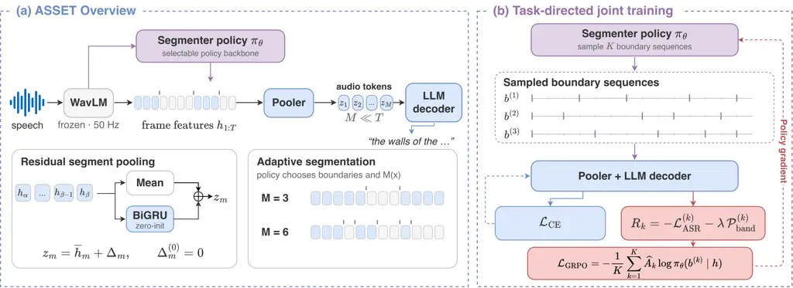

# ASSET: Adaptive Speech Segmentation via Reinforcement Learning

Cihan Xiao¹, Yuan Tseng², Matthew Wiesner³, Desh Raj⁴, Leibny Paola
Garcia Perera^(1,3), Sanjeev Khudanpur^(1,3), David Harwath²

###### Abstract

Speech large language models (LLMs) are often built using pretrained
acoustic encoders as an audio interface to an LLM decoder. However, LLMs
scale poorly with input sequence length, while acoustic encoders tend to
produce substantially longer sequences than typical textual inputs. This
motivates learning to compress encoder outputs while preserving
task-oriented information. To this end, we introduce ASSET, a
reinforcement learning (RL)-based framework that learns to adaptively
compress encoder outputs by first partitioning them into
variable-duration segments and then pooling each segment into a
continuous audio token. We use group-relative policy optimization (GRPO)
to train a segmenter with task performance feedback and a token-rate
penalty. In automatic speech recognition (ASR) experiments, ASSET
achieves performance comparable to a transcript-assisted
character-boundary oracle with approximately 25% fewer audio tokens on
English LibriSpeech, while improving on a phone-boundary oracle at a
similar token rate on Mandarin AISHELL. Exploratory experiments on
non-ASR tasks further illustrate how learned segmentation changes when
the framework is adapted to tasks beyond transcription.

###### Index Terms: 

speech recognition, speech LLM, audio-token compression, reinforcement
learning

^(†)^(†)address: ¹Johns Hopkins University, USA  ²The University of
Texas at Austin, USA  
³HLTCOE, Johns Hopkins University, USA  ⁴NVIDIA, USA

## 1 Introduction

Processing audio with LLMs is challenging, as such systems usually
combine a pretrained LLM decoder \[1, 26, 7, 24, 28\] with an acoustic
encoder which typically produces high-frequency feature sequences that
are expensive to process. The resulting long audio prefixes increase
context usage and the cost of decoder self-attention, which grows
quadratically with input sequence length. When the downstream task does
not require the encoder’s full temporal resolution, some of this
computation may be unnecessary. Our goal is therefore to learn how to
compress encoder outputs into shorter sequences while preserving
task-oriented acoustic information.

We view frame compression as two complementary operations:
_segmentation_, which partitions the frame sequence into contiguous
segments, and _pooling_, which summarizes each segment into one audio
token (Fig. 1). Fixed-rate frame stacking or pooling uses evenly
distributed boundaries \[2\], whereas connectionist temporal
classification (CTC) compression uses auxiliary alignments for
variable-rate token allocation \[28, 8\]. CTC provides a natural
criterion for ASR, however, for tasks such as emotion recognition, a
suitable auxiliary alignment objective is less obvious. This motivates
learning compression directly from the target task.

Both segmentation and pooling can be learned, but they require different
strategies. A pooling function can be optimized via backpropagation
directly once segment assignments are given. However, boundary decisions
are discrete: moving a boundary changes which frames belong to each
segment, blocking ordinary backpropagation through these assignments. RL
provides a convenient way to train such a boundary policy model by
scoring how its segmentation policies affect the downstream task
performance, without requiring an auxiliary frame-level target. In this
paper, we introduce ASSET, _Adaptive Speech SEgmenTation_, to learn a
boundary policy with a trainable pooling function for adaptive encoder
feature compression.

Our contributions are: 1) ASSET, a framework that combines a learned
segmenter with a residual pooler to adaptively produce compact audio
representations while retaining task-oriented information; 2) a joint
optimization paradigm that uses RL to learn segment boundaries from task
feedback, while training the pooler and decoder through direct
teacher-forcing; and 3) ASR experiments showing that the system works
across languages, while exploratory non-ASR studies revealing how
learned policies differ across tasks and speaking style.



Figure 1: ASSET overview. (a) A policy partitions encoder frames into
variable-duration segments, and a residual BiGRU pooler maps each
segment to an audio token. (b) Task losses score sampled boundary
sequences; cross-entropy updates the pooler and decoder, while GRPO
updates the segmenter.

## 2 Related Work

Decoder-only speech systems shorten continuous acoustic prompts with CTC
collapse \[24, 28\] or fixed pooling \[2\]. EFIN improves training
efficiency by pretraining the encoder before LLM integration \[15\].
AdaTS adaptively merges tokens using a pairwise-similarity threshold
\[19\]. By contrast, ASSET learns the boundary policy from task
performance feedback while retaining every frame in a monotonic
partition.

Adaptive reduction predates LLM-based ASR. Continuous integrate-and-fire
learns soft monotonic alignments \[6\], while extreme fixed reduction
compresses transducer encoder outputs \[18\]. Jiang et al. jointly
optimize phone error and frame rate with RL in hybrid ASR \[11\]; REBORN
rewards boundaries using predicted-phoneme perplexity in unsupervised
ASR \[23\]. In contrast, our approach optimizes boundaries against its
LLM decoder’s transcription loss and pools each segment with an
order-aware residual in a supervised manner.

## 3 Method

The goal of ASSET is to compress the frame sequence from a speech
encoder before passing it to an LLM decoder (Fig. 1). We extract
contextual speech features with a frozen encoder and use a learned
boundary policy to partition them into contiguous, variable-duration
segments. We then summarize each segment with a residual recurrent
pooler and prepend the resulting audio tokens to the decoder input to
condition text generation.

### 3.1 Adaptive segmentation

Let $`H=(h_{1},\ldots,h_{T})`$ denote the encoder features. Our policy
model outputs a logit $`a_{t}=f_{\theta}(H,b_{<t})`$ and boundary
probability $`p_{t}=\sigma(a_{t})`$. It then samples the boundary
indicator $`b_{t}\mid H,b_{<t}\sim\operatorname{Bernoulli}(p_{t})`$.
$`b_{t}=1`$ starts a segment at frame $`t`$, while $`b_{t}=0`$ continues
the current segment. With the first segment starting at frame one:

```math
s_{t}=1+\sum_{j=2}^{t}b_{j},\qquad M=1+\sum_{t=2}^{T}b_{t}, \tag{1}
```

where $`s_{t}`$ is the index of the segment that assigns frames to $`M`$
contiguous segments, as illustrated in Figure 1. We denote the frame
kept ratio as $`\rho=M/T`$ and the token rate as
$`f_{\mathrm{audio}}=\rho f_{\mathrm{enc}}`$, for encoder rate
$`f_{\mathrm{enc}}`$.

The policy distribution is

```math
\pi_{\theta}(b\mid H)=\prod_{t=2}^{T}p_{\theta}(b_{t}\mid H,b_{<t}). \tag{2}
```

In our implementation, the policy model is a CNN model or a transformer
with local attention. Each conditional decision follows a Bernoulli
distribution. However, the hidden states do condition on previous
decisions $`b_{<t}`$, which makes the sampling process causal rather
than independent. We will show in Section 4.2 how conditioning on
previous boundary decisions affects the task performance.

### 3.2 Residual segment pooling

Contextual features generated by the encoder contain ordering
information, but their mean is permutation-invariant within a segment.
To preserve the ordering information more explicitly, we additionally
apply a bidirectional gated recurrent unit (BiGRU) \[20\] to extract the
information from a segment. Let $`\mathcal{S}_{m}=\{t:s_{t}=m\}`$ denote
the set of frame indices assigned to segment $`m`$. The BiGRU’s terminal
forward and backward states $`\overrightarrow{g}_{m}`$ and
$`\overleftarrow{g}_{m}`$ provide an order-explicit information to the
segment mean:

```math
\overline{h}_{m}=\frac{1}{|\mathcal{S}_{m}|}\sum_{t\in\mathcal{S}_{m}}h_{t},\qquad z_{m}=\overline{h}_{m}+W_{r}[\overrightarrow{g}_{m};\overleftarrow{g}_{m}]+c_{r}. \tag{3}
```

Initializing $`W_{r},c_{r}=0`$ is equivalent to mean pooling exactly, so
introducing the recurrent branch does not inject noise into the encoded
audio representations. The mean retains every frame’s encoded
representation directly, while the continuation loss optimizes the
learned residual. As with other speech language models, we apply a
projection layer that maps the pooled representations
$`Z=(z_{1},\ldots,z_{M})`$ into the LLM embedding space.

### 3.3 Task-guided policy optimization

Our goal is to train a boundary policy model that preserves task
performance while shortening the audio prefix. For each utterance, it
samples $`K`$ complete boundary sequences $`b^{(k)}\sim\pi_{\theta}`$.
We then pool the encoder features accordingly and score the resulting
prefixes with the current LLM decoder. Let $`\ell_{k}`$ denote the
normalized teacher-forced negative log-likelihood of the target
continuation. For ASR, this continuation is the reference transcript.

However, continuation loss alone provides no explicit incentive to
compress the audio prefix. The policy could choose no downsampling to
avoid information loss from compression. We therefore introduce a soft
regularizer on the retained ratio $`\rho_{k}=M_{k}/T`$. Its upper bound
penalizes lazy over-segmentations, while its lower bound penalizes
excessive compression, which might lead to training collapses. We
combine this regularizer with the continuation loss to define the
reward:

```math
\displaystyle\mathcal{P}_{\mathrm{band}}(\rho) \displaystyle=[\rho_{\min}-\rho]_{+}^{2}+[\rho-\rho_{\max}]_{+}^{2}, \tag{4}
```

```math
\displaystyle R_{k} \displaystyle=-\ell_{k}-\lambda\mathcal{P}_{\mathrm{band}}(\rho_{k}). \tag{5}
```

Here $`[x]_{+}=\max(x,0)`$ and $`\lambda`$ controls the regularization
strength.

We use GRPO \[21\] to optimize the policy model. Specifically, we
standardize their returns to obtain relative advantages:

```math
\widehat{A}_{k}=\frac{R_{k}-\overline{R}}{s_{R}+\epsilon},\qquad\overline{R}=\frac{1}{K}\sum_{k=1}^{K}R_{k}. \tag{6}
```

Here $`s_{R}`$ is the standard deviation of the group returns and
$`\epsilon`$ stabilizes normalization. Segmentations with above-average
returns receive positive advantages, encouraging the policy to assign
them higher probability. We implement on-policy optimization with one
update per step:

```math
\mathcal{L}_{\mathrm{GRPO}}=-\frac{1}{K}\sum_{k=1}^{K}\frac{\widehat{A}_{k}}{T-1}\sum_{t=2}^{T}\log p_{\theta}(b_{t}^{(k)}\mid H,b_{<t}^{(k)}). \tag{7}
```

We omit reference-policy KL regularization ($`\beta=0`$), as we aim to
encourage the model to deviate from its starting point that has a higher
frequency. On the same minibatch, we use cross-entropy
$`\mathcal{L}_{\mathrm{CE}}`$ to train the pooler, projection layer, and
decoder adapters. The two losses update disjoint parameter sets: GRPO
trains the boundary policy through its decision probabilities, while
cross-entropy trains other components given the segmentation.

## 4 Experiments

|                                                           |                            |                               |       |                        |                   |
| --------------------------------------------------------- | -------------------------- | ----------------------------- | ----- | ---------------------- | ----------------- |
| System                                                    | Configuration              | Audio tokens/s $`\downarrow`$ |       | WER (%) $`\downarrow`$ |                   |
|                                                           |                            | Clean                         | Other | Clean                  | Other             |
| (a) Full LibriSpeech-960h system comparison               |                            |                               |       |                        |                   |
| No downsampling                                           | —                          | 50.0                          | 50.0  | 4.34 $`\pm`$ 0.47      | 7.08 $`\pm`$ 0.19 |
| Fixed grid                                                | $`k=5`$                    | 10.0                          | 10.0  | 4.37 $`\pm`$ 0.10      | 7.72 $`\pm`$ 0.18 |
| Phone-CTC                                                 | audio-only                 | 10.9                          | 10.5  | 4.05 $`\pm`$ 0.08      | 7.61 $`\pm`$ 0.06 |
| Character oracle^(†)                                      | char-CTC                   | 14.6                          | 14.3  | 2.87 $`\pm`$ 0.07      | 5.66 $`\pm`$ 0.15 |
| ASSET (CNN)                                               | first-order AR             | 11.9                          | 11.6  | 2.75 $`\pm`$ 0.05      | 5.67 $`\pm`$ 0.10 |
| ASSET (Transformer)                                       | local-64 AR                | 10.9                          | 10.6  | 2.79 $`\pm`$ 0.02      | 5.63 $`\pm`$ 0.12 |
| (b) Matched LibriSpeech-100h: pooling and policy learning |                            |                               |       |                        |                   |
| Fixed grid                                                | $`k=5`$, fixed / mean      | 10.0                          | 10.0  | 5.42 $`\pm`$ 0.23      | 9.71 $`\pm`$ 0.30 |
| Fixed grid                                                | $`k=5`$, fixed / BiGRU     | 10.0                          | 10.0  | 5.17 $`\pm`$ 0.05      | 9.70 $`\pm`$ 0.12 |
| Frozen policy                                             | local-64 AR, fixed / BiGRU | 14.4                          | 13.9  | 5.09 $`\pm`$ 0.34      | 9.52 $`\pm`$ 0.27 |
| ASSET (joint)                                             | local-64 AR, GRPO / BiGRU  | 11.2                          | 10.8  | 4.95 $`\pm`$ 0.02      | 9.11 $`\pm`$ 0.18 |

Table 1: Test results (mean $`\pm`$ sample SD, three seeds). Bold: best
WER per panel; lower ASSET rate in (a). ^(†) uses test transcripts. (b)
matches initialization and seven epochs. GRPO uses a token-rate band of
7.5–12.5 Hz.

### 4.1 Experimental setup

Data and models. Our design studies use LibriSpeech \[17\]
train-clean-100; main systems use all 960h (train-clean-100/360 and
train-other-500). Frozen WavLM-Large \[5\] produces features at
approximately 50 Hz and feeds Llama-3.2-1B-Instruct \[14\] with rank-16
LoRA \[10\]. The Transformer policy model has four 256-D layers and
64-frame local boundary history; the CNN policy model uses first-order
boundary history through a learned bias term using two 256-channel
convolutional layers followed by an output layer. The one-layer BiGRU
has 128 hidden units per direction.

Training. We use $`K=4`$ rollouts for policy sampling, AdamW \[12\], and
BF16 on one A100 per run. Learning rates are $`5\times 10^{-5}`$ for the
policy and pooler, and $`2\times 10^{-4}`$ for the projection and LoRA
adapters. We report three ASR seeds with greedy decoding.

Baselines. The no-downsampling baseline keeps all encoder outputs; fixed
grids place a boundary every $`k`$ frames. The character-boundary oracle
uses CTC alignments for downsampling with transcripts given during both
evaluation and training. The Phone-CTC baseline generates segment
boundaries using phoneme predictions (without the transcript) from a
frozen CTC module trained for ASR.

Optimization curriculum. We first initialize the segmenter with a binary
cross-entropy training phase using character-level CTC boundaries as
targets. This cold start is analogous to supervised fine-tuning (SFT) in
LLM post-training, where models are pretrained before being further
tuned with RL \[21, 25\]. We then use cross-entropy loss to adapt the
pooler and decoder with the segmenter frozen, warm-starting the system
to work with the compressed features with dynamic rates. This avoids
noisy reward signals in the early RL stage and therefore stabilizes the
training. In the last stage, we update the segmenter with the GRPO loss
while continuing to fine-tune the decoder with cross-entropy.

Figure 2: 100h WER. Left: fixed strides $`k`$ and Transformer/BiGRU.
Right: policy/pooler detail.

|                       |                 |      |                 |      |
| --------------------- | --------------- | ---- | --------------- | ---- |
|                       | Emotion         |      | Speaker count   |      |
| Segmentation          | Macro-F1        | Hz   | Acc.            | Hz   |
| No downsampling       | $`40.4\pm 6.0`$ | 50.0 | $`72.4\pm 6.9`$ | 50.0 |
| Fixed grid ($`k=2`$)  | $`42.2\pm 2.3`$ | 25.0 | $`77.3\pm 5.9`$ | 25.0 |
| Fixed grid ($`k=5`$)  | $`43.4\pm 3.3`$ | 10.0 | $`73.5\pm 2.1`$ | 10.0 |
| Fixed grid ($`k=10`$) | $`41.9\pm 3.3`$ | 5.0  | $`73.6\pm 3.4`$ | 5.0  |
| Frozen ASR policy     | $`43.1\pm 0.4`$ | 8.6  | $`72.9\pm 1.1`$ | 10.6 |
| ASSET (Transformer)   | $`43.8\pm 4.4`$ | 4.1  | $`72.4\pm 1.2`$ | 9.8  |

Table 2: Non-ASR test scores (%, mean $`\pm`$ sample SD, three seeds).
Rate bands: emotion 2–5, speaker count 3–6 Hz.

| Segmentation         | Tokens/s | CER (%) $`\downarrow`$ |
| -------------------- | -------- | ---------------------- |
| Fixed grid ($`k=5`$) | 10.1     | 9.17 $`\pm`$ 0.20      |
| Phone oracle^(†)     | 7.1      | 12.73 $`\pm`$ 0.36     |
| Character oracle^(†) | 3.2      | 8.63 $`\pm`$ 0.07      |
| ASSET (Transformer)  | 7.7      | 7.53 $`\pm`$ 0.07      |

Table 3: AISHELL-1 test CER and measured rates. ^(†) uses test
transcripts. Rate band: 3.25–10.0 Hz.

### 4.2 ASR results

Recognition at 960h. Table 1(a) compares systems trained on the full
LibriSpeech-960h set. The transformer-based system achieves 2.79/5.63%
WER at 10.9/10.6 Hz, about 4.6$`\times`$ prefix reduction and 8–9% fewer
tokens than the CNN system at comparable WER. Both approach the
character oracle with fewer tokens. The transformer system improves on
phone-CTC by 1.25/1.98 WER points at similar rates.

Ablation at 100h. The broader sweep varies fixed downsampling rates and
the policy models (Fig. 2) introduced in Section 3.1. Our transformer
system reaches 4.80/9.24% WER at 10.4/10.2 Hz, about 13% fewer tokens
than the CNN system.

Pooling and policy ablations. Table 1(b) holds decoder initialization
and the training budget fixed. The first two rows use identical $`k=5`$
boundaries and change only the pooling method: BiGRU improves test-clean
WER by 0.25 points, with test-other WER nearly unchanged. The last two
rows start from the same transformer policy and train the BiGRU pooler
and decoder in both cases; the segmenter stays frozen in one arm and
receives GRPO updates in the other. We observe that joint GRPO training
improves on the frozen policy by 0.14/0.41 WER while using about 3 fewer
tokens/s. Full-path RTF measurements on the 100h systems show 2.8×/2.7×
higher batched throughput for CNN/Transformer ASSET than no downsampling
at each system’s largest stable tested batch (32 versus 16),
demonstrating that decoder savings outweigh segmentation and pooling
overhead.

Mandarin ASR. We train separate systems on AISHELL-1’s 151h training
split \[3\], using frozen Chinese HuBERT-Large \[9, 22\] with the same
Llama decoder. Baselines use fixed $`k=5`$, character-CTC, and Montreal
Forced Aligner phone alignments \[13\]. We use phone-boundary
initialization, followed by 24,000 updates with $`\rho\in[0.065,0.20]`$.
Unlike English, Mandarin characters typically represent
syllables \[27\]. Phone alignment therefore produces a higher token rate
than character alignment (7.1 versus 3.2, Table 3). ASSET reaches 7.53%
CER at 7.7 tokens/s, outperforming both oracles with token rate
comparable to phones.

### 4.3 Exploratory non-ASR extensions

We adapt the same cold-start initialization separately for emotion
recognition (CREMA-D emotion \[4\]) and speaker counting (synthetic
LibriSpeech speaker counting data), using task-specific rate bands
(Table 2). We see that for emotion recognition, the system roughly
halves the frozen policy’s token rate with a similar mean macro-F1.

We study how policies learned for different tasks segment the same
speech, and how a fixed policy responds to different expressions of the
same text. On the Expresso \[16\] data, we compare different policies
using MFA phones with a 20 ms tolerance. We observe that different
policies prefer different transitions for the same speech: emotion and
speaker counting policies both keep about $`3/4`$ of ASR boundaries
entering vowels from consonants, but retain 36.5% and 2.1%,
respectively, when leaving vowels for consonants. We also compare the
emotion segmenter on recordings of the same text spoken by the same
speaker with different expressions. The boundary agreement with the
default rendition is 67.7–75.2% F1 across happy, sad, and confused
speech, indicating substantial overlap with some variation in the
policies. These observations suggest that the policy adjusts token
allocation based on how an utterance is spoken.

## 5 Conclusion

We propose ASSET, a framework for compressing speech LLM inputs through
learned segmentation and residual recurrent pooling. We train a boundary
policy with GRPO using task feedback, and the pooler and decoder with
teacher-forced cross-entropy. Our approach achieves WER comparable to a
transcript-assisted character-boundary oracle with fewer audio tokens on
LibriSpeech-960h, while experiments on linguistically distinct Mandarin
show similar benefits from our method. Exploratory non-ASR experiments
reveal that segmentation varies across tasks and, within a single
policy, with how the same utterance is expressed.

## 6 Acknowledgement

This work was supported by JSALT 2026 at Johns Hopkins University with
funds from NSF CCRI Grant No. 2120435, Google DeepMind, JHU HLTCOE, JHU
AI2AI and ACL.

We used AI tools to assist in generating some code snippets for the
experiments reported in Section 4. The authors take full responsibility
for the code, analyses, and reported results.

## 7 Compliance with Ethical Standards

This study used only existing speech datasets; our institution
determined that no additional ethics approval was required.

## References

- \[1\] Y. Bai, J. Chen, J. Chen, W. Chen, Z. Chen, C. Ding, L. Dong, Q.
  Dong, Y. Du, K. Gao, L. Gao, Y. Guo, M. Han, T. Han, W. Hu, X. Hu, Y.
  Hu, D. Hua, L. Huang, M. Huang, Y. Huang, J. Jin, F. Kong, Z. Lan, T.
  Li, X. Li, Z. Li, Z. Lin, R. Liu, S. Liu, L. Lu, Y. Lu, J. Ma, S.
  Ma, Y. Pei, C. Shen, T. Tan, X. Tian, M. Tu, B. Wang, H. Wang, Y.
  Wang, Y. Wang, H. Xia, R. Xia, S. Xie, H. Xu, M. Yang, B. Zhang, J.
  Zhang, W. Zhang, Y. Zhang, Y. Zhang, Y. Zheng, and M. Zou (2024)
  Seed-ASR: understanding diverse speech and contexts with LLM-based
  speech recognition. arXiv:2407.04675. External Links: 2407.04675,
  [Link](https://arxiv.org/abs/2407.04675) Cited by: §1.
- \[2\] S. Bhati, S. Thomas, H. Kuehne, R. Feris, and J. Glass (2025)
  Towards audio token compression in large audio language models.
  arXiv:2511.20973. External Links: 2511.20973,
  [Link](https://arxiv.org/abs/2511.20973) Cited by: §1, §2.
- \[3\] H. Bu, J. Du, X. Na, B. Wu, and H. Zheng (2017) AISHELL-1: an
  open-source mandarin speech corpus and a speech recognition baseline.
  In Proc. Oriental COCOSDA, pp. 1–5. External Links:
  [Document](https://dx.doi.org/10.1109/ICSDA.2017.8384449),
  [Link](https://arxiv.org/abs/1709.05522) Cited by: §4.2.
- \[4\] H. Cao, D. G. Cooper, M. K. Keutmann, R. C. Gur, A. Nenkova,
  and R. Verma (2014) CREMA-D: crowd-sourced emotional multimodal actors
  dataset. IEEE Trans. Affective Computing 5 (4), pp. 377–390. External
  Links: [Document](https://dx.doi.org/10.1109/TAFFC.2014.2336244),
  [Link](https://doi.org/10.1109/TAFFC.2014.2336244) Cited by: §4.3.
- \[5\] S. Chen, C. Wang, Z. Chen, Y. Wu, S. Liu, Z. Chen, J. Li, N.
  Kanda, T. Yoshioka, X. Xiao, J. Wu, L. Zhou, S. Ren, Y. Qian, Y.
  Qian, J. Wu, M. Zeng, X. Yu, and F. Wei (2022) WavLM: large-scale
  self-supervised pre-training for full stack speech processing. IEEE J.
  Sel. Topics Signal Process. 16 (6), pp. 1505–1518. External Links:
  [Document](https://dx.doi.org/10.1109/jstsp.2022.3188113), 2110.13900,
  [Link](https://doi.org/10.1109/jstsp.2022.3188113) Cited by: §4.1.
- \[6\] L. Dong and B. Xu (2020) CIF: continuous integrate-and-fire for
  end-to-end speech recognition. In Proc. IEEE ICASSP, pp. 6079–6083.
  External Links:
  [Document](https://dx.doi.org/10.1109/icassp40776.2020.9054250),
  [Link](https://doi.org/10.1109/icassp40776.2020.9054250) Cited by: §2.
- \[7\] Y. Fathullah, C. Wu, E. Lakomkin, J. Jia, Y. Shangguan, K.
  Li, J. Guo, W. Xiong, J. Mahadeokar, O. Kalinli, C. Fuegen, and M.
  Seltzer (2024) Prompting large language models with speech recognition
  abilities. In ICASSP 2024 - 2024 IEEE International Conference on
  Acoustics, Speech and Signal Processing (ICASSP), Vol. ,
  pp. 13351–13355. External Links:
  [Document](https://dx.doi.org/10.1109/ICASSP48485.2024.10447605) Cited
  by: §1.
- \[8\] A. Graves, S. Fernández, F. Gomez, and J. Schmidhuber (2006)
  Connectionist temporal classification: labelling unsegmented sequence
  data with recurrent neural networks. In Proc. ICML, pp. 369–376.
  External Links:
  [Document](https://dx.doi.org/10.1145/1143844.1143891),
  [Link](https://doi.org/10.1145/1143844.1143891) Cited by: §1.
- \[9\] W. Hsu, B. Bolte, Y. H. Tsai, K. Lakhotia, R. Salakhutdinov,
  and A. Mohamed (2021) HuBERT: self-supervised speech representation
  learning by masked prediction of hidden units. IEEE/ACM Trans. Audio
  Speech Lang. Process. 29, pp. 3451–3460. External Links:
  [Document](https://dx.doi.org/10.1109/TASLP.2021.3122291),
  [Link](https://arxiv.org/abs/2106.07447) Cited by: §4.2.
- \[10\] E. J. Hu, Y. Shen, P. Wallis, Z. Allen-Zhu, Y. Li, S. Wang, L.
  Wang, and W. Chen (2022) LoRA: low-rank adaptation of large language
  models. In Proc. ICLR, External Links: 2106.09685,
  [Link](https://openreview.net/forum?id=nZeVKeeFYf9) Cited by: §4.1.
- \[11\] D. Jiang, C. Zhang, and P. C. Woodland (2021) Variable frame
  rate acoustic models using minimum error reinforcement learning. In
  Proc. Interspeech, pp. 2601–2605. External Links:
  [Document](https://dx.doi.org/10.21437/interspeech.2021-2198),
  [Link](https://www.isca-archive.org/interspeech_2021/jiang21b_interspeech.html)
  Cited by: §2.
- \[12\] I. Loshchilov and F. Hutter (2019) Decoupled weight decay
  regularization. In Proc. ICLR, External Links: 1711.05101,
  [Link](https://openreview.net/forum?id=Bkg6RiCqY7) Cited by: §4.1.
- \[13\] M. McAuliffe, M. Socolof, S. Mihuc, M. Wagner, and M.
  Sonderegger (2017) Montreal forced aligner: trainable text-speech
  alignment using Kaldi. In Proc. Interspeech, pp. 498–502. External
  Links: [Document](https://dx.doi.org/10.21437/Interspeech.2017-1386),
  [Link](https://www.isca-archive.org/interspeech_2017/mcauliffe17_interspeech.html)
  Cited by: §4.2.
- \[14\] Meta (2024) Llama-3.2-1B-Instruct model card. Note: Hugging
  Face External Links:
  [Link](https://huggingface.co/meta-llama/Llama-3.2-1B-Instruct) Cited
  by: §4.1.
- \[15\] B. Mu, Y. Shao, K. Wei, D. Yu, and L. Xie (2025) Efficient
  scaling for LLM-based ASR. In Proc. IEEE ASRU, pp. 1–7. External
  Links: [Document](https://dx.doi.org/10.1109/asru65441.2025.11434774),
  [Link](https://doi.org/10.1109/asru65441.2025.11434774) Cited by: §2.
- \[16\] T. A. Nguyen, W. Hsu, A. D’Avirro, B. Shi, I. Gat, M.
  Fazel-Zarani, T. Remez, J. Copet, G. Synnaeve, M. Hassid, F. Kreuk, Y.
  Adi, and E. Dupoux (2023) Expresso: a benchmark and analysis of
  discrete expressive speech resynthesis. In Proc. Interspeech,
  pp. 4823–4827. External Links:
  [Document](https://dx.doi.org/10.21437/Interspeech.2023-1905),
  [Link](https://www.isca-archive.org/interspeech_2023/nguyen23_interspeech.pdf)
  Cited by: §4.3.
- \[17\] V. Panayotov, G. Chen, D. Povey, and S. Khudanpur (2015)
  LibriSpeech: an ASR corpus based on public domain audio books. In
  Proc. IEEE ICASSP, pp. 5206–5210. External Links:
  [Document](https://dx.doi.org/10.1109/icassp.2015.7178964),
  [Link](https://doi.org/10.1109/icassp.2015.7178964) Cited by: §4.1.
- \[18\] R. Prabhavalkar, Z. Meng, W. Wang, A. Stooke, X. Cai, Y. He, A.
  Narayanan, D. Hwang, T. N. Sainath, and P. J. Moreno (2024) Extreme
  encoder output frame rate reduction: improving computational latencies
  of large end-to-end models. In Proc. IEEE ICASSP, pp. 11816–11820.
  External Links:
  [Document](https://dx.doi.org/10.1109/icassp48485.2024.10446985),
  [Link](https://doi.org/10.1109/icassp48485.2024.10446985) Cited by:
  §2.
- \[19\] S. Sannigrahi, G. Attanasio, and A. F. T. Martins (2026) AdaTS:
  adaptive token sampling for efficient speech language models. In ICLR
  Workshop on Multimodal Intelligence: Next Token Prediction and Beyond,
  External Links: [Link](https://openreview.net/forum?id=9XelZ6s8qe)
  Cited by: §2.
- \[20\] M. Schuster and K. K. Paliwal (1997) Bidirectional recurrent
  neural networks. IEEE Trans. Signal Process. 45 (11), pp. 2673–2681.
  External Links: [Document](https://dx.doi.org/10.1109/78.650093),
  [Link](https://doi.org/10.1109/78.650093) Cited by: §3.2.
- \[21\] Z. Shao, P. Wang, Q. Zhu, R. Xu, J. Song, X. Bi, H. Zhang, M.
  Zhang, Y. K. Li, Y. Wu, and D. Guo (2024) DeepSeekMath: pushing the
  limits of mathematical reasoning in open language models.
  arXiv:2402.03300. External Links: 2402.03300,
  [Link](https://arxiv.org/abs/2402.03300) Cited by: §3.3, §4.1.
- \[22\] Tencent GameMate Chinese HuBERT-large. Note: Pretrained
  modelAccessed Sep. 21, 2026 External Links:
  [Link](https://huggingface.co/TencentGameMate/chinese-hubert-large)
  Cited by: §4.2.
- \[23\] L. Tseng, E. Hu, C. Chiang, Y. Tseng, H. Lee, L. Lee, and S.
  Sun (2024) REBORN: reinforcement-learned boundary segmentation with
  iterative training for unsupervised ASR. In Adv. Neural Inf. Process.
  Syst., Vol. 37, pp. 129357–129383. External Links:
  [Document](https://dx.doi.org/10.52202/079017-4110),
  [Link](https://proceedings.neurips.cc/paper_files/paper/2024/hash/e99ed1162e984a5f08cb57ecde2d2231-Abstract-Conference.html)
  Cited by: §2.
- \[24\] J. Wu, Y. Gaur, Z. Chen, L. Zhou, Y. Zhu, T. Wang, J. Li, S.
  Liu, B. Ren, L. Liu, and Y. Wu (2023) On decoder-only architecture for
  speech-to-text and large language model integration. In Proc. IEEE
  ASRU, pp. 1–8. External Links:
  [Document](https://dx.doi.org/10.1109/asru57964.2023.10389705),
  2307.03917, [Link](https://doi.org/10.1109/asru57964.2023.10389705)
  Cited by: §1, §2.
- \[25\] C. Xiao, Y. Shao, C. Li, X. He, Z. Liang, S. Yves, S.
  Khudanpur, and L. Bo (2026) Escape the language prior: mitigating
  late-stage modality collapse in audio reasoning via modality-aware
  policy optimization. External Links: 2605.27741,
  [Link](https://arxiv.org/abs/2605.27741) Cited by: §4.1.
- \[26\] K. Xu, Y. Jia, K. Huang, J. Chen, W. Li, K. Liu, F. Xie, X.
  Tang, and Y. Hu (2026) FireRedASR2S: a state-of-the-art
  industrial-grade all-in-one automatic speech recognition system.
  arXiv:2603.10420. External Links: 2603.10420,
  [Link](https://arxiv.org/abs/2603.10420) Cited by: §1.
- \[27\] S. Zhou, L. Dong, S. Xu, and B. Xu (2018) Syllable-based
  sequence-to-sequence speech recognition with the transformer in
  Mandarin Chinese. In Proc. Interspeech, pp. 791–795. External Links:
  [Document](https://dx.doi.org/10.21437/Interspeech.2018-1107),
  [Link](https://www.isca-archive.org/interspeech_2018/zhou18_interspeech.html)
  Cited by: §4.2.
- \[28\] W. Zhou, J. Jia, L. Sari, J. Mahadeokar, and O. Kalinli (2025)
  CJST: CTC compressor based joint speech and text training for
  decoder-only ASR. In Proc. IEEE ICASSP, pp. 1–5. External Links:
  [Document](https://dx.doi.org/10.1109/icassp49660.2025.10888940),
  [Link](https://doi.org/10.1109/icassp49660.2025.10888940) Cited by:
  §1, §1, §2.
