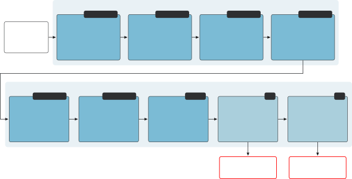
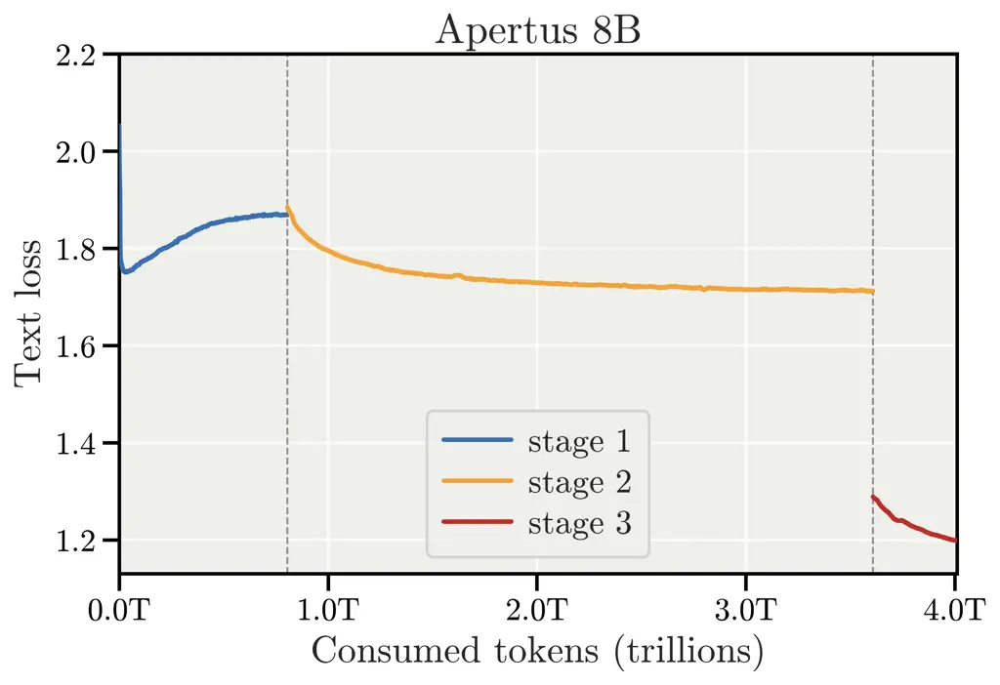
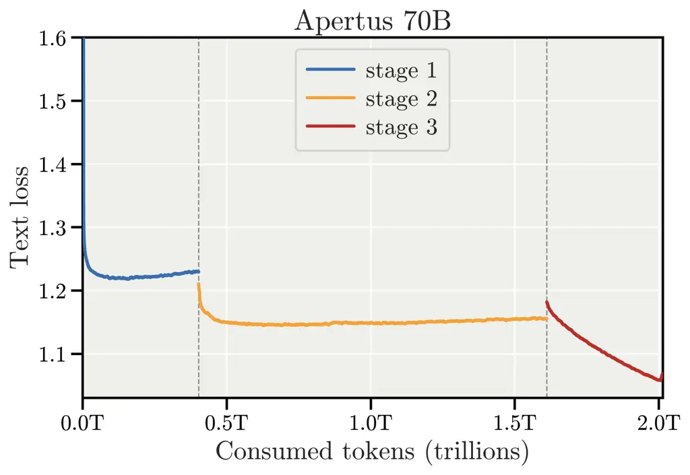
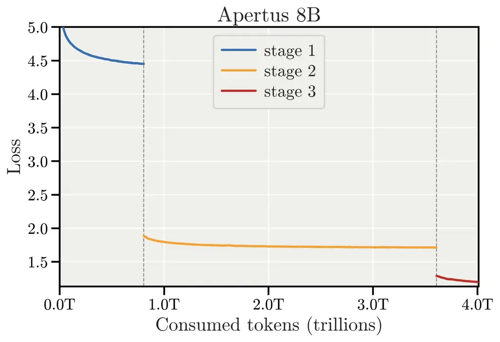
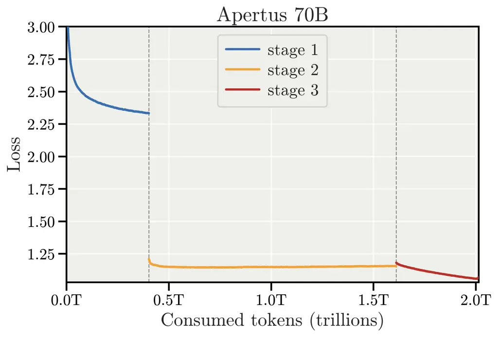
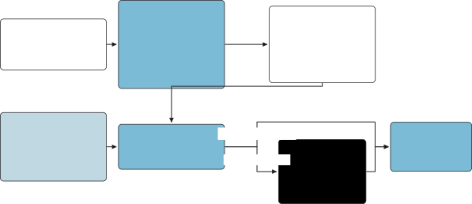
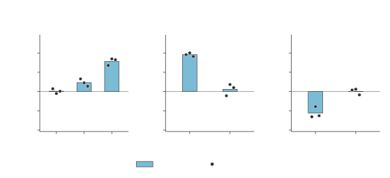
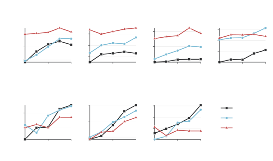
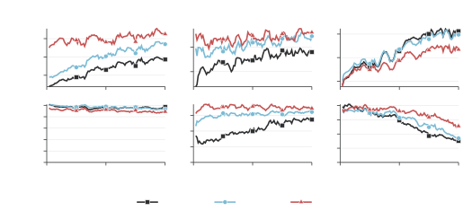
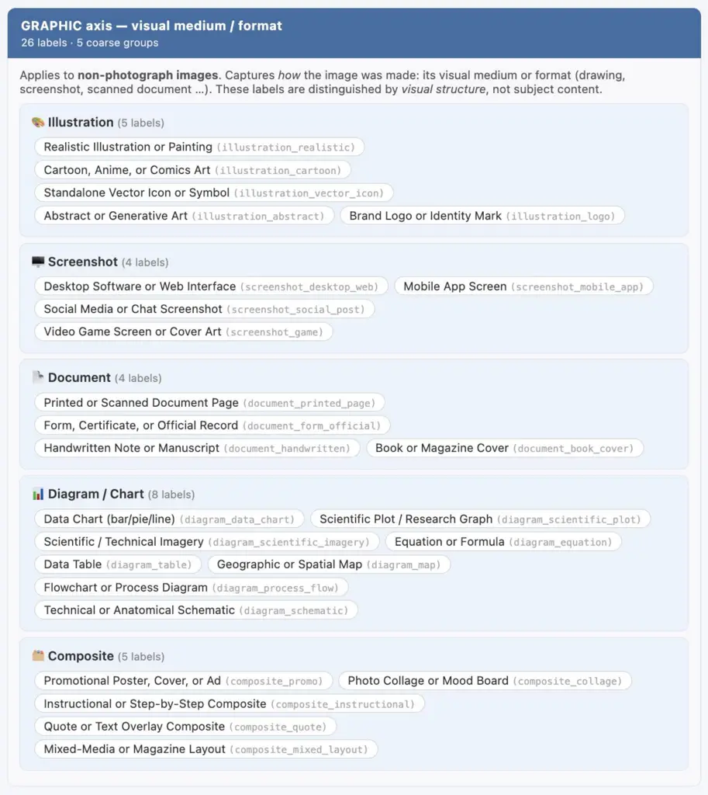

# ![[Uncaptioned image]](arxiv-2610-15542v1--4b1aca9cd611.figures/figure-1.webp) From Open Text Models to Open Multimodal Reasoners Apertus v1.5 Technical Report

Project Apertus ^(†)^(†)thanks: In each contribution level, team members
are listed in (reverse) alphabetical order by first or last name.
Contributions are described in more detail in Appendix A.
Affiliation: Core Team: Yixuan Xu¹, Yassine Turki², Vinko Sabolčec²,
Valentina Pyatkin¹, Tommy Chu², Sven Najem-Meyer², Sean F. Carroll²,
Robert Smith¹, Raphael Kreft¹, Oscar Alessandro Tazza¹, Oleg Lavrovsky²,
Nicola Irmiger¹, Matteo Santelmo², Marian Schneider¹,
Juan García Giraldo², Hanna Yukhymenko¹, Eduard Ďurech¹,
Davit Melikidze¹, Dani Tamayo², Bettina Messmer², Aryan Ahadinia²,
Anunay Yadav², Allen Huang²  
Contributors: Ahmad Fraij¹, Alessandro Bombarda², Alex Padula¹,
Alexander Hägele², Alexander Sternfeld³, Anna Hedström¹,
Anna Kosovskaia¹, Arthur Wuhrmann², Arundhati Balasubramaniam¹,
Badr Al Mahouri², Barna Pasztor¹, Bartosz Szostakiewicz¹,
Bich Ngoc Doan², Bryan Schmid⁴, Burak Sezen¹, Camille Challier²,
Clément Charmillot², Dana Shayakhmetova², Daniel Perruchoud⁴,
David Brüggemann⁵, David Isztl⁶, Elia Palme⁶, Emma Anastassova²,
Fabian Bösch⁶, Faruk Zahiragić², Fawzi Roberto Mohamed⁶,
Fiona Panicali⁴, Florian Kolly², Flynn Guerra⁴, Francesco Monti²,
Frederike Lübeck¹, Gennaro Oliva⁶, Haofeng Yang¹, Haoliang Shang¹,
Helen El Khoury², Henrique Mendonça⁶, Jannis Vamvas⁷, Jérome Landolt⁴,
Jessica Lam¹, Jingchun Xiao¹, Jonathan Coles⁶, Joshua Oyebanji²,
Khanh Nguyen², Konstantinos Pitas¹, Lasse B. Strand¹, Li Mi¹,
Loïc Deslarzes², Lorenzo Baggi¹, Lorenzo Noci¹, Luca Baumann¹,
Luca Sartori¹, Lukas Drescher⁶, Marco De Negri¹, Marco Passerini⁶,
Mark Klein⁶, Marko Stojanovic², Martin Majsec², Matin Ansaripour²,
Mattea Busato², Mauro Pellonara², Max Neuwinger¹, Michael Graber⁴,
Michal Tešnar¹, Michelle Wastl⁷, Miguel Gila⁶, Mikolaj Boronski²,
Morgane Magnin², Moritz Reihs¹, Mukhammadali Sayfiddinov¹,
Nathan Ranchin^(1,2), Nicolas Cuveillier², Oscar Wohlfahrt²,
Qianqian Zou⁵, Rada Kamysheva¹, Rita Sevastjanova¹, Roman Machacek⁸,
Sebastian Keller⁶, Simon Matrenok², Simon Pierre², Stefano Schuppli⁶,
Suei-Wen Chen¹, Szabina Horváth-Mikulas², Taliesin Perez²,
Thilo Spinner¹, Thomas Kleine Buening¹, Tim Robinson⁶,
Tymoteusz Kwiecinski¹, Vilém Zouhar¹, Vinzenz Thoma¹, Xiaozhe Yao¹,
Yannick Metz¹, Yuhei Fukuhara², Yusif Askari², Zixuan Chen¹  
Advisors: Alexander Ilic¹, Ana Klimovic¹, Andreas Krause¹,
Andrei Kucharavy³, Elliott Ash¹, Joost VandeVondele⁶, Martin Rajman²,
Mennatallah El-Assady¹, Thomas Schulthess⁶, Timo Kehrer⁸,
Torsten Hoefler¹  
Leads: Antoine Bosselut², Martin Jaggi², Imanol Schlag¹  
Affiliations:¹ETH Zurich, ²EPFL, ³HES-SO Valais-Wallis, ⁴FHNW, ⁵SDSC,
⁶CSCS, ⁷University of Zurich, ⁸University of Bern

###### Abstract

Language models are becoming infrastructure, and infrastructure built in
the open, by public institutions, on documented data, is the alternative
to dependence on a few providers; Apertus shows this is viable at scale.
Apertus 1.5 extends the fully open Apertus family from text to
multimodal reasoning. Continued pretraining of the Apertus 1.0 models,
on 4T additional tokens for the 8B and 2T for the 70B, adds image and
audio understanding and extends the context window fourfold to
262,144 tokens; multimodality enters through the tokenizer, the
language-model head remains restricted to text, and the architecture is
unchanged. Supervised finetuning, long-context finetuning, reinforcement
learning with verifiable rewards, and preference alignment complete the
released models. Thinking is a flag of the chat template rather than a
separate model, and lifts mathematical reasoning by up to 20 points on
the 8B model. The released models improve over their predecessors on
nearly every benchmark; among fully open models of its class, the 8B
leads on knowledge, instruction following, and cultural benchmarks, and
its instruction following surpasses all compared models, including
open-weight ones. On image and audio understanding, a first for the
family, the models are competitive with fully open multimodal models,
strongest on document understanding and long-form and lower-resource
speech recognition, while specialized vision and audio models remain
ahead on perception and transcription of English and other high-resource
languages. As in Apertus 1.0, we train only on openly available data,
respect crawler opt-outs retroactively, and exclude restrictively
licensed material. We release the model weights, data preparation and
training recipes, and evaluation suites under permissive licenses;
openness extends to values, with the Apertus charter guiding alignment
stages published alongside the models.

###### Contents

1.  1 Introduction
    1.  1.1 Released Models, Code, and Datasets
2.  2 Multimodality
    1.  2.1 Unified Representation
        1.  2.1.1 Images
        2.  2.1.2 Audio
    2.  2.2 Multimodal Training Data
        1.  2.2.1 Curation and Processing
        2.  2.2.2 Vision Training Data
        3.  2.2.3 Vision Data Composition
        4.  2.2.4 Audio Training Data
    3.  2.3 Tokenization and Training Pipelines
        1.  2.3.1 Image Tokenization
        2.  2.3.2 Audio Tokenization
    4.  2.4 Ablations
3.  3 Continued Pretraining Recipe
    1.  3.1 Pretraining Data
        1.  3.1.1 Compliance and Provenance
        2.  3.1.2 Text Data Selection
    2.  3.2 Optimizer and Training Recipe
    3.  3.3 Long-Context Extension
    4.  3.4 Pretraining Run Retrospective
4.  4 Post-Training
    1.  4.1 Chat Template
    2.  4.2 Supervised Finetuning
        1.  4.2.1 Image
        2.  4.2.2 Audio
        3.  4.2.3 Variety-Aware Translation Case Study
    3.  4.3 Long-Context Supervised Finetuning
    4.  4.4 Improving Instruction Following
    5.  4.5 Reinforcement Learning
    6.  4.6 Alignment
        1.  4.6.1 Direct Preference Optimization
        2.  4.6.2 Charter Alignment with SDPO
    7.  4.7 SFT Ablations
5.  5 Evaluations
    1.  5.1 Evaluation Setup
    2.  5.2 Base Models
    3.  5.3 Post-Trained Models
        1.  5.3.1 Reasoning and Thinking Mode
        2.  5.3.2 Post-Training Lineage
    4.  5.4 Multilingual and Cultural Evaluation
        1.  5.4.1 Machine Translation
    5.  5.5 Image Understanding
    6.  5.6 Audio Understanding
    7.  5.7 Long Context
    8.  5.8 Tool Use
    9.  5.9 Security, Safety, and Interpretability
        1.  5.9.1 Safety Benchmark Performance
        2.  5.9.2 Over-Refusal and Hallucination
        3.  5.9.3 Interpretability
    10. 5.10 Qualitative Spot-Testing
6.  6 Infrastructure, Scaling, and Efficiency
    1.  6.1 Infrastructure
    2.  6.2 Full Training Run Performance
    3.  6.3 Energy Consumption
    4.  6.4 Engineering Challenges and Solutions
7.  7 Responsible Release and Governance
    1.  7.1 License and Acceptable Use
    2.  7.2 Limitations
    3.  7.3 Broader Impact
    4.  7.4 Community and External Evaluation
8.  8 Conclusion
9.  References
10. A Contributions
11. B Vision Datasets by Training Stage
12. C Audio Datasets by Training Stage
13. D Image Dataset Exploration Detailed Breakdown
14. E Tokenizer Reconstruction by Category
15. F Long-Context Data Mixture Tables
16. G Training Configurations
17. H Supervised Finetuning Details
    1.  H.1 Per-Benchmark SFT Ablation Results
    2.  H.2 SFT Data Decontamination Details
18. I Preference Alignment Data
    1.  I.1 Judge Rubric Prompts
    2.  I.2 Prompt Set Composition
    3.  I.3 Response Model Pool
    4.  I.4 Completion Generation
    5.  I.5 Score Distribution
19. J Alignment Ablations
    1.  J.1 DPO Ablations
        1.  J.1.1 Apertus 1.5 8B
        2.  J.1.2 Apertus 1.5 70B
    2.  J.2 Judge Ablations
        1.  J.2.1 Judging Aspects Simplification
        2.  J.2.2 Choice of Judge Model
20. K Chatbot System Prompt
21. L Evaluation Details
    1.  L.1 Full Post-Training Lineage
22. M Pre-Release Manual Evaluations
    1.  M.1 General Information About Pre-Release Evaluation
    2.  M.2 Chemical, Biological, Radiological, Nuclear, and Explosive
        Indiscriminate Weapons (CBRNE)
    3.  M.3 Dual Use and Insurgency
    4.  M.4 LLM-Assisted Information Operations
    5.  M.5 (Child) Sexual Abuse
    6.  M.6 Offensive Cybersecurity
    7.  M.7 Multimodal Prompt Injection
    8.  M.8 Harmful Disinformation
    9.  M.9 Harmful Health Advice
    10. M.10 Private Person Defamation
23. N Coverage of Common AI Security Framework Risks

## 1 Introduction

The most capable large language models (LLMs) are accessible only
through proprietary interfaces, and even the strongest openly released
models typically publish their weights without the data, code, recipes,
and values behind them. Fully open models are increasingly rare as the
complexity and cost of LLM development have grown significantly, and
they still trail their open-weight peers in capabilities. Apertus exists
to close this gap. We understand full openness to extend across five
axes: open weights, open data, open code, open recipes, and open values.
Every claim in this report can therefore be traced to released
artifacts, and the principles that shape the behavior of our models are
published documents rather than internal policy.

Apertus is a collaborative effort led by ETH Zürich, EPFL, and CSCS,
with contributors from many further institutions, to develop AI in an
inclusive and trustworthy manner, and to provide a foundation on which
developers build products and services. Pluralism is a founding goal:
from the first release onward, Apertus pursues broad coverage of
languages and cultures, and this focus continues in the present release.
A second commitment is responsible development, guided by Swiss and
European ethical and regulatory standards, while striving for
performance and scale. LLMs are a central technology of our time, and we
believe research institutions should engage with them directly. Apertus
provides a scientific basis for research and development on open models
by making its model weights, code, data, training recipe, and values
available for study and reuse. This enables researchers and
practitioners to examine the training process, deploy models
independently, retain control over associated data flows, and develop
the expertise needed to teach the next generation of engineers and
researchers.

We released the first generation of models, Apertus 1.0, with 8B and
70B parameters in September 2025, trained from scratch on 15T tokens of
openly documented text spanning over 1000 languages on the Alps
supercomputer at CSCS (Hernández-Cano et al., 2026). Its data pipeline
respected machine-readable opt-outs of domain owners, applying them
retroactively to earlier crawls, removed personally identifiable
information, and drew only from permissively licensed sources, and
training suppressed verbatim memorization. The Apertus charter,
published alongside the models, states the principles that guide their
behavior, and the release included transparency documentation following
the EU AI Act template, intermediate checkpoints, data preparation
pipelines, and training code.

Apertus 1.5 8B and Apertus 1.5 70B build on this foundation through
continued pretraining on a mix of text, image, and audio data, roughly
4T tokens for the 8B model and 2T tokens for the 70B model. Where
Apertus 1.0 established that fully open training at scale is possible,
Apertus 1.5 expands and improves the capabilities of the models. The
models accept image and audio inputs in addition to text, support an
optional thinking mode for harder reasoning problems, extend the context
window fourfold to 262,144 tokens, follow instructions more reliably,
and use tools more effectively. Figure 1 gives an overview of the
complete training pipeline that produces both models, from the Apertus
1.0 checkpoints through continued pretraining and post-training to the
released models. Figure 2 gives an overview of the shared model
architecture and how it processes text, image, and audio inputs.

Our main contributions are:

- •
  Apertus 1.5 8B and Apertus 1.5 70B. Two fully open models that bring
  image and audio understanding, an optional thinking mode, a fourfold
  longer context window, and stronger instruction following and tool use
  to the Apertus family.
- •
  Multimodal continued pretraining. A recipe that upgrades the Apertus
  1.0 family in place: multimodality enters through the tokenizer, the
  language-model head remains restricted to text tokens, and the
  architecture is preserved.
- •
  Long-context extension. The context window grows fourfold to
  262,144 tokens, supported by dedicated long-context stages in both
  continued pretraining and post-training.
- •
  Our next generation of post-training. Supervised finetuning (SFT),
  long-context SFT, reinforcement learning with verifiable rewards
  (RLVR), direct preference optimization (DPO), and charter alignment
  with self-distillation policy optimization (SDPO), delivering the
  optional thinking mode, more reliable instruction following, and more
  effective tool use.
- •
  Full release. Weights, intermediate checkpoints, data preparation
  pipelines, training code, and evaluation harnesses, released under the
  Apache 2.0 license.



Figure 1: The Apertus 1.5 training pipeline. Solid blue stages train on
multimodal data (T$`\,\cdot\,`$I$`\,\cdot\,`$A, or T$`\,\cdot\,`$I for
RLVR), light-blue stages on text only (T); red outlines mark the
released models, which the 70B reaches without SDPO. DPO uses online
pairs for the 8B model and offline and online pairs for the 70B model.

The remainder of this report follows the lifecycle of the models.
Section 2 presents the multimodal tokenization, Section 3 the
pretraining data and the continued-pretraining recipe, and Section 4 the
post-training pipeline. Section 5 reports evaluations across modalities
and languages, Section 6 describes the training infrastructure and its
efficiency, Section 7 discusses the release and its governance, and
Section 8 concludes.

### 1.1 Released Models, Code, and Datasets

Full openness means every stage of this report can be retraced from
released artifacts. We group the release into models, code, and
datasets; all code and data carry permissive licenses, and the models
are distributed under Apache 2.0.

##### Models.

The two final post-trained models are distributed on Hugging Face behind
a gated download that records assent to the acceptable-use policy and
reaches deployers with updates (Section 7.1); major intermediate
checkpoints live as branches of these two repositories. The
post-training stage checkpoints, one repository per stage under the same
license and gating, let the lineage of Section 5.3.2 be inspected
checkpoint by checkpoint. Thinking is a request-time flag of the chat
template rather than a separate model, even where inference providers
expose it as a separate endpoint; usage instructions and supported
inference stacks are in the model cards.

![[Uncaptioned
image]](arxiv-2610-15542v1--4b1aca9cd611.figures/figure-2.webp)

[swiss-ai/Apertus-v1.5-8B-base](https://huggingface.co/swiss-ai/Apertus-v1.5-8B-base)  
![[Uncaptioned
image]](arxiv-2610-15542v1--4b1aca9cd611.figures/figure-2.webp) [swiss-ai/Apertus-v1.5-8B-SFT](https://huggingface.co/swiss-ai/Apertus-v1.5-8B-SFT)  
![[Uncaptioned
image]](arxiv-2610-15542v1--4b1aca9cd611.figures/figure-2.webp) [swiss-ai/Apertus-v1.5-8B-RL](https://huggingface.co/swiss-ai/Apertus-v1.5-8B-RL)  
![[Uncaptioned
image]](arxiv-2610-15542v1--4b1aca9cd611.figures/figure-2.webp) [swiss-ai/Apertus-v1.5-8B-DPO](https://huggingface.co/swiss-ai/Apertus-v1.5-8B-DPO)  
![[Uncaptioned
image]](arxiv-2610-15542v1--4b1aca9cd611.figures/figure-2.webp) [swiss-ai/Apertus-v1.5-8B](https://huggingface.co/swiss-ai/Apertus-v1.5-8B)  
![[Uncaptioned
image]](arxiv-2610-15542v1--4b1aca9cd611.figures/figure-2.webp) [swiss-ai/Apertus-v1.5-70B-base](https://huggingface.co/swiss-ai/Apertus-v1.5-70B-base)  
![[Uncaptioned
image]](arxiv-2610-15542v1--4b1aca9cd611.figures/figure-2.webp) [swiss-ai/Apertus-v1.5-70B-SFT](https://huggingface.co/swiss-ai/Apertus-v1.5-70B-SFT)  
![[Uncaptioned
image]](arxiv-2610-15542v1--4b1aca9cd611.figures/figure-2.webp) [swiss-ai/Apertus-v1.5-70B-RL](https://huggingface.co/swiss-ai/Apertus-v1.5-70B-RL)  
![[Uncaptioned
image]](arxiv-2610-15542v1--4b1aca9cd611.figures/figure-2.webp) [swiss-ai/Apertus-v1.5-70B](https://huggingface.co/swiss-ai/Apertus-v1.5-70B)

##### Code.

We release the full training and evaluation stack: the Megatron-LM fork
with the multimodal pretraining and SFT extensions, the multimodal
tokenizer, the data ingestion inventory, the post-training framework,
and the text and multimodal evaluation harnesses. Further
special-purpose repositories, such as the tokenizer benchmarks and the
synthetic long-context task generator, are linked in the sections where
they are used.

![[Uncaptioned
image]](arxiv-2610-15542v1--4b1aca9cd611.figures/figure-3.webp)

[swiss-ai/Megatron-LM](https://github.com/swiss-ai/Megatron-LM)  
![[Uncaptioned
image]](arxiv-2610-15542v1--4b1aca9cd611.figures/figure-3.webp) [swiss-ai/pretrain-code](https://github.com/swiss-ai/pretrain-code)  
![[Uncaptioned
image]](arxiv-2610-15542v1--4b1aca9cd611.figures/figure-3.webp) [swiss-ai/apertus-omni-tokenizer](https://github.com/swiss-ai/apertus-omni-tokenizer)  
![[Uncaptioned
image]](arxiv-2610-15542v1--4b1aca9cd611.figures/figure-3.webp) [swiss-ai/multimodal-data](https://github.com/swiss-ai/multimodal-data)  
![[Uncaptioned
image]](arxiv-2610-15542v1--4b1aca9cd611.figures/figure-3.webp) [swiss-ai/posttraining-data](https://github.com/swiss-ai/posttraining-data)  
![[Uncaptioned
image]](arxiv-2610-15542v1--4b1aca9cd611.figures/figure-3.webp) [swiss-ai/posttraining](https://github.com/swiss-ai/posttraining)  
![[Uncaptioned
image]](arxiv-2610-15542v1--4b1aca9cd611.figures/figure-3.webp) [swiss-ai/self-distillation](https://github.com/swiss-ai/self-distillation)  
![[Uncaptioned
image]](arxiv-2610-15542v1--4b1aca9cd611.figures/figure-3.webp) [swiss-ai/lm-evaluation-harness](https://github.com/swiss-ai/lm-evaluation-harness)  
![[Uncaptioned
image]](arxiv-2610-15542v1--4b1aca9cd611.figures/figure-3.webp) [swiss-ai/MLLM-eval-suite](https://github.com/swiss-ai/MLLM-eval-suite)  
![[Uncaptioned
image]](arxiv-2610-15542v1--4b1aca9cd611.figures/figure-3.webp) [swiss-ai/HELMET](https://github.com/swiss-ai/HELMET)  
![[Uncaptioned
image]](arxiv-2610-15542v1--4b1aca9cd611.figures/figure-3.webp) [swiss-ai/evals-post-train](https://github.com/swiss-ai/evals-post-train)  
![[Uncaptioned
image]](arxiv-2610-15542v1--4b1aca9cd611.figures/figure-3.webp) [swiss-ai/model-launch](https://github.com/swiss-ai/model-launch)  
![[Uncaptioned
image]](arxiv-2610-15542v1--4b1aca9cd611.figures/figure-3.webp) [swiss-ai/verl-recipe](https://github.com/swiss-ai/verl-recipe)  
![[Uncaptioned
image]](arxiv-2610-15542v1--4b1aca9cd611.figures/figure-3.webp) [swiss-ai/verl](https://github.com/swiss-ai/verl)

##### Datasets.

Apertus is open data. All used training datasets are openly available
for download and auditable via the list here ![[Uncaptioned
image]](arxiv-2610-15542v1--4b1aca9cd611.figures/figure-3.webp) [swiss-ai/apertus-data-transparency](https://github.com/swiss-ai/apertus-data-transparency),
including reproducible dataset versions and corresponding licenses. We
also release the SFT mixture, the annotated completion pool, and the
preference pairs built from it (Section 4.6), as well as the datasets we
curate ourselves. The respective sections detail the datasets used in
each stage, including exact numbers and the applied preprocessing.

![[Uncaptioned
image]](arxiv-2610-15542v1--4b1aca9cd611.figures/figure-2.webp)

[swiss-ai/Apertus-v1.5-SFT-mix](https://huggingface.co/datasets/swiss-ai/Apertus-v1.5-SFT-mix)  
![[Uncaptioned
image]](arxiv-2610-15542v1--4b1aca9cd611.figures/figure-2.webp) [swiss-ai/Apertus-v1.5-Preference-Pool](https://huggingface.co/datasets/swiss-ai/Apertus-v1.5-Preference-Pool)  
![[Uncaptioned
image]](arxiv-2610-15542v1--4b1aca9cd611.figures/figure-2.webp) [swiss-ai/Apertus-v1.5-Preference-Data](https://huggingface.co/datasets/swiss-ai/Apertus-v1.5-Preference-Data)  
![[Uncaptioned
image]](arxiv-2610-15542v1--4b1aca9cd611.figures/figure-2.webp) [swiss-ai/nasa](https://huggingface.co/datasets/swiss-ai/nasa)  
![[Uncaptioned
image]](arxiv-2610-15542v1--4b1aca9cd611.figures/figure-2.webp) [swiss-ai/owid](https://huggingface.co/datasets/swiss-ai/owid)  
![[Uncaptioned
image]](arxiv-2610-15542v1--4b1aca9cd611.figures/figure-2.webp) [swiss-ai/smithsonian](https://huggingface.co/datasets/swiss-ai/smithsonian)  
![[Uncaptioned
image]](arxiv-2610-15542v1--4b1aca9cd611.figures/figure-2.webp) [swiss-ai/swisstopo](https://huggingface.co/datasets/swiss-ai/swisstopo)

## 2 Multimodality

One core objective of Apertus 1.5 is to extend the models’ capabilities
to understanding and working with images and audio. We train both
Apertus 1.5 8B and Apertus 1.5 70B to understand images and audio and
respond in text. The multimodal effort spans continued pretraining,
supervised finetuning, and long-context supervised finetuning
(Figure 1).

This chapter describes how the two new modalities enter the model.
Section 2.1 sets out the discrete-token representation and the reasons
we prefer it to modality-specific encoders, while Section 2.1.1 and
Section 2.1.2 specify the two tokenizers with the vocabulary they
contribute. Section 2.2 presents the staged multimodal training data
used throughout the pipeline, whereas Section 2.3 describes the
tokenization pipelines and their integration into the training
infrastructure together with the modifications of the pretraining and
SFT codebase to enable multimodal training. Finally, Section 2.4
introduces ablations on preserving text capabilities while adding
modalities during continued pretraining, and Appendix B and Appendix C
record the data pool of each training stage. The following chapter,
Section 3, presents the continued-pretraining recipe.

### 2.1 Unified Representation

We represent images and audio as discrete tokens, following unified
models such as Chameleon and Emu3 (Chameleon Team, 2024; Wang et al.,
2026). A shared vocabulary represents all modalities, and the language
model applies a single next-token-prediction objective across them, as
illustrated in Figure 2.

A common alternative is to use modality-specific encoders whose features
are projected into the language model, as in LLaVA (Liu et al., 2023).
More recent unified approaches instead avoid separate pretrained
modality-specific encoders and process continuous inputs directly:
SenseNova-U1 (Cai et al., 2026) operates directly on pixels and text in
a unified end-to-end architecture, while the encoder-free Gemma 4
12B (Gemma Team et al., 2026) directly projects raw image patches and
raw audio into the model’s embedding space. These approaches unify
multimodal computation within a single model, but represent non-text
inputs continuously rather than through discrete modality tokens.

Our discrete representation allows the same next-token-prediction
objective to be applied to images and audio, enabling the first stage of
continued pretraining to draw on unpaired images and audio (Irmiger
et al., 2026). In this stage, the model learns the new modalities from
image-only and audio-only examples alongside text, before learning their
alignment with language from paired data in the subsequent stage
(Figure 1). Image and audio codes serve directly as prediction targets,
preserving a common training objective across modalities. A controlled
study shows that an image-only stage before paired training can improve
image understanding on most benchmark groups (Kreft, 2026); Section 2.4
summarizes its findings. Unpaired data also needs no captions, so it
remains usable where captions are scarce or of low quality.

We convert training images and audio into discrete tokens once, during
offline preprocessing (Section 2.1.1, Section 2.1.2), just as we
precompute text tokens. We reuse these tokenized datasets across
subsequent training runs and experiments that use the same tokenizers
and preprocessing. The language model consumes the precomputed tokens
through its shared embedding layer; no vision or audio encoder runs in
its forward pass. This separation lets us reuse the text-training
infrastructure without the overhead and complexity of encoder forward
passes during training, achieving throughput comparable to text-only
training with only minor modality-specific modifications to the
pretraining and SFT codebases (Section 2.3). A measured comparison
substantiates the efficiency benefit: at an identical configuration
(256 nodes, 8,192-token sequences), text-only ablation runs sustain
5,300 to 5,500 tokens per second per GPU, and the first multimodal
production stage 5,474 (Section 6.2).


Figure 2: The Apertus 1.5 architecture.

##### Vocabulary Extension.

We extend the 131,072-entry vocabulary of Apertus 1.0 with 200 reserved
multimodal slots, including structure markers, followed by 131,072 image
codes and 4,096 audio codes. These contiguous blocks yield
266,440 vocabulary entries (Figure 2). The released input embedding
matrix contains 266,752 rows: its final 312 rows are padding, not
additional vocabulary entries. The extended input vocabulary allows both
models to consume every modality, while the released output head retains
only the original text vocabulary (Section 3.2).

#### 2.1.1 Images

We use the vision tokenizer of Emu3.5 (Cui et al., 2025b) to convert
training images into discrete tokens during offline preprocessing.
Irmiger et al. (2026) evaluate image tokenizers on reconstruction
quality, on the average number of tokens per image, and on their support
for arbitrary image shapes, and find that the tokenizers of the Emu
family combine a favorable trade-off between reconstruction quality and
token efficiency with native support for arbitrary shapes. Section 2.4
discusses the choice between the Emu3 and Emu3.5 tokenizers.¹¹ 1 We
provide code and benchmarks at
[swiss-ai/benchmark-image-tokenizer](https://github.com/swiss-ai/benchmark-image-tokenizer).

The adopted tokenizer is trained solely with a pixel-reconstruction
objective, rather than an explicit semantic or image-text alignment
objective as used by vision encoders such as CLIP (Radford et al.,
2021). We use its pretrained discrete codes directly as inputs and
prediction targets for the language model.

The tokenizer maps every block of $`16\times 16`$ pixels to one code
from a codebook of 131,072 entries of dimension 256. An image of
$`512\times 512`$ pixels thus becomes a grid of $`32\times 32`$ codes,
or 1,024 tokens, and an image of arbitrary shape becomes a grid of its
height and width each divided by 16. The codebook is trained with index
backpropagation quantization, which keeps a codebook of this size in use
where earlier vector quantization leaves most codes dead (Shi et al.,
2025).

In the token sequence, an image opens with a start marker followed by
its dimensions; its rows of codes are separated by end-of-row markers,
and an end marker closes it. The visual codes extend the vocabulary
directly after the text tokens of Apertus 1.0 and a block of 200
reserved slots, seven of which hold these structure markers.

#### 2.1.2 Audio

We use the WavTokenizer codec (Ji et al., 2025) to convert training
audio into discrete tokens during offline preprocessing. The codec
discretizes a waveform with a single quantizer over a codebook of
4,096 entries. It consumes mono audio at 24 kHz and emits one code per
600 samples, hence 40 tokens per second; a minute of audio costs
2,400 tokens. Inputs at other sampling rates are resampled. Because the
codec was trained on peak-normalized audio, we normalize every input to
a peak of $`-3`$ dBFS before tokenization.

Neural audio codecs such as EnCodec quantize each frame with a stack of
residual codebooks (Défossez et al., 2023), and their parallel code
streams force an autoregressive model to interleave them (Copet et al.,
2023). WavTokenizer emits one code per frame, so audio enters the model
as a single flat sequence, exactly like text. This single code stream is
the deciding criterion, as it leaves the training stack unchanged.²² 2
We provide code and benchmarks at
[swiss-ai/benchmark-audio-tokenizer](https://github.com/swiss-ai/benchmark-audio-tokenizer).

In the token sequence, an audio segment is enclosed by start and end
markers, which live in the same reserved block of the vocabulary as
their visual counterparts. The audio codes follow the visual codes in
the extended vocabulary.

### 2.2 Multimodal Training Data

Multimodal training data is central to this release. It teaches the
models to use the image and audio token spaces introduced above. It also
aligns both modalities with language and supports multimodal instruction
following across continued pretraining and post-training. Across the
three continued-pretraining stages, text-only data accounts for roughly
60% of the Apertus 1.5 8B training mix and 55% of the Apertus 1.5 70B
mix, with vision and audio data accounting for the remaining 40% and
45%, respectively (Table 3). We organize the discussion around the six
data stages that serve these different roles, a design supported by the
ablation of Section 2.4. The six stages are the three
continued-pretraining stages of Section 3.2, whose third stage is the
cooldown, followed by long-context pretraining (Section 3.3), supervised
finetuning (Section 4.2), and long-context supervised finetuning
(Section 4.3).

#### 2.2.1 Curation and Processing

##### Acquisition and Normalization.

The public repository
[swiss-ai/multimodal-data](https://github.com/swiss-ai/multimodal-data)
provides an inventory of vision and audio datasets, recording each
source’s pinned revision, download script, processing recipe, license
filters, and training stages. The complementary
[swiss-ai/apertus-data-transparency](https://github.com/swiss-ai/apertus-data-transparency)
repository records source versions and licenses across all modalities.
We keep raw, processed, and tokenized layers separate to make the
transformations between them explicit and repeatable. Download adapters
handle repository snapshots, archives, object stores, public APIs, and
URL-based image datasets. Processing decodes media, removes invalid
records, checks minimum resolution, normalizes schemas, encodes media in
standard formats, and converts records to Arrow or WebDataset.
Dataset-specific adapters additionally handle large tiled geospatial
images, multi-image conversations, spatial annotations, and interleaved
documents. When the inventory lists no additional source-specific
operation, we apply these shared checks without changing the publisher’s
filtering decisions.

##### Deduplication.

For unpaired continued-pretraining images, we deduplicate samples with
perceptual hashes and choose thresholds by domain. Most sources use
exact equality of 64-bit hashes after reduction to $`32\times 32`$
pixels. Satellite images use a smaller hash input to suppress repeated
forest, water, and cloud tiles, while egocentric video frames allow a
small Hamming distance to remove adjacent near-duplicates. These rules
are inappropriate for text-rich images such as documents and web
interfaces, where distinct pages can share a layout and produce the same
hash. In early inspections of document and MINT-1T runs, perceptual
hashing removed valid OCR examples. We therefore disabled it for later
datasets centered on OCR and document understanding.

##### Caption Generation and Validation.

For paired continued-pretraining data, we retain informative source
captions and regenerate missing, repetitive, or low-information
descriptions for selected sources with open-weight vision-language
models. The generation pipelines reject empty outputs and apply
source-specific output checks. For long captions of text-dense technical
drawings, we additionally detect token loops, runaway number lists, and
repeated endings caused by repeated labels and tabular schedules. We
quarantine and regenerate flagged captions. These automated checks catch
common generation failures, but synthetic captions can still contain
factual errors. The public recaptioning pipelines and quality-control
tools provide the shared generation and validation infrastructure.³³ 3
Available at
[swiss-ai/multimodal-data](https://github.com/swiss-ai/multimodal-data):
recaptioning pipelines under recaption and quality-control tools under
tools.

##### Processing at Scale.

Preparing these corpora on shared supercomputing infrastructure
introduces constraints beyond data quality: unavailable source URLs,
storage and inode limits, scratch-retention policies, and network
restrictions on bulk downloads. The raw MINT-1T snapshot alone occupies
approximately 700 TB, so we compress it early and apply successive
filters in place. URL-based datasets create a different problem:
collecting the images generates crawl-like traffic across many domains,
including destinations on security blocklists. Retries against denied
endpoints put the Alps supercomputer’s shared outbound IP at risk of
blocking, with consequences for unrelated scientific workloads that
depend on the same network access. Multimodal data preparation therefore
requires coordination with the center’s storage, network, and security
teams to protect shared infrastructure while sustaining ingestion at
scale. We describe the operational incidents and the layered proxy that
enforces network safeguards in Section 6.4.

#### 2.2.2 Vision Training Data

Vision data enters all stages of pretraining and supervised finetuning.
The tables in Appendix B give the vision pool of each stage, with
samples and input tokens per dataset, complementing the selection and
preparation methodology in Section 3.1.

Across all six stages, the vision pools for Apertus 1.5 8B contain
821.6 million samples. Most belong to the unpaired and paired stages of
continued pretraining (Stages 1 and 2). We report the share of vision
data within each continued-pretraining stage’s token budget separately
in Table 3.

Stages 1 and 2 together contain approximately 86% of the vision samples
across the six 8B stage pools. Their scale explains why the overall
composition in Figure 3 mostly reflects these early stages, despite the
different emphasis of later pools.

#### 2.2.3 Vision Data Composition

Figure 3: Composition of the 8B vision samples. The inner segments show
the relative dataset sizes (largest first). A dataset can span multiple
categories.

We use
[LiquidAI/LFM2.5-VL-450M](https://huggingface.co/LiquidAI/LFM2.5-VL-450M)
to assign each vision sample to one visual category in the composition
figures.

General visual material dominates the overall vision pool (Figure 3).
The inner ring shows that a few large datasets supply most of this
category, while the other categories draw on a tail of smaller datasets
alongside their larger sources. Appendix D refines these categories with
a taxonomy of 61 fine-grained image types, applied to six large source
datasets, and reports the prevalence of broad task signals across the
mixture.

Stage 2 has the largest vision pools, with approximately 850 billion
input tokens for Apertus 1.5 8B and 534 billion for Apertus 1.5 70B
(Figure 4). The composition shifts from general visual material in
Stages 1 and 2 toward charts and diagrams in cooldown and long-context
pretraining. Medical content is more prominent in the 70B cooldown pool.
Geospatial content remains small overall.

Figure 4: Vision data composition by stage, with pool sizes in input
tokens on the right.

#### 2.2.4 Audio Training Data

Audio data enters the same six stages. Stage 1 uses unpaired speech,
music, and mixed audio, while the later stages concentrate on paired
speech and text. Paired speech takes three forms: transcription pairs,
translation pairs, and interleaved sequences that alternate the audio
and transcripts of consecutive clips from one recording, with dedicated
tokens marking each switch between speech and text. Interleaved
sequences make up about a fifth of the Stage 2 and cooldown audio tokens
and all of the long-context audio pool (Table C.3). The tables in
Appendix C give the audio pool of each stage, with samples and input
tokens per dataset.

Unlike vision, where we classify samples and weight categories by sample
count, we group entire audio datasets into six categories by source and
purpose. Figure 5 shows their contributions by input tokens.

Web and broadcast speech dominate every pretraining pool. Read speech
becomes more prominent in later pretraining stages. Music and other
audio remain small components. The 70B Stage 2 and cooldown pools are
identical. Dialogue and question answering dominate both SFT pools, with
domain-specific speech (such as medical QA) contributing a smaller
component.

Figure 5: Audio data composition by stage, with pool sizes in input
tokens on the right.

##### Interleaved Speech and Text.

For the paired stages, we build interleaved sequences from transcribed
speech corpora such as VoxPopuli, Multilingual LibriSpeech, and
WenetSpeech. We group the transcribed clips of each recording into runs
of consecutive clips. Within a run, a sequence alternates between
modalities clip by clip: the audio of one clip is followed by a
speech-to-text continuation token and the transcript of the next clip,
which is followed by a text-to-speech continuation token and the audio
of the clip after that, and every sequence ends with text. We build two
copies of each run that start one clip apart, so that a clip that
appears as audio in one copy appears as text in the other. Single-clip
runs and the leftover clip of a run become transcription sequences that
pair one clip’s audio with its own transcript. Sequences of up to
8,192 tokens enter Stage 2, and longer ones enter the long-context
extension. The builder is released in
[swiss-ai/benchmark-audio-tokenizer](https://github.com/swiss-ai/benchmark-audio-tokenizer).

##### Speech SFT Data.

The auxiliary checkpoint used for capability filtering of text data
(Section 4.2) and the production SFT runs draw from the same prepared
audio pool of six speech datasets (Table C.4). This pool contains speech
inputs with text outputs and no music or environmental-sound
supervision. Its largest component by sample count renders roughly
640,000 conversations from eight open chat corpora (Lian et al., 2023;
Zhao et al., 2024; Ding et al., 2023; Singh et al., 2024; Durbin, 2023;
Köpf et al., 2023), among them Capybara and Pure-Dove (Daniele &
Suphavadeeprasit, 2023), to speech with text-to-speech synthesis, so
that the assistant behavior of the text mixture carries over to spoken
instructions. For this component, we synthesize user turns with
Qwen3-TTS (Hu et al., 2026), while retaining assistant responses as
text. We align the generated speech to the corresponding source text
using Qwen3-ForcedAligner (Shi et al., 2026). During dataset
construction, we exclude conversations with unavailable audio and verify
that each audio placeholder corresponds to an associated audio segment.
The remainder combines a voice-assistant corpus of roughly
242,000 conversations (Xie & Wu, 2024), spoken question answering with
both machine-read and human-read questions (Wu et al., 2023), a
fraud-detection dialogue set (Ma et al., 2025), and a bilingual medical
set that mixes Chinese dialogues with English audio question answering
and speech recognition (Chen et al., 2025c). We process each dataset
separately: we decontaminate the vocalized conversations against the
evaluation benchmarks, removing 2,153 conversations, and filter them to
the languages supported by the synthesis pipeline, removing a further
6,141 conversations; we drop 4,306 identity-related rows from the
voice-assistant corpus to protect the model’s self-description; and we
filter the medical set to its bimodal records (dropping 32,320
image-bearing records) and repair the missing audio placeholders.

##### Long-Context SFT Data.

The long-context SFT pool in Table C.5 extends the ordinary SFT pool
with Marco Longspeech and AudioMCQ GeminiCoT, as well as additional
TeleAntiFraud and Vocalized SFT samples. Marco Longspeech is its largest
component by token count. AudioMCQ GeminiCoT contributes only the speech
partition of its source, with its reasoning traces placed in the
thinking span, and enters the short-context bucket of both models’
long-context SFT runs. The pool inventory gives the available data;
Table 8 reports the per-source counts used by each model.

### 2.3 Tokenization and Training Pipelines

Megatron-LM (Shoeybi et al., 2019) natively supports multimodality, with
two limitations. First, it supports only continuous features: neither
the multimodal models of Megatron Core nor the sample types of Megatron
Energon carry discrete tokens (Patel et al., 2025). Second, it computes
everything inside a training job: vision and audio encoders and a
projection layer embed pixels and waveforms in the forward pass, and the
supervised finetuning paths tokenize conversations and derive the loss
mask from the chat template at load time. This adds encoder compute and
media decoding to every step, and it leaves no entry point for
pre-tokenized multimodal sequences, in pretraining or in supervised
finetuning.

Following prior work on incorporating discrete multimodal
representations into pretrained LLMs (Ge et al., 2024; Zhan et al.,
2024), we extend the base LLM by adding dedicated vocabulary ranges for
vision and audio tokens. Each new token is assigned a corresponding
embedding, allowing tokenized media to be consumed by the transformer in
the same way as text tokens. The vocabulary is extended correspondingly,
and the output projection is extended to produce logits for the newly
introduced vision and audio tokens in addition to the original text
vocabulary. The newly introduced parameters are randomly initialized,
while all parameters inherited from the pretrained LLM are retained.
Thus, the transformer itself requires no modality-specific computation:
multimodal sequences can be processed with the standard autoregressive
next-token prediction objective.

We therefore build two high-throughput tokenization pipelines from
scratch, one for images and one for audio, that write Megatron indexed
datasets directly. Section 2.2.1 describes the upstream acquisition and
processing that feed them. The pipelines convert each image or waveform
into token ids from the corresponding added vocabulary range. This is
the payoff of discrete tokens: a codec maps an image or a waveform to
ids from a contiguous block of the vocabulary, so to the model a
tokenized image is a text document in a language it has not seen before.
The multimodal shards enter the training data mixture through the
standard data blending and sampling of Megatron-LM, and stream through
the unmodified pretraining data loader. Hence, continued pretraining can
run on an almost vanilla Megatron-LM installation.

The necessary changes to Megatron-LM live in our fork
([swiss-ai/Megatron-LM](https://github.com/swiss-ai/Megatron-LM)). For
pretraining, we add options for masking multimodal tokens from
prediction, which enables the text-only targets from the second training
stage onward (Figure 1), and for exempting the multimodal special tokens
from Goldfish-loss dropping (Section 3.2). For supervised finetuning, we
add the missing entry point: a loader that reads pre-tokenized
conversations from the same indexed format and derives the loss mask
efficiently on the fly at the token level, masking user turns and tool
responses without a separate preprocessing step or added overhead in the
training step.

#### 2.3.1 Image Tokenization

The pipeline, released in
[swiss-ai/benchmark-image-tokenizer](https://github.com/swiss-ai/benchmark-image-tokenizer),
separates indexing, planning, and tokenization. A scan reads only tar
headers and the first few kilobytes of each image, recording byte
offsets and dimensions for hundreds of millions of samples in minutes,
and never touches pixels. From the manifest a deterministic plan assigns
every image to a GPU batch: images are grouped in windows of consecutive
source rows, snapped to document boundaries, sorted by their exact
post-resize shape, and packed to a token budget, so that every batch is
shape-uniform and byte-adjacent, the ranks never communicate, and the
measured rank imbalance stays below 2% at 800 GPUs. Planning is
NumPy-only and costs seconds, so re-planning for a different batch size
or GPU count never requires a rescan. On each rank, loader threads
decode, filter, and resize images while the GPU encodes the previous
batch, and text tokenization and chat-template rendering run
concurrently with the encoder, which keeps the encoder at roughly 92% of
wall time. Each rank writes its own Megatron indexed-dataset shards and
checkpoints after every batch, so an interrupted job resumes from its
last written batch, and a final step merges the shards; for SFT data,
the merge can also write a copy with the reasoning spans removed. Two
changes to the encoder itself (selecting codes by argmax rather than
through a 131,072-way softmax and one-hot product, and pinning TF32 as
an explicit precision contract), together with host-side overlap,
roughly double throughput without changing a single emitted token,
whereas bf16 would flip 7% of codes and we therefore reject it.

#### 2.3.2 Audio Tokenization

Audio tokenization, released in
[swiss-ai/benchmark-audio-tokenizer](https://github.com/swiss-ai/benchmark-audio-tokenizer),
combines the main systems challenges of text and image processing. Text
inputs are variable-length, but tokenization is CPU-bound and scales
across many cores. Image tokenization is GPU-bound, but resizing enables
shape-homogeneous batches with high accelerator utilization. Audio is
both GPU-bound and variable-length, making efficient batching difficult
without excessive padding or underutilization. The pipeline first
converts every source into Lhotse Shar shards (Żelasko et al., 2021) and
tokenizes any paired text during that conversion, so the GPU stage
handles only audio. Each rank receives its own set of whole shards and
never communicates with the others, and a dynamic bucketing sampler
groups clips of similar duration into batches capped by total audio
duration while CPU workers decode the next batch. Because batched
encoding pads each clip to the longest in its batch and the last few
codes before the padding are unstable, the pipeline drops the last five
codes after padding.

### 2.4 Ablations

Introducing new modalities into a pretrained language model can degrade
its text capabilities, particularly during continued pretraining. Lu
et al. (2024) report catastrophic forgetting of language capabilities
during joint vision-language pretraining and retain at least 70% text
data to mitigate it. Similarly, Kimi Team et al. (2026) observe an
immediate drop in text performance when vision data is introduced to a
text-pretrained model, followed by only gradual recovery during
subsequent training.

Preserving the language capabilities of the base model is therefore a
primary constraint throughout the development of Apertus 1.5, alongside
acquiring strong multimodal capabilities. This section studies the
design choices of the continued pretraining that bear on this
constraint; Section 4.7 turns to post-training, where multimodal data
interacts with reasoning supervision.

Two design decisions of the continued pretraining rest on dedicated
experiments: the choice of the image tokenizer, which trades
reconstruction quality for token efficiency, and the two-stage recipe,
which separates representation learning on unpaired images from modality
alignment on paired data.

##### Image Tokenizer.

Irmiger et al. (2026) find that the tokenizers of the Emu family offer
the best trade-off between reconstruction quality and token efficiency
(Section 2.1.1). Within that family, we choose the tokenizer of
Emu3.5 (Cui et al., 2025b) over that of Emu3 (Wang et al., 2026) for its
token efficiency. Emu3 encodes one code per $`8\times 8`$ pixel patch
and Emu3.5 one per $`16\times 16`$ patch, so Emu3.5 represents the same
image with a quarter of the tokens.

To quantify what this compression costs on our data, we benchmark both
tokenizers on a stratified sample of the Stage 1 vision mixture, built
on the sample-level categories of Section 2.2.3. We draw 50 images per
category with a fixed seed and report a representative subset of six
categories, 350 image pairs, that spans natural photographs, synthetic
imagery, structured graphics, text, and the two specialist domains. We
omit the categories not listed and merge charts and diagrams into one
category, as in the composition figures. We resize each image as we do
for training Apertus, encode and decode it with each tokenizer, and
score the reconstruction against the input with the peak signal-to-noise
ratio (PSNR), the structural similarity index (SSIM), and the learned
perceptual image patch similarity (LPIPS) (Table 1 and Figure 6).

Emu3.5 uses a quarter of the tokens of Emu3 in every category, at a cost
of 2.7 dB PSNR, 0.07 SSIM, and 0.02 LPIPS averaged over the subset. The
gap is consistent across categories: Emu3 reconstructs better on every
metric except PSNR on geospatial imagery, where the two are almost
level, and the largest PSNR losses fall on charts and diagrams, medical
images, and documents, each between 3 and 4 dB. Medical images and
documents are the two categories in which Emu3.5 reconstructs worst in
PSNR, which confirms our qualitative observation that fine-grained
detail, and text in particular, is its main weakness. We accept this
trade: because image tokens typically dominate the token count of an
image sample, the fixed token budget of each pretraining stage covers
approximately four times as many images, and inference on image inputs
is correspondingly cheaper. Although our models see more images during
training, the coarser grid is the likely reason that OCR remains the
capability group in which they trail other open models (Table 34).

|           |                       |                        |                   |                      |
| --------- | --------------------- | ---------------------- | ----------------- | -------------------- |
| Tokenizer | Tokens $`\downarrow`$ | PSNR (dB) $`\uparrow`$ | SSIM $`\uparrow`$ | LPIPS $`\downarrow`$ |
| Emu3      | 8,372                 | 26.70                  | 0.806             | 0.075                |
| Emu3.5    | 2,080                 | 24.04                  | 0.740             | 0.099                |

Table 1: Reconstruction quality and token cost of the Emu3 and Emu3.5
tokenizers, averaged over 350 Stage 1 training images from six
representative categories of Section 2.2.3 and preprocessed as in
training. Tokens are the mean per image, arrows give the better
direction, and bold marks the better tokenizer; Table E.1 in Appendix E
lists the values per category.

Figure 6: Per-category reconstruction quality of the Emu3 and Emu3.5
tokenizers on the same 350 Stage 1 training images as Table 1. Each
marker is a category mean. Higher is better for PSNR and SSIM; lower is
better for LPIPS. Table E.1 lists the values.

##### Two-Stage Recipe.

A controlled study underpins the design of the first two pretraining
stages of Section 3.2 (Kreft, 2026). The study extends Llama 3.2 3B with
the same Emu3.5 tokenizer and splits the topic-balanced LLaVA-OneVision
1.5 image-caption corpus (An et al., 2025) in half: one half, stripped
to standalone images, feeds a representation-learning stage that
predicts image tokens, mirroring our Stage 1; the other half, kept as
image-caption pairs, feeds a subsequent modality-alignment stage,
mirroring our Stage 2. Both halves share one distribution, and every
batch replays 10% text-only data. Three findings carry over. First,
giving image and text tokens equal loss weight during modality alignment
is harmful: this setting scores far below all others on nearly every
group of image-understanding benchmarks, showing that image-token
prediction and modality alignment interfere when they share compute.
Second, zero weight on image tokens during modality alignment is the
strongest single setting for image understanding, best on the
document-understanding, grounding, and hallucination benchmark groups,
while variants that end the modality-alignment stage at zero weight stay
competitive on the remaining groups; this backs our text-only Stage 2
loss targets. Third, the representation-learning stage pays off
downstream: with the modality-alignment stage fixed, raising its budget
from zero to roughly 57B image tokens lifts image understanding measured
after modality alignment and SFT, for example GQA from 0.50 to 0.54,
DocVQA from 0.67 to 0.71, and SEED-Bench from 0.61 to 0.65, with
logarithmic gains that flatten at larger budgets; this backs our
unpaired all-token Stage 1 and its bounded token budget. At the largest
budgets, however, knowledge-heavy image benchmarks and text benchmarks
erode, as both rely on the model’s language capabilities; the deficits
persist despite the replayed text and do not fully recover in the later
stages, motivating the substantially larger text share of our mixtures
(Table 3).

## 3 Continued Pretraining Recipe

Apertus 1.5 is obtained through continued pretraining of Apertus 1.0,
with the goal of introducing multimodal capabilities, including image
and audio, while preserving the text capabilities of Apertus 1.0. We
start from the Apertus 1.0 8B and 70B checkpoints and proceed through
four stages of continued pretraining (Figure 1): unpaired multimodal
training, paired multimodal training, and cooldown with higher-quality
data, all at 8K sequence length, followed by long-context extension to
support context lengths up to 262K.

This chapter gives an overview of the continued-pretraining data and
recipe. Section 3.1 describes the revised data mixture including source
selection, data processing, and provenance requirements. Section 3.2
specifies the optimizer, learning-rate schedule, prediction targets, and
model-specific token budgets. Section 3.3 describes the long-context
extension and its data mixture. Finally, Section 3.4 examines the
training dynamics and lessons from the production runs.

### 3.1 Pretraining Data

We continue training on a new mixture based on the Apertus 1.0 text
mixture, refined with updated and additional text datasets and extended
with image and audio data. We use only publicly available datasets and
document their provenance and filtering. This subsection describes the
data governance requirements shared across modalities, including
compliance, provenance, and opt-out handling (Section 3.1.1), followed
by the selection and refinement of the text mixture (Section 3.1.2). We
maintain the source versions and licenses for the full mixture in
[swiss-ai/apertus-data-transparency](https://github.com/swiss-ai/apertus-data-transparency)
and the source-specific vision and audio processing recipes in
[swiss-ai/multimodal-data](https://github.com/swiss-ai/multimodal-data).

We introduce multimodality through the discrete-token early-fusion
approach presented in Section 2.1: images and audio as discrete tokens
that the model processes alongside text in a shared token space. These
new token spaces motivate the staged recipe shown in Figure 1. In
Stage 1, we combine text with unpaired images and audio and train the
model to predict tokens of all modalities. In Stage 2, we introduce
paired image-text and audio-text sequences and restrict prediction
targets to text, aligning the new modalities with language. The cooldown
then emphasizes higher-quality and targeted sources, and the
long-context extension adds longer and interleaved records. Section 3.2
specifies the model-specific token budgets, sampling ratios, and
optimization schedule.

Details of the multimodal data recipe appear in Section 2, which
describes the multimodal design, the rationale for the staged training
recipe (Section 2.4), and data preparation (Section 2.2). Section 2.2.2
and Section 2.2.4 describe the vision and audio data, respectively,
while Appendix B and Appendix C list the prepared pools across stages.
For multimodal sources, we apply the acquisition, filtering,
deduplication, and caption validation procedures described in
Section 2.2.1.

#### 3.1.1 Compliance and Provenance

Every new modality is also required to satisfy the same requirements as
the text data in Apertus 1.0 (Hernández-Cano et al., 2026). Our review
covers the upstream source, revision, declared license, constituent
datasets, and sample-level provenance where available. For composite
medical and remote-sensing collections, we select approved constituent
sources or records rather than relying on the aggregate license.
Non-commercial, research-only, and share-alike subsets are excluded, and
the spreadsheet in
[swiss-ai/apertus-data-transparency](https://github.com/swiss-ai/apertus-data-transparency)
remains the authoritative record of the final decisions. No paywalled or
otherwise closed sources are used for training. The text pipeline
additionally removes personally identifiable information and applies the
multilingual toxicity filters of Apertus 1.0.

We apply machine-readable opt-outs (robots.txt files) following the same
recipe as Apertus 1.0, and we honor robots exclusions retroactively: if
a page owner opts out this year, previous crawls of the same URL are
excluded as well. The opt-out filtering also applies to multimodal
content when a record retains the page URL on which the content
appeared. For example, MINT-1T HTML preserves original page URLs, so we
apply the same domain exclusion list as the text pipeline. For images, a
strict allow-list limited to domains represented in the FineWeb
robots.txt database would discard roughly 96% of MINT-1T, whereas the
exclusion rule used by the text pipeline removes roughly 2%. For
datasets that retain only an image-hosting URL or the name of another
dataset, we record that domain-level opt-out filtering is not
technically available, rather than treating the hosting service as the
content owner.

We materialize URL-based datasets by downloading original images from
source URLs on the shared Alps supercomputer at CSCS, and therefore
separately apply network safety filtering to protect the center’s shared
outbound network infrastructure. Section 6.4 describes the proxy and
blocklists. This safeguard is distinct from license review, opt-out
handling, and image content review; it does not constitute a
comprehensive scan for sexual or violent content. For image and audio
content, we otherwise retain the filtering supplied by the dataset
publishers.

#### 3.1.2 Text Data Selection

We refine the text mixture of Apertus 1.0 by replacing FineWeb2-HQ with
FineWeb2-HQ+ (Turki et al., 2026) and adding FinePDFs, Nemotron-CC-v2.1,
SYNTH, FineTranslations, Nemotron-Pretraining-Code-v1, and legal-domain
corpora. Table 4 reports the per-stage sampling proportions of the
resulting text mixture.

Every added source must be publicly available, pass license and
provenance review, and improve on the Apertus 1.0 mixture in a
small-scale ablation. The baseline experiment trains for 40,000 steps on
FineWeb followed by a 10,000-step cooldown on FineWeb-Edu. A candidate
source replaces 30% of the cooldown data, and we evaluate it on the
standard development suite.⁴⁴ 4 The data ablation results are published
at
[https://api.wandb.ai/links/bmessmer/2l4dpwl1](https://api.wandb.ai/links/bmessmer/2l4dpwl1).
For specialized sources, such as legal or medical data, we require an
improvement on the corresponding domain evaluations without a material
regression on the general suite. We also prefer sources that retain
original URLs and other provenance fields needed for later filtering.

For multilingual data, we extend the FineWeb2-HQ dataset (Messmer
et al., 2025) used for Apertus 1.0 to an improved variant,
FineWeb2-HQ+ (Turki et al., 2026). The dataset retains the 10% of
FineWeb-2 documents per language rated highest by a multilingual quality
classifier, covering the 100 highest-resource languages and a 10% sample
of the remaining languages (originally, FineWeb2-HQ’s quality filter
covered only 20 languages). The classifier recipe changes in two ways.
First, we train a single classifier jointly on all languages from a pool
of positive samples widened with multilingual instruction data
(including MURI-IT, Tagengo, and WikiQA), with lower-resource languages
upsampled by at most a factor of three so that high-resource languages
do not dominate the decision boundary. Second, its negative samples are
drawn from the 50th–75th percentile of a proxy quality classifier rather
than uniformly from FineWeb-2, which sets the boundary against fluent
but low-utility text instead of obvious noise (Turki et al., 2026).

### 3.2 Optimizer and Training Recipe

We continue pretraining both Apertus 1.5 models, the 8B and 70B, with
the AdEMAMix optimizer (Pagliardini et al., 2025) from Apertus
1.0 (Hernández-Cano et al., 2026), retaining the same momentum
hyperparameters. We resume from the Apertus 1.0 checkpoints that have
completed cooldown and use a warmup-stable-decay schedule: both models
warm up from zero to their peak learning rates over 4.2B tokens; the
learning rate then stays at its peak through the first two stages and
decays to 10% of the peak with a $`1-\text{sqrt}`$ decay over the third.
The 8B model keeps the peak learning rate of Apertus 1.0 8B,
$`1.1\times 10^{-4}`$. For the 70B model, we double the peak of Apertus
1.0 70B to $`2\times 10^{-5}`$, which outperforms the original value in
ablations, suggesting that the Apertus 1.0 70B peak learning rate was
likely too small. To accommodate multimodal data, we double the sequence
length from 4,096 tokens to 8,192 tokens. An image of $`512\times 512`$
pixels is tokenized into 1,024 tokens and a minute of audio into
2,400 tokens (Section 2.1.1, Section 2.1.2); multimodal sequences
interleaved with text documents routinely exceed the previous
4,096-token limit, and the 8,192-token window ensures that entire
documents fit within a single sequence. We halve the global batch size
so that the number of tokens per batch remains the same as in Apertus
1.0, and reuse the same tensor and pipeline parallelism configurations
to train Apertus 1.5. Table G.1 summarizes the resulting configuration
of both models.

We apply weight decay to all trainable parameters, including
normalization gains and the trainable parameters of the xIELU
activation (Huang & Schlag, 2024), which we find helps reduce large
activation and activation-gradient norms. We initialize the optimizer
states from scratch, since the newly added input and output embeddings
for image and audio tokens have no existing optimizer states. The
corresponding embedding and output rows for the new tokens are randomly
initialized, while the text rows keep their pretrained values; the fresh
rows start at roughly a tenth of the norm of the trained text rows and
adapt over the first pretraining stage. For the 70B model, we also
evaluate splicing in the multimodal embeddings learned by the 8B model,
but we observe that it destabilizes training, so we use random
initialization instead. In the released checkpoints, we prune the output
rows for image, audio, and reserved tokens from the language-model head,
since the models never generate non-text tokens and the text logits are
unchanged.

We keep the Goldfish loss of Apertus 1.0 with its parameters unchanged:
it drops the prediction target of a random subset of positions, thereby
preventing verbatim memorization of the training data and respecting
copyright (Hans et al., 2024; Xu, 2025). We extend this dropping to
cover the predicted tokens of every modality; only special tokens, among
them the markers that structure image and audio sequences, are exempt.
Image and audio tokens are prediction targets in the first stage alone.
The later stages predict text only, which prevents the model from
generating non-text tokens. From the second stage, we likewise exclude
from prediction the task-control markers that select between
transcription and continuation: they condition the model but are never
targets.

Before the long-context extension, continued pretraining proceeds in
three stages: unpaired multimodal training, paired multimodal training,
and cooldown with higher-quality data. The stages are summarized in
Table 2 and Table 3, and the text data mix in Table 4; the vision and
audio datasets of every stage are listed in Appendix B and Appendix C.
Each stage’s dataset list is frozen before the stage begins: the
deterministic sampling plan depends on the full list, and mid-stage
changes would shift that plan, silently repeating or skipping documents.
In the first stage we train on unpaired image, audio, and text data,
with the loss computed over tokens of all modalities. In the second and
third stages we add the respective parallel data (image-text and
audio-transcript pairs) along with text-only data, and compute the loss
over the text tokens only, since the models understand but never
generate images and audio (Section 2); an ablation further shows that
text-only targets during paired training also yield the strongest image
understanding (Section 2.4). For the 8B, the Stage 2 text share rises to
roughly two thirds, in part because multimodal data was still limited;
the 70B, with its halved token budget, keeps a roughly even split
between text and multimodal data, yet its text evaluations do not
degrade. The third stage is the cooldown, in which we emphasize
higher-quality data and include additional paired speech sources
(Table C.2). The audio portion of the cooldown accounts for 95B input
tokens for Apertus 1.5 8B and 92B for Apertus 1.5 70B (Table 3). These
training counts include paired text and any repeated sampling; they do
not measure unique hours of speech. The cooldown also includes a small
share of instruction-formatted data (roughly 3B tokens), for which the
loss is restricted to assistant tokens. We train the 70B model on half
the intended number of tokens to free resources for the next Apertus
pretraining project, keeping the cooldown length unchanged and reducing
the token budget mainly during Stage 2.

|       |                                                           |                    |
| ----- | --------------------------------------------------------- | ------------------ |
| Stage | Data                                                      | Prediction Targets |
| 1     | Unpaired image, audio, and text data.                     | All modalities     |
| 2     | Paired image-text, audio-transcript data, and text data   | Text only          |
| 3     | Higher-quality data, with some instruction-formatted data | Text only          |

Table 2: Stages 1 and 2 fall in the warmup and stable phases of the LR
schedule, while Stage 3 is the decay phase. Stage 1 is trained to
predict tokens of all modalities. Stages 2 and 3 are trained to predict
only text tokens.

|                 |              |              |                |        |
| --------------- | ------------ | ------------ | -------------- | ------ |
| Stage           | Vision       | Audio        | Text           | Total  |
| Apertus 1.5 8B  |              |              |                |        |
| 1               | 367B (45.6%) | 110B (13.7%) | 328B (40.7%)   | 806B   |
| 2               | 852B (30.4%) | 89B (3.2%)   | 1,861B (66.4%) | 2,802B |
| 3               | 78B (19.4%)  | 95B (23.4%)  | 230B (57.2%)   | 403B   |
| Apertus 1.5 70B |              |              |                |        |
| 1               | 49B (12.2%)  | 52B (13.0%)  | 301B (74.8%)   | 403B   |
| 2               | 512B (42.4%) | 90B (7.4%)   | 606B (50.1%)   | 1,208B |
| 3               | 107B (26.6%) | 92B (22.7%)  | 204B (50.7%)   | 403B   |

Table 3: Token budget per modality across the three curriculum stages of
Apertus 1.5 8B and Apertus 1.5 70B, that is, the mix each run trains on.
Percentages are the within-stage share of tokens. For Stages 2 and 3,
the Vision and Audio counts include their paired text (image captions
and audio transcripts); the Text column is the separate text-only data.

The full text data mixture for each stage is given in Table 4. Stages 1
and 2 share a single mixture dominated by high-quality web text
([HuggingFaceTB/dclm-edu](https://huggingface.co/datasets/HuggingFaceTB/dclm-edu)
and the top 10% of
[epfml/FineWeb2-HQ-Plus](https://huggingface.co/datasets/epfml/FineWeb2-HQ-Plus)),
supplemented by mathematics, code, translation, and legal corpora. The
Stage 3 cooldown deliberately trades general web text for higher-quality
and reasoning-heavy data: the share of general web text is cut
substantially, while the combined code-and-mathematics allocation rises
sharply, driven by larger allocations to mathematics
([HuggingFaceTB/finemath](https://huggingface.co/datasets/HuggingFaceTB/finemath),
[IFM/MegaMath](https://huggingface.co/datasets/IFM/MegaMath),
[Infi-MM/InfiMM-WebMath-40B](https://huggingface.co/datasets/Infi-MM/InfiMM-WebMath-40B))
and code
([HuggingFaceTB/stack-edu](https://huggingface.co/datasets/HuggingFaceTB/stack-edu),
[nvidia/Nemotron-Pretraining-Code-v1](https://huggingface.co/datasets/nvidia/Nemotron-Pretraining-Code-v1)).
At the same time, the general legal corpora are dropped in favor of
[voilaj/swiss-caselaw](https://huggingface.co/datasets/voilaj/swiss-caselaw),
the translation share rises
([HuggingFaceFW/finetranslations](https://huggingface.co/datasets/HuggingFaceFW/finetranslations)),
and a small amount of Apertus 1.5 SFT data is mixed in.

|                                                                                                              |               |             |
| ------------------------------------------------------------------------------------------------------------ | ------------- | ----------- |
| Name                                                                                                         | Stage 1+2 (%) | Stage 3 (%) |
| [HuggingFaceTB/dclm-edu](https://huggingface.co/datasets/HuggingFaceTB/dclm-edu)                             | 47.5          | 20.5        |
| [HuggingFaceFW/finepdfs-edu](https://huggingface.co/datasets/HuggingFaceFW/finepdfs-edu)                     | 2.8           | 3.2         |
| [nvidia/Nemotron-CC-v2.1](https://huggingface.co/datasets/nvidia/Nemotron-CC-v2.1)                           | 1.0           | 7.2         |
| [PleIAs/SYNTH](https://huggingface.co/datasets/PleIAs/SYNTH)                                                 | 0.7           | 0.0         |
| [epfml/FineWeb2-HQ-Plus](https://huggingface.co/datasets/epfml/FineWeb2-HQ-Plus) (top 10%)                   | 20.1          | 14.4        |
| [HuggingFaceFW/finepdfs-edu](https://huggingface.co/datasets/HuggingFaceFW/finepdfs-edu) (multilingual only) | 8.5           | 3.6         |
| [HuggingFaceFW/finetranslations](https://huggingface.co/datasets/HuggingFaceFW/finetranslations)             | 2.8           | 5.9         |
| [HuggingFaceTB/finemath](https://huggingface.co/datasets/HuggingFaceTB/finemath)                             | 0.9           | 6.3         |
| [IFM/MegaMath](https://huggingface.co/datasets/IFM/MegaMath)                                                 | 6.1           | 9.5         |
| [Infi-MM/InfiMM-WebMath-40B](https://huggingface.co/datasets/Infi-MM/InfiMM-WebMath-40B)                     | 0.6           | 4.2         |
| [HuggingFaceTB/stack-edu](https://huggingface.co/datasets/HuggingFaceTB/stack-edu)                           | 2.1           | 6.2         |
| [nvidia/Nemotron-Pretraining-Code-v1](https://huggingface.co/datasets/nvidia/Nemotron-Pretraining-Code-v1)   | 5.3           | 15.1        |
| [joelniklaus/legal-mc4](https://huggingface.co/datasets/joelniklaus/legal-mc4)                               | 0.7           | 0.0         |
| [joelniklaus/Multi_Legal_Pile](https://huggingface.co/datasets/joelniklaus/Multi_Legal_Pile)                 | 1.0           | 0.0         |
| [voilaj/swiss-caselaw](https://huggingface.co/datasets/voilaj/swiss-caselaw)                                 | 0.0           | 2.7         |
| Apertus 1.5 SFT data                                                                                         | 0.0           | 1.2         |

Table 4: Text data mixture per training stage, as a percentage of each
stage’s sampled text-only token budget.

### 3.3 Long-Context Extension

The long-context extension is the fourth and last stage of continued
pretraining (Figure 1), and follows the three stages of Section 3.2. We
extend the context window in four steps, from 8,192 to 32,768, 65,536,
131,072, and finally 262,144 tokens. Each step starts from the
checkpoint produced by the previous one and reinitializes the optimizer
states. Depending on the phase and model size, we train on
50B–63B tokens per step.

We keep the learning rate fixed at the final value reached during
cooldown. This provides a conservative continuation of training after
cooldown, limiting changes to the model while adapting it to longer
sequences. We also include synthetic long-context tasks to explicitly
train capabilities that require using information over long distances.
Whenever we double the sequence length, we halve the number of sequences
per batch so that the total number of tokens per batch remains constant.

We also adjust the rotary position embeddings as the context window
grows. The main runs initially keep the base frequency of 500,000 and
scaling factor of 8 used in Apertus 1.0. By the end of the four
extension stages, the final model uses a base frequency of 4M and a
scaling factor of 32. Documents are packed using a best-fit-decreasing
strategy (Ding et al., 2024). Cross-document attention masking under
context parallelism also makes training substantially cheaper: training
at 131,072 tokens costs roughly the same as training at 65,536 tokens
did for Apertus 1.0.

The prepared data for each step keeps the same relative composition
regardless of phase or model size: most tokens come from a subsample of
the cooldown mixture, and the remainder splits into genuinely long
documents and synthetic verifiable long-context tasks. Because each step
trains on fewer tokens than this prepared pool, Appendix F gives the
exact, already-scaled per-dataset, per-step token counts and sources
actually used in training. As throughout pretraining, we preprocess and
filter every dataset before use. The long documents, split into English
text, multilingual text, and multimodal image-text and audio corpora,
are length-filtered subsets of similar pretraining sources used earlier
in the recipe; we draw them proportionally to each source’s own size so
that no single source dominates a step. Table 5 gives the token budget
and within-phase share of each class.

Each step targets a fixed image budget, but the natively length-filtered
image pool cannot supply enough tokens at the 32k, 65k, and 131k phases,
since fewer real documents in the pretraining corpora happen to span
exactly those lengths; only the 262k phase has enough native
long-context images on its own. We close the gap at the shorter phases
by drawing additional images from short-context documents
(1,000–16,384 tokens) so that every phase reaches the same image budget:
native long-context images make up about 79% of the 32k budget, 47% of
the 65k budget, and 34% of the 131k budget, with the short-context
top-up filling the rest. Table B.4 gives further per-dataset sample
counts for the vision pool.

The remaining tokens per step are synthetic verifiable long-context
tasks from
[swiss-ai/LongContextQA](https://github.com/swiss-ai/LongContextQA): we
inject Q&A turns into a long document and re-tokenize it as one training
example. Common-word extraction (CWE) (Team Olmo et al., 2025) and
document-order reconstruction (DocOrder) together contribute most of
these tokens: CWE asks how many times each of several sampled words
occurs in the document, and DocOrder shuffles a document’s sections and
asks for their original order, each with 10 randomized question or
answer formats so the model cannot rely on one fixed phrasing. Both
tasks scale in difficulty with the packed length by varying how densely
they quiz each document: the hard bucket draws shorter source documents
and packs more items into them (10 questions for CWE, eight sections for
DocOrder), so the model must track more items with less surrounding
context; the easy bucket draws longer source documents and packs fewer
items into them (five questions, four sections), testing the same skill
with more context to spare. Mixing both buckets balances signal across
the full range of packed lengths. Artificial needles (Xiong et al., 2025) add the rest, planting a retrievable fact among synthetic
distractor listings. We add masking in the input sequence to avoid
biasing the models toward incorrect or random long context in DocOrder
and Artificial needles. The SFT token counts reported for these tasks
count the whole packed example, including the injected document that the
loss masking excludes; the number of assistant tokens actually optimized
per sample is far smaller than these totals suggest.⁵⁵ 5 Estimated from
representative per-task answer lengths (CWE: about six tokens per turn;
DocOrder: about 14 tokens for the single order-list answer; Artificial
needles: about 25 tokens per turn) and the number of samples per phase:
the actually optimized share of SFT tokens is well under 1%, from about
0.3% at 32k down to about 0.05% at 262k.

|                 |               |               |               |              |               |        |
| --------------- | ------------- | ------------- | ------------- | ------------ | ------------- | ------ |
| Phase           | English       | Multilingual  | Image         | Audio        | SFT           | Total  |
| Apertus 1.5 8B  |               |               |               |              |               |        |
| 32k             | 6.07B (25.6%) | 4.05B (17.1%) | 6.66B (28.1%) | 1.30B (5.5%) | 5.60B (23.6%) | 23.69B |
| 65k             | 5.63B (25.5%) | 3.79B (17.2%) | 6.25B (28.3%) | 1.22B (5.5%) | 5.17B (23.4%) | 22.07B |
| 131k            | 5.69B (25.9%) | 3.80B (17.3%) | 6.27B (28.6%) | 1.23B (5.6%) | 4.96B (22.6%) | 21.95B |
| 262k            | 5.69B (26.0%) | 3.81B (17.4%) | 6.29B (28.7%) | 1.22B (5.6%) | 4.86B (22.2%) | 21.87B |
| Apertus 1.5 70B |               |               |               |              |               |        |
| 32k             | 5.81B (27.3%) | 3.87B (18.2%) | 4.97B (23.4%) | 1.25B (5.9%) | 5.35B (25.2%) | 21.25B |
| 65k             | 5.77B (27.2%) | 3.88B (18.3%) | 5.00B (23.6%) | 1.25B (5.9%) | 5.29B (25.0%) | 21.19B |
| 131k            | 5.00B (27.7%) | 3.35B (18.6%) | 4.30B (23.8%) | 1.07B (5.9%) | 4.34B (24.0%) | 18.06B |
| 262k            | 4.99B (27.8%) | 3.33B (18.5%) | 4.31B (24.0%) | 1.08B (6.0%) | 4.26B (23.7%) | 17.98B |

Table 5: Token budget per class across the four long-context extension
phases. Percentages are the within-phase share of tokens beyond the
Cooldown subsample of Table 3.

The long-context evaluations of the released models appear in
Section 5.7.

### 3.4 Pretraining Run Retrospective

We discard the first Stage 1 run for the 8B and restart it. That run had
two problems. First, its peak learning rate was set to twice the Apertus
1.0 value, a choice that small-scale ablations had favored but that did
not transfer to this setting. Second, its text mixture silently omitted
the English quality-web, math, and code subsets: the corpus was spread
across personal scratch directories with no single manifest, so the
launch scripts only saw part of it. As a result, text capability
degraded; the text loss eventually recovered, but the evaluations did
not. The restart uses the original peak learning rate and the corrected
mixture. We keep the text-to-multimodal ratio and accept a drop of about
two points on general text evaluations as the cost of adding the new
modalities; text evaluations recover by Stage 2. The 70B, by contrast,
has enough capacity to absorb the new modalities with visibly less
text-capability cost than the 8B (the Stage 1 creep is far milder in
7(b) than in 7(a)), and we choose its peak learning rate by continuing a
pre-cooldown Apertus 1.0 checkpoint with preserved optimizer states on
unchanged data, letting the loss settle, and comparing peak learning
rates from there. This gives a reliable signal within tens of billions
of tokens, and it selects twice the original peak. These two
observations suggest that the text-capability cost of adding modalities
is capacity-dependent.

Ablations narrow down what drives the Stage 1 text-loss creep. Returning
to the original peak learning rate reduces the slow upward creep of the
text loss during Stage 1 (top row, Figure 7) but does not remove it; we
rule out weight-decay settings as the cause; freezing all non-embedding
parameters at the start of training only delays the creep; and the creep
appears at mixed text-to-multimodal ratios but not near either extreme,
consistent with gradient interference between modalities (Hao et al.,
2026). The main driver, however, is the schedule itself: Apertus 1.0
ends cooled down, and warming the learning rate back to its peak costs
text performance until the next cooldown recovers it; both the Stage 1
rise and its reversal over the Stage 3 cooldown are visible in the top
row of Figure 7. The same text-loss increase upon introducing multimodal
data is reported for Kimi K2.5, which for this reason keeps its
learning-rate schedule unchanged (Kimi Team et al., 2026).

Figure 7shows the loss of both runs across the three stages: the top row
on text tokens only, comparable across stages and exposing the Stage 1
creep and Stage 3 recovery discussed above, and the bottom row over each
stage’s own prediction targets.



(a) Apertus 1.5 8B, text loss



(b) Apertus 1.5 70B, text loss



(c) Apertus 1.5 8B, combined loss



(d) Apertus 1.5 70B, combined loss

Figure 7: Per-stage loss against consumed tokens. Top (7(a), 7(b)):
_text loss_, computed over text tokens only in every stage and therefore
comparable across stage boundaries. The text loss creeps upward through
Stage 1 and then drops sharply over the Stage 3 cooldown. Bottom
(7(c), 7(d)): _combined loss_ over all of each stage’s prediction
targets (Table 2): image, audio, and text tokens in Stage 1, text only
from Stage 2 onward. In Stage 1 the combined loss stays stable, so the
text-loss creep visible in the top row is masked when text and
multimodal targets are averaged together; the drop at the
Stage 1$`\to`$2 boundary reflects the change of targets, not a change in
quality. Averages are computed within each stage.

The 70B gains little over the 8B on multimodal tasks despite being nine
times larger (Section 5.5 and Section 5.6). We see two causes. First,
the 70B sees less multimodal data: its run stops before consuming the
full multimodal mixture, because its nodes are reallocated to the next
Apertus pretraining campaign. Since multimodal ability improves
throughout the mixture, this early stop costs the 70B much of the gain
it would otherwise have made. Second, the base learning rate of the
AdEMAMix optimizer used to pretrain Apertus 70B was likely too low;
continued pretraining uses a learning rate proportional to the original,
so a low base rate leaves little room for the model to adapt to a new
modality.

We also ablated adding a small share of instruction-formatted data
during the cooldown. This improved math, code, and instruction-following
benchmarks. Replaying the instruction-formatted data five-fold further
improved benchmarks but regressed safety behavior due to overfitting on
the small refusal subsets, so the small share performed better. Both
preference alignment and reinforcement learning improved long-context
evaluations even though neither stage trains on long documents,
suggesting that gains on short contexts carry over to long ones.

We also encountered various infrastructure and tooling incidents. During
the 70B long-context extension, virtual pipelining halves throughput, so
we disable it for that stage. Scaling the run to more nodes requires
manually resharding optimizer states, as the memory-efficient resharding
path fails at this size; we preserve the states rather than
reinitializing them mid-run, since reinitializing would break the
resumed optimization trajectory. Near the end of the 70B cooldown, some
datasets are exhausted and the loss creeps slightly as the effective
mixture shifts: because we blend proportionally by size, exhausting
smaller datasets moves the mixture away from its target composition. The
conversion used for evaluations also silently drops the
position-embedding scaling configuration, so converted checkpoints
underperform the checkpoints they come from, and part of the apparent
regression is an artifact of conversion rather than the model.

Data tooling caused incidents as well. Because the corpus was assembled
by a distributed effort across the team, some datasets were not stored
on persistent storage and fell under automatic deletion policies on the
Alps cluster; parts of the tokenized corpus were deleted mid-project.
The data loss was recoverable, because every dataset could be
regenerated from its preparation script. A bug in the decontamination
script removed an entire dataset from the mixture over a single flagged
sample; we caught it before training. Checkpoint inspection also exposes
upstream data artifacts that aggregate validation checks miss: some
captions in the upstream BLIP3 Grounding 50M dataset retain fragments of
the recaptioning prompt and follow a single repeated response template,
and the pretrained model occasionally reproduces those instructions or
applies the template to unrelated images. This motivates direct
inspection of generated samples and explicit prompt-fragment checks in
addition to schema and aggregate quality checks.

## 4 Post-Training

Post-training proceeds in five stages (Figure 1): supervised finetuning
(SFT), long-context SFT, reinforcement learning (RL), preference
alignment with DPO, and charter alignment with SDPO. Every stage trains
on conversations in the same format, which we therefore describe first.

### 4.1 Chat Template

The conversation format of Apertus 1.0 carries over: special tokens
delimit system, developer, user, and assistant messages, and the
developer message declares the tools available to the
model (Hernández-Cano et al., 2026). Here we describe what Apertus 1.5
adds.

Two conventions are deliberate. The template renders an explicit empty
system block when a conversation has no system message, so no
user-controlled content can occupy the system slot. And the training
conversations carry no knowledge-cutoff date, which keeps downstream
finetunes free of a stale date. The released inference template differs
in one respect: when a conversation has no system message, it inserts a
short default system prompt that names the model and its modalities
(Appendix K). Unlike the Apertus 1.0 default, this prompt contains
neither a knowledge cutoff nor the current date.

Images and audio enter user messages as the placeholder tokens
\<\|image\|\> and \<\|audio\|\>, which at tokenization time expand into
the structure markers and content codes of Section 2.1.1 and
Section 2.1.2. The literals \<image\> and \<audio\> are aliases: the
tokenizer maps them to the same identifiers, so existing datasets that
use these literals tokenize correctly without conversion.

Tool outputs are enclosed by the tokens \<\|tool_output_start\|\> and
\<\|tool_output_end\|\>, new in this release, which repurpose two
reserved identifiers of the Apertus 1.0 vocabulary. During training the
delimiters identify tool outputs so that they are excluded from the
loss: the model conditions on them without learning to generate them.
Explicit tokens are necessary because the raw bracket characters that
previously enclosed tool results cannot be masked reliably at the token
level; brackets merge into hundreds of vocabulary tokens. The assistant
emits tool calls as a JSON array between \<\|tools_prefix\|\> and
\<\|tools_suffix\|\>: each call is an object that maps the tool name to
its arguments, and parallel calls are elements of the same array. The
outputs of parallel calls return between the tool-output delimiters,
separated by commas. The tool declaration in the developer message is
unchanged from Apertus 1.0: available tools render as TypeScript-style
type declarations, and a conversation without tools declares them as
disabled.

In thinking mode the model reasons between \<\|inner_prefix\|\> and
\<\|inner_suffix\|\> before its visible answer. Thinking is off by
default and enabled per request through the chat template. The two
delimiters are deliberately not marked as special tokens, so they
survive detokenization and downstream code can parse the reasoning span
out of the decoded text. The literals \<think\> and \</think\> alias to
the same identifiers. The two surface forms repeatedly confuse
downstream tooling during development, with training data,
reinforcement-learning parsers, and serving stacks latching onto
different renderings; the token identifiers, not the rendered strings,
are canonical. The template itself supports tool calls inside the
thinking span; that the launch serving integrations expose tool calling
and thinking only separately is a serving limitation, not a format
constraint. Figure 8 shows a rendered conversation that exercises the
full format: the default system prompt, the developer message with the
deliberation flag and a tool declaration, and an assistant turn that
thinks, calls the tool, and answers after the tool output returns.


Figure 8: A conversation rendered by the inference chat template, with
thinking enabled and one tool declared: the model reasons and calls the
tool inside the thinking span, and answers after the tool output
returns. The released models do not yet produce this combination
(Section 7.2). Line breaks are added for display.

### 4.2 Supervised Finetuning

We use SFT to develop assistant behavior over text, image, and speech
inputs, with text output, using the shared conversation format of
Section 4.1. The mixture covers instruction following, multilingual
interaction, reasoning, code, tool use, safety, and model identity. We
train the models to provide reasoning traces when thinking is enabled
and direct answers when it is disabled.

To curate the text mixture, we train an auxiliary nonthinking checkpoint
of Apertus 1.5 8B from its long-context pretrained checkpoint
(Section 3.3), using text, image, and audio supervision with reasoning
traces removed. We use this checkpoint for capability filtering: we
evaluate selected verifiable text prompts and determine which receive
verified reasoning traces.

For production SFT, we initialize Apertus 1.5 8B and Apertus 1.5 70B
from their respective long-context pretrained checkpoints and use the
text mixture curated with the auxiliary Apertus 1.5 8B checkpoint. Only
the curated data carries over from the auxiliary run; neither production
model inherits its weights. After production SFT, we continue training
both models with dedicated long-context SFT to address degraded
long-context retrieval (Section 4.3).

Both production SFT runs use a constant learning rate after 800 warmup
iterations and a sequence length of 16,384 tokens: Apertus 1.5 8B trains
at $`6\times 10^{-5}`$ with a global batch size of 256 for roughly
159B tokens, and Apertus 1.5 70B at $`1\times 10^{-5}`$ with a global
batch size of 1,024 for roughly 155B tokens.⁶⁶ 6 Launch scripts for the
production and long-context SFT runs are available at
[swiss-ai/pretrain-code](https://github.com/swiss-ai/pretrain-code). The
auxiliary capability-filtering run instead decays a peak learning rate
of $`8\times 10^{-5}`$ linearly, at a global batch size of 1,024.

##### Capability Filtering.

As outlined in the introduction to Section 4.2, we train an auxiliary
nonthinking Apertus 1.5 8B checkpoint from its long-context pretrained
checkpoint (Section 3.3), using text, image, and audio supervision with
reasoning traces removed. We use this checkpoint to sample eight
nonthinking answers for each selected verifiable prompt and check the
final answers, extracted with the verifiable answer tool, against the
reference. Prompts solved at least once (pass@8) remain in the mixture
without a reasoning trace; prompts that fail all eight attempts receive
a verified reasoning trace. Figure 9 illustrates this procedure. Our
ablations motivate this selective use of reasoning traces: with thinking
on, trace supervision adds seven to 18 points on mathematics but costs
12 to 14 on instruction following, mostly because about a quarter of
traces degenerate into repetition (Section 4.7).

We apply capability filtering to the single-turn subset of our
instruction-following (IF) mixture, OpenMathReasoning, DeepMath-103K,
NuminaMath, and HARP. The share of prompts that remain without reasoning
traces varies substantially by source: 99% for instruction following and
roughly 10–40% for mathematics, with 11.9% for the 400k-prompt
OpenMathReasoning subset, 38.3% for DeepMath-103K, 22.7% for NuminaMath,
and 15.1% for HARP. We ablate $`k=1,\dots,8`$; for $`k`$ below eight,
the filtering rate on the mathematics datasets is negligible, so we
select pass@8 for the final run.



Figure 9: Capability filtering. We train an auxiliary nonthinking
Apertus 1.5 8B checkpoint to evaluate verifiable text prompts. Prompts
solved at least once in eight attempts enter the production text mixture
without reasoning traces; those that fail all eight receive verified
traces. Both production models use the resulting mixture.

##### Data.

The text component of the final production SFT mixture contains
3,707,851 samples (Table 6). Relative to Apertus 1.0, it shifts weight
toward instruction following, mathematics, and code, adds newer
multilingual chat data, carries refusal-style safety data whose
responses we regenerate and verify as described below, and carries
roughly 250,000 samples that reference the Apertus identity, mostly
through their system prompts, though no dedicated identity
question-answer pairs. The reasoning traces come partly from openly
released datasets whose traces are distilled from open reasoning models,
and partly from traces we generate ourselves on Alps. For mathematics
and instruction following, we generate verified reasoning traces with
thinking enabled, using multiple models: Kimi-K2.6, Qwen3.6-27B,
Gemma-4-31B, and MiniMax-M2.7. We deduplicate text prompts, and for the
capability-filtering phase we filter out prompts that could lead to
verifiable answers, such as math prompts, using an LLM-as-a-judge
(Kimi-K2.6). The text mixture remains thin on long multi-turn
conversations, with only roughly 30,000 samples of three or more turns.

The training mixture for the auxiliary checkpoint that we subsequently
use for capability filtering of text data includes an image pool of
20 datasets with roughly 58B tokens and an audio pool of six datasets
with roughly 1.1B tokens (Table 7, Table C.4). For this checkpoint’s
multimodal supervision, we follow a zero-reasoning policy: we regenerate
samples whose sources contain reasoning traces with Qwen3.6-27B and
thinking disabled. The final production SFT mixture uses the expanded
image pool in Table B.5, including reasoning-bearing additions described
in Section 4.2.1, and the same prepared audio pool (Table C.4).

|                  |                                                        |           |            |
| ---------------- | ------------------------------------------------------ | --------- | ---------- |
| Category         | Dataset Source                                         | Samples   | Data Ratio |
| Foundation       | OLMo2 OASST1 (Tulu-3) (Köpf et al., 2023)              | 7,028     | 6.14%      |
|                  | Llama-Nemotron Chat (Bercovich et al., 2025)           | 20,585    |            |
|                  | Llama-Nemotron Safety (Bercovich et al., 2025)         | 13,765    |            |
|                  | Apertus FAQ (Hernández-Cano et al., 2026)              | 1,580     |            |
|                  | IF-augmented (single- & multi-turn)                    | 184,580   |            |
|                  | Subtotal                                               | 227,538   |            |
| Math & Reasoning | OpenMathReasoning (Moshkov et al., 2025)               | 666,344   | 25.64%     |
|                  | DeepMath-103K (He et al., 2026)                        | 101,950   |            |
|                  | NuminaMath 1.5 (Li et al., 2024a)                      | 83,818    |            |
|                  | SciRIFF (Wadden et al., 2025)                          | 66,322    |            |
|                  | Table-GPT (Li et al., 2024c)                           | 13,222    |            |
|                  | FeTaQA (Nan et al., 2022)                              | 10,330    |            |
|                  | RiddleSense (Lin et al., 2021)                         | 4,531     |            |
|                  | HARP (Yue et al., 2024)                                | 4,128     |            |
|                  | Subtotal                                               | 950,645   |            |
| Code & Functions | OpenCodeReasoning v2 (Ahmad et al., 2025)              | 512,428   | 19.79%     |
|                  | Glaive Function Calling v2 (Glaive AI, 2023)           | 52,727    |            |
|                  | Jupyter Agent (Colle et al., 2025)                     | 29,529    |            |
|                  | GSM8K (TIR) (Cobbe et al., 2021)                       | 7,473     |            |
|                  | Toucan 1.5M                                            | 117,586   |            |
|                  | EnvScaler SFT Trajectories                             | 9,022     |            |
|                  | OpenSeeker v1                                          | 4,949     |            |
|                  | Subtotal                                               | 733,714   |            |
| Multilingual     | SmolTalk2 Multilingual (8 lang) (Bakouch et al., 2025) | 653,834   | 25.83%     |
|                  | EuroBlocks Multilingual (2512) (Ramos et al., 2026)    | 286,381   |            |
|                  | EuroBlocks Aya (Synthetic 1124) (Martins et al., 2025) | 17,467    |            |
|                  | Subtotal                                               | 957,682   |            |
| Regional         | WikiQA (Yang et al., 2015)                             | 482,799   | 15.35%     |
|                  | Romansh Varieties (Hernández-Cano et al., 2026)        | 46,078    |            |
|                  | German$`\rightarrow`$Romansh MT                        | 30,000    |            |
|                  | African Languages (Hernández-Cano et al., 2026)        | 7,339     |            |
|                  | Swiss German Dialects (Hernández-Cano et al., 2026)    | 2,674     |            |
|                  | Swiss Charter Q&A (Hernández-Cano et al., 2026)        | 88        |            |
|                  | Subtotal                                               | 568,978   |            |
| Domain-Specific  | MedMCQA (Pal et al., 2022)                             | 156,355   | 7.26%      |
|                  | MIRIAD (Zheng et al., 2025)                            | 99,556    |            |
|                  | Medical-o1 (Chen et al., 2025b)                        | 13,383    |            |
|                  | Subtotal                                               | 269,294   |            |
| Total            |                                                        | 3,707,851 | 100.00%    |

Table 6: Text component of the final production SFT mixture by source
and category. All datasets are decontaminated against evaluation
benchmarks. Numbers indicate example count after filtering. Data Ratio
is each category’s share of the text SFT pool by example count.

##### Tool-Use Data.

We select tool-use datasets by whether their trajectories are
execution-verified, rather than filtered only by an LLM judge, and drop
candidates that do not meet this bar. The mixture combines a curated
subset of Toucan (Xu et al., 2026) (119,287 samples), EnvScaler (Song
et al., 2026) (9,022), OpenSeeker (Du et al., 2026) (4,949), an
execution-verified subset of the Jupyter Agent dataset (Colle et al., 2025) (roughly 30,000 sandbox-verified notebooks), Glaive function
calling (Glaive AI, 2023) (roughly 52,000), and GSM8K (Cobbe et al., 2021) trajectories with calculator tool use (roughly 7,400). We validate
and clean the tool-use datasets to ensure correct conversation
formatting, declared tools, valid call arguments, and matching nonempty
tool outputs. Because a model that sees tools only in tool-calling
samples never learns to ignore them, we additionally inject tool
declarations into 131,557 conversations that do not call any tool,
teaching the model to answer directly even when tools are available. A
cleanup pass strips 950,544 calculator-annotation blocks that appear in
samples without a corresponding tool declaration.

##### Multilingual and Safety Data.

We use updated versions of EuroBlocks-SFT-2512 (Ramos et al., 2026) and
Llama-Nemotron Safety (Bercovich et al., 2025) to improve our safety and
multilingual capabilities. For Llama-Nemotron Safety, we observe
over-refusals of benign prompts and, on some occasions, harmful
responses to dangerous prompts; therefore, we regenerate responses with
GPT-OSS-120B-Safeguard and verify their validity with a Qwen3-235B judge
to improve assistant behavior and mitigate over-refusal. In the
EuroBlocks-SFT-2512 dataset, we observe that some of the assistant
responses contain traces of the original EuroLLM identity training with
the model name present in the provided outputs. Since we cannot remove
something like that verbatim, we use a pool of several models
(GPT-OSS-120B, MiniMax-M2, Qwen3.5-397B) randomly sampled to regenerate
responses with the Apertus identity provided in the system prompt. Of
the 1M original samples, we use only 286k non-English conversations to
diversify our multilingual training mix.

##### Decontamination.

We decontaminate the SFT mixture against a list of 595 evaluation
benchmarks with n-gram matching, and manually verify the flagged samples
of every affected dataset rather than dropping hits blindly, since
thresholds tuned for English text over-trigger on multimodal
boilerplate. The true positives concentrate in multilingual datasets
that contain translated benchmark items: in PangeaInstruct, roughly 71%
of the 9,114 flagged samples are genuine benchmark translations,
estimated from a manual inspection of 100 random hits. For EuroBlocks
2512, almost all of the removed samples are unrelated non-contaminated
multilingual samples. For our instruction-following mix, the majority of
“flagged” samples contain an instruction format similar to some from the
IFEval benchmark, which does not necessarily mean direct contamination.
We still decide to keep the original similarity threshold of 0.5 (as
used in Apertus 1.0) to ensure we catch contaminated samples at the cost
of false positives, which is still not critical. We remove contaminated
samples by identifier. For image data, text-based matching does not
transfer at all: templated prompts dominate, so nearly every n-gram hit
is a false positive, and matching must happen at the image level
instead. We therefore match the perceptual hashes of the training images
(Section 2.2.1) against roughly 950,000 benchmark images; this catches
near-duplicates of natural images but produces false positives in
low-entropy domains such as satellite and medical imagery, which require
manual thresholding. We provide full details with counts of dropped
samples for every dataset from the text SFT mixture in Section H.2
(Table H.2).

#### 4.2.1 Image

The image pool used to train the auxiliary checkpoint for capability
filtering of text data spans 20 datasets with 17,534,672 sequences and
roughly 58.1B tokens; Table 7 lists them. We assemble the pool under the
zero-reasoning policy of that checkpoint’s training: we exclude or strip
sources whose assistant turns carry reasoning markup, and for
template-heavy sources we regenerate the assistant answers with
Qwen3.6-27B and thinking disabled. The permissively licensed subset of
LLaVA-OneVision-1.5 (An et al., 2025) and SenseNova-SI-8M (Cai et al., 2026) together hold roughly 80% of the tokens in Table 7; the remainder
covers document, chart, and table understanding; captioning and open
question answering; GUI pointing; and domain imagery from remote
sensing, pathology, and memes. The production phase additionally trains
on reasoning-bearing image data: Innovator-VL (Wen et al., 2026) ships
with the boundaries of its thinking spans stripped by its creators, so
we regenerate the reasoning traces by reformatting the samples with
Qwen3.6-27B and keep only outputs whose answers match the original with
a ROUGE-L score above 0.9; in the pool of Table B.5, roughly 2.7 million
of the dataset’s 24.8 million samples carry restored reasoning. We
remove structured answer tags from source datasets, so that all
supervision matches the Apertus chat format; the processing of the image
SFT datasets otherwise follows the multimodal data pipeline of
Section 2.2. The share of text data packed into image-SFT batches
matters little in ablations, with benchmark movements small and split
between 2.5% and 15%. For three FineVision subsets we regenerate the
assistant turns with Qwen3.6-27B: for LNQA we keep the questions and
replace the template-like single-fact answers with image-grounded
answers of two to four sentences, and for emo-visual-data and Memotion 2
we replace the original Chinese descriptions and sentiment labels with
two-turn English explanations of each meme, dropping samples that the
generator flags as unsafe. In the Apertus 1.5 8B production run, text
makes up 13.6% of the sequences and 7.8% of the tokens. Besides
Innovator-VL, the production image pool carries thinking spans in
Nemotron-Image-Training-v3 (22% of sequences), SenseNova-SI-8M (5%), and
RSRCC (all sequences).

The production candidate pool contains 57,130,672 sequences and
157.8B input tokens. After we create the training and development splits
and complete final packing, the pool of the Apertus 1.5 8B run contains
43,915,058 sequences and 143.4B input tokens, and Table B.5 gives its
per-dataset composition.

[TABLE]

Table 7: Image pool used to train the auxiliary checkpoint for
capability filtering of text data: 20 datasets, 17.5M sequences,
58.1B tokens. The production SFT pool appears in Table B.5.

##### Categorical Answer Balance.

We inspect categorical answers in image SFT sources whose schemas permit
deterministic extraction. Their distributions vary substantially by
source. In RSRCC, 97.6% of 52,944 binary answers are “yes.” Among
50,923 questions with four options, 40.8% use answer A, 54.3% use B,
4.8% use C, and 0.1% use D. By contrast, the correct answers in
BigEarthNet are almost uniformly distributed across the four options,
and its binary answers are close to balanced; SpatialSense is exactly
balanced between “yes” and “no” (Figure 10). The RSRCC distribution can
induce answer priors and can inflate evaluation scores on data drawn
from the same source.

Figure 10: Representative categorical answer distributions in image SFT
sources with deterministic extraction. Left: RSRCC strongly favors the
first two answer options among questions with four options, whereas
BigEarthNet is nearly uniform. Right: RSRCC also strongly favors
affirmative binary answers, unlike BigEarthNet, SpatialSense, and
PathVQA. These source distributions can create answer priors but do not
by themselves establish a causal effect on evaluation accuracy.

#### 4.2.2 Audio

The audio pool used to train the auxiliary checkpoint for capability
filtering of text data is speech only, with no music or
environmental-sound supervision: six datasets with 1,116,511 sequences
and roughly 1.1B tokens, all speech in and text out. We synthesize and
filter these datasets as described in Section 2.2.4. The production SFT
runs draw from the same six-dataset pool listed in Table C.4. These
counts describe prepared data available to the runs, rather than
sampling weights, repetition factors, or tokens actually consumed. The
later long-context SFT stage draws from the extended pool in Table C.5;
Table 8 gives its per-model training counts.

#### 4.2.3 Variety-Aware Translation Case Study

Generating text in the correct variety of a multi-variety language can
be a challenge for language models, especially when some varieties are
underrepresented in the training data. Hernández-Cano et al. (2026)
studied this problem for Romansh, a Swiss national language with six
distinct varieties. While Apertus 1.0 outperformed comparable models at
translation from German into Romansh, it still struggled to adhere to
the distinct varieties of the language. We perform a case study to
investigate how a small amount of variety-aware post-training data
affects this behavior.

We follow a back-translation approach (Sennrich et al., 2016). We
translate a sample of Romansh text into German with machine translation,
and during supervised finetuning we train Apertus to translate the
German text back into the specific Romansh variety. The monolingual
Romansh text comes from the
[swiss-ai/apertus-pretrain-romansh](https://huggingface.co/datasets/swiss-ai/apertus-pretrain-romansh)
collection released with Apertus 1.0 (Hernández-Cano et al., 2026). We
identify the variety of each text with the language identification
system of Model et al. (2026), and translate into German with the
machine translation system of Vamvas et al. (2026). We include
5,000 samples per variety in the finetuning mixture, and release the SFT
dataset at
[swiss-ai/apertus-pretrain-romansh-backtranslated-sft](https://huggingface.co/datasets/swiss-ai/apertus-pretrain-romansh-backtranslated-sft).

Table 32reports the effect on translation from German into the six
Romansh varieties, and the human evaluation in Table 33 additionally
covers German into Sursilvan.

### 4.3 Long-Context Supervised Finetuning

|                                                                                                  |                |           |                |            |
| ------------------------------------------------------------------------------------------------ | -------------- | --------- | -------------- | ---------- |
|                                                                                                  | 8B             |           | 70B            |            |
| Dataset                                                                                          | Tokens         | Samples   | Tokens         | Samples    |
| Text, 26–108K                                                                                    |                |           |                |            |
| SFT mixture subset (Table 6)                                                                     | 1,870,000,000  | 1,119,142 | 2,410,000,000  | 1,438,897  |
| Tool (short-context), 119–16.4K                                                                  |                |           |                |            |
| Toucan (Xu et al., 2026)                                                                         | 33,700,000     | 15,162    | 43,400,000     | 19,494     |
| EnvScaler (Song et al., 2026)                                                                    | 9,300,000      | 763       | 11,900,000     | 981        |
| OpenSeeker (Du et al., 2026)                                                                     | 946,200        | 88        | 1,200,000      | 113        |
| Vision (short-context), 108–16.4K                                                                |                |           |                |            |
| Long-context vision pool (Table B.6)                                                             | 21,550,000,000 | 7,415,947 | 27,710,000,000 | 9,534,789  |
| Audio (short-context), 105–8.19K                                                                 |                |           |                |            |
| Production speech pool (Table C.4) and AudioMCQ GeminiCoT                                        | 725,600,000    | 730,285   | 933,000,000    | 938,938    |
| Text (long-context), 64.7K–262K                                                                  |                |           |                |            |
| CWE (Team Olmo et al., 2025)                                                                     | 184,200,000    | 1,493     | 236,800,000    | 1,920      |
| DocOrder                                                                                         | 92,900,000     | 791       | 119,400,000    | 1,016      |
| ArtificialNeedles (Xiong et al., 2025)                                                           | 66,300,000     | 395       | 85,300,000     | 508        |
| Tool (long-context), 131K–260K                                                                   |                |           |                |            |
| OpenSeeker (Du et al., 2026)                                                                     | 19,300,000     | 122       | 24,800,000     | 157        |
| Vision (long-context, lower), 16.4K–131K                                                         |                |           |                |            |
| [SenseNova-SI-8M](https://huggingface.co/datasets/sensenova/SenseNova-SI-8M)                     | 1,940,000,000  | 24,234    | 2,500,000,000  | 31,158     |
| [Nemotron Image Training v3](https://huggingface.co/datasets/nvidia/Nemotron-Image-Training-v3)  | 1,080,000,000  | 15,246    | 1,390,000,000  | 19,602     |
| [Molmo2 SynMultiImageQA](https://huggingface.co/datasets/allenai/Molmo2-SynMultiImageQA)         | 147,300,000    | 3,363     | 189,400,000    | 4,324      |
| [Innovator-VL Instruct](https://huggingface.co/datasets/InnovatorLab/Innovator-VL-Instruct-46M)  | 44,500,000     | 1,508     | 57,200,000     | 1,940      |
| [MapTrace](https://huggingface.co/datasets/google/MapTrace)                                      | 6,000,000      | 327       | 7,700,000      | 420        |
| [LLaVA-OneVision 1.5](https://huggingface.co/datasets/mvp-lab/LLaVA-OneVision-1.5-Instruct-Data) | 3,900,000      | 194       | 5,000,000      | 250        |
| [Molmo2 MultiImageQA](https://huggingface.co/datasets/allenai/Molmo2-MultiImageQA)               | 1,000,000      | 51        | 1,300,000      | 65         |
| [MolmoPoint GUISyn](https://huggingface.co/datasets/allenai/MolmoPoint-GUISyn)                   | 33,900         | 2         | 43,600         | 2          |
| Vision (long-context, upper), 131K–262K                                                          |                |           |                |            |
| [Nemotron Image Training v3](https://huggingface.co/datasets/nvidia/Nemotron-Image-Training-v3)  | 2,560,000,000  | 14,146    | 3,300,000,000  | 18,188     |
| [SenseNova-SI-8M](https://huggingface.co/datasets/sensenova/SenseNova-SI-8M)                     | 1,300,000,000  | 8,813     | 1,670,000,000  | 11,330     |
| [Molmo2 SynMultiImageQA](https://huggingface.co/datasets/allenai/Molmo2-SynMultiImageQA)         | 18,800,000     | 133       | 24,200,000     | 172        |
| Audio (long-context), 8.15K–52.7K                                                                |                |           |                |            |
| marco_longspeech_sft (Yang et al., 2026)                                                         | 3,560,000,000  | 132,759   | 4,570,000,000  | 170,690    |
| teleantifraud_matching_sft (Ma et al., 2025)                                                     | 5,800,000      | 594       | 7,500,000      | 764        |
| vocalized_sft (Table C.4)                                                                        | 1,100,000      | 110       | 1,400,000      | 141        |
| Total                                                                                            | 35,230,000,000 | 9,485,668 | 45,300,000,000 | 12,195,859 |

Table 8: Long-context SFT data mixture. The mix each model’s run trains
on, with tokens and samples per source; the runs draw subsets of the
pools, so the totals stay below the pool sizes. Length range is the
observed range from minimum to maximum sequence length within the class.
The short-context text and audio rows are length-filtered slices of the
production pools of Section 4.2; all three vision rows (short- and
long-context) are length buckets of the same pool in Table B.6. Those
tables give the per-dataset composition.

Preserving long-context retrieval through post-training is a known
challenge: short-context SFT systematically biases attention toward
local patterns, degrading the long-range retrieval established during
context extension (Zhou et al., 2026). After performing SFT at
16,384 tokens we confirm this behavior: the RULER (Hsieh et al., 2024)
score at 262,144 tokens drops from 54.8 to 8.3 in Apertus 1.5 8B, while
short-context scores remain unaffected. We address this with a dedicated
long-context SFT stage at the full sequence length of 262,144 tokens,
following the staged recipe of Qwen 2.5 (Qwen et al., 2024) and
Nemotron 3 Nano Omni (NVIDIA et al., 2026). Each model keeps its
production SFT learning rate, held constant: $`6\times 10^{-5}`$ for
Apertus 1.5 8B and $`1\times 10^{-5}`$ for Apertus 1.5 70B, after 195
and 100 warmup steps and at global batch sizes of 32 and 64 sequences,
respectively. Once this stage finishes, we evaluate the resulting
checkpoints across context lengths and select the best one to carry
forward into reinforcement learning.

##### Data.

The mixture blends 30.3% long-context multimodal data, 63.2%
short-context multimodal data, 5.4% short-context text data, and 1.0%
long-context text data, weighted by each source’s token count. The
multimodal share is vision and audio, each split into short- and
long-context length buckets. The text share replays a subset of the
production SFT mixture (Table 6) at short context and reuses the
synthetic verifiable tasks of Section 3.3 at long context, and tool-use
data enters at both lengths. Table 8 gives the per-source counts and
length ranges. The short-context audio subset draws from the ordinary
SFT speech pool (Table C.4) and AudioMCQ GeminiCoT, while the
long-context audio rows include Marco Longspeech and longer
TeleAntiFraud and Vocalized SFT samples. The broader available pool
appears in Table C.5; its inventory does not imply that every listed
source enters each run.

### 4.4 Improving Instruction Following

Instruction following is one of the target skills we aim to improve for
Apertus 1.5. IF scores improve over the course of post-training, as seen
in Table 26 and Table 9.

##### Verifiable IF.

We curate the verifiable IF SFT data through different synthetic data
pipelines; the data consists of the following subsets:

- •
  Single-turn verified. We sample the prompts from the
  capability-filtering SFT prompt pool and the Dolci Instruct SFT Pool
  (used for the OLMo 3 SFT run (Team Olmo et al., 2025)), and
  concatenate them with constraints from IFTrain (Pyatkin et al., 2025)
  and IFEval (Zhou et al., 2023). We either prepend or append the
  constraints to the instruction. We sample the completions from
  different open-weight models, such as Qwen3-235B, Kimi-K2.5,
  MiniMax-M2.7, Qwen3.5-397B, and GPT-OSS-120B-Safeguard. We then verify
  each prompt-completion pair twice: once for whether it passes all the
  verifiers of the constraints in the prompt, and then with an
  LLM-as-a-judge for whether the prompt and the constraints contradict
  each other and whether the answer is coherent.
- •
  Multi-turn verified. The multi-turn subset consists of multiple turns,
  where the first user turn is an instruction specifying the constraint
  and saying that this constraint should be followed throughout the
  whole conversation. The following user turns are prompts, sampled from
  the capability-filtering SFT prompt pool and the Dolci Instruct SFT
  Pool, with no constraints. We verify the completions similarly, by
  checking whether they fulfill the initial constraint and whether they
  are coherent.

##### Improving Non-verifiable Instruction Following.

In real-life user-AI conversations, instructions can be presented in a
form which is hard to verify, e.g., “When talking about table tennis,
focus more on specific forehand serve technique of this player…”, which
can result in numerous correct responses, but the verification method
would be based on an LLM-as-a-judge rather than a classic IFEval-like
hard-coded constraint check. Moreover, conversations in real life are
long and multi-turn with instructions and preferences shifting
mid-dialogue. To target this area more, we construct a dataset with a
multi-agent pipeline in which three roles, such as a planner, a
responder, and an evaluator, collaborate to generate and validate each
dialogue. The planner, given a seed context, a target challenge
category, and a one-shot example from MultiChallenge (Deshpande et al.,
2025), produces a JSON plan specifying the challenge type, an $`N`$-turn
user question sequence, a hidden trap design, and concrete detection
criteria. A trap is a hidden test planted in the conversation (e.g., an
early instruction or detail the user later implicitly relies on) that
the assistant fails (“triggers”) if it forgets or mishandles it, and the
dataset keeps only dialogues in which the trap is set up but not
triggered. The responder simulates the assistant under test by following
the planned questions, and the evaluator inspects the full dialogue to
verify that the trap is present and whether it is triggered, and to
score quality on a 10-point scale across safety, accuracy, naturalness,
and authenticity. We use seed contexts from
Nemotron-Instruction-Following-Chat-v1 (NVIDIA et al., 2025),
MiniMax-M2.5 as a generator model (planning and responding), and
Qwen3-235B as a judge (evaluator) to mitigate model-specific bias.

For each seed we generate four plans (one per challenge category) and
three trajectories per plan, then retain only dialogues in which the
trap is correctly introduced but not triggered by the assistant,
selecting the top-1 scored trajectory per seed (top-2 for eight-turn
chats) to balance quality and diversity. The generated 30,000 dialogues
span one to eight conversation turns, with an average of three turns.
The dataset shows improved performance on tasks involving more vague
constraints compared to standard IF benchmarks, while its multi-turn
nature assists with improving on Multi-IF.

##### Reinforcement Learning.

We sample the IF RL prompts from the capability-filtering SFT prompt
pool and concatenate them with constraints from IFTrain (Pyatkin et al., 2025) and IFEval (Zhou et al., 2023). We either prepend or append the
constraints to the instruction.

##### Preference Alignment.

Instruction following also profits from the preference stage of
Section 4.6, although no constraint checker is involved: prompts with
formatting and content constraints are part of the Dolci-Instruct-DPO
prompt set, and the judge scores each rollout on how well it serves the
request. To isolate this contribution, we apply online DPO directly to
the SFT checkpoint of Apertus 1.5 8B, skipping reinforcement learning,
with the recipe of Section 4.6 except for eight rollouts per prompt
instead of 12 (Table 9). Judge-based preference optimization alone
matches the verifier-driven reinforcement-learning stage on IFEval and
comes within two points of it on Multi-IF, even though instruction
following is a verifiable domain. The gain is specific to on-policy
training: offline DPO from the same checkpoint leaves IFEval unchanged
and adds roughly three points on Multi-IF. The two stages are
complementary rather than redundant, as online DPO on top of the RL
checkpoint adds a further 3.8 points on IFEval and 1.5 on Multi-IF. At
70B, the preference stage keeps IFEval and Multi-IF within one point of
the reinforcement-learning checkpoint while restoring response length
from 253 to 495 tokens and raising AlpacaEval from 25.9 to 59.4, so the
added verbosity does not come at the expense of constraint adherence.

|           |      |              |             |      |                 |
| --------- | ---- | ------------ | ----------- | ---- | --------------- |
| Benchmark | SFT  | +Offline DPO | +Online DPO | +RL  | +RL +Online DPO |
| IFEval    | 80.2 | 80.0         | 86.1        | 85.8 | 89.6            |
| Multi-IF  | 74.0 | 77.2         | 81.4        | 83.0 | 84.5            |

Table 9: Instruction following of Apertus 1.5 8B under different
post-training paths from the same SFT checkpoint, thinking disabled. The
SFT column is the shared starting point, the next two apply a single
alignment stage to it, and the last two are the checkpoints of the
release lineage (Table 26). Best value per row in bold.

### 4.5 Reinforcement Learning

The reinforcement learning stage optimizes verifiable rewards with a
fully asynchronous trainer on our fork of verl (Sheng et al., 2025);
Section 6.4 describes the infrastructure and Appendix G the algorithmic
configuration. Rewards come from checking or executing the model’s
output rather than from judging it: mathematical tasks check against
ground truth using Math-Verify (Kydlíček, 2025), instruction-following
prompts run formal constraint checkers (Pyatkin et al., 2025), code runs
against test cases in the sandbox, with a binary reward for a perfect
pass rate, and other tasks use exact match against gold answers. The
model emits final answers through a dedicated answer tool, which keeps
the tool-calling format of Section 4.2 in distribution during the stage.
We evaluate a held-out slice of standard benchmarks continuously during
training.

Two production configurations train in parallel, one with thinking
disabled throughout and one on a mixture of prompts with thinking
enabled and disabled; the mixed configuration performs better and feeds
the released models. Always-on thinking is not among them: it produces
overlong reasoning traces that slow training, and the model rarely calls
tools when thinking is enabled, which starves tool-use training of
signal. We exclude tool-use prompts themselves from the production run
after the hosted tool servers become a throughput bottleneck, a
compromise of this release: the tool-use behavior of the released models
comes from SFT rather than RL. The run uses no length penalty, to avoid
advantage sign flips.

RL starts from the selected long-context SFT checkpoints, after
4,200 long-context SFT steps for the 8B model and 2,700 for the 70B
model. The 8B RL run trains for 480 optimizer steps, corresponding to
roughly one million trajectories, and the 70B run for 180 steps.
Figure 11 reports a few evaluation scores during the RL runs. We collect
values with thinking mode disabled, 4,096 maximum output tokens, four
attempts per prompt, and the dedicated answer tool where it applies.
Especially at the 8B scale, evaluation scores do not show a plateau,
hinting that longer training could have yielded further improvement.

Figure 11: Validation accuracies (_mean@4_) during the reinforcement
learning run. Optimizer steps are shown on a log scale. Validation is
performed with thinking mode disabled and 4,096 maximum output tokens,
and relies on the verifiable answer for math domains. For faster
train-time evaluation, benchmarks are randomly subsampled to 100 prompts
each, so values may not exactly reflect the complete downstream
evaluation.

|                        |                           |         |
| ---------------------- | ------------------------- | ------- |
| Domain                 | Dataset                   | Samples |
| Mathematics            | Big-Math-RL-Verified      | 50,000  |
|                        | DeepMath-103K             | 50,000  |
| Instruction following  | In-house single-turn      | 60,000  |
|                        | In-house hard             | 20,000  |
| Code                   | TACO                      | 13,000  |
|                        | CodeContests              | 13,000  |
|                        | Codeforces                | 6,700   |
|                        | APPS                      | 4,500   |
| Multilingual reasoning | In-house translated r-gym | 50,000  |
| Vision                 | In-house BlindTasks-RL    | 50,000  |
| Tabular                | TableGPT                  | 27,000  |
| Other reasoning        | RiddleSense               | 3,500   |
| Legal MCQ              | LEXam                     | 1,600   |
| Total                  |                           | 349,300 |

Table 10: Prompt composition of the Apertus 1.5 reinforcement-learning
mixture. Counts refer to samples used in the production mixture.

##### Data.

The prompt pool spans mathematics with verified answers
(Big-Math-RL-Verified (Albalak et al., 2025), DeepMath-103K (He et al.,
2026)), instruction following with checkable constraints from in-house
prompt sets and from IFTrain (Pyatkin et al., 2025), competitive
programming (TACO (Li et al., 2023a), APPS (Hendrycks et al., 2021a),
CodeContests (Li et al., 2022), Codeforces (Penedo et al., 2025)),
procedurally generated reasoning tasks translated into 12 languages
(Reasoning Gym (Stojanovski et al., 2025), translation of traces using
the framework introduced by Yukhymenko et al. (2026)), riddles (Lin
et al., 2021), tabular data manipulation tasks (Li et al., 2024c), legal
examination multiple-choice questions (LEXam (Fan et al., 2026)), and
vision tasks, with thinking controlled per prompt. Because a small
subset of LEXam is part of the RL training mixture, we do not consider
it as a held-out evaluation benchmark. Table 10 reports the final data
mixture distribution, and we release its configuration with our verl
fork.

### 4.6 Alignment

We deploy a two-stage approach to align the models with human
preferences. First, we use Direct Preference Optimization
(DPO) (Rafailov et al., 2023) to align models with standard qualitative
aspects such as truthfulness, helpfulness, honesty, and instruction
following. Second, we use Self-Distillation Policy Optimization
(SDPO) (Hübotter et al., 2026; Buening et al., 2026) to align the models
with the Apertus charter (Hernández-Cano et al., 2026).

#### 4.6.1 Direct Preference Optimization

In the first step, we apply DPO to align the models with standard
qualitative aspects such as truthfulness, helpfulness, honesty, and
instruction following. In particular, we leverage both the standard
algorithm and its online variant (Guo et al., 2024). While the former
expects a static dataset as input, which we describe below, the latter
generates completions for any new batch of prompts from the current
version of the policy, calls a judge to select the qualitatively good
and bad responses, and updates the weights accordingly. In what follows,
we refer to the original DPO algorithm proposed by Rafailov et al.
(2023) as offline DPO to distinguish the two approaches. Our training
recipe differs for Apertus 1.5 8B and Apertus 1.5 70B. We align
Apertus 1.5 8B with online DPO alone. However, we observe that this
approach is not immediately applicable to Apertus 1.5 70B, as it leads
to qualitatively short and brittle responses. Therefore, we include
standard DPO training on a static dataset before training with online
DPO, which manages to improve the model’s capability across the board.
Section J.1 in Appendix J details the hyperparameter sweeps and
ablations driving these decisions.

##### Preference Data.

Both online and offline DPO draw from the same prompt set, a filtered
and decontaminated subset of Dolci-Instruct-DPO (Team Olmo et al.,
2025), whose sources span reasoning, code, instruction following,
multilingual chat, mathematics, and safety. We keep the prompts and
discard the original responses and preference labels. Decontamination
against our evaluation suite and a 3,600-token length filter leave
245,898 preference pairs. For the offline data we generate responses
with a pool of 24 models spanning 0.5B to 675B parameters, so that the
pool spans a wide range of response quality. We then score these
prompt-completion pairs with Qwen3-235B-A22B-Instruct-2507 (Yang et al.,
2025a), using the rubric-based prompts of ActiveUltraFeedback (Melikidze
et al., 2026). We elicit scores on a one-to-five scale for truthfulness,
helpfulness, honesty, and instruction following, taking the expected
value under the judge’s distribution over the five rating tokens. We
take the final score as the average over the four aspects. We build each
preference pair by MaxMin selection, taking the highest-scoring response
as chosen and the lowest-scoring as rejected. Melikidze et al. (2026)
compare this rule against a variety of response-pairing strategies and
find MaxMin the strongest of them, which is consistent with the Delta
Learning Hypothesis, under which the gap between the two sides of a
pair, rather than the absolute quality of either side, drives the
gain (Geng et al., 2025). Neither stage trains on multimodal or
long-context data, and both run with thinking disabled. Appendix I gives
the rubric prompts and reports the per-source composition of the prompt
set, the model pool, and the score distribution of the resulting pairs.

##### Offline DPO.

We begin preference alignment with offline DPO (Rafailov et al., 2023)
for Apertus 1.5 70B starting from its reinforcement-learning checkpoint
(Section 4.5) and using the dataset described above. Our implementation
uses a length-normalized version (Meng et al., 2024; Lambert et al., 2025) with KL regularization coefficient $`\beta=25`$, learning rate of
$`1\times 10^{-6}`$, linear learning rate scheduler with a warmup ratio
of 0.1, the AdamW optimizer (Loshchilov & Hutter, 2019)
($`\beta_{1}=0.9`$, $`\beta_{2}=0.999`$, $`\epsilon=10^{-8}`$) with no
weight decay, global batch size of 128, for one epoch at a maximum
sequence length of 4,096 tokens.

##### Online DPO.

We apply online DPO to both Apertus 1.5 8B and Apertus 1.5 70B, starting
from the reinforcement-learning (Section 4.5) and the final offline DPO
checkpoints, respectively. This training uses the prompts from the
Dolci-Instruct-DPO dataset while discarding the offline responses. For
each batch of prompts we sample rollouts from the current policy with
SGLang (Zheng et al., 2024) at temperature 1.0 and unrestricted
top-$`p`$ and top-$`k`$, score them, and form one MaxMin pair per
prompt. We then use this batch of prompt-completion pairs to update the
weights of the models with the DPO loss. We sample 12 rollouts per
prompt for Apertus 1.5 8B and eight for Apertus 1.5 70B, where the
smaller count is a concession to the cost of generation at that scale.
To speed up training and reduce the scoring latency, we deploy
Qwen3.6-27B (Qwen Team, 2026a) as a judge and use only the helpfulness
aspect instead of the average of four. Section J.2 ablates both
departures: the four aspect scores are highly correlated, and
Qwen3.6-27B matches or exceeds the offline stage’s much larger judge on
external preference benchmarks despite the size gap.

For both model sizes, online DPO uses KL penalty coefficient
$`\beta=0.1`$, a linear schedule with a warmup ratio of 0.1, the AdamW
optimizer (Loshchilov & Hutter, 2019) ($`\beta_{1}=0.9`$,
$`\beta_{2}=0.999`$, $`\epsilon=10^{-8}`$) with a weight decay of 0.01,
and prompt and response lengths of 2,048 tokens each. The prompt cap
removes a further 3,210 prompts, so an online epoch covers 242,688 of
them. We train for one epoch on our verl fork with FSDP (Zhao et al., 2023) and SGLang rollouts. Apertus 1.5 8B trains at a learning rate of
$`5\times 10^{-6}`$ with 256 prompts per batch for 948 steps on
24 nodes, 16 for training and eight for judge annotation.
Apertus 1.5 70B trains at a learning rate of $`2.5\times 10^{-6}`$ with
512 prompts per batch for 474 steps on 144 nodes, 128 for training and
16 for annotation. Both runs complete in under 12 hours. Table G.2 lists
the full configurations.

##### Results.

Preference alignment raises the overall average of our development
benchmark suite from 49.3% to 54.8% for Apertus 1.5 8B and from 55.3% to
61.2% for Apertus 1.5 70B. The gains are broad. Knowledge rises by 13.0
and 2.3 points at the two scales, mathematics by 4.1 and 4.8, reasoning
by 2.6 and 2.7, and safety by 3.9 and 5.4, while cultural knowledge
rises by 8.7 points for Apertus 1.5 70B. Chat improves by 8.7 and
25.9 points, tool use by 13.1 and 12.5, and charter alignment by 22.5
and 21.3. Degenerate outputs become rarer at both scales, falling from
1.7% to 0.6% and from 10.6% to 3.3%. The gains carry to thinking mode
although no stage trains with thinking enabled: the thinking-mode
average rises by 4.2 points for Apertus 1.5 8B and 6.6 for
Apertus 1.5 70B. Table 26, Table 27, Table 28, and Section L.1 provide
detailed evaluation results, discussed in Section 5.3.2.

#### 4.6.2 Charter Alignment with SDPO

The final post-training stage aligns the model with the Apertus
charter (Hernández-Cano et al., 2026) through text-only
self-distillation policy optimization (SDPO) (Hübotter et al., 2026;
Buening et al., 2026). During training, the student samples a response
to a prompt. A judge model receives that response together with the
Apertus charter and writes textual feedback on how the response can be
improved to follow the charter more closely. We form the teacher signal
by calculating the log-probabilities of the initial student response
with the textual feedback added to the original user prompt.
Conditioning on the feedback in context shifts these log-probabilities
toward a more charter-aligned version of the same response. We then
distill the teacher log-probabilities back into the student, which sees
the original prompt alone, with a top-$`k`$ reverse KL loss. The stage
is deliberately short and lightweight, so that the capabilities built by
the preceding stages carry over intact.

The two releases differ at this stage: Apertus 1.5 8B includes SDPO,
whereas Apertus 1.5 70B ships the preference-aligned DPO checkpoint of
Section 4.6. In ablations, initially SDPO regressed the capabilities of
the larger model, most visibly on math capabilities, and we dropped the
stage from the release for that reason. Investigating after the release,
we traced the regression not to SDPO itself but to an inconsistent
tokenizer configuration between the DPO and the SDPO runs. Training is
stable once the configuration is fixed, though the gains remain modest
next to those observed at 8B scale, increasing charter alignment by 2.4%
while most other capabilities are unchanged, the exceptions being a 1.1%
gain on coding and a drop of 1.2% on chat capabilities.

##### Data.

We train on value-laden safety prompts, where the charter shapes the
response most. The prompts come from the
[gretelai/gretel-safety-alignment-en-v1](https://huggingface.co/datasets/gretelai/gretel-safety-alignment-en-v1)
dataset, of which we keep the prompts alone and discard the
pre-generated responses. Decontamination against our evaluation suite
leaves 8,354 prompts. We compare this against Dolci-Instruct-DPO (Team
Olmo et al., 2025), RealToxicityPrompts (Gehman et al., 2020), and
PRISM (Kirk et al., 2024), and find that the Gretel safety prompts align
the model best. Growing the dataset beyond this size does not have a
measurable advantage, so we train on it alone to keep the stage cheap.

##### Feedback.

The judge is Qwen3.6-27B (Qwen Team, 2026a), chosen over
self-reflection, in which the student itself, the DPO checkpoint,
critiques its own responses. Both variants train comparably and
self-reflection aligns better with the charter, reaching a win rate of
73.2% in comparison to 67.4%, but it costs roughly 3% on math, so we
adopt the Qwen judge. We further tune the feedback and teacher templates
by hand over successive runs, guided by benchmark performance and by the
rollouts of the preceding run. Appendix G gives both prompt templates.
The remaining hyperparameters matter little at this scale, since the
small learning rate and the short schedule limit how far the model can
change.

##### Training.

We train in verl with vLLM (Kwon et al., 2023) rollouts and thinking
disabled throughout. Starting from the DPO checkpoint, we run 117 steps
at a batch size of 64, sampling 16 rollouts per prompt, at a learning
rate of $`1\times 10^{-7}`$ with 10 warmup steps, and distill the top-64
tokens plus one tail bucket that absorbs the remainder of the
distribution. The run takes two hours on 32 nodes of four GH200 GPUs
each.

### 4.7 SFT Ablations

Multimodal SFT corpora usually run to tens of millions of conversations,
an order of magnitude above our text mixture of 3.7M, and most of them
carry reasoning traces (Wen et al., 2026; Cai et al., 2026; Li et al.,
2025a; NVIDIA et al., 2026). Introducing them changes two things at
once: text becomes a minority of the mixture, and a reasoning trace, a
synthetic derivation written by a larger model that precedes the visible
answer and that our chat template places in the thinking span
(Section 4.1), enters about a third of the training conversations.

This motivates four questions:

1.  Q1.
    How does adding multimodal SFT data change the text capabilities
    relative to text-only SFT?
2.  Q2.
    What does supervising reasoning traces add, on text and on
    multimodal tasks?
3.  Q3.
    Do the gains from trace supervision persist when reasoning is
    disabled at inference time, or do they require the model to reason?
4.  Q4.
    How do off-policy reasoning traces from stronger models during SFT
    shape what subsequent RL can achieve?

##### Q1–Q3.

We build the SFT ablations from the cleaned text mixture and a selected
subset of the multimodal SFT pool, after decontamination against the
evaluation benchmarks, exact deduplication, and answer-format
normalization. We construct paired versions of each eligible example
with and without reasoning traces, referred to as the CoT and No-CoT
arms. Within each pair, the prompt, any multimodal inputs, and the
visible answer are identical; only the reasoning trace differs. Traces
are retained from the source data where available and generated with
Qwen3.8-27B for selected vision examples; a trace is kept only when its
conclusion agrees with the visible answer.

Table 11summarizes the four training configurations. Text No-CoT versus
MM No-CoT isolates the effect of adding multimodal data, while MM No-CoT
versus MM CoT isolates reasoning supervision. Comparing Text CoT with MM
CoT further measures the contribution of multimodal reasoning traces
beyond text reasoning alone. All configurations initialize from the
final Apertus 1.5 8B long-context pretraining checkpoint (Section 3.3)
with a fresh optimizer state and are trained for two epochs. We use a
sequence length of 8,192 with best-fit packing, a global batch size of
1,024 sequences (8.4M tokens per update), and a constant learning rate
of $`8\times 10^{-5}`$ after 28 warmup updates. The multimodal
configurations are trained with three seeds and the text-only
configurations with one. We evaluate every configuration with thinking
forced off or on, banning the opening token or prefilling it, since
after SFT enabling thinking alone does not reliably make the model
reason.

|             |                   |        |               |        |         |
| ----------- | ----------------- | ------ | ------------- | ------ | ------- |
| Arm         | Training Data     | Traces | Conversations | Tokens | Updates |
| Text No-CoT | Text              | No     | 3.48M         | 4.4B   | 535     |
| Text CoT    | Text              | Yes    | 3.48M         | 10.2B  | 1,211   |
| MM No-CoT   | Text + multimodal | No     | 7.40M         | 19.6B  | 2,352   |
| MM CoT      | Text + multimodal | Yes    | 7.40M         | 27.5B  | 3,290   |

Table 11: Configuration of the SFT ablation. Conversations are reported
per epoch and tokens over the full two-epoch run. CoT and No-CoT arms
use the same conversations and differ only in whether reasoning traces
are retained.



Figure 12: SFT ablations of multimodal supervision and reasoning, one
panel per question. Q1 compares text benchmark scores for MM No-CoT
versus Text No-CoT and MM CoT versus Text CoT, evaluated under matched
response modes. Q2 compares MM CoT with thinking on against MM No-CoT
with thinking off. Q3 compares MM CoT against MM No-CoT, both with
thinking off. Bars report mean score differences in percentage points;
dots denote the three multimodal seeds. Comparisons use a single
text-only reference seed in Q1 and paired seeds in Q2 and Q3. Scores are
unweighted means over 16 text benchmarks, excluding MGSM (Table H.1
gives the reason), and 14 vision benchmarks. Without thinking, decoding
is greedy with a 16,384-token budget; thinking is sampled at temperature
0.6 and top-p 0.95 with a 32,768-token budget.

Figure 12answers Q1 to Q3 with one panel each. For Q1, adding multimodal
SFT data preserves text performance; when multimodal reasoning traces
are retained, text performance even improves on average over the model
trained only on text reasoning. For Q2, reasoning-trace supervision
provides a clear benefit on multimodal tasks when reasoning is enabled
at inference time, while its effect on aggregate text performance
remains negligible. However, for Q3, the multimodal benefit turns into a
small loss when reasoning is disabled: trace supervision lowers vision
scores by 2.2 points on average, consistently across all three seeds,
while text is unaffected. The averages hide large per-benchmark effects
(Section H.1 in Appendix H): with thinking on, trace supervision adds
seven to 18 points on mathematics but costs 12 to 14 on IFEval and
Multi-IF, mostly because about a quarter of traces degenerate into
repetition and never finish.

##### Takeaway.

Multimodal supervision can be integrated at scale during SFT without
sacrificing text capabilities, and reasoning-trace supervision pays off
primarily when the model is allowed to reason at inference time.

##### Q4.

Whether reasoning supervision during SFT provides a better starting
point for subsequent RL remains unsettled. In text reasoning, prior work
finds both that SFT can constrain later exploration (Kang et al., 2026)
and that stronger reasoning SFT can improve the initialization for
RL (Liu et al., 2026); off-policy reasoning traces can also be
beneficial when combined with on-policy exploration (Yan et al., 2025).
Evidence from multimodal reasoning is similarly mixed (Chen et al.,
2025a; Wei et al., 2025), but comes largely from encoder-based VLMs.

We test the same question in our unified discrete-token model. Here, the
shift from SFT to RL introduces two distinct mismatches. First, the SFT
reasoning traces are generated off-policy by stronger teacher models,
whereas RL uses rollouts from the student itself. Second, much of the
SFT reasoning supervision is conditioned on multimodal inputs, whereas
the RL of this ablation is entirely text-only (Table 12). Thus, the
multimodal reasoning trajectories learned during SFT are never directly
revisited during RL.

We make the controlled comparison between Text CoT and the seed-42 MM
CoT checkpoint from the preceding SFT ablation. We additionally include
the production SFT checkpoint of Section 4.2 as a retrospective
reference. Unlike the two ablation checkpoints, it is trained on a
broader, more heterogeneous mixture without the same pairing and
normalization controls, and is therefore not a controlled arm. From each
checkpoint, we run RL using our fork of NeMo RL (NVIDIA, 2025)⁷⁷ 7
Available at [swiss-ai/Nemo-RL](https://github.com/swiss-ai/Nemo-RL).
separately on mathematics, reasoning, and instruction-following prompts
(Table 12). Instruction following is trained with thinking off, since
our SFT mixture supervises it almost entirely without reasoning traces
and explicit reasoning can hurt instruction following (Li et al., 2025b;
Fu et al., 2026). Figure 13 tracks held-out performance, while Figure 14
shows the corresponding reward and response-length dynamics.

|                       |                |         |                          |          |
| --------------------- | -------------- | ------- | ------------------------ | -------- |
| Prompt Set            | Source         | Prompts | Reward                   | Thinking |
| Mathematics           | DAPO-Math-17k  | 15,984  | Math-Verify              | On       |
| Reasoning             | Reasoning Gym  | 14,912  | Verifier, judge fallback | On       |
| Instruction following | Nemotron-RL IF | 46,390  | All constraints met      | Off      |

Table 12: Training configuration of the RL ablation, with one row per
prompt set. The sets are drawn from DAPO-Math-17k (Yu et al., 2025),
Reasoning Gym (Stojanovski et al., 2025), and
[nvidia/Nemotron-RL-instruction_following](https://huggingface.co/datasets/nvidia/Nemotron-RL-instruction_following).
Each run lasts 200 steps of GRPO (Shao et al., 2024), with 64 prompts
and eight rollouts per step. We use binary rewards, a leave-one-out
baseline, DAPO asymmetric clipping, no KL penalty, and a constant
learning rate of $`2\times 10^{-6}`$. Rollouts are asynchronous, at most
two policy versions stale, and capped at 14,336 new tokens with thinking
on and 3,840 with thinking off. Mathematics is scored with
Math-Verify (Kydlíček, 2025); for reasoning tasks, Qwen3.6-35B-A3B is
used as a fallback judge only when the task verifier rejects an answer.

Across mathematics and reasoning, MM CoT retains or increases its
advantage over Text CoT throughout RL, despite the latter substantially
increasing its reasoning length; on instruction following, where SFT
contains little trace supervision, the two converge. These results
suggest that the gains introduced by multimodal reasoning supervision
are not washed out by subsequent text-only RL, but can persist through
on-policy optimization. Figure 13 also shows the production SFT
checkpoint as a reference.

##### Takeaway.

Multimodal reasoning traces do more than raise the starting point for
text-only RL: RL improves MM CoT more than Text CoT on mathematics, and
on reasoning, where both improve equally, MM CoT keeps its lead from
SFT.



Figure 13: Held-out benchmarks during RL from three SFT checkpoints.
Each group of panels comes from the runs on one prompt set, evaluated in
the thinking mode used for training (Table 12). Each curve is a single
RL run; step 0 is the SFT checkpoint, and we evaluate every 50 steps. We
report accuracy on MATH-500, _mean@32_ on AIME, zero-shot exact match on
BBH, and prompt-level strict accuracy on IFEval, Multi-IF, and IFBench.
A response without a final answer counts as wrong. AIME 2026 excludes
problem 1, which appears in DAPO-Math-17k.



Figure 14: Training dynamics of the runs in Figure 13. The top row shows
the mean reward of each step, and the bottom row the tokens per rollout,
counting the reasoning trace when thinking is on and the whole response
when it is off. Curves are 10-step trailing means from step 3, because
the first two steps of asynchronous rollout collect the fastest and then
the slowest rollouts, producing unrepresentative reward and length
statistics.

## 5 Evaluations

This chapter evaluates the Apertus 1.5 models. Section 5.1 fixes the
shared methodology: the harnesses, the benchmark suites, the judge
models, and the pitfalls we control for. We then follow the models
through the pipeline: the base models after continued pretraining, the
post-trained models on general text capabilities including thinking
mode, and their multilingual and translation behavior. The new
modalities follow, image and audio understanding, and then the remaining
capability areas: long context, tool use, and security and safety.
Qualitative spot-testing closes the chapter with the behavior that
benchmarks miss.

### 5.1 Evaluation Setup

We evaluate text capabilities with our fork of the LM Evaluation
Harness (Gao et al., 2024), driven by a launcher layer that fixes task
lists, prompt formats, and the serving configuration, so that runs are
comparable across checkpoints. Visual and audio benchmarks run on forks
of LMMs-Eval (Zhang et al., 2025) and VLMEvalKit (Duan et al., 2024)
behind a common dispatcher. The forks and the task configurations we
report are public. The text suite starts from the 27 benchmarks reported
for Apertus 1.0 and grows to a release suite of roughly 50 tasks
spanning general knowledge, instruction following and chat quality,
mathematics, coding, reasoning, multilingual and cultural knowledge,
bias, toxicity and safety, system-prompt guardrails, function calling,
and alignment with the Apertus charter. Additions for this release
include machine translation, hallucination, over-refusal, function
calling, multi-turn instruction following, and the charter-alignment
benchmark. Many knowledge and mathematics benchmarks use
chain-of-thought variants scored on extracted answers, matching
contemporary open-model practice. Before a benchmark enters the suite,
we validate the implementation by reproducing published scores of openly
released models; we exclude from the reported set tasks whose published
scores we cannot reproduce, or whose answer extraction proves
unreliable.

Benchmarks that require a judge use openly released models served on
Alps: a Llama-3.3-70B-Instruct judge (e.g., for _AlpacaEval_),
Llama-2-13B-cls for *HarmBench* (Mazeika et al., 2024), and a
Llama-Guard-4 safety classifier for *RealToxicityPrompts* (Gehman
et al., 2020). Where the original benchmark prescribes a different
judge, absolute scores are not directly comparable with the original
leaderboard, and the affected sections say so.

We evaluate post-trained models through the chat template. Thinking mode
is deactivated by default, and we report it separately. During
development we additionally monitor a held-out set of benchmarks outside
the training distribution (Table 27) to detect overfitting of the
post-training recipe to the development suite.

##### Known Pitfalls.

Several classes of error distort benchmark numbers, and we control for
them explicitly. Harness defaults are tuned for base models: few-shot
prompting, greedy decoding, and tight output-token budgets under-report
post-trained models, and especially thinking models, whose answers are
truncated or missed by answer extraction. Small benchmarks need repeated
sampled runs before differences are meaningful. Tool-use scores depend
on the parser matching the call format the model emits. Serving-side
effects, such as prompt-formatting differences and checkpoint-conversion
errors, shift scores silently; the two serving backends are not
numerically identical, so no reported series mixes them.

The full list of benchmarks, including relevant settings for
replication, is given in Appendix L.

### 5.2 Base Models

Table 13to Table 22 compare the Apertus 1.5 base checkpoints against
their Apertus 1.0 predecessors on the identical suite, with open base
models as context: the difference quantifies what continued pretraining
adds in text capability while introducing the new modalities.
Section 3.4 discusses how these capabilities evolve over the course of
training.

The evaluations show that the final Apertus 1.5 base model improves on a
wide range of tasks compared to Apertus 1.0. Apertus 1.5 8B specifically
compares well with fully open peer models. In categories such as general
language understanding and factual knowledge, Apertus base models have
mostly closed the gap to other open-source models. Previously a weak
point, performance for reasoning, math, and coding has strongly improved
compared to the 1.0 model releases. Apertus models remain strong in
multilingual tasks, despite small regressions.

|               |             |             |        |       |             |           |
| ------------- | ----------- | ----------- | ------ | ----- | ----------- | --------- |
|               | Fully open  |             |        |       | Open-weight |           |
| Benchmark     | Apertus 1.0 | Apertus 1.5 | OLMo 3 | Marin | Qwen3.5     | Llama 3.1 |
| Parameters    | 8B          | 8B          | 7B     | 8B    | 9B          | 8B        |
| HellaSwag     | 78.8        | 78.1        | 74.1   | 82.4  | 79.3        | 79.3      |
| PIQA          | 80.2        | 80.3        | 78.7   | 81.9  | 80.5        | 81.2      |
| CommonsenseQA | 62.3        | 62.3        | 58.7   | 70.3  | 83.6        | 70.4      |
| LAMBADA       | 70.1        | 68.8        | 65.1   | 68.8  | 70.5        | 72.3      |
| XNLI          | 44.1        | 45.3        | 39.6   | 42.4  | 39.8        | 45.6      |
| XCOPA         | 65.6        | 64.9        | 55.1   | 57.0  | 64.1        | 62.5      |
| Avg           | 66.9        | 66.6        | 61.9   | 67.1  | 69.6        | 68.6      |

Table 13: Pretraining Evaluation (8B-class models). Performance (%) on
general language understanding tasks, higher is better. Bold = best
overall; italic = best among fully open models.

|               |             |             |        |         |       |       |             |              |
| ------------- | ----------- | ----------- | ------ | ------- | ----- | ----- | ----------- | ------------ |
|               | Fully open  |             |        |         |       |       | Open-weight |              |
| Benchmark     | Apertus 1.0 | Apertus 1.5 | OLMo 3 | EuroLLM | Marin | K2-V2 | Qwen3.5     | Nemotron 3.5 |
| Parameters    | 70B         | 70B         | 32B    | 22B     | 32B   | 70B   | 27B         | 30B-A3B      |
| HellaSwag     | 83.0        | 82.2        | 81.5   | 79.0    | 85.0  | 83.7  | 83.4        | 63.7         |
| PIQA          | 83.0        | 82.3        | 81.3   | 81.4    | 83.3  | 83.9  | 82.3        | 83.1         |
| CommonsenseQA | 53.8        | 66.8        | 71.1   | 60.5    | 75.5  | 73.3  | 87.4        | 77.7         |
| LAMBADA       | 72.9        | 72.9        | 70.5   | 70.9    | 68.7  | 76.1  | 74.2        | 72.8         |
| XNLI          | 45.9        | 46.3        | 42.4   | 44.1    | 42.3  | 44.1  | 45.3        | 43.4         |
| XCOPA         | 69.9        | 68.0        | 59.5   | 61.3    | 58.6  | 63.8  | 67.3        | 62.1         |
| Avg           | 68.1        | 69.8        | 67.7   | 66.2    | 68.9  | 70.8  | 73.3        | 67.1         |

Table 14: Pretraining Evaluation (70B-class models). Performance (%) on
general language understanding tasks, higher is better. Bold = best
overall; italic = best among fully open models.

|             |            |                |        |       |             |           |
| ----------- | ---------- | -------------- | ------ | ----- | ----------- | --------- |
|             | Fully open |                |        |       | Open-weight |           |
| Benchmark   | Apertus-8B | Apertus 1.5 8B | OLMo 3 | Marin | Qwen3.5     | Llama 3.1 |
| Parameters  | 8B         | 8B             | 7B     | 8B    | 9B          | 8B        |
| MMLU CoT    | 59.3       | 62.9           | 59.4   | 62.6  | 76.7        | 60.7      |
| Global-MMLU | 54.4       | 56.0           | 44.3   | 48.5  | 77.1        | 52.7      |
| MMLU-Pro    | 29.6       | 38.5           | 33.0   | 30.9  | 58.4        | 36.1      |
| AGIEval     | 36.1       | 37.2           | 35.0   | 37.3  | 58.0        | 35.5      |
| SQuADv2     | 32.1       | 17.6           | 36.9   | 24.5  | 38.7        | 23.6      |
| TruthfulQA  | 51.3       | 49.0           | 46.9   | 53.7  | 51.8        | 44.2      |
| Avg         | 43.8       | 43.5           | 42.6   | 42.9  | 60.1        | 42.1      |

Table 15: Pretraining Evaluation (8B-class models). Performance (%) on
factual knowledge tasks, higher is better. Bold = best overall; italic =
best among fully open models.

|             |             |             |        |         |       |       |             |              |
| ----------- | ----------- | ----------- | ------ | ------- | ----- | ----- | ----------- | ------------ |
|             | Fully open  |             |        |         |       |       | Open-weight |              |
| Benchmark   | Apertus 1.0 | Apertus 1.5 | OLMo 3 | EuroLLM | Marin | K2-V2 | Qwen3.5     | Nemotron 3.5 |
| Parameters  | 70B         | 70B         | 32B    | 22B     | 32B   | 70B   | 27B         | 30B-A3B      |
| MMLU CoT    | 61.8        | 67.0        | 71.4   | 62.9    | 71.6  | 70.5  | 84.9        | 75.4         |
| Global-MMLU | 56.3        | 59.3        | 49.1   | 54.9    | 54.2  | 56.1  | 78.6        | 69.4         |
| MMLU-Pro    | 36.0        | 43.8        | 48.0   | 36.8    | 45.3  | 45.4  | 78.0        | 67.2         |
| AGIEval     | 41.2        | 43.9        | 46.6   | 40.1    | 43.9  | 40.4  | 62.7        | 50.5         |
| SQuADv2     | 18.8        | 19.1        | 39.1   | 35.6    | 30.1  | 22.8  | 43.5        | 30.1         |
| TruthfulQA  | 52.5        | 50.8        | 54.9   | 49.3    | 53.3  | 54.9  | 58.3        | 55.5         |
| Avg         | 44.4        | 47.3        | 51.5   | 46.6    | 49.7  | 48.4  | 67.7        | 58.0         |

Table 16: Pretraining Evaluation (70B-class models). Performance (%) on
factual knowledge tasks, higher is better. Bold = best overall; italic =
best among fully open models.

|             |             |             |        |       |             |           |
| ----------- | ----------- | ----------- | ------ | ----- | ----------- | --------- |
|             | Fully open  |             |        |       | Open-weight |           |
| Benchmark   | Apertus 1.0 | Apertus 1.5 | OLMo 3 | Marin | Qwen3.5     | Llama 3.1 |
| Parameters  | 8B          | 8B          | 7B     | 8B    | 9B          | 8B        |
| Reasoning   |             |             |        |       |             |           |
| BBH         | 48.8        | 60.2        | 63.9   | 55.8  | 84.4        | 65.2      |
| ACP         | 22.1        | 28.1        | 31.8   | 32.0  | 52.7        | 35.1      |
| Mathematics |             |             |        |       |             |           |
| GSM8K       | 47.2        | 66.2        | 67.6   | 60.4  | 87.0        | 50.5      |
| GSM8K-P     | 48.2        | 67.8        | 71.1   | 63.6  | 89.9        | 52.4      |
| Minerva     | 14.0        | 29.6        | 40.4   | 24.6  | 50.4        | 19.7      |
| MGSM-En     | 5.2         | 40.1        | 31.5   | 12.9  | 55.3        | 16.5      |
| Code        |             |             |        |       |             |           |
| HumanEval   | 48.6        | 81.8        | 81.4   | 58.5  | 93.5        | 75.7      |
| MBPP        | 37.6        | 50.6        | 50.6   | 39.2  | 62.2        | 48.6      |
| Avg         | 34.0        | 53.1        | 54.8   | 43.4  | 71.9        | 45.5      |

Table 17: Pretraining Evaluation (8B-class models). Performance (%) on
reasoning, mathematics, and code tasks, higher is better. GSM8K-P =
GSM8K Platinum; Minerva = Minerva MATH; MGSM-En = MGSM English. Bold =
best overall; italic = best among fully open models.

|             |             |             |        |         |       |       |             |              |
| ----------- | ----------- | ----------- | ------ | ------- | ----- | ----- | ----------- | ------------ |
|             | Fully open  |             |        |         |       |       | Open-weight |              |
| Benchmark   | Apertus 1.0 | Apertus 1.5 | OLMo 3 | EuroLLM | Marin | K2-V2 | Qwen3.5     | Nemotron 3.5 |
| Parameters  | 70B         | 70B         | 32B    | 22B     | 32B   | 70B   | 27B         | 30B-A3B      |
| Reasoning   |             |             |        |         |       |       |             |              |
| BBH         | 58.5        | 68.2        | 78.8   | 59.4    | 71.4  | 69.3  | 91.7        | 77.9         |
| ACP         | 32.8        | 32.0        | 41.7   | 34.4    | 40.6  | 41.6  | 77.0        | 47.1         |
| Mathematics |             |             |        |         |       |       |             |              |
| GSM8K       | 54.0        | 70.7        | 80.9   | 55.8    | 69.8  | 68.6  | 87.3        | 85.4         |
| GSM8K-P     | 58.0        | 72.9        | 82.7   | 59.4    | 70.6  | 70.1  | 91.2        | 88.2         |
| Minerva     | 17.6        | 32.7        | 46.1   | 24.8    | 38.1  | 28.9  | 72.0        | –            |
| MGSM-En     | 21.6        | 49.2        | 51.2   | 46.4    | 37.8  | 36.7  | 69.0        | 77.4         |
| Code        |             |             |        |         |       |       |             |              |
| HumanEval   | 55.9        | 84.6        | 92.3   | 66.8    | 78.4  | 79.6  | 98.7        | 81.6         |
| MBPP        | 42.4        | 56.4        | 66.6   | 43.8    | 55.8  | 59.0  | 75.8        | 74.4         |
| Avg         | 42.6        | 58.3        | 67.5   | 48.9    | 57.8  | 56.7  | 82.8        | 76.0         |

Table 18: Pretraining Evaluation (70B-class models). Performance (%) on
reasoning, mathematics, and code tasks, higher is better. GSM8K-P =
GSM8K Platinum; Minerva = Minerva MATH; MGSM-En = MGSM English. Bold =
best overall; italic = best among fully open models.

|               |             |             |        |       |             |           |
| ------------- | ----------- | ----------- | ------ | ----- | ----------- | --------- |
|               | Fully open  |             |        |       | Open-weight |           |
| Benchmark     | Apertus 1.0 | Apertus 1.5 | OLMo 3 | Marin | Qwen3.5     | Llama 3.1 |
| Parameters    | 8B          | 8B          | 7B     | 8B    | 9B          | 8B        |
| XNLI          | 44.1        | 45.3        | 39.6   | 42.4  | 39.8        | 45.6      |
| XCOPA         | 65.6        | 64.9        | 55.1   | 57.0  | 64.1        | 62.5      |
| ARC-ml        | 38.4        | 37.5        | 25.5   | 26.4  | 37.9        | 33.1      |
| HellaSwag-ml  | 55.0        | 53.6        | 37.4   | 42.1  | 51.9        | 49.1      |
| LAMBADA-ml    | 52.2        | 48.9        | 40.2   | 44.7  | 50.3        | 49.6      |
| TruthfulQA-ml | 46.3        | 46.7        | 45.4   | 47.2  | 46.0        | 45.0      |
| Avg           | 50.3        | 49.5        | 40.5   | 43.3  | 48.3        | 47.5      |

Table 19: Pretraining Evaluation (8B-class models). Performance (%) on
multilingual tasks (“-ml” = multilingual variant), higher is better.
Bold = best overall; italic = best among fully open models.

|               |             |             |        |         |       |       |             |              |
| ------------- | ----------- | ----------- | ------ | ------- | ----- | ----- | ----------- | ------------ |
|               | Fully open  |             |        |         |       |       | Open-weight |              |
| Benchmark     | Apertus 1.0 | Apertus 1.5 | OLMo 3 | EuroLLM | Marin | K2-V2 | Qwen3.5     | Nemotron 3.5 |
| Parameters    | 70B         | 70B         | 32B    | 22B     | 32B   | 70B   | 27B         | 30B-A3B      |
| XNLI          | 45.9        | 46.3        | 42.4   | 44.1    | 42.3  | 44.1  | 45.3        | 43.4         |
| XCOPA         | 69.9        | 68.0        | 59.5   | 61.3    | 58.6  | 63.8  | 67.3        | 62.1         |
| ARC-ml        | 39.6        | 40.2        | 34.0   | 35.9    | 29.1  | 34.7  | 43.6        | 39.4         |
| HellaSwag-ml  | 57.6        | 57.1        | 47.2   | 52.9    | 45.2  | 52.4  | 57.3        | 41.8         |
| LAMBADA-ml    | 54.9        | 53.6        | 48.4   | 55.7    | 48.1  | 50.7  | 56.7        | 52.7         |
| TruthfulQA-ml | 48.4        | 48.8        | 46.7   | 46.1    | 47.2  | 48.3  | 51.1        | 48.8         |
| Avg           | 52.7        | 52.3        | 46.4   | 49.3    | 45.1  | 49.0  | 53.6        | 48.0         |

Table 20: Pretraining Evaluation (70B-class models). Performance (%) on
multilingual tasks (“-ml” = multilingual variant), higher is better.
Bold = best overall; italic = best among fully open models.

|               |             |             |        |       |             |           |
| ------------- | ----------- | ----------- | ------ | ----- | ----------- | --------- |
|               | Fully open  |             |        |       | Open-weight |           |
| Benchmark     | Apertus 1.0 | Apertus 1.5 | OLMo 3 | Marin | Qwen3.5     | Llama 3.1 |
| Parameters    | 8B          | 8B          | 7B     | 8B    | 9B          | 8B        |
| BBQ           | 56.7        | 57.0        | 59.4   | 58.4  | 63.0        | 58.6      |
| ToxiGen       | 52.2        | 42.7        | 58.8   | 48.3  | 59.8        | 43.0      |
| WMDP          | 50.2        | 53.2        | 54.5   | 54.9  | 63.7        | 54.3      |
| CulturalBench | 69.7        | 69.9        | 70.6   | 72.8  | 78.1        | 67.2      |
| Avg           | 57.2        | 55.7        | 60.8   | 58.6  | 66.2        | 55.8      |

Table 21: Pretraining Evaluation (8B-class models). Performance (%) on
bias, safety, and cultural knowledge tasks, higher is better (higher
ToxiGen/BBQ = less toxic/biased). Bold = best overall; italic = best
among fully open models.

|               |             |             |        |         |       |       |             |              |
| ------------- | ----------- | ----------- | ------ | ------- | ----- | ----- | ----------- | ------------ |
|               | Fully open  |             |        |         |       |       | Open-weight |              |
| Benchmark     | Apertus 1.0 | Apertus 1.5 | OLMo 3 | EuroLLM | Marin | K2-V2 | Qwen3.5     | Nemotron 3.5 |
| Parameters    | 70B         | 70B         | 32B    | 22B     | 32B   | 70B   | 27B         | 30B-A3B      |
| BBQ           | 55.1        | 58.6        | 61.8   | 57.4    | 61.2  | 62.7  | 63.0        | 59.5         |
| ToxiGen       | 44.1        | 47.2        | 61.9   | 39.7    | 50.3  | 43.2  | 58.6        | 45.5         |
| WMDP          | 53.3        | 55.9        | 60.5   | 52.5    | 59.5  | 59.2  | 70.0        | 63.6         |
| CulturalBench | 69.9        | 72.6        | 74.7   | 59.5    | 77.2  | 75.5  | 83.7        | 64.3         |
| Avg           | 55.6        | 58.6        | 64.7   | 52.3    | 62.1  | 60.2  | 68.8        | 58.2         |

Table 22: Pretraining Evaluation (70B-class models). Performance (%) on
bias, safety, and cultural knowledge tasks, higher is better (higher
ToxiGen/BBQ = less toxic/biased). Bold = best overall; italic = best
among fully open models.

### 5.3 Post-Trained Models

Table 23and Table 24 report the release evaluation runs of the final
checkpoints against Apertus 1.0 and contemporary peers, all with
thinking disabled; the thinking-mode comparison follows in Table 25.
Each table splits the peers into fully open models, which release
weights, data, and training recipes, and open-weight models. We evaluate
our 8B model against other fully open models: *OLMo 3 7B Instruct* (Team
Olmo et al., 2025), *Marin 8B Instruct* (The Marin Project, 2025), and
*EuroLLM 9B Instruct-2512* (Ramos et al., 2026). We also report scores
for the open-weight models *Qwen3.5-9B* (Qwen Team, 2026b) and *Llama
3.1 8B Instruct* (Grattafiori et al., 2024).

We report results for Apertus 1.5 70B along with other open models above
22B parameters in size. We compare to fully open models *OLMo 3.1 32B
Instruct* (Team Olmo et al., 2025) by AI2, *K2-V2 Instruct* (K2 Team
et al., 2025), and *EuroLLM* (Ramos et al., 2026). Additionally, we
report results for the open-weight models *Llama 3.3 70B
Instruct* (Grattafiori et al., 2024), *Gemma 4 31B* (Gemma Team et al.,
2026), *Qwen 3.5 27B* (Qwen Team, 2026b), and *Nemotron 3.5 Lightning
30B-A3B* (NVIDIA et al., 2025).

The generational step is clear: Apertus 1.5 8B improves over Apertus 1.0
8B Instruct on every reported benchmark except TruthfulQA and GPQA
(Table 23). Among the fully open models of its class, the 8B leads on
knowledge, instruction following, and cultural benchmarks, while OLMo 3
leads on mathematics and code; across all compared models of the class,
including open-weight ones, it is the strongest on instruction following
(IFEval, Multi-IF, and IFBench) and AGIEval. We report separate scores
for the subsequent steps of post-training in the following
Section 5.3.2.

Apertus 1.5 70B improves over its predecessor on every benchmark and
outperforms EuroLLM-22B on nearly all benchmarks, but trails the
strongest open-weight contemporaries on most axes (Table 24).

We omit the judged Arena-Hard scores from this snapshot, as the judge
model is unavailable in these runs; we report AIME with the thinking
comparison in Table 25.

|                                |             |             |        |       |         |             |           |
| ------------------------------ | ----------- | ----------- | ------ | ----- | ------- | ----------- | --------- |
|                                | Fully open  |             |        |       |         | Open-weight |           |
| Benchmark                      | Apertus 1.0 | Apertus 1.5 | OLMo 3 | Marin | EuroLLM | Qwen3.5     | Llama 3.1 |
| Parameters                     | 8B          | 8B          | 7B     | 8B    | 9B      | 9B          | 8B        |
| Knowledge                      |             |             |        |       |         |             |           |
| MMLU                           | 60.6        | 70.5        | 67.1   | 63.5  | 62.0    | 83.7        | 72.4      |
| MMLU-Pro                       | 35.8        | 48.8        | 52.7   | 41.0  | 38.5    | 76.0        | 48.4      |
| AGIEval                        | 38.5        | 45.4        | 37.1   | 36.4  | 41.7    | 39.0        | 38.0      |
| ARC-Challenge                  | 70.2        | 85.0        | 75.3   | 68.5  | 73.7    | 88.6        | 81.8      |
| TruthfulQA                     | 56.6        | 56.2        | 57.5   | 55.3  | 47.4    | 59.1        | 55.0      |
| Instruction Following and Chat |             |             |        |       |         |             |           |
| IFEval                         | 68.4        | 87.1        | 82.8   | 65.2  | 66.0    | 84.3        | 75.0      |
| Multi-IF                       | 66.8        | 83.7        | 70.5   | 59.6  | 56.4    | 80.0        | 66.5      |
| IFBench                        | 19.7        | 35.3        | 28.3   | 17.7  | 14.7    | 34.3        | 25.7      |
| AlpacaEval (LC)                | 12.5        | 47.2        | 57.3   | 25.2  | 64.9    | 71.8        | 36.9      |
| Mathematics                    |             |             |        |       |         |             |           |
| GSM8K                          | 62.7        | 78.5        | 83.5   | 81.2  | 62.7    | 94.8        | 84.0      |
| MATH                           | 19.0        | 41.2        | 59.4   | 31.5  | 31.1    | 71.4        | 36.6      |
| MATH-500                       | 19.6        | 51.2        | 77.2   | 38.0  | 35.4    | 87.2        | 47.6      |
| Code                           |             |             |        |       |         |             |           |
| HumanEval                      | 41.4        | 68.8        | 81.6   | 51.2  | 38.8    | 88.3        | 65.1      |
| MBPP                           | 40.2        | 51.8        | 57.8   | 41.2  | 41.2    | 70.2        | 60.2      |
| Reasoning and Reading          |             |             |        |       |         |             |           |
| BBH                            | 55.7        | 68.5        | 58.9   | 60.3  | 54.5    | 84.1        | 72.0      |
| GPQA                           | 27.9        | 27.2        | 31.5   | 25.9  | 28.3    | 57.6        | 26.6      |
| DROP                           | 44.7        | 54.2        | 55.5   | 60.1  | 45.8    | 67.9        | 60.4      |
| Multilingual and Cultural      |             |             |        |       |         |             |           |
| Global-MMLU                    | 55.5        | 59.4        | 46.4   | 48.7  | 55.0    | 74.6        | 56.9      |
| SwitzerlandQA                  | 63.1        | 64.6        | 53.4   | 53.7  | 64.1    | 67.9        | 60.2      |

Table 23: Release evaluation of the 8B-class post-trained models,
thinking disabled for all models including thinking-capable peers. All
values in percent, higher is better, best per group in bold. Instruction
following is scored by prompt-level strict accuracy and code by pass@1.

|                                |             |             |          |       |         |             |         |         |              |
| ------------------------------ | ----------- | ----------- | -------- | ----- | ------- | ----------- | ------- | ------- | ------------ |
|                                | Fully open  |             |          |       |         | Open-weight |         |         |              |
| Benchmark                      | Apertus 1.0 | Apertus 1.5 | OLMo 3.1 | K2-V2 | EuroLLM | Llama 3.3   | Gemma 4 | Qwen3.5 | Nemotron 3.5 |
| Parameters                     | 70B         | 70B         | 32B      | 70B   | 22B     | 70B         | 31B     | 27B     | 30B-A3B      |
| Knowledge                      |             |             |          |       |         |             |         |         |              |
| MMLU                           | 70.1        | 76.5        | 80.1     | 88.1  | 69.0    | 87.6        | 90.5    | 89.5    | 85.0         |
| MMLU-Pro                       | 44.7        | 56.4        | 66.0     | 73.3  | 49.1    | 71.1        | 84.8    | 81.9    | 56.4         |
| AGIEval                        | 40.4        | 50.6        | 50.6     | 35.8  | 46.0    | 54.2        | 50.1    | 38.0    | 45.9         |
| ARC-Challenge                  | 79.7        | 87.8        | 89.0     | 54.4  | 80.0    | 93.5        | 96.8    | 93.3    | 91.7         |
| TruthfulQA                     | 61.9        | 67.0        | 68.8     | 57.9  | 56.3    | 66.2        | 64.8    | 64.1    | 58.3         |
| Instruction Following and Chat |             |             |          |       |         |             |         |         |              |
| IFEval                         | 65.1        | 87.8        | 86.7     | 31.1  | 71.2    | 90.2        | 90.9    | 88.0    | 75.6         |
| Multi-IF                       | 65.6        | 83.7        | 81.9     | 29.2  | 67.8    | 87.8        | 89.7    | 86.6    | 70.3         |
| IFBench                        | 20.7        | 25.7        | 38.0     | 25.7  | 19.0    | 41.3        | 50.3    | 45.3    | 31.0         |
| AlpacaEval (LC)                | 26.0        | 67.2        | 57.6     | 34.4  | 70.7    | 49.8        | 70.1    | 78.2    | 62.6         |
| Mathematics                    |             |             |          |       |         |             |         |         |              |
| GSM8K                          | 75.1        | 85.0        | 92.9     | 89.0  | 71.8    | 94.9        | 96.3    | 96.3    | 89.9         |
| MATH                           | 27.8        | 52.9        | 65.3     | 72.4  | 38.0    | 59.9        | 78.7    | 74.9    | 51.2         |
| MATH-500                       | 34.4        | 64.0        | 79.6     | 85.8  | 43.2    | 75.0        | 96.4    | 89.6    | 50.4         |
| Code                           |             |             |          |       |         |             |         |         |              |
| HumanEval                      | 46.6        | 70.3        | 86.9     | 74.5  | 51.6    | 85.0        | 92.0    | 96.2    | 55.5         |
| MBPP                           | 44.8        | 61.4        | 68.8     | 64.0  | 47.4    | 75.4        | 69.6    | 80.0    | 74.6         |
| Reasoning and Reading          |             |             |          |       |         |             |         |         |              |
| BBH                            | 64.1        | 66.0        | 63.2     | 85.2  | 60.0    | 87.5        | 92.0    | 93.3    | 83.3         |
| GPQA                           | 28.1        | 32.1        | 35.3     | 54.2  | 32.1    | 58.5        | 72.1    | 61.8    | 45.1         |
| DROP                           | 44.3        | 60.7        | 71.2     | 56.4  | 52.1    | 70.5        | 72.6    | 82.4    | 70.4         |
| Multilingual and Cultural      |             |             |          |       |         |             |         |         |              |
| Global-MMLU                    | 62.9        | 66.5        | 65.0     | 77.7  | 58.2    | 77.7        | 84.7    | 83.0    | 69.6         |
| SwitzerlandQA                  | 67.3        | 69.8        | 61.4     | 71.2  | 66.3    | 74.2        | 77.8    | 74.3    | 68.0         |

Table 24: Release evaluation of the 70B-class post-trained models,
thinking disabled for all models including thinking-capable peers. All
values in percent, higher is better, best per group in bold. Instruction
following is scored by prompt-level strict accuracy and code by pass@1.

#### 5.3.1 Reasoning and Thinking Mode

Thinking is a request-time flag of the chat template rather than a
separate model, and we evaluate every checkpoint with thinking on and
off, at a 32,768-token thinking budget. For small benchmarks with a high
run-to-run variance, like AIME, we report _mean@k_ metrics across
multiple seeds (e.g., with $`k=8`$ for AIME). Table 25 compares the
Apertus models in both modes with thinking-native peers in their
thinking mode. We compare to *OLMo 3 7B Think* (Team Olmo et al., 2025),
*OLMo 3.1 32B Think* (Team Olmo et al., 2025), and *K2 Think V2* (K2
Think Team et al., 2026). The improvement concentrates where reasoning
is long: on the 8B, MATH-500 improves from 51.2 to 71.4, MATH from 41.2
to 57.3, and IFBench from 35.3 to 44.3, the strongest IFBench score
among the compared 8B-class models; multimodal reasoning gains double
digits, roughly 10 points on MMMU. Knowledge benchmarks move less, and
the 70B even cedes GPQA under thinking. For AIME 24/25, while still
behind other peer models, Apertus has improved dramatically since
version 1.0, when the models were unable to solve a substantial number
of tasks. Thinking further pushes Apertus 1.5 8B from 7.5 to 22.9 on
AIME 24, and from 8.3 to 23.8 on AIME 25.

|                         |                |      |                 |      |                       |              |                 |
| ----------------------- | -------------- | ---- | --------------- | ---- | --------------------- | ------------ | --------------- |
|                         | Apertus 1.5 8B |      | Apertus 1.5 70B |      | Thinking-native peers |              |                 |
| Benchmark               | Off            | On   | Off             | On   | OLMo 3 7B             | OLMo 3.1 32B | K2 Think V2 70B |
| Knowledge and Reasoning |                |      |                 |      |                       |              |                 |
| MMLU                    | 70.5           | 74.5 | 76.5            | 77.1 | 74.0                  | 82.7         | 88.0            |
| GPQA                    | 27.2           | 32.1 | 32.1            | 30.1 | 27.2                  | 39.7         | 59.6            |
| Instruction Following   |                |      |                 |      |                       |              |                 |
| IFBench                 | 35.3           | 44.3 | 25.7            | 32.7 | 20.0                  | 23.0         | 36.7            |
| Mathematics             |                |      |                 |      |                       |              |                 |
| GSM8K                   | 78.5           | 85.7 | 85.0            | 86.4 | 91.9                  | 96.7         | 89.8            |
| MATH                    | 41.2           | 57.3 | 52.9            | 59.0 | 74.0                  | 74.9         | 75.2            |
| MATH-500                | 51.2           | 71.4 | 64.0            | 73.6 | 86.2                  | 88.2         | 90.2            |
| AIME 24                 | 7.5            | 22.9 | 15.0            | 27.9 | 74.2                  | 80.0         | 84.6            |
| AIME 25                 | 8.3            | 23.8 | 7.0             | 21.7 | 69.1                  | 78.8         | 74.6            |

Table 25: Thinking-mode comparison on reasoning-heavy benchmarks: the
Apertus 1.5 models with thinking off and on, and thinking-native peers
in their thinking mode. All values in percent, best per row in bold. We
report _mean@8_ for AIME, and _mean@4_ for other math and coding
benchmarks.

#### 5.3.2 Post-Training Lineage

Our post-training pipeline runs in four stages: supervised finetuning,
including its long-context stage (Section 4.2 and Section 4.3),
reinforcement learning (Section 4.5), preference alignment with DPO
(Section 4.6), and charter alignment with SDPO (Section 4.6.2). Table 26
follows both models through that sequence, each column adding one stage
to the checkpoint of the column before it, so the difference between
adjacent columns isolates what the intervening stage contributes. We
split the suite in two: the development benchmarks, which guide our own
iteration, and the held-out benchmarks of Table 27, which we never
consult when selecting checkpoints and which therefore measure how far
the gains generalize. Table 28 repeats the exercise with thinking
enabled, and Section L.1 gives all 37 development benchmarks. In these
tables, including Table L.3, GPT-4.1 (gpt-4.1-2025-04-14) judges
AlpacaEval and Arena-Hard v0.1, and o3-mini (o3-mini-2025-01-31) judges
Arena-Hard v2.

Every stage adds to the overall average, which rises from 47.3% to 55.0%
for Apertus 1.5 8B and from 52.2% to 61.2% for Apertus 1.5 70B, and the
held-out averages move with them, from 48.2% to 51.7% and from 53.2% to
56.4%. The stages divide the labor. Reinforcement learning does most of
the work on reasoning and instruction following, lifting ACPBench by 5.1
and 11.4 points at the two scales and IFEval by 5.6 and 7.3. Preference
alignment then takes the conversational and agentic axes: AlpacaEval
gains 12.1 points at 8B and 33.5 at 70B, Arena-Hard v0.1 gains 13.9 and
38.8, and tool use gains 13.1 and 12.5. It also carries most of the
safety movement, with BBQ rising 12.4 points at 70B and ToxiGen 8.6 at
8B. SDPO is deliberately narrow, moving charter alignment by 9.9 points
and AlpacaEval by 10.0, and leaving the remaining benchmarks within a
few points.

Two effects run against the trend. Reinforcement learning shortens
responses at 70B scale, from 367 to 253 tokens on average over the three
chat benchmarks, and offline DPO raises them to 495, the behavior that
motivates the offline stage of Section 4.6. The alignment stages also
make both models markedly more cautious: refusals on benign prompts that
resemble harmful ones climb sharply through the alignment stages
(Section 5.9.2).

|                                |                |      |      |       |                 |      |      |
| ------------------------------ | -------------- | ---- | ---- | ----- | --------------- | ---- | ---- |
|                                | Apertus 1.5 8B |      |      |       | Apertus 1.5 70B |      |      |
| Benchmark                      | SFT            | +RL  | +DPO | +SDPO | SFT             | +RL  | +DPO |
| Knowledge and Reasoning        |                |      |      |       |                 |      |      |
| MMLU                           | 65.8           | 66.6 | 70.7 | 70.6  | 75.1            | 72.0 | 77.2 |
| MMLU-Pro                       | 40.1           | 43.0 | 49.4 | 49.2  | 46.3            | 44.4 | 56.9 |
| BBH                            | 67.9           | 69.1 | 71.1 | 68.2  | 72.4            | 75.2 | 66.7 |
| ACPBench                       | 26.1           | 31.2 | 37.9 | 37.1  | 38.3            | 49.7 | 63.6 |
| DROP                           | 53.2           | 56.0 | 55.2 | 54.1  | 57.7            | 57.8 | 60.6 |
| Instruction Following and Chat |                |      |      |       |                 |      |      |
| IFEval                         | 80.2           | 85.8 | 89.6 | 90.0  | 83.5            | 90.8 | 89.8 |
| Multi-IF                       | 74.0           | 83.0 | 84.5 | 85.0  | 78.0            | 86.3 | 85.7 |
| AlpacaEval                     | 20.0           | 20.6 | 32.7 | 42.7  | 22.6            | 25.9 | 59.4 |
| Math                           |                |      |      |       |                 |      |      |
| GSM8K                          | 77.0           | 79.5 | 80.7 | 78.6  | 78.6            | 84.7 | 84.8 |
| MATH                           | 35.2           | 39.7 | 44.6 | 41.4  | 38.0            | 45.8 | 52.8 |
| MATH-500                       | 43.2           | 47.0 | 54.2 | 50.2  | 44.2            | 56.2 | 63.2 |
| Coding                         |                |      |      |       |                 |      |      |
| HumanEval                      | 85.3           | 86.0 | 83.2 | 85.5  | 89.6            | 91.8 | 88.6 |
| MBPP                           | 48.6           | 51.6 | 51.2 | 52.6  | 54.2            | 56.4 | 62.2 |
| Multilingual and Cultural      |                |      |      |       |                 |      |      |
| Global-MMLU                    | 55.8           | 55.4 | 58.9 | 59.3  | 64.0            | 61.7 | 66.6 |
| MGSM                           | 53.3           | 57.5 | 66.7 | 66.2  | 59.8            | 70.3 | 67.7 |
| INCLUDE-44                     | 56.9           | 56.7 | 56.6 | 56.9  | 60.4            | 59.9 | 61.6 |
| SwitzerlandQA                  | 65.7           | 64.4 | 64.6 | 64.6  | 68.5            | 67.6 | 69.8 |
| Safety and Alignment           |                |      |      |       |                 |      |      |
| BBQ                            | 62.9           | 67.4 | 67.8 | 67.6  | 65.7            | 68.1 | 80.5 |
| ToxiGen                        | 53.8           | 73.3 | 81.9 | 81.7  | 77.7            | 83.8 | 86.8 |
| WMDP                           | 51.7           | 50.7 | 53.4 | 53.4  | 54.6            | 56.1 | 56.9 |
| Charter Alignment              | 33.4           | 34.3 | 56.8 | 66.7  | 41.7            | 50.9 | 72.2 |
| Tool Use                       |                |      |      |       |                 |      |      |
| BFCL v3                        | 32.2           | 39.8 | 52.9 | 48.2  | 43.3            | 43.5 | 56.0 |
| Overall Average                | 47.3           | 49.3 | 54.8 | 55.0  | 52.2            | 55.3 | 61.2 |

Table 26: Post-training lineage of the Apertus 1.5 models on the
development benchmark suite, thinking disabled. Each column adds one
stage to the one before it. A representative subset of each skill area
is shown; Table L.3 gives all 37 benchmarks, and the overall average is
taken over all of them. Best value per row in bold, taken separately
within each model.

|                         |                |      |      |       |                 |      |      |
| ----------------------- | -------------- | ---- | ---- | ----- | --------------- | ---- | ---- |
|                         | Apertus 1.5 8B |      |      |       | Apertus 1.5 70B |      |      |
| Benchmark               | SFT            | +RL  | +DPO | +SDPO | SFT             | +RL  | +DPO |
| Knowledge and Reasoning |                |      |      |       |                 |      |      |
| AGIEval                 | 33.1           | 34.9 | 44.9 | 45.5  | 38.1            | 49.1 | 50.5 |
| ARC-Challenge           | 78.4           | 84.0 | 84.9 | 84.8  | 85.1            | 86.9 | 87.3 |
| GPQA                    | 29.5           | 29.7 | 31.2 | 26.8  | 32.8            | 32.1 | 31.2 |
| Math                    |                |      |      |       |                 |      |      |
| GSM8K-Platinum          | 76.5           | 78.0 | 79.6 | 78.2  | 84.6            | 87.1 | 83.3 |
| Multilingual            |                |      |      |       |                 |      |      |
| mLogiQA                 | 35.4           | 37.5 | 35.2 | 35.1  | 41.5            | 39.0 | 44.5 |
| Mult. ARC               | 36.5           | 37.1 | 39.8 | 39.6  | 37.1            | 40.2 | 41.8 |
| Overall Average         | 48.2           | 50.2 | 52.6 | 51.7  | 53.2            | 55.7 | 56.4 |

Table 27: Held-out benchmarks, excluded from development, for both
models, thinking disabled. All six held-out benchmarks are shown. Best
value per row in bold, taken separately within each model.

|                         |                |      |      |       |                 |      |      |
| ----------------------- | -------------- | ---- | ---- | ----- | --------------- | ---- | ---- |
|                         | Apertus 1.5 8B |      |      |       | Apertus 1.5 70B |      |      |
| Benchmark               | SFT            | +RL  | +DPO | +SDPO | SFT             | +RL  | +DPO |
| Knowledge and Reasoning |                |      |      |       |                 |      |      |
| MMLU                    | 69.9           | 70.7 | 74.2 | 73.2  | 73.4            | 76.6 | 78.6 |
| MMLU-Pro                | 46.5           | 48.4 | 50.5 | 50.8  | 51.5            | 46.7 | 57.7 |
| AGIEval^(†)             | 33.2           | 35.4 | 42.9 | 44.4  | 34.0            | 48.7 | 47.0 |
| BBH                     | 67.9           | 68.1 | 70.4 | 71.0  | 72.0            | 75.4 | 65.1 |
| ACPBench                | 40.1           | 33.8 | 48.6 | 49.4  | 37.8            | 50.2 | 70.6 |
| DROP                    | 53.3           | 55.4 | 55.5 | 55.4  | 53.4            | 54.6 | 61.1 |
| GPQA^(†)                | 29.9           | 33.0 | 31.7 | 32.1  | 29.7            | 32.8 | 37.3 |
| Math                    |                |      |      |       |                 |      |      |
| GSM8K                   | 79.8           | 86.4 | 84.7 | 86.7  | 84.8            | 88.2 | 85.4 |
| MATH                    | 51.6           | 55.8 | 59.3 | 60.3  | 56.6            | 55.2 | 59.7 |
| Minerva MATH            | 60.9           | 66.2 | 73.0 | 74.3  | 67.0            | 65.9 | 74.0 |
| MATH-500                | 61.2           | 66.2 | 70.4 | 69.6  | 66.6            | 66.4 | 74.0 |
| GSM8K-Platinum^(†)      | 84.3           | 90.2 | 91.1 | 89.2  | 82.5            | 90.8 | 88.5 |
| MathQA                  | 45.8           | 46.0 | 46.3 | 46.4  | 48.1            | 47.9 | 48.4 |
| AIME 24                 | 3.3            | 0.0  | 16.7 | 23.3  | 3.3             | 20.0 | 26.7 |
| AIME 25                 | 16.7           | 10.0 | 23.3 | 20.0  | 10.0            | 13.3 | 30.0 |
| Coding                  |                |      |      |       |                 |      |      |
| HumanEval               | 51.4           | 38.0 | 32.6 | 26.2  | 65.0            | 37.5 | 59.7 |
| MBPP                    | 49.6           | 51.4 | 51.6 | 52.0  | 55.6            | 58.2 | 62.2 |
| Multilingual            |                |      |      |       |                 |      |      |
| MGSM                    | 52.3           | 65.1 | 68.6 | 68.0  | 60.0            | 64.7 | 66.0 |
| mLogiQA^(†)             | 40.0           | 32.8 | 32.1 | 31.5  | 42.2            | 33.4 | 44.4 |
| Average (development)   | 50.0           | 50.8 | 55.0 | 55.1  | 53.7            | 54.7 | 61.3 |
| Average (held-out)^(†)  | 46.8           | 47.9 | 49.5 | 49.3  | 47.1            | 51.4 | 54.3 |

Table 28: Post-training lineage with thinking enabled, on all
19 benchmarks evaluated in thinking mode. Benchmarks marked ^(†) are
held out from development. The two averages cover the development and
held-out benchmarks respectively, and neither is comparable with
Table 26, which spans a wider suite. Best value per row in bold, taken
separately within each model.

### 5.4 Multilingual and Cultural Evaluation

Multilinguality is where Apertus stands strongest relative to its peers.
The 13-point gap to Qwen3.5-9B on English knowledge benchmarks
(Table 23) shrinks to two or three points on the multilingual and
cultural slice (Table 29); Apertus 1.5 8B is the strongest of all
compared models on multilingual ARC and Multi-IF and among the strongest
on multilingual TruthfulQA, and its lead over the fully open group is
wide. Thinking transfers across languages, lifting Global-MMLU by eight
points. The clearest weakness is XNLI, which regresses against Apertus
1.0 at both scales; Apertus 1.5 70B improves on its predecessor
everywhere else (Table 30) but trails the strongest open-weight
contemporaries.

|                                                  |             |             |        |       |         |             |           |
| ------------------------------------------------ | ----------- | ----------- | ------ | ----- | ------- | ----------- | --------- |
|                                                  | Fully open  |             |        |       |         | Open-weight |           |
| Benchmark                                        | Apertus 1.0 | Apertus 1.5 | OLMo 3 | Marin | EuroLLM | Qwen3.5     | Llama 3.1 |
| Parameters                                       | 8B          | 8B          | 7B     | 8B    | 9B      | 9B          | 8B        |
| Multilingual Knowledge                           |             |             |        |       |         |             |           |
| Global-MMLU                                      | 55.5        | 59.4        | 46.4   | 48.7  | 55.0    | 74.6        | 56.9      |
| INCLUDE-44                                       | 54.1        | 56.9        | 38.4   | 38.6  | 51.5    | 70.9        | 53.2      |
| INCLUDE-45                                       | 38.9        | 39.5        | 32.1   | 34.6  | 34.4    | 44.5        | 33.8      |
| Mult. TruthfulQA                                 | 52.1        | 51.7        | 50.6   | 47.6  | 47.2    | 52.0        | 50.8      |
| Mult. ARC                                        | 39.3        | 42.2        | 29.8   | 29.5  | 36.5    | 39.2        | 35.6      |
| Multilingual Reasoning and Instruction Following |             |             |        |       |         |             |           |
| MGSM                                             | 47.0        | 66.2        | 48.5   | 42.9  | 38.8    | 67.8        | 67.8      |
| mLogiQA                                          | 28.9        | 35.2        | 36.8   | 32.6  | 37.0    | 62.3        | 41.2      |
| XNLI                                             | 47.0        | 43.8        | 39.3   | 40.4  | 42.4    | 43.9        | 43.4      |
| Multi-IF                                         | 66.8        | 83.7        | 70.5   | 59.6  | 56.4    | 80.0        | 66.5      |
| Cultural Knowledge                               |             |             |        |       |         |             |           |
| BLEnD                                            | 62.9        | 67.3        | 59.6   | 62.0  | 66.5    | 69.5        | 67.3      |
| CulturalBench                                    | 50.9        | 60.5        | 62.1   | 69.4  | 46.7    | 69.1        | 68.2      |
| SwitzerlandQA                                    | 63.1        | 64.6        | 53.4   | 53.7  | 64.1    | 67.9        | 60.2      |

Table 29: Multilingual and cultural evaluation of the 8B-class
post-trained models, thinking disabled. All values in percent, higher is
better, best per group in bold. Global-MMLU, Multi-IF, and SwitzerlandQA
repeat from Table 23 for completeness. Multiple-choice benchmarks report
accuracy, length-normalized for multilingual ARC.

|                                                  |             |             |          |      |         |             |         |         |          |
| ------------------------------------------------ | ----------- | ----------- | -------- | ---- | ------- | ----------- | ------- | ------- | -------- |
|                                                  | Fully open  |             |          |      |         | Open-weight |         |         |          |
| Benchmark                                        | Apertus 1.0 | Apertus 1.5 | OLMo 3.1 | K2   | EuroLLM | Llama 3.3   | Gemma 4 | Qwen3.5 | Nemotron |
| Parameters                                       | 70B         | 70B         | 32B      | 70B  | 22B     | 70B         | 31B     | 27B     | 30B-A3B  |
| Multilingual Knowledge                           |             |             |          |      |         |             |         |         |          |
| Global-MMLU                                      | 62.9        | 66.5        | 65.0     | 77.7 | 58.2    | 77.7        | 84.7    | 83.0    | 69.6     |
| INCLUDE-44                                       | 58.3        | 61.6        | 51.6     | 66.6 | 55.3    | 71.7        | 78.9    | 77.1    | 56.7     |
| INCLUDE-45                                       | 40.0        | 41.8        | 37.9     | 45.3 | 37.8    | 45.9        | 54.6    | 50.8    | 39.7     |
| Mult. TruthfulQA                                 | 54.2        | 56.9        | 53.8     | 49.5 | 48.9    | 55.2        | 56.3    | 55.5    | 52.5     |
| Mult. ARC                                        | 39.5        | 43.5        | 38.4     | 32.2 | 37.8    | 46.0        | 39.5    | 42.1    | 39.7     |
| Multilingual Reasoning and Instruction Following |             |             |          |      |         |             |         |         |          |
| MGSM                                             | 62.2        | 67.7        | 67.3     | 61.9 | 50.0    | 85.5        | 73.7    | 73.9    | 74.4     |
| mLogiQA                                          | 40.2        | 44.1        | 50.5     | 46.8 | 40.4    | 57.5        | 74.1    | 68.5    | 49.9     |
| XNLI                                             | 47.1        | 42.3        | 40.9     | 42.9 | 43.3    | 42.2        | 40.5    | 44.4    | 43.6     |
| Multi-IF                                         | 65.6        | 83.7        | 81.9     | 29.2 | 67.8    | 87.8        | 89.7    | 86.6    | 70.3     |
| Cultural Knowledge                               |             |             |          |      |         |             |         |         |          |
| BLEnD                                            | 65.3        | 69.8        | 66.0     | 22.8 | 68.0    | 75.1        | 80.1    | 75.1    | 71.1     |
| CulturalBench                                    | 60.1        | 68.9        | 70.3     | 34.4 | 58.4    | 82.6        | 69.7    | 77.1    | 44.1     |
| SwitzerlandQA                                    | 67.3        | 69.8        | 61.4     | 71.2 | 66.3    | 74.2        | 77.8    | 74.3    | 68.0     |

Table 30: Multilingual and cultural evaluation of the 70B-class
post-trained models, thinking disabled. All values in percent, higher is
better, best per group in bold. Multiple-choice benchmarks report
accuracy, length-normalized for multilingual ARC.

Table 31: Automatic evaluation of the SwissGov translation tasks with
COMETKiwi22.

#### 5.4.1 Machine Translation

Being able to translate well is a major sign of a model’s multilingual
capability, and machine translation remains a challenging NLP
task (Zouhar et al., 2026a). To this end, we evaluate several comparable
models across many languages on WMT24++ (Kocmi et al., 2024; Deutsch
et al., 2025) and its Romansh extension (Vamvas et al., 2025),
WMT25 (Kocmi et al., 2025), and SwissGov (Wastl et al., 2026). This
evaluation pays particular attention to, but is not limited to, German,
Swiss German, French, Italian, and Romansh.

Table 32: Automatic evaluation on the news domain of the WMT24, WMT24++,
and WMT25 translation tasks with the ChrF metric.

Table 33: Human evaluation results for the translation tasks on a 0% to
100% cESA scale.

##### Automatic Evaluation.

The results of automatic evaluation in Table 32 and Table 31, based on
the ChrF (Popović, 2015) and COMETKiwi22 (Rei et al., 2022) metrics
respectively, show that the average performance of Apertus models
correlates across languages with other models, indicating that they do
not tend to have an inherent preference for a particular language. An
exception is translation from German into Romansh varieties, where the
targeted post-training (Section 4.2.3) enables Apertus 1.5 8B to surpass
comparable models by a large margin.

##### Human Evaluation.

Automatic evaluation can sometimes be misaligned with human perception
of quality (Lavie et al., 2025; Kocmi et al., 2025). To this end, we
also run human evaluation of translation quality, where bilingual
annotators (recruited from authors and their professional network) are
blindly presented with multiple translations and rate them from 0% to
100%. We carry out the annotations using the cESA annotation
protocol (Zouhar et al., 2026b; Zouhar & Kocmi, 2026) with four model
outputs shown next to each other: Apertus 1.0 8B, Apertus 1.5 8B,
EuroLLM 22B, and Ministral 3 8B. In Table 33 the human evaluation
confirms that Apertus 1.5 8B avoids critical failure on
Switzerland-specific language pairs. The data collected by human
annotators are available publicly.⁸⁸ 8
[swiss-ai/apertus-translate](https://github.com/swiss-ai/apertus-translate)

##### Automatic Evaluation with SwissGov.

SwissGov is a multiparallel document-level dataset of Swiss government
texts in three official national languages and English, providing a
domain-specific evaluation that approximates a realistic use case for
Apertus. For language pairs also covered by WMT, evaluation with
SwissGov yields the same relative ranking, suggesting that the observed
performance differences generalize beyond the news domain.

##### Last Translation Benchmark.

We also evaluate Apertus models on the hard translation examples (Zouhar
et al., 2026a) over more than 100 languages and 3000+ texts. Apertus
v1.5 8B shows promising performance, achieving 1.32% on LTBv1-eval
(911 samples), matching the GPT-OSS-20B score and outperforming models
like Claude Haiku 4.5 or Google Translate. In comparison, the Apertus v1
8B model (Apertus-8B-Instruct-2509) and the 70B model
(Apertus-70B-Instruct-2509) achieve 0.77% and 1.21%, respectively, while
the v1.5 70B model shows a worse result with 0.66%. We believe that our
bigger model is better adapted to English-centric, high-performance
tasks, while the 8B model is a fitting candidate for translation.
Moreover, the results give a strong signal toward more focus on
multilingual and multicultural post-training, which we plan to target in
future versions with greater effort.

### 5.5 Image Understanding

The image suite spans around 70 unique benchmarks, from general visual
question answering and OCR to spatial reasoning, remote sensing, and
medical imagery; Table 34 reports a representative subset for the
released checkpoints against openly released vision-language models,
evaluated with our forks of LMMs-Eval (Zhang et al., 2025) and
VLMEvalKit (Duan et al., 2024). Decoding is greedy with a 16,384-token
budget; thinking samples at temperature 0.6 and top-p 0.95 with a
32,768-token budget. Spatial-intelligence benchmarks follow the EASI
protocol (Cai et al., 2025). Within the fully open group, Apertus 1.5 8B
leads on document and chart understanding (ChartQA, DocVQA) and general
VQA (GQA), while Molmo2-8B leads general perception. The strongest
open-weight models, Qwen3-VL and Qwen2.5-VL, stay ahead overall, most
visibly on OCR-heavy tasks. Thinking lifts reasoning-heavy benchmarks by
roughly 12 points (MMMU 39.8 to 52.2) but costs some extraction-style
tasks about as much (ChartQA 78.7 to 66.0). Apertus 1.5 70B adds little
over the 8B on most image benchmarks.

|                            |             |      |      |        |          |             |             |         |         |      |
| -------------------------- | ----------- | ---- | ---- | ------ | -------- | ----------- | ----------- | ------- | ------- | ---- |
|                            | Fully open  |      |      |        |          | Open-weight |             |         |         |      |
|                            | Apertus 1.5 |      |      | Molmo2 | EuroVLM  | Qwen3- VL   | Qwen2.5- VL | Gemma 4 | Pixtral | Emu3 |
| Benchmark                  | 8B          | 8Bth | 70B  | 8B     | 9B       | 8B          | 7B          | 12B     | 12B     | 8B   |
| General VQA and Perception |             |      |      |        |          |             |             |         |         |      |
| GQA                        | 59.2        | 52.8 | 58.4 | 56.6   | 47.9     | 61.6        | 60.9        | 38.0    | 58.8    | 60.3 |
| MMStar                     | 45.2        | 63.1 | 47.0 | 64.5   | 45.5     | 63.9        | 62.4        | 67.9    | 55.8    | 44.4 |
| RealWorldQA                | 60.0        | 63.5 | 64.3 | 71.1   | 49.9     | 68.8        | 68.9        | 64.7    | 63.4    | 54.0 |
| VQAv2                      | 76.9        | 71.5 | 75.3 | 77.7   | 71.7     | 81.8        | 83.0        | 56.5    | 78.8    | 73.7 |
| V\*Bench                   | 63.4        | 68.6 | 60.2 | 72.8   | 56.5     | 84.8        | 80.1        | 51.3    | 52.9    | 52.4 |
| CountBench                 | 84.9        | 86.0 | 90.8 | 88.4   | 88.6     | 91.5        | 85.7        | 91.5    | 3.7     | 65.4 |
| Documents and OCR          |             |      |      |        |          |             |             |         |         |      |
| ChartQA                    | 78.7        | 66.0 | 72.8 | 73.1   | 71.2     | 85.2        | 86.0        | 51.0    | 83.8    | 69.1 |
| DocVQA                     | 84.8        | 86.2 | 82.6 | 69.1   | 71.3     | 95.7        | 95.1        | 80.3    | 88.9    | 72.8 |
| InfoVQA                    | 53.0        | 56.4 | 55.5 | 53.6   | 43.4     | 83.6        | 82.3        | 52.0    | 52.1    | 36.6 |
| SEED-Bench- 2-Plus         | 55.4        | 60.4 | 56.6 | 70.1   | 50.9     | 71.2        | 71.1        | 68.6    | 68.3    | 44.8 |
| OmniDocBench               | 33.5        | 35.9 | 36.4 | 11.6   | 10.7     | 54.7        | 37.2        | 22.8    | 26.8    | 30.7 |
| Visual Math and Logic      |             |      |      |        |          |             |             |         |         |      |
| MathVista                  | 61.0        | 66.7 | 61.4 | 63.9   | 46.5     | 79.6        | 67.4        | 75.6    | 58.0    | 45.6 |
| MathVision                 | 25.0        | 27.4 | 23.9 | 26.4   | 14.6     | 41.6        | 25.6        | 57.1    | 17.5    | 12.8 |
| BabyVision                 | 10.6        | 5.2  | 11.6 | 10.6   | 9.5      | 6.4         | 12.1        | 18.6    | 13.1    | 8.0  |
| STEM and Knowledge         |             |      |      |        |          |             |             |         |         |      |
| AI2D                       | 74.3        | 76.8 | 74.1 | 84.5   | 15.8^(†) | 83.7        | 82.6        | 75.1    | 78.0    | 70.1 |
| MMMU                       | 39.8        | 52.2 | 44.2 | 52.6   | 36.8     | 53.9        | 51.9        | 63.7    | 50.0    | 29.8 |
| MMMU-Pro                   | 23.5        | 39.0 | 26.9 | 37.5   | 22.9     | 39.9        | 37.5        | 46.8    | 33.5    | 15.3 |
| ScienceQA                  | 84.7        | 90.6 | 85.1 | 94.2   | 52.5     | 92.9        | 88.8        | 86.5    | 88.8    | 72.9 |
| Spatial Intelligence       |             |      |      |        |          |             |             |         |         |      |
| EmbSpatial                 | 66.9        | 75.2 | 65.4 | 68.8   | 20.7     | 78.0        | 71.5        | 70.8    | 28.4    | 53.5 |
| MMSI                       | 32.5        | 26.4 | 28.9 | 29.3   | 25.2     | 30.5        | 27.3        | 29.4    | 24.2    | 21.8 |
| ViewSpatial                | 43.6        | 43.2 | 41.2 | 41.5   | 15.4     | 41.9        | 37.3        | 38.3    | 16.1    | 21.5 |
| MindCube                   | 43.9        | 36.1 | 42.5 | 41.1   | 37.9     | 30.0        | 33.6        | 48.6    | 29.9    | 32.1 |
| Remote Sensing             |             |      |      |        |          |             |             |         |         |      |
| FRIEDA                     | 16.1        | 15.1 | 15.7 | 12.0   | 15.1     | 19.6        | 15.3        | 5.4     | 10.4    | 8.3  |
| GeoBench                   | 28.3        | 32.2 | 31.1 | 46.1   | 30.8     | 42.1        | 41.7        | 41.3    | 34.2    | 28.6 |
| VRSBench-VQA               | 51.0        | 47.9 | 53.1 | 45.1   | 50.3     | 51.9        | 50.2        | 37.4    | 47.5    | 43.7 |
| Medical Imaging            |             |      |      |        |          |             |             |         |         |      |
| PathVQA                    | 68.8        | 70.7 | 62.4 | 63.4   | 61.6     | 71.0        | 65.8        | 69.5    | 64.8    | 55.0 |
| PMC-VQA                    | 52.7        | 51.3 | 55.3 | 48.5   | 45.0     | 54.8        | 51.3        | 58.1    | 49.4    | 45.5 |
| SLAKE                      | 77.4        | 79.6 | 70.9 | 63.7   | 71.4     | 77.9        | 71.4        | 80.0    | 69.7    | 52.2 |
| VQA-RAD                    | 68.1        | 66.5 | 68.1 | 65.3   | 67.3     | 75.7        | 74.5        | 72.5    | 71.3    | 78.5 |
| Robustness and Bias        |             |      |      |        |          |             |             |         |         |      |
| MMVP                       | 69.0        | 76.0 | 70.3 | 86.3   | 73.7     | 79.7        | 77.0        | 83.0    | 68.0    | 70.3 |
| VLMs-Are-Biased            | 21.5        | 20.9 | 18.8 | 25.2   | 18.9     | 13.9        | 17.1        | 3.9     | 12.1    | 10.5 |
| VLMsAreBlind               | 68.9        | 54.5 | 56.8 | 58.9   | 47.1     | 59.8        | 52.0        | 66.0    | 47.2    | 15.5 |
| Hallucination and Safety   |             |      |      |        |          |             |             |         |         |      |
| POPE                       | 86.1        | 86.0 | 86.8 | 88.7   | 88.7     | 88.8        | 87.8        | 81.8    | 85.5    | 81.9 |
| MM-Safety^(\*)             | 62.0        | 65.8 | 71.5 | 74.9   | 47.9     | 78.0        | 57.6        | 82.0    | 42.1    | 33.9 |

Table 34: Image understanding of the released checkpoints against open
vision-language models, on the 33 image benchmarks of the released model
card plus MM-Safety. 8Bth is the 8B model with thinking enabled. All
values in percent, higher is better, best per group in bold. Dashes mark
cells with no valid run. ^(\*)For MM-Safety we report the safety rate
instead of the attack rate. ^(†)EuroVLM answers AI2D in prose rather
than the requested option letter in 74.6% of responses, whereas every
other model complies in essentially all of them; the harness credits
only bare-letter replies, so this cell largely measures instruction
following. A prose-tolerant extractor scores the same generations at
64.3.

### 5.6 Audio Understanding

The audio suite centers on multilingual speech recognition, the primary
target of the audio training, complemented by speech translation and by
audio understanding beyond transcription, from audio and music question
answering to vocal-sound classification. Table 35 reports a
representative subset against openly released audio models, namely
Qwen2.5-Omni (Xu et al., 2025), Qwen2-Audio (Chu et al., 2024), and
Kimi-Audio (Kimi Team et al., 2025), all evaluated with our fork of
LMMs-Eval (Zhang et al., 2025). It covers speech recognition on
LibriSpeech (Panayotov et al., 2015), VoxPopuli (Wang et al., 2021a),
SPGISpeech (O’Neill et al., 2021), TED-LIUM (Hernandez et al., 2018),
and FLEURS (Conneau et al., 2023); speech translation on CoVoST2 (Wang
et al., 2021b); and audio understanding on MMAU (Sakshi et al., 2025),
MuChoMusic (Weck et al., 2024), Clotho-AQA (Lipping et al., 2022), and
VocalSound (Gong et al., 2022).

We evaluate every model ourselves, on the same tasks with the same
scoring and each task’s instruction as the prompt, so that the values
are comparable. Qwen2-Audio keeps the default of its chat template, and
Kimi-Audio is prompted as in its authors’ own evaluation
([MoonshotAI/Kimi-Audio-Evalkit](https://github.com/MoonshotAI/Kimi-Audio-Evalkit)),
with the instruction in the user turn and no system prompt, which its
inference code
([MoonshotAI/Kimi-Audio](https://github.com/MoonshotAI/Kimi-Audio)) does
not accept. Qwen2.5-Omni receives the task-category prompts of its
authors’ examples
([QwenLM/Qwen2.5-Omni](https://github.com/QwenLM/Qwen2.5-Omni)) for
speech recognition, speech translation, and vocal-sound classification;
for audio question answering, for which its authors publish no
evaluation prompt, it receives a short audio-understanding prompt,
because with its default prompt it appends conversation to one-word
answers. We report MMAU on its test-mini split, the split with public
answers (Sakshi et al., 2025). One CoVoST2 clip cannot be decoded in the
pipeline of the three peers; we score their empty answers as wrong, so
that every model is scored on the same samples.

On English speech recognition of short utterances, the dedicated audio
models lead, by wide margins on LibriSpeech and SPGISpeech, while
Apertus 1.5 70B comes within 2.1 points of the best VoxPopuli error rate
and ahead of Qwen2.5-Omni and Qwen2-Audio. On FLEURS, Apertus 1.5 70B
holds the best word error rates on Spanish and Ukrainian, and
Apertus 1.5 8B the best on Polish, where Qwen2.5-Omni reaches 87.1%,
Qwen2-Audio 98.6%, and Kimi-Audio 65.3%; the peers lead English, German,
French, and Italian. On TED-LIUM long form, whose eight talks run 3 to
22 minutes, Apertus 1.5 8B reaches 36.0% and Apertus 1.5 70B 47.3%,
against 61.8% for Kimi-Audio, 67.7% for Qwen2.5-Omni, and 99.6% for
Qwen2-Audio, which processes audio in 30-second windows and returns at
most 26 words per talk. On CoVoST2 English-Chinese, the Qwen models lead
with 44.3 BLEU for Qwen2.5-Omni and 38.1 for Qwen2-Audio, against 15.3
for Apertus 1.5 8B, 13.1 for Apertus 1.5 70B, and 0.3 for Kimi-Audio. On
audio understanding beyond speech, Apertus trails the peers throughout,
and its vocal-sound classification is at or below chance (16.0% and 5.0%
against 16.7% for six classes).

|                                                                     |                |                 |               |              |             |
| ------------------------------------------------------------------- | -------------- | --------------- | ------------- | ------------ | ----------- |
| Benchmark                                                           | Apertus 1.5 8B | Apertus 1.5 70B | Qwen2.5- Omni | Qwen2- Audio | Kimi- Audio |
| Parameters                                                          | 8B             | 70B             | 7B            | 7B           | 7B          |
| English Speech Recognition (WER, lower is better)                   |                |                 |               |              |             |
| LibriSpeech test-clean                                              | 6.6            | 6.2             | 2.3           | 4.2          | 1.3         |
| LibriSpeech test-other                                              | 19.9           | 19.3            | 4.4           | 8.2          | 2.5         |
| VoxPopuli                                                           | 11.2           | 10.3            | 11.9          | 14.0         | 8.2         |
| SPGISpeech                                                          | 18.4           | 12.6            | 5.5           | 6.0          | 3.5         |
| TED-LIUM long form                                                  | 36.0           | 47.3            | 67.7          | 99.6         | 61.8        |
| Multilingual Speech Recognition (FLEURS, WER, lower is better)      |                |                 |               |              |             |
| English                                                             | 15.2           | 14.1            | 7.4           | 8.4          | 4.4         |
| German                                                              | 16.2           | 17.8            | 8.3           | 16.8         | 23.7        |
| French                                                              | 22.2           | 21.0            | 10.6          | 13.8         | 17.7        |
| Italian                                                             | 7.6            | 7.3             | 6.8           | 12.1         | 13.1        |
| Spanish                                                             | 8.7            | 7.9             | 8.0           | 11.5         | 14.9        |
| Polish                                                              | 43.9           | 44.7            | 87.1          | 98.6         | 65.3        |
| Ukrainian                                                           | 34.9           | 31.4            | 57.6          | 99.3         | 108.2       |
| Speech Translation (BLEU, higher is better)                         |                |                 |               |              |             |
| CoVoST2 English-Chinese                                             | 15.3           | 13.1            | 44.3          | 38.1         | 0.3         |
| Audio Understanding and Classification (accuracy, higher is better) |                |                 |               |              |             |
| MMAU                                                                | 55.1           | 55.9            | 67.8          | 57.7         | 66.4        |
| MuChoMusic                                                          | 51.2           | 57.3            | 62.5          | 67.6         | 68.7        |
| Clotho-AQA                                                          | 53.0           | 57.2            | 87.0          | 75.7         | 83.9        |
| VocalSound                                                          | 16.0           | 5.0             | 92.2          | 93.7         | 65.0        |

Table 35: Audio evaluation of the released Apertus 8B and 70B
checkpoints against open audio models. Word error rates (WER) are in
percent, lower is better; accuracies are in percent and BLEU on a 0 to
100 scale, both higher is better. Best per row in bold. All models
decode greedily, Qwen2-Audio with the repetition penalty (Keskar et al., 2019) of 1.1 from its generation configuration, which its authors’
evaluation code
([QwenLM/Qwen2-Audio](https://github.com/QwenLM/Qwen2-Audio)) also
applies, and use each task’s output cap; where a task sets none, all
models share a cap of 4,096 tokens, which TED-LIUM long form also
receives because its own cap of 256 tokens would cut off transcripts of
up to 4,164 words; on that task, Qwen2.5-Omni uses PyTorch SDPA
attention, whose fused kernels do not store the full attention
matrix (Dao et al., 2022; Rabe & Staats, 2021), because with the default
eager attention its longest talks exceed GPU memory.

### 5.7 Long Context

We evaluate long-context ability with two benchmarks: RULER (Hsieh
et al., 2024) measures synthetic retrieval and aggregation, while
HELMET (Yen et al., 2025) spans seven categories of downstream tasks.⁹⁹
9 RULER evaluation is run with ![[Uncaptioned
image]](arxiv-2610-15542v1--4b1aca9cd611.figures/figure-3.webp) [swiss-ai/evals-post-train](https://github.com/swiss-ai/evals-post-train);
HELMET with ![[Uncaptioned
image]](arxiv-2610-15542v1--4b1aca9cd611.figures/figure-3.webp) [swiss-ai/HELMET](https://github.com/swiss-ai/HELMET).
Table 36 reports both at every stage of the Apertus 1.5 8B and 70B
pipelines. The context extension is the decisive step: on RULER it puts
Apertus 1.5 ahead of Apertus 1.0 at every length and at both sizes, and
it carries the model out to 256k tokens. Short-context SFT then undoes
much of that, collapsing retrieval on long inputs, and the dedicated
long-context SFT stage described in Section 4.3 restores it. RL and
preference optimization add further gains on RULER even though neither
stage trains on long documents, a point we return to in Section 3.4.
HELMET, in the right-hand columns, shows the same collapse and the same
recovery, with the preference-optimization stages strongest at every
length. Through 128k the 70B pipeline stays ahead of the 8B on both
benchmarks.

|                           |       |      |      |      |      |      |        |      |      |      |      |
| ------------------------- | ----- | ---- | ---- | ---- | ---- | ---- | ------ | ---- | ---- | ---- | ---- |
|                           | RULER |      |      |      |      |      | HELMET |      |      |      |      |
| Model                     | 8k    | 16k  | 32k  | 64k  | 128k | 256k | 8k     | 16k  | 32k  | 64k  | 128k |
| Base models               |       |      |      |      |      |      |        |      |      |      |      |
| Fully open                |       |      |      |      |      |      |        |      |      |      |      |
| Apertus 1.0 8B            | 82.0  | 75.7 | 71.2 | 55.5 | –    | –    | 49.2   | 47.2 | 44.5 | 37.3 | –    |
| Apertus 1.0 70B           | 79.8  | 78.1 | 71.6 | 57.3 | –    | –    | 48.5   | 47.2 | 44.4 | 37.7 | –    |
| Apertus 1.5 8B            | 85.9  | 81.3 | 76.1 | 67.5 | 61.5 | 54.8 | 45.1   | 42.1 | 40.7 | 37.6 | 36.5 |
| Apertus 1.5 70B           | 86.8  | 85.5 | 78.8 | 71.9 | 61.8 | 51.0 | 49.6   | 49.0 | 44.2 | 41.1 | 37.8 |
| OLMo 3 7B                 | 85.5  | 77.8 | 70.9 | 62.4 | –    | –    | 48.7   | 47.0 | 44.6 | 39.7 | –    |
| OLMo 3 32B                | 92.7  | 89.4 | 83.9 | 76.3 | –    | –    | 52.7   | 50.8 | 48.8 | 46.2 | –    |
| Open-weight               |       |      |      |      |      |      |        |      |      |      |      |
| Gemma-3-12B               | 91.3  | 90.0 | 89.4 | 85.1 | 78.8 | –    | 50.0   | 49.3 | 47.5 | 46.6 | 44.1 |
| Qwen3-8B                  | 92.5  | 91.1 | 86.6 | –    | –    | –    | 52.8   | 50.9 | 48.3 | –    | –    |
| Post-trained models       |       |      |      |      |      |      |        |      |      |      |      |
| Fully open                |       |      |      |      |      |      |        |      |      |      |      |
| Apertus 1.0 8B Instruct   | 88.3  | 80.1 | 65.3 | 59.6 | –    | –    | 44.7   | 34.3 | 27.0 | 23.8 | –    |
| Apertus 1.0 70B Instruct  | 88.5  | 85.6 | 80.6 | 69.4 | –    | –    | 51.4   | 46.4 | 39.4 | 30.9 | –    |
| Apertus 1.5 8B after SFT  | 83.1  | 77.6 | 56.9 | 40.5 | 18.9 | 8.3  | 41.0   | 33.9 | 23.4 | 15.8 | 8.7  |
| after long-context SFT    | 86.8  | 82.6 | 76.3 | 65.9 | 59.5 | 44.9 | 42.9   | 36.7 | 29.2 | 23.8 | 21.1 |
| after RL                  | 87.1  | 82.8 | 78.6 | 67.1 | 60.1 | 48.8 | 41.1   | 37.1 | 29.1 | 24.1 | 19.7 |
| after DPO                 | 88.2  | 84.0 | 80.0 | 69.2 | 61.5 | 50.4 | 48.5   | 46.0 | 36.1 | 28.5 | 23.1 |
| after SDPO                | 87.4  | 85.0 | 80.7 | 68.3 | 61.1 | 50.5 | 48.3   | 45.9 | 36.3 | 28.7 | 23.1 |
| Apertus 1.5 70B after SFT | 90.9  | 88.5 | 79.3 | 70.5 | 54.1 | 12.0 | 46.6   | 42.8 | 38.6 | 34.4 | 28.7 |
| after long-context SFT    | 90.7  | 89.7 | 82.1 | 75.4 | 65.2 | 43.9 | 48.7   | 45.8 | 42.1 | 37.5 | 35.4 |
| after RL                  | 90.5  | 89.1 | 82.2 | 75.6 | 66.0 | 45.0 | 51.7   | 47.8 | 42.5 | 36.5 | 34.7 |
| after DPO                 | 91.7  | 90.8 | 85.3 | 77.0 | 65.9 | 45.6 | 56.1   | 54.7 | 50.0 | 45.3 | 42.1 |
| OLMo 3 7B Instruct        | 58.3  | 45.9 | 36.3 | 26.1 | –    | –    | 39.6   | 35.3 | 32.1 | 26.8 | –    |
| OLMo 3.1 32B Instruct     | 91.3  | 86.9 | 80.2 | 61.4 | –    | –    | 50.1   | 44.1 | 42.3 | 39.5 | –    |
| Open-weight               |       |      |      |      |      |      |        |      |      |      |      |
| Gemma-3-12B               | 92.6  | 87.7 | 80.0 | 70.7 | 60.9 | –    | 56.2   | 51.8 | 44.4 | 38.2 | 33.0 |
| Gemma-3-27B               | 94.2  | 93.3 | 91.4 | 83.7 | 65.5 | –    | 58.7   | 57.0 | 51.9 | 45.8 | 38.7 |
| Llama-3.1-8B              | 93.8  | 93.4 | 87.3 | 84.6 | 78.8 | –    | 45.4   | 43.2 | 42.2 | 42.4 | 33.4 |
| Llama-3.3-70B             | 95.4  | 95.2 | 94.1 | 84.7 | 56.6 | –    | 59.2   | 59.2 | 57.4 | 51.3 | 38.0 |
| Qwen3.5-9B                | 96.1  | 95.9 | 96.0 | 95.8 | 94.1 | 93.6 | 59.7   | 59.9 | 59.2 | 56.9 | 55.4 |
| Qwen3.5-27B               | 96.7  | 96.6 | 96.5 | 96.3 | 94.9 | 94.8 | 63.7   | 64.8 | 65.2 | 64.7 | 64.9 |

Table 36: Long-context evaluation on RULER and HELMET, in percent,
higher is better. RULER cells average 13 subtasks; HELMET cells average
seven task-group scores, HELMET’s own aggregation. Three HELMET settings
use ROUGE in place of the reference LLM judge. Base and post-trained
models are shown separately, fully open models above open-weight ones;
bold marks the best value per column within a panel. “–” marks a length
beyond the model’s position ceiling.

### 5.8 Tool Use

We evaluate function calling on the single-turn categories of BFCL v3,
with the parser matched to the call format of the chat template
(Table 37); the official leaderboard additionally includes multi-turn
categories, so these numbers are not comparable to published entries.
Both models improve over their predecessors, the 70B most visibly: its
overall accuracy rises from 58.0 to 70.1, within 1.5 points of
Llama-3.3-70B, and it repairs the parallel-call collapse of Apertus 1.0.
The 8B remains weak on parallel calls, a known release limitation, but
nearly doubles its predecessor’s score on the irrelevance categories,
where the declared tools do not fit the request and the model should
answer in plain text instead of calling one. This is the intended effect
of a supervised-finetuning design choice: tool declarations are also
injected into conversations that call no tool (Section 4.2). At launch,
providers expose tool calling and thinking as mutually exclusive, a
serving limitation discussed with the chat template.

|                   |            |      |      |      |          |         |             |           |           |
| ----------------- | ---------- | ---- | ---- | ---- | -------- | ------- | ----------- | --------- | --------- |
|                   | Fully open |      |      |      |          |         | Open-weight |           |           |
|                   | Apertus    |      |      |      |          |         |             |           |           |
| Category          | 1.0        | 1.0  | 1.5  | 1.5  | OLMo 3.1 | EuroLLM | Qwen3.5     | Llama 3.1 | Llama 3.3 |
| Parameters        | 8B         | 70B  | 8B   | 70B  | 32B      | 9B      | 9B          | 8B        | 70B       |
| Overall           | 56.4       | 58.0 | 61.2 | 70.1 | 73.8     | 31.1    | 69.1        | 64.5      | 71.6      |
| Single Calls      |            |      |      |      |          |         |             |           |           |
| Simple            | 90.3       | 91.8 | 78.8 | 93.3 | 85.3     | 79.8    | 87.0        | 94.3      | 94.3      |
| Multiple          | 89.5       | 91.5 | 79.0 | 92.0 | 86.0     | 83.5    | 93.0        | 93.5      | 94.5      |
| Live simple       | 61.6       | 72.9 | 60.9 | 79.8 | 62.8     | 52.7    | 69.0        | 75.2      | 82.2      |
| Live multiple     | 56.4       | 64.0 | 47.3 | 72.1 | 57.7     | 48.8    | 68.8        | 70.1      | 78.6      |
| Parallel Calls    |            |      |      |      |          |         |             |           |           |
| Parallel          | 80.0       | 24.0 | 64.0 | 87.5 | 81.5     | 0.5     | 87.0        | 89.0      | 88.5      |
| Parallel multiple | 71.0       | 9.5  | 55.5 | 82.0 | 74.0     | 0.0     | 88.0        | 88.5      | 89.5      |
| Live parallel     | 56.3       | 12.5 | 31.3 | 81.3 | 50.0     | 0.0     | 81.3        | 43.8      | 68.8      |
| Tool Rejection    |            |      |      |      |          |         |             |           |           |
| Irrelevance       | 36.3       | 50.0 | 69.6 | 67.9 | 94.2     | 41.3    | 60.4        | 44.2      | 65.4      |
| Live irrelevance  | 29.0       | 46.7 | 66.4 | 45.7 | 85.3     | 32.8    | 51.9        | 30.5      | 39.5      |

Table 37: BFCL v3 function calling by call type, over the single-turn
categories alone. All values in percent, higher is better, best per
group in bold. The irrelevance categories reward declining to call a
tool when none applies.

### 5.9 Security, Safety, and Interpretability

As Apertus is a fully open and massively multilingual foundation model,
the safety evaluations of the Apertus family present a number of unique
challenges, initially outlined for the Apertus 1.0
release (Hernández-Cano et al., 2026). While most current LLM
literature, standards, and regulations focus on LLM deployments, Apertus
is an open foundation LLM, for which release risks have to be evaluated
accordingly. First, any security mechanisms relying on alignment, such
as refusal, can be removed by post-release training, so the intrinsic
model usefulness for dangerous capabilities must be evaluated
independently of alignment (O’Brien et al., 2026). Second, pre-release
evaluations of models’ safety are inherently distinct from performance
evaluation. While benchmarks can serve as good general proxies of
performance, security evaluations seek to evaluate the severity and
likelihood of potential harms arising from the model release, with a
single high-likelihood, high-impact risk being able to block the model
release.

To ensure the released model’s safety in light of those considerations,
we approach model safety in three stages.

First, we design the post-training to ensure safety in non-adversarial
usage scenarios. The SFT mixture carries only about 16,000 refusal-style
safety samples out of 3.7 million (Section 4.2), so safety behavior is
concentrated in the alignment stages, most directly in the charter
alignment of SDPO. Over-refusal is tracked as the counterweight
throughout development. Of the safety suite, only BBQ, ToxiGen, and WMDP
inform alignment iteration; every other safety benchmark is held out as
an out-of-distribution check.

Second, we evaluate release-candidate models against standardized safety
and security benchmarks. Notably, we use HarmBench Direct Requests and
Human Jailbreaks (referred to as HarmBench\*\*) as a proxy for the
safety of the release candidates in non-adversarial use, thanks to good
coverage of general harm categories (Mazeika et al., 2024). We use WMDP
as a proxy for intrinsically dangerous knowledge, but without seeking to
optimize it, due to overlap with general model capabilities (Li et al.,
2024b). Finally, we use BBQ, ToxiGen, and RealToxicityPrompts\*¹⁰¹⁰ 10
For scalability, we randomly subsample RealToxicityPrompts and use the
LLaMA-Guard3 judge model, as reported in the Apertus 1.0 technical
report. to measure the potential for unprompted and unexpected toxicity
in English, and PolyGloToxicityPrompts to validate it in other
languages (Parrish et al., 2022; Hartvigsen et al., 2022; Gehman et al.,
2020; Jain et al., 2024).

Finally, we perform a blocking manual evaluation of every
release-candidate model and provide early access to independent third
parties. As part of the manual evaluation, we notably evaluate CBRNE,
dual-use, and child sexual abuse usefulness, ensuring a high coverage of
risk criteria outlined in NIST-RMF GenAI 600.1 (Autio et al., 2024) and
ML Commons Risk 1.0 (Ghosh et al., 2025) (cf. Table N.1 in Appendix N
for detailed mapping). Consistent with the concern outlined above for
open-weight model release, to ensure that we evaluate the intrinsic
capabilities of the models rather than alignment, we create and evaluate
abliterated versions of each release-candidate model (Arditi et al., 2024) and provide access to them to external evaluators. Due to the
nature of evaluation of usefulness for inherently malicious use, the
manual evaluation criteria per se can be useful to malicious parties and
hence are not publicly released. However, more detailed information
about the manual evaluation and third parties is available in
Appendix M, and the pre-release manual review report is available upon
request.

#### 5.9.1 Safety Benchmark Performance

We report safety benchmark performance in Table 38 for the released
checkpoints, their predecessors, and open-weight anchors, using the
served classifier and judge models of Section 5.1. The alignment stages
move the metrics in the intended direction for Apertus 1.5 vs 1.0:
ToxiGen rises by 11.4% for the 8B and 24.3% for the 70B, BBQ improves at
both sizes with the 70B reaching the best score in the comparison, and
the judged toxicity of generated continuations is low throughout. WMDP
rises slightly alongside general capability (2.1% and 1.8% for 8B and
70B respectively). On HarmBench, the released 8B resists direct harmful
requests (1.3% attack success) but remains vulnerable to human-written
jailbreaks (31.5%), for an average request success rate of 26.5%. This
is consistent with the main defense against malicious misuse of the
Apertus family being capability limitations, rather than alignment, and
is still an improvement of 8.7% and 2.8% for the 8B and 70B
respectively. Finally, we evaluate Apertus 1.5 release candidates for
multimodal jailbreak robustness, leveraging MM-SafetyBench (Liu et al.,
2025a), obtaining scores of 38.0% and 28.5% for the 8B and 70B
respectively (lower is better). Comparatively, Qwen3-VL-8B, Molmo2-8B,
Gemma4-12B, and EuroVLM-9B achieve 22.0%, 25.1%, 18.0%, and 52.1%,
respectively, positioning the released models within the normal
distribution of similarly sized open-weight models (full data in
Table 34; note that the values are inverted in the table to facilitate
comparison).

|                                   |         |        |         |         |        |         |           |
| --------------------------------- | ------- | ------ | ------- | ------- | ------ | ------- | --------- |
|                                   | Apertus |        |         |         |        |         |           |
| Benchmark                         | 1.0 8B  | 1.5 8B | 1.0 70B | 1.5 70B | OLMo 3 | Qwen3.5 | Llama 3.3 |
| Parameters                        | 8B      | 8B     | 70B     | 70B     | 7B     | 9B      | 70B       |
| Higher Is Better                  |         |        |         |         |        |         |           |
| BBQ                               | 65.2    | 67.6   | 68.6    | 80.5    | 73.2   | 75.3    | 72.0      |
| ToxiGen                           | 70.4    | 81.8   | 62.5    | 86.8    | 83.6   | 74.8    | 87.3      |
| Lower Is Better                   |         |        |         |         |        |         |           |
| PolyGloToxicityPrompts (toxicity) | 4.7     | 7.9    | 3.7     | 7.0     | 7.0    | 3.9     | 6.3       |
| RealToxicityPrompts\* (toxicity)  | 0.2     | 0.5    | 0.2     | 0.5     | 0.3    | 0.5     | 1.1       |
| HarmBench\*\* (attack success)    | 35.2    | 26.5   | 31.9    | 29.1    | 21.0   | 1.6     | 39.2      |
| No Preferred Direction            |         |        |         |         |        |         |           |
| WMDP (accuracy)                   | 51.4    | 53.5   | 54.9    | 56.7    | 49.8   | 45.8    | 57.1      |

Table 38: Safety evaluation of the released checkpoints against their
predecessors and open-weight anchors. All values in percent; WMDP
reports accuracy on hazardous-knowledge questions without a preferred
direction, and is excluded from bolding.

#### 5.9.2 Over-Refusal and Hallucination

Two additions to the evaluation suite measure failure modes adjacent to
safety. We measure over-refusal, the refusal of benign requests, on the
hard subset of OR-Bench (Cui et al., 2025a) as a counterweight to the
refusal-based safety benchmarks. Refusal rates rise from 3.6% after SFT
to 81.5% after alignment at 8B and from 2.9% to 67.6% at 70B
(Table L.3). Most of the rise comes at the DPO stage; at 70B, RL already
raises the rate to 24.7%. A share of the benchmark’s prompts is
legitimately refusable, so we report this trend rather than an absolute
over-refusal rate (Section 7.2). We measure hallucination with
HalluLens (Bang et al., 2025). Our judge is a locally served
Qwen3.5-27B, whereas the original benchmark uses a Llama-3.1-405B, so
absolute scores are not comparable with the official leaderboard; a
cross-check with a Llama-3.3-70B judge moves the rates by at most two
points. Table 39 shows a split result. Where the failure is answering
about things that do not exist, Apertus 1.5 improves sharply: abstention
on fabricated entities more than triples at 8B, and long-form generation
becomes both more precise and more willing to abstain, gaining six
points of F1 at 8B and two at 70B. Short-form hallucination on questions
about real entities does not improve. Both releases attempt an answer on
more than eight of 10 questions and hallucinate on roughly six to seven
of them, slightly more than Apertus 1.0 at 70B scale. Reducing this
without inflating over-refusal remains open for a future release.

|                                            |             |             |             |             |
| ------------------------------------------ | ----------- | ----------- | ----------- | ----------- |
|                                            | 8B          |             | 70B         |             |
| Metric                                     | Apertus 1.0 | Apertus 1.5 | Apertus 1.0 | Apertus 1.5 |
| PreciseWiki (short-form factoid questions) |             |             |             |             |
| Hallucination $`\downarrow`$               | 71.9        | 71.5        | 54.0        | 59.6        |
| Correct $`\uparrow`$                       | 18.8        | 15.2        | 27.4        | 23.3        |
| Refusal                                    | 9.4         | 13.3        | 18.7        | 17.1        |
| Nonexistent-Entity Abstention              |             |             |             |             |
| Fabricated entities $`\uparrow`$           | 27.0        | 87.1        | 61.5        | 87.9        |
| Mixed entities $`\uparrow`$                | 18.5        | 38.2        | 15.7        | 29.0        |
| LongWiki (long-form generation)            |             |             |             |             |
| Precision $`\uparrow`$                     | 25.5        | 33.2        | 31.1        | 35.9        |
| Recall $`\uparrow`$                        | 17.7        | 23.0        | 27.1        | 28.9        |
| F1 $`\uparrow`$                            | 19.5        | 25.6        | 27.6        | 29.8        |
| Abstained                                  | 1.9         | 27.1        | 5.2         | 10.6        |

Table 39: HalluLens hallucination suite of the released checkpoints. All
values in percent. The PreciseWiki rates partition all questions, so
hallucination, correct, and refusal sum to roughly 100; the abstention
rows reward declining to answer questions about nonexistent entities.
The best value per row and model size is in bold on rows with a
direction. The judge is a served Qwen3.5-27B, whereas the original
benchmark uses a Llama-3.1-405B judge, so scores are not comparable with
the official leaderboard.

#### 5.9.3 Interpretability

We do not claim to understand the internal behavior of the released
models, and the results above make the gap explicit: the preceding
benchmarks tell us about the frequency of failures, not why they arise.
To be open about potential risks, we treat interpretability as one
safeguard in a “defense-in-depth” strategy (Bengio et al., 2026),
alongside evaluation, alignment, and manual safety review.

With this release, we launch Apertus Claritas¹¹¹¹ 11
[https://apertus-claritas.org](https://apertus-claritas.org), a public
platform that collects interpretability studies on the Apertus models,
including exploratory and negative results. Importantly, open weights
and intermediate checkpoints let us study when an unsafe behavior
forms (Biderman et al., 2026), rather than only after training. The
studies to date use the Apertus 1.0 and 1.5 checkpoints; three of their
findings feed into this release.

##### Exploding Activations.

Hallucination probes trained on the activations of the 8B initially fail
where the same probes succeed on Llama-3.1-8B (Obeso et al., 2025). The
cause is activation norms that grow roughly a hundredfold toward the
deeper layers. With layer normalization and precision fixes, the probe
reaches an AUC of 0.90
([swiss-ai/feature-probes](https://github.com/swiss-ai/feature-probes)).
The diagnosis motivates revisiting how the activation-function
parameters are regularized in continued pretraining (Section 3.2).

##### Degeneration Probes.

Linear probes on the hidden states of the 8B detect repetitive collapse
before it surfaces in the generated text, most reliably from layer 15
onward
([swiss-ai/degeneration-probe](https://github.com/swiss-ai/degeneration-probe)).
This points toward intervening during generation rather than diagnosing
afterward, and complements the degeneration rates tracked across the
post-training stages (Section 5.3.2).

##### Multilingual Geometry.

Ablations on the translation directions of the 8B show that low-resource
languages lean on the representations of related high-resource
languages: for example, suppressing the high-resource direction degrades
Galician and Afrikaans translation, while the reverse intervention has
almost no effect
([swiss-ai/multilingual-geometry](https://github.com/swiss-ai/multilingual-geometry)).
This gives a mechanism behind the coverage picture of Section 5.4 and
suggests that long-tail quality needs more than additional data.

Further platform studies cover error-predicting probes with calibrated
inference-time steering
([swiss-ai/apertus-probes](https://github.com/swiss-ai/apertus-probes)) (Hedström
et al., 2025), emotion persona representations (van der Ben et al.,
2026), and bias auditing of latent generation paths (Pelossi et al.,
2026).

### 5.10 Qualitative Spot-Testing

Hand testing during development repeatedly surfaces behavior that the
benchmark suite misses, including degeneration on out-of-distribution
prompts and weak multi-turn instruction following; this section
documents that practice and its findings. User reports on Apertus 1.0
concentrated on a failure mode the benchmarks had not measured:
degeneration in long conversations, particularly under language
switching. Hand testing of Apertus 1.5 adds identity confusion, where
the model misattributes itself to another provider in some languages
(Section 7.2). The SFT mixture references the Apertus identity
(Section 4.2) but contains no dedicated identity data, and occasional
misattribution appears, plausibly from model-generated content in the
web-scale pretraining data. The degeneration reports feed back into the
evaluation suite as an automated degeneration metric, an n-gram
repetition ratio computed on the generations of a small set of
benchmarks of varying difficulty. Two further practices support it:
every release candidate passes an automated compatibility suite of
roughly 65 checks before distribution, covering prompt and
begin-of-sequence invariants, degeneration probes, multimodal inputs,
reasoning-channel separation, and the tool-calling and streaming paths;
and we bisect behavioral regressions by serving every post-training
stage side by side and comparing them on the same prompts.

## 6 Infrastructure, Scaling, and Efficiency

Whereas the Apertus 1.0 report documents the Alps Research
Infrastructure in greater detail, this chapter focuses on what the 1.5
campaign adds. The introduction of new modalities and an expanded
vocabulary brings additional infrastructure costs, while asynchronous
reinforcement learning introduces a new class of workload. These runs
share a production system whose scheduling environment, operating
system, and storage infrastructure continue to evolve over the course of
the project. We describe the platform and its operation (Section 6.1),
the throughput and interruption records of the training runs
(Section 6.2), their energy footprint (Section 6.3), and the engineering
approaches used to address the challenges encountered (Section 6.4).

### 6.1 Infrastructure

Both models are trained on the Alps supercomputer at CSCS using a
flexible reservation of GH200 nodes that grows from approximately 150 to
600 nodes as production ramps up. This allocation is shared across the
Apertus 1.5 training campaign and related project workloads, including
preparatory work for subsequent post-training stages. The production
runs use 256 nodes for the 8B model and 512 nodes for the 70B model.

Alps, being a shared production system serving multiple users and
projects, must also accommodate unrelated workloads alongside the
Apertus campaign. For approximately two weeks in the middle of the
project, one such full-scale workload requires the entire machine.
During this period, training continues in the available night and
weekend reservation windows, with schedules adjusted at short notice to
match system availability.

All training jobs run in containers based on NGC images and integrated
with the Alps software and networking environment through site-provided
mechanisms. Library versions are pinned where required, and
project-specific patches are applied on top of the validated software
stack. During the project, the cluster operating system and GPU driver
are also upgraded through staged rollouts: changes are first deployed to
a small test partition and subsequently rolled out cluster-wide.

The cluster has undergone no major changes since Apertus 1.0 and is
documented in detail there (Hernández-Cano et al., 2026).

### 6.2 Full Training Run Performance

CSCS engineering teams contribute specialized expertise in analyzing and
optimizing the performance of the Apertus workloads at scale. During the
pretraining preparatory phase, they profile the workloads across the
system and apply targeted tuning to its network, storage, memory, and
compute components; this work continues as the runs scale up and new
bottlenecks emerge. In parallel, CSCS and the Apertus core team jointly
tune the 70B pretraining configuration, including sequence parallelism,
virtual pipelining, and larger gradient-communication buckets. Together
with node-level memory and clock tuning, these optimizations achieve
roughly 750 tokens per second per GPU at 256 nodes, on par with the
Apertus 1.0 70B run despite the doubled sequence length and enlarged
vocabulary. Scaling from 256 to 512 nodes retains roughly 90% parallel
efficiency.

Table 40reports the measured performance of the production phases,
aggregated from the logged run segments; each SLURM job opens a new
segment, so the segment count records how often scheduling windows and
failures partition a phase. The 8B sustains roughly 4,900 to
5,500 tokens per second per GPU (270 to 300 TFLOPs per GPU, a model
FLOPs utilization (MFU) of 0.27 to 0.30 against the nominal 989 TFLOPs
bf16 peak of the GH200, which understates efficiency on Alps, where each
GH200 module runs under a 660 W power cap (Section 6.3) and cannot reach
that peak), and the 70B 430 to 710 (0.20 to 0.33). The long-context
extension pays the expected attention cost: throughput decreases with
each doubling of the context window, although cross-document attention
masking partially alleviates this degradation. Sustained rates overstate
delivered progress: dividing consumed tokens by segment wall time gives
an effective rate roughly 30% lower for the 70B, the gap consisting of
job startup, checkpoint saving and loading, and stalls before failures.

|                    |       |        |              |            |          |          |
| ------------------ | ----- | ------ | ------------ | ---------- | -------- | -------- |
| Phase              | Nodes | Tokens | Tokens/s/GPU | TFLOPs/GPU | Segments | Wall (h) |
| 8B stage 1         | 256   | 0.81T  | 5,474        | 300        | 11       | 44       |
| 8B stage 2         | 256   | 2.80T  | 4,899        | 269        | 19       | 155      |
| 8B stage 3         | 256   | 0.40T  | 5,438        | 298        | 5        | 21       |
| 8B extension 32k   | 256   | 0.06T  | 3,510        | 260        | 1        | 6        |
| 8B extension 65k   | 256   | 0.06T  | 2,671        | 267        | 1        | 7        |
| 8B extension 131k  | 256   | 0.06T  | 1,449        | 220        | 2        | 12       |
| 8B extension 262k  | 256   | 0.06T  | 712          | 181        | 2        | 20       |
| 70B stage 1        | 512   | 0.40T  | 713          | 325        | 21       | 158      |
| 70B stage 2        | 512   | 1.21T  | 562          | 257        | 65       | 463      |
| 70B stage 3        | 512   | 0.40T  | 428          | 195        | 15       | 113      |
| 70B extension 32k  | 512   | 0.06T  | 422          | 233        | 3        | 18       |
| 70B extension 65k  | 512   | 0.06T  | 365          | 249        | 2        | 24       |
| 70B extension 131k | 512   | 0.05T  | 219          | 206        | 4        | 35       |
| 70B extension 262k | 512   | 0.05T  | 119          | 166        | 20       | 56       |

Table 40: Measured performance of the production training phases,
aggregated from the logged wandb run segments. Tokens are per phase,
from the differences of the cumulative counter; throughput and TFLOPs
per GPU are means over the longest segment of each phase; wall time sums
the process time of all segments of the phase.

### 6.3 Energy Consumption

We estimate the energy of the training runs with the same method as the
Apertus 1.0 report: measured GPU-hours times an assumed draw of 560 W
per GH200 module, below the configured 660 W power cap (Hernández-Cano
et al., 2026). The logged segments of Table 40 total roughly
225,000 GPU-hours for the 8B continued-pretraining stages, 1.50 million
for the 70B continued-pretraining stages, and the remainder for the
long-context extensions of both models, together roughly 2 million
GPU-hours or 1.1 GWh, against roughly 5 GWh for the from-scratch
Apertus 1.0 pretraining. The estimate covers the logged production
segments only; it excludes the phases missing from Table 40,
post-training, evaluation, ablations, and idle reservation time. During
the whole project duration, 9 million GPU-hours have been allocated,
which translates to an estimate of 5 GWh, excluding the idle times and
the resources consumed by the other projects within the Swiss AI
initiative that have synergies with the Apertus project but were not
part of the training campaign. Alps draws on carbon-free hydropower, and
CSCS cools the infrastructure with lake water in a closed cycle.

### 6.4 Engineering Challenges and Solutions

##### Software Environment and Node Validation.

The first weeks were characterized by further work on tuning the
software environment for production at scale. During this phase,
multi-node jobs exposed two interacting issues: a system-level network
library affecting collective operations during checkpointing, and
rendezvous failures in the campaign-specific container environment
following an update to the system software stack. To reduce this
coupling, we evolved the container environment to incorporate the
required network components directly where appropriate. This
deliberately trades some of the low-friction integration provided by the
CSCS software environment for greater control over the campaign-specific
stack, making long-running production workloads less sensitive to system
upgrades.

We also incorporated into every job preamble a node-vetting tool
developed by CSCS and made available to all users. Before training
starts, it validates the execution environment, GPU health, and intra-
and inter-node communication, allowing unsuitable nodes or
configurations to be detected before they affect a distributed run.
Finally, we hardened just-in-time (JIT) compilation for large-scale
execution by placing compilation caches per process on node-local
storage. This avoids cross-process and cross-node contention and ensures
that generated kernels remain consistent with the software environment
in which they are compiled.

##### Communication at Scale.

Two performance issues encountered during the Apertus 1.5 campaign have
close analogues in the Apertus 1.0 experience, allowing previous
diagnostic work to accelerate their resolution. In the first case,
throughput dropped by roughly an order of magnitude at 256 nodes, but
only after restoring from a checkpoint. CSCS engineers traced this
distinct failure mode to a memory-registration cache limit in the
network stack; the corresponding mitigation was subsequently
incorporated into the shared software environment and documented
publicly. At scales beyond 256 nodes, we additionally enabled an
alternative rendezvous protocol whose implementation had been corrected
by the interconnect vendor (HPE) during the Apertus 1.0 campaign,
avoiding a separate collapse in collective communication performance at
large scale.

##### Storage Capacity and Data Placement.

Storage capacity and data placement are among the first operational
constraints of the runs. Preparing the multimodal corpus required
substantially more space than initially available within the project
allocation, leading to a coordinated cleanup of existing data and an
increase in storage quotas before preprocessing could proceed at full
scale. As production matured, data was placed according to its I/O
characteristics: checkpoints were written to storage suited to large
sequential transfers, while tokenized training datasets resided on an
IOPS-optimized tier better matched to the fine-grained access patterns
of training. Checkpoint size is dominated by optimizer state, which
accounts for roughly 90% of the footprint: for the 70B model, removing
optimizer state reduces a checkpoint from approximately 1.2 TB to
132 GB. We therefore retain full optimizer state only at phase
boundaries and prune it from intermediate checkpoints.

The campaign also reinforces the importance of matching storage tiers
and scratch policies to access patterns and retention needs. Tokenized
datasets were initially moved to backed-up disk storage to avoid
scratch-retention limits, but the additional metadata activity
introduced by the backup process became visible as training throughput
variability at scale. Frequently accessed training data was therefore
placed on SSD-backed scratch storage using the recommended striping
policy, which distributes file blocks across multiple storage targets
and avoids concentrating large-file traffic on a single server. The same
consideration applies to all large objects accessed concurrently by
distributed jobs: at 512-node startup, insufficiently striped container
images and checkpoints can concentrate I/O on individual storage
servers, a pattern clearly visible in the storage-system telemetry.
During the campaign, CSCS also introduced a project-scoped storage tier
combining scratch-like performance with longer-lived data retention,
providing a better fit for such workloads.

##### Network Safeguards for Data Ingestion.

Collecting web-scale multimodal data from the Internet on a large
supercomputing infrastructure introduces network and security
considerations that differ substantially from those of conventional
training workloads. Many permissively licensed image datasets provide
URL manifests rather than the image objects themselves. Corpus
construction therefore requires dereferencing large numbers of URLs
across a very broad set of Internet domains, producing highly
distributed outbound HTTP(S) traffic with characteristics similar to
large-scale web crawling.

A small fraction of these destinations are present on security
blacklists. During early ingestion runs, requests to such endpoints
repeatedly triggered CSCS security monitoring, while retries against
denied destinations eventually caused a shared outbound IP address to be
blacklisted by Internet Service Providers. Because Internet egress is
shared, such an event can affect not only the Apertus campaign but also
the other unrelated scientific workloads running concurrently on Alps.
Filtering against a single widely used hosts list proved insufficient,
and ingestion was paused while we developed a more robust filtering
pipeline together with the CSCS network and security teams.

For each ingestion run, the pipeline retrieves fresh copies of multiple
public threat-intelligence feeds, including FireHOL IP sets, URLhaus,
Spamhaus, and additional feeds used by the CSCS monitoring
infrastructure. These are compiled into IP-network, domain, and URL
access-control lists consumed by a local web proxy.¹²¹² 12 Available at
[swiss-ai/multimodal-data](https://github.com/swiss-ai/multimodal-data)
under download/blacklist. All downloader traffic passes through the
proxy, including requests generated by HTTP redirects, and destination
hostnames are resolved before the resulting addresses are checked
against the IP-based blacklists. Because HTTPS path information is not
visible to the proxy without TLS interception, URL-level HTTPS
indicators are conservatively promoted to host-level blocks. In the
first production run, the resulting policy rejected fewer than 0.01% of
candidate downloads, indicating that a very small fraction of
destinations accounts for the relevant security risk.

##### Reinforcement Learning Infrastructure.

Reinforcement learning introduces a distinct infrastructure workload.
This stage runs on our fork of verl with a fully asynchronous trainer.
Enabling the rollout stack on the ARM-based Grace Hopper superchip
(GH200) platform and the Alps interconnect requires upstream
contributions across the inference engines, training framework, and
attention kernels. At scale, two performance bottlenecks become
dominant. The first is the distribution of updated model weights from
the trainer to the inference workers, which we addressed by porting a
high-performance transfer engine to the interconnect’s libfabric
interface in close collaboration with CSCS engineering teams. The second
is the loading of sharded checkpoints from the parallel filesystem,
whose aggregate I/O becomes increasingly significant as the number of
workers grows.

Reward environments are decoupled from the GPU compute nodes and run as
CPU-only services on an on-premises Kubernetes cluster built on
commodity hardware. The code sandbox executes its test harnesses within
the Kubernetes pods, keeping this workload outside the GPU allocation
and isolating it from the training infrastructure. End-to-end rollout
throughput comes within approximately 5% of comparable open models
executed on the same software stack. The remaining difference is
attributed primarily to the implementation of the xIELU activation
function.

## 7 Responsible Release and Governance

This chapter documents the release: the license and the gated
distribution (Section 7.1), the known limitations of the models
(Section 7.2), what the openness of weights, data, recipes, and values
enables and what it risks (Section 7.3), and the external evaluation and
community work around the release (Section 7.4). We describe practices
and published documents and make no claim about their legal sufficiency.

### 7.1 License and Acceptable Use

We release model weights and training and evaluation code under the
Apache 2.0 license. All training data is fully available: every dataset
is public, and Section 3.1 and the legal spreadsheet identify each one
in the version we use. Third-party data can be obtained from its
original providers; we also publish the SFT mixture as a single dataset,
with each component retaining its source license. Datasets we construct
ourselves, such as the instruction-following prompt sets and preference
pairs in Section 4, are published on Hugging Face under open licenses
specified in the corresponding dataset cards. We maintain the license,
acceptable-use policy, and privacy policy in
[swiss-ai/apertus-legal](https://github.com/swiss-ai/apertus-legal). The
models are distributed on Hugging Face behind a gated download that
records assent to the acceptable-use policy.

Transparency Documentation. We publish two documents prepared for the EU
framework for general-purpose AI models: the Public Summary of Training
Content, following the European Commission’s template, and a Code of
Practice document covering transparency and copyright policy. We publish
the Code of Practice voluntarily, and neither document asserts that any
obligation is satisfied. Both are versioned in
[swiss-ai/apertus-legal](https://github.com/swiss-ai/apertus-legal); the
legal spreadsheet of Section 3.1.1 is versioned in
[swiss-ai/apertus-data-transparency](https://github.com/swiss-ai/apertus-data-transparency).

### 7.2 Limitations

Factual Reliability. The models hallucinate on short-form factual
questions at the rate of their predecessors: on PreciseWiki they attempt
an answer on more than eight of 10 questions and hallucinate on roughly
six to seven of them, slightly more than Apertus 1.0 at 70B scale
(Table 39). The gains of this release lie in recognizing questions about
things that do not exist and in long-form precision, not in factoid
recall.

Over-Refusal. The alignment stages make the models cautious, and prompts
that merely resemble harmful ones are often declined; the effect is
visible across the post-training lineage (Section 5.3.2) and in manual
testing. On the hard subset of OR-Bench, refusal rates rise sharply
through the alignment stages (Section 5.9.2); because a share of its
prompts is legitimately refusable, this shows the trend but not an
absolute over-refusal rate. Reducing the caution without weakening the
safety behavior remains open.

Language Coverage. Multilinguality is the models’ strongest relative
position, but not uniformly so. XNLI regresses against Apertus 1.0 at
both scales (Table 29), and the instruction-following and reasoning data
concentrate on a few dozen languages, so quality in the long tail of the
pretraining languages is not evaluated.

Multimodal Scope. The models understand images and audio but do not
generate them. The 70B trails the 8B on several multimodal benchmarks
because its run stops before consuming the full multimodal mixture and
its inherited learning rate leaves it less room to adapt (Section 3.4).
The audio training data skews toward parliamentary and political speech
(Section 3.1), and for image and audio data we rely on the curation and
filtering of the dataset creators (Section 3.1.1).

Grounding. Preference alignment improves most multimodal capability
groups, among them spatial reasoning, medical and document
understanding, and visual math, but systematically degrades
referring-expression grounding, by about 17 points across the RefCOCO
family. The diagnosis is precise: the output format remains valid and
the model still locates the object, but the predicted boxes drift
systematically looser, a regression in extent calibration. We accept
this trade-off for the release; we note grounding-aware rewards in
alignment for future iterations.

Identity. The post-trained models sometimes misstate their identity,
claiming to be created by other providers, particularly in
lower-resource languages; Apertus 1.0 did not show this behavior. We
check the post-training data carefully: it conveys no other provider’s
identity. This points at subtler inheritance: a model can adopt a
teacher’s identity from distillation data with all identity markers
removed (Zhong, 2026), and behavioral traits transmit through hidden
signals in data more generally (Cloud et al., 2026), so model-generated
content in the web corpus and the openly released reasoning traces in
our mixture remain plausible carriers. Instilling a robust self-identity
despite such data is an open problem.

Tool Calling and Thinking. Tool calling and thinking do not combine in
the released models. The chat template supports tool calls inside the
reasoning span (Figure 8), but the supervised mixture contains no
conversation that both reasons and calls a tool, and we exclude tool-use
prompts from the reinforcement-learning run (Section 4.5). The models
behave accordingly: with thinking enabled and the reasoning span forced,
they produce no tool calls; with thinking enabled but not forced, they
tend to skip the reasoning span and answer as in non-thinking mode. At
launch the serving stacks additionally mis-parse tool calls emitted
under thinking, dropping the call terminator. Inference providers
therefore expose the two features as mutually exclusive. More generally,
the post-training of this release is not designed for agentic use:
tool-use behavior comes from supervised finetuning alone, we exclude
tool-use prompts from reinforcement learning, and we do not evaluate
multi-turn tool use (Table 37 covers the single-turn categories of
BFCL). The 8B further remains weak on parallel calls, often producing a
single call where several are requested.

### 7.3 Broader Impact

Apertus 1.5 releases the weights, the data recipe, the training and
evaluation code, and the charter its alignment follows, and trains only
on publicly available data (Section 3.1). We enumerate every dataset,
its license, and its filtering, and we publish the data ablations, so
the training data and its processing can be inspected in full. The
recipes of Section 3 and Section 4 are the ones we ran, so institutions
that cannot train such models from scratch can continue, finetune, or
distill them on their own infrastructure. The models can be deployed
without dependence on a vendor, which matters for public
administrations, regulated sectors, and research that needs a model
whose behavior is fixed and documented.

Openness extends to the values to which models are aligned. For most
released models, the alignment data and objectives are undisclosed, so
users observe a behavior but not the intent behind it. The Apertus
charter, introduced with Apertus 1.0 (Hernández-Cano et al., 2026),
states the principles the models are aligned to; the charter-alignment
stage of Section 4.6.2 trains the released 8B against it with a
published recipe and judge prompts (Appendix G); and the
charter-alignment score of Section 5.3.2 measures how far each released
checkpoint follows it. A deployer who disagrees with a principle can see
what to change, and retrain.

Roughly 40% of the pretraining data of Apertus 1.0 is non-English, the
post-training data of this release adds multilingual instruction data,
and the evaluations of Section 5.4 place the models at their strongest
relative position on multilingual and cultural benchmarks, including the
national languages of Switzerland and Romansh (Section 4.2.3). For
communities whose languages are underrepresented in commercial models,
an open model that can be adapted further is a direct benefit, within
the coverage limits of Section 7.2.

We keep the data measures of Apertus 1.0: we respect opt-outs
retroactively, use no paywalled or private sources, remove personally
identifiable information and toxic text, train with the Goldfish
objective to limit verbatim memorization, and publish the provenance of
every dataset (Section 3.1.1, Section 3.2).

Open weights can be finetuned to remove the safety behavior of
Section 5.9, and released models can be misused at scale. We address
this with alignment trained into the released checkpoints, the
acceptable-use policy (Section 7.1), the data-protection request
channel, and pre-release evaluation by external organizations
(Section 7.4); Section 7.2 reports the measured safety limitations.

### 7.4 Community and External Evaluation

Beyond releasing weights, data, and recipes (Section 7.3), we open the
development process to outside contributors: an outreach and community
function connects external contributors and deployment engineers with
the development process and collects their findings to improve model
compatibility. Smith et al. (2026) argue that inclusive design and
capacity building are conditions for responsible openness. The public
website¹³¹³ 13 [https://apertus-ai.org](https://apertus-ai.org) includes
the charter, usage guides, benchmark resources, model documentation, and
links to downstream projects; newsletters, social media, and
multilingual media monitoring complement it. Direct involvement of the
engineering team has included presentations to science and industry,
round-tables with companies, support of hackathons, and hands-on
workshops.

One month before the Apertus 1.5 release, in addition to the third-party
safety evaluation of Section 5.9, 15 organizations, represented by
roughly 50 engineers and experts, evaluated the 8B and 70B weights for
deployment readiness: quantization, alignment, multimodal input,
tokenizer distribution, and general compatibility. Their feedback led to
quantizations and community builds for several inference frameworks.

The pre-release surfaced problems that internal testing had missed, and
we thank Infomaniak and OnPrem.ai in particular. Infomaniak contributed
a vLLM integration that runs the image and audio tokenizers on the GPU.
Our review of it found that encoding several media items as one
zero-padded batch changes their codes, because neither tokenizer
satisfies $`\operatorname{crop}(T(\operatorname{pad}(x)))=T(x)`$, so the
integration now encodes each item separately. OnPrem.ai traced a
tool-calling failure in the 70B pre-release checkpoint, where a faulty
generation configuration let the model continue past a complete tool
call and fabricate the tool’s result, and confirmed the corrected
configuration in the release candidate. Their quantization studies
showed that 8-bit (FP8) weights and activations are near-lossless. 4-bit
NVFP4 in the attention layers of the 8B model produces NaN logits, which
they attribute to the quadratic term of xIELU amplifying quantization
noise. Keeping attention at FP8 and quantizing only the MLP to NVFP4
fits the 70B model into 49 GiB, so it runs on a single 96 GB GPU with
more than 200k tokens of context.

We also measured the serving performance of the 70B model at five
inference providers and on our own deployment with a single run of the
open-source tool
[GuideLLM](https://vllm-project.github.io/guidellm/main/) from CSCS on
16 September 2026. Table 41 lists latency, throughput, and time to first
token, with providers anonymized; requests originate at CSCS, which
gives our own deployment a network advantage.

|           |             |           |                       |        |
| --------- | ----------- | --------- | --------------------- | ------ |
|           |             |           | Throughput (tokens/s) |        |
| Provider  | Latency (s) | TTFT (ms) | Input                 | Output |
| P0 (ours) | 1.90        | 103.6     | 179.7                 | 67.9   |
| P3        | 2.09        | 87.9      | 157.6                 | 61.5   |
| P5        | 2.18        | 171.2     | 150.9                 | 58.9   |
| P1        | 2.31        | 469.8     | 143.6                 | 56.4   |
| P4        | 3.63        | 81.6      | 92.8                  | 35.3   |
| P2        | 4.30        | 223.6     | 79.5                  | 29.9   |

Table 41: Serving performance of Apertus 1.5 70B on a simulated
workload, by anonymized inference provider. Latency in seconds and TTFT
(time to first token) in milliseconds, lower is better; throughput in
tokens per second, higher is better.

For replies of the same length, latency varies by a factor of 2.3
between deployments (1.9 to 4.3 s) and time to first token by a factor
of almost six (82 to 470 ms). Comparing answer quality across providers
proved harder than measuring speed: most of our benchmarks score answers
by log-likelihood, which requires a completions endpoint that several
providers and our own gateway do not expose, and rate limits slow the
remaining generation-based tests. Therefore, a quality comparison
between providers remains open.

## 8 Conclusion

Apertus 1.5 extends the Apertus 1.0 models from text to image and audio
understanding through continued pretraining on 4T and 2T additional
tokens, extends the context window fourfold to 262,144 tokens, and
introduces the second generation of our post-training pipeline, which
adds a thinking mode, more reliable instruction following, and more
effective tool calling. The released models improve over their
predecessors on nearly every benchmark; among fully open models of its
class, the 8B leads on knowledge, instruction following, and cultural
benchmarks, and both models stand strongest relative to their peers on
multilingual evaluations. Thinking lifts the 8B from 51.2 to 71.4 on
MATH-500; its instruction following reaches 87.1 on IFEval and 83.7 on
Multi-IF, above every model we compare against; single-turn function
calling on the 70B rises from 58.0 to 70.1, within 1.5 points of
Llama-3.3-70B; and among fully open multimodal models the 8B leads
document and chart understanding and stays ahead on long-form and
lower-resource speech recognition, where dedicated audio models degrade.

The second generation of the post-training pipeline also produced most
of the lessons of this release. Adding modalities through the tokenizer,
with the language-model head restricted to text, upgraded the models
without an architectural change. A dedicated long-context stage after
supervised finetuning preserved the context extension. Filtering
reasoning data by what the model already solves, and at 70B scale
preceding online preference optimization with an offline stage, were
decisive for the post-trained models. The 70B run, stopped before it
consumed its multimodal mixture, showed that multimodal capability
follows exposure.

The next generation of Apertus starts from these recipes, with the
remaining gaps of Section 7.2, among them short-form hallucination and
the combination of tool calling with thinking, as its first targets. As
with the first release, the weights, intermediate checkpoints, data
recipes, training and evaluation code, and the charter that guides the
alignment are public.

## Acknowledgments

This work was supported as part of the Swiss AI Initiative by a grant
from the Swiss National Supercomputing Centre (CSCS). JV acknowledges
support from Lia Rumantscha, RTR, and Fundaziun Patrimoni Cultural RTR.
JV and MW acknowledge funding by the Swiss National Science Foundation
(project InvestigaDiff; no. 10000503). We thank Ahmetcan Yavuz, Not
Battesta Soliva, Manuel Tuor, Oleg Lavrovsky, Arundhati Balasubramaniam,
and Marius Huber for participating in the human evaluation study for
machine translation.

## References

- Ahmad et al. (2025) Wasi Uddin Ahmad, Sean Narenthiran, Somshubra
  Majumdar, Aleksander Ficek, Siddhartha Jain, Jocelyn Huang, Vahid
  Noroozi, and Boris Ginsburg. OpenCodeReasoning: Advancing data
  distillation for competitive coding. In _Conference on Language
  Modeling (COLM)_, 2025. URL
  [https://openreview.net/forum?id=aykM7KUVJZ](https://openreview.net/forum?id=aykM7KUVJZ).
- Albalak et al. (2025) Alon Albalak, Duy Phung, Nathan Lile, Rafael
  Rafailov, Kanishk Gandhi, Louis Castricato, Anikait Singh, Chase
  Blagden, Violet Xiang, Dakota Mahan, and Nick Haber. Big-Math: A
  large-scale, high-quality math dataset for reinforcement learning in
  language models, 2025. URL
  [https://arxiv.org/abs/2502.17387](https://arxiv.org/abs/2502.17387).
- An et al. (2025) Xiang An, Yin Xie, Kaicheng Yang, Wenkang Zhang,
  Xiuwei Zhao, Zheng Cheng, Yirui Wang, Songcen Xu, Changrui Chen, Didi
  Zhu, Chunsheng Wu, Huajie Tan, Chunyuan Li, Jing Yang, Jie Yu, et al.
  LLaVA-OneVision-1.5: Fully open framework for democratized multimodal
  training, 2025. URL
  [https://arxiv.org/abs/2509.23661](https://arxiv.org/abs/2509.23661).
- Arditi et al. (2024) Andy Arditi, Oscar Obeso, Aaquib Syed, Daniel
  Paleka, Nina Panickssery, Wes Gurnee, and Neel Nanda. Refusal in
  language models is mediated by a single direction. In _Advances in
  Neural Information Processing Systems (NeurIPS)_, pp.
  136037–136083, 2024. doi: 10.52202/079017-4322. URL
  [https://proceedings.neurips.cc/paper_files/paper/2024/hash/f545448535dfde4f9786555403ab7c49-Abstract-Conference.html](https://proceedings.neurips.cc/paper_files/paper/2024/hash/f545448535dfde4f9786555403ab7c49-Abstract-Conference.html).
- Austin et al. (2021) Jacob Austin, Augustus Odena, Maxwell Nye,
  Maarten Bosma, Henryk Michalewski, David Dohan, Ellen Jiang, Carrie
  Cai, Michael Terry, Quoc Le, and Charles Sutton. Program synthesis
  with large language models, 2021. URL
  [https://arxiv.org/abs/2108.07732](https://arxiv.org/abs/2108.07732).
- Autio et al. (2024) Chloe Autio, Reva Schwartz, Jesse Dunietz, Shomik
  Jain, Martin Stanley, Elham Tabassi, Patrick Hall, and Kamie Roberts.
  Artificial intelligence risk management framework: Generative
  artificial intelligence profile, 2024. URL
  [https://nvlpubs.nist.gov/nistpubs/ai/NIST.AI.600-1.pdf](https://nvlpubs.nist.gov/nistpubs/ai/NIST.AI.600-1.pdf).
- Bakouch et al. (2025) Elie Bakouch, Loubna Ben Allal, Anton Lozhkov,
  Nouamane Tazi, Lewis Tunstall, Carlos Miguel Patiño, Edward Beeching,
  Aymeric Roucher, Aksel Joonas Reedi, Quentin Gallouédec, Kashif Rasul,
  Nathan Habib, Clémentine Fourrier, Hynek Kydlicek, Guilherme Penedo,
  et al. SmolLM3: smol, multilingual, long-context reasoner, 2025. URL
  [https://huggingface.co/blog/smollm3](https://huggingface.co/blog/smollm3).
- Bang et al. (2025) Yejin Bang, Ziwei Ji, Alan Schelten, Anthony
  Hartshorn, Tara Fowler, Cheng Zhang, Nicola Cancedda, and Pascale
  Fung. HalluLens: LLM hallucination benchmark. In _Proceedings of the
  Annual Meeting of the Association for Computational Linguistics
  (ACL)_, pp. 24128–24156, 2025. doi: 10.18653/v1/2025.acl-long.1176.
  URL
  [https://aclanthology.org/2025.acl-long.1176/](https://aclanthology.org/2025.acl-long.1176/).
- Bengio et al. (2026) Yoshua Bengio, Stephen Clare, Carina Prunkl,
  Malcolm Murray, Maksym Andriushchenko, Ben Bucknall, Rishi Bommasani,
  Stephen Casper, Tom Davidson, Raymond Douglas, David Duvenaud, Philip
  Fox, Usman Gohar, Rose Hadshar, Anson Ho, et al. International AI
  safety report 2026, 2026. URL
  [https://internationalaisafetyreport.org](https://internationalaisafetyreport.org).
- Bercovich et al. (2025) Akhiad Bercovich, Itay Levy, Izik Golan,
  Mohammad Dabbah, Ran El-Yaniv, Omri Puny, Ido Galil, Zach Moshe, Tomer
  Ronen, Najeeb Nabwani, Ido Shahaf, Oren Tropp, Ehud Karpas, Ran
  Zilberstein, Jiaqi Zeng, et al. Llama-Nemotron: Efficient reasoning
  models, 2025. URL
  [https://arxiv.org/abs/2505.00949](https://arxiv.org/abs/2505.00949).
- Biderman et al. (2026) Stella Biderman, Mohammad Aflah Khan, Niloofar
  Mireshghallah, Catherine Arnett, Fazl Barez, and Naomi Saphra.
  Position: Don’t just “fix it in post”: A science of AI must study
  training dynamics. In _International Conference on Machine Learning
  (ICML), Position Paper Track_, pp. 169526–169542, 2026. URL
  [https://proceedings.mlr.press/v306/biderman26a.html](https://proceedings.mlr.press/v306/biderman26a.html).
- Bisk et al. (2020) Yonatan Bisk, Rowan Zellers, Ronan Le Bras,
  Jianfeng Gao, and Yejin Choi. PIQA: Reasoning about physical
  commonsense in natural language. In _Proceedings of the AAAI
  Conference on Artificial Intelligence (AAAI)_, pp. 7432–7439, 2020.
  doi: 10.1609/aaai.v34i05.6239. URL
  [https://ojs.aaai.org/index.php/AAAI/article/view/6239](https://ojs.aaai.org/index.php/AAAI/article/view/6239).
- Buening et al. (2026) Thomas Kleine Buening, Jonas Hübotter, Barna
  Pásztor, Idan Shenfeld, Giorgia Ramponi, and Andreas Krause. Aligning
  language models from user interactions. In _Conference on Language
  Modeling (COLM)_, 2026. URL
  [https://openreview.net/forum?id=wxVL74qXUC](https://openreview.net/forum?id=wxVL74qXUC).
- Cai et al. (2025) Zhongang Cai, Yubo Wang, Qingping Sun, Ruisi Wang,
  Chenyang Gu, Wanqi Yin, Zhiqian Lin, Zhitao Yang, Chen Wei, Oscar
  Qian, Hui En Pang, Xuanke Shi, Kewang Deng, Xiaoyang Han, Zukai Chen,
  et al. Holistic evaluation of multimodal LLMs on spatial
  intelligence, 2025. URL
  [https://arxiv.org/abs/2508.13142](https://arxiv.org/abs/2508.13142).
- Cai et al. (2026) Zhongang Cai, Ruisi Wang, Chenyang Gu, Fanyi Pu,
  Junxiang Xu, Yubo Wang, Wanqi Yin, Zhitao Yang, Chen Wei, Tongxi Zhou,
  Qingping Sun, Hui En Pang, Jiaqi Li, Oscar Qian, Zhiqian Lin, et al.
  Scaling spatial intelligence with multimodal foundation models. In
  _Proceedings of the IEEE/CVF Conference on Computer Vision and Pattern
  Recognition (CVPR)_, pp. 7879–7890, 2026. URL
  [https://openaccess.thecvf.com/content/CVPR2026/html/Cai_Scaling_Spatial_Intelligence_with_Multimodal_Foundation_Models_CVPR_2026_paper.html](https://openaccess.thecvf.com/content/CVPR2026/html/Cai_Scaling_Spatial_Intelligence_with_Multimodal_Foundation_Models_CVPR_2026_paper.html).
- Chameleon Team (2024) Chameleon Team. Chameleon: Mixed-modal
  early-fusion foundation models, 2024. URL
  [https://arxiv.org/abs/2405.09818](https://arxiv.org/abs/2405.09818).
- Chen et al. (2025a) Hardy Chen, Haoqin Tu, Fali Wang, Hui Liu,
  Xianfeng Tang, Xinya Du, Yuyin Zhou, and Cihang Xie. SFT or RL? an
  early investigation into training R1-Like reasoning large
  vision-language models. _Transactions on Machine Learning Research_,
  2025a. URL
  [https://openreview.net/forum?id=wZI5qkQeDF](https://openreview.net/forum?id=wZI5qkQeDF).
- Chen et al. (2025b) Junying Chen, Zhenyang Cai, Ke Ji, Xidong Wang,
  Wanlong Liu, Rongsheng Wang, and Benyou Wang. Towards medical complex
  reasoning with LLMs through medical verifiable problems. In _Findings
  of the Association for Computational Linguistics: ACL_, pp.
  14552–14573, 2025b. doi: 10.18653/v1/2025.findings-acl.751. URL
  [https://aclanthology.org/2025.findings-acl.751/](https://aclanthology.org/2025.findings-acl.751/).
- Chen et al. (2025c) Junying Chen, Zhenyang Cai, Zhiheng Liu, Yunjin
  Yang, Rongsheng Wang, Qingying Xiao, Xiangyi Feng, Zhan Su, Jing Guo,
  Xiang Wan, Guangjun Yu, Haizhou Li, and Benyou Wang. ShizhenGPT:
  Towards multimodal LLMs for traditional Chinese medicine, 2025c. URL
  [https://arxiv.org/abs/2508.14706](https://arxiv.org/abs/2508.14706).
- Chiu et al. (2025) Yu Ying Chiu, Liwei Jiang, Bill Yuchen Lin,
  Chan Young Park, Shuyue Stella Li, Sahithya Ravi, Mehar Bhatia, Maria
  Antoniak, Yulia Tsvetkov, Vered Shwartz, and Yejin Choi.
  CulturalBench: A robust, diverse and challenging benchmark for
  measuring LMs’ cultural knowledge through human-AI red-teaming. In
  _Proceedings of the Annual Meeting of the Association for
  Computational Linguistics (ACL)_, pp. 25663–25701, 2025. doi:
  10.18653/v1/2025.acl-long.1247. URL
  [https://aclanthology.org/2025.acl-long.1247/](https://aclanthology.org/2025.acl-long.1247/).
- Chu et al. (2024) Yunfei Chu, Jin Xu, Qian Yang, Haojie Wei, Xipin
  Wei, Zhifang Guo, Yichong Leng, Yuanjun Lv, Jinzheng He, Junyang Lin,
  Chang Zhou, and Jingren Zhou. Qwen2-Audio technical report, 2024. URL
  [https://arxiv.org/abs/2407.10759](https://arxiv.org/abs/2407.10759).
- Clark et al. (2026a) Christopher Clark, Yue Yang, Jae Sung Park,
  Zixian Ma, Jieyu Zhang, Rohun Tripathi, Mohammadreza Salehi, Sangho
  Lee, Taira Anderson, Winson Han, and Ranjay Krishna. MolmoPoint:
  Better pointing for VLMs with grounding tokens. In _Proceedings of the
  European Conference on Computer Vision (ECCV)_, pp. 665–684, 2026a.
  doi: 10.1007/978-3-032-37242-0_37. URL
  [https://link.springer.com/chapter/10.1007/978-3-032-37242-0_37](https://link.springer.com/chapter/10.1007/978-3-032-37242-0_37).
- Clark et al. (2026b) Christopher Clark, Jieyu Zhang, Zixian Ma,
  Jae Sung Park, Rohun Tripathi, Sangho Lee, Mohammadreza Salehi, Jason
  Ren, Chris Dongjoo Kim, Yinuo Yang, Vincent Shao, Yue Yang, Weikai
  Huang, Ziqi Gao, Taira Anderson, et al. Molmo2: Open weights and data
  for vision-language models with video understanding and grounding. In
  _Proceedings of the IEEE/CVF Conference on Computer Vision and Pattern
  Recognition (CVPR)_, pp. 28652–28668, 2026b. URL
  [https://openaccess.thecvf.com/content/CVPR2026/html/Clark_Molmo2_Open_Weights_and_Data_for_Vision-Language_Models_with_Video_CVPR_2026_paper.html](https://openaccess.thecvf.com/content/CVPR2026/html/Clark_Molmo2_Open_Weights_and_Data_for_Vision-Language_Models_with_Video_CVPR_2026_paper.html).
- Clark et al. (2018) Peter Clark, Isaac Cowhey, Oren Etzioni, Tushar
  Khot, Ashish Sabharwal, Carissa Schoenick, and Oyvind Tafjord. Think
  you have solved question answering? try ARC, the AI2 reasoning
  challenge, 2018. URL
  [https://arxiv.org/abs/1803.05457](https://arxiv.org/abs/1803.05457).
- Cloud et al. (2026) Alex Cloud, Minh Le, James Chua, Jan Betley, Anna
  Sztyber-Betley, Sören Mindermann, Jacob Hilton, Samuel Marks, and
  Owain Evans. Language models transmit behavioural traits through
  hidden signals in data. _Nature_, 652(8110):615–621, 2026. doi:
  10.1038/s41586-026-10319-8. URL
  [https://www.nature.com/articles/s41586-026-10319-8](https://www.nature.com/articles/s41586-026-10319-8).
- Cobbe et al. (2021) Karl Cobbe, Vineet Kosaraju, Mohammad Bavarian,
  Mark Chen, Heewoo Jun, Lukasz Kaiser, Matthias Plappert, Jerry Tworek,
  Jacob Hilton, Reiichiro Nakano, Christopher Hesse, and John Schulman.
  Training verifiers to solve math word problems, 2021. URL
  [https://arxiv.org/abs/2110.14168](https://arxiv.org/abs/2110.14168).
- Colle et al. (2025) Baptiste Colle, Hanna Yukhymenko, and Leandro von
  Werra. Jupyter agent dataset, 2025. URL
  [https://huggingface.co/datasets/jupyter-agent/jupyter-agent-dataset](https://huggingface.co/datasets/jupyter-agent/jupyter-agent-dataset).
- Conneau et al. (2018) Alexis Conneau, Ruty Rinott, Guillaume Lample,
  Adina Williams, Samuel R. Bowman, Holger Schwenk, and Veselin
  Stoyanov. XNLI: Evaluating cross-lingual sentence representations. In
  _Proceedings of the Conference on Empirical Methods in Natural
  Language Processing (EMNLP)_, pp. 2475–2485, 2018. doi:
  10.18653/v1/d18-1269. URL
  [https://aclanthology.org/D18-1269/](https://aclanthology.org/D18-1269/).
- Conneau et al. (2023) Alexis Conneau, Min Ma, Simran Khanuja,
  Yu Zhang, Vera Axelrod, Siddharth Dalmia, Jason Riesa, Clara Rivera,
  and Ankur Bapna. FLEURS: Few-shot learning evaluation of universal
  representations of speech. In _IEEE Spoken Language Technology
  Workshop (SLT)_, pp. 798–805, 2023. doi:
  10.1109/slt54892.2023.10023141. URL
  [https://ieeexplore.ieee.org/document/10023141](https://ieeexplore.ieee.org/document/10023141).
- Copet et al. (2023) Jade Copet, Felix Kreuk, Itai Gat, Tal Remez,
  David Kant, Gabriel Synnaeve, Yossi Adi, and Alexandre Défossez.
  Simple and controllable music generation. In _Advances in Neural
  Information Processing Systems (NeurIPS)_, pp. 47704–47720, 2023. doi:
  10.52202/075280-2066. URL
  [https://proceedings.neurips.cc/paper_files/paper/2023/hash/94b472a1842cd7c56dcb125fb2765fbd-Abstract-Conference.html](https://proceedings.neurips.cc/paper_files/paper/2023/hash/94b472a1842cd7c56dcb125fb2765fbd-Abstract-Conference.html).
- Council of Europe (2007) Council of Europe. Council of europe
  convention on the protection of children against sexual exploitation
  and sexual abuse, 2007. URL
  [https://www.coe.int/en/web/children/lanzarote-convention](https://www.coe.int/en/web/children/lanzarote-convention).
- Cui et al. (2025a) Justin Cui, Wei-Lin Chiang, Ion Stoica, and Cho-Jui
  Hsieh. OR-Bench: An over-refusal benchmark for large language models.
  In _International Conference on Machine Learning (ICML)_, pp.
  11515–11542, 2025a. URL
  [https://proceedings.mlr.press/v267/cui25a.html](https://proceedings.mlr.press/v267/cui25a.html).
- Cui et al. (2025b) Yufeng Cui, Honghao Chen, Haoge Deng, Xu Huang,
  Xinghang Li, Jirong Liu, Yang Liu, Zhuoyan Luo, Jinsheng Wang, Wenxuan
  Wang, Yueze Wang, Chengyuan Wang, Fan Zhang, Yingli Zhao, Ting Pan,
  et al. Emu3.5: Native multimodal models are world learners, 2025b. URL
  [https://arxiv.org/abs/2510.26583](https://arxiv.org/abs/2510.26583).
- Daniele & Suphavadeeprasit (2023) Luigi Daniele and Suphavadeeprasit.
  Amplify-Instruct: Synthetically generated diverse multi-turn
  conversations for efficient LLM training, 2023. URL
  [https://huggingface.co/datasets/LDJnr/Capybara](https://huggingface.co/datasets/LDJnr/Capybara).
- Dao et al. (2022) Tri Dao, Daniel Y. Fu, Stefano Ermon, Atri Rudra,
  and Christopher Ré. FlashAttention: Fast and Memory-Efficient exact
  attention with IO-awareness. In _Advances in Neural Information
  Processing Systems (NeurIPS)_, pp. 16344–16359, 2022. doi:
  10.52202/068431-1189. URL
  [https://proceedings.neurips.cc/paper_files/paper/2022/hash/67d57c32e20fd0a7a302cb81d36e40d5-Abstract-Conference.html](https://proceedings.neurips.cc/paper_files/paper/2022/hash/67d57c32e20fd0a7a302cb81d36e40d5-Abstract-Conference.html).
- Défossez et al. (2023) Alexandre Défossez, Jade Copet, Gabriel
  Synnaeve, and Yossi Adi. High fidelity neural audio compression.
  _Transactions on Machine Learning Research_, 2023. URL
  [https://openreview.net/forum?id=ivCd8z8zR2](https://openreview.net/forum?id=ivCd8z8zR2).
- Deitke et al. (2025) Matt Deitke, Christopher Clark, Sangho Lee, Rohun
  Tripathi, Yue Yang, Jae Sung Park, Mohammadreza Salehi, Niklas
  Muennighoff, Kyle Lo, Luca Soldaini, Jiasen Lu, Taira Anderson, Erin
  Bransom, Kiana Ehsani, Huong Ngo, et al. Molmo and PixMo: Open weights
  and open data for state-of-the-art vision-language models. In
  _Proceedings of the IEEE/CVF Conference on Computer Vision and Pattern
  Recognition (CVPR)_, pp. 91–104, 2025. doi:
  10.1109/cvpr52734.2025.00018. URL
  [https://ieeexplore.ieee.org/document/11092508](https://ieeexplore.ieee.org/document/11092508).
- Dekoninck et al. (2026) Jasper Dekoninck, Nikola Jovanović, Tim
  Gehrunger, Kári Rögnvaldsson, Ivo Petrov, Chenhao Sun, and Martin
  Vechev. Beyond benchmarks: MathArena as an evaluation platform for
  mathematics with LLMs. In _AI for Math Workshop (AI4Math @
  ICML)_, 2026. URL
  [https://openreview.net/forum?id=DmPE4byHuN](https://openreview.net/forum?id=DmPE4byHuN).
- Deshpande et al. (2025) Kaustubh Deshpande, Ved Sirdeshmukh,
  Johannes Baptist Mols, Lifeng Jin, Ed-Yeremai Hernandez-Cardona, Dean
  Lee, Jeremy Kritz, Willow E. Primack, Summer Yue, and Chen Xing.
  MultiChallenge: A realistic multi-turn conversation evaluation
  benchmark challenging to frontier LLMs. In _Findings of the
  Association for Computational Linguistics: ACL_, pp.
  18632–18702, 2025. doi: 10.18653/v1/2025.findings-acl.958. URL
  [https://aclanthology.org/2025.findings-acl.958/](https://aclanthology.org/2025.findings-acl.958/).
- Deutsch et al. (2025) Daniel Deutsch, Eleftheria Briakou,
  Isaac Rayburn Caswell, Mara Finkelstein, Rebecca Galor, Juraj Juraska,
  Geza Kovacs, Alison Lui, Ricardo Rei, Jason Riesa, Shruti Rijhwani,
  Parker Riley, Elizabeth Salesky, Firas Trabelsi, Stephanie Winkler,
  et al. WMT24++: Expanding the language coverage of WMT24 to 55
  languages & dialects. In _Findings of the Association for
  Computational Linguistics: ACL_, pp. 12257–12284, 2025. doi:
  10.18653/v1/2025.findings-acl.634. URL
  [https://aclanthology.org/2025.findings-acl.634/](https://aclanthology.org/2025.findings-acl.634/).
- Ding et al. (2024) Hantian Ding, Zijian Wang, Giovanni Paolini, Varun
  Kumar, Anoop Deoras, Dan Roth, and Stefano Soatto. Fewer truncations
  improve language modeling. In _International Conference on Machine
  Learning (ICML)_, pp. 11030–11048, 2024. URL
  [https://proceedings.mlr.press/v235/ding24f.html](https://proceedings.mlr.press/v235/ding24f.html).
- Ding et al. (2023) Ning Ding, Yulin Chen, Bokai Xu, Yujia Qin,
  Shengding Hu, Zhiyuan Liu, Maosong Sun, and Bowen Zhou. Enhancing chat
  language models by scaling high-quality instructional conversations.
  In _Proceedings of the Conference on Empirical Methods in Natural
  Language Processing (EMNLP)_, pp. 3029–3051, 2023. doi:
  10.18653/v1/2023.emnlp-main.183. URL
  [https://aclanthology.org/2023.emnlp-main.183/](https://aclanthology.org/2023.emnlp-main.183/).
- Du et al. (2026) Yuwen Du, Rui Ye, Shuo Tang, Xinyu Zhu, Yijun Lu,
  Yuzhu Cai, and Siheng Chen. OpenSeeker: Democratizing frontier search
  agents by fully open-sourcing training data. In _Conference on
  Language Modeling (COLM)_, 2026. URL
  [https://openreview.net/forum?id=eb6JhjKo8B](https://openreview.net/forum?id=eb6JhjKo8B).
- Dua et al. (2019) Dheeru Dua, Yizhong Wang, Pradeep Dasigi, Gabriel
  Stanovsky, Sameer Singh, and Matt Gardner. DROP: A reading
  comprehension benchmark requiring discrete reasoning over paragraphs.
  In _Proceedings of the Conference of the North American Chapter of the
  Association for Computational Linguistics: Human Language Technologies
  (NAACL)_, pp. 2368–2378, 2019. doi: 10.18653/v1/n19-1246. URL
  [https://aclanthology.org/N19-1246/](https://aclanthology.org/N19-1246/).
- Duan et al. (2024) Haodong Duan, Junming Yang, Yuxuan Qiao, Xinyu
  Fang, Lin Chen, Yuan Liu, Xiaoyi Dong, Yuhang Zang, Pan Zhang, Jiaqi
  Wang, Dahua Lin, and Kai Chen. VLMEvalKit: An open-source toolkit for
  evaluating large multi-modality models. In _Proceedings of the ACM
  International Conference on Multimedia (MM)_, pp. 11198–11201, 2024.
  doi: 10.1145/3664647.3685520. URL
  [https://dl.acm.org/doi/10.1145/3664647.3685520](https://dl.acm.org/doi/10.1145/3664647.3685520).
- Dubois et al. (2024) Yann Dubois, Percy Liang, and Tatsunori
  Hashimoto. Length-controlled AlpacaEval: A simple debiasing of
  automatic evaluators. In _Conference on Language Modeling
  (COLM)_, 2024. URL
  [https://openreview.net/forum?id=CybBmzWBX0](https://openreview.net/forum?id=CybBmzWBX0).
- Durbin (2023) Jon Durbin. airoboros-3.1: Instruction tuning data
  generated with Self-Instruct, 2023. URL
  [https://huggingface.co/datasets/jondurbin/airoboros-3.1](https://huggingface.co/datasets/jondurbin/airoboros-3.1).
- Fan et al. (2026) Yu Fan, Jingwei Ni, Jakob Merane, Yang Tian, Yoan
  Hermstrüwer, Yinya Huang, Mubashara Akhtar, Etienne Salimbeni, Florian
  Geering, Oliver Dreyer, Daniel Brunner, Markus Leippold, Mrinmaya
  Sachan, Alexander Stremitzer, Christoph Engel, et al. LEXam:
  Benchmarking legal reasoning on 340 law exams. In _International
  Conference on Learning Representations (ICLR)_, pp. 43451–43489, 2026.
  URL
  [https://proceedings.iclr.cc/paper_files/paper/2026/hash/47cbdfce2fc71cd473bd7d409cd1bf4b-Abstract-Conference.html](https://proceedings.iclr.cc/paper_files/paper/2026/hash/47cbdfce2fc71cd473bd7d409cd1bf4b-Abstract-Conference.html).
- Fu et al. (2026) Tingchen Fu, Yafu Li, Jiawei Gu, Xiaoye Qu, and
  Yu Cheng. Scaling reasoning, losing control: Evaluating instruction
  following in large reasoning models. In _Proceedings of the Annual
  Meeting of the Association for Computational Linguistics (ACL)_, pp.
  40445–40463, 2026. doi: 10.18653/v1/2026.acl-long.1878. URL
  [https://aclanthology.org/2026.acl-long.1878/](https://aclanthology.org/2026.acl-long.1878/).
- Gameiro et al. (2024) Henrique Da Silva Gameiro, Andrei Kucharavy, and
  Ljiljana Dolamic. LLM detectors still fall short of real world: Case
  of LLM-generated short news-like posts, 2024. URL
  [https://arxiv.org/abs/2409.03291](https://arxiv.org/abs/2409.03291).
- Gao et al. (2024) Leo Gao, Jonathan Tow, Baber Abbasi, Stella
  Biderman, Sid Black, Anthony DiPofi, Charles Foster, Laurence Golding,
  Jeffrey Hsu, Alain Le Noac’h, Haonan Li, Kyle McDonell, Niklas
  Muennighoff, Chris Ociepa, Jason Phang, et al. The language model
  evaluation harness, 2024. URL
  [https://zenodo.org/records/12608602](https://zenodo.org/records/12608602).
- Ge et al. (2024) Yuying Ge, Sijie Zhao, Ziyun Zeng, Yixiao Ge, Chen
  Li, Xintao Wang, and Ying Shan. Making LLaMA SEE and draw with SEED
  tokenizer. In _International Conference on Learning Representations
  (ICLR)_, pp. 35206–35231, 2024. URL
  [https://proceedings.iclr.cc/paper_files/paper/2024/hash/97011c648eda678424f9292dadeae72e-Abstract-Conference.html](https://proceedings.iclr.cc/paper_files/paper/2024/hash/97011c648eda678424f9292dadeae72e-Abstract-Conference.html).
- Gehman et al. (2020) Samuel Gehman, Suchin Gururangan, Maarten Sap,
  Yejin Choi, and Noah A. Smith. RealToxicityPrompts: Evaluating neural
  toxic degeneration in language models. In _Findings of the Association
  for Computational Linguistics: EMNLP_, pp. 3356–3369, 2020. doi:
  10.18653/v1/2020.findings-emnlp.301. URL
  [https://aclanthology.org/2020.findings-emnlp.301/](https://aclanthology.org/2020.findings-emnlp.301/).
- Gemma Team et al. (2026) Gemma Team, Sherif El Abd, Vaibhav Aggarwal,
  Robin Algayres, Alek Andreev, Olivier Bachem, Ian Ballantyne, Cormac
  Brick, Victor Cărbune, Michelle Casbon, Mayank Chaturvedi, Aditya
  Chawla, Victor Cotruta, Alice Coucke, Phil Culliton, et al. Gemma 4
  technical report, 2026. URL
  [https://arxiv.org/abs/2607.02770](https://arxiv.org/abs/2607.02770).
- Geng et al. (2025) Scott Geng, Hamish Ivison, Chun-Liang Li, Maarten
  Sap, Jerry Li, Ranjay Krishna, and Pang Wei Koh. The delta learning
  hypothesis: Preference tuning on weak data can yield strong gains. In
  _Conference on Language Modeling (COLM)_, 2025. URL
  [https://openreview.net/forum?id=9rwtezthwo](https://openreview.net/forum?id=9rwtezthwo).
- Ghosh et al. (2025) Shaona Ghosh, Heather Frase, Adina Williams, Sarah
  Luger, Paul Röttger, Fazl Barez, Sean McGregor, Kenneth Fricklas, Mala
  Kumar, Quentin Feuillade-Montixi, Kurt D. Bollacker, Felix Friedrich,
  Ryan Tsang, Bertie Vidgen, Alicia Parrish, et al. AILuminate:
  Introducing v1.0 of the AI risk and reliability benchmark from
  MLCommons, 2025. URL
  [https://arxiv.org/abs/2503.05731](https://arxiv.org/abs/2503.05731).
- Glaive AI (2023) Glaive AI. Glaive function calling v2, 2023. URL
  [https://huggingface.co/datasets/glaiveai/glaive-function-calling-v2](https://huggingface.co/datasets/glaiveai/glaive-function-calling-v2).
- Gong et al. (2022) Yuan Gong, Jin Yu, and James Glass. VocalSound: A
  dataset for improving human vocal sounds recognition. In _IEEE
  International Conference on Acoustics, Speech and Signal Processing
  (ICASSP)_, pp. 151–155, 2022. doi: 10.1109/icassp43922.2022.9746828.
  URL
  [https://ieeexplore.ieee.org/document/9746828](https://ieeexplore.ieee.org/document/9746828).
- Grattafiori et al. (2024) Aaron Grattafiori, Abhimanyu Dubey, Abhinav
  Jauhri, Abhinav Pandey, Abhishek Kadian, Ahmad Al-Dahle, Aiesha
  Letman, Akhil Mathur, Alan Schelten, Alex Vaughan, Amy Yang, Angela
  Fan, Anirudh Goyal, Anthony Hartshorn, Aobo Yang, et al. The Llama 3
  herd of models, 2024. URL
  [https://arxiv.org/abs/2407.21783](https://arxiv.org/abs/2407.21783).
- Guo et al. (2024) Shangmin Guo, Biao Zhang, Tianlin Liu, Tianqi Liu,
  Misha Khalman, Felipe Llinares, Alexandre Rame, Thomas Mesnard, Yao
  Zhao, Bilal Piot, Johan Ferret, and Mathieu Blondel. Direct language
  model alignment from online AI feedback, 2024. URL
  [https://arxiv.org/abs/2402.04792](https://arxiv.org/abs/2402.04792).
- Hans et al. (2024) Abhimanyu Hans, Yuxin Wen, Neel Jain, John
  Kirchenbauer, Hamid Kazemi, Prajwal Singhania, Siddharth Singh,
  Gowthami Somepalli, Jonas Geiping, Abhinav Bhatele, and Tom Goldstein.
  Be like a goldfish, don’t memorize! mitigating memorization in
  generative LLMs. In _Advances in Neural Information Processing Systems
  (NeurIPS)_, pp. 24022–24045, 2024. doi: 10.52202/079017-0757. URL
  [https://proceedings.neurips.cc/paper_files/paper/2024/hash/2ad2dffba5079687651226ac8752df97-Abstract-Conference.html](https://proceedings.neurips.cc/paper_files/paper/2024/hash/2ad2dffba5079687651226ac8752df97-Abstract-Conference.html).
- Hao et al. (2026) Jitai Hao, Hao Liu, Xinyan Xiao, Qiang Huang, and
  Jun Yu. Uni-X: Mitigating modality conflict with a two-end-separated
  architecture for unified multimodal models. In _International
  Conference on Learning Representations (ICLR)_, pp.
  123737–123758, 2026. URL
  [https://proceedings.iclr.cc/paper_files/paper/2026/hash/c8c7ae251c1d2241d0f1186ea90bf7c9-Abstract-Conference.html](https://proceedings.iclr.cc/paper_files/paper/2026/hash/c8c7ae251c1d2241d0f1186ea90bf7c9-Abstract-Conference.html).
- Hartvigsen et al. (2022) Thomas Hartvigsen, Saadia Gabriel, Hamid
  Palangi, Maarten Sap, Dipankar Ray, and Ece Kamar. ToxiGen: A
  large-scale machine-generated dataset for adversarial and implicit
  hate speech detection. In _Proceedings of the Annual Meeting of the
  Association for Computational Linguistics (ACL)_, pp. 3309–3326, 2022.
  doi: 10.18653/v1/2022.acl-long.234. URL
  [https://aclanthology.org/2022.acl-long.234/](https://aclanthology.org/2022.acl-long.234/).
- He et al. (2020) Xuehai He, Yichen Zhang, Luntian Mou, Eric Xing, and
  Pengtao Xie. PathVQA: 30000+ questions for medical visual question
  answering, 2020. URL
  [https://arxiv.org/abs/2003.10286](https://arxiv.org/abs/2003.10286).
- He et al. (2024) Yun He, Di Jin, Chaoqi Wang, Chloe Bi, Karishma
  Mandyam, Hejia Zhang, Chen Zhu, Ning Li, Tengyu Xu, Hongjiang Lv,
  Shruti Bhosale, Chenguang Zhu, Karthik Abinav Sankararaman, Eryk
  Helenowski, Melanie Kambadur, et al. Multi-IF: Benchmarking LLMs on
  multi-turn and multilingual instructions following, 2024. URL
  [https://arxiv.org/abs/2410.15553](https://arxiv.org/abs/2410.15553).
- He et al. (2026) Zhiwei He, Tian Liang, Jiahao Xu, Qiuzhi Liu, Xingyu
  Chen, Yue Wang, Linfeng Song, Dian Yu, Zhenwen Liang, Wenxuan Wang,
  Zhuosheng Zhang, Rui Wang, Zhaopeng Tu, Haitao Mi, and Dong Yu.
  DeepMath-103K: A large-scale, challenging, decontaminated, and
  verifiable mathematical dataset for advancing reasoning. In
  _International Conference on Learning Representations (ICLR)_, pp.
  138306–138322, 2026. URL
  [https://proceedings.iclr.cc/paper_files/paper/2026/hash/df7b97ccf54c528516b62aa9a012d02a-Abstract-Conference.html](https://proceedings.iclr.cc/paper_files/paper/2026/hash/df7b97ccf54c528516b62aa9a012d02a-Abstract-Conference.html).
- Hedström et al. (2025) Anna Hedström, Salim I. Amoukou, Tom Bewley,
  Saumitra Mishra, and Manuela Veloso. To steer or not to steer?
  mechanistic error reduction with abstention for language models. In
  _International Conference on Machine Learning (ICML)_, pp.
  22924–22945, 2025. URL
  [https://proceedings.mlr.press/v267/hedstrom25a.html](https://proceedings.mlr.press/v267/hedstrom25a.html).
- Hendrycks et al. (2021a) Dan Hendrycks, Steven Basart, Saurav
  Kadavath, Mantas Mazeika, Akul Arora, Ethan Guo, Collin Burns, Samir
  Puranik, Horace He, Dawn Song, and Jacob Steinhardt. Measuring coding
  challenge competence with APPS. In _Advances in Neural Information
  Processing Systems (NeurIPS), Datasets and Benchmarks Track_, 2021a.
  URL
  [https://datasets-benchmarks-proceedings.neurips.cc/paper/2021/hash/c24cd76e1ce41366a4bbe8a49b02a028-Abstract-round2.html](https://datasets-benchmarks-proceedings.neurips.cc/paper/2021/hash/c24cd76e1ce41366a4bbe8a49b02a028-Abstract-round2.html).
- Hendrycks et al. (2021b) Dan Hendrycks, Collin Burns, Steven Basart,
  Andy Zou, Mantas Mazeika, Dawn Song, and Jacob Steinhardt. Measuring
  massive multitask language understanding. In _International Conference
  on Learning Representations (ICLR)_, 2021b. URL
  [https://openreview.net/forum?id=d7KBjmI3GmQ](https://openreview.net/forum?id=d7KBjmI3GmQ).
- Hendrycks et al. (2021c) Dan Hendrycks, Collin Burns, Saurav Kadavath,
  Akul Arora, Steven Basart, Eric Tang, Dawn Song, and Jacob Steinhardt.
  Measuring mathematical problem solving with the MATH dataset. In
  _Advances in Neural Information Processing Systems (NeurIPS), Datasets
  and Benchmarks Track_, 2021c. URL
  [https://datasets-benchmarks-proceedings.neurips.cc/paper/2021/hash/be83ab3ecd0db773eb2dc1b0a17836a1-Abstract-round2.html](https://datasets-benchmarks-proceedings.neurips.cc/paper/2021/hash/be83ab3ecd0db773eb2dc1b0a17836a1-Abstract-round2.html).
- Hernandez et al. (2018) François Hernandez, Vincent Nguyen, Sahar
  Ghannay, Natalia Tomashenko, and Yannick Estève. TED-LIUM 3: Twice as
  much data and corpus repartition for experiments on speaker
  adaptation. In _International Conference on Speech and Computer
  (SPECOM)_, pp. 198–208, 2018. doi: 10.1007/978-3-319-99579-3_21. URL
  [https://link.springer.com/chapter/10.1007/978-3-319-99579-3_21](https://link.springer.com/chapter/10.1007/978-3-319-99579-3_21).
- Hernández-Cano et al. (2026) Alejandro Hernández-Cano, Alexander
  Hägele, Allen Hao Huang, Angelika Romanou, Antoni-Joan Solergibert,
  Barna Pásztor, Bettina Messmer, Dhia Garbaya, Eduard Frank Ďurech, Ido
  Hakimi, Juan Garcia Giraldo, Mete Ismayilzada, Negar Foroutan, Skander
  Moalla, Tiancheng Chen, et al. Apertus: Democratizing open and
  compliant LLMs for global language environments. In _Proceedings of
  the Annual Meeting of the Association for Computational Linguistics
  (ACL)_, pp. 46877–46955, 2026. doi: 10.18653/v1/2026.acl-long.2172.
  URL
  [https://aclanthology.org/2026.acl-long.2172/](https://aclanthology.org/2026.acl-long.2172/).
- Herzog et al. (2026) Johann-Ludwig Herzog, Mathis Jürgen Adler,
  Leonard Hackel, Yan Shu, Angelos Zavras, Ioannis Papoutsis, Paolo
  Rota, and Begüm Demir. BigEarthNet.txt: A large-scale Multi-Sensor
  Image-Text dataset and benchmark for earth observation, 2026. URL
  [https://arxiv.org/abs/2603.29630](https://arxiv.org/abs/2603.29630).
- Hsieh et al. (2024) Cheng-Ping Hsieh, Simeng Sun, Samuel Kriman,
  Shantanu Acharya, Dima Rekesh, Fei Jia, and Boris Ginsburg. RULER:
  What’s the real context size of your long-context language models? In
  _Conference on Language Modeling (COLM)_, 2024. URL
  [https://openreview.net/forum?id=kIoBbc76Sy](https://openreview.net/forum?id=kIoBbc76Sy).
- Hu et al. (2026) Hangrui Hu, Xinfa Zhu, Ting He, Dake Guo, Bin Zhang,
  Xiong Wang, Zhifang Guo, Ziyue Jiang, Hongkun Hao, Zishan Guo, Xinyu
  Zhang, Pei Zhang, Baosong Yang, Jin Xu, Jingren Zhou, et al. Qwen3-TTS
  technical report, 2026. URL
  [https://arxiv.org/abs/2601.15621](https://arxiv.org/abs/2601.15621).
- Huang & Schlag (2024) Allen Hao Huang and Imanol Schlag. Deriving
  activation functions using integration, 2024. URL
  [https://arxiv.org/abs/2411.13010](https://arxiv.org/abs/2411.13010).
- Hübotter et al. (2026) Jonas Hübotter, Frederike Lübeck, Lejs Deen
  Behric, Anton Baumann, Marco Bagatella, Daniel Marta, Ido Hakimi, Idan
  Shenfeld, Thomas Kleine Buening, Carlos Guestrin, and Andreas Krause.
  Reinforcement learning via self-distillation. In _International
  Conference on Machine Learning (ICML)_, pp. 48677–48721, 2026. URL
  [https://proceedings.mlr.press/v306/hubotter26a.html](https://proceedings.mlr.press/v306/hubotter26a.html).
- Irmiger et al. (2026) Nicola Irmiger, Yixuan Xu, Raphael Kreft, Aram
  Davtyan, Manuel Kaufmann, and Imanol Schlag. Learning vision-language
  alignment in unified LLMs with 24 text tokens per image. In
  _Proceedings of the International Workshop on Spoken Dialogue System
  Technology (IWSDS)_, pp. 275–287, 2026. URL
  [https://aclanthology.org/2026.iwsds-1.28/](https://aclanthology.org/2026.iwsds-1.28/).
- Jain et al. (2024) Devansh Jain, Priyanshu Kumar, Samuel Gehman, Xuhui
  Zhou, Thomas Hartvigsen, and Maarten Sap. PolygloToxicityPrompts:
  Multilingual evaluation of neural toxic degeneration in large language
  models. In _Conference on Language Modeling (COLM)_, 2024. URL
  [https://openreview.net/forum?id=ootI3ZO6TJ](https://openreview.net/forum?id=ootI3ZO6TJ).
- Ji et al. (2025) Shengpeng Ji, Ziyue Jiang, Wen Wang, Yifu Chen,
  Minghui Fang, Jialong Zuo, Qian Yang, Xize Cheng, Zehan Wang, Ruiqi
  Li, Ziang Zhang, Xiaoda Yang, Rongjie Huang, Yidi Jiang, Qian Chen,
  et al. WavTokenizer: An efficient acoustic discrete codec tokenizer
  for audio language modeling. In _International Conference on Learning
  Representations (ICLR)_, pp. 93809–93826, 2025. URL
  [https://proceedings.iclr.cc/paper_files/paper/2025/hash/ea1f5f0878d43ff4fb8bf64ef4a2326c-Abstract-Conference.html](https://proceedings.iclr.cc/paper_files/paper/2025/hash/ea1f5f0878d43ff4fb8bf64ef4a2326c-Abstract-Conference.html).
- K2 Team et al. (2025) K2 Team, Zhengzhong Liu, Liping Tang, Linghao
  Jin, Haonan Li, Nikhil Ranjan, Desai Fan, Shaurya Rohatgi, Richard
  Fan, Omkar Pangarkar, Huijuan Wang, Zhoujun Cheng, Suqi Sun, Seungwook
  Han, Bowen Tan, et al. K2-V2: A 360-open, reasoning-enhanced
  LLM, 2025. URL
  [https://arxiv.org/abs/2512.06201](https://arxiv.org/abs/2512.06201).
- K2 Think Team et al. (2026) K2 Think Team, Taylor W. Killian, Varad
  Pimpalkhute, Richard Fan, Haonan Li, Chengqian Gao, Ming Shan Hee,
  Xudong Han, John Maggs, Guowei He, Zhengzhong Liu, and Eric P. Xing.
  K2 Think V2: A fully sovereign reasoning model, 2026. URL
  [https://mbzuai.ac.ae/news/k2-think-v2-a-fully-sovereign-reasoning-model](https://mbzuai.ac.ae/news/k2-think-v2-a-fully-sovereign-reasoning-model).
- Kang et al. (2026) Feiyang Kang, Michael Kuchnik, Karthik Padthe,
  Marin Vlastelica, Ruoxi Jia, Carole-Jean Wu, and Newsha Ardalani.
  Quagmires in SFT-RL post-training: When high SFT scores mislead and
  what to use instead. In _International Conference on Learning
  Representations (ICLR)_, pp. 56876–56918, 2026. URL
  [https://proceedings.iclr.cc/paper_files/paper/2026/hash/5d6ae8ba43ecb378030753c4408ef9bd-Abstract-Conference.html](https://proceedings.iclr.cc/paper_files/paper/2026/hash/5d6ae8ba43ecb378030753c4408ef9bd-Abstract-Conference.html).
- Kazoom et al. (2026) Roie Kazoom, Yotam Gigi, George Leifman, Tomer
  Shekel, and Genady Beryozkin. RSRCC: A remote sensing regional change
  comprehension benchmark constructed via retrieval-augmented best-of-N
  ranking, 2026. URL
  [https://arxiv.org/abs/2604.20623](https://arxiv.org/abs/2604.20623).
- Keskar et al. (2019) Nitish Shirish Keskar, Bryan McCann, Lav R.
  Varshney, Caiming Xiong, and Richard Socher. CTRL: A conditional
  transformer language model for controllable generation, 2019. URL
  [https://arxiv.org/abs/1909.05858](https://arxiv.org/abs/1909.05858).
- Kimi Team et al. (2025) Kimi Team, Ding Ding, Zeqian Ju, Yichong Leng,
  Songxiang Liu, Tong Liu, Zeyu Shang, Kai Shen, Wei Song, Xu Tan, Heyi
  Tang, Zhengtao Wang, Chu Wei, Yifei Xin, Xinran Xu, et al. Kimi-Audio
  technical report, 2025. URL
  [https://arxiv.org/abs/2504.18425](https://arxiv.org/abs/2504.18425).
- Kimi Team et al. (2026) Kimi Team, Tongtong Bai, Yifan Bai, Yiping
  Bao, S. H. Cai, Yuan Cao, Ziwei Chai, Y. Charles, H. S. Che, Cheng
  Chen, Guanduo Chen, Huarong Chen, Jia Chen, Jianlong Chen, Jun Chen,
  et al. Kimi K2.5: Visual agentic intelligence, 2026. URL
  [https://arxiv.org/abs/2602.02276](https://arxiv.org/abs/2602.02276).
- Kirk et al. (2024) Hannah Rose Kirk, Alexander Whitefield, Paul
  Röttger, Andrew Bean, Katerina Margatina, Juan Ciro, Rafael Mosquera,
  Max Bartolo, Adina Williams, He He, Bertie Vidgen, and Scott Hale. The
  PRISM alignment dataset: What participatory, representative and
  individualised human feedback reveals about the subjective and
  multicultural alignment of large language models. In _Advances in
  Neural Information Processing Systems (NeurIPS), Datasets and
  Benchmarks Track_, pp. 105236–105344, 2024. doi: 10.52202/079017-3342.
  URL
  [https://proceedings.neurips.cc/paper_files/paper/2024/hash/be2e1b68b44f2419e19f6c35a1b8cf35-Abstract-Datasets_and_Benchmarks_Track.html](https://proceedings.neurips.cc/paper_files/paper/2024/hash/be2e1b68b44f2419e19f6c35a1b8cf35-Abstract-Datasets_and_Benchmarks_Track.html).
- Kocmi et al. (2024) Tom Kocmi, Eleftherios Avramidis, Rachel Bawden,
  Ondřej Bojar, Anton Dvorkovich, Christian Federmann, Mark Fishel,
  Markus Freitag, Thamme Gowda, Roman Grundkiewicz, Barry Haddow,
  Marzena Karpinska, Philipp Koehn, Benjamin Marie, Christof Monz,
  et al. Findings of the WMT24 general machine translation shared task:
  The LLM era is here but MT is not solved yet. In _Proceedings of the
  Conference on Machine Translation (WMT)_, pp. 1–46, 2024. doi:
  10.18653/v1/2024.wmt-1.1. URL
  [https://aclanthology.org/2024.wmt-1.1/](https://aclanthology.org/2024.wmt-1.1/).
- Kocmi et al. (2025) Tom Kocmi, Ekaterina Artemova, Eleftherios
  Avramidis, Rachel Bawden, Ondřej Bojar, Konstantin Dranch, Anton
  Dvorkovich, Sergey Dukanov, Mark Fishel, Markus Freitag, Thamme Gowda,
  Roman Grundkiewicz, Barry Haddow, Marzena Karpinska, Philipp Koehn,
  et al. Findings of the WMT25 general machine translation shared task:
  Time to stop evaluating on easy test sets. In _Proceedings of the
  Conference on Machine Translation (WMT)_, pp. 355–413, 2025. doi:
  10.18653/v1/2025.wmt-1.22. URL
  [https://aclanthology.org/2025.wmt-1.22/](https://aclanthology.org/2025.wmt-1.22/).
- Köpf et al. (2023) Andreas Köpf, Yannic Kilcher, Dimitri von Rütte,
  Sotiris Anagnostidis, Zhi-Rui Tam, Keith Stevens, Abdullah Barhoum,
  Nguyen Minh Duc, Oliver Stanley, Richárd Nagyfi, Shahul ES, Sameer
  Suri, David Glushkov, Arnav Dantuluri, Andrew Maguire, et al.
  OpenAssistant conversations – democratizing large language model
  alignment. In _Advances in Neural Information Processing Systems
  (NeurIPS), Datasets and Benchmarks Track_, pp. 47669–47681, 2023. doi:
  10.52202/075280-2064. URL
  [https://proceedings.neurips.cc/paper_files/paper/2023/hash/949f0f8f32267d297c2d4e3ee10a2e7e-Abstract-Datasets_and_Benchmarks.html](https://proceedings.neurips.cc/paper_files/paper/2023/hash/949f0f8f32267d297c2d4e3ee10a2e7e-Abstract-Datasets_and_Benchmarks.html).
- Kreft (2026) Raphael Kreft. Effects of representation learning on
  understanding-capabilities of unified vision-language-models: A study
  based on token-based vision models. Master’s thesis, ETH Zürich, 2026.
  URL
  [https://doi.org/10.3929/ethz-c-000806425](https://doi.org/10.3929/ethz-c-000806425).
- Kucharavy et al. (2025) Andrei Kucharavy, Sherine Seppey, Cyril
  Vallez, Dimitri Percia David, and Ljiljana Dolamic. Low-resource
  languages LLM disinformation is within reach: The case of
  walliserdeutsch. In _Findings of the Association for Computational
  Linguistics: EMNLP_, pp. 25613–25625, 2025. doi:
  10.18653/v1/2025.findings-emnlp.1396. URL
  [https://aclanthology.org/2025.findings-emnlp.1396/](https://aclanthology.org/2025.findings-emnlp.1396/).
- Kwon et al. (2023) Woosuk Kwon, Zhuohan Li, Siyuan Zhuang, Ying Sheng,
  Lianmin Zheng, Cody Hao Yu, Joseph E. Gonzalez, Hao Zhang, and Ion
  Stoica. Efficient memory management for large language model serving
  with PagedAttention. In _Proceedings of the ACM Symposium on Operating
  Systems Principles (SOSP)_, pp. 611–626, 2023. doi:
  10.1145/3600006.3613165. URL
  [https://dl.acm.org/doi/10.1145/3600006.3613165](https://dl.acm.org/doi/10.1145/3600006.3613165).
- Kydlíček (2025) Hynek Kydlíček. Math-Verify: Math verification
  library, 2025. URL
  [https://github.com/huggingface/math-verify](https://github.com/huggingface/math-verify).
- Lambert et al. (2025) Nathan Lambert, Jacob Morrison, Valentina
  Pyatkin, Shengyi Huang, Hamish Ivison, Faeze Brahman, Lester
  James Validad Miranda, Alisa Liu, Nouha Dziri, Xinxi Lyu, Yuling Gu,
  Saumya Malik, Victoria Graf, Jena D. Hwang, Jiangjiang Yang, et al.
  Tulu 3: Pushing frontiers in open language model post-training. In
  _Conference on Language Modeling (COLM)_, 2025. URL
  [https://openreview.net/forum?id=i1uGbfHHpH](https://openreview.net/forum?id=i1uGbfHHpH).
- Lavie et al. (2025) Alon Lavie, Greg Hanneman, Sweta Agrawal, Diptesh
  Kanojia, Chi-Kiu Lo, Vilém Zouhar, Frederic Blain, Chrysoula Zerva,
  Eleftherios Avramidis, Sourabh Deoghare, Archchana Sindhujan, Jiayi
  Wang, David Ifeoluwa Adelani, Brian Thompson, Tom Kocmi, et al.
  Findings of the WMT25 shared task on automated translation evaluation
  systems: Linguistic diversity is challenging and references still
  help. In _Proceedings of the Conference on Machine Translation (WMT)_,
  pp. 436–483, 2025. doi: 10.18653/v1/2025.wmt-1.24. URL
  [https://aclanthology.org/2025.wmt-1.24/](https://aclanthology.org/2025.wmt-1.24/).
- Li et al. (2025a) Bo Li, Yuanhan Zhang, Dong Guo, Renrui Zhang, Feng
  Li, Hao Zhang, Kaichen Zhang, Peiyuan Zhang, Yanwei Li, Ziwei Liu, and
  Chunyuan Li. LLaVA-OneVision: Easy visual task transfer. _Transactions
  on Machine Learning Research_, 2025a. URL
  [https://openreview.net/forum?id=zKv8qULV6n](https://openreview.net/forum?id=zKv8qULV6n).
- Li et al. (2024a) Jia Li, Edward Beeching, Lewis Tunstall, Ben Lipkin,
  Roman Soletskyi, Shengyi Costa Huang, Kashif Rasul, Longhui Yu, Albert
  Jiang, Ziju Shen, Zihan Qin, Bin Dong, Li Zhou, Yann Fleureau,
  Guillaume Lample, et al. NuminaMath, 2024a. URL
  [https://huggingface.co/datasets/AI-MO/NuminaMath-1.5](https://huggingface.co/datasets/AI-MO/NuminaMath-1.5).
- Li et al. (2024b) Nathaniel Li, Alexander Pan, Anjali Gopal, Summer
  Yue, Daniel Berrios, Alice Gatti, Justin D. Li, Ann-Kathrin
  Dombrowski, Shashwat Goel, Gabriel Mukobi, Nathan Helm-Burger, Rassin
  Lababidi, Lennart Justen, Andrew Bo Liu, Michael Chen, et al. The WMDP
  benchmark: Measuring and reducing malicious use with unlearning. In
  _International Conference on Machine Learning (ICML)_, pp.
  28525–28550, 2024b. URL
  [https://proceedings.mlr.press/v235/li24bc.html](https://proceedings.mlr.press/v235/li24bc.html).
- Li et al. (2024c) Peng Li, Yeye He, Dror Yashar, Weiwei Cui, Song Ge,
  Haidong Zhang, Danielle Rifinski Fainman, Dongmei Zhang, and Surajit
  Chaudhuri. Table-GPT: Table fine-tuned GPT for diverse table tasks.
  _Proceedings of the ACM on Management of Data_, 2(3):1–28, 2024c. doi:
  10.1145/3654979. URL
  [https://dl.acm.org/doi/10.1145/3654979](https://dl.acm.org/doi/10.1145/3654979).
- Li et al. (2023a) Rongao Li, Jie Fu, Bo-Wen Zhang, Tao Huang, Zhihong
  Sun, Chen Lyu, Guang Liu, Zhi Jin, and Ge Li. TACO: Topics in
  algorithmic COde generation dataset, 2023a. URL
  [https://arxiv.org/abs/2312.14852](https://arxiv.org/abs/2312.14852).
- Li et al. (2025b) Xiaomin Li, Zhou Yu, Zhiwei Zhang, Xupeng Chen, Ziji
  Zhang, Yingying Zhuang, Narayanan Sadagopan, and Anurag Beniwal. When
  thinking fails: The pitfalls of reasoning for instruction-following in
  LLMs. In _Advances in Neural Information Processing Systems
  (NeurIPS)_, pp. 77925–77962, 2025b. doi: 10.52202/085713-2612. URL
  [https://proceedings.neurips.cc/paper_files/paper/2025/file/706338a08f9378b708f21cbf5686e617-Paper-Conference.pdf](https://proceedings.neurips.cc/paper_files/paper/2025/file/706338a08f9378b708f21cbf5686e617-Paper-Conference.pdf).
- Li et al. (2023b) Xuechen Li, Tianyi Zhang, Yann Dubois, Rohan Taori,
  Ishaan Gulrajani, Carlos Guestrin, Percy Liang, and Tatsunori B.
  Hashimoto. AlpacaEval: An automatic evaluator of instruction-following
  models, 2023b. URL
  [https://github.com/tatsu-lab/alpaca_eval](https://github.com/tatsu-lab/alpaca_eval).
- Li et al. (2022) Yujia Li, David Choi, Junyoung Chung, Nate Kushman,
  Julian Schrittwieser, Rémi Leblond, Tom Eccles, James Keeling, Felix
  Gimeno, Agustin Dal Lago, Thomas Hubert, Peter Choy, Cyprien de Masson
  d’Autume, Igor Babuschkin, Xinyun Chen, et al. Competition-level code
  generation with AlphaCode. _Science_, 378(6624):1092–1097, 2022. doi:
  10.1126/science.abq1158. URL
  [https://www.science.org/doi/10.1126/science.abq1158](https://www.science.org/doi/10.1126/science.abq1158).
- Lian et al. (2023) Wing Lian, Guan Wang, Bleys Goodson, Eugene
  Pentland, Austin Cook, Chanvichet Vong, and Teknium. SlimOrca: An open
  dataset of GPT-4 augmented FLAN reasoning traces, with
  verification, 2023. URL
  [https://huggingface.co/datasets/Open-Orca/SlimOrca](https://huggingface.co/datasets/Open-Orca/SlimOrca).
- Lin et al. (2021) Bill Yuchen Lin, Ziyi Wu, Yichi Yang, Dong-Ho Lee,
  and Xiang Ren. RiddleSense: Reasoning about riddle questions featuring
  linguistic creativity and commonsense knowledge. In _Findings of the
  Association for Computational Linguistics: ACL-IJCNLP_, pp.
  1504–1515, 2021. doi: 10.18653/v1/2021.findings-acl.131. URL
  [https://aclanthology.org/2021.findings-acl.131/](https://aclanthology.org/2021.findings-acl.131/).
- Lin et al. (2022) Stephanie Lin, Jacob Hilton, and Owain Evans.
  TruthfulQA: Measuring how models mimic human falsehoods. In
  _Proceedings of the Annual Meeting of the Association for
  Computational Linguistics (ACL)_, pp. 3214–3252, 2022. doi:
  10.18653/v1/2022.acl-long.229. URL
  [https://aclanthology.org/2022.acl-long.229/](https://aclanthology.org/2022.acl-long.229/).
- Lipping et al. (2022) Samuel Lipping, Parthasaarathy Sudarsanam,
  Konstantinos Drossos, and Tuomas Virtanen. Clotho-AQA: A crowdsourced
  dataset for audio question answering. In _Proceedings of the European
  Signal Processing Conference (EUSIPCO)_, pp. 1140–1144, 2022. doi:
  10.23919/eusipco55093.2022.9909680. URL
  [https://ieeexplore.ieee.org/document/9909680](https://ieeexplore.ieee.org/document/9909680).
- Liu et al. (2023) Haotian Liu, Chunyuan Li, Qingyang Wu, and Yong Jae
  Lee. Visual instruction tuning. In _Advances in Neural Information
  Processing Systems (NeurIPS)_, pp. 34892–34916, 2023. doi:
  10.52202/075280-1516. URL
  [https://proceedings.neurips.cc/paper_files/paper/2023/hash/6dcf277ea32ce3288914faf369fe6de0-Abstract-Conference.html](https://proceedings.neurips.cc/paper_files/paper/2023/hash/6dcf277ea32ce3288914faf369fe6de0-Abstract-Conference.html).
- Liu et al. (2025a) Xin Liu, Yichen Zhu, Jindong Gu, Yunshi Lan, Chao
  Yang, and Yu Qiao. MM-SafetyBench: A benchmark for safety evaluation
  of multimodal large language models. In _Proceedings of the European
  Conference on Computer Vision (ECCV)_, pp. 386–403, 2025a. doi:
  10.1007/978-3-031-72992-8_22. URL
  [https://link.springer.com/chapter/10.1007/978-3-031-72992-8_22](https://link.springer.com/chapter/10.1007/978-3-031-72992-8_22).
- Liu et al. (2025b) Yantao Liu, Zijun Yao, Rui Min, Yixin Cao, Lei Hou,
  and Juanzi Li. RM-bench: Benchmarking reward models of language models
  with subtlety and style. In _International Conference on Learning
  Representations (ICLR)_, pp. 44323–44355, 2025b. URL
  [https://proceedings.iclr.cc/paper_files/paper/2025/hash/6da1eec80095dc5937f7716db15aca4b-Abstract-Conference.html](https://proceedings.iclr.cc/paper_files/paper/2025/hash/6da1eec80095dc5937f7716db15aca4b-Abstract-Conference.html).
- Liu et al. (2026) Zihan Liu, Zhuolin Yang, Yang Chen, Chankyu Lee,
  Mohammad Shoeybi, Bryan Catanzaro, and Wei Ping. AceReason-Nemotron
  1.1: Advancing math and code reasoning through SFT and RL synergy. In
  _International Conference on Learning Representations (ICLR)_, pp.
  70010–70028, 2026. URL
  [https://proceedings.iclr.cc/paper_files/paper/2026/hash/72398f80dc0f81159f79e6ff8fd1e376-Abstract-Conference.html](https://proceedings.iclr.cc/paper_files/paper/2026/hash/72398f80dc0f81159f79e6ff8fd1e376-Abstract-Conference.html).
- LLM-Red-Team Contributors (2024) LLM-Red-Team Contributors. Emo visual
  data, 2024. URL
  [https://github.com/LLM-Red-Team/emo-visual-data](https://github.com/LLM-Red-Team/emo-visual-data).
- Loshchilov & Hutter (2019) Ilya Loshchilov and Frank Hutter. Decoupled
  weight decay regularization. In _International Conference on Learning
  Representations (ICLR)_, 2019. URL
  [https://openreview.net/forum?id=Bkg6RiCqY7](https://openreview.net/forum?id=Bkg6RiCqY7).
- Lu et al. (2024) Haoyu Lu, Wen Liu, Bo Zhang, Bingxuan Wang, Kai Dong,
  Bo Liu, Jingxiang Sun, Tongzheng Ren, Zhuoshu Li, Hao Yang, Yaofeng
  Sun, Chengqi Deng, Hanwei Xu, Zhenda Xie, and Chong Ruan. DeepSeek-VL:
  Towards real-world vision-language understanding, 2024. URL
  [https://arxiv.org/abs/2403.05525](https://arxiv.org/abs/2403.05525).
- Luo et al. (2025) Run Luo, Haonan Zhang, Longze Chen, Ting-En Lin,
  Xiong Liu, Yuchuan Wu, Min Yang, Yongbin Li, Minzheng Wang, Pengpeng
  Zeng, Lianli Gao, Heng Tao Shen, Yunshui Li, Hamid Alinejad-Rokny,
  Xiaobo Xia, et al. MMEvol: Empowering multimodal large language models
  with Evol-Instruct. In _Findings of the Association for Computational
  Linguistics: ACL_, pp. 19655–19682, 2025. doi:
  10.18653/v1/2025.findings-acl.1009. URL
  [https://aclanthology.org/2025.findings-acl.1009/](https://aclanthology.org/2025.findings-acl.1009/).
- Ma et al. (2025) Zhiming Ma, Peidong Wang, Minhua Huang, Jinpeng Wang,
  Kai Wu, Xiangzhao Lv, Yachun Pang, Yin Yang, Wenjie Tang, and Yuchen
  Kang. TeleAntiFraud-28k: An audio-text slow-thinking dataset for
  telecom fraud detection. In _Proceedings of the ACM International
  Conference on Multimedia (MM)_, pp. 5853–5862, 2025. doi:
  10.1145/3746027.3755835. URL
  [https://dl.acm.org/doi/10.1145/3746027.3755835](https://dl.acm.org/doi/10.1145/3746027.3755835).
- Malik et al. (2026) Saumya Malik, Valentina Pyatkin, Sander Land,
  Jacob Morrison, Noah A. Smith, Hannaneh Hajishirzi, and Nathan
  Lambert. RewardBench 2: Advancing reward model evaluation. In
  _International Conference on Learning Representations (ICLR)_, pp.
  144839–144866, 2026. URL
  [https://proceedings.iclr.cc/paper_files/paper/2026/hash/ea4fe0a56d02c93401902b5b4c6b12da-Abstract-Conference.html](https://proceedings.iclr.cc/paper_files/paper/2026/hash/ea4fe0a56d02c93401902b5b4c6b12da-Abstract-Conference.html).
- Martins et al. (2025) Pedro Henrique Martins, João Alves, Patrick
  Fernandes, Nuno M. Guerreiro, Ricardo Rei, Amin Farajian, Mateusz
  Klimaszewski, Duarte M. Alves, José Pombal, Nicolas Boizard, Manuel
  Faysse, Pierre Colombo, François Yvon, Barry Haddow, José G. C.
  de Souza, et al. EuroLLM-9B: Technical report, 2025. URL
  [https://arxiv.org/abs/2506.04079](https://arxiv.org/abs/2506.04079).
- Mazeika et al. (2024) Mantas Mazeika, Long Phan, Xuwang Yin, Andy Zou,
  Zifan Wang, Norman Mu, Elham Sakhaee, Nathaniel Li, Steven Basart,
  Bo Li, David Forsyth, and Dan Hendrycks. HarmBench: A standardized
  evaluation framework for automated red teaming and robust refusal. In
  _International Conference on Machine Learning (ICML)_, pp.
  35181–35224, 2024. URL
  [https://proceedings.mlr.press/v235/mazeika24a.html](https://proceedings.mlr.press/v235/mazeika24a.html).
- Melikidze et al. (2026) Davit Melikidze, Marian Schneider, Jessica
  Lam, Martin Wertich, Ido Hakimi, Barna Pásztor, and Andreas Krause.
  ActiveUltraFeedback: Efficient preference data generation using active
  learning. In _International Conference on Machine Learning (ICML)_,
  pp. 87541–87580, 2026. URL
  [https://proceedings.mlr.press/v306/melikidze26a.html](https://proceedings.mlr.press/v306/melikidze26a.html).
- Meng et al. (2024) Yu Meng, Mengzhou Xia, and Danqi Chen. SimPO:
  Simple preference optimization with a reference-free reward. In
  _Advances in Neural Information Processing Systems (NeurIPS)_, pp.
  124198–124235, 2024. doi: 10.52202/079017-3946. URL
  [https://proceedings.neurips.cc/paper_files/paper/2024/hash/e099c1c9699814af0be873a175361713-Abstract-Conference.html](https://proceedings.neurips.cc/paper_files/paper/2024/hash/e099c1c9699814af0be873a175361713-Abstract-Conference.html).
- Messmer et al. (2025) Bettina Messmer, Vinko Sabolčec, and Martin
  Jaggi. Enhancing multilingual LLM pretraining with model-based data
  selection. In _Proceedings of the Swiss Text Analytics Conference
  (SwissText)_, pp. 31–56, 2025. URL
  [https://aclanthology.org/2025.swisstext-1.4/](https://aclanthology.org/2025.swisstext-1.4/).
- Model et al. (2026) Charlotte Model, Sina Ahmadi, and Jannis Vamvas.
  Robust language identification for Romansh varieties. In _Proceedings
  of the Swiss Text Analytics Conference (SwissText)_, pp.
  101–110, 2026. URL
  [https://aclanthology.org/2026.swisstext-1.9/](https://aclanthology.org/2026.swisstext-1.9/).
- Moshkov et al. (2025) Ivan Moshkov, Darragh Hanley, Ivan Sorokin,
  Shubham Toshniwal, Christof Henkel, Benedikt Schifferer, Wei Du, and
  Igor Gitman. AIMO-2 winning solution: Building state-of-the-art
  mathematical reasoning models with OpenMathReasoning dataset, 2025.
  URL
  [https://arxiv.org/abs/2504.16891](https://arxiv.org/abs/2504.16891).
- Nan et al. (2022) Linyong Nan, Chiachun Hsieh, Ziming Mao, Xi Victoria
  Lin, Neha Verma, Rui Zhang, Wojciech Kryściński, Hailey Schoelkopf,
  Riley Kong, Xiangru Tang, Mutethia Mutuma, Ben Rosand, Isabel
  Trindade, Renusree Bandaru, Jacob Cunningham, et al. FeTaQA: Free-form
  table question answering. _Transactions of the Association for
  Computational Linguistics_, 10:35–49, 2022. doi: 10.1162/tacl_a_00446.
  URL
  [https://aclanthology.org/2022.tacl-1.3/](https://aclanthology.org/2022.tacl-1.3/).
- NVIDIA (2025) NVIDIA. NeMo RL: A scalable and efficient post-training
  library, 2025. URL
  [https://github.com/NVIDIA-NeMo/RL](https://github.com/NVIDIA-NeMo/RL).
- NVIDIA et al. (2025) NVIDIA, Aaron Blakeman, Aaron Grattafiori, Aarti
  Basant, Abhibha Gupta, Abhinav Khattar, Adi Renduchintala, Aditya
  Vavre, Akanksha Shukla, Akhiad Bercovich, Aleksander Ficek, Aleksandr
  Shaposhnikov, Alex Kondratenko, Alexander Bukharin, Alexandre Milesi,
  et al. NVIDIA nemotron 3: Efficient and open intelligence, 2025. URL
  [https://arxiv.org/abs/2512.20856](https://arxiv.org/abs/2512.20856).
- NVIDIA et al. (2026) NVIDIA, Amala Sanjay Deshmukh, Kateryna
  Chumachenko, Tuomas Rintamaki, Matthieu Le, Tyler Poon, Danial Mohseni
  Taheri, Ilia Karmanov, Guilin Liu, Jarno Seppanen, Arushi Goel, Mike
  Ranzinger, Greg Heinrich, Guo Chen, Lukas Voegtle, et al. Nemotron 3
  nano omni: Efficient and open multimodal intelligence, 2026. URL
  [https://arxiv.org/abs/2604.24954](https://arxiv.org/abs/2604.24954).
- Obeso et al. (2025) Oscar Obeso, Andy Arditi, Javier Ferrando, Joshua
  Freeman, Cameron Holmes, and Neel Nanda. Real-time detection of
  hallucinated entities in long-form generation, 2025. URL
  [https://arxiv.org/abs/2509.03531](https://arxiv.org/abs/2509.03531).
- O’Brien et al. (2026) Kyle O’Brien, Stephen Casper, Quentin Anthony,
  Tomek Korbak, Robert Kirk, Xander Davies, Ishan Mishra, Geoffrey
  Irving, Yarin Gal, and Stella Biderman. Deep ignorance: Filtering
  pretraining data builds tamper-resistant safeguards into open-weight
  LLMs. In _International Conference on Learning Representations
  (ICLR)_, pp. 35579–35633, 2026. URL
  [https://proceedings.iclr.cc/paper_files/paper/2026/hash/3bf80b34f731313b8292f4578e820c90-Abstract-Conference.html](https://proceedings.iclr.cc/paper_files/paper/2026/hash/3bf80b34f731313b8292f4578e820c90-Abstract-Conference.html).
- O’Neill et al. (2021) Patrick K. O’Neill, Vitaly Lavrukhin, Somshubra
  Majumdar, Vahid Noroozi, Yuekai Zhang, Oleksii Kuchaiev, Jagadeesh
  Balam, Yuliya Dovzhenko, Keenan Freyberg, Michael D. Shulman, Boris
  Ginsburg, Shinji Watanabe, and Georg Kucsko. SPGISpeech: 5,000 hours
  of transcribed financial audio for fully formatted end-to-end speech
  recognition. In _Proceedings of Interspeech_, pp. 1434–1438, 2021.
  doi: 10.21437/interspeech.2021-1860. URL
  [https://www.isca-archive.org/interspeech_2021/oneill21_interspeech.html](https://www.isca-archive.org/interspeech_2021/oneill21_interspeech.html).
- Pagliardini et al. (2025) Matteo Pagliardini, Pierre Ablin, and David
  Grangier. The AdEMAMix optimizer: Better, faster, older. In
  _International Conference on Learning Representations (ICLR)_, pp.
  64715–64757, 2025. URL
  [https://proceedings.iclr.cc/paper_files/paper/2025/hash/a2cf225ba392627529efef14dc857e22-Abstract-Conference.html](https://proceedings.iclr.cc/paper_files/paper/2025/hash/a2cf225ba392627529efef14dc857e22-Abstract-Conference.html).
- Pal et al. (2022) Ankit Pal, Logesh Kumar Umapathi, and Malaikannan
  Sankarasubbu. MedMCQA: A large-scale multi-subject multi-choice
  dataset for medical domain question answering. In _Conference on
  Health, Inference, and Learning (CHIL)_, pp. 248–260, 2022. URL
  [https://proceedings.mlr.press/v174/pal22a.html](https://proceedings.mlr.press/v174/pal22a.html).
- Panagopoulou et al. (2025) Artemis Panagopoulou, Aveek Purohit, Achin
  Kulshrestha, Soroosh Yazdani, and Mohit Goyal. MapTrace: Scalable data
  generation for route tracing on maps, 2025. URL
  [https://arxiv.org/abs/2512.19609](https://arxiv.org/abs/2512.19609).
- Panayotov et al. (2015) Vassil Panayotov, Guoguo Chen, Daniel Povey,
  and Sanjeev Khudanpur. LibriSpeech: An ASR corpus based on public
  domain audio books. In _IEEE International Conference on Acoustics,
  Speech and Signal Processing (ICASSP)_, pp. 5206–5210, 2015. doi:
  10.1109/icassp.2015.7178964. URL
  [https://ieeexplore.ieee.org/document/7178964](https://ieeexplore.ieee.org/document/7178964).
- Paperno et al. (2016) Denis Paperno, Germán Kruszewski, Angeliki
  Lazaridou, Ngoc Quan Pham, Raffaella Bernardi, Sandro Pezzelle, Marco
  Baroni, Gemma Boleda, and Raquel Fernández. The LAMBADA dataset: Word
  prediction requiring a broad discourse context. In _Proceedings of the
  Annual Meeting of the Association for Computational Linguistics
  (ACL)_, pp. 1525–1534, 2016. doi: 10.18653/v1/p16-1144. URL
  [https://aclanthology.org/P16-1144/](https://aclanthology.org/P16-1144/).
- Parrish et al. (2022) Alicia Parrish, Angelica Chen, Nikita Nangia,
  Vishakh Padmakumar, Jason Phang, Jana Thompson, Phu Mon Htut, and
  Samuel R. Bowman. BBQ: A hand-built bias benchmark for question
  answering. In _Findings of the Association for Computational
  Linguistics: ACL_, pp. 2086–2105, 2022. doi:
  10.18653/v1/2022.findings-acl.165. URL
  [https://aclanthology.org/2022.findings-acl.165/](https://aclanthology.org/2022.findings-acl.165/).
- Patel et al. (2025) Zeeshan Patel, Ethan He, Parth Mannan, Xiaowei
  Ren, Ryan Wolf, Niket Agarwal, Jacob Huffman, Zhuoyao Wang, Carl Wang,
  Jack Chang, Yan Bai, Tommy Huang, Linnan Wang, Sahil Jain, Shanmugam
  Ramasamy, et al. Training video foundation models with NVIDIA
  NeMo, 2025. URL
  [https://arxiv.org/abs/2503.12964](https://arxiv.org/abs/2503.12964).
- Pelossi et al. (2026) Matteo Pelossi, Rita Sevastjanova, Thilo
  Spinner, and Mennatallah El-Assady. Exposing the unsaid: Visualizing
  hidden LLM bias through stochastic path aggregation, 2026. URL
  [https://arxiv.org/abs/2606.19344](https://arxiv.org/abs/2606.19344).
- Penedo et al. (2025) Guilherme Penedo, Anton Lozhkov, Hynek Kydlíček,
  Loubna Ben Allal, Edward Beeching, Agustín Piqueres Lajarín, Quentin
  Gallouédec, Nathan Habib, Lewis Tunstall, and Leandro von Werra.
  CodeForces, 2025. URL
  [https://huggingface.co/datasets/open-r1/codeforces](https://huggingface.co/datasets/open-r1/codeforces).
- Pont-Tuset et al. (2020) Jordi Pont-Tuset, Jasper Uijlings, Soravit
  Changpinyo, Radu Soricut, and Vittorio Ferrari. Connecting vision and
  language with Localized Narratives. In _Proceedings of the European
  Conference on Computer Vision (ECCV)_, pp. 647–664, 2020. doi:
  10.1007/978-3-030-58558-7_38. URL
  [https://link.springer.com/chapter/10.1007/978-3-030-58558-7_38](https://link.springer.com/chapter/10.1007/978-3-030-58558-7_38).
- Ponti et al. (2020) Edoardo Maria Ponti, Goran Glavaš, Olga Majewska,
  Qianchu Liu, Ivan Vulić, and Anna Korhonen. XCOPA: A multilingual
  dataset for causal commonsense reasoning. In _Proceedings of the
  Conference on Empirical Methods in Natural Language Processing
  (EMNLP)_, pp. 2362–2376, 2020. doi: 10.18653/v1/2020.emnlp-main.185.
  URL
  [https://aclanthology.org/2020.emnlp-main.185/](https://aclanthology.org/2020.emnlp-main.185/).
- Popović (2015) Maja Popović. chrF: character n-gram F-score for
  automatic MT evaluation. In _Proceedings of the Workshop on
  Statistical Machine Translation (WMT)_, pp. 392–395, 2015. doi:
  10.18653/v1/w15-3049. URL
  [https://aclanthology.org/W15-3049/](https://aclanthology.org/W15-3049/).
- Pyatkin et al. (2025) Valentina Pyatkin, Saumya Malik, Victoria Graf,
  Hamish Ivison, Shengyi Huang, Pradeep Dasigi, Nathan Lambert, and
  Hannaneh Hajishirzi. Generalizing verifiable instruction following. In
  _Advances in Neural Information Processing Systems (NeurIPS), Datasets
  and Benchmarks Track_, pp. 54870–54896, 2025. doi:
  10.52202/085713-1645. URL
  [https://proceedings.neurips.cc/paper_files/paper/2025/hash/46499a0622ecf568b72d17b61e45dbd5-Abstract-Datasets_and_Benchmarks_Track.html](https://proceedings.neurips.cc/paper_files/paper/2025/hash/46499a0622ecf568b72d17b61e45dbd5-Abstract-Datasets_and_Benchmarks_Track.html).
- Qwen et al. (2024) Qwen, An Yang, Baosong Yang, Beichen Zhang, Binyuan
  Hui, Bo Zheng, Bowen Yu, Chengyuan Li, Dayiheng Liu, Fei Huang, Haoran
  Wei, Huan Lin, Jian Yang, Jianhong Tu, Jianwei Zhang, et al. Qwen2.5
  technical report, 2024. URL
  [https://arxiv.org/abs/2412.15115](https://arxiv.org/abs/2412.15115).
- Qwen Team (2026a) Qwen Team. Qwen3.6-27B: Flagship-level coding in a
  27B dense model, 2026a. URL
  [https://qwen.ai/blog?id=qwen3.6-27b](https://qwen.ai/blog?id=qwen3.6-27b).
- Qwen Team (2026b) Qwen Team. Qwen3.5: Towards native multimodal
  agents, 2026b. URL
  [https://qwen.ai/blog?id=qwen3.5](https://qwen.ai/blog?id=qwen3.5).
- Rabe & Staats (2021) Markus N. Rabe and Charles Staats. Self-attention
  does not need $`O(n^{2})`$ memory, 2021. URL
  [https://arxiv.org/abs/2112.05682](https://arxiv.org/abs/2112.05682).
- racine.ai et al. (2025) racine.ai, Yumeng Ye, and Léo Appourchaux.
  VDR_Cooking_Recipes, 2025. URL
  [https://huggingface.co/datasets/racineai/VDR_Cooking_Recipes](https://huggingface.co/datasets/racineai/VDR_Cooking_Recipes).
- Radford et al. (2021) Alec Radford, Jong Wook Kim, Chris Hallacy,
  Aditya Ramesh, Gabriel Goh, Sandhini Agarwal, Girish Sastry, Amanda
  Askell, Pamela Mishkin, Jack Clark, Gretchen Krueger, and Ilya
  Sutskever. Learning transferable visual models from natural language
  supervision. In _International Conference on Machine Learning (ICML)_,
  pp. 8748–8763, 2021. URL
  [https://proceedings.mlr.press/v139/radford21a.html](https://proceedings.mlr.press/v139/radford21a.html).
- Rafailov et al. (2023) Rafael Rafailov, Archit Sharma, Eric Mitchell,
  Christopher D Manning, Stefano Ermon, and Chelsea Finn. Direct
  preference optimization: Your language model is secretly a reward
  model. In _Advances in Neural Information Processing Systems
  (NeurIPS)_, pp. 53728–53741, 2023. doi: 10.52202/075280-2338. URL
  [https://proceedings.neurips.cc/paper_files/paper/2023/hash/a85b405ed65c6477a4fe8302b5e06ce7-Abstract-Conference.html](https://proceedings.neurips.cc/paper_files/paper/2023/hash/a85b405ed65c6477a4fe8302b5e06ce7-Abstract-Conference.html).
- Rajbhandari et al. (2020) Samyam Rajbhandari, Jeff Rasley, Olatunji
  Ruwase, and Yuxiong He. ZeRO: Memory optimizations toward training
  trillion parameter models. In _Proceedings of the International
  Conference for High Performance Computing, Networking, Storage and
  Analysis (SC)_, pp. 1–16, 2020. doi: 10.1109/sc41405.2020.00024. URL
  [https://doi.org/10.1109/SC41405.2020.00024](https://doi.org/10.1109/SC41405.2020.00024).
- Rajpurkar et al. (2018) Pranav Rajpurkar, Robin Jia, and Percy Liang.
  Know what you don’t know: Unanswerable questions for SQuAD. In
  _Proceedings of the Annual Meeting of the Association for
  Computational Linguistics (ACL)_, pp. 784–789, 2018. doi:
  10.18653/v1/p18-2124. URL
  [https://aclanthology.org/P18-2124/](https://aclanthology.org/P18-2124/).
- Ramamoorthy et al. (2022) Sathyanarayanan Ramamoorthy, Nethra Gunti,
  Shreyash Mishra, S. Suryavardan, Aishwarya Reganti, Parth Patwa,
  Amitava Das, Tanmoy Chakraborty, Amit Sheth, Asif Ekbal, and Chaitanya
  Ahuja. Memotion 2: Dataset on sentiment and emotion analysis of memes.
  In _Proceedings of the Workshop on Multi-Modal Fake News and
  Hate-Speech Detection (DE-FACTIFY), CEUR Workshop Proceedings_, 2022.
  URL
  [https://ceur-ws.org/Vol-3199/paper20.pdf](https://ceur-ws.org/Vol-3199/paper20.pdf).
- Ramos et al. (2026) Miguel Moura Ramos, Duarte M. Alves, Hippolyte
  Gisserot-Boukhlef, João Alves, Pedro Henrique Martins, Patrick
  Fernandes, José Pombal, Nuno M. Guerreiro, Ricardo Rei, Nicolas
  Boizard, Amin Farajian, Mateusz Klimaszewski, José G. C. de Souza,
  Barry Haddow, François Yvon, et al. EuroLLM-22B: Technical
  report, 2026. URL
  [https://arxiv.org/abs/2602.05879](https://arxiv.org/abs/2602.05879).
- Rei et al. (2022) Ricardo Rei, Marcos Treviso, Nuno M. Guerreiro,
  Chrysoula Zerva, Ana C. Farinha, Christine Maroti, José G. C.
  de Souza, Taisiya Glushkova, Duarte Alves, Luisa Coheur, Alon Lavie,
  and André F. T. Martins. CometKiwi: IST-Unbabel 2022 submission for
  the quality estimation shared task. In _Proceedings of the Conference
  on Machine Translation (WMT)_, pp. 634–645, 2022. doi:
  10.18653/v1/2022.wmt-1.60. URL
  [https://aclanthology.org/2022.wmt-1.60/](https://aclanthology.org/2022.wmt-1.60/).
- Rein et al. (2024) David Rein, Betty Li Hou, Asa Cooper Stickland,
  Jackson Petty, Richard Yuanzhe Pang, Julien Dirani, Julian Michael,
  and Samuel R. Bowman. GPQA: A graduate-level google-proof Q&A
  benchmark. In _Conference on Language Modeling (COLM)_, 2024. URL
  [https://openreview.net/forum?id=Ti67584b98](https://openreview.net/forum?id=Ti67584b98).
- Sadeghi & Blachez (2025) McKenzie Sadeghi and Isis Blachez. A
  well-funded moscow-based global ‘news’ network has infected western
  artificial intelligence tools worldwide with russian propaganda, 2025.
  URL
  [https://www.newsguardrealitycheck.com/p/a-well-funded-moscow-based-global](https://www.newsguardrealitycheck.com/p/a-well-funded-moscow-based-global).
- Sakshi et al. (2025) S. Sakshi, Utkarsh Tyagi, Sonal Kumar, Ashish
  Seth, Ramaneswaran Selvakumar, Oriol Nieto, Ramani Duraiswami, Sreyan
  Ghosh, and Dinesh Manocha. MMAU: A massive multi-task audio
  understanding and reasoning benchmark. In _International Conference on
  Learning Representations (ICLR)_, pp. 84929–84964, 2025. URL
  [https://proceedings.iclr.cc/paper_files/paper/2025/hash/d36f208919582785db965fe648b9fe59-Abstract-Conference.html](https://proceedings.iclr.cc/paper_files/paper/2025/hash/d36f208919582785db965fe648b9fe59-Abstract-Conference.html).
- Sennrich et al. (2016) Rico Sennrich, Barry Haddow, and Alexandra
  Birch. Improving neural machine translation models with monolingual
  data. In _Proceedings of the Annual Meeting of the Association for
  Computational Linguistics (ACL)_, pp. 86–96, 2016. doi:
  10.18653/v1/p16-1009. URL
  [https://aclanthology.org/P16-1009/](https://aclanthology.org/P16-1009/).
- Shah et al. (2024) Jay Shah, Ganesh Bikshandi, Ying Zhang, Vijay
  Thakkar, Pradeep Ramani, and Tri Dao. FlashAttention-3: Fast and
  accurate attention with asynchrony and low-precision. In _Advances in
  Neural Information Processing Systems (NeurIPS)_, pp.
  68658–68685, 2024. doi: 10.52202/079017-2193. URL
  [https://proceedings.neurips.cc/paper_files/paper/2024/hash/7ede97c3e082c6df10a8d6103a2eebd2-Abstract-Conference.html](https://proceedings.neurips.cc/paper_files/paper/2024/hash/7ede97c3e082c6df10a8d6103a2eebd2-Abstract-Conference.html).
- Shao et al. (2024) Zhihong Shao, Peiyi Wang, Qihao Zhu, Runxin Xu,
  Junxiao Song, Xiao Bi, Haowei Zhang, Mingchuan Zhang, Y. K. Li, Y. Wu,
  and Daya Guo. DeepSeekMath: Pushing the limits of mathematical
  reasoning in open language models, 2024. URL
  [https://arxiv.org/abs/2402.03300](https://arxiv.org/abs/2402.03300).
- Sheng et al. (2025) Guangming Sheng, Chi Zhang, Zilingfeng Ye, Xibin
  Wu, Wang Zhang, Ru Zhang, Yanghua Peng, Haibin Lin, and Chuan Wu.
  HybridFlow: A flexible and efficient RLHF framework. In _Proceedings
  of the European Conference on Computer Systems (EuroSys)_, pp.
  1279–1297, 2025. doi: 10.1145/3689031.3696075. URL
  [https://dl.acm.org/doi/10.1145/3689031.3696075](https://dl.acm.org/doi/10.1145/3689031.3696075).
- Shi et al. (2025) Fengyuan Shi, Zhuoyan Luo, Yixiao Ge, Yujiu Yang,
  Ying Shan, and Limin Wang. Scalable image tokenization with index
  backpropagation quantization. In _Proceedings of the IEEE/CVF
  International Conference on Computer Vision (ICCV)_, pp.
  16037–16046, 2025. doi: 10.1109/iccv51701.2025.01488. URL
  [https://ieeexplore.ieee.org/document/11444691](https://ieeexplore.ieee.org/document/11444691).
- Shi et al. (2026) Xian Shi, Xiong Wang, Zhifang Guo, Yongqi Wang, Pei
  Zhang, Xinyu Zhang, Zishan Guo, Hongkun Hao, Yu Xi, Baosong Yang, Jin
  Xu, Jingren Zhou, and Junyang Lin. Qwen3-ASR technical report, 2026.
  URL
  [https://arxiv.org/abs/2601.21337](https://arxiv.org/abs/2601.21337).
- Shoeybi et al. (2019) Mohammad Shoeybi, Mostofa Patwary, Raul Puri,
  Patrick LeGresley, Jared Casper, and Bryan Catanzaro. Megatron-LM:
  Training multi-billion parameter language models using model
  parallelism, 2019. URL
  [https://arxiv.org/abs/1909.08053](https://arxiv.org/abs/1909.08053).
- Singh et al. (2024) Shivalika Singh, Freddie Vargus, Daniel D’souza,
  Börje F. Karlsson, Abinaya Mahendiran, Wei-Yin Ko, Herumb Shandilya,
  Jay Patel, Deividas Mataciunas, Laura O’Mahony, Mike Zhang, Ramith
  Hettiarachchi, Joseph Wilson, Marina Machado, Luisa Souza Moura,
  et al. Aya dataset: An open-access collection for multilingual
  instruction tuning. In _Proceedings of the Annual Meeting of the
  Association for Computational Linguistics (ACL)_, pp.
  11521–11567, 2024. doi: 10.18653/v1/2024.acl-long.620. URL
  [https://aclanthology.org/2024.acl-long.620/](https://aclanthology.org/2024.acl-long.620/).
- Singh et al. (2025) Shivalika Singh, Angelika Romanou, Clémentine
  Fourrier, David Ifeoluwa Adelani, Jian Gang Ngui, Daniel Vila-Suero,
  Peerat Limkonchotiwat, Kelly Marchisio, Wei Qi Leong, Yosephine
  Susanto, Raymond Ng, Shayne Longpre, Sebastian Ruder, Wei-Yin Ko,
  Antoine Bosselut, et al. Global MMLU: Understanding and addressing
  cultural and linguistic biases in multilingual evaluation. In
  _Proceedings of the Annual Meeting of the Association for
  Computational Linguistics (ACL)_, pp. 18761–18799, 2025. doi:
  10.18653/v1/2025.acl-long.919. URL
  [https://aclanthology.org/2025.acl-long.919/](https://aclanthology.org/2025.acl-long.919/).
- Smith et al. (2026) Genevieve Smith, Hiral Patel, Steven Luo, Monica
  Bobra, Judy Brewer, Cathryn Carson, Isadora Cruxen, Shachee Doshi,
  Maximilian Gahntz, Nicholas Garcia, Natalia Luka, Meredith Lee,
  Min Kyung Lee, Woohyeuk Lee, Jarrod Millman, et al. Reimagining open
  source and openness in AI: Co-creating responsible technological
  futures. In _Proceedings of the ACM Conference on Fairness,
  Accountability, and Transparency (FAccT)_, pp. 7263–7281, 2026. doi:
  10.1145/3805689.3806719. URL
  [https://dl.acm.org/doi/10.1145/3805689.3806719](https://dl.acm.org/doi/10.1145/3805689.3806719).
- Song et al. (2026) Xiaoshuai Song, Haofei Chang, Guanting Dong, Yutao
  Zhu, Ji-Rong Wen, and Zhicheng Dou. EnvScaler: Scaling
  tool-interactive environments for LLM agent via programmatic
  synthesis. In _Findings of the Association for Computational
  Linguistics: ACL_, pp. 8326–8357, 2026. doi:
  10.18653/v1/2026.findings-acl.407. URL
  [https://aclanthology.org/2026.findings-acl.407/](https://aclanthology.org/2026.findings-acl.407/).
- Stojanovski et al. (2025) Zafir Stojanovski, Oliver Stanley, Joe
  Sharratt, Richard Jones, Abdulhakeem Adefioye, Jean Kaddour, and
  Andreas Köpf. Reasoning gym: Reasoning environments for reinforcement
  learning with verifiable rewards. In _Advances in Neural Information
  Processing Systems (NeurIPS), Datasets and Benchmarks Track_, pp.
  63612–63655, 2025. doi: 10.52202/085713-1913. URL
  [https://proceedings.neurips.cc/paper_files/paper/2025/hash/528d56195a2c77c808494c86fa7c77ad-Abstract-Datasets_and_Benchmarks_Track.html](https://proceedings.neurips.cc/paper_files/paper/2025/hash/528d56195a2c77c808494c86fa7c77ad-Abstract-Datasets_and_Benchmarks_Track.html).
- Suzgun et al. (2023) Mirac Suzgun, Nathan Scales, Nathanael Schärli,
  Sebastian Gehrmann, Yi Tay, Hyung Won Chung, Aakanksha Chowdhery,
  Quoc V. Le, Ed H. Chi, Denny Zhou, and Jason Wei. Challenging
  BIG-Bench tasks and whether chain-of-thought can solve them. In
  _Findings of the Association for Computational Linguistics: ACL_, pp.
  13003–13051, 2023. doi: 10.18653/v1/2023.findings-acl.824. URL
  [https://aclanthology.org/2023.findings-acl.824/](https://aclanthology.org/2023.findings-acl.824/).
- Talmor et al. (2019) Alon Talmor, Jonathan Herzig, Nicholas Lourie,
  and Jonathan Berant. CommonsenseQA: A question answering challenge
  targeting commonsense knowledge. In _Proceedings of the Conference of
  the North American Chapter of the Association for Computational
  Linguistics: Human Language Technologies (NAACL)_, pp.
  4149–4158, 2019. doi: 10.18653/v1/n19-1421. URL
  [https://aclanthology.org/N19-1421/](https://aclanthology.org/N19-1421/).
- Tan et al. (2025) Sijun Tan, Siyuan Zhuang, Kyle Montgomery,
  William Y. Tang, Alejandro Cuadron, Chenguang Wang, Raluca Ada Popa,
  and Ion Stoica. JudgeBench: A benchmark for evaluating LLM-based
  judges. In _International Conference on Learning Representations
  (ICLR)_, pp. 63277–63303, 2025. URL
  [https://proceedings.iclr.cc/paper_files/paper/2025/hash/9e720fce64f91114c49cfd640d821da3-Abstract-Conference.html](https://proceedings.iclr.cc/paper_files/paper/2025/hash/9e720fce64f91114c49cfd640d821da3-Abstract-Conference.html).
- Team Olmo et al. (2025) Team Olmo, Allyson Ettinger, Amanda Bertsch,
  Bailey Kuehl, David Graham, David Heineman, Dirk Groeneveld, Faeze
  Brahman, Finbarr Timbers, Hamish Ivison, Jacob Morrison, Jake
  Poznanski, Kyle Lo, Luca Soldaini, Matt Jordan, et al. Olmo 3, 2025.
  URL
  [https://arxiv.org/abs/2512.13961](https://arxiv.org/abs/2512.13961).
- The Marin Project (2025) The Marin Project. Marin 8B instruct, 2025.
  URL
  [https://huggingface.co/marin-community/marin-8b-instruct](https://huggingface.co/marin-community/marin-8b-instruct).
- Turki et al. (2026) Yassine Turki, Vinko Sabolčec, Bettina Messmer,
  and Martin Jaggi. Toward cross-lingual quality classifiers for
  multilingual pretraining data selection. In _Workshop on Navigating
  and Addressing Data Problems for Foundation Models (DATA-FM @
  ICLR)_, 2026. URL
  [https://arxiv.org/abs/2604.20549](https://arxiv.org/abs/2604.20549).
- Vamvas et al. (2025) Jannis Vamvas, Ignacio Pérez Prat, Not Soliva,
  Sandra Baltermia-Guetg, Andrina Beeli, Simona Beeli, Madlaina Capeder,
  Laura Decurtins, Gian Peder Gregori, Flavia Hobi, Gabriela
  Holderegger, Arina Lazzarini, Viviana Lazzarini, Walter Rosselli,
  Bettina Vital, et al. Expanding the WMT24++ benchmark with Rumantsch
  Grischun, Sursilvan, Sutsilvan, Surmiran, Puter, and Vallader. In
  _Proceedings of the Conference on Machine Translation (WMT)_, pp.
  1028–1047, 2025. doi: 10.18653/v1/2025.wmt-1.79. URL
  [https://aclanthology.org/2025.wmt-1.79/](https://aclanthology.org/2025.wmt-1.79/).
- Vamvas et al. (2026) Jannis Vamvas, Ignacio Pérez Prat, Angela
  Heldstab, Dominic P. Fischer, Sina Ahmadi, and Rico Sennrich.
  Translation asymmetry in LLMs as a data augmentation factor: A case
  study for 6 Romansh language varieties. In _Findings of the
  Association for Computational Linguistics: EMNLP_, 2026. URL
  [https://arxiv.org/abs/2603.25489](https://arxiv.org/abs/2603.25489).
- van der Ben et al. (2026) Sinie van der Ben, Raphaël Baur, Yannick
  Metz, and Mennatallah El-Assady. Where do models find happiness?
  emotion vectors in open-source LLMs, 2026. URL
  [https://arxiv.org/abs/2606.26987](https://arxiv.org/abs/2606.26987).
- VIGINUM (2024) VIGINUM. Portal kombat: A structured and coordinated
  pro-russian propaganda network, 2024. URL
  [https://www.sgdsn.gouv.fr/files/files/20240212_NP_SGDSN_VIGINUM_PORTAL-KOMBAT-NETWORK_ENG_VF.pdf](https://www.sgdsn.gouv.fr/files/files/20240212_NP_SGDSN_VIGINUM_PORTAL-KOMBAT-NETWORK_ENG_VF.pdf).
- Wadden et al. (2025) David Wadden, Kejian Shi, Jacob Morrison, Alan
  Li, Aakanksha Naik, Shruti Singh, Nitzan Barzilay, Kyle Lo, Tom Hope,
  Luca Soldaini, Shannon Zejiang Shen, Doug Downey, Hannaneh Hajishirzi,
  and Arman Cohan. SciRIFF: A resource to enhance language model
  instruction-following over scientific literature. In _Proceedings of
  the Conference on Empirical Methods in Natural Language Processing
  (EMNLP)_, pp. 6072–6109, 2025. doi: 10.18653/v1/2025.emnlp-main.310.
  URL
  [https://aclanthology.org/2025.emnlp-main.310/](https://aclanthology.org/2025.emnlp-main.310/).
- Wang et al. (2021a) Changhan Wang, Morgane Riviere, Ann Lee, Anne Wu,
  Chaitanya Talnikar, Daniel Haziza, Mary Williamson, Juan Pino, and
  Emmanuel Dupoux. VoxPopuli: A large-scale multilingual speech corpus
  for representation learning, semi-supervised learning and
  interpretation. In _Proceedings of the Annual Meeting of the
  Association for Computational Linguistics (ACL)_, pp. 993–1003, 2021a.
  doi: 10.18653/v1/2021.acl-long.80. URL
  [https://aclanthology.org/2021.acl-long.80/](https://aclanthology.org/2021.acl-long.80/).
- Wang et al. (2021b) Changhan Wang, Anne Wu, Jiatao Gu, and Juan Pino.
  CoVoST 2 and massively multilingual speech translation. In
  _Proceedings of Interspeech_, pp. 2247–2251, 2021b. doi:
  10.21437/interspeech.2021-2027. URL
  [https://www.isca-archive.org/interspeech_2021/wang21s_interspeech.html](https://www.isca-archive.org/interspeech_2021/wang21s_interspeech.html).
- Wang et al. (2026) Xinlong Wang, Yufeng Cui, Jinsheng Wang, Fan Zhang,
  Yueze Wang, Xiaosong Zhang, Zhengxiong Luo, Quan Sun, Zhen Li, Yuqi
  Wang, Qiying Yu, Yingli Zhao, Yulong Ao, Xuebin Min, Chunlei Men,
  et al. Multimodal learning with next-token prediction for large
  multimodal models. _Nature_, 650(8101):327–333, 2026. doi:
  10.1038/s41586-025-10041-x. URL
  [https://www.nature.com/articles/s41586-025-10041-x](https://www.nature.com/articles/s41586-025-10041-x).
- Wang et al. (2024) Yubo Wang, Xueguang Ma, Ge Zhang, Yuansheng Ni,
  Abhranil Chandra, Shiguang Guo, Weiming Ren, Aaran Arulraj, Xuan He,
  Ziyan Jiang, Tianle Li, Max Ku, Kai Wang, Alex Zhuang, Rongqi Fan,
  et al. MMLU-Pro: A more robust and challenging multi-task language
  understanding benchmark. In _Advances in Neural Information Processing
  Systems (NeurIPS), Datasets and Benchmarks Track_, pp.
  95266–95290, 2024. doi: 10.52202/079017-3018. URL
  [https://proceedings.neurips.cc/paper_files/paper/2024/hash/ad236edc564f3e3156e1b2feafb99a24-Abstract-Datasets_and_Benchmarks_Track.html](https://proceedings.neurips.cc/paper_files/paper/2024/hash/ad236edc564f3e3156e1b2feafb99a24-Abstract-Datasets_and_Benchmarks_Track.html).
- Wastl et al. (2026) Michelle Wastl, Jannis Vamvas, and Rico Sennrich.
  SwissGov-RSD: A human-annotated, cross-lingual benchmark for
  token-level recognition of semantic differences between related
  documents. In _Proceedings of the Annual Meeting of the Association
  for Computational Linguistics (ACL)_, pp. 31134–31163, 2026. doi:
  10.18653/v1/2026.acl-long.1437. URL
  [https://aclanthology.org/2026.acl-long.1437/](https://aclanthology.org/2026.acl-long.1437/).
- Weck et al. (2024) Benno Weck, Ilaria Manco, Emmanouil Benetos, Elio
  Quinton, George Fazekas, and Dmitry Bogdanov. MuChoMusic: Evaluating
  music understanding in multimodal audio-language models. In
  _Proceedings of the International Society for Music Information
  Retrieval Conference (ISMIR)_, pp. 825–833, 2024. doi:
  10.5281/zenodo.14877459. URL
  [https://doi.org/10.5281/zenodo.14877459](https://doi.org/10.5281/zenodo.14877459).
- Wei et al. (2025) Lai Wei, Yuting Li, Kaipeng Zheng, Chen Wang, Yue
  Wang, Linghe Kong, Lichao Sun, and Weiran Huang. Advancing multimodal
  reasoning via reinforcement learning with cold start, 2025. URL
  [https://arxiv.org/abs/2505.22334](https://arxiv.org/abs/2505.22334).
- Wen et al. (2026) Zichen Wen, Boxue Yang, Shuang Chen, Yaojie Zhang,
  Yuhang Han, Junlong Ke, Cong Wang, Yicheng Fu, Jiawang Zhao, Jiangchao
  Yao, Xi Fang, Zhen Wang, Henxing Cai, Lin Yao, Zhifeng Gao, et al.
  Innovator-VL: A multimodal large language model for scientific
  discovery, 2026. URL
  [https://arxiv.org/abs/2601.19325](https://arxiv.org/abs/2601.19325).
- Wiedmann et al. (2025) Luis Wiedmann, Orr Zohar, Amir Mahla, Xiaohan
  Wang, Rui Li, Thibaud Frere, Leandro von Werra, Aritra Roy Gosthipaty,
  and Andrés Marafioti. FineVision: Open data is all you need, 2025. URL
  [https://arxiv.org/abs/2510.17269](https://arxiv.org/abs/2510.17269).
- Wu et al. (2023) Yijing Wu, SaiKrishna Rallabandi, Ravisutha
  Srinivasamurthy, Parag Pravin Dakle, Alolika Gon, and Preethi
  Raghavan. HeySQuAD: A spoken question answering dataset, 2023. URL
  [https://arxiv.org/abs/2304.13689](https://arxiv.org/abs/2304.13689).
- Wuhrmann et al. (2026) Arthur Wuhrmann, Gaetan Stein, Daniel Brunner,
  and Andrei Kucharavy. Measuring & mitigating over-alignment for LLMs
  in multilingual criminal law courts, 2026. URL
  [https://arxiv.org/abs/2606.23375](https://arxiv.org/abs/2606.23375).
- Xie & Wu (2024) Zhifei Xie and Changqiao Wu. Mini-Omni: Language
  models can hear, talk while thinking in streaming, 2024. URL
  [https://arxiv.org/abs/2408.16725](https://arxiv.org/abs/2408.16725).
- Xiong et al. (2025) Zheyang Xiong, Vasilis Papageorgiou, Kangwook Lee,
  and Dimitris Papailiopoulos. From artificial needles to real
  haystacks: Improving retrieval capabilities in LLMs by finetuning on
  synthetic data. In _International Conference on Learning
  Representations (ICLR)_, pp. 7276–7291, 2025. URL
  [https://proceedings.iclr.cc/paper_files/paper/2025/hash/15a321fbfc19fce9b325ec6e77dfb597-Abstract-Conference.html](https://proceedings.iclr.cc/paper_files/paper/2025/hash/15a321fbfc19fce9b325ec6e77dfb597-Abstract-Conference.html).
- Xu et al. (2025) Jin Xu, Zhifang Guo, Jinzheng He, Hangrui Hu, Ting
  He, Shuai Bai, Keqin Chen, Jialin Wang, Yang Fan, Kai Dang, Bin Zhang,
  Xiong Wang, Yunfei Chu, and Junyang Lin. Qwen2.5-Omni technical
  report, 2025. URL
  [https://arxiv.org/abs/2503.20215](https://arxiv.org/abs/2503.20215).
- Xu (2025) Yixuan Xu. Quantifying training data retention in large
  language models: An analysis of pretraining factors and mitigation
  strategies. Master’s thesis, EPFL, 2025. URL
  [https://infoscience.epfl.ch/handle/20.500.14299/253615](https://infoscience.epfl.ch/handle/20.500.14299/253615).
- Xu et al. (2026) Zhangchen Xu, Adriana Meza Soria, Shawn Tan, Anurag
  Roy, Ashish Sunil Agrawal, Radha Poovendran, and Rameswar Panda.
  TOUCAN: Synthesizing 1.5M tool-agentic data from real-world MCP
  environments. In _Workshop on Scaling Post-training for LLMs (SPOT @
  ICLR)_, 2026. URL
  [https://openreview.net/forum?id=3zrBvf9NLn](https://openreview.net/forum?id=3zrBvf9NLn).
- Yan et al. (2025) Jianhao Yan, Yafu Li, Zican Hu, Zhi Wang, Ganqu Cui,
  Xiaoye Qu, Yu Cheng, and Yue Zhang. Learning to reason under
  off-policy guidance. In _Advances in Neural Information Processing
  Systems (NeurIPS)_, pp. 117157–117186, 2025. doi:
  10.52202/085713-3904. URL
  [https://proceedings.neurips.cc/paper_files/paper/2025/hash/a9d5c33e38442450f9781bd7bad3c81e-Abstract-Conference.html](https://proceedings.neurips.cc/paper_files/paper/2025/hash/a9d5c33e38442450f9781bd7bad3c81e-Abstract-Conference.html).
- Yang et al. (2025a) An Yang, Anfeng Li, Baosong Yang, Beichen Zhang,
  Binyuan Hui, Bo Zheng, Bowen Yu, Chang Gao, Chengen Huang, Chenxu Lv,
  Chujie Zheng, Dayiheng Liu, Fan Zhou, Fei Huang, Feng Hu, et al. Qwen3
  technical report, 2025a. URL
  [https://arxiv.org/abs/2505.09388](https://arxiv.org/abs/2505.09388).
- Yang et al. (2026) Fei Yang, Xuanfan Ni, Renyi Yang, Jiahui Geng, Qing
  Li, Chenyang Lyu, Yichao Du, Longyue Wang, Weihua Luo, and Kaifu
  Zhang. LongSpeech: A scalable benchmark for transcription, translation
  and understanding in long speech. In _IEEE International Conference on
  Acoustics, Speech and Signal Processing (ICASSP)_, pp.
  15547–15551, 2026. doi: 10.1109/icassp55912.2026.11461821. URL
  [https://ieeexplore.ieee.org/document/11461821](https://ieeexplore.ieee.org/document/11461821).
- Yang et al. (2019) Kaiyu Yang, Olga Russakovsky, and Jia Deng.
  SpatialSense: An adversarially crowdsourced benchmark for spatial
  relation recognition. In _Proceedings of the IEEE/CVF International
  Conference on Computer Vision (ICCV)_, pp. 2051–2060, 2019. doi:
  10.1109/iccv.2019.00214. URL
  [https://ieeexplore.ieee.org/document/9010884](https://ieeexplore.ieee.org/document/9010884).
- Yang et al. (2015) Yi Yang, Wen-tau Yih, and Christopher Meek. WikiQA:
  A challenge dataset for open-domain question answering. In
  _Proceedings of the Conference on Empirical Methods in Natural
  Language Processing (EMNLP)_, pp. 2013–2018, 2015. doi:
  10.18653/v1/d15-1237. URL
  [https://aclanthology.org/D15-1237/](https://aclanthology.org/D15-1237/).
- Yang et al. (2025b) Yue Yang, Ajay Patel, Matt Deitke, Tanmay Gupta,
  Luca Weihs, Andrew Head, Mark Yatskar, Chris Callison-Burch, Ranjay
  Krishna, Aniruddha Kembhavi, and Christopher Clark. Scaling text-rich
  image understanding via code-guided synthetic multimodal data
  generation. In _Proceedings of the Annual Meeting of the Association
  for Computational Linguistics (ACL)_, pp. 17486–17505, 2025b. doi:
  10.18653/v1/2025.acl-long.855. URL
  [https://aclanthology.org/2025.acl-long.855/](https://aclanthology.org/2025.acl-long.855/).
- Yen et al. (2025) Howard Yen, Tianyu Gao, Minmin Hou, Ke Ding, Daniel
  Fleischer, Peter Izsak, Moshe Wasserblat, and Danqi Chen. HELMET: How
  to evaluate long-context models effectively and thoroughly. In
  _International Conference on Learning Representations (ICLR)_, pp.
  98914–98965, 2025. URL
  [https://proceedings.iclr.cc/paper_files/paper/2025/hash/f5332c8273d02729730a9c24dec2135e-Abstract-Conference.html](https://proceedings.iclr.cc/paper_files/paper/2025/hash/f5332c8273d02729730a9c24dec2135e-Abstract-Conference.html).
- Yu et al. (2025) Qiying Yu, Zheng Zhang, Ruofei Zhu, Yufeng Yuan,
  Xiaochen Zuo, Yu Yue, Weinan Dai, Tiantian Fan, Gaohong Liu, Juncai
  Liu, LingJun Liu, Xin Liu, Haibin Lin, Zhiqi Lin, Bole Ma, et al.
  DAPO: An open-source LLM reinforcement learning system at scale. In
  _Advances in Neural Information Processing Systems (NeurIPS)_, pp.
  113222–113244, 2025. doi: 10.52202/085713-3775. URL
  [https://proceedings.neurips.cc/paper_files/paper/2025/hash/a4277440d50f1f15d2cb4c14f7e0c0d2-Abstract-Conference.html](https://proceedings.neurips.cc/paper_files/paper/2025/hash/a4277440d50f1f15d2cb4c14f7e0c0d2-Abstract-Conference.html).
- Yue et al. (2024) Albert S. Yue, Lovish Madaan, Ted Moskovitz,
  DJ Strouse, and Aaditya K. Singh. HARP: A challenging human-annotated
  math reasoning benchmark, 2024. URL
  [https://arxiv.org/abs/2412.08819](https://arxiv.org/abs/2412.08819).
- Yukhymenko et al. (2026) Hanna Yukhymenko, Anton Alexandrov, and
  Martin Vechev. Recovered in translation: Efficient pipeline for
  automated translation of benchmarks and datasets. In _Findings of the
  Association for Computational Linguistics: ACL_, pp.
  41590–41609, 2026. doi: 10.18653/v1/2026.findings-acl.2067. URL
  [https://aclanthology.org/2026.findings-acl.2067/](https://aclanthology.org/2026.findings-acl.2067/).
- Żelasko et al. (2021) Piotr Żelasko, Daniel Povey, Jan Trmal, and
  Sanjeev Khudanpur. Lhotse: A speech data representation library for
  the modern deep learning ecosystem. In _Workshop on Data-Centric AI
  (DCAI @ NeurIPS)_, 2021. URL
  [https://arxiv.org/abs/2110.12561](https://arxiv.org/abs/2110.12561).
- Zellers et al. (2019) Rowan Zellers, Ari Holtzman, Yonatan Bisk, Ali
  Farhadi, and Yejin Choi. HellaSwag: Can a machine really finish your
  sentence? In _Proceedings of the Annual Meeting of the Association for
  Computational Linguistics (ACL)_, pp. 4791–4800, 2019. doi:
  10.18653/v1/p19-1472. URL
  [https://aclanthology.org/P19-1472/](https://aclanthology.org/P19-1472/).
- Zhan et al. (2024) Jun Zhan, Junqi Dai, Jiasheng Ye, Yunhua Zhou, Dong
  Zhang, Zhigeng Liu, Xin Zhang, Ruibin Yuan, Ge Zhang, Linyang Li, Hang
  Yan, Jie Fu, Tao Gui, Tianxiang Sun, Yu-Gang Jiang, et al. AnyGPT:
  Unified multimodal LLM with discrete sequence modeling. In
  _Proceedings of the Annual Meeting of the Association for
  Computational Linguistics (ACL)_, pp. 9637–9662, 2024. doi:
  10.18653/v1/2024.acl-long.521. URL
  [https://aclanthology.org/2024.acl-long.521/](https://aclanthology.org/2024.acl-long.521/).
- Zhang et al. (2025) Kaichen Zhang, Bo Li, Peiyuan Zhang, Fanyi Pu,
  Joshua Adrian Cahyono, Kairui Hu, Shuai Liu, Yuanhan Zhang, Jingkang
  Yang, Chunyuan Li, and Ziwei Liu. LMMs-Eval: Reality check on the
  evaluation of large multimodal models. In _Findings of the Association
  for Computational Linguistics: NAACL_, pp. 881–916, 2025. doi:
  10.18653/v1/2025.findings-naacl.51. URL
  [https://aclanthology.org/2025.findings-naacl.51/](https://aclanthology.org/2025.findings-naacl.51/).
- Zhao et al. (2024) Wenting Zhao, Xiang Ren, Jack Hessel, Claire
  Cardie, Yejin Choi, and Yuntian Deng. WildChat: 1M ChatGPT interaction
  logs in the wild. In _International Conference on Learning
  Representations (ICLR)_, pp. 34590–34605, 2024. URL
  [https://proceedings.iclr.cc/paper_files/paper/2024/hash/9421261e06f1a63a352b068f1ac90609-Abstract-Conference.html](https://proceedings.iclr.cc/paper_files/paper/2024/hash/9421261e06f1a63a352b068f1ac90609-Abstract-Conference.html).
- Zhao et al. (2023) Yanli Zhao, Andrew Gu, Rohan Varma, Liang Luo,
  Chien-Chin Huang, Min Xu, Less Wright, Hamid Shojanazeri, Myle Ott,
  Sam Shleifer, Alban Desmaison, Can Balioglu, Pritam Damania, Bernard
  Nguyen, Geeta Chauhan, et al. PyTorch FSDP: Experiences on scaling
  fully sharded data parallel. _Proceedings of the VLDB Endowment_,
  16(12):3848–3860, 2023. doi: 10.14778/3611540.3611569. URL
  [https://www.vldb.org/pvldb/vol16/p3848-huang.pdf](https://www.vldb.org/pvldb/vol16/p3848-huang.pdf).
- Zhao et al. (2022) Yilun Zhao, Yunxiang Li, Chenying Li, and Rui
  Zhang. MultiHiertt: Numerical reasoning over multi hierarchical
  tabular and textual data. In _Proceedings of the Annual Meeting of the
  Association for Computational Linguistics (ACL)_, pp. 6588–6600, 2022.
  doi: 10.18653/v1/2022.acl-long.454. URL
  [https://aclanthology.org/2022.acl-long.454/](https://aclanthology.org/2022.acl-long.454/).
- Zheng et al. (2024) Lianmin Zheng, Liangsheng Yin, Zhiqiang Xie,
  Chuyue Sun, Jeff Huang, Cody Hao Yu, Shiyi Cao, Christos Kozyrakis,
  Ion Stoica, Joseph E. Gonzalez, Clark Barrett, and Ying Sheng. SGLang:
  Efficient execution of structured language model programs. In
  _Advances in Neural Information Processing Systems (NeurIPS)_, pp.
  62557–62583, 2024. doi: 10.52202/079017-2000. URL
  [https://proceedings.neurips.cc/paper_files/paper/2024/hash/724be4472168f31ba1c9ac630f15dec8-Abstract-Conference.html](https://proceedings.neurips.cc/paper_files/paper/2024/hash/724be4472168f31ba1c9ac630f15dec8-Abstract-Conference.html).
- Zheng et al. (2025) Qinyue Zheng, Salman Abdullah, Sam Rawal, Cyril
  Zakka, Sophie Ostmeier, Maximilian Purk, Eduardo Reis, Eric J. Topol,
  Jure Leskovec, and Michael Moor. MIRIAD: Augmenting LLMs with millions
  of medical query-response pairs, 2025. URL
  [https://arxiv.org/abs/2506.06091](https://arxiv.org/abs/2506.06091).
- Zhong et al. (2024) Wanjun Zhong, Ruixiang Cui, Yiduo Guo, Yaobo
  Liang, Shuai Lu, Yanlin Wang, Amin Saied, Weizhu Chen, and Nan Duan.
  AGIEval: A human-centric benchmark for evaluating foundation models.
  In _Findings of the Association for Computational Linguistics: NAACL_,
  pp. 2299–2314, 2024. doi: 10.18653/v1/2024.findings-naacl.149. URL
  [https://aclanthology.org/2024.findings-naacl.149/](https://aclanthology.org/2024.findings-naacl.149/).
- Zhong (2026) Ziqian Zhong. Model self-identification could be
  subliminally transferred, 2026. URL
  [https://www.lesswrong.com/posts/cb5quszpxCbFDGk68/model-self-identification-could-be-subliminally-transferred](https://www.lesswrong.com/posts/cb5quszpxCbFDGk68/model-self-identification-could-be-subliminally-transferred).
- Zhou et al. (2023) Jeffrey Zhou, Tianjian Lu, Swaroop Mishra,
  Siddhartha Brahma, Sujoy Basu, Yi Luan, Denny Zhou, and Le Hou.
  Instruction-following evaluation for large language models, 2023. URL
  [https://arxiv.org/abs/2311.07911](https://arxiv.org/abs/2311.07911).
- Zhou et al. (2026) Xinyu Zhou, Boyu Zhu, Yi Xu, Zhiwei Li, Yingfa
  Chen, Huiming Wang, and Zhijiang Guo. Attention amnesia in hybrid
  LLMs: When CoT fine-tuning breaks long-range recall, and how to fix
  it, 2026. URL
  [https://arxiv.org/abs/2606.11052](https://arxiv.org/abs/2606.11052).
- Zouhar & Kocmi (2026) Vilém Zouhar and Tom Kocmi. Pearmut: Human
  evaluation of translation made trivial, 2026. URL
  [https://arxiv.org/abs/2601.02933](https://arxiv.org/abs/2601.02933).
- Zouhar et al. (2026a) Vilém Zouhar, Niyati Bafna, Mukund Choudhary,
  Maike Züfle, Sara Rajaee, Pinzhen Chen, Jannis Vamvas, Sara Papi, Ona
  de Gibert, Bhavitvya Malik, Eliya Habba, Orfeas Menis
  Mastromichalakis, Patrícia Schmidtová, Michelle Wastl, Sheriff Issaka,
  et al. Last translation benchmark, 2026a. URL
  [https://arxiv.org/abs/2609.04173](https://arxiv.org/abs/2609.04173).
- Zouhar et al. (2026b) Vilém Zouhar, Roman Grundkiewicz, Sara Rajaee,
  Parker Riley, Martin Popel, Rachel Bawden, Philipp Koehn, Marine
  Carpuat, and Tom Kocmi. Contrastive ESA: Human evaluation of multiple
  translations at once, 2026b. URL
  [https://arxiv.org/abs/2607.26640](https://arxiv.org/abs/2607.26640).

## Appendix

## Appendix A Contributions

Contributors by effort area, ordered by contribution within each area;
bold marks core team members.

Multimodality: Yixuan Xu, Raphael Kreft, Tommy Chu, Anunay Yadav,
Nicola Irmiger, Yuhei Fukuhara

Geospatial Data: Li Mi, Haoliang Shang

Swiss German Audio Data: Jérome Landolt, Fiona Panicali, Bryan Schmid,
Flynn Guerra, Daniel Perruchoud, Michael Graber

Data and Compliance: Sven Najem-Meyer, Bettina Messmer, Vinko Sabolčec,
Yassine Turki, Matin Ansaripour, Roman Machacek, Konstantinos Pitas,
David Brüggemann, Qianqian Zou  
Pretraining and Long Context: Allen Huang, Dani Tamayo, Lorenzo Noci,
Alexander Hägele, Mikolaj Boronski, Faruk Zahiragić, Yusif Askari  
Supervised Finetuning: Hanna Yukhymenko, Valentina Pyatkin,
Max Neuwinger, Matteo Santelmo, Juan García Giraldo, Dani Tamayo,
Zixuan Chen, Haofeng Yang, Jingchun Xiao, Nathan Ranchin,
Bich Ngoc Doan, Rada Kamysheva, Luca Baumann, Anna Kosovskaia,
Eduard Ďurech  
Reinforcement Learning: Eduard Ďurech, Valentina Pyatkin,
Matteo Santelmo, Juan García Giraldo, Oscar Alessandro Tazza  
RL Environments: Eduard Ďurech  
   Code Gym: Roman Machacek, Martin Majsec, Alex Padula, Khanh Nguyen,
Bartosz Szostakiewicz, Robert Smith  
   Reasoning Gym: Mauro Pellonara, Camille Challier, Clément Charmillot,
Hanna Yukhymenko  
   Vision RL: Mukhammadali Sayfiddinov, Badr Al Mahouri,
Joshua Oyebanji, Alessandro Bombarda  
   QA Gym: Oscar Wohlfahrt, Florian Kolly, Nicolas Cuveillier,
Marko Stojanovic, Valentina Pyatkin  
   Tool Gym: Loïc Deslarzes, Michal Tešnar, Francesco Monti,
Morgane Magnin, Dana Shayakhmetova, Suei-Wen Chen

IF Gym: Emma Anastassova, Mattea Busato, Taliesin Perez, Simon Pierre,
Valentina Pyatkin

Alignment: Davit Melikidze, Marian Schneider, Simon Matrenok,
Thomas Kleine Buening, Barna Pasztor, Vinzenz Thoma, Jessica Lam

Applications and Inference: Robert Smith, Aryan Ahadinia,
Oleg Lavrovsky, Davit Melikidze, Ahmad Fraij, Helen El Khoury,
Szabina Horváth-Mikulas, Burak Sezen, Xiaozhe Yao

Framework Integrations: Raphael Kreft, Anunay Yadav, Aryan Ahadinia,
Robert Smith

Evaluations and Safety: Yannick Metz, Frederike Lübeck, Davit Melikidze,
Alexander Sternfeld, Vinzenz Thoma, Vilém Zouhar, Hanna Yukhymenko,
Jannis Vamvas, Andrei Kucharavy, Michelle Wastl, Arthur Wuhrmann  
Interpretability: Anna Hedström, Rita Sevastjanova,
Arundhati Balasubramaniam, Tymoteusz Kwiecinski, Lorenzo Baggi,
Marco De Negri, Luca Sartori, Moritz Reihs, Lasse B. Strand,
Thilo Spinner  
Infrastructure: Fabian Bösch, Jonathan Coles, Lukas Drescher,
David Isztl, Miguel Gila, Sebastian Keller, Mark Klein,
Henrique Mendonça, Fawzi Roberto Mohamed, Gennaro Oliva, Elia Palme,
Marco Passerini, Tim Robinson, Stefano Schuppli, Joost VandeVondele  
Management and Advisors: Sean F. Carroll, Joost VandeVondele,
Thomas Schulthess, Elliott Ash, Andreas Krause, Ana Klimovic,
Martin Rajman, Torsten Hoefler, Alexander Ilic, Mennatallah El-Assady,
Timo Kehrer  
Project Leadership: Imanol Schlag, Martin Jaggi, Antoine Bosselut

## Appendix B Vision Datasets by Training Stage

The stagewise tables give the vision pool of each stage: for every
dataset, the prepared samples and input tokens available to the run. The
mix a run trains on, that is, the tokens trained on including
repetition, appears per modality in Table 3 for the pretraining stages,
per dataset in Appendix F for the long-context extension, and per source
in Table 8 for long-context SFT. Stages 1 and 2 appear in Table B.1 and
Table B.2, the cooldown and long-context pretraining pools in Table B.3
and Table B.4, and the SFT and long-context SFT pools in Table B.5 and
Table B.6. Table B.2 and Table B.3 report the Apertus 1.5 8B pools. The
Apertus 1.5 70B cooldown additionally reuses datasets already listed for
Stage 2 in Table B.2, which we do not repeat. Vision reinforcement
learning adds 50,000 in-house BlindTasks-RL prompts, which Table 10
reports separately. The preference-optimization stages use no multimodal
inputs. The SFT tables here report the production pools; the smaller
image pool of the capability-filtering SFT phase appears in Table 7,
whereas the audio pool is the same in both phases.

|                                                                                                                                        |         |        |                                                                                                                                |         |        |
| -------------------------------------------------------------------------------------------------------------------------------------- | ------- | ------ | ------------------------------------------------------------------------------------------------------------------------------ | ------- | ------ |
| Dataset                                                                                                                                | Samples | Tokens | Dataset                                                                                                                        | Samples | Tokens |
| [BigDocs-7.5M](https://huggingface.co/datasets/ServiceNow/BigDocs-7.5M/tree/dae4403c28307bd5328920740e81ce5232819e74)                  | 2.2M    | 6.1B   | [MedTrinity-25M](https://huggingface.co/datasets/UCSC-VLAA/MedTrinity-25M/tree/89e5c684794e5c4cc1af9e8f1a7798af7c937dbf)       | 4.4M    | 2.0B   |
| [BigEarthNet](https://huggingface.co/datasets/wangyi111/Copernicus-Bench/tree/a287ab1b414d2bff99557166988571c5885ed81a)                | 24.0K   | 6.0M   | [MINT-1T ArXiv](https://huggingface.co/datasets/mlfoundations/MINT-1T-ArXiv/tree/7c5b00ffd5b563071010c3bf2082b4a8f836eb72)     | 4.6M    | 14.4B  |
| [BUSI](https://www.kaggle.com/datasets/sabahesaraki/breast-ultrasound-images-dataset)                                                  | 732     | 934.7K | [MINT-1T HTML](https://huggingface.co/datasets/mlfoundations/MINT-1T-HTML/tree/906a8b85cea61198ff7339c4dd711ad0b5361847)       | 125.0M  | 228.0B |
| [COVID-US](https://github.com/nrc-cnrc/COVID-US)                                                                                       | 9.7K    | 11.1M  | [MINT-1T PDF](https://huggingface.co/collections/mlfoundations/mint-1t)                                                        | 58.8M   | 93.4B  |
| [DDTI](https://www.kaggle.com/datasets/dasmehdixtr/ddti-thyroid-ultrasound-images)                                                     | 347     | 278.6K | [MAmmoTH-VL](https://huggingface.co/datasets/MAmmoTH-VL/MAmmoTH-VL-Instruct-12M/tree/bac8f77cb8a8f9c4d0de407c6e3a589bd722562a) | 1.5M    | 3.1B   |
| [DFC2020](https://huggingface.co/datasets/wangyi111/Copernicus-Bench/tree/a287ab1b414d2bff99557166988571c5885ed81a)                    | 5.1K    | 1.5M   | [Open UFI](https://springernature.figshare.com/articles/dataset/Open_UFI_and_clinical_IQA/26936446)                            | 700     | 3.7M   |
| [Handwriting documents](https://huggingface.co/datasets/swiss-ai/handwriting_data/tree/850e7569decaec09b1b1a8c959c9560c9059dc58)       | 15.0K   | 49.9M  | [OpenPMC-18M](https://huggingface.co/datasets/vector-institute/open-pmc-18m/tree/b5a67783ec3e1bf91809a5efc4b72fbedacacdf6)     | 17.3M   | 4.8B   |
| [Handwriting slides](https://huggingface.co/datasets/swiss-ai/handwriting_data/tree/850e7569decaec09b1b1a8c959c9560c9059dc58)          | 2.5K    | 4.3M   | [PMC OA](https://huggingface.co/datasets/axiong/pmc_oa/tree/1d2296e9c022a24e82a47e524d53f0915b98c926)                          | 1.3M    | 364.9M |
| [HoloAssist](https://holoassist.github.io/)                                                                                            | 266.6K  | 126.6M | [RFMiD 2](https://zenodo.org/records/7505822)                                                                                  | 754     | 2.4M   |
| [ISIC](https://www.kaggle.com/datasets/abhii1929/isic-skin-disease-image-dataset-4-classes)                                            | 216.3K  | 18.2M  | [SCIN](https://huggingface.co/datasets/google/scin/tree/996257142f7517fb8991a28cfba46ec4e3f530a9)                              | 10.4K   | 31.6M  |
| [LAION Aesthetics 12M](https://huggingface.co/datasets/dclure/laion-aesthetics-12m-umap/tree/06928317703bcfa6099c7fc0f13e11bb295e7769) | 4.4M    | 8.7B   | [SLID-E](https://figshare.com/articles/dataset/SLID-E/26172919)                                                                | 3.0K    | 5.3M   |
| [MedMax](https://huggingface.co/datasets/mint-medmax/medmax_data/tree/2a63fb4d5e57bbf30a130976825fadf95ea95ebb)                        | 446.0K  | 537.8M | [SWISSIMAGE 10 cm](https://www.swisstopo.admin.ch/en/orthoimage-swissimage-10#Download)                                        | 1.3M    | 5.1B   |
| [MedMNIST](https://zenodo.org/records/10519652)                                                                                        | 236.6K  | 52.3M  | [TreeOfLife-10M](https://huggingface.co/datasets/imageomics/TreeOfLife-10M/tree/91debffb7146c32c89d76feb1eb575b555e2ecc7)      | 765.5K  | 4.4B   |

Table B.1: Vision pool of Stage 1.

|                                                                                                                                                         |         |        |                                                                                                                                                              |         |        |
| ------------------------------------------------------------------------------------------------------------------------------------------------------- | ------- | ------ | ------------------------------------------------------------------------------------------------------------------------------------------------------------ | ------- | ------ |
| Dataset                                                                                                                                                 | Samples | Tokens | Dataset                                                                                                                                                      | Samples | Tokens |
| [Ultrasound Liver Images](https://www.kaggle.com/datasets/orvile/annotated-ultrasound-liver-images-dataset)                                             | 735     | 1.8M   | [MedTrinity-25M](https://huggingface.co/datasets/UCSC-VLAA/MedTrinity-25M/tree/89e5c684794e5c4cc1af9e8f1a7798af7c937dbf)                                     | 6.9M    | 5.1B   |
| [Art Museums PD-440K](https://huggingface.co/datasets/Mitsua/art-museums-pd-440k/tree/fba945da78b36262eb9272067197cc28d06cffbf)                         | 10.6M   | 26.7B  | [Megalith-10M](https://huggingface.co/datasets/madebyollin/megalith-10m/tree/1e65a79953396f6d05f60eba4cc564541ad4be8c)                                       | 8.9M    | 26.4B  |
| [BLIP3 Grounding 50M](https://huggingface.co/datasets/Salesforce/blip3-grounding-50m/tree/4d622c4f19b8a6b91ad914caf343306e363ff79b)                     | 33.7M   | 47.5B  | [MIT-10M](https://huggingface.co/datasets/liboaccn/MIT-10M/tree/bcba6b2651771c69f93e000486c2baa0896d32c3)                                                    | 11.8M   | 30.5B  |
| [BLIP3o Long Caption](https://huggingface.co/datasets/BLIP3o/BLIP3o-Pretrain-Long-Caption/tree/e4d07091a466d1a1e35a9b0c61caddc78d14a059)                | 29.3M   | 36.9B  | [Molmo2-MultiImageQA](https://huggingface.co/datasets/allenai/Molmo2-MultiImageQA/tree/f47ca3644d394b548be07a68d5a6fc0275924f08)                             | 564.3K  | 2.6B   |
| [Brain Tumor MRI](https://www.kaggle.com/datasets/masoudnickparvar/brain-tumor-mri-dataset)                                                             | 7.2K    | 6.7M   | [MultiCare Case Images](https://huggingface.co/datasets/openmed-community/multicare-case-images/tree/c8517124928d2fe3651ee6cb6c560fce66e02344)               | 96.7K   | 106.8M |
| [Breast Ultrasound (BUSI)](https://www.kaggle.com/datasets/sabahesaraki/breast-ultrasound-images-dataset)                                               | 773     | 1.3M   | [MultiCare Images](https://huggingface.co/datasets/openmed-community/multicare-images/tree/5c954c4fbf9abdcb55053488dab6c1ef142796b5)                         | 161.6K  | 132.9M |
| [CommonCatalog CC-BY](https://huggingface.co/datasets/common-canvas/commoncatalog-cc-by/tree/80f50fe4a1ca937f37a11be3f8eee5199d776ff3)                  | 14.6M   | 84.9B  | [NCT-CRC-HE-100K](https://zenodo.org/records/1214456)                                                                                                        | 107.2K  | 25.5M  |
| [COVID-US](https://github.com/nrc-cnrc/COVID-US)                                                                                                        | 30.1K   | 44.9M  | [NIH Chest X-Ray](https://huggingface.co/datasets/alkzar90/NIH-Chest-X-ray-dataset/tree/36778e3b0e4f4b4fad31d1728d6190f3eda5b543)                            | 112.1K  | 470.4M |
| [DaTikZ-V4](https://huggingface.co/datasets/nllg/DaTikZ-V4/tree/33734c83608211682be11001a1618856fc1979dd)                                               | 427.8K  | 419.8M | [Open Images v7](https://huggingface.co/datasets/bitmind/open-images-v7/tree/4518ecd40f8f9ef66ee4356be438f840c714e95a)                                       | 1.9M    | 6.4B   |
| [DDTI Thyroid Ultrasound](https://www.kaggle.com/datasets/dasmehdixtr/ddti-thyroid-ultrasound-images)                                                   | 347     | 429.1K | [OpenPMC-18M](https://huggingface.co/datasets/vector-institute/open-pmc-18m/tree/b5a67783ec3e1bf91809a5efc4b72fbedacacdf6)                                   | 17.5M   | 8.1B   |
| [Diabetic Retinopathy 2015](https://www.kaggle.com/datasets/sovitrath/diabetic-retinopathy-2015-data-colored-resized)                                   | 35.1K   | 8.5M   | [PD12M](https://huggingface.co/datasets/Spawning/pd12m-full/tree/7bda6bfe13c6a39fd0a286adced5df1228041720)                                                   | 12.5M   | 83.6B  |
| [EBHI-SEG](https://github.com/dataset-ninja/ebhi-seg)                                                                                                   | 2.2K    | 534.1K | [PIN-200M](https://huggingface.co/datasets/m-a-p/PIN-200M/tree/0518ee384f3afbbc594f68c428667b86847327e8)                                                     | 16.6M   | 38.0B  |
| [EgoPAT3Dv2](https://huggingface.co/datasets/ai4ce/EgoPAT3Dv2/tree/9f20d0b0f6f48022bc2e10c46f219e3b89c44681)                                            | 6.8K    | 29.2M  | [PixMo Cap](https://huggingface.co/datasets/allenai/pixmo-cap/tree/edce6390d9d5be6c8db0d863fbe62718c88988a4)                                                 | 706.5K  | 3.4B   |
| [FaceCaption-15M](https://huggingface.co/datasets/OpenFace-CQUPT/FaceCaption-15M/tree/3ed92d90f7fc7199b47c4da17c6863b1a175f380)                         | 10.6M   | 4.1B   | [PMC OA](https://huggingface.co/datasets/axiong/pmc_oa/tree/1d2296e9c022a24e82a47e524d53f0915b98c926)                                                        | 1.6M    | 601.8M |
| [Fine-T2I](https://huggingface.co/datasets/ma-xu/fine-t2i/tree/28fdd5663ee202b5cafc01d6ed08a03f14957854)                                                | 168.4K  | 1.2B   | [Product Catalogue](https://huggingface.co/datasets/Shopify/product-catalogue/tree/002ca15536bb015ebc47b99cc2d716d7040bb09e)                                 | 36.7K   | 137.2M |
| [FLAIR-HUB](https://huggingface.co/datasets/IGNF/FLAIR-HUB/tree/8275163f72f0eed69050a703925791b7c3577f10)                                               | 241.1K  | 299.6M | [Recap-DataComp-1B](https://huggingface.co/datasets/UCSC-VLAA/Recap-DataComp-1B/tree/457c44d98651bcfdfb3cc8695f5e60a0d2705e78)                               | 153.3M  | 243.4B |
| [GeoChat Instruct](https://huggingface.co/datasets/MBZUAI/GeoChat_Instruct/tree/8eb13307eabc7fa9c1f8b0e61e372a327ccd68b1)                               | 302.1K  | 540.9M | [RSTeller](https://huggingface.co/datasets/SlytherinGe/RSTeller/tree/a03b35f1bc9a3ac14ae93724d175c2611f1bba5b)                                               | 1.3M    | 1.2B   |
| [Handwriting Data](https://huggingface.co/datasets/swiss-ai/handwriting_data/tree/850e7569decaec09b1b1a8c959c9560c9059dc58)                             | 4.1K    | 19.9M  | [ShizhenGPT pretrain (book)](https://huggingface.co/datasets/FreedomIntelligence/TCM-Pretrain-Data-ShizhenGPT/tree/db4874ce4e322f47432fe322c558e516c5aad71e) | 11.6K   | 51.9M  |
| [IGN](https://geoservices.ign.fr/planign)                                                                                                               | 14.4K   | 18.3M  | [ShizhenGPT pretrain (web)](https://huggingface.co/datasets/FreedomIntelligence/TCM-Pretrain-Data-ShizhenGPT/tree/db4874ce4e322f47432fe322c558e516c5aad71e)  | 384.1K  | 1.5B   |
| [LaTeX Formulas 80M](https://huggingface.co/datasets/OleehyO/latex-formulas-80M/tree/5cd783320b0092caa85720a85d86595f42df043b)                          | 45.6M   | 14.6B  | [SkyScript](https://github.com/wangzhecheng/SkyScript)                                                                                                       | 5.1M    | 1.8B   |
| [LLaVA-OV 1.5 Mid-Training](https://huggingface.co/datasets/mvp-lab/LLaVA-OneVision-1.5-Mid-Training-85M/tree/c5218cad785eba7d218137e8ce4997bda568a050) | 90.0M   | 153.1B | [TextAtlas5M](https://huggingface.co/datasets/CSU-JPG/TextAtlas5M/tree/f9f2a0f5000fbb078f718197acb45cfb9ceed551)                                             | 4.9M    | 6.8B   |
| [MapTrace](https://huggingface.co/datasets/google/MapTrace/tree/8dd60adfde2f189768f27204c78ec44af07a67bf)                                               | 241.9K  | 1.0B   | [UNO-1M](https://huggingface.co/datasets/bytedance-research/UNO-1M/tree/f25bb61db6d6d66d82f41d1e613c0e04ba342e84)                                            | 1.2M    | 4.8B   |
| [MedMax](https://huggingface.co/datasets/mint-medmax/medmax_data/tree/2a63fb4d5e57bbf30a130976825fadf95ea95ebb)                                         | 859.7K  | 1.2B   | [WebSight v0.2](https://huggingface.co/datasets/HuggingFaceM4/WebSight/tree/b11f8172f89c992b56ac702319e02c428cca4a4e)                                        | 1.5M    | 12.2B  |
| [MedPix-2](https://zenodo.org/records/12624810)                                                                                                         | 405     | 1.0M   |                                                                                                                                                              |         |        |

Table B.2: Vision pool of Stage 2.

|                                                                                                                                 |         |        |                                                                                                                            |         |        |
| ------------------------------------------------------------------------------------------------------------------------------- | ------- | ------ | -------------------------------------------------------------------------------------------------------------------------- | ------- | ------ |
| Dataset                                                                                                                         | Samples | Tokens | Dataset                                                                                                                    | Samples | Tokens |
| [Art Museums PD-440K](https://huggingface.co/datasets/Mitsua/art-museums-pd-440k/tree/fba945da78b36262eb9272067197cc28d06cffbf) | 10.6M   | 26.7B  | [MINT-1T ArXiv](https://huggingface.co/datasets/mlfoundations/MINT-1T-ArXiv/tree/7c5b00ffd5b563071010c3bf2082b4a8f836eb72) | 4.4M    | 16.7B  |
| [ChartNet](https://huggingface.co/datasets/ibm-granite/ChartNet/tree/52832dd476c9a7a7b01c20245e952958cef1e2b2)                  | 4.3M    | 20.1B  | [NASA Images](https://www.nasa.gov/)                                                                                       | 23.0K   | 152.1M |
| [Crello](https://huggingface.co/datasets/cyberagent/crello/tree/7997e2f434ee4aa73cf4cdf22c5954cb175872e1)                       | 23.1K   | 61.0M  | [OWID Articles](https://ourworldindata.org/)                                                                               | 102     | 533.8K |
| [DailyMed SPL](https://dailymed.nlm.nih.gov/dailymed/spl-resources-all-drug-labels.cfm)                                         | 77.4K   | 328.0M | [OWID Grapher](https://ourworldindata.org/)                                                                                | 3.5K    | 8.4M   |
| [Data Insights](https://ourworldindata.org/)                                                                                    | 398     | 3.1M   | [PixMo Cap](https://huggingface.co/datasets/allenai/pixmo-cap/tree/edce6390d9d5be6c8db0d863fbe62718c88988a4)               | 706.5K  | 3.4B   |
| [DOCCI](https://huggingface.co/datasets/google/docci/tree/a0a43eaf34676ffd008fb6565dd8c2ba00d09100)                             | 9.6K    | 72.3M  | [Smithsonian Open Access](https://www.si.edu/openaccess)                                                                   | 41.7K   | 314.8M |
| [HQ-50K](https://huggingface.co/datasets/YangQiee/HQ-50K/tree/1c501522f77594726b00b5943f1804c600e0230d)                         | 36.7K   | 255.8M | [Swisstopo (map-sat)](https://www.geo.admin.ch/en/wms-available-services-an-data)                                          | 280.5K  | 1.1B   |
| [LaTeX Formulas 80M](https://huggingface.co/datasets/OleehyO/latex-formulas-80M/tree/5cd783320b0092caa85720a85d86595f42df043b)  | 29.4M   | 3.1B   | [Visual Genome](https://huggingface.co/datasets/ranjaykrishna/visual_genome/tree/65bc9e7e7353fff750326c9523e384701934e530) | 102.0K  | 299.9M |
| [MedTrinity-25M](https://huggingface.co/datasets/UCSC-VLAA/MedTrinity-25M/tree/89e5c684794e5c4cc1af9e8f1a7798af7c937dbf)        | 6.9M    | 5.1B   |                                                                                                                            |         |        |

Table B.3: Vision pool of the cooldown.

|                                                                                                                                                              |         |        |                                                                                                                                                              |         |        |
| ------------------------------------------------------------------------------------------------------------------------------------------------------------ | ------- | ------ | ------------------------------------------------------------------------------------------------------------------------------------------------------------ | ------- | ------ |
| Dataset                                                                                                                                                      | Samples | Tokens | Dataset                                                                                                                                                      | Samples | Tokens |
| [Argimi-Ardian Finance 10-K](https://huggingface.co/datasets/artefactory/Argimi-Ardian-Finance-10k-text-image/tree/d019db455ff58bc14cae72422c4fc3ef0c301ea7) | 138.7K  | 37.4B  | [Molmo2-MultiImageQA](https://huggingface.co/datasets/allenai/Molmo2-MultiImageQA/tree/f47ca3644d394b548be07a68d5a6fc0275924f08)                             | 466.2K  | 7.4B   |
| [ChartNet](https://huggingface.co/datasets/ibm-granite/ChartNet/tree/52832dd476c9a7a7b01c20245e952958cef1e2b2)                                               | 764.6K  | 6.6B   | [NASA Images](https://www.nasa.gov/)                                                                                                                         | 225     | 1.9M   |
| [Data Insights](https://ourworldindata.org/)                                                                                                                 | 18      | 148.4K | [OWID Articles](https://ourworldindata.org/)                                                                                                                 | 301     | 7.1M   |
| [HQ-50K](https://huggingface.co/datasets/YangQiee/HQ-50K/tree/1c501522f77594726b00b5943f1804c600e0230d)                                                      | 100     | 829.0K | [PIN-200M](https://huggingface.co/datasets/m-a-p/PIN-200M/tree/0518ee384f3afbbc594f68c428667b86847327e8)                                                     | 938.9K  | 11.3B  |
| [MedPix-2](https://zenodo.org/records/12624810)                                                                                                              | 41      | 507.2K | [ShizhenGPT pretrain (book)](https://huggingface.co/datasets/FreedomIntelligence/TCM-Pretrain-Data-ShizhenGPT/tree/db4874ce4e322f47432fe322c558e516c5aad71e) | 6.5K    | 110.0M |
| [MINT-1T ArXiv](https://huggingface.co/datasets/mlfoundations/MINT-1T-ArXiv/tree/7c5b00ffd5b563071010c3bf2082b4a8f836eb72)                                   | 23.4K   | 193.4M | [ShizhenGPT pretrain (web)](https://huggingface.co/datasets/FreedomIntelligence/TCM-Pretrain-Data-ShizhenGPT/tree/db4874ce4e322f47432fe322c558e516c5aad71e)  | 113.9K  | 1.9B   |
| [WAFFLE](https://tau-vailab.github.io/WAFFLE/)                                                                                                               | 11.8K   | 75.6M  |                                                                                                                                                              |         |        |

Table B.4: Vision pool of the long-context extension; Appendix F gives
the mix each run trains on.

|                                                                                                                                                  |         |        |                                                                                                                                                      |         |        |
| ------------------------------------------------------------------------------------------------------------------------------------------------ | ------- | ------ | ---------------------------------------------------------------------------------------------------------------------------------------------------- | ------- | ------ |
| Dataset                                                                                                                                          | Samples | Tokens | Dataset                                                                                                                                              | Samples | Tokens |
| [BigEarthNet v2](https://huggingface.co/datasets/BIFOLD-BigEarthNetv2-0/BigEarthNet.txt/tree/72d865f2146f0a85b720f7f3ca1cdbaeafc3d316)           | 160.4K  | 191.8M | [MolmoPoint-GUISyn](https://huggingface.co/datasets/allenai/MolmoPoint-GUISyn/tree/24bb3e990bb1e48796d80ade9dbc858dda695e75)                         | 25.3K   | 177.8M |
| [ChineseMeme (English)](https://huggingface.co/datasets/HuggingFaceM4/FineVision/tree/3c380a731a3429c1d04693d6ec16d7e683def84c)                  | 29.9K   | 51.1M  | [MultiHiertt](https://huggingface.co/datasets/HuggingFaceM4/FineVision/tree/3c380a731a3429c1d04693d6ec16d7e683def84c)                                | 3.8K    | 16.5M  |
| [CoSyn-400K](https://huggingface.co/datasets/HuggingFaceM4/FineVision/tree/3c380a731a3429c1d04693d6ec16d7e683def84c)                             | 143.8K  | 863.7M | [Nemotron-Image-Training-3](https://huggingface.co/datasets/nvidia/Nemotron-Image-Training-v3/tree/7656391d4d4cb11ec3722b34f10d499435de0460)         | 4.1M    | 14.7B  |
| [Innovator-VL Instruct](https://huggingface.co/datasets/InnovatorLab/Innovator-VL-Instruct-46M/tree/1e7bac4db314fcc99e43601632c6ad7de71b3a6c)    | 24.8M   | 65.2B  | [PathVQA](https://huggingface.co/datasets/flaviagiammarino/path-vqa/tree/1685832883334b5bb5beaf4e4b333fdeecaa4ad9)                                   | 13.8K   | 22.2M  |
| [LLaVA-OV 1.5 Instruct](https://huggingface.co/datasets/mvp-lab/LLaVA-OneVision-1.5-Instruct-Data/tree/0efb7ad47f8ba36e1d262545cadec4cd8960dc5f) | 7.2M    | 19.0B  | [PixMo Ask Model Anything](https://huggingface.co/datasets/allenai/pixmo-ask-model-anything/tree/739ffd8b417737da31e5069b9c8ff6a72a7d58b6)           | 41.8K   | 145.9M |
| [LLaVA-OV 2 (OSD)](https://huggingface.co/datasets/mvp-lab/LLaVA-OneVision-2-Data/tree/e73747a5)                                                 | 546.7K  | 1.2B   | [PixMo Cap QA](https://huggingface.co/datasets/allenai/pixmo-cap/tree/edce6390d9d5be6c8db0d863fbe62718c88988a4)                                      | 117.1K  | 557.3M |
| [LLaVA-OV 2 (RoboRefer)](https://huggingface.co/datasets/mvp-lab/LLaVA-OneVision-2-Data/tree/e73747a5)                                           | 172.1K  | 471.9M | [PixMo Point Explanations](https://huggingface.co/datasets/allenai/pixmo-point-explanations/tree/08a566fa00747e4c1c7e8481c350763b469c209c)           | 11.6K   | 48.0M  |
| [LNQA (recap)](https://huggingface.co/datasets/HuggingFaceM4/FineVision/tree/3c380a731a3429c1d04693d6ec16d7e683def84c)                           | 211.9K  | 724.0M | [RSRCC](https://huggingface.co/datasets/google/RSRCC/tree/7898de7bfd08bc404d9a92e1caaa9dce91b0c3ea)                                                  | 72.7K   | 169.8M |
| [MapTrace](https://huggingface.co/datasets/google/MapTrace/tree/8dd60adfde2f189768f27204c78ec44af07a67bf)                                        | 1.3M    | 11.4B  | [SenseNova-SI-8M](https://huggingface.co/datasets/sensenova/SenseNova-SI-8M/tree/cfc5b062b304e9ee57ad1e8323f3d83fe94d33d1)                           | 4.8M    | 27.5B  |
| [Memotion (English recap)](https://huggingface.co/datasets/HuggingFaceM4/FineVision/tree/3c380a731a3429c1d04693d6ec16d7e683def84c)               | 4.1K    | 7.1M   | [ShizhenGPT IT](https://huggingface.co/datasets/FreedomIntelligence/TCM-Instruction-Tuning-ShizhenGPT/tree/718596f04350cc6c4c7735f8d62899a5a1649cb8) | 46.8K   | 149.2M |
| [MMEvol (judged)](https://huggingface.co/datasets/HuggingFaceM4/FineVision/tree/3c380a731a3429c1d04693d6ec16d7e683def84c)                        | 64.7K   | 151.1M | [SpatialSense (gold)](https://huggingface.co/datasets/HuggingFaceM4/FineVision/tree/3c380a731a3429c1d04693d6ec16d7e683def84c)                        | 4.8K    | 4.5M   |
| [Molmo2-MultiImageQA](https://huggingface.co/datasets/allenai/Molmo2-MultiImageQA/tree/f47ca3644d394b548be07a68d5a6fc0275924f08)                 | 17.1K   | 132.3M | [VDR Cooking Recipes](https://huggingface.co/datasets/racineai/VDR_Cooking_Recipes/tree/0be4bc6a1d7f4483fc74d2dfd5c9dc1c2f55eb17)                    | 8.2K    | 56.0M  |
| [Molmo2-SynMultiImageQA](https://huggingface.co/datasets/allenai/Molmo2-SynMultiImageQA/tree/5a00b7a26f0ad416ae7dd030094270e0a3adfb0f)           | 45.0K   | 427.0M |                                                                                                                                                      |         |        |

Table B.5: Vision pool of SFT, after splitting and packing for the
Apertus 1.5 8B production run.

|                                                                                                                                                  |         |        |                                                                                                                                                      |         |        |
| ------------------------------------------------------------------------------------------------------------------------------------------------ | ------- | ------ | ---------------------------------------------------------------------------------------------------------------------------------------------------- | ------- | ------ |
| Dataset                                                                                                                                          | Samples | Tokens | Dataset                                                                                                                                              | Samples | Tokens |
| [BigEarthNet v2](https://huggingface.co/datasets/BIFOLD-BigEarthNetv2-0/BigEarthNet.txt/tree/72d865f2146f0a85b720f7f3ca1cdbaeafc3d316)           | 34.7K   | 41.5M  | [MolmoPoint-GUISyn](https://huggingface.co/datasets/allenai/MolmoPoint-GUISyn/tree/24bb3e990bb1e48796d80ade9dbc858dda695e75)                         | 5.5K    | 38.7M  |
| [ChineseMeme (English)](https://huggingface.co/datasets/HuggingFaceM4/FineVision/tree/3c380a731a3429c1d04693d6ec16d7e683def84c)                  | 6.5K    | 11.1M  | [MultiHiertt](https://huggingface.co/datasets/HuggingFaceM4/FineVision/tree/3c380a731a3429c1d04693d6ec16d7e683def84c)                                | 825     | 3.6M   |
| [CoSyn-400K](https://huggingface.co/datasets/HuggingFaceM4/FineVision/tree/3c380a731a3429c1d04693d6ec16d7e683def84c)                             | 31.1K   | 186.5M | [Nemotron-Image-Training-3](https://huggingface.co/datasets/nvidia/Nemotron-Image-Training-v3/tree/7656391d4d4cb11ec3722b34f10d499435de0460)         | 939.1K  | 8.8B   |
| [GMAI-VL (permissive)](https://huggingface.co/datasets/General-Medical-AI/GMAI-VL-5.5M/tree/d68bd3c1fb46d123b3ff3509301da9ffeb8ea07e)            | 653.7K  | 341.3M | [PathVQA](https://huggingface.co/datasets/flaviagiammarino/path-vqa/tree/1685832883334b5bb5beaf4e4b333fdeecaa4ad9)                                   | 3.0K    | 4.8M   |
| [Innovator-VL Instruct](https://huggingface.co/datasets/InnovatorLab/Innovator-VL-Instruct-46M/tree/1e7bac4db314fcc99e43601632c6ad7de71b3a6c)    | 5.4M    | 14.2B  | [PixMo Ask Model Anything](https://huggingface.co/datasets/allenai/pixmo-ask-model-anything/tree/739ffd8b417737da31e5069b9c8ff6a72a7d58b6)           | 9.0K    | 32.0M  |
| [LLaVA-OV 1.5 Instruct](https://huggingface.co/datasets/mvp-lab/LLaVA-OneVision-1.5-Instruct-Data/tree/0efb7ad47f8ba36e1d262545cadec4cd8960dc5f) | 1.6M    | 4.1B   | [PixMo Cap QA](https://huggingface.co/datasets/allenai/pixmo-cap/tree/edce6390d9d5be6c8db0d863fbe62718c88988a4)                                      | 25.3K   | 120.3M |
| [LLaVA-OV 2 (OSD)](https://huggingface.co/datasets/mvp-lab/LLaVA-OneVision-2-Data/tree/e73747a5)                                                 | 118.3K  | 259.3M | [PubMedVision](https://huggingface.co/datasets/FreedomIntelligence/PubMedVision/tree/3c84e04b38bceb5341419b9a4f8ca37ba790cb84)                       | 1.3M    | 1.9B   |
| [LLaVA-OV 2 (RoboRefer)](https://huggingface.co/datasets/mvp-lab/LLaVA-OneVision-2-Data/tree/e73747a5)                                           | 37.2K   | 102.1M | [RSRCC](https://huggingface.co/datasets/google/RSRCC/tree/7898de7bfd08bc404d9a92e1caaa9dce91b0c3ea)                                                  | 15.7K   | 36.7M  |
| [LNQA (recap)](https://huggingface.co/datasets/HuggingFaceM4/FineVision/tree/3c380a731a3429c1d04693d6ec16d7e683def84c)                           | 45.9K   | 156.7M | [SenseNova-SI-8M](https://huggingface.co/datasets/sensenova/SenseNova-SI-8M/tree/cfc5b062b304e9ee57ad1e8323f3d83fe94d33d1)                           | 1.0M    | 8.0B   |
| [MapTrace](https://huggingface.co/datasets/google/MapTrace/tree/8dd60adfde2f189768f27204c78ec44af07a67bf)                                        | 292.0K  | 2.5B   | [SenseNova-SI-8M (CoT)](https://huggingface.co/datasets/sensenova/SenseNova-SI-8M/tree/cfc5b062b304e9ee57ad1e8323f3d83fe94d33d1)                     | 37.4K   | 3.0B   |
| [Memotion (English recap)](https://huggingface.co/datasets/HuggingFaceM4/FineVision/tree/3c380a731a3429c1d04693d6ec16d7e683def84c)               | 887     | 1.5M   | [ShizhenGPT IT](https://huggingface.co/datasets/FreedomIntelligence/TCM-Instruction-Tuning-ShizhenGPT/tree/718596f04350cc6c4c7735f8d62899a5a1649cb8) | 10.1K   | 32.1M  |
| [MMEvol (judged)](https://huggingface.co/datasets/HuggingFaceM4/FineVision/tree/3c380a731a3429c1d04693d6ec16d7e683def84c)                        | 14.0K   | 32.7M  | [SpatialSense (gold)](https://huggingface.co/datasets/HuggingFaceM4/FineVision/tree/3c380a731a3429c1d04693d6ec16d7e683def84c)                        | 1.0K    | 974.2K |
| [Molmo2-MultiImageQA](https://huggingface.co/datasets/allenai/Molmo2-MultiImageQA/tree/f47ca3644d394b548be07a68d5a6fc0275924f08)                 | 3.8K    | 30.1M  | [VDR Cooking Recipes](https://huggingface.co/datasets/racineai/VDR_Cooking_Recipes/tree/0be4bc6a1d7f4483fc74d2dfd5c9dc1c2f55eb17)                    | 1.8K    | 12.1M  |
| [Molmo2-SynMultiImageQA](https://huggingface.co/datasets/allenai/Molmo2-SynMultiImageQA/tree/5a00b7a26f0ad416ae7dd030094270e0a3adfb0f)           | 15.1K   | 349.1M |                                                                                                                                                      |         |        |

Table B.6: Vision pool of long-context SFT; Table 8 gives the mix each
run trains on.

## Appendix C Audio Datasets by Training Stage

Tables 0, 0, 0, 0, and 0 give the audio pool of each training stage.
Appendix F and Table 8 give the corresponding per-run mixtures for the
long-context extension and long-context SFT.

|                                                                                                                             |         |        |                                                                                                                                                 |         |        |
| --------------------------------------------------------------------------------------------------------------------------- | ------- | ------ | ----------------------------------------------------------------------------------------------------------------------------------------------- | ------- | ------ |
| Dataset                                                                                                                     | Samples | Tokens | Dataset                                                                                                                                         | Samples | Tokens |
| [AudioSet (bal./unbal.)](https://huggingface.co/datasets/agkphysics/AudioSet/tree/0c609e8302cf139307f639c57652032af0a88041) | 1.7M    | 700.3M | [Suno](https://huggingface.co/datasets/nyuuzyou/suno/tree/dd95495c415eea043c250f12da595de2ad4cad7f)                                             | 235.4K  | 1.4B   |
| [Common Voice 24](https://commonvoice.mozilla.org/)                                                                         | 2.0M    | 427.0M | [People’s Speech (unsup.)](https://huggingface.co/datasets/MLCommons/unsupervised_peoples_speech/tree/d917e17e86f6abc4fa4d83e958c8f4173f45f0e7) | 15.5M   | 51.2B  |
| [Gemeinderat Zurich](https://www.cs.technik.fhnw.ch/i4ds-datasets)                                                          | 72.1K   | 172.7M | [VoxPopuli](https://github.com/facebookresearch/voxpopuli)                                                                                      | 31.9M   | 56.7B  |
| [MTG-Jamendo](https://huggingface.co/datasets/rkstgr/mtg-jamendo/tree/8265518f6b5127d386a85ab5c380d867ff9ae70b)             | 19.5K   | 107.6M |                                                                                                                                                 |         |        |

Table C.1: Audio pool of Stage 1.

|                                                                                                                                                     |         |        |                                                                                                                                   |         |        |
| --------------------------------------------------------------------------------------------------------------------------------------------------- | ------- | ------ | --------------------------------------------------------------------------------------------------------------------------------- | ------- | ------ |
| Dataset                                                                                                                                             | Samples | Tokens | Dataset                                                                                                                           | Samples | Tokens |
| [AISHELL-1/3/4](https://www.openslr.org/33/)                                                                                                        | 226.7K  | 48.8M  | [MediaSpeech](https://www.openslr.org/108/)                                                                                       | 10.0K   | 6.3M   |
| [Aozora Hurigana](https://github.com/ndl-lab/hurigana-speech-corpus-aozora)                                                                         | 2.6M    | 703.6M | [MultiMed](https://huggingface.co/datasets/leduckhai/MultiMed/tree/459d0ab6db332904f9d7b76a8baabf3333958fa8)                      | 34.1K   | 15.2M  |
| [CC-Podcasts](https://huggingface.co/datasets/shuyuej/CC-Podcasts/tree/044c5e8b545e306cec2d9bc6e4a3db5ded17625b)                                    | 238.5K  | 437.4M | [OmniLingual ASR](https://huggingface.co/datasets/facebook/omnilingual-asr-corpus/tree/8648ba8946377697b427ae952076e49fc0e5e44d)  | 183.9K  | 373.9M |
| [Common Voice 24](https://commonvoice.mozilla.org/)                                                                                                 | 11.7M   | 2.6B   | [ParlaMent Parla](https://huggingface.co/datasets/projecte-aina/parlament_parla_v3/tree/5fabb9fb9cf76ecf8a6cf915dd41d276d48fd0ff) | 241.7K  | 115.8M |
| [Coral V3](https://huggingface.co/datasets/CoRal-project/coral-v3/tree/01f7c93c21fc9dec87fe9f7149c79569cc433f08)                                    | 295.2K  | 80.6M  | [ParlaSpeech-RS](https://huggingface.co/datasets/classla/ParlaSpeech-RS/tree/a806c1fb6e2bfb99c75f4a811b8efe537e70d631)            | 159.7K  | 117.7M |
| [EuroSpeech](https://huggingface.co/datasets/disco-eth/EuroSpeech/tree/d244daad20b9189245f361c057df5b130d75c113)                                    | 2.1M    | 2.1B   | [People’s Speech (sup.)](https://huggingface.co/datasets/MLCommons/peoples_speech/tree/f10597c5d3d3a63f8b6827701297c3afdf178272)  | 2.1M    | 1.4B   |
| [F1 Team Radio](https://huggingface.co/datasets/MikCil/f1-team-radio/tree/a0b99e1a325d92d63b574541a24902a660a352ea)                                 | 14.3K   | 6.8M   | [Russian LibriSpeech](https://www.openslr.org/96/)                                                                                | 31.3K   | 14.6M  |
| [Farsi ASR](https://huggingface.co/datasets/farsi-asr/farsi-asr-dataset/tree/59f14ee2ffce2f9e454d80f2b6d29016dd513492)                              | 329.7K  | 78.7M  | [SPC-R](https://huggingface.co/datasets/i4ds/spc_r/tree/86a54db1b27c10154cc371576fcc97017f434f79)                                 | 66.1K   | 59.3M  |
| [Ghana English Speech](https://huggingface.co/datasets/ghananlpcommunity/ghana-english-speech-600hrs/tree/9c0b9da2d02cfea61c082582f2c628e39aebeeca) | 405.9K  | 96.6M  | [SeamlessAlign](https://huggingface.co/datasets/ai4bharat/SeamlessAlign/tree/8c812b0c895ffc3e1d8f63f3c0122d9cf332a286)            | 6.0M    | 2.4B   |
| [GigaSpeech](https://huggingface.co/datasets/speechcolab/gigaspeech/tree/63c0836b643dc6136a608de041e56b67c12649b3)                                  | 7.8M    | 1.6B   | [SloPalSpeech](https://huggingface.co/datasets/NaiveNeuron/SloPalSpeech/tree/c8a0ee1733fc1f28dee7fb80fec24a2153280569)            | 243.3K  | 450.1M |
| [GigaSpeech 2](https://huggingface.co/datasets/speechcolab/gigaspeech2/tree/aeedc8cde7fd37c4164ab1d1b5551dd12ee931fe)                               | 19.0M   | 3.9B   | [ToneWebinars](https://huggingface.co/datasets/Vikhrmodels/ToneWebinars/tree/a9bda19fb4bf501a744dc0a9c1c7d239b4c43ea4)            | 285.2K  | 325.3M |
| [Granary (YODAS/YTC)](https://huggingface.co/datasets/nvidia/Granary/tree/ed9782b0a927000dfd4d3b3a7e3d3e08a83360d5)                                 | 74.1M   | 41.9B  | [Tuda-De](https://huggingface.co/datasets/uhhlt/Tuda-De/tree/26ad28a9ac73b664c2f7c7c93969f9507ea6aadc)                            | 50.8K   | 19.2M  |
| [Infore2 Audiobooks](https://huggingface.co/datasets/doof-ferb/infore2_audiobooks/tree/836a9a79e28c6e598a5c308de7f047613dcf9ec5)                    | 265.8K  | 68.3M  | [ViMedCSS](https://huggingface.co/datasets/tensorxt/ViMedCSS/tree/b6959a18a08739464733930a872e7125c03e6558)                       | 7.3K    | 3.8M   |
| [Kathbath](https://huggingface.co/datasets/ai4bharat/Kathbath/tree/5b9e92849222026d9141acba4e8434fe816396bf)                                        | 776.0K  | 240.3M | [VietSpeech](https://huggingface.co/datasets/NhutP/VietSpeech/tree/0f18688afa9b64ea515d3fdaad850999b86a0f52)                      | 1.0M    | 183.4M |
| [Kazakh Speech](https://huggingface.co/datasets/Flamme-VRM/kazakh-speech-dataset/tree/343bb8647d6dadef5c7db0710fd0d34340cfc488)                     | 230.7K  | 75.6M  | [VoxPopuli](https://github.com/facebookresearch/voxpopuli)                                                                        | 22.2M   | 28.1B  |
| [LegCo Speech](https://huggingface.co/datasets/laubonghaudoi/legco-speech/tree/d7b41c4be0bea9d58b9fc98e7ad3e14dce3771eb)                            | 3.5M    | 1.4B   | [WenetSpeech](https://huggingface.co/datasets/wenet-e2e/wenetspeech/tree/5fe6045424583e9480cc6ca2a09df6932e3d51fd)                | 5.9M    | 761.5M |
| [LibriHeavy](https://huggingface.co/datasets/mythicinfinity/libriheavy/tree/784858eb1793bfcf2fd859f7a7ce2dae67dfe5f7)                               | 4.5M    | 3.0B   | [Zeroth Korean](https://huggingface.co/datasets/Bingsu/zeroth-korean/tree/bd173fe2c8ed0dccd47acb4eda77542593651622)               | 21.8K   | 8.0M   |
| [Localized Narratives Audio](https://storage.googleapis.com/localized-narratives)                                                                   | 827.6K  | 707.8M | [Zoengjyutgaai](https://huggingface.co/datasets/CanCLID/zoengjyutgaai/tree/829b30725811cabe9b8e2fd0513966470b304f12)              | 47.0K   | 14.4M  |
| [MLS](https://huggingface.co/datasets/facebook/multilingual_librispeech/tree/2e83e61823b4c47dcbcb1980bb88601274127609)                              | 580.0K  | 380.1M |                                                                                                                                   |         |        |

Table C.2: Audio pool of Stage 2 and the cooldown.

|                                                                                                                          |         |        |                                                                                                                                  |         |        |
| ------------------------------------------------------------------------------------------------------------------------ | ------- | ------ | -------------------------------------------------------------------------------------------------------------------------------- | ------- | ------ |
| Dataset                                                                                                                  | Samples | Tokens | Dataset                                                                                                                          | Samples | Tokens |
| [AISHELL-1/3/4](https://www.openslr.org/33/)                                                                             | 39      | 405.6K | [ParlaSpeech-RS](https://huggingface.co/datasets/classla/ParlaSpeech-RS/tree/a806c1fb6e2bfb99c75f4a811b8efe537e70d631)           | 286     | 2.9M   |
| [EuroSpeech](https://huggingface.co/datasets/disco-eth/EuroSpeech/tree/d244daad20b9189245f361c057df5b130d75c113)         | 16.6K   | 206.2M | [People’s Speech (sup.)](https://huggingface.co/datasets/MLCommons/peoples_speech/tree/f10597c5d3d3a63f8b6827701297c3afdf178272) | 66.8K   | 1.8B   |
| [Granary (YODAS/YTC)](https://huggingface.co/datasets/nvidia/Granary/tree/ed9782b0a927000dfd4d3b3a7e3d3e08a83360d5)      | 266.2K  | 3.3B   | [SPC-R](https://huggingface.co/datasets/i4ds/spc_r/tree/86a54db1b27c10154cc371576fcc97017f434f79)                                | 1.2K    | 16.0M  |
| [LegCo Speech](https://huggingface.co/datasets/laubonghaudoi/legco-speech/tree/d7b41c4be0bea9d58b9fc98e7ad3e14dce3771eb) | 53.8K   | 1.7B   | [VoxPopuli](https://github.com/facebookresearch/voxpopuli)                                                                       | 509.7K  | 30.2B  |
| [LibriHeavy](https://huggingface.co/datasets/mythicinfinity/libriheavy/tree/784858eb1793bfcf2fd859f7a7ce2dae67dfe5f7)    | 146.4K  | 4.1B   | [WenetSpeech](https://huggingface.co/datasets/wenet-e2e/wenetspeech/tree/5fe6045424583e9480cc6ca2a09df6932e3d51fd)               | 42.6K   | 841.1M |
| [MLS](https://huggingface.co/datasets/facebook/multilingual_librispeech/tree/2e83e61823b4c47dcbcb1980bb88601274127609)   | 3.5K    | 556.9M | [Zoengjyutgaai](https://huggingface.co/datasets/CanCLID/zoengjyutgaai/tree/829b30725811cabe9b8e2fd0513966470b304f12)             | 838     | 16.3M  |

Table C.3: Audio pool of the long-context extension.

|                                                                                                                                                           |         |        |
| --------------------------------------------------------------------------------------------------------------------------------------------------------- | ------- | ------ |
| Dataset                                                                                                                                                   | Samples | Tokens |
| [HeySQuAD human](https://huggingface.co/datasets/yijingwu/HeySQuAD_human/tree/2a9aff6032a76185b98eff703144a2a896313e49)                                   | 49.6K   | 23.5M  |
| [HeySQuAD machine](https://huggingface.co/datasets/yijingwu/HeySQuAD_machine/tree/129220a5a6d27eb2c70be4ecc2e4bbcad4cca436)                               | 98.2K   | 36.2M  |
| [TCM Shizhen Speech](https://huggingface.co/datasets/FreedomIntelligence/TCM-Instruction-Tuning-ShizhenGPT/tree/718596f04350cc6c4c7735f8d62899a5a1649cb8) | 58.4K   | 59.5M  |
| [TeleAntiFraud](https://huggingface.co/datasets/JimmyMa99/TeleAntiFraud/tree/0872e54b584b28d34e0911dffcf696f0b2e5e49a)                                    | 33.0K   | 124.0M |
| Vocalized SFT                                                                                                                                             | 635.1K  | 725.6M |
| [VoiceAssistant-400K](https://huggingface.co/datasets/gpt-omni/VoiceAssistant-400K/tree/65dab707fcdd3d43dcfb834398aa9fed4116be3a)                         | 242.2K  | 144.3M |

Table C.4: Audio pool of SFT.

|                                                                                                                                                           |         |        |
| --------------------------------------------------------------------------------------------------------------------------------------------------------- | ------- | ------ |
| Dataset                                                                                                                                                   | Samples | Tokens |
| [AudioMCQ GeminiCoT](https://huggingface.co/datasets/Harland/AudioMCQ-StrongAC-GeminiCoT/tree/6d549d883b2b4a7e323e8786596277e876c01052)                   | 10.5K   | 6.4M   |
| [HeySQuAD human](https://huggingface.co/datasets/yijingwu/HeySQuAD_human/tree/2a9aff6032a76185b98eff703144a2a896313e49)                                   | 49.6K   | 23.5M  |
| [HeySQuAD machine](https://huggingface.co/datasets/yijingwu/HeySQuAD_machine/tree/129220a5a6d27eb2c70be4ecc2e4bbcad4cca436)                               | 98.2K   | 36.2M  |
| [Marco Longspeech](https://huggingface.co/datasets/ATH-MaaS/Marco_Longspeech/tree/bb50d8c11fe9aa9fc5e899a0d941e3b40acbc740)                               | 204.9K  | 5.5B   |
| [TCM Shizhen Speech](https://huggingface.co/datasets/FreedomIntelligence/TCM-Instruction-Tuning-ShizhenGPT/tree/718596f04350cc6c4c7735f8d62899a5a1649cb8) | 58.4K   | 59.5M  |
| [TeleAntiFraud](https://huggingface.co/datasets/JimmyMa99/TeleAntiFraud/tree/0872e54b584b28d34e0911dffcf696f0b2e5e49a)                                    | 34.0K   | 133.0M |
| Vocalized SFT                                                                                                                                             | 635.3K  | 727.2M |
| [VoiceAssistant-400K](https://huggingface.co/datasets/gpt-omni/VoiceAssistant-400K/tree/65dab707fcdd3d43dcfb834398aa9fed4116be3a)                         | 242.2K  | 144.3M |

Table C.5: Audio pool of long-context SFT.

## Appendix D Image Dataset Exploration Detailed Breakdown

Our large-scale multimodal image collections comprise a diverse range of
visual media, including photographs, illustrations, screenshots,
documents, diagrams, and composite graphics, with correspondingly
varying content. While visual benchmarks are usually balanced across
different image types and different task types, our vision data is not
guaranteed to be balanced across image types, and might therefore cover
some benchmarks poorly. Beyond the coarse classification of Figure 3,
quantifying our coverage of different image types thus requires a rich
representation taxonomy. In turn, this could lead to a filtering scheme
that balances the vision data in appropriate ways.

Taxonomy. We therefore design a taxonomy consisting of 61 fine-grained
labels organized along two orthogonal dimensions: graphics and
photographs. We also organize these fine-grained labels into five
coarse-grained labels for graphics and seven coarse-grained labels for
photographs for easier analysis. We plot this taxonomy in Figure D.1 and
Figure D.2. Using CLIP ViT-L/14, we classify approximately 1% of the
full datasets in a single forward pass, enabling efficient large-scale
analysis while preserving the overall dataset statistics. The taxonomy
uses a flat one-pass design: all 61 labels are scored in a single CLIP
forward pass (image $`\leftrightarrow`$ text prompt), so classification
adds no extra compute beyond the embedding computation. We focus on
LLaVA-OneVision, BLIP3, DataComp-1B, MINT-1T-ArXiv, MINT-1T-HTML, and
MINT-1T-PDF. These are some of the largest datasets by token count
(LLaVA-OneVision, BLIP3, DataComp-1B) that consist of large image piles
sourced from the general internet. We also explore a selection of more
specialized datasets (MINT-1T-ArXiv, MINT-1T-HTML, and MINT-1T-PDF).
These MINT-1T subsets still form a large part of the overall token
count. At the same time, the image source is constrained (PDF documents
for both the arXiv and PDF subparts), and the domain for MINT-1T-ArXiv
is further constrained to scientific works. We separate our analysis
into quantitative and qualitative steps.



Figure D.1: Graphic axis of the taxonomy, subdivided into five coarse
groups and then into 26 fine-grained groups.


Figure D.2: Photograph axis of the taxonomy, subdivided into seven
coarse groups and then into 35 fine-grained groups.

Quantitative breakdown. The first step provides a quantitative
exploration of the datasets by applying our taxonomy-based image
classification pipeline. The resulting distributions over the taxonomy
classes reveal the diversity of visual content within and across
datasets while demonstrating that the proposed taxonomy effectively
explores both graphics and photographs.

We plot the results of our analysis in Figure D.3, Figure D.5,
Figure D.5, Figure D.6, and Figure D.7. This analysis yields several
interesting conclusions that can also inspire future work. First, in our
coarse-grained analysis, we observe that “Composite Graphic” is the most
frequent graphic. At the same time, “Artifacts/Objects” appears as the
most frequent photograph. This seems intuitive, given that these
datasets provide great internet coverage; logos and related material
should dominate due to commercial actors and advertisements. At the same
time, in our fine-grained analysis, we observe that in most datasets,
the “Artifacts/Objects” class consists of “Clothing”, “Food”, “Vehicle”,
“Electronic Device”, and “Home Goods”, which figure prominently across
all datasets. In contrast, specialized domains such as insects,
astronomy, and historic sites make up a relatively small percentage of
all images, while potentially appearing prominently in user queries to
the model. We quantify this imbalance in Table D.1. These imbalances
raise the prospect of rebalancing the dataset to make the image
distribution more equal across different domains. Finally, we observe
that the image distribution remains relatively similar across different
datasets except the MINT-1T dataset. Here, especially for the arXiv
subset, documents and research graphs dominate the distribution in
accordance with our data source. Similarly, in the MINT-1T-PDF subset,
we observe diagrams and charts dominating. This aligns with how these
datasets are sourced. It also provides quantitative motivation for
including diversified datasets in our data mixture to address
limitations in larger but more general image pools.

Figure D.3: Breakdown of the main image datasets into Graphic and
Photograph categories. We observe that most datasets are roughly evenly
split between graphics and photographs. The main outlier is the MINT-1T
(arXiv) dataset, which consists overwhelmingly of graphics.

Figure D.4: Breakdown of the main image datasets by coarse graphic type.
The datasets are relatively evenly distributed across the different
image types. Composite graphics seem to be overrepresented in the
datasets. Furthermore, MINT-1T-ArXiv is an outlier, as most images
belong to the Diagram/Chart class. This is consistent with the dataset’s
sourcing, as it consists of scientific papers.

Figure D.5: Breakdown of the main image datasets by coarse photograph
type. We observe that all datasets are significantly unbalanced. The
Artifacts/Objects class is significantly overrepresented in all
datasets. The second most represented class is People. The remaining
classes are roughly equally represented, with 5–10% of the total images.

|                     |                |                   |              |                 |
| ------------------- | -------------- | ----------------- | ------------ | --------------- |
| Dataset             | Graphic Coarse | Photograph Coarse | Graphic Fine | Photograph Fine |
| LLaVA-OneVision-1.5 | 10.38          | 12.87             | 4.29         | 3.15            |
| BLIP3-Grounding-50M | 9.25           | 19.83             | 4.10         | 4.24            |
| Recap-DataComp-1B   | 9.68           | 18.97             | 3.97         | 4.11            |
| MINT-1T (arXiv)     | 37.25          | 10.43             | 15.87        | 4.15            |
| MINT-1T (PDF)       | 11.16          | 11.24             | 3.05         | 3.25            |
| MINT-1T (HTML)      | 10.22          | 12.70             | 3.49         | 3.26            |
| Average             | 14.66          | 14.34             | 5.80         | 3.69            |

Table D.1: Standard deviation (percentage points) of renormalized
category shares across categories, per dataset, for each grouping. We
observe significant variation across the different domain and type
classes.

Figure D.6: Breakdown of the main image datasets by fine graphic type.
We observe that the Brand Logo, Book or Magazine Cover, Scientific Plot,
Scientific / Technical Imagery, and Quote or Text Overlay Composite
types are overrepresented in the image distribution. By contrast, the
Data Table, Geographic or Spatial Map, and Flowchart or Process Diagram
classes are relatively underrepresented.

Figure D.7: Breakdown of the main image datasets by fine photograph
type.

Qualitative check. The second step consists of a qualitative evaluation
of the proposed taxonomy. Specifically, we construct a per-label montage
containing representative high-confidence examples for each of the 61
fine-grained categories together with their top-5 CLIP prediction
scores. This visualization enables direct inspection of the image
classes and model confidence across the taxonomy. The resulting examples
demonstrate that most category images are visually coherent, supporting
the validity of the proposed taxonomy for analyzing our image datasets.
Figure D.8 shows samples from several prominent fine-grained classes.


Figure D.8: Image samples from several prominent fine-grained classes.
We observe that our embedding and classifier pipeline correctly captures
the diverse classes in our taxonomy.

Task signals. The broad task view in Figure D.9 focuses on training
signals. Captioning is the largest signal across the entire training
mixture. Classification and recognition, grounding and counting, visual
question answering, and OCR and document understanding also occur across
the inventory. The task labels overlap and their shares are not mutually
exclusive.

Figure D.9: Prevalence of broad overlapping task signals.

## Appendix E Tokenizer Reconstruction by Category

Table E.1gives the per-category values behind Figure 6 and the averages
of Table 1.

|                             |                       |        |                        |        |                   |        |                      |        |
| --------------------------- | --------------------- | ------ | ---------------------- | ------ | ----------------- | ------ | -------------------- | ------ |
|                             | Tokens $`\downarrow`$ |        | PSNR (dB) $`\uparrow`$ |        | SSIM $`\uparrow`$ |        | LPIPS $`\downarrow`$ |        |
| Category                    | Emu3                  | Emu3.5 | Emu3                   | Emu3.5 | Emu3              | Emu3.5 | Emu3                 | Emu3.5 |
| General visual              | 8,748                 | 2,184  | 26.55                  | 24.00  | 0.784             | 0.691  | 0.081                | 0.115  |
| Charts & diagrams           | 8,020                 | 2,001  | 27.99                  | 24.36  | 0.898             | 0.865  | 0.043                | 0.064  |
| Illustration & synthetic    | 8,572                 | 2,135  | 27.17                  | 24.63  | 0.819             | 0.760  | 0.062                | 0.091  |
| Documents & OCR             | 8,251                 | 2,055  | 26.38                  | 23.22  | 0.853             | 0.795  | 0.054                | 0.079  |
| Medical                     | 1,662                 | 414    | 26.05                  | 22.61  | 0.761             | 0.669  | 0.079                | 0.112  |
| Geospatial & remote sensing | 15,330                | 3,772  | 24.80                  | 25.06  | 0.632             | 0.531  | 0.159                | 0.167  |

Table E.1: Reconstruction quality and token cost of the Emu3 and Emu3.5
tokenizers on 350 Stage 1 training images, 50 per source category,
grouped into six representative categories of Section 2.2.3 and
preprocessed as in training. Tokens are the mean per image, arrows give
the better direction, and bold marks the better tokenizer per row and
metric.

## Appendix F Long-Context Data Mixture Tables

This appendix gives the exact per-dataset breakdown behind Table 5.
Table F.1 and Table F.2 list, for every dataset and every class, the
token count trained on at each long-context phase, already scaled to the
tokens each phase actually consumes (Section 3.3).

|                                                                                                    |                |                |                |                |
| -------------------------------------------------------------------------------------------------- | -------------- | -------------- | -------------- | -------------- |
| Dataset                                                                                            | 32k            | 65k            | 131k           | 262k           |
| Cooldown                                                                                           |                |                |                |                |
| Cooldown Stage 3 Subsample                                                                         | 39,220,000,000 | 36,640,000,000 | 36,770,000,000 | 36,850,000,000 |
| English                                                                                            |                |                |                |                |
| [Biomed-Enriched](https://huggingface.co/datasets/almanach/Biomed-Enriched)                        | 509,700,000    | 178,400,000    | 0              | 49,900,000     |
| [Dolma 3 OCR](https://huggingface.co/datasets/allenai/dolma3_pool)                                 | 2,780,000,000  | 2,480,000,000  | 211,500,000    | 0              |
| [FinePDFs-Edu (EN)](https://huggingface.co/datasets/HuggingFaceFW/finepdfs-edu)                    | 2,780,000,000  | 2,480,000,000  | 2,990,000,000  | 2,420,000,000  |
| [Institutional Books](https://huggingface.co/datasets/institutional/institutional-books-hl)        | 0              | 494,300,000    | 2,490,000,000  | 3,220,000,000  |
| Multilingual                                                                                       |                |                |                |                |
| [FinePDFs-Edu (multi)](https://huggingface.co/datasets/HuggingFaceFW/finepdfs-edu)                 | 1,350,000,000  | 1,660,000,000  | 1,780,000,000  | 2,150,000,000  |
| [FineTranslations (edu)](https://huggingface.co/datasets/HuggingFaceFW/finetranslations)           | 1,350,000,000  | 714,400,000    | 239,100,000    | 138,400,000    |
| [FineWeb-2 (10% HQ)](https://huggingface.co/datasets/HuggingFaceFW/fineweb-2)                      | 1,350,000,000  | 1,420,000,000  | 1,780,000,000  | 1,520,000,000  |
| Image                                                                                              |                |                |                |                |
| [Argimi Finance](https://huggingface.co/datasets/artefactory/Argimi-Ardian-Finance-10k-text-image) | 51,500,000     | 193,700,000    | 791,000,000    | 4,900,000,000  |
| [ChartNet](https://huggingface.co/datasets/ibm-granite/ChartNet)                                   | 1,770,000,000  | 2,170,000,000  | 2,380,000,000  | 1,320,000,000  |
| [Data Insights](https://ourworldindata.org/)                                                       | 8,100          | 19,000         | 23,800         | 0              |
| [HQ-50K](https://huggingface.co/datasets/YangQiee/HQ-50K)                                          | 224,100        | 273,400        | 300,400        | 0              |
| [MedPix-2](https://zenodo.org/records/12624810)                                                    | 98,300         | 82,200         | 63,200         | 0              |
| [MINT-1T ArXiv](https://huggingface.co/datasets/mlfoundations/MINT-1T-ArXiv)                       | 51,900,000     | 63,300,000     | 69,700,000     | 38,800,000     |
| [Molmo2 MultiImageQA](https://huggingface.co/datasets/allenai/Molmo2-MultiImageQA)                 | 1,270,000,000  | 2,230,000,000  | 1,360,000,000  | 7,700,000      |
| [NASA Images](https://www.nasa.gov/)                                                               | 505,000        | 616,500        | 679,500        | 377,500        |
| [OWID Articles](https://ourworldindata.org/)                                                       | 3,900,000      | 3,700,000      | 2,300,000      | 1,300,000      |
| [PIN-200M](https://huggingface.co/datasets/m-a-p/PIN-200M)                                         | 2,720,000,000  | 1,150,000,000  | 1,440,000,000  | 0              |
| [ShizhenGPT](https://huggingface.co/datasets/FreedomIntelligence/TCM-Pretrain-Data-ShizhenGPT)     | 774,400,000    | 415,200,000    | 198,600,000    | 4,500,000      |
| [WAFFLE](https://tau-vailab.github.io/WAFFLE/)                                                     | 20,100,000     | 24,900,000     | 27,100,000     | 15,100,000     |
| Audio                                                                                              |                |                |                |                |
| [EuroSpeech](https://huggingface.co/datasets/disco-eth/EuroSpeech)                                 | 6,600,000      | 1,800,000      | 269,700        | 0              |
| [LegCo Speech](https://huggingface.co/datasets/laubonghaudoi/legco-speech)                         | 80,800,000     | 77,500,000     | 47,700,000     | 10,400,000     |
| [LibriHeavy](https://huggingface.co/datasets/mythicinfinity/libriheavy)                            | 308,400,000    | 253,200,000    | 35,200,000     | 0              |
| [MLS-7Lang](https://huggingface.co/datasets/facebook/multilingual_librispeech)                     | 1,500,000      | 2,300,000      | 4,700,000      | 49,700,000     |
| [ParlaSpeech-RS](https://huggingface.co/datasets/classla/ParlaSpeech-RS)                           | 10,400         | 0              | 0              | 0              |
| [People’s Speech](https://huggingface.co/datasets/MLCommons/peoples_speech)                        | 160,100,000    | 85,400,000     | 17,000,000     | 3,900,000      |
| [SPC-R](https://huggingface.co/datasets/i4ds/spc_r)                                                | 991,200        | 117,000        | 0              | 0              |
| [VoxPopuli](https://github.com/facebookresearch/voxpopuli)                                         | 506,100,000    | 761,000,000    | 1,120,000,000  | 1,160,000,000  |
| [WenetSpeech](https://huggingface.co/datasets/wenet-e2e/wenetspeech)                               | 95,100,000     | 17,100,000     | 1,600,000      | 0              |
| [YODAS Granary](https://huggingface.co/datasets/espnet/yodas-granary)                              | 142,200,000    | 19,600,000     | 1,200,000      | 0              |
| [Zoengjyutgaai](https://huggingface.co/datasets/CanCLID/zoengjyutgaai)                             | 1,800,000      | 338,800        | 0              | 0              |
| SFT                                                                                                |                |                |                |                |
| ArtificialNeedles (Xiong et al., 2025)                                                             | 950,100,000    | 943,600,000    | 947,000,000    | 948,700,000    |
| CWE (Team Olmo et al., 2025)                                                                       | 2,860,000,000  | 2,660,000,000  | 2,600,000,000  | 2,580,000,000  |
| DocOrder                                                                                           | 1,790,000,000  | 1,570,000,000  | 1,410,000,000  | 1,330,000,000  |
| Total                                                                                              | 62,910,000,000 | 58,720,000,000 | 58,720,000,000 | 58,720,000,000 |

Table F.1: Long-context data mixture (Apertus 1.5 8B). Per-dataset token
counts for each long-context training step; columns denote the trained
context length in tokens (32,768, 65,536, 131,072, and 262,144,
respectively). We draw the Cooldown row and the short-context top-up
share of Image tokens from documents under 16,384 tokens even though
they count toward that step’s mixture. We sort rows within a class
alphabetically.

|                                                                                                    |                |                |                |                |
| -------------------------------------------------------------------------------------------------- | -------------- | -------------- | -------------- | -------------- |
| Dataset                                                                                            | 32k            | 65k            | 131k           | 262k           |
| Cooldown                                                                                           |                |                |                |                |
| Cooldown Stage 3 Subsample                                                                         | 37,460,000,000 | 37,530,000,000 | 32,270,000,000 | 32,350,000,000 |
| English                                                                                            |                |                |                |                |
| [Biomed-Enriched](https://huggingface.co/datasets/almanach/Biomed-Enriched)                        | 487,100,000    | 182,600,000    | 0              | 43,700,000     |
| [Dolma 3 OCR](https://huggingface.co/datasets/allenai/dolma3_pool)                                 | 2,660,000,000  | 2,540,000,000  | 185,600,000    | 0              |
| [FinePDFs-Edu (EN)](https://huggingface.co/datasets/HuggingFaceFW/finepdfs-edu)                    | 2,660,000,000  | 2,540,000,000  | 2,620,000,000  | 2,130,000,000  |
| [Institutional Books](https://huggingface.co/datasets/institutional/institutional-books-hl)        | 0              | 507,000,000    | 2,190,000,000  | 2,820,000,000  |
| Multilingual                                                                                       |                |                |                |                |
| [FinePDFs-Edu (multi)](https://huggingface.co/datasets/HuggingFaceFW/finepdfs-edu)                 | 1,290,000,000  | 1,700,000,000  | 1,570,000,000  | 1,880,000,000  |
| [FineTranslations (edu)](https://huggingface.co/datasets/HuggingFaceFW/finetranslations)           | 1,290,000,000  | 732,200,000    | 209,700,000    | 121,400,000    |
| [FineWeb-2 (10% HQ)](https://huggingface.co/datasets/HuggingFaceFW/fineweb-2)                      | 1,290,000,000  | 1,450,000,000  | 1,570,000,000  | 1,330,000,000  |
| Image                                                                                              |                |                |                |                |
| [Argimi Finance](https://huggingface.co/datasets/artefactory/Argimi-Ardian-Finance-10k-text-image) | 49,200,000     | 198,400,000    | 694,300,000    | 4,300,000,000  |
| [ChartNet](https://huggingface.co/datasets/ibm-granite/ChartNet)                                   | 359,000,000    | 867,800,000    | 930,900,000    | 0              |
| [Data Insights](https://ourworldindata.org/)                                                       | 7,800          | 19,500         | 20,900         | 0              |
| [HQ-50K](https://huggingface.co/datasets/YangQiee/HQ-50K)                                          | 43,400         | 108,800        | 116,700        | 0              |
| [MedPix-2](https://zenodo.org/records/12624810)                                                    | 93,900         | 84,200         | 55,400         | 0              |
| [MINT-1T ArXiv](https://huggingface.co/datasets/mlfoundations/MINT-1T-ArXiv)                       | 10,100,000     | 25,400,000     | 27,200,000     | 0              |
| [Molmo2 MultiImageQA](https://huggingface.co/datasets/allenai/Molmo2-MultiImageQA)                 | 1,210,000,000  | 2,290,000,000  | 1,190,000,000  | 6,700,000      |
| [NASA Images](https://www.nasa.gov/)                                                               | 98,500         | 247,200        | 265,200        | 0              |
| [OWID Articles](https://ourworldindata.org/)                                                       | 2,300,000      | 2,300,000      | 738,700        | 39,300         |
| [PIN-200M](https://huggingface.co/datasets/m-a-p/PIN-200M)                                         | 2,600,000,000  | 1,180,000,000  | 1,270,000,000  | 0              |
| [ShizhenGPT](https://huggingface.co/datasets/FreedomIntelligence/TCM-Pretrain-Data-ShizhenGPT)     | 740,000,000    | 425,400,000    | 174,200,000    | 4,000,000      |
| [WAFFLE](https://tau-vailab.github.io/WAFFLE/)                                                     | 3,900,000      | 9,900,000      | 10,600,000     | 0              |
| Audio                                                                                              |                |                |                |                |
| [EuroSpeech](https://huggingface.co/datasets/disco-eth/EuroSpeech)                                 | 6,300,000      | 1,800,000      | 236,700        | 0              |
| [LegCo Speech](https://huggingface.co/datasets/laubonghaudoi/legco-speech)                         | 77,200,000     | 79,300,000     | 41,900,000     | 9,200,000      |
| [LibriHeavy](https://huggingface.co/datasets/mythicinfinity/libriheavy)                            | 294,700,000    | 259,400,000    | 30,900,000     | 0              |
| [MLS-7Lang](https://huggingface.co/datasets/facebook/multilingual_librispeech)                     | 1,500,000      | 2,400,000      | 4,200,000      | 43,600,000     |
| [ParlaSpeech-RS](https://huggingface.co/datasets/classla/ParlaSpeech-RS)                           | 10,000         | 0              | 0              | 0              |
| [People’s Speech](https://huggingface.co/datasets/MLCommons/peoples_speech)                        | 153,000,000    | 87,400,000     | 14,900,000     | 3,400,000      |
| [SPC-R](https://huggingface.co/datasets/i4ds/spc_r)                                                | 947,200        | 119,800        | 0              | 0              |
| [VoxPopuli](https://github.com/facebookresearch/voxpopuli)                                         | 483,600,000    | 779,500,000    | 978,800,000    | 1,020,000,000  |
| [WenetSpeech](https://huggingface.co/datasets/wenet-e2e/wenetspeech)                               | 90,900,000     | 17,500,000     | 1,400,000      | 0              |
| [YODAS Granary](https://huggingface.co/datasets/espnet/yodas-granary)                              | 135,800,000    | 20,100,000     | 1,000,000      | 0              |
| [Zoengjyutgaai](https://huggingface.co/datasets/CanCLID/zoengjyutgaai)                             | 1,800,000      | 347,100        | 0              | 0              |
| SFT                                                                                                |                |                |                |                |
| ArtificialNeedles (Xiong et al., 2025)                                                             | 908,000,000    | 966,500,000    | 831,200,000    | 833,200,000    |
| CWE (Team Olmo et al., 2025)                                                                       | 2,730,000,000  | 2,720,000,000  | 2,280,000,000  | 2,270,000,000  |
| DocOrder                                                                                           | 1,710,000,000  | 1,600,000,000  | 1,230,000,000  | 1,160,000,000  |
| Total                                                                                              | 58,720,000,000 | 58,720,000,000 | 50,330,000,000 | 50,330,000,000 |

Table F.2: Long-context data mixture (Apertus 1.5 70B). Per-dataset
token counts for each long-context training step; columns denote the
trained context length in tokens (32,768, 65,536, 131,072, and 262,144,
respectively). We draw the Cooldown row and the short-context top-up
share of Image tokens from documents under 16,384 tokens even though
they count toward that step’s mixture. We sort rows within a class
alphabetically.

## Appendix G Training Configurations

|                       |                       |                     |
| --------------------- | --------------------- | ------------------- |
|                       | 8B                    | 70B                 |
| Nodes                 | 256                   | 512                 |
| Sequence length       | 8,192                 | 8,192               |
| Global batch size     | 1,024                 | 2,048               |
| Parallelism           | TP2                   | TP4, PP8, VPP2      |
| Peak learning rate    | $`1.1\times 10^{-4}`$ | $`2\times 10^{-5}`$ |
| Minimum learning rate | $`1.1\times 10^{-5}`$ | $`2\times 10^{-6}`$ |
| Warmup                | 500 iterations        | 250 iterations      |

Table G.1: Continued-pretraining configuration of both models. The
learning rate follows the warmup-stable-decay schedule of Section 3.2:
constant at the peak through stages 1 and 2, decaying to the minimum
over stage 3 with the $`1-\sqrt{x}`$ shape.

Both models train with AdEMAMix ($`\beta_{1}=0.9`$, $`\beta_{2}=0.999`$,
$`\alpha=8`$, $`\beta_{3}=0.9999`$, with the $`\beta_{3}`$ and
$`\alpha`$ warmup over 100,000 iterations), gradient clipping at 0.1,
and weight decay of 0.1, applied also to the xIELU parameters and the
normalization gains. The optimizer state is fresh at the start of stage
1 and carries over across the later stage transitions. All stages pack
documents with cross-document attention masking: position identifiers
reset at document boundaries, and end-of-document positions are excluded
from the loss.

The long-context extension proceeds through a curriculum of 32,768,
65,536, 131,072, and 262,144 tokens, each step loading the previous
checkpoint with a fresh optimizer state and training at a constant
learning rate equal to the main run’s minimum. The RoPE base grows to 2M
for the first step and 4M thereafter, with scaling factors of 8, 8, 16,
and 32. The token budgets per step are 62.9B, 58.7B, 58.7B, and 58.7B
for the 8B model, and 58.7B, 58.7B, 50.3B, and 50.3B for the 70B model
(Appendix F). The global batch size halves with each doubling of the
sequence length (256, 128, 64, and 32 for the 8B model), context
parallelism scales as 2, 4, 8, and 16 for the 8B model and 4, 8, 16, and
32 for the 70B model, and sequences are packed with a
best-fit-decreasing policy.

Both production SFT runs of Section 4.2 use Adam ($`\beta_{1}=0.9`$,
$`\beta_{2}=0.999`$) with no weight decay and gradient clipping at 1.0;
Section 4.2 gives their learning rates, warmup, batch sizes, and
sequence length, together with those of the capability-filtering run. We
apply the chat template offline during data preparation, restrict the
loss to assistant regions with special tokens masked, and pack samples
with the same best-fit-decreasing policy.

The reinforcement-learning stage trains with a fully asynchronous
trainer on FSDP2 with FlashAttention-3 (Shah et al., 2024), eight
rollouts per prompt served by SGLang, leave-one-out advantage
estimation, filtering of groups with zero reward variance, asymmetric
clipping (0.2, 0.28), a geometric-mean loss aggregation, no KL penalty,
and AdamW at a learning rate of $`1\times 10^{-6}`$. For the 8B model,
the training runs for 480 training steps, effectively training on about
one million trajectories, while the 70B model runs for 180 steps.

|                     |                        |                     |                       |
| ------------------- | ---------------------- | ------------------- | --------------------- |
|                     | Offline DPO (70B)      | Online DPO (8B)     | Online DPO (70B)      |
| $`\beta`$           | 25 (length-normalized) | 0.1                 | 0.1                   |
| Learning rate       | $`1\times 10^{-6}`$    | $`5\times 10^{-6}`$ | $`2.5\times 10^{-6}`$ |
| Schedule            | linear, warmup 0.1     | linear, warmup 0.1  | linear, warmup 0.1    |
| Weight decay        | 0.0                    | 0.01                | 0.01                  |
| Batch size          | 128 pairs              | 256 prompts         | 512 prompts           |
| Rollouts per prompt |                        | 12                  | 8                     |
| Sequence length     | 4,096                  | 2,048 + 2,048       | 2,048 + 2,048         |
| Epochs              | 1                      | 1                   | 1                     |
| Steps               | 1921                   | 948                 | 474                   |
| Training nodes      | 16                     | 16                  | 128                   |
| Annotation nodes    |                        | 8                   | 16                    |

Table G.2: Preference-alignment configurations. Offline DPO trains
Apertus 1.5 70B only; online DPO trains both models. Online sequence
lengths are given as prompt plus response.

Offline DPO trains with our own preference trainer
([swiss-ai/posttraining](https://github.com/swiss-ai/posttraining)),
which implements the DPO objective directly and divides $`\beta`$ by
sequence length under length normalization, running on DeepSpeed
ZeRO (Rajbhandari et al., 2020). Online DPO runs on our verl fork with
FSDP and SGLang rollouts, sampling at temperature 1.0 with unrestricted
top-$`p`$ and top-$`k`$. Neither stage trains a reward model, and
neither trains on image inputs.

The SDPO charter-alignment stage of Section 4.6.2 runs on our verl fork
with FSDP2 for training and vLLM for rollouts. It trains for one epoch
at a batch size of 64 prompts, with 16 rollouts per prompt, at a
learning rate of $`1\times 10^{-7}`$ with 10 linear warmup steps, a
maximum model length of 4,096 tokens, and token-level importance
sampling clipped at a ratio of two. We never update the teacher, so it
stays the initial policy throughout.

Appendix Gand Appendix G give the two templates. The judge template
carries the full charter, and the teacher template combines the original
user prompt with the resulting feedback and instructs the model not to
mention it, to prevent leaking the feedback into model responses.


## Appendix H Supervised Finetuning Details

### H.1 Per-Benchmark SFT Ablation Results

Table H.1lists the per-benchmark score changes behind each bar of
Figure 12.

|                           |                |          |          |                      |                         |
| ------------------------- | -------------- | -------- | -------- | -------------------- | ----------------------- |
|                           | Q1: MM vs Text |          |          | Q2                   | Q3                      |
| Benchmark                 | No-CoT, Off    | CoT, Off | CoT, On  | CoT On vs No-CoT Off | CoT vs No-CoT, both Off |
| Mathematics               |                |          |          |                      |                         |
| GSM8K                     | +0.5           | +3.2     | +2.2     | +6.6                 | +0.8                    |
| MGSM^(\*)                 | $`-`$35.5      | +0.7     | +2.9     | +50.4                | +36.9                   |
| MATH                      | $`-`$2.6       | +0.4     | +0.5     | +16.2                | +3.8                    |
| Minerva MATH              | $`-`$0.3       | +0.4     | +2.7     | +18.3                | +2.7                    |
| Knowledge                 |                |          |          |                      |                         |
| MMLU-Pro                  | +1.2           | +0.4     | +8.3     | $`-`$3.5             | $`-`$1.6                |
| MMLU (flan CoT)           | $`-`$2.9       | +7.7     | +6.8     | +9.0                 | +5.3                    |
| Reasoning                 |                |          |          |                      |                         |
| BBH (3-shot CoT)          | +1.2           | +4.1     | +8.0     | $`-`$9.9             | +2.9                    |
| Multilingual              |                |          |          |                      |                         |
| Global-MMLU               | +0.8           | +0.8     | +2.9     | +4.7                 | $`-`$0.9                |
| INCLUDE-44                | +0.9           | $`-`$1.2 | +2.1     | +1.1                 | $`-`$2.4                |
| INCLUDE-45                | 0.0            | $`-`$0.6 | +4.2     | $`-`$2.8             | $`-`$1.5                |
| SwitzerlandQA             | $`-`$0.8       | $`-`$1.6 | +2.4     | $`-`$2.4             | $`-`$1.9                |
| Instruction Following     |                |          |          |                      |                         |
| IFEval                    | +3.1           | $`-`$0.6 | +1.3     | $`-`$14.0            | $`-`$1.2                |
| IFBench                   | $`-`$1.1       | $`-`$0.9 | +4.1     | +5.6                 | $`-`$3.1                |
| Multi-IF                  | +0.3           | $`-`$0.3 | +1.0     | $`-`$12.4            | $`-`$1.1                |
| Code                      |                |          |          |                      |                         |
| HumanEval                 | $`-`$2.2       | $`-`$0.2 | +0.8     | $`-`$5.5             | +0.2                    |
| MBPP                      | $`-`$3.3       | $`-`$1.0 | $`-`$1.7 | $`-`$3.5             | +0.3                    |
| Reading                   |                |          |          |                      |                         |
| DROP (F1)                 | +5.9           | +4.1     | +4.5     | $`-`$3.8             | $`-`$1.8                |
| Text average (16 tasks)   | 0.0            | +0.9     | +3.1     | +0.2                 | 0.0                     |
| Vision                    |                |          |          |                      |                         |
| MMMU                      | –              | –        | –        | +7.3                 | $`-`$1.4                |
| MMMU-Pro                  | –              | –        | –        | +7.8                 | $`-`$1.2                |
| MMStar                    | –              | –        | –        | +18.2                | $`-`$4.7                |
| MathVision                | –              | –        | –        | $`-`$4.1             | $`-`$2.7                |
| ScienceQA                 | –              | –        | –        | +7.1                 | $`-`$2.8                |
| BLINK                     | –              | –        | –        | +7.8                 | $`-`$3.7                |
| VisualPuzzles             | –              | –        | –        | +0.9                 | $`-`$1.7                |
| AI2D                      | –              | –        | –        | +4.5                 | $`-`$2.6                |
| ChartQA                   | –              | –        | –        | +7.4                 | $`-`$1.9                |
| DocVQA                    | –              | –        | –        | $`-`$2.5             | $`-`$0.4                |
| TextVQA                   | –              | –        | –        | $`-`$4.0             | $`-`$0.5                |
| RealWorldQA               | –              | –        | –        | +5.9                 | $`-`$4.5                |
| POPE                      | –              | –        | –        | +0.7                 | $`-`$3.4                |
| OCRBench                  | –              | –        | –        | $`-`$3.5             | +0.2                    |
| Vision average (14 tasks) | –              | –        | –        | +3.8                 | $`-`$2.2                |

Table H.1: Per-benchmark score changes behind Figure 12, in percentage
points. Q1 compares MM against Text at matched supervision and response
mode; Q2 compares MM CoT with thinking on against MM No-CoT with
thinking off; Q3 compares MM CoT against MM No-CoT, both with thinking
off. Thinking is forced and sampled at temperature 0.6 and top-p 0.95;
without thinking, decoding is greedy. Multimodal values average three
seeds; the text-only reference is one seed. The average rows reproduce
the bars of Figure 12, and – marks comparisons the figure does not make.
^(\*)MGSM is left out of the text average, as in the figure: its
zero-shot prompt asks for a step-by-step answer, and the multimodal
No-CoT arms mostly reply with the final number alone (median four words,
against 137 for the text-only No-CoT arm), so their score reflects
answer style and ranges from 27.2 to 39.2 across seeds. With reasoning
traces in SFT, the multimodal arm writes out its work again and scores
69.9 even with thinking forced off, level with the text-only CoT arm
(69.2).

### H.2 SFT Data Decontamination Details

We report the detailed count of removed samples after decontamination
for the text SFT mixture in Table H.2.

|                                    |           |         |           |           |
| ---------------------------------- | --------- | ------- | --------- | --------- |
| Dataset                            | Original  | Removed | Final     | % Removed |
| OLMo2 OASST1                       | 7,125     | 97      | 7,028     | 1.36%     |
| Llama-Nemotron Chat                | 20,853    | 264     | 20,589    | 1.27%     |
| Llama-Nemotron Safety              | 13,797    | 31      | 13,766    | 0.22%     |
| EuroBlocks Aya                     | 2,117     | 0       | 2,117     | 0.00%     |
| EuroBlocks Refusal                 | 7,648     | 0       | 7,648     | 0.00%     |
| EuroBlocks Low-Resource            | 7,702     | 0       | 7,702     | 0.00%     |
| EuroBlocks Multilingual (2512)^(a) | 346,751   | 60,367  | 286,384   | 17.41%    |
| SmolTalk2 Multilingual (8 lang)    | 219,223   | 47      | 219,176   | 0.02%     |
| SmolTalk2 (everyday)               | 2,259     | 0       | 2,259     | 0.00%     |
| SmolTalk2 (magpie)                 | 264,257   | 2,019   | 262,238   | 0.76%     |
| SmolTalk2 (rewrite)                | 48,093    | 1       | 48,092    | 0.00%     |
| SmolTalk2 (summarize)              | 92,728    | 16      | 92,712    | 0.02%     |
| SmolTalk2 (system-chats)           | 29,473    | 0       | 29,473    | 0.00%     |
| Swiss German Dialects              | 2,674     | 0       | 2,674     | 0.00%     |
| Romansh Varieties                  | 46,078    | 0       | 46,078    | 0.00%     |
| African Languages                  | 8,730     | 0       | 8,730     | 0.00%     |
| WikiQA                             | 482,799   | 0       | 482,799   | 0.00%     |
| German$`\rightarrow`$Romansh MT    | 30,000    | 0       | 30,000    | 0.00%     |
| Swiss Charter Q&A                  | 88        | 0       | 88        | 0.00%     |
| Glaive Function Calling v2         | 52,732    | 0       | 52,732    | 0.00%     |
| GSM8K (TIR)                        | 7,473     | 0       | 7,473     | 0.00%     |
| IF-mix (combined)^(b)              | 201,481   | 13,455  | 188,026   | 6.68%     |
| Table-GPT                          | 13,222    | 0       | 13,222    | 0.00%     |
| FeTaQA                             | 10,330    | 0       | 10,330    | 0.00%     |
| SciRIFF                            | 72,367    | 3,338   | 69,029    | 4.61%     |
| RiddleSense                        | 4,531     | 0       | 4,531     | 0.00%     |
| Medical-o1                         | 13,696    | 311     | 13,385    | 2.27%     |
| NuminaMath 1.5                     | 417,101   | 4,908   | 412,193   | 1.18%     |
| DeepMath-103K                      | 103,022   | 0       | 103,022   | 0.00%     |
| HARP                               | 4,542     | 0       | 4,542     | 0.00%     |
| OpenMathReasoning                  | 2,362,555 | 55,490  | 2,307,065 | 2.35%     |
| OpenCodeReasoning v2               | 529,210   | 16,782  | 512,428   | 3.17%     |
| OpenMathReasoning (CoT)            | 688,801   | 22,412  | 666,389   | 3.25%     |
| Total                              | 6,113,458 | 179,538 | 5,933,920 | 2.94%     |

^(a) False positives, common for multilingual data, dominate the high
removal rate.

^(b) Removals stem largely from IFEval-style instructions and also
include false positives.

Table H.2: Decontamination statistics for the SFT data sources. For each
dataset we report the example count before decontamination (_Original_),
the number of examples removed by matching against evaluation benchmarks
(_Removed_), the resulting count (_Final_), and the fraction removed. We
compute removals per source prior to mixing.

## Appendix I Preference Alignment Data

This appendix documents the preference data of Section 4.6: the rubric
prompts we give the judge, the composition of the prompt set, the pool
of response models, and the distribution of the resulting scores. The
released artifacts are
[swiss-ai/Apertus-v1.5-Preference-Data](https://huggingface.co/datasets/swiss-ai/Apertus-v1.5-Preference-Data)
for the preference pairs and
[swiss-ai/Apertus-v1.5-Preference-Pool](https://huggingface.co/datasets/swiss-ai/Apertus-v1.5-Preference-Pool)
for the underlying annotated completions.

### I.1 Judge Rubric Prompts

Qwen3-235B-A22B-Instruct-2507 (Yang et al., 2025a) rates each completion
on the four aspects independently, one request per aspect, with the
system prompt of Section I.1 and the aspect prompt as the user message.
We make annotation deterministic and disable thinking: the judge decodes
at temperature 0 and generates exactly one token, constrained to the
token identifiers of the digits one through five, and we keep the
renormalized distribution over those five tokens, so an aspect score is
the expected value $`\sum_{k}k\,p_{k}`$ and is continuous on $`[1,5]`$.
The final score of a completion is the mean over the four aspects.
Across the full matrix of 6,235,908 scored completions the four aspects
correlate between 0.838 and 0.916, so the mean is close to a single
latent quality axis; Section J.2 takes up the consequence for the online
stage, which scores on helpfulness alone.


### I.2 Prompt Set Composition

The prompts come from Dolci-Instruct-DPO (Team Olmo et al., 2025), whose
identifiers encode the originating dataset; the 32 source tags map onto
the 23 sources of Table I.1 with none left unmapped. Decontamination
against our evaluation suite and a 3,600-token length filter reduce
259,922 source prompts to 245,898 preference pairs, a retention of
94.6%, unevenly distributed: the two precise instruction-following tags
lose 12 to 19% while most other sources keep at least 95%.
Dolci-Instruct-DPO repeats a minority of its prompts; each repetition
receives an independent generation and pairing run, which soft-upweights
those prompts rather than duplicating pairs.

|                                  |                    |         |        |
| -------------------------------- | ------------------ | ------- | ------ |
| Source                           | Category           | Pairs   | %      |
| Dolci Instruct Precise IF        | Precise IF         | 30,320  | 12.33  |
| WildChat                         | Chat               | 28,203  | 11.47  |
| OpenThoughts3 Science            | Science            | 25,633  | 10.42  |
| Dolci Instruct Python Algorithms | Code               | 23,616  | 9.60   |
| UltraFeedback                    | General            | 21,226  | 8.63   |
| FLAN                             | Other              | 14,845  | 6.04   |
| Tulu 3 Persona MATH              | Math               | 14,082  | 5.73   |
| Evol CodeAlpaca                  | Code               | 12,642  | 5.14   |
| WildJailbreak                    | Safety             | 12,261  | 4.99   |
| WildGuardMix                     | Safety             | 11,846  | 4.82   |
| SciRiff                          | Science            | 8,409   | 3.42   |
| Tulu 3 Persona IF                | Precise IF         | 6,452   | 2.62   |
| Aya                              | Multilingual       | 5,928   | 2.41   |
| OpenMathInstruct 2               | Math               | 5,239   | 2.13   |
| Tulu 3 Persona GSM               | Math               | 4,893   | 1.99   |
| Multiturn SelfTalk               | Multiturn SelfTalk | 4,714   | 1.92   |
| Multiturn SynthCtx               | Multiturn SynthCtx | 4,570   | 1.86   |
| Tulu 3 Persona Python            | Code               | 4,481   | 1.82   |
| CoCoNot                          | Safety             | 2,162   | 0.88   |
| Tulu 3 Persona Algebra           | Math               | 1,917   | 0.78   |
| TableGPT                         | Other              | 1,154   | 0.47   |
| DaringAnteater                   | General            | 821     | 0.33   |
| OpenAssistant                    | Chat               | 484     | 0.20   |
| Total                            |                    | 245,898 | 100.00 |

Table I.1: Composition of the preference prompt set by source dataset,
after decontamination and length filtering. Categories follow the
Dolci-Instruct-DPO grouping.

|                                    |            |            |       |            |              |
| ---------------------------------- | ---------- | ---------- | ----- | ---------- | ------------ |
| Model                              | Params (B) | Active (B) | Score | Chosen (%) | Rejected (%) |
| Qwen2.5-0.5B-Instruct              | 0.5        | –          | 2.186 | 0.20       | 7.17         |
| Qwen3-0.6B                         | 0.6        | –          | 2.624 | 0.33       | 3.33         |
| Qwen2.5-1.5B-Instruct              | 1.5        | –          | 2.942 | 0.41       | 1.42         |
| Qwen3-1.7B                         | 1.7        | –          | 3.390 | 1.15       | 0.84         |
| EuroLLM-1.7B-Instruct              | 1.7        | –          | 1.598 | 0.07       | 37.51        |
| Ministral-3-3B-Instruct-2512       | 3          | –          | 2.541 | 0.97       | 16.82        |
| SmolLM3-3B                         | 3          | –          | 3.559 | 0.74       | 0.64         |
| Qwen3-4B-Instruct-2507             | 4          | –          | 4.384 | 4.59       | 0.06         |
| Phi-4-mini-instruct                | 4          | –          | 1.819 | 0.10       | 18.90        |
| Trinity-Nano-Preview               | 6          | –          | 2.909 | 0.66       | 4.29         |
| Qwen3-8B                           | 8          | –          | 4.231 | 2.83       | 0.10         |
| Ministral-3-8B-Instruct-2512       | 8          | –          | 3.301 | 1.78       | 3.86         |
| EuroLLM-9B-Instruct-2512           | 9          | –          | 3.218 | 1.13       | 1.22         |
| Ministral-3-14B-Instruct-2512      | 14         | –          | 3.773 | 3.90       | 1.25         |
| EuroLLM-22B-Instruct-2512          | 22         | –          | 3.425 | 1.30       | 1.12         |
| Mistral-Small-24B-Instruct-2501    | 24         | –          | 3.949 | 1.69       | 0.25         |
| Qwen3-30B-A3B-Instruct-2507        | 30         | 3          | 4.513 | 8.91       | 0.04         |
| Qwen3-Omni-30B-A3B-Instruct        | 30         | 3          | 4.342 | 4.01       | 0.33         |
| Qwen3-32B                          | 32         | –          | 4.433 | 4.55       | 0.06         |
| Qwen3-Next-80B-A3B-Instruct        | 80         | 3          | 4.595 | 11.60      | 0.30         |
| Mixtral-8x22B-Instruct-v0.1        | 141        | 39         | 3.939 | 1.35       | 0.20         |
| Qwen3-235B-A22B-Instruct-2507      | 235        | 22         | 4.650 | 21.55      | 0.09         |
| Qwen3.5-397B-A17B                  | 397        | 17         | 4.691 | 16.17      | 0.08         |
| Mistral-Large-3-675B-Instruct-2512 | 675        | –          | 4.524 | 9.99       | 0.13         |

Table I.2: The 24 response models, ordered by parameter count. We give
active parameters for the mixture-of-experts models. Score is the
four-aspect judge mean over all prompts; the last two columns give how
often each model supplies the chosen and the rejected side of a pair.

### I.3 Response Model Pool

All 24 models of Table I.2, which span 0.5B to 675B parameters and four
main families, answer every prompt, so that the pool covers a wide
quality range and the max-min rule has something to select from.
Coverage is complete apart from 1,969 prompts for which
Qwen3-Omni-30B-A3B-Instruct returns no completion, leaving
23 candidates; across the full matrix only 251 of 6,236,159 completions
fail annotation, and no prompt has all 24 models tie. Qwen3-Omni is
omni-modal but we use it text-only. Note that the judge model is itself
in the pool and supplies 21.6% of the chosen responses, so we cannot
exclude a self-preference effect.

### I.4 Completion Generation

Every model answers every prompt once, at temperature 1.0 and a cap of
4,096 generated tokens. We leave top-$`p`$ and top-$`k`$ unset, so each
model falls back to the defaults of its own shipped generation
configuration; we therefore sample the pool at a common temperature but
not under a single decoding configuration, and the Qwen3 models in
particular carry non-neutral nucleus defaults. We disable thinking
throughout, through the chat template for every model that accepts the
argument and through a no-reasoning launch flag for the four Mistral
models whose tokenizer rejects it.

### I.5 Score Distribution

Max-min selection over a pool of very unequal capability pins both ends
of the scale: 86.5% of chosen responses score in $`[4.9,5.0]`$ and 96.7%
of rejected ones sit at the 1.0 floor, giving a mean margin of 3.766
(Table I.3 and Table I.4). The margin is large almost everywhere, with
97.9% of pairs separated by at least two points and 93.4% by at least
three. The 3,600-token filter costs little separation: the mean
per-prompt max-min gap is 3.822 before filtering against a realized
3.766 after it.

|          |       |       |       |        |       |
| -------- | ----- | ----- | ----- | ------ | ----- |
|          | Mean  | Std   | p5    | Median | p95   |
| Chosen   | 4.897 | 0.354 | 4.345 | 4.998  | 5.000 |
| Rejected | 1.132 | 0.385 | 1.000 | 1.003  | 1.738 |
| Margin   | 3.766 | 0.503 | 2.804 | 3.974  | 4.000 |

Table I.3: Summary of the four-aspect judge scores over the
245,898 preference pairs: the chosen score, the rejected score, and
their margin.

|              |         |       |          |       |
| ------------ | ------- | ----- | -------- | ----- |
| Score Band   | Chosen  | %     | Rejected | %     |
| \[1, 2)      | 527     | 0.21  | 238,016  | 96.73 |
| \[2, 3)      | 1,872   | 0.76  | 5,264    | 2.14  |
| \[3, 4)      | 5,425   | 2.21  | 1,586    | 0.64  |
| \[4, 4.5)    | 7,414   | 3.02  | 544      | 0.22  |
| \[4.5, 4.9)  | 17,868  | 7.27  | 297      | 0.12  |
| \[4.9, 5.0\] | 212,792 | 86.54 | 191      | 0.08  |

Table I.4: Preference pairs by score band.

## Appendix J Alignment Ablations

### J.1 DPO Ablations

This appendix reports the sweeps over the learning rate, the KL penalty
($`\beta`$), and the batch size for offline DPO (Rafailov et al., 2023),
its length-normalized variant (Meng et al., 2024; Lambert et al., 2025),
and online DPO (Guo et al., 2024). It also compares strategies for
combining offline and online DPO. Section 4.6 documents the final
configurations and Section 5.3.2 their downstream results.

All scores are percentages, and $`\Delta`$ is the difference in average
from the SFT model that initializes the runs. The ablations use
intermediate checkpoints and earlier versions of the evaluation suite;
scores are therefore comparable only within a table. In particular,
AlpacaEval uses Llama-3.3-70B-Instruct (Grattafiori et al., 2024) and
Arena-Hard uses Qwen3.5-27B (Qwen Team, 2026b) as the judge, instead of
the GPT judges of the post-training lineage (Section 5.3.2); these
scores, and the averages that include them, are not comparable to
Table 26. For Apertus 1.5 70B we report skill-group means.

#### J.1.1 Apertus 1.5 8B

##### Offline DPO, standard loss.

Table J.1 lists the ten best configurations of a 60-run grid over the
learning rate, $`\beta`$, and the batch size. Their averages lie within
0.5 points. Nine of the ten use a learning rate of $`5{\cdot}10^{-7}`$
or $`10^{-6}`$, and none uses $`\beta\geq 0.5`$. All three batch sizes
appear among them, which indicates a low sensitivity to the batch size.
The best configuration ($`\beta{=}0.05`$, learning rate
$`5{\cdot}10^{-7}`$, batch size 512) reaches $`\Delta{=}{+}4.1`$.

|                                |              |      |      |      |      |      |      |      |      |      |           |          |
| ------------------------------ | ------------ | ---- | ---- | ---- | ---- | ---- | ---- | ---- | ---- | ---- | --------- | -------- |
|                                | Standard DPO |      |      |      |      |      |      |      |      |      | Baselines |          |
| $`\beta`$                      | 0.05         | 0.1  | 0.1  | 0.01 | 0.1  | 0.05 | 0.1  | 0.05 | 0.05 | 0.05 |           |          |
| Learning Rate ($`10^{-7}`$)    | 5            | 5    | 10   | 5    | 5    | 1    | 5    | 5    | 5    | 10   |           |          |
| Batch Size                     | 512          | 512  | 512  | 512  | 256  | 128  | 128  | 256  | 128  | 512  | SFT       | Instruct |
| Knowledge and Reasoning        |              |      |      |      |      |      |      |      |      |      |           |          |
| MMLU                           | 62.5         | 61.8 | 61.9 | 61.5 | 62.3 | 61.0 | 62.4 | 62.2 | 62.6 | 61.9 | 58.9      | 61.7     |
| TruthfulQA                     | 59.8         | 59.2 | 61.2 | 60.2 | 60.4 | 58.6 | 61.9 | 61.3 | 64.7 | 62.4 | 54.5      | 56.7     |
| HellaSwag                      | 70.0         | 70.6 | 70.0 | 72.3 | 70.6 | 70.6 | 69.9 | 67.6 | 68.2 | 67.0 | 72.3      | 73.8     |
| BBH                            | 55.1         | 55.5 | 55.9 | 50.7 | 54.9 | 55.3 | 55.3 | 54.1 | 53.4 | 54.5 | 54.1      | 55.0     |
| ACPBench                       | 32.0         | 30.1 | 31.7 | 30.6 | 30.9 | 29.5 | 32.8 | 33.4 | 34.8 | 34.0 | 25.4      | 32.4     |
| DROP                           | 45.1         | 45.4 | 44.2 | 45.9 | 44.1 | 45.9 | 42.2 | 43.9 | 41.2 | 43.4 | 42.7      | 44.8     |
| Instruction Following and Chat |              |      |      |      |      |      |      |      |      |      |           |          |
| IFEval                         | 58.0         | 63.2 | 65.6 | 56.7 | 64.9 | 57.3 | 66.3 | 60.8 | 60.4 | 59.7 | 60.1      | 68.4     |
| Multi-IF                       | 56.3         | 58.7 | 60.1 | 50.8 | 59.5 | 55.5 | 60.2 | 55.2 | 56.6 | 55.9 | 59.7      | 65.8     |
| AlpacaEval                     | 37.7         | 32.5 | 33.6 | 44.4 | 33.6 | 31.4 | 32.2 | 39.3 | 39.7 | 39.1 | 5.1       | 12.9     |
| Math                           |              |      |      |      |      |      |      |      |      |      |           |          |
| GSM8K                          | 67.3         | 65.4 | 65.3 | 68.5 | 65.9 | 66.4 | 65.1 | 65.7 | 67.4 | 67.0 | 56.6      | 62.6     |
| MATH                           | 21.5         | 19.0 | 19.7 | 23.1 | 19.7 | 19.9 | 19.9 | 21.8 | 21.0 | 21.7 | 15.2      | 18.2     |
| MathQA                         | 37.5         | 37.9 | 37.1 | 38.3 | 37.0 | 37.3 | 37.5 | 36.9 | 36.6 | 36.4 | 37.5      | 38.0     |
| Coding                         |              |      |      |      |      |      |      |      |      |      |           |          |
| HumanEval                      | 71.1         | 72.6 | 72.0 | 71.5 | 70.1 | 71.6 | 71.8 | 71.5 | 69.1 | 69.4 | 65.0      | 69.2     |
| MBPP                           | 39.4         | 38.2 | 40.0 | 34.2 | 39.8 | 39.0 | 38.2 | 40.0 | 40.8 | 41.0 | 36.0      | 39.0     |
| Multilingual and Cultural      |              |      |      |      |      |      |      |      |      |      |           |          |
| MGSM                           | 52.8         | 52.9 | 51.4 | 48.1 | 52.8 | 52.4 | 51.6 | 52.0 | 49.3 | 51.6 | 43.9      | 46.5     |
| Safety and Alignment           |              |      |      |      |      |      |      |      |      |      |           |          |
| ToxiGen                        | 64.4         | 66.5 | 57.7 | 70.5 | 59.2 | 73.6 | 57.0 | 57.1 | 56.8 | 56.8 | 78.5      | 70.1     |
| Average                        | 51.9         | 51.8 | 51.7 | 51.7 | 51.6 | 51.6 | 51.5 | 51.4 | 51.4 | 51.4 | 47.8      | 51.0     |
| $`\Delta`$ vs. SFT             | +4.1         | +4.0 | +3.9 | +3.9 | +3.8 | +3.8 | +3.7 | +3.6 | +3.6 | +3.5 | –         | +3.1     |

Table J.1: Offline standard DPO from Apertus 1.0 8B SFT (Hernández-Cano
et al., 2026): the ten best configurations of a 60-run grid over
learning rate
$`\in\{10^{-6},5{\cdot}10^{-7},10^{-7},5{\cdot}10^{-8}\}`$,
$`\beta\in\{0.01,0.05,0.1,0.5,1.0\}`$, and batch size
$`\in\{128,256,512\}`$, sorted by average; the learning-rate row is in
units of $`10^{-7}`$. Scores are percentages (higher is better). The two
rightmost columns are Apertus 1.0 8B SFT, from which all runs start, and
Apertus 1.0 8B Instruct. $`\Delta`$ is the difference in average from
the SFT column, and – marks the SFT column itself. Bold marks the best
DPO value per row.

##### Offline DPO, length-normalized loss.

With the batch size fixed at 128, we sweep $`\beta`$ and the learning
rate (Table J.2). A larger $`\beta`$ tolerates a larger learning rate:
at $`10^{-6}`$ only $`\beta{=}25`$ improves over the SFT model, and at
$`5{\cdot}10^{-7}`$ only $`\beta\in\{5,25\}`$ does. At $`\beta{=}25`$,
the average increases monotonically with the learning rate up to
$`10^{-6}`$. The six configurations absent from the table do not improve
over the SFT model. The best configuration ($`\beta{=}25`$, learning
rate $`10^{-6}`$) reaches $`\Delta{=}{+}5.5`$, 1.4 points above the best
standard DPO run. Extending the grid to $`\beta\in\{50,100\}`$ lowers
the best $`\Delta`$ to $`+4.4`$ and $`+3.2`$, respectively (Table J.3).
We use $`\beta{=}25`$ for all offline DPO training.

|                                |                       |      |      |      |      |      |      |      |      |      |           |          |
| ------------------------------ | --------------------- | ---- | ---- | ---- | ---- | ---- | ---- | ---- | ---- | ---- | --------- | -------- |
|                                | Length-Normalized DPO |      |      |      |      |      |      |      |      |      | Baselines |          |
| $`\beta`$                      | 25.0                  | 25.0 | 5.0  | 25.0 | 2.5  | 5.0  | 0.5  | 0.5  | 25.0 | 2.5  |           |          |
| Learning Rate ($`10^{-7}`$)    | 10.0                  | 5.0  | 1.0  | 1.0  | 1.0  | 5.0  | 1.0  | 0.1  | 0.1  | 0.1  | SFT       | Instruct |
| Knowledge and Reasoning        |                       |      |      |      |      |      |      |      |      |      |           |          |
| MMLU                           | 62.0                  | 62.4 | 62.2 | 61.5 | 63.3 | 61.9 | 60.0 | 58.1 | 59.1 | 59.3 | 58.9      | 61.7     |
| TruthfulQA                     | 61.1                  | 60.1 | 59.2 | 57.8 | 59.5 | 63.7 | 58.0 | 54.7 | 54.5 | 54.7 | 54.5      | 56.7     |
| HellaSwag                      | 76.4                  | 75.5 | 69.0 | 72.7 | 64.9 | 78.8 | 70.9 | 72.2 | 72.2 | 72.2 | 72.3      | 73.8     |
| BBH                            | 53.6                  | 55.5 | 53.6 | 55.4 | 50.8 | 32.5 | 40.9 | 54.3 | 54.0 | 54.2 | 54.1      | 55.0     |
| ACPBench                       | 34.0                  | 33.0 | 31.3 | 29.5 | 33.3 | 28.2 | 31.7 | 25.2 | 25.2 | 25.0 | 25.4      | 32.4     |
| DROP                           | 47.5                  | 46.9 | 45.7 | 45.2 | 45.8 | 47.4 | 46.2 | 43.0 | 42.8 | 43.0 | 42.7      | 44.8     |
| Instruction Following and Chat |                       |      |      |      |      |      |      |      |      |      |           |          |
| IFEval                         | 64.1                  | 64.5 | 57.9 | 63.6 | 56.6 | 58.4 | 53.0 | 60.8 | 61.0 | 60.1 | 60.1      | 68.4     |
| Multi-IF                       | 62.0                  | 61.6 | 55.2 | 60.8 | 53.8 | 53.7 | 51.0 | 59.5 | 59.5 | 59.4 | 59.7      | 65.8     |
| AlpacaEval                     | 30.2                  | 26.1 | 38.8 | 20.9 | 40.5 | 44.1 | 42.9 | 5.9  | 4.8  | 4.9  | 5.1       | 12.9     |
| Math                           |                       |      |      |      |      |      |      |      |      |      |           |          |
| GSM8K                          | 68.8                  | 67.4 | 67.2 | 63.6 | 66.3 | 67.2 | 64.6 | 57.9 | 56.7 | 57.0 | 56.6      | 62.6     |
| MATH                           | 19.7                  | 20.7 | 23.9 | 18.8 | 24.4 | 21.1 | 23.7 | 15.2 | 14.8 | 15.2 | 15.2      | 18.2     |
| MathQA                         | 38.4                  | 38.8 | 37.6 | 38.2 | 37.3 | 38.1 | 37.7 | 37.7 | 37.7 | 37.8 | 37.5      | 38.0     |
| Coding                         |                       |      |      |      |      |      |      |      |      |      |           |          |
| HumanEval                      | 70.2                  | 69.1 | 70.4 | 67.7 | 66.5 | 59.6 | 64.1 | 65.8 | 65.4 | 64.5 | 65.0      | 69.2     |
| MBPP                           | 40.2                  | 39.0 | 38.2 | 39.2 | 38.8 | 29.8 | 37.2 | 36.0 | 35.2 | 35.8 | 36.0      | 39.0     |
| Multilingual and Cultural      |                       |      |      |      |      |      |      |      |      |      |           |          |
| MGSM                           | 52.5                  | 51.5 | 51.7 | 50.4 | 51.7 | 48.8 | 51.0 | 43.4 | 44.0 | 43.5 | 43.9      | 46.5     |
| Safety and Alignment           |                       |      |      |      |      |      |      |      |      |      |           |          |
| ToxiGen                        | 73.2                  | 74.2 | 68.8 | 76.4 | 63.4 | 72.5 | 58.2 | 78.5 | 78.5 | 78.4 | 78.5      | 70.1     |
| Average                        | 53.4                  | 52.9 | 51.9 | 51.4 | 51.1 | 50.4 | 49.4 | 48.0 | 47.8 | 47.8 | 47.8      | 51.0     |
| $`\Delta`$ vs. SFT             | +5.5                  | +5.1 | +4.1 | +3.5 | +3.2 | +2.5 | +1.6 | +0.2 | 0.0  | 0.0  | –         | +3.1     |

Table J.2: Offline length-normalized DPO from Apertus 1.0 8B SFT with
batch size 128: the ten best configurations of the grid
$`\beta\in\{0.5,2.5,5,25\}`$ $`\times`$ learning rate
$`\in\{10^{-6},5{\cdot}10^{-7},10^{-7},10^{-8}\}`$, sorted by average;
the learning-rate row is in units of $`10^{-7}`$. Scores are percentages
(higher is better). The two rightmost columns are Apertus 1.0 8B SFT and
Instruct; $`\Delta`$ and – are as in Table J.1. Bold marks the best DPO
value per row.

|                                |                       |      |       |      |       |       |           |          |
| ------------------------------ | --------------------- | ---- | ----- | ---- | ----- | ----- | --------- | -------- |
|                                | Length-Normalized DPO |      |       |      |       |       | Baselines |          |
| $`\beta`$                      | 50.0                  | 50.0 | 100.0 | 50.0 | 100.0 | 100.0 |           |          |
| Learning Rate ($`10^{-7}`$)    | 10                    | 5    | 10    | 1    | 5     | 1     | SFT       | Instruct |
| Knowledge and Reasoning        |                       |      |       |      |       |       |           |          |
| MMLU                           | 61.2                  | 60.7 | 60.7  | 61.2 | 62.4  | 59.9  | 58.9      | 61.7     |
| TruthfulQA                     | 59.0                  | 58.6 | 57.8  | 56.9 | 57.2  | 56.1  | 54.5      | 56.7     |
| HellaSwag                      | 75.2                  | 74.7 | 74.3  | 72.7 | 74.0  | 72.7  | 72.3      | 73.8     |
| BBH                            | 56.0                  | 55.9 | 55.4  | 55.3 | 55.5  | 54.4  | 54.1      | 55.0     |
| ACPBench                       | 31.6                  | 29.2 | 28.3  | 27.7 | 28.1  | 26.8  | 25.4      | 32.4     |
| DROP                           | 45.4                  | 45.9 | 45.4  | 44.4 | 45.1  | 44.0  | 42.7      | 44.8     |
| Instruction Following and Chat |                       |      |       |      |       |       |           |          |
| IFEval                         | 62.5                  | 62.8 | 63.4  | 63.0 | 61.4  | 62.3  | 60.1      | 68.4     |
| Multi-IF                       | 63.9                  | 61.7 | 61.9  | 60.9 | 60.6  | 60.2  | 59.7      | 65.8     |
| AlpacaEval                     | 19.6                  | 16.6 | 11.7  | 13.9 | 10.4  | 9.0   | 5.1       | 12.9     |
| Math                           |                       |      |       |      |       |       |           |          |
| GSM8K                          | 66.1                  | 64.8 | 65.4  | 62.3 | 63.5  | 60.6  | 56.6      | 62.6     |
| MATH                           | 18.3                  | 17.5 | 16.5  | 17.0 | 16.2  | 15.6  | 15.2      | 18.2     |
| MathQA                         | 38.8                  | 38.6 | 39.0  | 38.3 | 38.1  | 38.1  | 37.5      | 38.0     |
| Coding                         |                       |      |       |      |       |       |           |          |
| HumanEval                      | 71.8                  | 70.7 | 70.5  | 68.3 | 68.9  | 65.8  | 65.0      | 69.2     |
| MBPP                           | 38.0                  | 39.2 | 38.6  | 38.0 | 38.2  | 37.4  | 36.0      | 39.0     |
| Multilingual and Cultural      |                       |      |       |      |       |       |           |          |
| MGSM                           | 50.0                  | 50.5 | 48.1  | 48.6 | 48.2  | 47.3  | 43.9      | 46.5     |
| Safety and Alignment           |                       |      |       |      |       |       |           |          |
| ToxiGen                        | 78.2                  | 78.8 | 79.6  | 78.5 | 78.4  | 78.5  | 78.5      | 70.1     |
| Average                        | 52.2                  | 51.7 | 51.0  | 50.4 | 50.4  | 49.3  | 47.8      | 51.0     |
| $`\Delta`$ vs. SFT             | +4.4                  | +3.8 | +3.2  | +2.6 | +2.5  | +1.5  | –         | +3.1     |

Table J.3: Extension of the length-normalized DPO grid of Table J.2 to
$`\beta\in\{50,100\}`$, from Apertus 1.0 8B SFT with batch size 128,
sorted by average; the learning-rate row is in units of $`10^{-7}`$.
Scores, $`\Delta`$, –, and the baseline columns are as in Table J.2.
Bold marks the best DPO value per row.

##### Offline DPO, transfer to Apertus 1.5 8B.

The preceding grids use the Apertus 1.0 8B SFT checkpoint, and we apply
the selected configuration to the Apertus 1.5 8B SFT checkpoints without
a new search. As a check, a learning rate of $`5{\cdot}10^{-6}`$ on an
intermediate Apertus 1.5 8B SFT checkpoint changes the averages by at
most 0.1 points (48.8 vs. 48.8 on the development benchmarks and 44.0
vs. 43.9 on the held-out benchmarks). We therefore keep the learning
rate of $`10^{-6}`$.

##### Online DPO.

With $`\beta{=}0.1`$ and 256 prompts per step, we sweep the learning
rate over $`\{10^{-5},5{\cdot}10^{-6},10^{-6}\}`$ (Table J.4). A
learning rate of $`5{\cdot}10^{-6}`$ performs best
($`\Delta{=}{+}4.4`$), ahead of $`10^{-6}`$ ($`+3.3`$), $`10^{-5}`$
($`+3.2`$), and offline DPO from the same checkpoint ($`+3.7`$).

|                                |            |      |      |                      |      |      |         |      |
| ------------------------------ | ---------- | ---- | ---- | -------------------- | ---- | ---- | ------- | ---- |
|                                | Online DPO |      |      | Offline$`\to`$Online |      |      |         |      |
| Learning Rate ($`10^{-7}`$)    | 50         | 10   | 100  | 50                   | 10   | 5    | Offline | SFT  |
| Knowledge and Reasoning        |            |      |      |                      |      |      |         |      |
| MMLU                           | 62.8       | 62.1 | 62.8 | 63.8                 | 61.7 | 62.4 | 61.3    | 59.3 |
| TruthfulQA                     | 62.2       | 55.2 | 65.3 | 64.1                 | 57.2 | 57.4 | 57.9    | 53.4 |
| HellaSwag                      | 70.8       | 68.0 | 72.4 | 71.9                 | 69.3 | 70.8 | 71.6    | 70.8 |
| BBH                            | 54.2       | 55.9 | 51.1 | 52.5                 | 55.8 | 55.2 | 55.1    | 54.6 |
| ACPBench                       | 41.1       | 37.5 | 41.2 | 39.4                 | 35.9 | 33.7 | 33.7    | 28.1 |
| DROP                           | 36.3       | 39.5 | 34.6 | 35.9                 | 45.8 | 46.7 | 47.0    | 47.4 |
| Instruction Following and Chat |            |      |      |                      |      |      |         |      |
| IFEval                         | 77.8       | 77.5 | 77.8 | 79.1                 | 76.0 | 73.6 | 72.6    | 71.7 |
| Multi-IF                       | 72.1       | 72.6 | 69.8 | 73.8                 | 70.7 | 70.2 | 68.1    | 68.9 |
| AlpacaEval                     | 25.4       | 24.5 | 21.7 | 41.0                 | 36.4 | 26.2 | 27.2    | 9.4  |
| Math                           |            |      |      |                      |      |      |         |      |
| GSM8K                          | 70.1       | 65.4 | 65.0 | 68.8                 | 67.0 | 68.5 | 69.7    | 64.5 |
| MATH                           | 31.6       | 32.1 | 28.6 | 32.8                 | 30.2 | 29.6 | 28.7    | 22.9 |
| MathQA                         | 38.9       | 39.0 | 39.9 | 37.2                 | 40.7 | 41.0 | 40.8    | 39.6 |
| Coding                         |            |      |      |                      |      |      |         |      |
| HumanEval                      | 70.5       | 71.1 | 73.4 | 73.2                 | 79.1 | 79.1 | 80.0    | 79.3 |
| MBPP                           | 43.0       | 42.0 | 39.4 | 42.0                 | 43.6 | 44.0 | 42.0    | 40.6 |
| Multilingual and Cultural      |            |      |      |                      |      |      |         |      |
| MGSM                           | 58.0       | 53.5 | 51.1 | 53.0                 | 50.3 | 50.3 | 51.7    | 43.4 |
| Safety and Alignment           |            |      |      |                      |      |      |         |      |
| ToxiGen                        | 82.8       | 83.4 | 83.8 | 84.7                 | 82.3 | 82.0 | 78.6    | 73.0 |
| Average                        | 56.1       | 55.0 | 54.9 | 57.1                 | 56.4 | 55.7 | 55.4    | 51.7 |
| $`\Delta`$ vs. SFT             | +4.4       | +3.3 | +3.2 | +5.4                 | +4.7 | +4.0 | +3.7    | –    |

Table J.4: Learning-rate sweeps for online DPO and offline$`\to`$online
DPO ($`\beta{=}0.1`$, 256 prompts per step) from an intermediate
Apertus 1.5 8B SFT checkpoint, sorted by average within each group.
Scores are percentages (higher is better). The learning-rate row is in
units of $`10^{-7}`$. Offline is length-normalized offline DPO
($`\beta{=}25`$, learning rate $`10^{-6}`$) from the same checkpoint,
which also initializes offline$`\to`$online; the rightmost column is the
SFT checkpoint, and – marks it in the $`\Delta`$ row. In these runs,
rollouts come from the initial instead of the current policy because of
an implementation issue fixed afterward; on-policy training then uses
the selected learning rate. Bold marks the best DPO value per row.

##### Combining offline and online DPO.

We evaluate two combinations of offline and online DPO: a sequential
pipeline and a joint data mixture.

In the sequential offline$`\to`$online setting, online DPO starts from a
trained offline DPO checkpoint. The learning-rate sweep for the online
phase again favors $`5{\cdot}10^{-6}`$ ($`\Delta{=}{+}5.4`$), ahead of
$`10^{-6}`$ ($`+4.7`$) and $`5{\cdot}10^{-7}`$ ($`+4.0`$; Table J.4).

The mixture adds 256 offline pairs to each online step. Table J.5
compares the four variants (offline, online, offline$`\to`$online, and
mixture) with the selected hyperparameters. All four improve over the
SFT checkpoint (51.4 on the development benchmarks, 49.3 on the held-out
benchmarks). The mixture scores highest (55.5 / 53.8), followed by
offline$`\to`$online (55.4 / 53.5), online (54.6 / 52.0), and offline
(54.0 / 50.8).

The final Apertus 1.5 8B recipe uses online DPO alone. When we repeat
the comparison of offline, online, and mixture DPO on the four final
Apertus 1.5 8B SFT checkpoints, online DPO matches the mixture; the
small gains of the combined variants on the intermediate checkpoint do
not justify the additional data streams and training stages.

|                                    |         |                      |        |         |      |
| ---------------------------------- | ------- | -------------------- | ------ | ------- | ---- |
| Benchmark                          | Mixture | Offline$`\to`$Online | Online | Offline | SFT  |
| Knowledge and Reasoning            |         |                      |        |         |      |
| MMLU                               | 67.7    | 68.1                 | 68.3   | 68.3    | 63.8 |
| MMLU-Pro                           | 45.3    | 43.8                 | 36.4   | 36.7    | 27.7 |
| TruthfulQA                         | 60.9    | 59.5                 | 59.1   | 55.0    | 49.5 |
| CommonsenseQA                      | 75.3    | 74.7                 | 74.9   | 74.4    | 74.5 |
| SQuADv2                            | 23.3    | 25.9                 | 27.2   | 13.6    | 16.5 |
| HellaSwag                          | 69.9    | 73.6                 | 70.0   | 75.8    | 73.5 |
| BBH                                | 67.5    | 67.1                 | 67.4   | 67.0    | 64.7 |
| ACPBench                           | 35.8    | 43.0                 | 35.6   | 32.3    | 27.8 |
| DROP                               | 51.3    | 50.7                 | 51.4   | 50.1    | 48.5 |
| Instruction Following and Chat     |         |                      |        |         |      |
| IFEval                             | 85.0    | 85.0                 | 83.9   | 80.8    | 78.2 |
| Multi-IF                           | 81.0    | 82.2                 | 81.9   | 78.8    | 74.0 |
| AlpacaEval                         | 41.1    | 49.4                 | 38.6   | 49.9    | 20.4 |
| Math                               |         |                      |        |         |      |
| GSM8K                              | 80.7    | 81.9                 | 81.0   | 81.3    | 73.5 |
| MATH                               | 34.0    | 33.7                 | 31.5   | 31.1    | 27.4 |
| Minerva MATH                       | 35.0    | 31.2                 | 34.3   | 32.6    | 31.1 |
| MathQA                             | 46.5    | 47.3                 | 46.7   | 46.9    | 45.9 |
| MATH-500                           | 33.8    | 30.4                 | 34.6   | 30.4    | 31.6 |
| AIME 24                            | 6.7     | 0.0                  | 0.0    | 6.7     | 0.0  |
| AIME 25                            | 13.3    | 6.7                  | 6.7    | 0.0     | 10.0 |
| Coding                             |         |                      |        |         |      |
| HumanEval                          | 86.1    | 85.0                 | 83.5   | 85.5    | 84.1 |
| MBPP                               | 49.8    | 48.2                 | 50.2   | 49.2    | 47.4 |
| Multilingual and Cultural          |         |                      |        |         |      |
| Global-MMLU                        | 62.4    | 60.3                 | 59.7   | 60.0    | 57.9 |
| MGSM                               | 76.4    | 80.8                 | 79.6   | 77.6    | 79.2 |
| Multilingual TruthfulQA            | 54.1    | 53.4                 | 53.4   | 51.1    | 48.4 |
| INCLUDE-44                         | 58.1    | 57.3                 | 57.1   | 57.4    | 56.7 |
| INCLUDE-45                         | 38.8    | 38.4                 | 37.8   | 40.1    | 39.6 |
| XNLI                               | 43.6    | 44.3                 | 44.3   | 46.2    | 46.2 |
| BLEnD                              | 66.8    | 66.5                 | 66.5   | 65.9    | 65.6 |
| CulturalBench                      | 72.8    | 73.5                 | 73.0   | 74.0    | 73.9 |
| SwitzerlandQA                      | 64.7    | 63.9                 | 64.1   | 64.8    | 64.5 |
| Safety and Alignment               |         |                      |        |         |      |
| BBQ                                | 67.6    | 66.5                 | 66.6   | 64.2    | 63.5 |
| ToxiGen                            | 83.8    | 82.8                 | 83.1   | 82.6    | 79.6 |
| WMDP                               | 53.6    | 53.5                 | 54.0   | 52.5    | 51.1 |
| Development Average                | 55.5    | 55.4                 | 54.6   | 54.0    | 51.4 |
| Held-out Knowledge and Reasoning   |         |                      |        |         |      |
| AGIEval                            | 47.8    | 46.1                 | 46.8   | 39.4    | 38.4 |
| ARC-Challenge                      | 84.4    | 84.8                 | 84.5   | 81.8    | 77.6 |
| GPQA                               | 31.0    | 32.4                 | 25.7   | 29.5    | 29.0 |
| Held-out Math                      |         |                      |        |         |      |
| GSM8K-Platinum                     | 80.6    | 81.7                 | 79.7   | 78.3    | 79.7 |
| Held-out Multilingual and Cultural |         |                      |        |         |      |
| mLogiQA                            | 37.6    | 34.9                 | 34.4   | 37.8    | 34.8 |
| Multilingual ARC                   | 41.7    | 40.9                 | 41.0   | 38.1    | 36.5 |
| Held-out Average                   | 53.8    | 53.5                 | 52.0   | 50.8    | 49.3 |

Table J.5: DPO variants from another intermediate Apertus 1.5 8B SFT
checkpoint (rightmost column) with thinking disabled, sorted by
development average; scores are percentages (higher is better). Offline
uses length-normalized DPO ($`\beta{=}25`$, learning rate $`10^{-6}`$,
batch size 128); the others use $`\beta{=}0.1`$, learning rate
$`5{\cdot}10^{-6}`$, and 256 prompts per step; the mixture adds
256 offline pairs to each step, and offline$`\to`$online starts from the
offline checkpoint. Held-out groups contain the held-out benchmarks and
the others the development benchmarks; each average is over all
benchmarks of its split. Bold marks the best DPO value per row.

#### J.1.2 Apertus 1.5 70B

##### Transferring the Apertus 1.5 8B hyperparameters.

We test the transfer on Apertus 1.0 70B SFT, the SFT checkpoint of
![[Uncaptioned
image]](arxiv-2610-15542v1--4b1aca9cd611.figures/figure-2.webp) [swiss-ai/Apertus-70B-Instruct-2509](https://huggingface.co/swiss-ai/Apertus-70B-Instruct-2509)
(Table J.6). The best Apertus 1.5 8B online setting (learning rate
$`5{\cdot}10^{-6}`$, $`\beta{=}0.1`$) does not transfer to this scale:
it shortens responses from 280 to 160 tokens on average, and coding
(44.3 vs. 60.5) and math (20.7 vs. 27.2) fall below the SFT checkpoint.
A lower learning rate with a larger $`\beta`$ ($`2{\cdot}10^{-6}`$ with
$`\beta\in\{0.25,0.35\}`$) avoids this degradation and raises the
overall average from 46.3 to 48.9–49.1.

|                               |                                        |                            |                           |       |
| ----------------------------- | -------------------------------------- | -------------------------- | ------------------------- | ----- |
|                               | Online DPO (Learning Rate / $`\beta`$) |                            |                           |       |
| Skill Group                   | $`2{\cdot}10^{-6}`$ / 0.25             | $`2{\cdot}10^{-6}`$ / 0.35 | $`5{\cdot}10^{-6}`$ / 0.1 | SFT   |
| Knowledge                     | 58.0                                   | 57.0                       | 60.3                      | 54.2  |
| Reasoning                     | 54.4                                   | 54.6                       | 53.0                      | 50.1  |
| Instruction Following         | 76.8                                   | 75.7                       | 79.7                      | 68.9  |
| Chat                          | 10.7                                   | 9.2                        | 15.7                      | 6.4   |
| Math                          | 28.7                                   | 29.3                       | 20.7                      | 27.2  |
| Coding                        | 60.0                                   | 61.0                       | 44.3                      | 60.5  |
| Multilingual                  | 55.7                                   | 56.2                       | 52.5                      | 55.8  |
| Cultural Knowledge            | 68.8                                   | 68.1                       | 67.8                      | 68.7  |
| Safety                        | 67.6                                   | 67.9                       | 70.0                      | 57.8  |
| Charter Alignment             | 32.2                                   | 27.4                       | 50.8                      | 21.9  |
| Tool Use                      | 40.8                                   | 42.9                       | 42.4                      | 45.0  |
| Overall Average               | 49.1                                   | 48.9                       | 47.6                      | 46.3  |
| Mean response length (tokens) | 245.9                                  | 252.9                      | 160.0                     | 279.9 |
| Degeneration (%)              | 0.6                                    | 2.3                        | 0.0                       | 8.4   |

Table J.6: Online DPO from Apertus 1.0 70B SFT with the learning rate /
$`\beta`$ given in the headers, sorted by average; $`5{\cdot}10^{-6}`$ /
0.1 is the Apertus 1.5 8B setting, and the rightmost column is the SFT
checkpoint. Scores in percent (higher is better) with thinking disabled;
for degeneration, lower is better. Bold marks the best DPO value per
skill-group and average row. Each skill-group row is the mean over the
benchmarks within that group, and the overall average is the mean over
all individual benchmarks.

##### Offline and mixture.

The RL checkpoint of Apertus 1.5 70B produces much shorter responses
than its SFT checkpoint (253 vs. 367 tokens; Table L.3). Offline DPO
from the RL checkpoint reverses this shortening and raises the mean
response length from 253 to 501 tokens (Table J.7). From the RL
checkpoint, offline DPO alone reaches an average of 56.1, above the
mixture (55.6) and online DPO (55.5). The final Apertus 1.5 70B recipe
runs offline DPO followed by online DPO (Section 4.6), which restores
the response length before on-policy training.

|                               |         |         |        |       |
| ----------------------------- | ------- | ------- | ------ | ----- |
| Skill Group                   | Offline | Mixture | Online | RL    |
| Knowledge                     | 56.4    | 61.7    | 61.7   | 59.4  |
| Reasoning                     | 62.2    | 63.5    | 62.4   | 60.9  |
| Instruction Following         | 84.1    | 88.6    | 88.5   | 88.5  |
| Chat                          | 39.5    | 24.4    | 24.2   | 19.5  |
| Math                          | 34.2    | 35.6    | 36.0   | 35.7  |
| Coding                        | 75.7    | 75.7    | 74.5   | 74.1  |
| Multilingual                  | 58.3    | 57.6    | 57.9   | 57.8  |
| Cultural Knowledge            | 71.1    | 66.8    | 67.1   | 63.6  |
| Safety                        | 70.1    | 71.4    | 71.0   | 69.9  |
| Charter Alignment             | 62.8    | 53.0    | 53.5   | 50.9  |
| Tool Use                      | 52.7    | 47.9    | 47.2   | 43.5  |
| Overall Average               | 56.1    | 55.6    | 55.5   | 54.0  |
| Mean response length (tokens) | 501.2   | 241.7   | 231.0  | 252.9 |
| Degeneration (%)              | 10.6    | 1.1     | 2.2    | 10.6  |

Table J.7: Offline DPO, mixture, and online DPO from the Apertus 1.5 70B
RL checkpoint, sorted by average; the rightmost column is the RL
checkpoint. Offline DPO uses the configuration of Section 4.6; online
DPO and the mixture use $`\beta{=}0.1`$ and a learning rate of
$`5{\cdot}10^{-6}`$, and the mixture adds 256 offline pairs to each
online step. Scores in percent (higher is better) with thinking
disabled; for degeneration, lower is better. Bold marks the best DPO
value per skill-group and average row. Each skill-group row is the mean
over the benchmarks within that group, and the overall average is the
mean over all individual benchmarks.

### J.2 Judge Ablations

The online DPO judge described in Section 4.6 scores each rollout on
helpfulness alone with Qwen3.6-27B, rather than the offline stage’s
four-aspect rubric with Qwen3-235B-A22B-Instruct-2507. We ablate both
departures: the aspect simplification and the choice of judge model.

#### J.2.1 Judging Aspects Simplification

We test whether the four aspect-wise scores from
Qwen3-235B-A22B-Instruct-2507 are correlated enough that scoring on one
alone is a safe simplification, using
[ActiveUltraFeedback/ultrafeedback](https://huggingface.co/datasets/ActiveUltraFeedback/ultrafeedback):
60,829 prompts¹⁴¹⁴ 14 The released dataset contained 10 prompts twice;
we keep only the first occurrence of each., each with responses from a
pool of 30 models rated on all four aspects by
Qwen3-235B-A22B-Instruct-2507.

Prompt difficulty and response-model strength each push a response’s
score on all four aspects up or down together, inflating pairwise
correlations between aspects for reasons unrelated to whether the
aspects actually agree. Writing $`s_{a,p,m}`$ for aspect $`a`$’s
expected rating on the response to prompt $`p`$ from model $`m`$, we
remove both effects before correlating:

```math
\tilde{s}_{a,p,m}=s_{a,p,m}-\bar{s}_{a,p,\cdot}-\bar{s}_{a,\cdot,m}+\bar{s}_{a,\cdot,\cdot}, \tag{1}
```

where $`\bar{s}_{a,p,\cdot}`$, $`\bar{s}_{a,\cdot,m}`$, and
$`\bar{s}_{a,\cdot,\cdot}`$ are aspect $`a`$’s mean score over responses
to prompt $`p`$, over responses from model $`m`$, and over all
responses, respectively.

The four aspects are strongly correlated both before¹⁵¹⁵ 15 On the raw
scores, before removing prompt and model effects, correlations are
higher still, ranging from 0.749 (Helpfulness vs. Truthfulness) to 0.849
(Helpfulness vs. Instruction Following). and after deconfounding
(Table J.8). Pairwise Spearman correlations are close to the Pearson
ones, differing by 0.029 on average and 0.042 at most (Helpfulness vs.
Instruction Following), so the pairwise relationships are close to
linear rather than merely monotonic. Scoring on one aspect alone, rather
than averaging all four, is therefore a safe simplification.

|                       |             |         |                  |              |
| --------------------- | ----------- | ------- | ---------------- | ------------ |
|                       | Helpfulness | Honesty | Instr. Following | Truthfulness |
| Helpfulness           | –           | 0.710   | 0.748            | 0.644        |
| Honesty               | 0.710       | –       | 0.680            | 0.745        |
| Instruction Following | 0.748       | 0.680   | –                | 0.641        |
| Truthfulness          | 0.644       | 0.745   | 0.641            | –            |
| Average               | 0.701       | 0.712   | 0.690            | 0.677        |

Table J.8: Pairwise Pearson correlation between the four aspects, pooled
across all response models, on scores with prompt and model effects
removed via equation 1.

To identify which aspect to keep, we compare all four on three external
judging benchmarks: JudgeBench (GPT split) (Tan et al., 2025),
RewardBench 2 (Malik et al., 2026), and RM-Bench (Liu et al., 2025b).
Each pairs a prompt with a labeled-preferred response and one or more
labeled-rejected responses, and scores a judge by how often it ranks the
preferred response above the rejected one (Table J.9).

|                     |             |         |                       |              |
| ------------------- | ----------- | ------- | --------------------- | ------------ |
|                     | Helpfulness | Honesty | Instruction Following | Truthfulness |
| JudgeBench          |             |         |                       |              |
| MMLU-Pro            | 73.4        | 70.1    | 71.4                  | 71.4         |
| LiveBench Reasoning | 69.4        | 67.3    | 71.4                  | 69.4         |
| LiveBench Math      | 83.9        | 85.7    | 83.9                  | 82.1         |
| LiveCodeBench       | 83.3        | 78.6    | 76.2                  | 81.0         |
| Macro Average       | 77.5        | 75.4    | 75.7                  | 76.0         |
| RewardBench 2       |             |         |                       |              |
| Factuality          | 80.4        | 83.0    | 79.8                  | 81.9         |
| Focus               | 87.5        | 79.2    | 86.9                  | 76.2         |
| Math                | 74.9        | 72.1    | 76.5                  | 72.1         |
| Precise IF          | 43.1        | 46.2    | 40.6                  | 42.5         |
| Safety              | 94.7        | 97.3    | 94.7                  | 96.0         |
| Ties                | 76.0        | 78.1    | 76.1                  | 86.5         |
| Macro Average       | 76.1        | 76.0    | 75.8                  | 75.9         |
| RM-Bench            |             |         |                       |              |
| Chat                | 72.6        | 80.9    | 76.2                  | 83.3         |
| Math                | 77.3        | 75.5    | 77.3                  | 76.3         |
| Code                | 74.3        | 74.4    | 75.0                  | 75.9         |
| Safety              | 93.2        | 92.2    | 92.8                  | 91.0         |
| Hard                | 67.9        | 74.6    | 71.5                  | 80.4         |
| Normal              | 81.7        | 82.2    | 81.7                  | 82.3         |
| Easy                | 88.5        | 85.5    | 87.8                  | 82.2         |
| Macro Average       | 79.3        | 80.8    | 80.3                  | 81.6         |

Table J.9: Accuracy with Qwen3-235B-A22B-Instruct-2507 and different
aspects.

Helpfulness is the strongest individual aspect on JudgeBench and
RewardBench 2; Truthfulness scores highest on RM-Bench and, by a
similarly thin margin, on the three-benchmark average. Since
Truthfulness is the least correlated with the other three (Table J.8)
and thus least representative of the full rubric, we choose the
runner-up, Helpfulness, as our single judging aspect.

#### J.2.2 Choice of Judge Model

Having fixed Helpfulness as the scoring aspect, we test whether smaller,
newer LLMs that fit on a single node can substitute for the
resource-intensive Qwen3-235B-A22B-Instruct-2507, which requires four
nodes, reusing the same three benchmarks as before.

Table J.10shows Qwen3.6-27B matches or exceeds
Qwen3-235B-A22B-Instruct-2507 on all three benchmarks; the largest gap
is on RM-Bench’s Hard split, which specifically tests robustness to
response style over substance. Qwen3.5-35B-A3B is the weakest judge on
RewardBench 2 and RM-Bench, trailing Qwen3-235B-A22B-Instruct-2507 by
10 points on RewardBench 2 from a collapse on the Ties category (44.0%
versus 76.0%). We therefore choose Qwen3.6-27B as the online DPO judge
model, for both performance and cost.

|                     |                                |                  |             |
| ------------------- | ------------------------------ | ---------------- | ----------- |
|                     | Qwen3-235B- A22B-Instruct-2507 | Qwen3.5- 35B-A3B | Qwen3.6-27B |
| JudgeBench          |                                |                  |             |
| MMLU-Pro            | 73.4                           | 75.3             | 80.5        |
| LiveBench Reasoning | 69.4                           | 71.4             | 75.5        |
| LiveBench Math      | 83.9                           | 83.9             | 89.3        |
| LiveCodeBench       | 83.3                           | 85.7             | 90.5        |
| Macro Average       | 77.5                           | 79.1             | 84.0        |
| RewardBench 2       |                                |                  |             |
| Factuality          | 80.4                           | 68.0             | 77.9        |
| Focus               | 87.5                           | 77.0             | 81.4        |
| Math                | 74.9                           | 71.0             | 75.4        |
| Precise IF          | 43.1                           | 41.2             | 45.6        |
| Safety              | 94.7                           | 91.6             | 91.8        |
| Ties                | 76.0                           | 44.0             | 87.1        |
| Macro Average       | 76.1                           | 65.5             | 76.5        |
| RM-Bench            |                                |                  |             |
| Chat                | 72.6                           | 67.8             | 77.0        |
| Math                | 77.3                           | 79.3             | 84.0        |
| Code                | 74.3                           | 73.4             | 78.6        |
| Safety              | 93.2                           | 92.1             | 93.7        |
| Hard                | 67.9                           | 69.2             | 80.9        |
| Normal              | 81.7                           | 79.2             | 83.7        |
| Easy                | 88.5                           | 86.0             | 85.4        |
| Macro Average       | 79.3                           | 78.1             | 83.3        |

Table J.10: Accuracy of the Helpfulness judge with different LLMs on
three benchmarks.

## Appendix K Chatbot System Prompt

The chat template ships with a default system prompt, given in
Appendix K, used verbatim whenever a request supplies no system message;
the deployed chatbot relies on this default.


Independent of the system message, the template additionally emits a
developer message that states whether the thinking mode is enabled and
declares the available tools (Section 4.1).

## Appendix L Evaluation Details

We report additional evaluation details to enable the replication of
results. Furthermore, we report additional benchmark scores for
ablations.

Text-based benchmarks can be reproduced at commit _4ac31da_ of the Swiss
AI
[swiss-ai/lm-evaluation-harness](https://github.com/swiss-ai/lm-evaluation-harness)
fork of _lm-evaluation-harness_. We used _vLLM_ as the inference
framework to run the models. We generally sample all generative tasks
greedily (temperature $`0.0`$), with the exception of thinking-enabled
evaluations, which use the recommended temperature and top-k settings.
We score multiple-choice benchmarks either as _loglikelihood_ requests,
using the predicted output probabilities to score each answer option, or
generatively, by exact match on the answer extracted from the model’s
response.

To evaluate general language understanding of pretrained models, we use
*HellaSwag* (Zellers et al., 2019), *PIQA* (Bisk et al., 2020),
*CommonsenseQA* (Talmor et al., 2019), *LAMBADA* (Paperno et al., 2016),
*XNLI* (Conneau et al., 2018), and *XCOPA* (Ponti et al., 2020).
Furthermore, we evaluated MMLU with chain-of-thought
prompting (Hendrycks et al., 2021b), *Global-MMLU* (Singh et al., 2025),
*MMLU-Pro* (Wang et al., 2024), *AGIEval* (Zhong et al., 2024),
*SQuADv2* (Rajpurkar et al., 2018), and *TruthfulQA* (Lin et al., 2022),
including some multilingual versions generated by machine translation.
Finally, we evaluate some safety-related benchmarks, including
*BBQ* (Parrish et al., 2022), *ToxiGen* (Hartvigsen et al., 2022), and
*WMDP* (Li et al., 2024b), and we use *CulturalBench* (Chiu et al., 2025) to measure wider cultural knowledge.

For post-trained models, we evaluated knowledge via *MMLU* (Hendrycks
et al., 2021b), *MMLU-Pro* (Wang et al., 2024), *AGIEval* (Zhong et al.,
2024), *ARC-Challenge* (Clark et al., 2018), and *TruthfulQA* (Lin
et al., 2022). We evaluated instruction following and chat with
*IFEval* (Zhou et al., 2023), *Multi-IF* (He et al., 2024),
*IFBench* (Pyatkin et al., 2025), and *AlpacaEval* (Li et al., 2023b;
Dubois et al., 2024). Math capabilities were evaluated with
*GSM8K* (Cobbe et al., 2021), _MATH_, and a sub-sampled
*MATH500* (Hendrycks et al., 2021c). For coding, we evaluated models on
_HumanEval_ and *MBPP* (Austin et al., 2021). Reasoning was benchmarked
via *BBH* (Suzgun et al., 2023), *GPQA* (Rein et al., 2024), and
*DROP* (Dua et al., 2019). Finally, multilingual and cultural
understanding were evaluated via *Global-MMLU* (Singh et al., 2025) and
an in-house benchmark focusing on Switzerland called _SwitzerlandQA_,
which we will release in the future. For thinking-model benchmarks, we
additionally evaluated AIME 2024 and 2025 (Dekoninck et al., 2026).

Table L.1and Table L.2 contain a list of all used benchmarks, including
replication-relevant settings, such as few-shot examples.

### L.1 Full Post-Training Lineage

Section 5.3.2tracks the Apertus 1.5 models through the post-training
stages on a representative subset of each skill area. We give the same
lineage over the full development suite here. The held-out and
thinking-mode tables of that section already list every benchmark of
their suite, so they have no fuller form here. We compute the behavioral
measures once per checkpoint rather than per suite, and they appear at
the foot of Table L.3.

[TABLE]

Table L.1: Benchmark configurations used in the Apertus evaluation
suites. Accuracy^(†) denotes prompt-level loose accuracy.

[TABLE]

Table L.2: Benchmark configurations used in the Apertus evaluation
suites (continued). Accuracy^(‡) denotes prompt-level strict accuracy.

|                                |                |       |       |       |                 |       |       |
| ------------------------------ | -------------- | ----- | ----- | ----- | --------------- | ----- | ----- |
|                                | Apertus 1.5 8B |       |       |       | Apertus 1.5 70B |       |       |
| Benchmark                      | SFT            | +RL   | +DPO  | +SDPO | SFT             | +RL   | +DPO  |
| Knowledge and Reasoning        |                |       |       |       |                 |       |       |
| MMLU                           | 65.8           | 66.6  | 70.7  | 70.6  | 75.1            | 72.0  | 77.2  |
| MMLU-Pro                       | 40.1           | 43.0  | 49.4  | 49.2  | 46.3            | 44.4  | 56.9  |
| TruthfulQA                     | 48.1           | 50.8  | 58.0  | 56.1  | 58.2            | 58.1  | 67.0  |
| CommonsenseQA                  | 50.8           | 27.6  | 75.5  | 75.3  | 64.8            | 73.9  | 77.0  |
| SQuADv2                        | 10.1           | 13.5  | 30.8  | 32.0  | 10.9            | 31.9  | 19.1  |
| HellaSwag                      | 72.7           | 71.4  | 66.9  | 66.6  | 76.6            | 75.8  | 72.8  |
| BBH                            | 67.9           | 69.1  | 71.1  | 68.2  | 72.4            | 75.2  | 66.7  |
| ACPBench                       | 26.1           | 31.2  | 37.9  | 37.1  | 38.3            | 49.7  | 63.6  |
| DROP                           | 53.2           | 56.0  | 55.2  | 54.1  | 57.7            | 57.8  | 60.6  |
| Instruction Following and Chat |                |       |       |       |                 |       |       |
| IFEval                         | 80.2           | 85.8  | 89.6  | 90.0  | 83.5            | 90.8  | 89.8  |
| Multi-IF                       | 74.0           | 83.0  | 84.5  | 85.0  | 78.0            | 86.3  | 85.7  |
| AlpacaEval                     | 20.0           | 20.6  | 32.7  | 42.7  | 22.6            | 25.9  | 59.4  |
| Arena-Hard v0.1                | 18.9           | 19.7  | 33.6  | 33.8  | 23.5            | 27.4  | 66.2  |
| Arena-Hard v2                  | 2.3            | 2.1   | 2.1   | 2.6   | 2.3             | 2.3   | 7.8   |
| Math                           |                |       |       |       |                 |       |       |
| GSM8K                          | 77.0           | 79.5  | 80.7  | 78.6  | 78.6            | 84.7  | 84.8  |
| MATH                           | 35.2           | 39.7  | 44.6  | 41.4  | 38.0            | 45.8  | 52.8  |
| Minerva MATH                   | 42.9           | 48.8  | 54.3  | 50.8  | 44.6            | 55.0  | 64.3  |
| MathQA                         | 46.1           | 46.3  | 46.7  | 46.1  | 48.2            | 47.9  | 48.2  |
| MATH-500                       | 43.2           | 47.0  | 54.2  | 50.2  | 44.2            | 56.2  | 63.2  |
| AIME 24                        | 3.3            | 3.3   | 6.7   | 13.3  | 0.0             | 13.3  | 13.3  |
| AIME 25                        | 3.3            | 6.7   | 13.3  | 13.3  | 6.7             | 0.0   | 10.0  |
| Coding                         |                |       |       |       |                 |       |       |
| HumanEval                      | 85.3           | 86.0  | 83.2  | 85.5  | 89.6            | 91.8  | 88.6  |
| MBPP                           | 48.6           | 51.6  | 51.2  | 52.6  | 54.2            | 56.4  | 62.2  |
| Multilingual and Cultural      |                |       |       |       |                 |       |       |
| Global-MMLU                    | 55.8           | 55.4  | 58.9  | 59.3  | 64.0            | 61.7  | 66.6  |
| MGSM                           | 53.3           | 57.5  | 66.7  | 66.2  | 59.8            | 70.3  | 67.7  |
| Mult. TruthfulQA               | 46.7           | 48.7  | 52.4  | 51.7  | 50.8            | 50.6  | 56.9  |
| INCLUDE-44                     | 56.9           | 56.7  | 56.6  | 56.9  | 60.4            | 59.9  | 61.6  |
| INCLUDE-45                     | 40.2           | 40.9  | 39.7  | 39.5  | 42.4            | 42.5  | 41.7  |
| XNLI                           | 45.8           | 45.3  | 43.8  | 43.7  | 46.6            | 46.3  | 42.4  |
| BLEnD                          | 65.1           | 66.5  | 67.5  | 67.3  | 67.2            | 68.0  | 69.9  |
| CulturalBench                  | 71.5           | 72.6  | 71.6  | 72.0  | 75.6            | 55.3  | 77.1  |
| SwitzerlandQA                  | 65.7           | 64.4  | 64.6  | 64.6  | 68.5            | 67.6  | 69.8  |
| Safety and Alignment           |                |       |       |       |                 |       |       |
| BBQ                            | 62.9           | 67.4  | 67.8  | 67.6  | 65.7            | 68.1  | 80.5  |
| ToxiGen                        | 53.8           | 73.3  | 81.9  | 81.7  | 77.7            | 83.8  | 86.8  |
| WMDP                           | 51.7           | 50.7  | 53.4  | 53.4  | 54.6            | 56.1  | 56.9  |
| Charter Alignment              | 33.4           | 34.3  | 56.8  | 66.7  | 41.7            | 50.9  | 72.2  |
| Tool Use                       |                |       |       |       |                 |       |       |
| BFCL v3                        | 32.2           | 39.8  | 52.9  | 48.2  | 43.3            | 43.5  | 56.0  |
| Overall Average                | 47.3           | 49.3  | 54.8  | 55.0  | 52.2            | 55.3  | 61.2  |
| Mean response length (tokens)  | 347.4          | 358.7 | 338.2 | 346.8 | 367.2           | 252.9 | 495.3 |
| Degeneration (%)               | 2.9            | 1.7   | 0.6   | 1.1   | 11.2            | 10.6  | 3.3   |
| Over-Refusal (%)               | 3.6            | 7.6   | 79.0  | 81.5  | 2.9             | 24.7  | 67.6  |

Table L.3: Full post-training lineage of the Apertus 1.5 models on the
development benchmark suite, all 37 benchmarks, thinking disabled, with
the behavioral measures of Section 5.1. The subset shown in the main
text is Table 26. Best value per row in bold, taken separately within
each model. Over-refusal is the refusal rate on the hard subset of
OR-Bench; a share of its prompts is legitimately refusable, so only the
trend across stages is meaningful (Section 5.9.2).

## Appendix M Pre-Release Manual Evaluations

### M.1 General Information About Pre-Release Evaluation

We perform the manual evaluation on all release-candidate models prior
to their public release, and we provide the full manual evaluation
report, along with the recommendation from the safety and security lead
as to the model release, to inform a release/no-release decision.

In every test case below, we evaluate the model behavior in English,
three common languages of the Confederation (German, French, and
Italian), and Serbian (Cyrillic Serbo-Croatian), as a low-resource
language with a different alphabet and notable usage within Switzerland.

For all evaluations of usage scenarios assuming malicious users (CBRNE,
Dual Use, Disinformation, and Child Sexual Abuse enablement), we
evaluate abliterated versions of the release candidates alongside the
release candidates to confirm the absence of dangerous capabilities
independently of the model alignment. For non-abliterated models, we
evaluate their helpfulness through multi-turn, multi-conversation
interactions with a malicious user faking benign interest.

In addition to the internal safety and security evaluation, we provide
early access to the release candidates to independent third-party
evaluators. Specifically, we provide access to Orange Cyberdefense
Switzerland (previously SCRT) for offensive cybersecurity capabilities
evaluation; to Cyber-Defence Campus, armasuisse S+T, DDPS (Federal
Department of Defence, Civil Protection and Sport) for overall model
risk evaluation; and to Spiez Lab, Federal Office for Civil Protection,
DDPS, for CBRNE capabilities evaluation.

### M.2 Chemical, Biological, Radiological, Nuclear, and Explosive Indiscriminate Weapons (CBRNE)

##### Threat Model.

A moderately sophisticated attacker seeks to fabricate such a weapon at
home. We assume they are seeking to acquire fabrication knowledge for
such weapons by prompting the model. This would notably exclude
biological weapons fabrication, due to the need for specialized
equipment and tools in order to produce and maintain such weapons, as
well as nuclear weapons, given the difficulty of procuring the
components, correctly assembling them, and packaging them for delivery.
While such tests are important for frontier models, they are not a
primary concern for a medium-sized open-weight model such as the Apertus
family.

##### Results.

While the abliterated versions of the model provide realistic-looking
recipes for CBRNE indiscriminate weapons in the test cases examined, due
to the concept collapse, none of the recipes examined contain sufficient
information for household assembly alone, and none provide any
additional information beyond what is available on the web. We observe a
variability in response across languages, including lower refusal in the
low-resource language tested, but that does not affect the overall
evaluation of release candidates as safe to release.

### M.3 Dual Use and Insurgency

##### Threat Model.

Similar to CBRNE weapons, dual-use and specific military knowledge is
generally considered inherently harmful in models available to the
general public. Additionally, some of this knowledge might be useful for
the preparation of terrorist attacks on civilians, making the existence
of such knowledge within LLMs inherently problematic.

##### Results.

Neither the release candidates nor the abliterated versions of release
candidates provide any useful dual-use information in the test cases
analyzed.

### M.4 LLM-Assisted Information Operations

##### Threat Model.

An attacker attempts to leverage an LLM for information operations in a
low-resource language. Notably, they use in-depth prompting and
real-world text examples to generate social media biographies of
journalists or digital technology company workers, social media posts,
or short articles, using few-shot learning prompts for target text types
and in-depth person definition prompting in the original language, a
popular and effective attack strategy (Gameiro et al., 2024; Kucharavy
et al., 2025).

##### Results.

We are not able to produce texts undetectable to common online free LLM
detectors across several mid-to-low-resource languages.

### M.5 (Child) Sexual Abuse

##### Threat Model.

Distinct from CBRNE and dual-use concerns is the use of LLMs for sexual
and intimate abuse assistance, notably against children. Based on the
Lanzarote Convention (Council of Europe, 2007), as well as the
definitions in Ghosh et al. (2025) and Autio et al. (2024), Wuhrmann
et al. (2026) identified two clearly illegitimate uses of LLMs in that
context, and demonstrated how LLMs’ usefulness in such uses could be
evaluated beyond simple refusal, leveraging the Swiss Supreme Court
decisions, which are publicly available and correspond to unequivocally
and clearly illegal instances of abuse.

##### Results.

Apertus 1.5 demonstrates a significant improvement in refusal and
non-compliance with the requests emulating illegitimate uses compared to
Apertus 1.0. Overall, Apertus 1.5 refusal and request compliance rates
are in line with other widely used open-weight LLMs of similar size, and
once abliterated, it does not comply with requests better than readily
available abliterated models of the same size.

### M.6 Offensive Cybersecurity

##### Threat Model.

A malicious party in cyberspace uses the model in order to design,
support, and conceal offensive operations.

##### Results.

The evaluation from the third party (Orange Cyberdefense Switzerland)
reports limited usefulness for offensive usage; however, it is
significantly below other common open-weight models and has insufficient
structured output compliance to allow for offensive automation. The
Apertus safety and security team does not judge the reported results
sufficient to block the candidates’ release.

### M.7 Multimodal Prompt Injection

##### Threat Model.

We evaluate the model’s susceptibility to prompt injection through text
supplied as images, including white-on-white text, previously reported
as effective against widely used commercial LLMs.

##### Results.

We do not observe compliance with embedded instructions for the release
candidates.

### M.8 Harmful Disinformation

##### Threat Model.

LLM vectoring has been reported as an offensive information warfare
tactic (VIGINUM, 2024; Sadeghi & Blachez, 2025), which is
language-dependent. Here we investigate how much Apertus has been
affected using publicly available examples of false narratives.
Additionally, we ask the model about the status of the contested
territories as defined in the UN 2022 “Main Instances of Disputed
Territories” resolution and evaluate the partiality of the model’s
response.

##### Results.

We note minimal disinformation recitation or disputed-territory
partiality for released models, even in non-thinking mode.

### M.9 Harmful Health Advice

##### Threat Model.

We focus on the harmful health advice that has been reported or can
reasonably be expected from LLM-based chatbots. In order to test the
model in the most realistic condition, we attempt the harmful response
elicitation as a question with an implicit assumption of harmful
statement correctness.

##### Results.

Across evaluated scenarios, the release candidates consistently inform
the users of the harmfulness of the health advice, except in the
low-resource language tested. While this behavior can be improved in the
future, the release candidates offer an improvement compared to other
commonly used open-weight models, resulting in a decision to not block
the candidates’ release.

### M.10 Private Person Defamation

##### Threat Model.

In this section, we focus on the case of an LLM user attempting to find
information about a real person and getting partially incorrect,
prejudicial information. Specifically, we examine the hallucination of a
nonexistent lawsuit following a two-stage dedicated prompt, and the
generation of partially correct information about a private person that
would uniquely identify them but be incorrect about their biography.

##### Results.

We observe a high variability in the results across languages and
private person names, with the vast majority refusing generation, and
those providing it adding disclaimers or not allowing a reasonable
association with a real person. We observe a quasi-universal rejection
of the nonexistent lawsuit assumption, except for the low-resource
language tested. While this behavior can be improved in the future, the
model offers an improvement compared to other commonly used open-weight
models, resulting in a decision to not block the candidates’ release.

## Appendix N Coverage of Common AI Security Framework Risks

|                                            |                                       |                                                                                                                                                                                                                                                                                                                                                                                                   |
| ------------------------------------------ | ------------------------------------- | ------------------------------------------------------------------------------------------------------------------------------------------------------------------------------------------------------------------------------------------------------------------------------------------------------------------------------------------------------------------------------------------------- |
| NIST AI RMF 600.1                          | MLCommons Hazards v1.0                | Apertus 1.5 Pre-Release Evaluation                                                                                                                                                                                                                                                                                                                                                                |
| CBRNE Information and Capabilities         | CBRNE                                 | Evaluated: Manually evaluated for usefulness in principle, given offline use potential, and then for the risk increase compared to a shallow web search output, in reference to CBRNE scenarios in a multi-turn and iterative multi-conversation setting, including abliterated release candidates. Early access for evaluation provided to Spiez Lab of the Federal Office for Civil Protection. |
| Dangerous, Violent, or Hateful Content     | Hate                                  | Evaluated: using the standardized RealToxicityPrompts, ToxiGen, and PolyglotToxicityPrompts benchmarks.                                                                                                                                                                                                                                                                                           |
| Harmful Bias and Homogenization            |                                       | Evaluated: using the standardized BBQ and ToxiGen benchmarks.                                                                                                                                                                                                                                                                                                                                     |
| Obscene, Degrading, and/or Abusive Content | Child Sexual Exploitation             | Evaluated: No image generation supported; main concern is Child Sexual Abuse enablement. We apply the LLM under-alignment benchmark of Wuhrmann et al. (2026), derived from cases reported in the Swiss Supreme Court rulings, as part of the manual evaluation.                                                                                                                                  |
|                                            | Sex-Related Crimes                    | Partially evaluated: Same evaluation as above. While the dataset of Wuhrmann et al. (2026) covers general sex-related crimes, it has fewer test cases.                                                                                                                                                                                                                                            |
|                                            | Violent Crimes                        | Evaluated: Same evaluation as above. Additional overlap for armed violence with manual dual-use capabilities evaluation; partially probed by HarmBench.                                                                                                                                                                                                                                           |
| Confabulation / Hallucinations             | Defamation                            | Evaluated: HalluLens benchmark, combined with manual probing for private person biography hallucination, and wrongful confirmation of harmful statements about such persons.                                                                                                                                                                                                                      |
| Information Integrity                      | Specialized Advice                    | Partially evaluated: We manually test dangerous health misinformation reported as recited by widely used LLMs. HarmBench partially tests for unqualified advice. We do not specifically test financial, legal, and electoral advice.                                                                                                                                                              |
| Information Security                       | Nonviolent Crimes, Specialized Advice | Evaluated: Orange Cyberdefense Switzerland and the Swiss Cyber-Defence Campus performed an offensive cyber-capabilities evaluation. The security team judges none of the reported findings to increase risk.                                                                                                                                                                                      |
| Information Integrity                      | –                                     | Evaluated: Manual testing for suitability for information operations, dangerous health misinformation previously reported in other LLMs, and politically motivated disinformation.                                                                                                                                                                                                                |
| Human-AI Configuration                     | –                                     | Not completed: INTIMA benchmark integration not completed in time.                                                                                                                                                                                                                                                                                                                                |
| Value Chain and Component Integration      | –                                     | Evaluated: Apertus development relies exclusively on openly available components. Data collection and preprocessing are described in this report. Code artifacts documented.                                                                                                                                                                                                                      |
| –                                          | Suicide and Self-Harm                 | Partially evaluated: Partially probed by HarmBench; we cannot guarantee the construct validity of the manual tests and hence do not report them.                                                                                                                                                                                                                                                  |
| –                                          | Nonviolent Crimes                     | Partially evaluated: Indirectly probed by HarmBench test cases; however, given the multilinguality and international use scope of Apertus, evaluation is minimal due to jurisdictional differences.                                                                                                                                                                                               |
| Data Privacy                               | Privacy                               | Mitigated by Design: PII filtering and masking on pretraining and post-training data and Goldfish training loss (Section 3.1.1 & Section 3.2).                                                                                                                                                                                                                                                    |
| Intellectual Property                      | Intellectual Property                 | Mitigated by Design: IP filtering on pretraining and post-training data and Goldfish training loss (Section 3.1.1 & Section 3.2).                                                                                                                                                                                                                                                                 |
| Environmental Impacts                      | –                                     | Addressed elsewhere: Training emissions are evaluated in Section 6.3.                                                                                                                                                                                                                                                                                                                             |

Table N.1: NIST AI RMF 600.1 and MLCommons Hazards Taxonomy v1.0 risks
evaluated for Apertus 1.5. Bold items indicate benchmark names. Color
coding: fully evaluated, partially evaluated, not evaluated, not
applicable.
