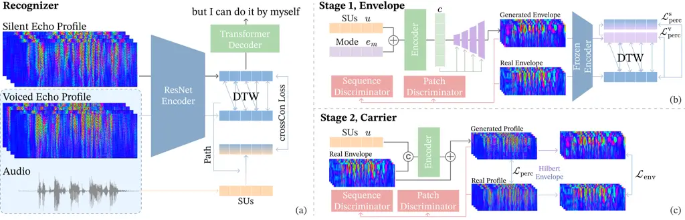

# SYNTHESIZING ULTRASONIC ECHO PROFILES FROM TEXT FOR OPEN-VOCABULARY SILENT SPEECH RECOGNITION

Jiacheng Liu    Ruidong Zhang    François Guimbretière    Cheng Zhang

###### Abstract

Eyewear that senses articulation with inaudible ultrasound can now
recognize silent speech over an open vocabulary, but its accuracy is
limited by the cost of training data. We present SoniGAN, which
synthesizes the ultrasonic echo profiles of silent articulation from
text and uses them as synthetic supervision. A voice-cloned
text-to-speech (TTS) model reads a text corpus, and a two-stage
generator synthesizes echo profiles from representations of the spoken
content of that audio. Pretraining a recognizer on 104 hours of the
synthesized data improves the word error rate (WER) of a public
open-vocabulary benchmark by 2.3 points. Adding the sessions the corpus
discards for a faulty microphone brings the system to 22.2% without any
language model. Lexicon-constrained decoding, LLM rescoring, and
ensembling further bring it to 14.9%, the first minimally obtrusive
silent speech interface to fall inside the error range in which users
report no loss of willingness to use silent speech input.

###### Index Terms: 

Silent speech interface, acoustic sensing, synthetic supervision,
open-vocabulary speech recognition, eyewear

^(†)^(†)address: Cornell University, Ithaca, NY, USA

## 1 INTRODUCTION

Silent speech interfaces (SSIs) recover what a person is articulating
without any audible sound, serving both those who cannot phonate and
anyone who needs speech input where speaking aloud is impractical or
intrusive \[16\]. So far, accuracy has come at the cost of
obtrusiveness. Open vocabularies have been reached with facial
electrodes \[6, 1\] and with ultrasound tongue imaging \[18\], both of
which put hardware on the skin or hold a probe against the jaw, whereas
minimally obtrusive sensing on an ordinary eyeglass frame has stayed
with closed command sets \[22\]. SoniSpeech \[23\] lifted that
restriction, recognizing open-vocabulary silent speech from echo
profiles captured with inaudible FMCW ultrasound on eyewear, but at
26.3% WER it sits well above the range in which users’ willingness to
adopt silent speech input holds at the level of an error-free
system \[16\].

Lowering that error rate calls for more paired data, which is exactly
what this modality lacks. Every sentence in an echo-profile corpus has
to be articulated silently by a wearer with the device on, which makes
collection slow and hard to scale. Unpaired text carries no such cost,
and generating training data from it has already been exploited for lip
reading \[2, 13, 8\] and for EMG-based speech recognition \[3, 19\].
However, no generative model exists for ultrasonic echo profiles, and
whether synthesized profiles can improve recognition performance is
untested.

To close the gaps, we present SoniGAN. It generates the echo profiles of
silent articulation from text, providing synthetic supervision for
silent speech recognition. The system leverages a voice-cloned TTS model
that reads unpaired text; the audio is reduced to soft speech
units \[20\] that keep what is said and discard who says it, and a
generator turns those units into echo profiles on which the recognizer
is pretrained. The articulatory cue sits in both the coarse envelope of
an echo profile and its fringe structure. The generator therefore
produces the two in sequence, the envelope first and then the fringes.
Each stage is supervised by a frozen recognizer and by two critics that
judge local texture and temporal structure separately.

We make two contributions. (1) The first text-to-echo-profile generator,
whose output serves as synthetic supervision for silent speech
recognition. A judge recognizer trained on real data reads the generated
profiles at 29.0% WER, against 30.4% for the real profiles of the same
sentences. Pretraining on 104 h of synthesized data and fine-tuning on
real profiles then lowers WER from 25.9% to 23.6%. (2) The first
echo-profile system below 15% WER. Recovering the sessions SoniSpeech
discards for a faulty microphone \[23\] brings the system to 22.2%
without a language model, and lexicon-constrained decoding, LLM
rescoring and ensembling bring it to 14.9%, to our knowledge the first
time a minimally obtrusive SSI falls inside the error range in which
users report no loss of willingness to use silent speech input \[16\].

## 2 RELATED WORK



Figure 1: Overview of SoniGAN. (a) The recognizer encodes echo profiles
with a ResNet encoder and decodes text with a Transformer; crossCon
contrasts its output against soft speech units $`u`$, with a DTW path
aligning the silent profile to its voiced counterpart. (b) Stage 1
encodes $`u`$ and the mode vector $`e_{m}`$ into $`c`$ and expands it
into an envelope, under two discriminators and
$`\mathcal{L}_{\text{perc}}`$ from a frozen encoder. (c) Stage 2
concatenates $`u`$ with an envelope and predicts the residual that
carries the fringe structure, under $`\mathcal{L}_{\text{perc}}`$,
$`\mathcal{L}_{\text{env}}`$ on the Hilbert envelope, and a second pair
of discriminators. The circled plus denotes element-wise addition and
the circled C concatenation along the channel axis.

### 2.1 Open-vocabulary Silent Speech Recognition on Wearables

Gaddy and Klein \[6, 7\] pioneered open-vocabulary silent speech
recognition with an approximately 20-hour, 8-channel facial EMG corpus,
which has since become the standard benchmark for the modality. Benster
et al. \[1\] align silent EMG with recorded voiced sessions through a
cross-modal contrastive objective and rescore with an LLM, reducing word
error rate to 12.2%. Ultrasound tongue imaging reaches continuous speech
from a different angle. Ribeiro et al. \[18\] recognise multi-speaker
silent speech from synchronised tongue imaging and lip video, and report
a substantial domain gap between silent and modal articulation that
adaptation only partly closes. Both modalities, however, require
skin-contact electrodes or a head-stabilised probe. Active acoustic
sensing removes that burden by probing articulation with inaudible
sweeps from an ordinary eyeglass frame \[22\], at the cost of a closed
command set, until SoniSpeech \[23\] paired the same front-end with an
open-vocabulary corpus and a CTC recognizer, whose baseline remains at
26.3% WER.

### 2.2 Learning from Synthetic Supervision in SSI

Synthetic supervision has emerged as a common remedy for the data
scarcity of silent speech interfaces. In lip reading, DualLip \[2\]
generates video–text pairs to exploit low-resource corpora,
SynthVSR \[13\] scales this idea to 3,652 hours of lip videos rendered
from speech audio, and LipGen \[8\] employs speech-driven visual
synthesis to improve robustness in real-world settings. Beyond the
visual modality, Chen et al. \[3\] train an EMG-to-speech model on
signals produced by the speech-conditioned generator STE-GAN \[19\].

Compared to video and EMG synthesis, SoniGAN addresses a distinct
condition. Real data for this modality is far scarcer, and range
compression places the articulatory cue in fringe structure that a
perceptually plausible sample does not reproduce, which, to our
knowledge, no prior work has attempted to synthesize.

## 3 METHODS

### 3.1 Recognizer

As shown in Figure 1 (a), the recognizer is a ResNet-18 followed by a
six-layer Transformer encoder \[21\] ($`d_{\text{model}}{=}384`$, 8
heads, relative positional attention), 22.4 M parameters in total. To
utilize the audible speech provided in the SoniSpeech dataset \[23\],
which the baseline leaves unused, we exploit it with the cross-contrast
(crossCon) loss of Benster et al. \[1\], which ties an echo-profile
encoder to a speech representation frame by frame. Rather than training
a separate audio branch as in the original work, we contrast the
ResNet-18 output directly against soft speech units pooled to the same
12.5 Hz rate, so no extra parameters are introduced.

CrossCon is an InfoNCE objective in which simultaneous frames of the two
representations form the positive pair and every other frame of either
modality in the batch is a negative. A silent recording has no audible
speech of its own, so its units must come from the voiced recording of
the same sentence. The two takes differ in timing, so we align them with
a DTW path computed between their echo-profile representations and warp
the speech units onto the silent frames along that path. The recognizer
minimizes $`\mathcal{L}_{\text{CTC}}+\mathcal{L}_{\text{con}}`$.

#### 3.1.1 Condition Corpus Preparation

Existing speech corpora \[15\] differ from SoniSpeech in content and
literary style, since SoniSpeech is built on the social-dialogue corpus
SODA \[10\], and conditioning on them would introduce out-of-vocabulary
(OOV) words. We therefore draw text from two movie-dialogue and subtitle
datasets \[5, 12\], keeping sentences of 10–25 words whose vocabulary is
covered by the training set and discarding any sentence that appears in
the SoniSpeech evaluation transcripts, which yields 76,382 sentences.

A flow-matching TTS model, F5-TTS \[4\], is cloned on 11.7 hours of the
corpus speaker’s own voiced recordings and reads this text, producing
104 hours of audio. Its speed parameter is drawn per utterance from a
calibrated distribution so that the synthetic corpus matches the
speaking rate of the real recordings; the two measure $`2.69\pm 0.40`$
and $`2.71\pm 0.37`$ words/s.

Following STE-GAN \[19\], the generator is conditioned not on this audio
but on its soft speech units \[20\], a 256-d vector every 20 ms (50 Hz)
that retains what is being said and discards who is saying it. This
further removes the timbre difference between vocoder-generated and real
audio. We write $`u`$ for the unit sequence of an utterance.

#### 3.1.2 Echo Profile Synthesis

The SoniSpeech device emits inaudible FMCW sweeps and range-compresses
the reflections into _echo profiles_, four channels of 80 range bins at
200 Hz that map how the reflecting surfaces of the face move over
time \[23\]. The articulatory cue sits in both the coarse envelope of an
echo profile and the fine fringe structure left by the carrier, which a
generator is unlikely to recover in a single step. We therefore
synthesize the two in sequence with two GANs, predicting the envelope
first and the carrier conditioned on it (Fig. 1a).

SoniSpeech provides echo profiles in two modes, silent and voiced, the
former recorded while the participant articulates without phonation and
the latter while speaking the utterance aloud. To exploit both while
still directing the generator towards a target mode, each mode
$`m\in\{\mathrm{v},\mathrm{s}\}`$ is represented by a learnable vector
$`e_{m}\in\mathbb{R}^{256}`$ that conditions the generator. We write
$`a_{m}`$ for a real envelope and $`y_{m}`$ for the full echo profile it
comes from.

Stage 1, envelope. The generator produces
$`\hat{a}_{m}=G_{1}(u,e_{m})`$, a $`4\times 80\times T`$ envelope at
200 Hz, from the units $`u`$ of the utterance’s voiced recording
(Fig. 1b). It is trained on 256-frame windows (1.28 s, 64 unit frames)
and applied to whole sentences at synthesis. The mode vector $`e_{m}`$
is broadcast over time and added to $`u`$, and an encoder of four
residual dilated 1-D convolutions turns the sum into a latent sequence
$`c`$; a decoder then grows a 5-bin seed computed from $`c`$ to 80 range
bins at 200 Hz, every block modulated by $`c`$, following the
StyleGAN2-style decoder of SynthVSR \[13\].

Each mode is assigned two critics $`D^{k}_{m}`$,
$`k\in\{\mathrm{p},\mathrm{q}\}`$, one for the realism of local detail
and one for temporal structure. The patch critic
$`D^{\mathrm{p}}_{m}`$ \[9\] scores patches of 34 range bins $`\times`$
34 frames and judges local texture and amplitude statistics; since
plausible texture is plausible wherever it sits, the sequence critic
$`D^{\mathrm{q}}_{m}`$ pools over range and judges temporal structure
instead. Both compare $`\hat{a}_{m}`$ with real envelopes of the same
mode under the least-squares objective \[14\], giving the generator the
term

```math
\mathcal{L}_{\text{adv}}=\frac{1}{8}\sum_{m}\sum_{k}\mathbb{E}\bigl[(D^{k}_{m}(\hat{a}_{m})-1)^{2}\bigr], \tag{1}
```

the standard least-squares generator loss averaged over the four
critics.

Matching the style of a given mode, however, does not guarantee that the
generated envelope carries the intended content. We therefore adopt the
perceptual loss of SynthVSR \[13\]. A recognizer is first trained on
real envelopes following Section 3.1 and then frozen, supervising
content through its ResNet-18 output $`z(\cdot)`$ and its CTC posteriors
$`p(\cdot)`$,

```math
\mathcal{L}^{m}_{\text{perc}}=\lVert z(\hat{a}_{m})-z(a_{m})\rVert_{1}+\lambda_{\text{logit}}\,\mathrm{KL}\bigl(p(a_{m})\,\|\,p(\hat{a}_{m})\bigr), \tag{2}
```

with $`\lambda_{\text{logit}}=0.1`$. Both terms compare frames pairwise,
so $`\hat{a}_{m}`$ and $`a_{m}`$ must share a clock. This holds for the
voiced mode, whose units and envelope come from one recording, but a
silent envelope $`\hat{a}_{\mathrm{s}}`$ is generated from units of the
voiced take of the same sentence. We align the two as in Section 3.1,
warping $`a_{\mathrm{s}}`$ onto $`\hat{a}_{\mathrm{s}}`$ along a DTW
path computed between the two real envelopes in the latent space of the
frozen recognizer. The generator minimizes

```math
\mathcal{L}_{G_{1}}=\lambda_{\mathrm{v}}\mathcal{L}^{\mathrm{v}}_{\text{perc}}+\lambda_{\mathrm{s}}\mathcal{L}^{\mathrm{s}}_{\text{perc}}+\lambda_{\text{adv}}\mathcal{L}_{\text{adv}}. \tag{3}
```

Stage 2, carrier. As shown in Fig. 1c, the second generator $`G_{2}`$
predicts the residual between an envelope and the profile it came from,
that is, the fringe structure the envelope lacks,

```math
\hat{y}_{m}=a_{m}+G_{2}(a_{m},u). \tag{4}
```

The units $`u`$ are embedded by a $`1{\times}1`$ convolution, upsampled
to 200 Hz and broadcast over range, then concatenated with $`a_{m}`$ and
passed through a stack of dilated 2-D residual convolutions with no
downsampling, since the fringes are a high spatial frequency along range
that striding would erase. An $`L_{1}`$ loss on the range-axis Hilbert
envelope keeps the envelope of $`\hat{y}_{m}`$ faithful to that of
$`y_{m}`$, while the fringe structure is restored by a perceptual loss
through a second frozen recognizer, trained on intact echo profiles with
latent $`z^{\prime}(\cdot)`$, and by a patch and a sequence critic of
the Stage 1 design,

```math
\mathcal{L}_{G_{2}}=\lambda_{\text{env}}\mathcal{L}_{\text{env}}+\lambda^{\prime}_{\text{perc}}\mathcal{L}_{\text{perc}}+\lambda^{\prime}_{\text{adv}}\mathcal{L}_{\text{adv}}, \tag{5}
```

where
$`\mathcal{L}_{\text{env}}=\bigl\lVert|\mathcal{H}(\hat{y}_{m})|-|\mathcal{H}(y_{m})|\bigr\rVert_{1}`$.

### 3.2 Decoding

Greedy CTC decoding invents word forms. We therefore decode with a beam
search constrained by a lexicon of the 4,789 word forms observed in the
training transcripts, together with a word 4-gram with stupid backoff
estimated on the same transcripts. Candidates are scored by a weighted
sum of the CTC and 4-gram log-probabilities and a word-count bonus that
offsets CTC’s bias towards short outputs, and the $`n`$-best list is
then rescored by a neural language model.

## 4 EXPERIMENTAL SETUP

For comparability with the SoniSpeech baseline \[23\], all models are by
default trained on the first 140 sessions of the training split (10.6 h
silent, 10.2 h voiced). The recognizer is first pretrained on synthetic
data alone with the CTC loss for 6 epochs, then trained for a further 60
epochs on real echo profiles together with the units $`u`$ extracted
from the voiced recordings.

Generator. Both generators use AdamW (learning rate
$`2{\times}10^{-4}`$, no weight decay) and are trained for 12 epochs.
Stage 1 takes $`\lambda_{\mathrm{v}}{=}0.040`$,
$`\lambda_{\mathrm{s}}{=}0.20`$ and $`\lambda_{\text{adv}}{=}3.0`$ in
Eq. (3), and Stage 2 takes $`\lambda_{\text{env}}{=}1.0`$,
$`\lambda^{\prime}_{\text{perc}}{=}0.20`$ and
$`\lambda^{\prime}_{\text{adv}}{=}3.0`$ in Eq. (5).

Recognizer. Training uses AdamW (learning rate $`3{\times}10^{-4}`$,
weight decay 0.01, cosine schedule). Group normalization, $`16\times`$
temporal downsampling, the 1000-piece SentencePiece vocabulary \[11\]
and the SpecAugment and utterance-concatenation augmentations are kept
from the baseline \[23\]. CTC targets are lowercased and stripped of
punctuation, reproducing the corpus statistics of \[23\] exactly (1,684
test word types, 242 out of vocabulary).

Evaluation. We report word error rate (WER) on the full 1,000-sentence
silent test set, scored after the Whisper English normalizer \[17\].

## 5 Results

|                              |              |          |         |
| ---------------------------- | ------------ | -------- | ------- |
| Method                       | Real (sess.) | Syn. (h) | WER (%) |
| SoniSpeech \[23\]            | 140          | –        | 26.3    |
| SoniGAN                      | 140          | –        | 25.9    |
| \+ synthetic data            | 140          | 26       | 24.6    |
| \+ synthetic data            | 140          | 51       | 23.8    |
| \+ synthetic data            | 140          | 104      | 23.6    |
| \+ 20 noisy-channel sessions | 160          | 104      | 22.2    |
| \+ lexicon, 4-gram           | 160          | 104      | 18.8    |
| \+ Qwen3-4B rescoring        | 160          | 104      | 17.1    |
| \+ 5-model ensemble          | 160          | 104      | 14.9    |

Table 1: Silent-speech WER on the SoniSpeech test set. Rows are
cumulative; each addition is applied on top of the row above.

### 5.1 Overall Performance

Table 1 builds the system one component at a time. Under the baseline’s
data budget of 140 sessions, our recognizer alone reads 25.9% against
the published 26.3%, and pretraining on 104 h of synthetic profiles
lowers this to 23.6%. The synthetic data is thus worth 2.3 points, over
five times the architectural change it sits on.

Scale of the synthetic corpus. We draw 26 h and 51 h subsets from the
104 h corpus, pretrain a recognizer on each and fine-tune on the same
140 real sessions. The gain arrives early and then flattens. A quarter
of the corpus already buys more than half of it, 26 h giving 24.6%, the
doubling to 51 h a further 0.8 points, and the last doubling to 104 h
only 0.2.

Sessions with a faulty microphone. SoniSpeech \[23\] releases 160
sessions but excludes 20 silent and 11 voiced sessions in which one of
the two microphones is dominated by noise. Each microphone contributes
two of the four echo-profile channels, one per transmitter, and in the
released data the faulty microphone’s two channels have been replaced by
copies of the intact microphone’s, so these sessions carry only two
independent channels. Since such a failure is exactly what a device worn
daily will meet, we ask whether the data can still be used.

Starting from the same 104 h pretrained checkpoint, we fine-tune on all
160 sessions and add an augmentation that overwrites the two channels of
one microphone with those of the other, with probability 0.15 per
utterance and resampled every epoch. Table 2 separates the two factors.
The augmentation alone is worth 0.1 points and does nothing when no
degraded data is present, while the 20 extra sessions are worth 0.8; the
two together reach 22.2%, so the augmentation pays off only once the
recognizer has degraded sessions to learn from.

Decoding. The remaining errors are largely invented word forms and
implausible word sequences, which a lexicon and a language model can
repair. Constraining a 128-wide beam search to the training lexicon and
adding the word 4-gram removes 3.4 points, and rescoring with
Qwen3-4B-Base removes a further 1.7%. An ensemble of five runs that
differ only in random seed brings the system to 14.9%, a 43% relative
reduction over the baseline. This is, to our knowledge, the first time
open-vocabulary silent-speech recognition from an eyewear-mounted sensor
has fallen below 15% WER, the range within which users’ willingness to
adopt silent speech input holds at the level of an error-free
system \[16\].

|                       | WER (%)  |         |
| --------------------- | -------- | ------- |
| Training sessions     | w/o dup. | w/ dup. |
| 140 (intact only)     | 23.6     | 23.5    |
| 160 (incl. 20 faulty) | 22.8     | 22.2    |

Table 2: Contribution of the 20 sessions with a faulty microphone and of
the channel-duplication augmentation. All rows start from the same 104 h
pretrained checkpoint.

### 5.2 Ablation Studies

SoniGAN supervises the recognizer with contrastive learning and the
generator with several objectives at once. We remove them one at a time
to attribute the gain.

Recognizer. Removing crossCon, and with it the latent-space alignment
between audio and echo profiles, raises WER from 25.9% to 29.0% on 140
sessions without pretraining. The two modalities can thus be bridged
without warping either the audio or the silent profiles explicitly.

Generator. Signal generators are commonly evaluated by the WER of their
own output and by similarity to real signals \[19\], but neither settles
what a generator contributes as supervision. We therefore report both,
the downstream WER of a recognizer pretrained on 104 h of each variant’s
data, and the WER at which a frozen ResNet-34 judge reads 200 generated
silent profiles from the SoniSpeech test set or from the subtitle
corpus. Since the generator is supervised through a frozen recognizer,
the judge is deliberately a different architecture, trained
independently on the same 140 sessions and without the crossCon
objective, so that the perceptual loss cannot satisfy it by a shortcut.

Pretraining of any kind adds tens of thousands of optimizer steps, which
alone could account for the gain. Two controls separate this from the
data itself. The first pretrains on noise matched to the per-channel,
per-range-bin mean and variance of real profiles, which reproduces their
amplitude statistics while encoding nothing about time. The second
replays the real training profiles through the synthetic branch, adding
passes over data the recognizer already sees without adding new
sentences. Both are run for the same number of optimizer steps and
fine-tuned on the same 140 sessions. Neither helps; both hurt, noise by
1.7 points against no pretraining at all and replayed profiles by 0.3.
The gain is therefore neither the extra steps nor more passes over the
same recordings (Table 3).

On the generation side, the generated profiles are as readable as the
real ones. The judge reads generated silent profiles of the SoniSpeech
test sentences at 29.0% against 30.4% for the real profiles of the same
sentences, and every ablation except one stays within 1.1 points of
that. Removing $`\mathcal{L}_{\text{perc}}`$ is the exception and
collapses the output to 96.2%, leaving profiles that are
articulation-shaped but unreadable. On the subtitle corpus the same
profiles are read 23 points worse. The judge is itself trained on
SoniSpeech transcripts, so subtitle-style sentences are out of domain
for it as well, and this gap bounds rather than measures the generator’s
degradation.

Removing each supervision in turn exposes a mismatch between how
readable the synthetic data is and how useful it is downstream. Every
term contributes downstream, each worth between 0.4 and 0.9 points, yet
data whose semantic content has collapsed still improves the recognizer
by 1.8 points over no pretraining. Synthetic supervision therefore helps
along two routes at once, warming the recognizer up on synthesized
articulatory dynamics and carrying the content those dynamics encode,
and only the second of the two is visible to a readability metric.

|                                   |                   |                  |            |
| --------------------------------- | ----------------- | ---------------- | ---------- |
|                                   | Synthetic WER (%) |                  | Downstream |
| Pretraining data                  | SoniSpeech \[23\] | Corpus \[5, 12\] | WER (%)    |
| None                              | –                 | –                | 25.9       |
| Noise                             | –                 | –                | 27.6       |
| Real data                         | 30.4              | –                | 26.2       |
| SoniGAN                           | 29.0              | 52.0             | 23.6       |
| w/o $`\mathcal{L}_{\text{env}}`$  | 28.3              | 50.8             | 24.3       |
| w/o $`\mathcal{L}_{\text{perc}}`$ | 96.2              | 96.6             | 24.1       |
| w/o $`D^{\mathrm{p}}_{m}`$        | 29.9              | 53.0             | 24.0       |
| w/o $`D^{\mathrm{q}}_{m}`$        | 27.8              | 53.2             | 24.5       |

Table 3: Ablations of the pretraining data and of the generator’s
supervision.

## 6 CONCLUSION

We presented SoniGAN, which synthesizes ultrasonic echo profiles from
text and pretrains a silent-speech recognizer on them. The generated
profiles are as readable as real recordings, and pretraining on 104 h of
them is worth 2.3 points. Ablations show that readability and downstream
usefulness are only loosely coupled, which also explains why the gain
saturates early. With the discarded faulty sessions, contrastive
learning and standard decoding, the system reaches 14.9% WER.

## References

- \[1\] T. Benster, G. Wilson, R. Elisha, F. R. Willett, and S.
  Druckmann (2024) A cross-modal approach to silent speech with
  llm-enhanced recognition. arXiv preprint arXiv:2403.05583. Cited by:
  §1, §2.1, §3.1.
- \[2\] W. Chen, X. Tan, Y. Xia, T. Qin, Y. Wang, and T. Liu (2020)
  Duallip: a system for joint lip reading and generation. In Proceedings
  of the 28th ACM international conference on multimedia, pp. 1985–1993.
  Cited by: §1, §2.2.
- \[3\] X. Chen, X. Gao, M. Quoy, A. Pitti, and N. F. Chen (2025)
  Confidence-based self-training for emg-to-speech: leveraging synthetic
  emg for robust modeling. In 2025 IEEE Automatic Speech Recognition and
  Understanding Workshop (ASRU), pp. 1–8. Cited by: §1, §2.2.
- \[4\] Y. Chen, Z. Niu, Z. Ma, K. Deng, C. Wang, J. JianZhao, K. Yu,
  and X. Chen (2025) F5-tts: a fairytaler that fakes fluent and faithful
  speech with flow matching. In Proceedings of the 63rd Annual Meeting
  of the Association for Computational Linguistics (Volume 1: Long
  Papers), pp. 6255–6271. Cited by: §3.1.1.
- \[5\] C. Danescu-Niculescu-Mizil and L. Lee (2011) Chameleons in
  imagined conversations: a new approach to understanding coordination
  of linguistic style in dialogs. In Proceedings of the 2nd workshop on
  cognitive modeling and computational linguistics, pp. 76–87. Cited by:
  §3.1.1, Table 3.
- \[6\] D. Gaddy and D. Klein (2020) Digital voicing of silent speech.
  In Proceedings of the 2020 Conference on Empirical Methods in Natural
  Language Processing (EMNLP), B. Webber, T. Cohn, Y. He, and Y. Liu
  (Eds.), Online, pp. 5521–5530. External Links:
  [Link](https://aclanthology.org/2020.emnlp-main.445/),
  [Document](https://dx.doi.org/10.18653/v1/2020.emnlp-main.445) Cited
  by: §1, §2.1.
- \[7\] D. Gaddy and D. Klein (2021) An improved model for voicing
  silent speech. In Proceedings of the 59th Annual Meeting of the
  Association for Computational Linguistics and the 11th International
  Joint Conference on Natural Language Processing (Volume 2: Short
  Papers), C. Zong, F. Xia, W. Li, and R. Navigli (Eds.), Online,
  pp. 175–181. External Links:
  [Link](https://aclanthology.org/2021.acl-short.23/),
  [Document](https://dx.doi.org/10.18653/v1/2021.acl-short.23) Cited by:
  §2.1.
- \[8\] B. Hao, D. Zhou, X. Li, X. Zhang, L. Xie, J. Wu, and E.
  Yin (2025) Lipgen: viseme-guided lip video generation for enhancing
  visual speech recognition. In ICASSP 2025-2025 IEEE International
  Conference on Acoustics, Speech and Signal Processing (ICASSP),
  pp. 1–5. Cited by: §1, §2.2.
- \[9\] P. Isola, J. Zhu, T. Zhou, and A. A. Efros (2017) Image-to-image
  translation with conditional adversarial networks. In 2017 IEEE
  conference on computer vision and pattern recognition (CVPR),
  pp. 5967–5976. Cited by: §3.1.2.
- \[10\] H. Kim, J. Hessel, L. Jiang, P. West, X. Lu, Y. Yu, P. Zhou, R.
  Bras, M. Alikhani, G. Kim, et al. (2023) Soda: million-scale dialogue
  distillation with social commonsense contextualization. In Proceedings
  of the 2023 Conference on Empirical Methods in Natural Language
  Processing, pp. 12930–12949. Cited by: §3.1.1.
- \[11\] T. Kudo and J. Richardson (2018) SentencePiece: a simple and
  language independent subword tokenizer and detokenizer for neural text
  processing. In Proceedings of the 2018 conference on empirical methods
  in natural language processing: System demonstrations, pp. 66–71.
  Cited by: §4.
- \[12\] P. Lison and J. Tiedemann (2016) OpenSubtitles2016: extracting
  large parallel corpora from movie and tv subtitles. In Proceedings of
  the Tenth International Conference on Language Resources and
  Evaluation (LREC’16), pp. 923–929. Cited by: §3.1.1, Table 3.
- \[13\] X. Liu, E. Lakomkin, K. Vougioukas, P. Ma, H. Chen, R. Xie, M.
  Doulaty, N. Moritz, J. Kolar, S. Petridis, et al. (2023) SynthVSR:
  scaling up visual speech recognitionwith synthetic supervision. In
  2023 IEEE/CVF Conference on Computer Vision and Pattern Recognition
  (CVPR), pp. 18806–18815. Cited by: §1, §2.2, §3.1.2, §3.1.2.
- \[14\] X. Mao, Q. Li, H. Xie, R. Y. Lau, Z. Wang, and S. Paul
  Smolley (2017) Least squares generative adversarial networks. In
  Proceedings of the IEEE international conference on computer vision,
  pp. 2794–2802. Cited by: §3.1.2.
- \[15\] V. Panayotov, G. Chen, D. Povey, and S. Khudanpur (2015)
  Librispeech: an asr corpus based on public domain audio books. In 2015
  IEEE international conference on acoustics, speech and signal
  processing (ICASSP), pp. 5206–5210. Cited by: §3.1.1.
- \[16\] L. Pandey, K. Hasan, and A. S. Arif (2021) Acceptability of
  speech and silent speech input methods in private and public. In
  Proceedings of the 2021 CHI conference on human factors in computing
  systems, pp. 1–13. Cited by: §1, §1, §5.1.
- \[17\] A. Radford, J. W. Kim, T. Xu, G. Brockman, C. McLeavey, and I.
  Sutskever (2023) Robust speech recognition via large-scale weak
  supervision. In International conference on machine learning,
  pp. 28492–28518. Cited by: §4.
- \[18\] M. S. Ribeiro, A. Eshky, K. Richmond, and S. Renals (2021)
  Silent versus modal multi-speaker speech recognition from ultrasound
  and video. arXiv preprint arXiv:2103.00333. Cited by: §1, §2.1.
- \[19\] K. Scheck and T. Schultz (2023) STE-gan:
  speech-to-electromyography signal conversion using generative
  adversarial networks. In Proc. Interspeech 2023, pp. 1174–1178. Cited
  by: §1, §2.2, §3.1.1, §5.2.
- \[20\] B. Van Niekerk, M. Carbonneau, J. Zaïdi, M. Baas, H. Seuté,
  and H. Kamper (2022) A comparison of discrete and soft speech units
  for improved voice conversion. In ICASSP 2022-2022 IEEE International
  Conference on Acoustics, Speech and Signal Processing (ICASSP),
  pp. 6562–6566. Cited by: §1, §3.1.1.
- \[21\] A. Vaswani, N. Shazeer, N. Parmar, J. Uszkoreit, L.
  Jones, A. N. Gomez, Ł. Kaiser, and I. Polosukhin (2017) Attention is
  all you need. Advances in neural information processing systems 30.
  Cited by: §3.1.
- \[22\] R. Zhang, K. Li, Y. Hao, Y. Wang, Z. Lai, F. Guimbretière,
  and C. Zhang (2023) EchoSpeech: continuous silent speech recognition
  on minimally-obtrusive eyewear powered by acoustic sensing. In
  Proceedings of the 2023 CHI Conference on Human Factors in Computing
  Systems, CHI ’23, New York, NY, USA. External Links: ISBN
  9781450394215, [Link](https://doi.org/10.1145/3544548.3580801),
  [Document](https://dx.doi.org/10.1145/3544548.3580801) Cited by: §1,
  §2.1.
- \[23\] R. Zhang, J. Liu, F. Guimbretière, and C. Zhang (2026)
  SoniSpeech: a large-scale open-vocabulary tri-modal dataset for
  wearable silent speech interfaces. arXiv preprint arXiv:2608.00803.
  Cited by: §1, §1, §2.1, §3.1.2, §3.1, §4, §4, §5.1, Table 1, Table 3.
