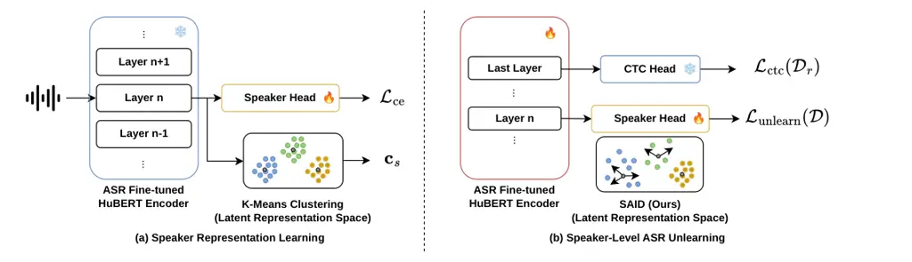

Ok Han Kim Lee

# Towards Privacy-Preserving ASR: Speaker-Level Machine Unlearning

Seaone    Seungu    Eungbeom    Kyogu

###### Abstract

Automatic Speech Recognition (ASR) systems are commonly designed to
transcribe linguistic content independently of speaker identity.
However, speaker-specific information can persist within the latent
representations of ASR models, raising privacy concerns when training
data includes sensitive individuals. While machine unlearning has been
studied in several speech tasks, applying speaker unlearning to ASR
remains challenging due to the strong entanglement of linguistic and
speaker-related information in speech representations. In this work, we
conduct a layer-wise analysis of Self-Supervised Learning (SSL) based
ASR representations, revealing that speaker identity is primarily
encoded in intermediate encoder layers. Based on this observation, we
explore a feature-level unlearning strategy that targets these identity
structures. Experiments on the VCTK corpus show that the proposed
approach removes the influence of specific speakers while maintaining
robust transcription performance.

###### keywords

Machine Unlearning, Automatic Speech Recognition, Privacy Preservation

^(†)^(†)address: ¹ Interdisciplinary Program in Artificial Intelligence,
Seoul National University  
² Department of Intelligence and Information, Seoul National
University  
³ Artificial Intelligence Institute, Seoul National University, Republic
of Korea ^(†)^(†)email: seaoneok@snu.ac.kr, hansw0326@snu.ac.kr,
eb.kim@snu.ac.kr, kglee@snu.ac.kr

## 1 Introduction

Machine unlearning has recently emerged as critical research frontier,
driven by the need to comply with regulatory mandates such as the Right
To Be Forgotten (RTBF) under the General Data Protection Regulation
(GDPR) \[1\]. These frameworks grant individuals the right to request
that their data be removed from trained systems, posing a significant
challenge when a user withdraws consent after a model has been deployed.
Unlearning has expanded into the speech domain, particularly for tasks
such as Keyword Spotting, Speaker Identification, and
Text-to-Speech \[2, 3, 4\]. In these applications, the information
targeted for unlearning are typically entangled with the primary goal of
the model. However, unlearning remains underexplored in Automatic Speech
Recognition (ASR), which is one of the foundational task of speech
processing. As ASR fundamentally relies on broad generalization to
transcribe effectively, it is commonly assumed that unlearning specific
data could severely degrade its general transcription performance.

Although ASR is typically formulated as a speaker-independent task,
empirical evidence shows that modern ASR models still encode
speaker-specific traits during training \[5\]. This effect becomes
pronounced in modern ASR pipelines, where large pretrained speech models
are fine-tuned on relatively small, application-specific datasets. While
such approaches enable strong performance in data-constrained scenarios
like clinical or low-resource applications \[6, 7, 8, 9\], neural
networks are known to memorize distinctive details of their training
data beyond what is required for generalization \[10, 11\]. In context
of ASR, this results in residual acoustic fingerprints that persist
within the model representations. These signals can potentially be
exploited through Membership Inference Attacks (MIAs) \[12, 13\],
allowing an adversary to determine whether a particular speaker was
included in the training data \[14\]. Such risks raise serious privacy
concerns \[15\], particularly when the training corpus involves
sensitive cohorts, such as patients in clinical studies, where a privacy
breach could lead to the re-identification of protected health
information.

Despite these risks, to the best of our knowledge, achieving
speaker-level unlearning in ASR while preserving transcription
performance has not yet been explored \[16\]. This difficulty arises
from the coupling of linguistic and paralinguistic information within
speech representations. An effective unlearning strategy must therefore
selectively remove speaker-specific traces while maintaining the general
recognition performance, ensuring that speech from those speakers is
transcribed with the same fidelity expected for any previously unseen
speaker.

In this work, we investigate speaker-level unlearning in ASR. Building
on prior observations that speaker-related information tends to be
localized within intermediate layers of speech encoders \[17\], we
explore a representation-level intervention that targets these identity
structures directly in the latent space. To enable controlled
manipulation of speaker representations, we attach an auxiliary
representation head and perform feature-level unlearning on the
resulting embeddings. As one concrete approach, we introduce a simple
dispersion objective that pushes representations of the forget speakers
away from their latent centroids. Our experiments demonstrate that such
targeted intervention can effectively removes speaker-specific traces
while maintaining robust ASR performance. By achieving a favorable
privacy-utility trade-off compared to existing unlearning baselines, our
work provides a practical step toward privacy-preserving ASR systems.



Figure 1: Overall framework of the proposed speaker-level ASR
unlearning. (a) Speaker Representation Learning identifies
speaker-specific distributions within the latent space of the ASR-tuned
HuBERT-base model. K-Means clustering is employed to identify their
geometric centroids $`\mathbf{c}_{s}`$. (b) Speaker-Level ASR Unlearning
selectively dissolve speaker identity under each objective loss while
maintaining transcription utility. Our mechanism applies a dispersion
force to push latent embeddings from corresponding centroids, defined in
the previous stage.

## 2 Related Work

### 2.1 Privacy Risks and Membership Inference in Speech Models

Membership Inference Attacks reveal that training data can leave
measurable traces in deployed models \[12, 14, 18\], including modern
end-to-end ASR systems \[19\]. Moreover, SSL encoders such as
HuBERT \[20\] have been shown to retain training-specific signals within
their latent representations \[13\], suggesting that memorization may
originate at the representation level and propagate to downstream tasks.
While prior studies highlight the privacy risks of speech models, they
primarily focus on auditing vulnerabilities rather than enabling
mechanisms for identity erasure from trained ASR systems.

### 2.2 Machine Unlearning

Machine unlearning \[15\] seeks to remove the influence of specific
training data without retraining a model from scratch \[21\]. Existing
approaches typically rely on parameter updates, such as gradient ascent
or label corruption applied to the forget set \[22\]. More advanced
methods introduce mechanisms such as knowledge distillation or
structural model editing \[23, 24, 25, 26, 27\]. Recent works has
explored representation-level approaches that manipulate latent
embeddings to control data influence more locally \[28\].

Machine unlearning has been studied in several speech tasks \[2, 3, 4\].
However, applying unlearning to ASR remains particularly challenging due
to the strong entanglement of linguistic and speaker-related information
in speech representations. Consequently, only a limited number of
studies have explored unlearning in ASR, including sample unlearning on
LLM-based ASR architectures \[29\] and optimization constraints during
training \[16\], that suppress transcription performance for targeted
speakers. However, this objective differs from the goal of general ASR
systems, which are designed to operate independently of speaker
identity. Existing studies have not yet demonstrated how to remove
speaker-specific traces from ASR models while preserving their ability
to transcribe speech for those speakers.

## 3 Method

### 3.1 Problem Definition

We define the task of speaker-level machine unlearning for ASR. Let
$`\mathcal{D}=\{(x_{i},y_{i},s_{i})\}^{N}_{i=1}`$ denote the original
training dataset, where $`x_{i}`$ is an input utterance, $`y_{i}`$ is
its transcription $`y_{i}`$, and $`s_{i}\in\mathcal{S}`$ represents the
speaker identity. Following the standard unlearning setup, we split
$`\mathcal{D}`$ into a forget set
$`\mathcal{D}_{f}=\{(x,y,s)|s\in\mathcal{S}_{f}\}`$, specified by a set
of forget speakers $`\mathcal{S}_{f}`$, and a retain set
$`\mathcal{D}_{r}=\mathcal{D}\backslash\mathcal{D}_{f}`$. Given a model
$`f_{\theta}`$ trained on $`\mathcal{D}`$, the objective is to update
its parameters to $`\theta^{\prime}`$ such that $`f_{\theta^{\prime}}`$
behaves similar to a gold model $`f_{\theta*}`$ trained exclusively on
$`\mathcal{D}_{r}`$, without requiring full retraining. A successful
unlearned model must satisfy the following three objectives.

- •
  Utility preservation The model must maintain its transcription
  performance on $`\mathcal{D}_{r}`$, ensuring that the linguistic
  mapping remains intact.
- •
  Targeted Identity Erasure Speaker-specific information associated with
  $`\mathcal{S}_{f}`$ must be removed to defend against membership
  inference attacks, while identity information of $`\mathcal{S}_{r}`$
  remains unaffected.
- •
  Generalization The model should maintain robust ASR performance on
  both forgotten and unseen speakers, treating forgotten identities as
  non-member data.

### 3.2 Auxiliary Speaker Representation Head

The overall architecture of ASR model consists of a pre-trained
HuBERT-base encoder followed by a Connectionist Temporal Classifcation
(CTC) \[30\] decoder. To obtain a controllable representation of
speaker-related information, we attach an auxiliary speaker
classification head to the hidden states of the 6th encoder layer. This
choice follows prior analyses showing that speaker information tends to
emerge in the early-to-middle layers of SSL speech encoders \[17\]. As
illustrated in Figure 1(a), we first train this speaker head while
freezing the encoder. This step learns a speaker embedding space
$`\mathbf{z}`$ that captures identity-related structure without
modifying the linguistic representations used by the ASR decoder. The
subsequent unlearning stage is operated on this embedding space to
enable representation-level interventions while minimizing disruption to
transcription performance.

### 3.3 Representation-level unlearning objective

The overall objective is defined as

```math
\displaystyle\mathcal{L}_{total}=\mathcal{L}_{\text{ctc}}(\mathcal{D}_{r})+\lambda\mathcal{L}_{\text{unlearn}} \tag{1}
```

where the CTC loss is computed only on the retain data to maintain
transcription performance. We exclude the forget set from the CTC
objective, treating it as non-member data and relying on the inherent
generalization ability of the model to transcribe forgotten speakers
without explicitly optimizing on their samples during unlearning. Here,
$`\lambda`$ balances the CTC loss and the unlearning objective; we set
$`\lambda=1`$ in all experiments. To allow consistent comparison across
different unlearning strategies, $`\mathcal{L}_{\text{unlearn}}`$ is
applied directly to the speaker embedding $`\mathbf{z}`$. We use a
unified formulation:

```math
\displaystyle\mathcal{L}_{\text{unlearn}}=\alpha\mathcal{L}_{\text{unlearn}}(\mathcal{D}_{r})+\beta\mathcal{L}_{\text{unlearn}}(\mathcal{D}_{f}) \tag{2}
```

Here, $`\mathcal{L}_{\text{unlearn}}(\mathcal{D}_{f})`$ induces
forgetting by disrupting the identity representation of the target
speakers, while $`\mathcal{L}_{\text{unlearn}}(\mathcal{D}_{r})`$
stabilizes the representations of the retain speakers. In all
experiments, we set $`\alpha=1`$ and $`\beta=1`$ for unlearning
strategies.

### 3.4 Speaker-Aware Identity Dispersion

We instantiate $`\mathcal{L}_{\text{unlearn}}(\mathcal{D}_{f})`$ with a
two-stage identity dispersion procedure that targets geometric structure
of speaker clusters in the embedding space.

Stage 1: Centroid-based Distribution Mapping Using the speaker embedding
space defined in Section 3.2, we estimate geometric anchors for the
forget speakers. Although speaker labels are available, we intentionally
apply K-Means clustering to the embeddings of the forget set to identify
latent centroids $`\textbf{c}_{s}`$ corresponding to each speaker
distribution. Speaker identity typically manifests as compact clusters
in the representation space. Estimating the centroid of each cluster
therefore provides a natural geometric anchor that summarizes
identity-specific structure and serve as a reference points for targeted
removal during unlearning.

Stage 2: Latent Identity Dispersion Once the centroids are estimated, we
unfreeze the encoder and optimize the model to push the embeddings of
forget samples away from their corresponding centroid. For a forget
utterance $`x_{j}`$ belonging to speaker $`s`$, we apply a margin-based
dispersion loss between the current embedding $`\Psi_{\theta}(x_{j})`$
and its centroid anchor $`\textbf{c}_{s}`$. We refer to this objective
as Speech-Aware Identity Dispersion (SAID). The SAID loss is defined as:

```math
\mathcal{L}_{\text{SAID}}=\text{softplus}\left(\frac{\cos(\Psi_{\theta}(x_{j}),\mathbf{c}_{s})-m}{\tau}\right) \tag{3}
```

where $`m`$ is a distance margin and $`\tau`$ is a temperature scaling
factor. Minimizing this objective progressively repels forget embeddings
from their identity anchors, dispersing speaker-specific clusters in the
latent space while preserving the broader linguistic representation
required for ASR transcription.

## 4 Experiments

### 4.1 Experimental Setup

Datasets We evaluate our method on the VCTK corpus \[31\], a
multi-speaker English dataset of high-quality read speech, to simulate a
realistic unlearning scenario where an ASR model is fine-tuned to a new
domain. We use the mic2 recordings and exclude p280 and p315 due to
reported technical artifacts, resulting in a total of 108 speakers. All
recordings are resampled to 16kHz. To rigorously evaluate speaker-level
forgetting, we construct speaker-independent splits such that speaker
identities are strictly disjoint across training and evaluation sets.
The speakers are randomly partitioned into a retain set
$`\mathcal{D}_{r}`$ of 95 speakers, a forget set $`\mathcal{D}_{f}`$ of
5 speakers and a test set $`\mathcal{D}_{t}`$ of 8 speakers. To mitigate
potential speaker imbalance, we maintain a balanced distribution of
gender and accent across the splits. To further distinguish between the
removal of specific training samples and the erasure of speaker
identity, both $`\mathcal{D}_{r}`$ and $`\mathcal{D}_{f}`$ are divided
into training and evaluation subsets with a 9:1 ratio.

Implementation Details We first prepare the reference ASR models by
fine-tuning a HuBERT-base encoder with the CTC loss. The Original Model
$`\mathcal{M}_{\text{orig}}`$ is trained on
$`\mathcal{D}_{r,\text{train}}\cup\mathcal{D}_{f,\text{train}}`$, while
the Gold Model $`\mathcal{M}_{\text{gold}}`$ is trained exclusively on
$`\mathcal{D}_{r,\text{train}}`$, simulating retraining without exposure
to the forget data. To extract and manipulate speaker-specific
information, we attach a speaker classification head to the hidden
states of the 6th encoder layer. The speaker head is trained using a
Cross-Entropy loss for 15 epochs with the learning rate of
$`3\times 10^{-4}`$ on
$`\mathcal{D}_{r,\text{train}}\cup\mathcal{D}_{f,\text{train}}`$, while
the ASR encoder remains frozen to preserve the pre-trained
representation space. During the unlearning phase, this configuration is
kept identical across all methods to ensure a unified representation
space for fair comparison. All unlearning methods, including baselines,
are optimized using the same training settings with a learning rate of
$`1\times 10^{-5}`$, and their objectives are applied to the speaker
embedding $`\mathbf{z}`$ produced by the auxiliary speaker head. For
SAID, the margin is set to $`m=0`$. All models are trained for 25 epochs
using the AdamW \[32\] optimizer with a weight decay of 0.1.

|                        |           |           |           |           |           |
| ---------------------- | --------- | --------- | --------- | --------- | --------- |
| Methods                | WER       |           |           | MIA       |           |
|                        | $`D_{r}`$ | $`D_{f}`$ | $`D_{t}`$ | $`D_{f}`$ | $`D_{r}`$ |
| Original               | 7.75      | 8.90      | 7.69      | 60.1      | 70.4      |
| Gold                   | 7.43      | 11.05     | 7.06      | 52.7      | 69.8      |
| Fine-Tuning            | 6.64      | 8.58      | 6.36      | 60.5      | 70.8      |
| Gradient Ascent \[22\] | 6.91      | 99.61     | 6.57      | 64.4      | 78.0      |
| Random Label \[22\]    | 6.91      | 7.60      | 6.64      | 47.6      | 75.1      |
| Bad-T \[26\]           | 6.98      | 7.86      | 6.47      | 53.4      | 74.2      |
| SCRUB \[33\]           | 6.79      | 99.56     | 6.33      | 43.0      | 77.6      |
| DUCK \[28\]            | 7.07      | 8.90      | 6.96      | 58.9      | 74.9      |
| SAID (Ours)            | 7.60      | 9.55      | 7.30      | 52.6      | 74.8      |

Table 1: Performance evaluation on $`D_{r}`$, $`D_{f}`$ and $`D_{t}`$.
MIA scores $`D_{f}`$($`\downarrow`$) and $`D_{r}`$($`\uparrow`$)
indicate the privacy protection levels for each unlearning method.
Values closest to the gold standard are bolded, while the second-best
results are underlined.

### 4.2 Evaluation Metrics

We evaluate the proposed unlearning method on the three criteria defined
in Section 3.1.

Performance and generalization To measure the impact of unlearning on
speech recognition performance, we report the Word Error Rate (WER)
across multiple data partitions. For utility preservation, we evaluate
WER on $`\mathcal{D}_{r,\text{test}}`$, which consists unseen utterances
from retain speakers. This verifies that the model maintains its
transcription capability for identities that should remain unaffected by
the unlearning process. To assess generalization, we additionally report
WER on $`\mathcal{D}_{f,\text{test}}`$ and $`\mathcal{D}_{t}`$. After
unlearning, $`\mathcal{D}_{f,\text{test}}`$ is treated as an unseen
speaker set. Thus, robust performance on $`\mathcal{D}_{f,\text{test}}`$
indicates that forgotten speakers are handled similarly to ordinary
unseen speakers rather than suffering unintended degradation in
recognition quality. Performance on $`\mathcal{D}_{t}`$ further reflects
robustness to completely unseen identities.

Membership Inference Analysis To quantify targeted identity erasure at
the representation level, we conduct a representation-level MIA,
following prior work \[13, 22\]. We train an external binary classifier
as an attacker to distinguish between training members and non-members
using pooled hidden representations extracted from the encoder.
Specifically, the attacker is implemented as a logistic regression
classifier operating on the encoder representations. This simple linear
classifier serves as a probing model to measure whether membership
signals remain linearly separable in the latent space. The classifier
outputs a membership probability, indicating the confidence that a given
sample belongs to the training data. In our experimental setting, the
gold model represents ideal unlearning under the same data distribution.
Effective unlearning is therefore characterized by the convergence
toward the membership behavior of the gold model.

To provide a structured analysis of unlearning behavior, we evaluate
membership inference performance across the following complementary
partitions.

- •
  Speaker-level Forgetting evaluates membership inference on unseen
  utterances from forget speakers $`\mathcal{D}_{f,\text{test}}`$. The
  absence of direct exposure to these samples during training isolates
  speaker-level identity traces rather than memorization of specific
  utterances. Successful unlearning should prevent these utterances from
  being recognized as members.
- •
  Retain Identity Preservation evaluates whether unlearning
  inadvertently affects retain speakers $`\mathcal{D}_{r,\text{test}}`$.
  Membership separability for retain speakers should remain comparable
  to the gold model, confirming that the erasure process is targeted on
  the forget set and does not introduce unintended degradation.

## 5 Results

### 5.1 Main Results

Table 1 shows the performance of the proposed method and various
unlearning baselines in terms of ASR performance (WER) and privacy
protection (MIA). These results highlight how different methods balance
the three objectives defined in Section  3.1. Regarding targeted
identity erasure, SAID achieves an MIA score of $`52.6\%`$ on
$`\mathcal{D}_{f,\text{test}}`$, which is nearly identical to the
privacy level of $`\mathcal{M}_{\text{gold}}`$. Since MIA was evaluated
on $`\mathcal{D}_{f,\text{test}}`$, composed of unseen utterances from
forgotten speakers, this result indicates that SAID successfully
dissolves underlying speaker-specific acoustic features rather than
merely erasing memorized training samples. In terms of utility, SAID
maintains robust performance on $`\mathcal{D}_{r,\text{test}}`$ while
showing a targeted increase in WER on $`\mathcal{D}_{f}`$ to closely
align with $`\mathcal{M}_{\text{gold}}`$. This suggests a more authentic
forgetting process compared to baselines that show lower WERs on
$`\mathcal{D}_{f}`$ but exhibit higher privacy risks. Furthermore, SAID
satisfies generalization on the unseen contexts, as evidenced by its
improved performance on the unseen test set $`\mathcal{D}_{t}`$ compared
to $`\mathcal{M}_{\text{orig}}`$. While some baselines achieve even
lower WERs on $`\mathcal{D}_{t}`$, their suboptimal MIA scores suggest a
failure to meet the primary privacy requirements of unlearning. These
results position SAID as a more effective and reliable solution for
speaker-level machine unlearning.

Figure 2: Membership inference accuracy evaluated on
$`\mathcal{D}_{f,\text{test}}`$ for $`\mathcal{M}_{\text{orig}}`$ and
$`\mathcal{M}_{\text{gold}}`$ across different HuBERT layers.

### 5.2 Analysis

Layer-wise Analysis for Identity Localization To identify the optimal
layer for speaker identity manipulation, we conduct a layer-wise
analysis on the HuBERT-base encoder fine-tuned for ASR on the VCTK
corpus. The attack is evaluated on $`\mathcal{D}_{f,\text{test}}`$ to
distinguish between inherent acoustic discriminability and identity
memorization induced by training. As shown in Figure 2, both
$`\mathcal{M}_{\text{orig}}`$ and $`\mathcal{M}_{\text{gold}}`$ exhibit
high classification accuracy ($`>0.8`$) in early layers. This behavior
is consistent with prior observations in SSL speech models, where early
layer representations capture highly variant acoustic feature that
naturally separate speakers regardless of training exposure.

A critical transition occurs at the 6th encoder layer. At this layer,
the accuracy of $`\mathcal{M}_{\text{gold}}`$, which has never been
exposed to the forget speakers, drops to near random chance of $`0.52`$.
In contrast, $`\mathcal{M}_{\text{orig}}`$ maintains a significantly
higher accuracy of $`0.75`$. Such a substantial performance gap between
the original and gold models indicates that the separability cannot be
solely explained by raw acoustic differences. Instead, it reveals that
speaker-specific identity information of the forget speakers is encoded
in this intermediate layer due to training exposure. While a notable
performance gap persists across several subsequent layers, the
difference between the two models eventually diminishes in the final
layers as representations become increasingly specialized for linguistic
transcription. Targeting the onset of such memorization, we select the
6th layer as the optimal intervention point for speaker-level
unlearning.

Layer-wise Effects of Unlearning As shown in Figure 2, we analyze the
layer-wise MIA accuracy of the unlearned model
($`\mathcal{M}_{\text{SAID}}`$) across the encoder hierarchy. In early
encoder layers, $`\mathcal{M}_{\text{SAID}}`$ shows slightly lower
accuracy than both $`\mathcal{M}_{\text{orig}}`$ and
$`\mathcal{M}_{\text{gold}}`$, indicating that the unlearning process
actively disrupts the acoustic signals associated with the forget
speakers. This proactive erasure weakens identity-related signals in the
early stages of representation, where identity information is typically
most variant. The more informative comparison appears at the 6th layer,
the selected intervention point. At this layer,
$`\mathcal{M}_{\text{SAID}}`$ closely follows the behavior of
$`\mathcal{M}_{\text{gold}}`$ and substantially reduces the gap
previously observed between $`\mathcal{M}_{\text{orig}}`$ and
$`\mathcal{M}_{\text{gold}}`$. This result indicates that the proposed
identity dispersion effectively neutralizes the speaker-specific
signatures associated with the forget speakers. While all models
eventually converge toward random-chance accuracy in the deeper layers
as they prioritize phonetic and linguistic content,
$`\mathcal{M}_{\text{unlearn}}`$ ensures that residual identity signals
are eliminated much earlier in the representation flow. This confirms
that once the identity signatures are dissolved at the targeted layer,
the model maintains its privacy state, effectively ensuring that no
residual identity information remains within the encoder.

## 6 Conclusion

In this work, we study speaker-level machine unlearning in ASR. While
ASR models are designed to recover linguistic content independently of
speaker identity, prior study \[5\] shows that speaker information still
persist within their internal representations. Our layer-wise analysis
confirms that SSL-based ASR models retain speaker-specific traces in
their latent representations, creating potential privacy risks.
Motivated by this, we explore a feature-level unlearning strategy that
targets these identity structures directly in the latent space.
Experimental results show that the influence of specific speakers can be
removed while preserving general transcription capability, providing a
promising direction toward privacy-aware speech recognition systems.
Beyond speaker identity, our framework can be extended to other
feature-level unlearning tasks \[2\], including lexical identity leakage
where speaker-specific information may persist through characteristic
vocabulary or phrasing patterns.

## 7 Generative AI Use Disclosure

During the preparation of this manuscript, the author used ChatGPT to
improve the language and readability of the text. After using this tool,
the authors reviewed and edited the content as needed and take full
responsibility for the final version of the paper. Tha AI tool was
strictly limited to editing and polishing and was not used to generate a
significant part of the original content of the manuscript.

## 8 Acknowledgements

This work was partly supported by the National Research Foundation of
Korea(NRF) grant funded by the Korea government(MSIT) \[No.
RS-2025-24683892, 50%\], Institute of Information & communications
Technology Planning & Evaluation (IITP) grant funded by the Korea
government(MSIT) \[No. RS-2022-II220320, 20220-00320, 45%\] and \[No.
RS-2021-II211343, 5%\]. The GPUs were supported by the Advanced GPU
Utilization Support Program funded by the Ministry of Science and ICT
and supervised by NIPA \[No. 02-26-01-0285\].

## References

- \[1\] A. Mantelero (2013) The eu proposal for a general data
  protection regulation and the roots of the ‘right to be forgotten’.
  Computer Law & Security Review 29 (3), pp. 229–235. Cited by: §1.
- \[2\] J. Cheng and H. Amiri (2025) Speech Unlearning. In Interspeech,
  pp. 3209–3213. External Links:
  [Document](https://dx.doi.org/10.21437/Interspeech.2025-2412), ISSN
  2958-1796 Cited by: §1, §2.2, §6.
- \[3\] A. Koudounas, C. Savelli, F. Giobergia, and E. Baralis (2025)
  “Alexa, can you forget me?” Machine Unlearning Benchmark in Spoken
  Language Understanding. In Interspeech, pp. 1768–1772. External Links:
  [Document](https://dx.doi.org/10.21437/Interspeech.2025-2607), ISSN
  2958-1796 Cited by: §1, §2.2.
- \[4\] T. Kim, J. Kim, D. C. Kim, J. H. Ko, and G. Park (2025) Do not
  mimic my voice : speaker identity unlearning for zero-shot
  text-to-speech. In Forty-second International Conference on Machine
  Learning, Cited by: §1, §2.2.
- \[5\] T. Dang, O. Thakkar, S. Ramaswamy, R. Mathews, P. Chin, and F.
  Beaufays (2022) A method to reveal speaker identity in distributed asr
  training, and how to counter it. In ICASSP, pp. 4338–4342. Cited by:
  §1, §6.
- \[6\] D. Chauhan, A. Solanki, V. Patel, K. Kapoor, R. Jain, A.
  Bansal, P. Narang, and D. Kumar (2025) Navigating the reality gap:
  privacy-preserving on-device continual adaptation of asr for clinical
  telephony. arXiv preprint arXiv:2512.16401. Cited by: §1.
- \[7\] S. Leivaditi, T. Matsushima, M. Coler, S. Nayak, and V.
  Verkhodanova (2024) Fine-Tuning Strategies for Dutch Dysarthric Speech
  Recognition: Evaluating the Impact of Healthy, Disease-Specific, and
  Speaker-Specific Data. In Interspeech, pp. 1295–1299. External Links:
  [Document](https://dx.doi.org/10.21437/Interspeech.2024-1231), ISSN
  2958-1796 Cited by: §1.
- \[8\] X. Zheng, B. Phukon, and M. Hasegawa-Johnson (2024) Fine-Tuning
  Automatic Speech Recognition for People with Parkinson’s: An Effective
  Strategy for Enhancing Speech Technology Accessibility. In
  Interspeech, pp. 2485–2489. External Links:
  [Document](https://dx.doi.org/10.21437/Interspeech.2024-1969), ISSN
  2958-1796 Cited by: §1.
- \[9\] S. Liang and G. Levow (2025) Breaking the transcription
  bottleneck: fine-tuning asr models for extremely low-resource
  fieldwork languages. In Proceedings of the Fourth Workshop on NLP
  Applications to Field Linguistics, pp. 26–37. Cited by: §1.
- \[10\] N. Carlini, C. Liu, Ú. Erlingsson, J. Kos, and D. Song (2019)
  The secret sharer: evaluating and testing unintended memorization in
  neural networks. In 28th USENIX security symposium (USENIX security
  19), pp. 267–284. Cited by: §1.
- \[11\] L. Wang, O. Thakkar, and R. Mathews (2024) Unintended
  memorization in large asr models, and how to mitigate it. In ICASSP,
  pp. 4655–4659. Cited by: §1.
- \[12\] R. Shokri, M. Stronati, C. Song, and V. Shmatikov (2017)
  Membership inference attacks against machine learning models. In 2017
  IEEE symposium on security and privacy (SP), pp. 3–18. Cited by: §1,
  §2.1.
- \[13\] W. Tseng, W. Kao, and H. Lee (2022) Membership Inference
  Attacks Against Self-supervised Speech Models. In Interspeech,
  pp. 5040–5044. External Links:
  [Document](https://dx.doi.org/10.21437/Interspeech.2022-11245), ISSN
  2958-1796 Cited by: §1, §2.1, §4.2.
- \[14\] F. Teixeira, K. Pizzi, R. Olivier, A. Abad, B. Raj, and I.
  Trancoso (2024) Improving membership inference in asr model auditing
  with perturbed loss features. arXiv preprint arXiv:2405.01207. Cited
  by: §1, §2.1.
- \[15\] L. Bourtoule, V. Chandrasekaran, C. A. Choquette-Choo, H.
  Jia, A. Travers, B. Zhang, D. Lie, and N. Papernot (2021) Machine
  unlearning. In 2021 IEEE symposium on security and privacy (SP),
  pp. 141–159. Cited by: §1, §2.2.
- \[16\] A. Shamsian, E. Shaar, A. Navon, G. Chechik, and E.
  Fetaya (2025) Go beyond your means: unlearning with per-sample
  gradient orthogonalization. arXiv preprint arXiv:2503.02312. Cited by:
  §1, §2.2.
- \[17\] S. Chen, C. Wang, Z. Chen, Y. Wu, S. Liu, Z. Chen, J. Li, N.
  Kanda, T. Yoshioka, X. Xiao, et al. (2022) Wavlm: large-scale
  self-supervised pre-training for full stack speech processing. IEEE
  Journal of Selected Topics in Signal Processing 16 (6), pp. 1505–1518.
  Cited by: §1, §3.2.
- \[18\] Y. Miao, M. Xue, C. Chen, L. Pan, J. Zhang, B. Z. H. Zhao, D.
  Kaafar, and Y. Xiang (2019) The audio auditor: user-level membership
  inference in internet of things voice services. arXiv preprint
  arXiv:1905.07082. Cited by: §2.1.
- \[19\] M. A. Shah, J. Szurley, M. Mueller, A. Mouchtaris, and J.
  Droppo (2021) Evaluating the vulnerability of end-to-end automatic
  speech recognition models to membership inference attacks. In
  Interspeech, pp. 891–895. External Links:
  [Document](https://dx.doi.org/10.21437/Interspeech.2021-1188), ISSN
  2958-1796 Cited by: §2.1.
- \[20\] W. Hsu, B. Bolte, Y. H. Tsai, K. Lakhotia, R. Salakhutdinov,
  and A. Mohamed (2021) Hubert: self-supervised speech representation
  learning by masked prediction of hidden units. IEEE/ACM transactions
  on audio, speech, and language processing 29, pp. 3451–3460. Cited by:
  §2.1.
- \[21\] Z. Liu, G. Dou, Z. Tan, Y. Tian, and M. Jiang (2024) Machine
  unlearning in generative ai: a survey. arXiv preprint
  arXiv:2407.20516. Cited by: §2.2.
- \[22\] A. Golatkar, A. Achille, and S. Soatto (2020) Eternal sunshine
  of the spotless net: selective forgetting in deep networks. In
  Proceedings of the IEEE/CVF conference on computer vision and pattern
  recognition, pp. 9304–9312. Cited by: §2.2, §4.2, Table 1, Table 1.
- \[23\] A. Thudi, G. Deza, V. Chandrasekaran, and N. Papernot (2022)
  Unrolling sgd: understanding factors influencing machine unlearning.
  In 2022 IEEE 7th European Symposium on Security and Privacy (EuroS&P),
  Vol. , pp. 303–319. External Links:
  [Document](https://dx.doi.org/10.1109/EuroSP53844.2022.00027) Cited
  by: §2.2.
- \[24\] C. Fan, J. Liu, Y. Zhang, E. Wong, D. Wei, and S. Liu (2024)
  SalUn: empowering machine unlearning via gradient-based weight
  saliency in both image classification and generation. In ICLR, Cited
  by: §2.2.
- \[25\] L. Wang, T. Chen, W. Yuan, X. Zeng, K. Wong, and H. Yin (2023)
  Kga: a general machine unlearning framework based on knowledge gap
  alignment. In Proceedings of the 61st Annual Meeting of the
  Association for Computational Linguistics (Volume 1: Long Papers),
  pp. 13264–13276. Cited by: §2.2.
- \[26\] V. S. Chundawat, A. K. Tarun, M. Mandal, and M.
  Kankanhalli (2023) Can bad teaching induce forgetting? unlearning in
  deep networks using an incompetent teacher. In Proceedings of the AAAI
  Conference on Artificial Intelligence, Vol. 37, pp. 7210–7217. Cited
  by: §2.2, Table 1.
- \[27\] V. B. Kumar, R. Gangadharaiah, and D. Roth (2023) Privacy
  adhering machine un-learning in nlp. In Findings of the Association
  for Computational Linguistics: IJCNLP-AACL 2023 (Findings),
  pp. 268–277. Cited by: §2.2.
- \[28\] M. Cotogni, J. Bonato, L. Sabetta, F. Pelosin, and A.
  Nicolosi (2023) Duck: distance-based unlearning via centroid
  kinematics. arXiv preprint arXiv:2312.02052. Cited by: §2.2, Table 1.
- \[29\] Z. Liu (2025) Unlearning LLM-Based Speech Recognition Models.
  In Interspeech, pp. 3214–3218. External Links:
  [Document](https://dx.doi.org/10.21437/Interspeech.2025-287), ISSN
  2958-1796 Cited by: §2.2.
- \[30\] A. Graves (2012) Connectionist temporal classification. In
  Supervised sequence labelling with recurrent neural networks,
  pp. 61–93. Cited by: §3.2.
- \[31\] J. Yamagishi, C. Veaux, and K. MacDonald (2019) CSTR vctk
  corpus: english multi-speaker corpus for cstr voice cloning toolkit
  (version 0.92). Cited by: §4.1.
- \[32\] I. Loshchilov and F. Hutter Decoupled weight decay
  regularization. In International Conference on Learning
  Representations, Cited by: §4.1.
- \[33\] M. Kurmanji, P. Triantafillou, J. Hayes, and E.
  Triantafillou (2023) Towards unbounded machine unlearning. Advances in
  neural information processing systems 36, pp. 1957–1987. Cited by:
  Table 1.
