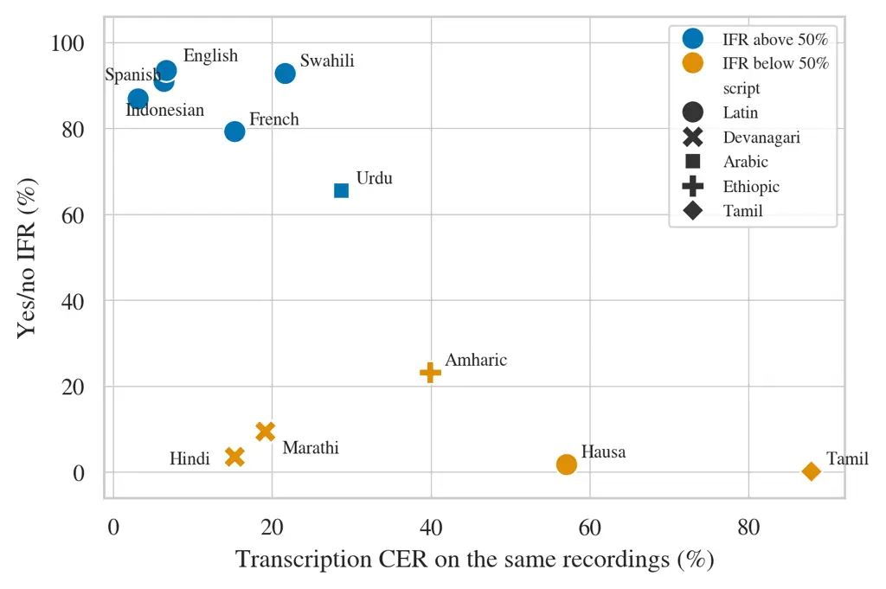

# Zero-Shot Spoken Language Understanding with SLAM-ASR: What Do Monolingual ASR-Trained Linear Projectors Enable?

Edwin Arkel Rios ^(†)^(†)thanks: Work done during an internship at
Tranxform AI. Affiliation: National Yang Ming Chiao Tung University,
Taiwan Affiliation: Tranxform AI    Sneh Sourabh Affiliation: Indian
Institute of Technology Hyderabad, India    Jocelyn Zaruma
Affiliation: Institut national des langues et civilisations orientales,
France Affiliation: Université Sorbonne Nouvelle, France    Girish
Ewoorkar Affiliation: Cohere Labs Community    Julian Mack
Affiliation: Cohere    Bo-Cheng Lai Affiliation: National Yang Ming
Chiao Tung University, Taiwan

###### Abstract

The SLAM-ASR framework connects the features of a frozen speech encoder
as input to a frozen LLM decoder to enable speech transcription. In this
work we ask whether this training—on speech transcription—provides the
LLM with the capability to also perform spoken language understanding
(SLU) tasks, by training monolingual projectors on 11 languages. When
prompted to answer a yes/no question about the input speech, the mean
instruction following rate (IFR) is 49.8%. When not following the
instruction, these models default back to transcription. The
transcription quality—measured by the character error rate (CER)—is not
sufficient to predict IFR. Remarkably, when the model is instructed to
answer the topic question as a single digit option, the mean IFR rises
to 81.3%. Our models score a mean 23.2% topic balanced accuracy (BAcc)
against 14.3% chance. However, the same decoder scores a mean 71.5% BAcc
when using reference transcripts as text input. This indicates a failure
of the projector to transfer information for the SLU tasks.

## 1 Introduction

The SLAM-ASR recipe (Ma et al., 2024) enables training of large audio
language models (LALMs) by connecting a speech encoder to a text decoder
through a linear projector. LALMs enable large language models (LLMs) to
perform spoken language understanding (SLU), but most works following
the SLAM-ASR recipe have been limited to studying ASR capabilities Fong
et al. (2025); Kumar et al. (2025); Zhang et al. (2026); Burdisso et al.
(2026). Few works have explored zero-shot SLU—translation Fan et al.
(2025) and intent classification Lee et al. (2026)—for LALMs beyond
transcription, using a trainable transformer-based projector instead.
However, this increases the cost of the system. In this study, we ask
whether a linear projector—trained on monolingual ASR data—can enable
SLU capabilities for an LLM, and if yes, under which conditions.

## 2 Setup

We follow the SLAM-ASR recipe (Ma et al., 2024). A Whisper-medium speech
encoder (Radford et al., 2022) is connected to a Tiny Aya Global decoder
(Salamanca et al., 2026) via a linear projector, while the encoder and
decoder are kept frozen. We train a projector for each of the 11 target
languages using WorldSpeech (Asonitis et al., 2026) with an audio
transcription loss. We compare our models against a strong baseline,
Qwen2-Audio-7B (Chu et al., 2024), a _multi-task LALM_. It also connects
a Whisper encoder to an LLM decoder through a linear projector, but it
is trained with supervision on 520k hours of audio data, across many
tasks, each posed as a natural-language instruction. Training details
are in Appendix A.

For evaluation, we use FLEURS (Conneau et al., 2023). We evaluate three
tasks: 1) transcription, 2) yes/no questions, and 3) topic
classification. We use character error rate (CER) K et al. (2025) to
evaluate transcription quality. For yes/no questions and topic
classification we measure instruction following rate (IFR), the share of
utterances whose output counts as a valid answer. For yes/no questions
we also use balanced accuracy (BAcc), the mean of each class’s recall
over answered utterances. A teacher model uses reference transcripts to
create proxy labels for the yes/no task—whether a person is being named
in the script/audio or not. For the topic classification task, we
measure BAcc, using the labels from SIB-Fleurs (Schmidt et al., 2025),
which classifies samples into 7 categories. We adopt its English prompt
template, which we call the _digit template_ (topics use digits as
choice labels). An audio output counts as a valid answer only if it
names exactly one option with at most 8 other words. A text output
counts as a valid answer if it names any option, and the first one named
is its answer. Details on metrics are in Appendix B.1.

|            |       |        | Topic Classification |       |       |
| ---------- | ----- | ------ | -------------------- | ----- | ----- |
|            |       | Yes/no | Speech               |       | Text  |
| Language   | CER%  | IFR%   | IFR%                 | BAcc% | BAcc% |
| English    | 6.65  | 93.5   | 100.0                | 41.4  | 73.0  |
| Spanish    | 3.09  | 86.9   | 100.0                | 36.2  | 73.6  |
| French     | 15.26 | 79.3   | 99.4                 | 35.7  | 75.8  |
| Indonesian | 6.35  | 91.0   | 100.0                | 35.7  | 71.3  |
| Swahili    | 21.61 | 92.8   | 99.6                 | 17.1  | 66.0  |
| Urdu       | 28.67 | 65.6   | 100.0                | 16.4  | 70.9  |
| Amharic    | 39.86 | 23.3   | 79.6                 | 14.7  | 70.4  |
| Hausa      | 57.05 | 1.8    | 74.3                 | 14.9  | 67.2  |
| Hindi      | 15.25 | 3.6    | 26.0                 | 14.3  | 71.5  |
| Marathi    | 19.11 | 9.5    | 41.4                 | 14.3  | 71.1  |
| Tamil      | 87.87 | 0.2    | 73.6                 | 14.3  | 75.2  |

Table 1: Performance across languages. CER measures transcription
quality. IFR is the instruction following rate. Topic Classification
uses the digit template and reports balanced accuracy (BAcc) across 7
topics for Speech (audio via the projector) and Text (reference
transcript replaces the audio).

## 3 Results

#### Can a projector trained only for transcription answer questions? Yes.

Following a prompt for a task other than transcription suggests some
instruction following. For 6 of 11 projectors, more than half of yes/no
outputs are a short answer rather than a transcript (Table 1).
Recognition quality alone does not decide which projectors answer.
Despite nearly identical CERs for Hindi (15.25) and French (15.26),
their IFRs diverge drastically (3.6% vs. 79.3%). When a projector fails
to answer, it reverts to transcription.

#### Can a projector answer correctly?

Answering correctly would indicate understanding of the utterance’s
content. Evaluated against teacher labels, yes/no BAcc shows our models
are not better than chance (45.5%–54.0% in the 7 languages with at least
100 answers). Open-ended topic queries phrased in the projector’s
language elicit answers on at most 16.0% of utterances. Remarkably, the
digit template increases IFR to 26.0%–100.0% (Table 1). Raw accuracy
averages 16.0%, below the 30.6% obtained by always predicting the most
frequent topic. BAcc averages 23.2% over the 11 languages against 14.3%.
The translated digit template lowers IFR to 65.0%; its per-language
results are in Appendix C. On identical utterances and answer rules, the
multi-task LALM achieves a higher mean BAcc (39.4%) than our projectors.
Yet on 4 of 11 languages—3 where our projectors answer few yes/no
questions—its raw accuracy falls below that of always predicting the
most frequent topic. These languages are difficult even for a multi-task
LALM.

#### Does the limitation come from the projector or the decoder?

We evaluate the decoder alone on each question using the FLEURS
reference text as input in place of the audio. With the text input, the
decoder answers 100.0% of topic questions at a mean 71.5% BAcc, against
23.2% through its own projector with audio input. This gap holds in
every language. The text-only version is nearly the same across
languages while CER varies widely, so the gap does not track the
decoder’s per-language competence (Table 1). These BAcc values count
only answered utterances. The projector answers fewer utterances than
the text input yields, so scoring unanswered utterances as wrong would
widen the gap further. This speech-text ceiling gap aligns with the
findings of Cuervo et al. (2026), attributing the issue to the
audio-text projector. The yes/no task stays at chance for both audio
(48.6% BAcc) and text (49.2%). Detailed results are in Appendix C.

## 4 Conclusion

Instruction following emerges without any labeled task example. For over
half the evaluated languages, the models answer in the right form.
However, the answers show limited understanding of the utterance. Yes/no
BAcc stays at chance, and topic BAcc stays far below what the same
decoder reaches from the reference transcript. Table 1 outlines which
languages follow instructions for SLU tasks. When not following
instructions, these models default to transcription. Notably, topic BAcc
exceeds double the 14.3% chance only in English, Spanish, French, and
Indonesian. Because Swahili and Urdu yield high response rates with
near-chance BAcc, non-answering projectors present lower deployment risk
than randomly answering ones. The text ceiling demonstrates that the
topic knowledge exists in the decoder; what fails is the projector’s
alignment to it.

#### Limitations.

All projectors use one speech encoder, Whisper-medium, and each
projector was trained once, with a single random seed. The teacher
labels are not independently validated and are generated from the source
evaluation dataset’s reference transcripts. They measure what is said,
not how it is said, and that may affect the decoder output when speech
is the input. FLEURS consists of read speech from Wikipedia sentences,
which is narrow in domain. We used only the utterance-level samples of
Fleurs-SLU because its listening-comprehension samples average 47.0 s,
well beyond the Whisper-medium 30 s window used in our study. The
in-language templates (Table 3) are LLM translations of the English
template, without native-speaker review. We did not test sensitivity to
the template format, for example digits against letters as choice
labels, or different delimiters. Under the audio answer rule, a correct
option inside a longer output counts as unanswered. Answering behavior
could improve with further training on data beyond simple transcription.

## Acknowledgments

This work was supported by Tranxform AI and NSTC under Grant
114-2221-E-A49-186.

## References

- Asonitis et al. (2026) A. Asonitis, L. A. Lanzendörfer, F. Berdoz,
  and R. Wattenhofer WorldSpeech: A Multilingual Speech Corpus from
  Around the World. arXiv. Note: arXiv:2605.09167 \[cs.CL\] External
  Links: [Link](http://arxiv.org/abs/2605.09167),
  [Document](https://dx.doi.org/10.48550/arXiv.2605.09167) Cited by: §2.
- Burdisso et al. (2026) S. Burdisso, E. Villatoro-Tello, S. Kumar, S.
  Madikeri, A. Carofilis, P. Rangappa, M. K. E, K. Hacioglu, P.
  Motlicek, and A. Stolcke Reducing Prompt Sensitivity in LLM-Based
  Speech Recognition Through Learnable Projection. In ICASSP 2026 - 2026
  IEEE International Conference on Acoustics, Speech and Signal
  Processing (ICASSP), pp. 16372–16376. Note: ISSN: 2379-190X External
  Links: ISSN 2379-190X,
  [Link](https://ieeexplore.ieee.org/document/11464534),
  [Document](https://dx.doi.org/10.1109/ICASSP55912.2026.11464534) Cited
  by: §1.
- Chu et al. (2024) Y. Chu, J. Xu, Q. Yang, H. Wei, X. Wei, Z. Guo, Y.
  Leng, Y. Lv, J. He, J. Lin, C. Zhou, and J. Zhou Qwen2-Audio Technical
  Report. arXiv. Note: arXiv:2407.10759 \[eess\] External Links:
  [Link](http://arxiv.org/abs/2407.10759),
  [Document](https://dx.doi.org/10.48550/arXiv.2407.10759) Cited by:
  Table 4, §2.
- Communication et al. (2023) S. Communication, L. Barrault, Y.
  Chung, M. C. Meglioli, D. Dale, N. Dong, P. Duquenne, H. Elsahar, H.
  Gong, K. Heffernan, J. Hoffman, C. Klaiber, P. Li, D. Licht, J.
  Maillard, A. Rakotoarison, K. R. Sadagopan, G. Wenzek, E. Ye, B.
  Akula, P. Chen, N. E. Hachem, B. Ellis, G. M. Gonzalez, J. Haaheim, P.
  Hansanti, R. Howes, B. Huang, M. Hwang, H. Inaguma, S. Jain, E.
  Kalbassi, A. Kallet, I. Kulikov, J. Lam, D. Li, X. Ma, R.
  Mavlyutov, B. Peloquin, M. Ramadan, A. Ramakrishnan, A. Sun, K.
  Tran, T. Tran, I. Tufanov, V. Vogeti, C. Wood, Y. Yang, B. Yu, P.
  Andrews, C. Balioglu, M. R. Costa-jussà, O. Celebi, M. Elbayad, C.
  Gao, F. Guzmán, J. Kao, A. Lee, A. Mourachko, J. Pino, S. Popuri, C.
  Ropers, S. Saleem, H. Schwenk, P. Tomasello, C. Wang, J. Wang, and S.
  Wang SeamlessM4T: Massively Multilingual & Multimodal Machine
  Translation. arXiv. Note: arXiv:2308.11596 \[cs\] External Links:
  [Link](http://arxiv.org/abs/2308.11596),
  [Document](https://dx.doi.org/10.48550/arXiv.2308.11596) Cited by:
  Table 4.
- Conneau et al. (2023) A. Conneau, M. Ma, S. Khanuja, Y. Zhang, V.
  Axelrod, S. Dalmia, J. Riesa, C. Rivera, and A. Bapna FLEURS: FEW-Shot
  Learning Evaluation of Universal Representations of Speech. In 2022
  IEEE Spoken Language Technology Workshop (SLT), pp. 798–805. External
  Links: [Link](https://ieeexplore.ieee.org/document/10023141),
  [Document](https://dx.doi.org/10.1109/SLT54892.2023.10023141) Cited
  by: §2.
- Cuervo et al. (2026) S. Cuervo, S. Seto, M. d. Seyssel, R. H. Bai, Z.
  Gu, T. Likhomanenko, N. Jaitly, and Z. Aldeneh Closing the Gap Between
  Text and Speech Understanding in LLMs. In ICLR 2026, (en). External
  Links: [Link](https://openreview.net/forum?id=dDHnO3Vhyj) Cited by:
  §3.
- Fan et al. (2025) R. Fan, B. Ren, Y. Hu, R. Zhao, S. Liu, and J. Li
  AlignFormer: Modality Matching Can Achieve Better Zero-Shot
  Instruction-Following Speech-LLM. IEEE Journal of Selected Topics in
  Signal Processing 19 (7), pp. 1329–1337. External Links: ISSN
  1941-0484, [Link](https://ieeexplore.ieee.org/document/11077996),
  [Document](https://dx.doi.org/10.1109/JSTSP.2025.3588378) Cited by:
  §1.
- Fong et al. (2025) S. Fong, M. Matassoni, and A. Brutti Speech LLMs in
  Low-Resource Scenarios: Data Volume Requirements and the Impact of
  Pretraining on High-Resource Languages. In Interspeech 2025,
  pp. 2003–2007. External Links:
  [Link](https://www.isca-archive.org/interspeech_2025/fong25_interspeech.html),
  [Document](https://dx.doi.org/10.21437/Interspeech.2025-764) Cited by:
  §1.
- Gopal et al. (2026) S. Gopal, D. Wu, A. Anshul, Y. Y. Heng, Y.
  Peng, H. Li, H. Liu, and E. S. Chng Language-Aware Distillation for
  Multilingual Instruction-Following Speech LLMs with ASR-Only
  Supervision. arXiv. Note: arXiv:2603.07025 \[cs.CL\] External Links:
  [Link](http://arxiv.org/abs/2603.07025),
  [Document](https://dx.doi.org/10.48550/arXiv.2603.07025) Cited by:
  Appendix C.
- K et al. (2025) T. D. K, J. James, D. P. Gopinath, and M. A. K
  Advocating Character Error Rate for Multilingual ASR Evaluation. In
  Findings of the Association for Computational Linguistics: NAACL
  2025, L. Chiruzzo, A. Ritter, and L. Wang (Eds.), Albuquerque, New
  Mexico, pp. 4941–4950. External Links: ISBN 979-8-89176-195-7,
  [Link](https://aclanthology.org/2025.findings-naacl.277/),
  [Document](https://dx.doi.org/10.18653/v1/2025.findings-naacl.277)
  Cited by: §2.
- Kumar et al. (2025) S. Kumar, I. Thorbecke, S. Burdisso, E.
  Villatoro-Tello, M. K E, K. Hacioğlu, P. Rangappa, P. Motlicek, A.
  Ganapathiraju, and A. Stolcke Performance Evaluation of SLAM-ASR: The
  Good, the Bad, the Ugly, and the Way Forward. In 2025 IEEE
  International Conference on Acoustics, Speech, and Signal Processing
  Workshops (ICASSPW), pp. 1–5. External Links:
  [Link](https://ieeexplore.ieee.org/document/11010998),
  [Document](https://dx.doi.org/10.1109/ICASSPW65056.2025.11010998)
  Cited by: §1.
- Lee et al. (2026) B. Lee, M. Gaido, I. Calapodescu, L. Besacier,
  and M. Negri Towards Zero-Shot SLU: An Empirical Study of Competing
  Architectural Paradigms. In Proceedings of the 23rd International
  Conference on Spoken Language Translation (IWSLT 2026), E. Salesky, A.
  Anastasopoulos, M. Negri, and M. Federico (Eds.), San Diego, USA
  (in-person and online), pp. 1–7. External Links: ISBN
  979-8-89176-411-8, [Link](https://aclanthology.org/2026.iwslt-1.1/),
  [Document](https://dx.doi.org/10.18653/v1/2026.iwslt-1.1) Cited by:
  §1.
- Ma et al. (2024) Z. Ma, G. Yang, Y. Yang, Z. Gao, J. Wang, Z. Du, F.
  Yu, Q. Chen, S. Zheng, S. Zhang, and X. Chen An Embarrassingly Simple
  Approach for LLM with Strong ASR Capacity. arXiv. Note:
  arXiv:2402.08846 \[cs\] External Links:
  [Link](http://arxiv.org/abs/2402.08846),
  [Document](https://dx.doi.org/10.48550/arXiv.2402.08846) Cited by: §1,
  §2.
- Radford et al. (2022) A. Radford, J. W. Kim, T. Xu, G. Brockman, C.
  McLeavey, and I. Sutskever Robust Speech Recognition via Large-Scale
  Weak Supervision. arXiv. External Links:
  [Link](https://arxiv.org/abs/2212.04356),
  [Document](https://dx.doi.org/10.48550/ARXIV.2212.04356) Cited by: §2.
- Salamanca et al. (2026) A. R. Salamanca, D. Abagyan, D. D’souza, A.
  Khairi, D. Mora, S. Dash, V. Aryabumi, S. Rajaee, M. Mofakhami, A.
  Sahu, T. Euyang, B. Prince, M. Smith, H. Lin, A. Locatelli, S.
  Hooker, T. Kocmi, A. Gomez, I. Zhang, P. Blunsom, N. Frosst, J.
  Pineau, B. Ermis, A. Üstün, J. Kreutzer, and M. Fadaee Tiny Aya:
  Bridging Scale and Multilingual Depth. arXiv. Note: arXiv:2603.11510
  \[cs.CL\] External Links: [Link](http://arxiv.org/abs/2603.11510),
  [Document](https://dx.doi.org/10.48550/arXiv.2603.11510) Cited by: §2.
- Schmidt et al. (2025) F. D. Schmidt, I. Vulić, G. Glavaš, and D. I.
  Adelani Fleurs-SLU: A Massively Multilingual Benchmark for Spoken
  Language Understanding. In COLM 2025, (en). External Links:
  [Link](https://openreview.net/forum?id=Tqj3fYqhwS#discussion) Cited
  by: Table 4, §2.
- Team et al. (2022) N. Team, M. R. Costa-jussà, J. Cross, O. Çelebi, M.
  Elbayad, K. Heafield, K. Heffernan, E. Kalbassi, J. Lam, D. Licht, J.
  Maillard, A. Sun, S. Wang, G. Wenzek, A. Youngblood, B. Akula, L.
  Barrault, G. M. Gonzalez, P. Hansanti, J. Hoffman, S. Jarrett, K. R.
  Sadagopan, D. Rowe, S. Spruit, C. Tran, P. Andrews, N. F. Ayan, S.
  Bhosale, S. Edunov, A. Fan, C. Gao, V. Goswami, F. Guzmán, P.
  Koehn, A. Mourachko, C. Ropers, S. Saleem, H. Schwenk, and J. Wang No
  Language Left Behind: Scaling Human-Centered Machine Translation.
  arXiv. Note: arXiv:2207.04672 \[cs.CL\] External Links:
  [Link](http://arxiv.org/abs/2207.04672),
  [Document](https://dx.doi.org/10.48550/arXiv.2207.04672) Cited by:
  Table 4.
- Yang et al. (2025) A. Yang, A. Li, B. Yang, B. Zhang, B. Hui, B.
  Zheng, B. Yu, C. Gao, C. Huang, C. Lv, C. Zheng, D. Liu, F. Zhou, F.
  Huang, F. Hu, H. Ge, H. Wei, H. Lin, J. Tang, J. Yang, J. Tu, J.
  Zhang, J. Yang, J. Yang, J. Zhou, J. Zhou, J. Lin, K. Dang, K. Bao, K.
  Yang, L. Yu, L. Deng, M. Li, M. Xue, M. Li, P. Zhang, P. Wang, Q.
  Zhu, R. Men, R. Gao, S. Liu, S. Luo, T. Li, T. Tang, W. Yin, X.
  Ren, X. Wang, X. Zhang, X. Ren, Y. Fan, Y. Su, Y. Zhang, Y. Zhang, Y.
  Wan, Y. Liu, Z. Wang, Z. Cui, Z. Zhang, Z. Zhou, and Z. Qiu Qwen3
  Technical Report. arXiv. Note: arXiv:2505.09388 \[cs.CL\] External
  Links: [Link](http://arxiv.org/abs/2505.09388),
  [Document](https://dx.doi.org/10.48550/arXiv.2505.09388) Cited by:
  Appendix C.
- Zhang et al. (2026) Y. Zhang, R. Shekhar, and H. Mouratidis Language
  Family Matters: Evaluating LLM-Based ASR Across Linguistic Boundaries.
  arXiv. Note: arXiv:2601.18899 \[cs\] External Links:
  [Link](http://arxiv.org/abs/2601.18899),
  [Document](https://dx.doi.org/10.48550/arXiv.2601.18899) Cited by: §1.

## Appendix A Training Setup

The main text uses Tiny Aya Global as the decoder, the globally balanced
instruction-tuned variant. Appendix C applies the same setup to the
other four Tiny Aya variants: Base, the model before instruction tuning,
and the region-specialized variants Earth (Africa and West Asia:
Amharic, Hausa and Swahili), Fire (South Asia: Hindi, Marathi, Tamil and
Urdu) and Water (Asia-Pacific and Europe: English, French, Indonesian
and Spanish), each of our languages listed under the variant whose
region the Tiny Aya report assigns it. Together with Qwen3-4B, six
decoders for each of the 11 languages give 66 projectors. Each model has
three parts: a frozen Whisper-medium encoder, a linear projector, and a
frozen decoder. Only the projector is trained, on one language’s
WorldSpeech transcription data, with samples of at most 30 s. The
projector has 2.1M parameters with a Tiny Aya decoder and 2.6M with
Qwen3-4B. The encoder, projector and decoder together have 3.66B
parameters with any Tiny Aya decoder and 4.33B with Qwen3-4B. Training
runs 1,000 steps at an effective batch of 512 samples, with AdamW on a
cosine schedule and 10 warmup steps. The learning rate is
$`1.5\times 10^{-3}`$ for Tiny Aya and $`1.0\times 10^{-3}`$ for
Qwen3-4B. We evaluate the checkpoint the trainer recorded as best on
validation loss, not the final one. A run takes a median 15.2 h on one
H200 GPU.

## Appendix B Evaluation Details

### B.1 Metrics

For evaluation, each question asks for an answer from a fixed set of
options. An option is named by its digit in the digit template, by a
topic name in the prompt’s language in the open question, and by a yes
or no word of the prompt’s language in the yes/no question. With audio
input, an answering model writes a bare option, such as “5” for the
digit template. A model that does not answer usually writes a
transcript, which can name an option by chance. With text input, the
decoder reads the reference transcript instead of the audio, or the
projector’s own transcript in the cascade of Appendix C. The decoder
given text names an option and then explains it, as in “5 the utterance
is about science because it discusses chemistry”.

Each output is first lowercased and stripped of diacritics, Indic vowel
signs, bracketed text and punctuation. Prompt echoes are removed, and
immediately repeated phrases are kept once. Words are the tokens that
remain, so an Indic word can count as several. With audio input, an
output counts as an answer only if it names exactly one option and has
at most 8 other words. With text input, an output that names any option
counts as an answer, and the first option named is the answer.

Labelled utterances are every recording for audio input and each unique
FLEURS sentence for text input. Let $`N`$ be the labelled utterances,
$`A\subseteq N`$ the answered ones, $`\hat{y}_{i}`$ the answer and
$`y_{i}`$ the label. The instruction following rate (IFR), accuracy
(Acc.), accuracy over answered utterances (Acc.^(†)) and balanced
accuracy (BAcc) are

```math
\displaystyle=|A|/|N|,
```

```math
\displaystyle=\textstyle\frac{1}{|N|}\sum_{i\in A}\mathds{1}[\hat{y}_{i}=y_{i}],
```

```math
\displaystyle\text{Acc.}^{\dagger} \displaystyle=\textstyle\frac{1}{|A|}\sum_{i\in A}\mathds{1}[\hat{y}_{i}=y_{i}],
```

```math
\displaystyle=\frac{1}{|C|}\sum_{c\in C}\frac{|\{i\in A:y_{i}=\hat{y}_{i}=c\}|}{|\{i\in A:y_{i}=c\}|},
```

where $`\mathds{1}[\cdot]`$ is 1 when the condition inside holds and 0
otherwise. $`C`$ is the set of labels among the answered utterances: yes
and no for the yes/no task, and the topics for the topic classification
task. $`C`$ contains every class in every reported cell except one—Tiny
Aya Base on Marathi speech (Table 7)—where the few answered utterances
do not cover every topic. For yes/no IFR, $`N`$ contains every test
utterance, labelled or not.

### B.2 Prompts and Labels

| Question              | Prompt                                                                                                                                                                                                                                                                         |
| --------------------- | ------------------------------------------------------------------------------------------------------------------------------------------------------------------------------------------------------------------------------------------------------------------------------ |
| Yes/no, person named  | Answer with one word, yes or no: does the audio mention a person by name? {AUDIO} Answer:                                                                                                                                                                                      |
| Topic, open question  | What is the topic of the audio? Answer with one or two words. {AUDIO} Topic:                                                                                                                                                                                                   |
| Topic, digit template | The utterance belongs to one of the following topics. Utterance: {AUDIO} Topics: 1. Entertainment 2. Geography 3. Health 4. Politics 5. Science and Technology 6. Sports 7. Travel Please respond with only the number of the correct answer (1, 2, 3, 4, 5, 6, or 7). Answer: |

Table 2: The English prompts as the models saw them. {AUDIO} marks the
position of the projected audio tokens, and the model continues after
the final colon. Table 3 gives the in-language template for each
language.

Table 3: The in-language digit template for each language, as the models
saw it. It translates the English template's wrapper and option labels
into the projector's language and keeps the digit answer space. Its
English row drops “Utterance:” and shortens a label, so it differs from
the digit template of Table 2 used in Table 1.

Table 2 gives the English prompts as the models saw them, and Table 3
gives the in-language template for each language. The yes/no labels come
from a text-only teacher: Claude Sonnet reads the English side of each
FLEURS parallel sentence and states whether it names a person, and the
label carries to every language because the sentences are parallel.
13.1% of sentences name a person, which is why the yes/no question is
scored by BAcc, where chance is 50% whatever the class balance.

## Appendix C Extended Results



Figure 1: Transcription CER against yes/no IFR. Each point is one
projector, trained and evaluated on its own language. Marker shape
denotes the language’s script, and color marks whether its IFR is above
50%.

|                                                                                         |       |           |       |       |
| --------------------------------------------------------------------------------------- | ----- | --------- | ----- | ----- |
| System                                                                                  | Acc.% | Acc.^(†)% | BAcc% | IFR%  |
| _Reference points_                                                                      |       |           |       |       |
| Chance (7 classes)                                                                      | 14.3  | –         | 14.3  | –     |
| Majority-class prediction                                                               | 30.6  | –         | 14.3  | –     |
| _Fleurs-SLU (Schmidt et al., 2025): a classification head trained on English task data_ |       |           |       |       |
| MMS-1B encoder                                                                          | 21.3  | –         | –     | –     |
| SeamlessM4Tv2-L encoder (Communication et al., 2023)                                    | 80.9  | –         | –     | –     |
| Cascade, LLM2Vec-S4T                                                                    | 86.4  | –         | –     | –     |
| Reference text, NLLB-LLM2Vec (Team et al., 2022)                                        | 88.9  | –         | –     | –     |
| _This work: one projector per language behind Tiny Aya Global, no task training_        |       |           |       |       |
| Digit template                                                                          | 16.0  | 17.7      | 23.2  | 81.3  |
| In-language template                                                                    | 10.9  | 13.9      | 20.5  | 65.0  |
| Cascade, projector transcript                                                           | 58.3  | 58.3      | 52.5  | 100.0 |
| Reference transcript                                                                    | 73.5  | 73.5      | 71.5  | 100.0 |
| _Multi-task LALM, our run on the same utterances_                                       |       |           |       |       |
| Qwen2-Audio-7B (Chu et al., 2024)                                                       | 37.2  | 37.2      | 39.4  | 100.0 |

Table 4: Topic classification on FLEURS audio across 11 languages.
Scores are means over the languages, and balanced accuracy (BAcc) first
averages the 7 classes within each language. The Fleurs-SLU rows are
that paper's published results. Its systems are trained on the task,
while our projectors and the multi-task LALM are not. The cascade and
reference-transcript rows replace the audio with the projector's
transcript or the reference transcript. Acc. counts unanswered
utterances as wrong. Acc.^(†) and BAcc use answered utterances only.
Text input is scored at its first named option (Appendix B.1).

|            | Open question |           | In-language |       | Qwen2-Audio-7B |       |
| ---------- | ------------- | --------- | ----------- | ----- | -------------- | ----- |
| Language   | IFR%          | Acc.^(†)% | IFR%        | BAcc% | IFR%           | BAcc% |
| English    | 3             | 91        | 100         | 41    | 100            | 67    |
| Spanish    | 11            | 68        | 100         | 29    | 100            | 63    |
| French     | 1             | 50        | 100         | 34    | 100            | 64    |
| Indonesian | 16            | 48        | 81          | 21    | 100            | 36    |
| Swahili    | 1             | 50        | 57          | 14    | 100            | 21    |
| Urdu       | 0             | –         | 88          | 14    | 100            | 44    |
| Amharic    | 2             | 60        | 67          | 14    | 100            | 31    |
| Hausa      | 0             | –         | 68          | 15    | 100            | 17    |
| Hindi      | 0             | –         | 13          | 14    | 100            | 45    |
| Marathi    | 0             | –         | 8           | 14    | 100            | 27    |
| Tamil      | 0             | –         | 33          | 14    | 100            | 19    |

Table 5: Topic classification across languages. Open question task: the
projector is prompted for a category word. Accuracy is computed over
answered utterances only, and blank where none was answered. In-language
prompt: the digit template translated into the projector's native
language. Qwen2-Audio-7B: evaluated on the same utterances using the
English digit template. BAcc is balanced accuracy over answered
utterances.

|            | Yes/no, text input |       |
| ---------- | ------------------ | ----- |
| Language   | IFR%               | BAcc% |
| English    | 89.1               | 52.8  |
| Spanish    | 64.7               | 47.2  |
| French     | 87.0               | 45.3  |
| Indonesian | 98.5               | 54.4  |
| Swahili    | 93.6               | 48.0  |
| Urdu       | 58.7               | 50.6  |
| Amharic    | 95.3               | 46.8  |
| Hausa      | 25.7               | 45.0  |
| Hindi      | 95.5               | 46.7  |
| Marathi    | 70.8               | 53.5  |
| Tamil      | 91.7               | 51.1  |
| Mean       | 79.1               | 49.2  |

Table 6: The yes/no question with the reference transcript as text
input, per language, through Tiny Aya Global. IFR is computed based on
the first option named. BAcc is over answered utterances, and chance is
50%. The last row is the mean over the 11 languages.

| Language   | Global |      | Earth |      | Fire |      | Water |      | Base |      | Qwen3-4B |      |
| ---------- | ------ | ---- | ----- | ---- | ---- | ---- | ----- | ---- | ---- | ---- | -------- | ---- |
| BAcc%      | S      | T    | S     | T    | S    | T    | S     | T    | S    | T    | S        | T    |
| English    | 41.4   | 73.0 | 50.6  | 72.0 | 38.2 | 73.8 | 53.4  | 71.5 | 15.6 | 15.1 | 43.6     | 88.0 |
| Spanish    | 36.2   | 73.6 | 27.8  | 73.0 | 23.0 | 76.5 | 29.2  | 74.1 | 15.6 | 14.3 | 42.3     | 82.5 |
| French     | 35.7   | 75.8 | 37.7  | 76.6 | 62.6 | 78.2 | 48.2  | 75.8 | 15.5 | 17.0 | 56.8     | 84.0 |
| Indonesian | 35.7   | 71.3 | 31.7  | 71.1 | 31.7 | 74.1 | 42.7  | 70.8 | 13.4 | 14.3 | 30.5     | 83.1 |
| Swahili    | 17.1   | 66.0 | 22.0  | 68.2 | 18.0 | 73.6 | 19.3  | 65.7 | 16.8 | 14.3 | 18.3     | 62.0 |
| Urdu       | 16.4   | 70.9 | 33.7  | 71.7 | 39.6 | 69.4 | 31.3  | 72.3 | 9.3  | 21.0 | 16.3     | 81.3 |
| Amharic    | 14.7   | 70.4 | 19.2  | 71.4 | 22.2 | 72.1 | 17.4  | 71.7 | 14.4 | 19.9 | 12.7     | 44.1 |
| Hausa      | 14.9   | 67.2 | 20.2  | 65.6 | 12.9 | 72.4 | 14.5  | 65.3 | 16.5 | 14.3 | 16.7     | 42.5 |
| Hindi      | 14.3   | 71.5 | 16.7  | 70.9 | 18.1 | 72.6 | 15.5  | 71.4 | 14.3 | 22.2 | 12.4     | 81.6 |
| Marathi    | 14.3   | 71.1 | 14.3  | 71.9 | 14.3 | 73.7 | 14.3  | 71.4 | 16.7 | 19.2 | 14.5     | 75.0 |
| Tamil      | 14.3   | 75.2 | 14.3  | 76.1 | 14.5 | 75.0 | 14.3  | 75.5 | 14.3 | 20.4 | 16.4     | 82.0 |
| Mean       | 23.2   | 71.5 | 26.2  | 71.7 | 26.8 | 73.8 | 27.3  | 71.4 | 14.8 | 17.4 | 25.5     | 73.3 |

Table 7: Balanced accuracy (BAcc) over the 7 topics on the digit
template question, by language and frozen decoder. Each decoder has its
own projector for each language. S uses speech. T uses the reference
transcript instead of the audio. The final row averages the 11
languages. Base is the pretrained Tiny Aya before instruction tuning.
Earth, Fire and Water are its regional variants, and Global is reported
in the main text. Chance is 14.3% (i.e. 1/7).

#### Does recognition quality predict instruction following? No.

Figure 1 plots each projector’s CER against its yes/no IFR from Table 1.
Hindi and French transcribe equally well, at 15.25 and 15.26 CER, yet
Hindi answers 3.6% of the yes/no questions and French 79.3%. The amount
of training data does not predict IFR either. Hindi’s projector trains
on 2,189 h of WorldSpeech and Urdu’s on 81 h, yet Urdu’s projector
answers 65.6% of the questions.

#### Does transcribing first help? Yes.

In a cascade, the projector first transcribes the audio, and the decoder
then answers from that transcript as text. Table 4 lists the cascade
beside the audio and the reference transcript. The cascade answers
100.0% of the digit template questions at 52.5% mean BAcc when using the
projector’s own transcript as text. That is more than twice the 23.2%
from the audio directly, and below the 71.5% from the reference
transcript. The projector’s transcript contains the topic, but the
decoder cannot recover it _directly_ from the audio tokens. Further
training should therefore target the alignment between the projector’s
audio tokens and the decoder, which Gopal et al. (2026) show can be
trained from ASR pairs alone, with the encoder and decoder frozen.

#### How far is zero-shot prompting from task training?

Table 4 places our projectors beside the topic classifiers that
Fleurs-SLU trains on the task, on our eleven languages. Task-trained
systems are far ahead. With a classification head trained on English
task data, Fleurs-SLU reaches 88.9% accuracy from the reference text,
86.4% through a translation cascade, and 21.3%–80.9% from speech
encoders. Our projectors’ raw accuracy stays below the majority-class
prediction. They have no task training and no classification head. Their
raw accuracy of 16.0% sits below the 30.6% obtained by always predicting
the most frequent topic, which is why we report BAcc: 23.2% against
14.3% chance. The multi-task LALM, under the same answer rule, reaches
39.4%.

#### How do the topic results vary across languages?

Table 5 gives the per-language values behind the topic classification
results. Open questions are rarely answered. At most 16% of utterances
get a category. When the projector does answer, it is usually right, up
to 91%. So the open form measures whether the decoder will commit to
answer rather than whether it knows. Asking in the projector’s own
language does not help. The digit template translated into each
projector’s language drops IFR to 65.0% and accuracy to 10.9%. It
elicits answers less often than the English one in 8 of 11 languages and
scores higher in none. The multi-task LALM answers all but one utterance
and has higher BAcc than our projectors in every language. Its raw
accuracy still falls below that of always predicting the most frequent
topic in 4 of the 11 languages, 3 being languages where our projectors
answer few yes/no questions.

#### Does text input change the yes/no result? No.

Table 6 gives the yes/no results with the reference transcript in place
of the audio. The decoder answers 25.7%–98.5% of the questions, and its
BAcc stays within 45.0%–54.4% in every language, around the 50% chance
level. The mean of 49.2% sits inside the 45.5%–54.0% the projectors
reach from speech. The yes/no question fails in the decoder, with or
without the projector.

#### Does the decoder matter?

Table 7 repeats the topic classification setup using the digit template
with different frozen decoders: Tiny Aya Global, which the main text
reports; its three regional variants Earth, Fire and Water; Tiny Aya
Base, the same model before instruction tuning; and Qwen3-4B (Yang et
al., 2025), a second model family. The projector for each decoder is
trained for each language as in the main text. The table answers three
questions:

1.  1.  Does instruction tuning matter? Yes. Without it, the decoder cannot
        answer.
2.  2.  Does the regional variant matter? A little.
3.  3.  Does the decoder family matter? Not much. Qwen3-4B performs like
        Tiny Aya.

#### 1. Instruction tuning.

The base decoder answers at chance, with 14.8% mean BAcc through speech
and 17.4% from the reference text. Every instruction-tuned decoder
reaches 71.4%–73.8% from the reference text. The base decoder fails even
when it reads the text, so no projector can make it answer from speech.

#### 2. Regional variant.

Through speech, the three regional variants reach 26.2%–27.3% mean BAcc,
against 23.2% for Global. Each language is matched to one of the three
variants, as listed in Appendix A. Using the matched variant adds 3.7
points over the mean of the other two.

#### 3. Decoder family.

Qwen3-4B reaches 73.3% BAcc from the reference text, inside the range of
the instruction-tuned Tiny Aya decoders. Through speech it reaches
25.5%, 2.3 points above Global.
