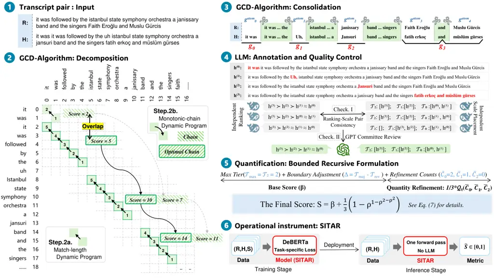

# ![[Uncaptioned image]](arxiv-2610-21440v1--d28840215f78.figures/figure-1.webp) Sitar: A Situational Distortion Metric for Automatic Speech Recognition Evaluation

Mingzhe Lu^(1,2), Jinhao Liu^(1,2), Yunpeng Li^(1,2,\*), Hang Su^(3,\*),
Lichun Fan³, Jian Luan³ ¹Institute of Information Engineering, Chinese
Academy of Sciences, Beijing, China ²School of Cyber Security,
University of Chinese Academy of Sciences, Beijing, China ³Xiaomi Inc.

###### Abstract

In automatic speech recognition (ASR), transcription errors with similar
lexical or semantic discrepancies can have markedly different
consequences for the situation conveyed by speech. Capturing these
differences requires not merely contextual assessment, but an
understanding of what the spoken discourse describes, establishes, or
seeks to bring about. However, relying on LLM judges introduces
computational cost and scoring variability. We introduce Sitar, a
situational distortion metric for ASR, realized through a comprehensive
end-to-end construction framework. Specifically, this framework
aggregates situational severity and cumulative extent into a unified
score via a bounded recursive formulation. Using targets derived from
this formulation with limited offline LLM support, we train Sitar as a
lightweight BERT-family regressor that scores reference–hypothesis pairs
in a single forward pass, entirely free of any prohibitive runtime
costs. Recognizing that introducing a new metric demands rigorous
justification, we formalize a principled validation protocol spanning
both extrinsic validity, assessed at macro and micro levels, and
intrinsic scorer reliability. The former, evaluated across diverse
datasets and models, demonstrates that Sitar reliably tracks broad
capability scaling while providing orthogonal diagnostic utility,
whereas the latter, examined on a purpose-built controlled benchmark,
confirms the operational soundness of the scoring instrument itself.
Through systematic validation, we demonstrate that Sitar holds strong
potential as a practical, lightweight complement to existing ASR
metrics. We will release the full recipes (code, model weights, dataset,
etc.) after the internal review to support community research.

|     |
| --- |
|     |

¹¹footnotetext: Corresponding authors:
[liyunpeng@iie.ac.cn](mailto:liyunpeng@iie.ac.cn); [suhang10@xiaomi.com](mailto:suhang10@xiaomi.com).

## 1 Introduction

Automatic speech recognition (ASR) is pivotal to modern human-computer
interaction, yet even small transcription errors can cause downstream
failures in conversational voice assistants (Harvill et al., 2024).
Beyond architectural improvements, meaningful progress fundamentally
hinges on evaluation metrics that faithfully reflect transcription
quality (Aksënova et al., 2021). Although modern LLM-based ASR metrics
align more closely with human judgments (Parulekar & Jyothi, 2025), the
prompt-dependent scoring variability (Hong et al., 2026) and prohibitive
computational costs of frequent LLM calls (Huang et al., 2026) hinder
their widespread adoption as standard metrics. This presents a threefold
imperative for next-generation metrics: to effectively harness the
understanding capabilities of modern LLMs, to operate independently of
them at inference time, and to deliver deterministic scores that make
any two transcription errors comparable on a unified scale. Beyond these
operational criteria, and aiming for closer alignment with human
judgments, we present a novel target property for transcription
evaluation, termed situational distortion.

Across the evolution of ASR metrics, the conceptualization of
transcription fidelity has broadened from verbatim correspondence to
semantic consistency and, more recently, alignment with human judgments,
driving a methodological shift from edit-based error counting toward
embedding-based metrics and large language model evaluators. Despite
providing a well-defined and deterministic error metric, WER remains
indifferent to the meaning carried by language. Subsequent metrics
address this limitation at differing levels of granularity, with NE-WER
prioritizing micro-level entity components (Garofolo et al., 1999) and
SemDist assessing macro-level semantic representations (Kim et al.,
2021). However, a gap persists between semantic proximity and alignment
with human judgments. For example, a single-token shift from “depart at
fifteen” to “depart at fifty” leaves almost all of the wording unchanged
but alters the specified departure time. AER therefore probes
comprehension fidelity through task-driven question answering.

Yet, AER (Pulikodan et al., 2025) introduces fresh dilemmas. Although
question answering exposes errors invisible to semantic metrics, AER
lacks a calibrated scale for comparing transcriptions that lead to
failures on entirely different questions and requires repeated LLM
queries. LASER (Parulekar & Jyothi, 2025) also explores fine-tuning a
smaller LLM to reduce inference costs. Its rubric assigns fixed
penalties to word-level error categories and normalizes their sum by
reference length. Although these categories distinguish
meaning-preserving from meaning-changing errors, they do not explicitly
grade their situational consequences. More fundamentally, although these
metrics introduce fine-grained distinctions within their respective
basic units, their assessment of the entire reference–hypothesis pair
remains a statistical aggregation of locally defined judgments rather
than a unified measure of overall transcript distortion.

To develop modern ASR metrics aligned with human judgments, constantly
scrambling to address these disparate dilemmas through piecemeal fixes
only traps us in treating isolated symptoms. This recognition urges us
instead to step back and re-examine the structural foundations of
transcription evaluation. Laying these foundations requires treating
evaluation as a unified measurement system rather than a collection of
heuristics. Specifically, its design must answer four core questions:
what property is being measured, against what reference deviations are
defined, on what scale their values become comparable, and through what
instrument those values are obtained.

Thus, we present Sitar, an ASR metric that quantifies reference-grounded
situational distortion on a common scale and is realized as a
lightweight, deterministic scorer. Constructing Sitar proceeds through
these four elements as a coherent sequence, with each establishing the
basis for the next. Specifically, we define the target property as the
distortion that a hypothesis introduces into the situation conveyed by
the spoken source utterance. We establish the reference condition by
treating the reference as the gold textual realization of that utterance
and taking $`h=r`$ as zero distortion, with our proposed Constrained Gap
Delineation (CGD) identifying paired gaps as elementary deviation units.
These units are first assessed relative to their own reference, yielding
reference-specific deviation levels that are then projected onto a
common scale according to how they distort the situation conveyed by the
spoken source utterance, that is, how they change what that utterance
describes, establishes, or seeks to bring about. A bounded recursive
formulation subsequently integrates situational severity with cumulative
extent into scalar targets. Finally, these targets, constructed offline
with LLM-assisted judgments, are used to train the operational
instrument, namely Sitar itself, a lightweight BERT-family regressor
requiring no LLM calls at scoring time.

The contributions of this paper can be summarized as follows:

- •
  We introduce Sitar, a lightweight, deterministic ASR metric that
  quantifies reference-grounded situational distortion in a single
  forward pass, eliminating any LLM involvement during practical use
  while achieving closer alignment with human judgments.
- •
  We formulate a principled, measurement-grounded methodology to
  construct Sitar, establishing an explicit reference anchor, CGD-based
  deviation delineation, a common scale for reference-specific deviation
  levels, and a bounded recursive formulation that unifies situational
  severity with cumulative extent.
- •
  We comprehensively validate Sitar through broad cross-dataset and
  cross-model evaluations, complemented by a purpose-built controlled
  benchmark, demonstrating its capacity to track model capability
  trends, reveal fine-grained diagnostic distinctions, and maintain
  within-reference severity ordering and cross-reference score
  consistency.

## 2 Related Work

With recent developments in ASR evaluation, we consider it informative
to examine literature not only methodologically, regarding how
transcription quality is computationally measured and operationalized,
but also conceptually, regarding how transcription fidelity is
understood and defined.

Methodological Evolution. At the _lexical_ level, Word Error Rate (WER)
remains the de facto standard (Morris et al., 2004) despite recognized
limitations (Aksënova et al., 2021), with Character Error Rate (CER) as
its character-level counterpart (K et al., 2025). Both rely on optimal
alignment under uniform edit penalties. However, minimum-edit-distance
alignment can be linguistically implausible for splits, merges (Kuhn
et al., 2024), or homophonic spans (Ruiz & Federico, 2015), motivating
relaxed alignment constraints (Borgholt et al., 2026), while uniform
penalties overlook error severity, prompting weighted variants based on
task relevance (Nanjo et al., 2005) or human perception (Mishra et al.,
2011). Yet these edit-based paradigms remain tied to surface-form
discrepancies. Shifting toward semantic preservation, _representational_
metrics compare sentence-level embeddings, as in SemDist (Kim et al.,
2021), while Aligned Semantic Distance (Rugayan et al., 2022) introduces
token-level alignment to expose local discrepancies. Representational
similarity cannot fully replace lexical signals. BERTScore and WER
jointly fit expert ratings of disordered speech better than either
alone (Tobin et al., 2022), supporting hybrid metrics that blend
semantic similarity with edit penalties, including
$`H_{\mathrm{eval}}`$ (Sasindran et al., 2023) and SeMaScore (Sasindran
et al., 2024). Phonetic extensions further target
intelligibility (Phukon et al., 2025). Still, representational
similarity alone does not determine practical consequences across
diverse contexts, prompting domain-specific weighting for clinically
relevant errors (Shor et al., 2023) and driving the turn toward the
_LLM-based_ paradigm. Enabled by large-scale pretraining (Kaplan et al.,
2020; Hoffmann et al., 2022) and in-context learning (Brown et al.,
2020), LLM evaluators directly assess error severity, semantic
disruption, and acceptable variation, as in LASER (Parulekar & Jyothi,
2025). They also support intent-aware probes, with AER (Pulikodan
et al., 2025) using question-answering accuracy as a proxy for fidelity
and $`\text{S}^{2}\text{ER}`$ (Jiang et al., 2026) evaluating the
preservation of core intent and meaning-bearing content. Nevertheless,
prompt-based scoring introduces instability across rubric
perturbations (Hong et al., 2026) and repeated runs (Haldar &
Hockenmaier, 2025), while prohibitive inference latency and
computational cost restrict scalability, motivating selective invocation
of LLM judges (Huang et al., 2026).

Conceptual Perspectives. Under the _surface_ view, fidelity is defined
through strict verbatim correspondence, yet lexical discrepancies do not
consistently translate into downstream comprehension failures. Lower
slot-understanding error can coexist with higher WER (Wang et al.,
2003), and errors involving key actions or entities can prevent a voice
assistant from fulfilling a request even when other lexical errors leave
the intended action intact (Harvill et al., 2024). In practical decision
audits, WER poorly tracks how effectively humans extract decisions from
transcripts (Favre et al., 2013). The _semantic_ view therefore assesses
whether asserted or implied content is preserved, drawing on semantic
textual similarity (Agirre et al., 2012) and natural language
inference (Bowman et al., 2015). However, equivalent propositional
content can function differently across discourse contexts or
conversational positions. In clinical dialogue, standard surface and
semantic metrics correlate poorly with clinician-assigned risk
labels (Ellis et al., 2026). This motivates our _situational_
perspective, grounded in cognitive situation models where comprehenders
integrate events and entities into an evolving representation of the
described state of affairs (Zwaan & Radvansky, 1998), as well as
communicative grounding through which interlocutors establish mutual
understanding sufficient for their current purposes (Clark & Brennan,
1991). Bridging these cognitive and interactive views, we define the
situation relevant to ASR evaluation in terms of what the spoken source
utterance describes, establishes, or seeks to bring about, and evaluate
transcription errors by the degree to which they distort this situation.

## 3 Methodology

Let $`r\in\mathcal{R}`$ denote the reference transcript of the raw audio
and $`h\in\mathcal{H}`$ the ASR hypothesis. Figure 1 exemplifies the
operational workflow of Sitar on a concrete instance, with each
procedural stage detailed below.



Figure 1: Overview of Sitar construction: CGD extracts paired gaps from
transcripts, which are annotated for situational severity and aggregated
into supervision targets to train the LLM-free scorer.

### 3.1 Reference Condition

The primary prerequisite for reliable scoring is establishing an
unambiguous, well-bounded unit of comparison across a reference $`r`$
and a hypothesis $`h`$. Its boundaries must respect the informational
structure of the source utterance, rendering word-level Levenshtein
alignment ill-suited for defining such units (Ruiz & Federico, 2015;
Borgholt et al., 2026). While LLMs can delineate such units, costly
inference limits scalability and variable outputs undermine
reproducibility. We therefore introduce Constrained Gap Delineation
(CGD), a deterministic algorithm that locates text discrepancies using
shared text as anchors and consolidates adjacent differences into paired
gaps $`g_{i}`$. Each gap pairs an offset-defined character span from
$`r`$ with one from $`h`$, either of which may be empty, and serves as
an elementary unit for subsequent situational scoring. We begin by
normalizing $`r`$ and $`h`$ into word sequences $`\tilde{r}`$ and
$`\tilde{h}`$, respectively, through lowercasing and punctuation
removal, while retaining mappings from normalized tokens to their
original character spans. In what follows, we elaborate on the
algorithmic details of CGD.

Decomposition. To identify anchors, we recursively process paired
regions $`(u,v)`$, beginning with $`(\tilde{r},\tilde{h})`$. Within each
region, we set $`n_{u}=|u|`$ and $`n_{v}=|v|`$ and identify maximal
common word blocks extension using a _match-length dynamic program_:
$`L_{p,q}`$ denotes the number of consecutive matches starting at
$`u_{p}`$ and $`v_{q}`$, with $`L_{p,q}=1+L_{p+1,q+1}`$ if
$`u_{p}=v_{q}`$ and $`0`$ otherwise, for $`0\leq p<n_{u}`$ and
$`0\leq q<n_{v}`$. The boundary values are $`L_{n_{u},q}=0`$ for
$`0\leq q\leq n_{v}`$ and $`L_{p,n_{v}}=0`$ for $`0\leq p\leq n_{u}`$.
Requiring left-maximality with a minimum block length $`\ell_{\min}`$
gives the candidate set

```math
\mathcal{B}=\left\{(p,q,L_{p,q}):L_{p,q}\geq\ell_{\min},\;p=0\ \lor\ q=0\ \lor\ u_{p-1}\neq v_{q-1}\right\}. \tag{1}
```

We set $`\ell_{\min}=2`$ to suppress spurious isolated matches,
especially on function words such as _the_ and _to_, and recompute
$`\mathcal{B}`$ with $`\ell_{\min}=1`$ if it is empty. If
$`\mathcal{B}`$ remains empty, no anchor is selected for the current
region. Otherwise, we sort the candidates by $`(p,q,-\ell)`$ into
indexed triples $`(p_{i},q_{i},\ell_{i})`$. A second _monotonic-chain
dynamic program_ then selects an ordered, nonoverlapping chain with the
greatest cumulative matched length. Let $`f_{i}`$ denote the maximum
cumulative matched length of such a chain ending at candidate $`i`$:

```math
f_{i}=\ell_{i}+\max\left(\left\{f_{j}:j<i,\;p_{j}+\ell_{j}\leq p_{i},\;q_{j}+\ell_{j}\leq q_{i}\right\}\cup\{0\}\right). \tag{2}
```

The optimal chain is recovered by backtracking from the earliest index
in $`\arg\max_{i}f_{i}`$, with predecessor ties likewise resolved in
favor of the earliest candidate in the sort order.

We then filter the matching word-position pairs $`(p,q)`$ in the
selected chain using forward and backward edit-distance dynamic
programs. Let $`E^{+}_{a,b}`$ and $`E^{-}_{a,b}`$ denote the resulting
unit-cost prefix and suffix edit distances for $`(u[:a],v[:b])`$ and
$`(u[a:],v[b:])`$, respectively. Both use unit costs for insertion and
deletion and substitution cost
$`\delta_{a,b}=\mathbf{1}[u_{a}\neq v_{b}]`$, with boundary values
$`E^{+}_{a,0}=a`$, $`E^{+}_{0,b}=b`$, $`E^{-}_{a,n_{v}}=n_{u}-a`$, and
$`E^{-}_{n_{u},b}=n_{v}-b`$. Because a matching pair satisfies
$`u_{p}=v_{q}`$, it lies on a minimum-cost edit path if and only if

```math
E^{+}_{p,q}+E^{-}_{p+1,q+1}=E^{+}_{n_{u},n_{v}}. \tag{3}
```

Retained matching pairs contiguous in both sequences form anchor blocks.
We recursively repeat this selection and filtering in the paired
subregions before, between, and after these blocks. Recursion terminates
in subregions with no retained matches; terminal subregions with at
least one nonempty side form the ordered atomic gaps
$`g_{t}^{\mathrm{atom}}=(\tilde{r}[I_{t}^{r}],\tilde{h}[I_{t}^{h}])`$,
where $`I_{t}^{r}`$ and $`I_{t}^{h}`$ are zero-based word intervals in
$`\tilde{r}`$ and $`\tilde{h}`$, respectively.

Consolidation. Atomic gaps can over-segment a coherent local deviation
when opportunistic matches split it into multiple fragments. CGD
therefore complements lexical matching with linguistic constraints,
consolidating adjacent gaps into elementary deviation units.
Specifically, given atomic gaps
$`g_{0}^{\mathrm{atom}},\ldots,g_{M-1}^{\mathrm{atom}}`$, we identify
those with at most three tokens per side as candidate fragments, and
examine whether adjacent gaps can merge with them into an elementary
deviation unit. Such consolidation is permitted only when intervening
matches do not cross informational boundaries and the resulting envelope
spans at most one predicate per side. For example, matching the shared
word _search_ splits a coherent local deviation into two atomic gaps,
which CGD consolidates:

```math
\displaystyle r: \displaystyle\text{Okay, so I'm just }\underbrace{\overbrace{\text{gonna}}^{g_{i}^{\mathrm{atom}}}\ \text{search}\ \overbrace{\text{the app}}^{g_{i+1}^{\mathrm{atom}}}}_{\text{elementary deviation unit}}\text{ so I can see that we do have a flight.}
```

```math
\displaystyle h: \displaystyle\text{Okay, so I'm just }\underbrace{\overbrace{\text{going to}}^{g_{i}^{\mathrm{atom}}}\ \text{search}\ \overbrace{\text{that up}}^{g_{i+1}^{\mathrm{atom}}}}_{\text{elementary deviation unit}}\text{ so I can see that we do have a flight.}
```

Let $`\mathcal{A}_{i}`$ denote the endpoint indices
$`j\in\{i,\ldots,M-1\}`$ for which
$`g_{i}^{\mathrm{atom}},\ldots,g_{j}^{\mathrm{atom}}`$ forms an
admissible group, where singleton feasibility guarantees
$`i\in\mathcal{A}_{i}`$. CGD then computes a minimum-cardinality
partition of the atomic-gap sequence by dynamic programming over
suffixes. Let $`d_{i}`$ denote the minimum number of groups covering
$`g_{i}^{\mathrm{atom}},\ldots,g_{M-1}^{\mathrm{atom}}`$. With
$`d_{M}=0`$, the recurrence is

```math
d_{i}:=1+\min_{j\in\mathcal{A}_{i}}d_{j+1},\qquad i=M-1,\ldots,0. \tag{4}
```

The optimal partition is decoded forward from $`i=0`$, with ties broken
in favor of the largest endpoint. Retained character-offset mappings
then project each consolidated group back to the original transcripts,
yielding the ordered paired gaps $`g_{0},\ldots,g_{m-1}`$.

For an original transcript pair $`(r,h)`$, let $`g_{0},\ldots,g_{m-1}`$
denote the paired gaps identified by CGD. For each $`g_{i}`$, we
construct a complete single-gap hypothesis $`h^{(i)}`$. It retains the
hypothesis-side content of $`g_{i}`$, while all other gaps are restored
with their reference-side content. This produces $`m`$ single-gap pairs,
$`(r,h^{(0)}),\ldots,(r,h^{(m-1)})`$, all sharing the same reference.

### 3.2 Common Scale

The distortion caused by each $`g_{i}`$ reflects how strongly
$`h^{(i)}`$ alters the information conveyed by $`r`$. When $`h^{(i)}`$
induces less distortion than $`h^{(j)}`$, we denote
$`g_{i}\prec^{(r)}g_{j}`$. When their impacts are approximately equal,
we denote $`g_{i}\approx^{(r)}g_{j}`$. Anchoring this relation at the
zero-deviation baseline $`g_{\emptyset}`$ yields a reference-specific
ordering of the schematic form:

```math
g_{\emptyset}\prec^{(r)}\cdots\prec^{(r)}g_{i}\prec^{(r)}\cdots\prec^{(r)}g_{j}\approx^{(r)}g_{k}\prec^{(r)}\cdots,\qquad\text{where }g_{\emptyset}\leftrightarrow\bigl(h^{(\emptyset)}\equiv r\bigr). \tag{5}
```

However, a general metric must make transcription deviations comparable
across hypotheses produced by any ASR model for any reference. Although
existing metrics, exemplified by lexical edit distance and
representational similarity, yield common numerical scales, their
implicit priors impose an intrinsic ceiling on evaluation, restricting
each metric to a partial view of the situation conveyed by the
reference. Any common scale necessarily abstracts, but where that
abstraction stops determines the highest level of change the scale can
register, as in WER, whose defining advantage in lexical fidelity serves
as the very barrier blinding it to higher-level semantic consequences.

We seek comparability not by impoverishing the object of measurement,
but through a shared structure capable of preserving effects across
distinct levels. Results-chain frameworks¹¹ 1 OECD, [_Managing for
Sustainable Development
Results_](https://www.oecd.org/en/publications/development-co-operation-tips-tools-insights-practices_be69e0cf-en/managing-for-sustainable-development-results_8e326a5d-en.html), 2024. provide such a structure by organizing results into linked tiers
and treating the links among them as integral to evaluation.
Specifically, they distinguish three progressively broader levels,
namely changes confined to the immediate result, changes that alter
subsequent outcomes, and changes that lead to higher-level consequences,
whether intended or unintended. When it comes to a spoken utterance, its
effects may arise through what it describes, establishes, or seeks to
bring about.

Across these functions, we argue that transcription deviations can be
distinguished by whether they remain confined to expression, alter
uptake without changing the intended outcome, or affect the ultimate
outcome. These distinctions lead us to define three foundational
consequence tiers, formalizing an evaluation perspective we term
situational distortion. At $`\mathcal{T}_{0}`$, the situation is
preserved despite differences in expression. At $`\mathcal{T}_{1}`$,
uptake changes while the intended outcome is preserved. At
$`\mathcal{T}_{2}`$, the ultimate outcome changes, including
consequences for decisions and execution. These tiers are deliberately
coarse-grained to reduce ambiguity in severity assignment. Finer
resolution is subsequently introduced through directional boundary cases
and tier-wise gap counts, yielding a composite score that captures both
the severity and extent of distortion.

We assign nominal scores $`0,1,2`$ to
$`\mathcal{T}_{0},\mathcal{T}_{1},\mathcal{T}_{2}`$, respectively.
Between adjacent tiers $`\mathcal{T}_{i}`$ and $`\mathcal{T}_{i+1}`$, we
distinguish two directional boundary cases:
$`\mathcal{T}_{i}\rightarrow\mathcal{T}_{i+1}`$ and
$`\mathcal{T}_{i+1}\rightarrow\mathcal{T}_{i}`$. Here, the starting tier
gives the gap’s nominal assignment, while trisecting the unit interval
gives a $`1/3`$ severity adjustment in the arrow’s direction. For a
transcript pair with at least one gap, the highest severity position
among its gaps defines the base score $`\beta`$:

```math
\beta\in\left\{0,\,0+1/3,\,1-1/3,\,1,\,1+1/3,\,2-1/3,\,2\right\}. \tag{6}
```

Each $`\beta`$ anchors a nonoverlapping interval $`[\beta,\beta+1/3)`$
reserved for refinement by cumulative extent, yielding an overall scale
of $`[0,2+1/3)`$.

To capture cumulative extent, let $`c_{k}`$ count gaps assigned to
nominal tier $`\mathcal{T}_{k}`$, for $`k\in\{0,1,2\}`$. Here,
$`k_{\max}=\max\{k:c_{k}>0\}`$ identifies the nominal tier of the most
severe gap, whereas $`\beta`$ records its exact severity position,
including any directional boundary adjustment. Quantity refinement
counts gaps by nominal tier irrespective of boundary adjustments, to
avoid unnecessary combinatorial complexity. Since $`\beta`$ already
accounts for one gap in $`\mathcal{T}_{k_{\max}}`$, refinement begins
with the second gap at that tier and includes all gaps at lower tiers,
yielding counts $`\bar{c}_{k}=c_{k}-\mathbf{1}[k=k_{\max}]`$. Within
each base-score interval, this refinement preserves tier priority: of
two distinct count configurations, the one with more gaps at the highest
tier where they differ receives the higher score. For a fixed parameter
$`0<\rho<1`$ controlling saturation, we define the score as

```math
S(r,h)=\beta+(1/3)\mathcal{Q}_{\rho}\bigl(\bar{c}_{0},\ldots,\bar{c}_{k_{\max}}\bigr). \tag{7}
```

Here, $`\mathcal{Q}_{\rho}`$ aggregates counts recursively from lower to
higher tiers, with $`x_{j}`$ denoting the nonnegative integer refinement
count at tier $`j`$:

```math
\mathcal{Q}_{\rho}(\emptyset)=0,\qquad\mathcal{Q}_{\rho}(x_{0},\ldots,x_{k})=1-\rho^{\,x_{k}+\mathcal{Q}_{\rho}(x_{0},\ldots,x_{k-1})}. \tag{8}
```

In particular, $`\mathcal{Q}_{\rho}(x_{0})=1-\rho^{x_{0}}`$. For finite
counts, $`0\leq\mathcal{Q}_{\rho}<1`$, ensuring that
$`S(r,h)\in[\beta,\beta+1/3)`$. This bound, combined with integer counts
and monotone recursive updates, preserves tier priority while allowing
lower-tier gaps to refine the score. A notable case is benign speech
disfluencies, where multiple $`\mathcal{T}_{0}`$ gaps yield a positive
but saturating refinement, yet preserve the situation. Appendix A.1
provides the parameter derivation, proofs, and worked examples.

### 3.3 Operational Instrument: Sitar

In practice, we first rank the single-gap pairs $`(r,h^{(i)})`$ to
establish a reference-specific ordering of the form shown in Eq. 5, and
subsequently assign each a severity tier independently. Decoupling these
steps provides a self-consistency check within each round, and any
contradiction between the ranking and tier assignments in any round
leads to rejection of the entire transcript pair. Specifically, both the
ranking and tier annotations are generated by DeepSeek-V4-Pro across
three independent rounds to mitigate stochasticity.

At this stage, each single-gap hypothesis $`h^{(i)}`$ receives three
candidate tier assignments generated by DeepSeek,
$`\{t_{\text{DS}}^{(i,k)}\}_{k=1}^{3}`$. For each $`h^{(i)}`$, we obtain
the majority tier $`t_{\text{maj}}^{(i)}`$ across the three rounds; if
any hypothesis in a transcript pair lacks such a majority, the entire
pair is discarded. Qualified pairs then undergo quality review by a
four-agent committee using GPT-5.6-Sol-Max in ultra mode, which assigns
a reviewed tier $`t_{\text{rev}}^{(i)}`$ to each hypothesis. We apply a
second quality filter, discarding the pair if any constituent hypothesis
violates the consistency condition

```math
\lvert t_{\text{maj}}^{(i)}-t_{\text{rev}}^{(i)}\rvert\leq 1\quad\land\quad\left(t_{\text{dis}}^{(i)}\text{ is undefined}\;\lor\;\lvert t_{\text{maj}}^{(i)}-t_{\text{dis}}^{(i)}\rvert\leq 1\right), \tag{9}
```

where $`t_{\text{dis}}^{(i)}`$ denotes the unique dissenting DeepSeek
assignment if one exists.

For each retained hypothesis, $`t_{\text{rev}}^{(i)}`$ sets the nominal
score, while the sign of $`t_{\text{maj}}^{(i)}-t_{\text{rev}}^{(i)}`$
determines the directional boundary adjustment. The maximum adjusted
position within each transcript pair defines its base score $`\beta`$.
After excluding one hypothesis that attains this maximum, we count the
remaining hypotheses by their GPT-reviewed tiers to obtain the
refinement counts $`\bar{c}_{k}`$. Substituting $`\beta`$ and these
refinement counts into Eq. 7 yields the deterministic supervision target
$`S(r,h)`$.

For scalable, LLM-free evaluation with low latency, we amortize this
multi-stage pipeline into a lightweight regressor
$`f_{\theta}(r,h)\in\mathbb{R}`$. Specifically, we implement
$`f_{\theta}`$ using DeBERTa-v3-large (He et al., 2023) and optimize it
on reference-hypothesis pairs using exclusively the scalar supervision
targets $`S(r,h)`$ via three complementary objectives:

```math
\mathcal{L}(\theta)=\lambda_{\mathrm{mse}}\mathcal{L}_{\mathrm{mse}}+\lambda_{\mathrm{boundary}}\mathcal{L}_{\mathrm{boundary}}+\lambda_{\mathrm{ordinal}}\mathcal{L}_{\mathrm{ordinal}}. \tag{10}
```

In this joint objective, $`\mathcal{L}_{\mathrm{mse}}`$ regresses toward
the target scores, while $`\mathcal{L}_{\mathrm{boundary}}`$ penalizes
predictions outside the score interval containing the target.
Additionally, $`\mathcal{L}_{\mathrm{ordinal}}`$ (Niu et al., 2016)
supervises an auxiliary head to predict whether the target score reaches
each predefined threshold. During inference, $`f_{\theta}`$ evaluates
any reference-hypothesis pair in a single forward pass, and we clip and
normalize the raw prediction to $`[0,1]`$ such that lower values
indicate less situational distortion:

```math
\widehat{S}(r,h)=\frac{\operatorname{clip}\left(f_{\theta}(r,h),\,0,\,7/3\right)}{7/3}. \tag{11}
```

## 4 Experiments

To justify a new evaluation metric alongside established baselines, we
evaluate Sitar along two complementary axes of extrinsic validity. At
the macro level, the metric must faithfully track broad developmental
progress with systematically decreasing distortion. At the micro level,
it must offer orthogonal diagnostic insights, differentiating nuanced
error behaviors that conventional metrics treat identically. Finally, we
evaluate the intrinsic reliability of the trained Sitar regressor
itself.

### 4.1 Benchmark Setup

Sitar-specific. The supervision corpus originates primarily from
AppTek Beck et al. (2026), with transcripts generated by four ASR
models. Through quality filtering, FLEURS error augmentation, and
selective gap-correction synthesis on multi-gap instances, we construct
a supervision dataset of 12,347 pairs. Data construction and scorer
training are detailed in Appendices A.2 and A.3, respectively.

Cross-domain. We evaluate Sitar across domains and model families using
the FLEURS English test split (Conneau et al., 2023),
LibriSpeech (Panayotov et al., 2015), and VoxPopuli English (Wang
et al., 2021), with five Whisper variants (Radford et al., 2023) ranging
from tiny to large alongside the base and large variants of
wav2vec 2.0 (Baevski et al., 2020). Among these datasets and models,
only a portion of the FLEURS training split and selected erroneous
Whisper-large-v3 transcriptions contributed to supervision; LibriSpeech,
VoxPopuli, and outputs from the other evaluated models were excluded. We
compare against five baselines: WER and Named Entity WER, abbreviated as
NE-WER (Garofolo et al., 1999), for lexical overlap;
BERTScore\_(F1) (Zhang et al., 2020) and SemDist (Kim et al., 2021) for
semantic similarity; and AER for task-driven comprehension. For AER, we
use the scores reported by Pulikodan et al. (2025).

|                |             |        |        |                 |         |        |        |
| -------------- | ----------- | ------ | ------ | --------------- | ------- | ------ | ------ |
| Model Name     | Dataset     | WER    | NE-WER | BERTScore\_(F1) | SemDist | AER    | Sitar  |
| whisper-tiny   | fleurs_en   | 0.1446 | 0.6500 | 0.9437          | 0.0711  | 0.2478 | 0.3872 |
| whisper-base   |             | 0.1150 | 0.5500 | 0.9516          | 0.0558  | 0.2015 | 0.2999 |
| whisper-small  |             | 0.0711 | 0.4250 | 0.9585          | 0.0457  | 0.1586 | 0.2113 |
| whisper-medium |             | 0.0671 | 0.3167 | 0.9610          | 0.0421  | 0.1508 | 0.1590 |
| whisper-large  |             | 0.0465 | 0.3000 | 0.9621          | 0.0410  | 0.1477 | 0.1388 |
| wav2vec2-base  |             | 0.2016 | 0.7750 | 0.8709          | 0.0855  | 0.2393 | 0.3670 |
| wav2vec2-large |             | 0.1719 | 0.7917 | 0.8752          | 0.0651  | 0.2301 | 0.3247 |
| whisper-tiny   | librispeech | 0.0816 | 0.2348 | 0.8890          | 0.0828  | 0.3009 | 0.2257 |
| whisper-base   |             | 0.0558 | 0.1927 | 0.8912          | 0.0776  | 0.2897 | 0.1631 |
| whisper-small  |             | 0.0397 | 0.1569 | 0.8927          | 0.0738  | 0.2600 | 0.1047 |
| whisper-medium |             | 0.0324 | 0.1356 | 0.8927          | 0.0729  | 0.2637 | 0.0818 |
| whisper-large  |             | 0.0233 | 0.1199 | 0.8924          | 0.0672  | 0.2540 | 0.0634 |
| wav2vec2-base  |             | 0.0356 | 0.1205 | 0.9902          | 0.0183  | 0.2696 | 0.1585 |
| wav2vec2-large |             | 0.0290 | 0.1136 | 0.9918          | 0.0149  | 0.2643 | 0.1344 |
| whisper-tiny   | voxpopuli   | 0.1387 | 0.3580 | 0.9583          | 0.0482  | 0.4723 | 0.3157 |
| whisper-base   |             | 0.1149 | 0.2716 | 0.9628          | 0.0397  | 0.4505 | 0.2532 |
| whisper-small  |             | 0.1025 | 0.1481 | 0.9660          | 0.0346  | 0.4567 | 0.1984 |
| whisper-medium |             | 0.0920 | 0.1605 | 0.9675          | 0.0312  | 0.4739 | 0.1701 |
| whisper-large  |             | 0.1084 | 0.1605 | 0.9651          | 0.0406  | 0.4345 | 0.1684 |
| wav2vec2-base  |             | 0.2247 | 0.7407 | 0.8754          | 0.1334  | 0.4387 | 0.4084 |
| wav2vec2-large |             | 0.1876 | 0.6914 | 0.8799          | 0.1017  | 0.4366 | 0.3577 |

Table 1: Comparison of ASR evaluation metrics across datasets.

### 4.2 Extrinsic Metric Validity

Macro-Level. Intuitively, as an ASR system generates more accurate
transcriptions, evaluation metrics should broadly reflect this
improvement. Model scaling serves as a natural testbed, leading us to
evaluate Whisper across varying sizes. As capacity expands from tiny to
large, transcription performance tends to improve, as reflected by
existing metrics such as WER, SemDist, and AER in Table 1. Sitar follows
the same trend across all three benchmarks and both Whisper and
wav2vec2. These evaluations include LibriSpeech and VoxPopuli, which
were absent from its supervision data, alongside Whisper variants from
tiny to medium and wav2vec2, whose outputs were not used for
supervision. For example, on VoxPopuli, Sitar decreases from 0.4084 for
wav2vec2-base to 0.3577 for wav2vec2-large.

Micro-Level. Beyond macro-level trends, a new metric should provide
diagnostic utility orthogonal to established baselines. Conventional
metrics often occupy narrow ranges for modern ASR systems, with WER and
SemDist below 0.1 and BERTScore$`{\mathrm{F1}}`$ around 0.9–0.99. Sitar
scores span 0.06 to 0.40, showing greater dispersion similar to NE-WER
and AER. Table 1 further reveals rank inversions across model families.
On LibriSpeech, Sitar favors whisper-small (0.1047) over wav2vec2-large
(0.1344), reversing the ordering under WER, NE-WER,
BERTScore$`{\mathrm{F1}}`$, and SemDist. On FLEURS, whisper-tiny leads
wav2vec2-large under WER, NE-WER, and BERTScore\_(F1), but receives a
higher Sitar score (0.3872 versus 0.3247). Comprehension-centric AER
agrees with Sitar in both cases, as does SemDist on FLEURS. However,
AER’s uncached evaluation requires four test-time LLM calls per
transcript pair (Pulikodan et al., 2025), whereas Sitar requires none.
Appendix B provides further comparative analysis.

### 4.3 Intrinsic Reliability

We next evaluate the intrinsic quality of Sitar using 330 controlled
transcript pairs in $`\mathcal{D}_{\mathrm{ctrl}}`$, comprising 11
hypothesis variants for each of 30 English references across finance,
culture and sports, public affairs, services, and general communication.
The construction profiles are listed in Table 2. Appendix C provides a
complete construction example, annotation instructions, and analysis
details, including the prediction-based selection of the 30 references
from 35 candidates.

Validating the Common Scale. A common scale should map comparable error
structures to consistent severity regions across contexts. Grouping by
the planned tier and gap-count profiles, Table 2 summarizes normalized
score distributions across references in
$`\mathcal{D}_{\mathrm{ctrl}}`$. These groups retain their construction
assignments; the subsequent ranking analysis uses final
human-adjudicated labels, including the correction detailed in
Appendix C.4. Expression-only profiles $`\mathcal{T}_{0}`$ and
$`2\mathcal{T}_{0}`$ receive consistently low scores across references,
with medians below 0.10 and interquartile ranges near 0.04. For the
$`\mathcal{T}_{1}`$ and $`\mathcal{T}_{2}`$ profiles, distribution
centers shift upward, with greater dispersion and partially overlapping
central intervals. Profiles containing both tiers have medians above
0.70 and narrower interquartile ranges, indicating higher score
positions with less dispersion. Within a fixed planned
$`\mathcal{T}_{1}`$ and $`\mathcal{T}_{2}`$ composition, adding
$`\mathcal{T}_{0}`$ gaps produces small changes in location and spread.
For example, adding two $`\mathcal{T}_{0}`$ gaps to
$`\mathcal{T}_{2}+\mathcal{T}_{1}`$ increases the mean by 0.0030 and
standard deviation by 0.0082, consistent with expression-level
differences providing modest refinements to principal severity position.

|                                                      |        |        |                    |                    |        |
| ---------------------------------------------------- | ------ | ------ | ------------------ | ------------------ | ------ |
| Construction profile                                 | Mean   | Median | Standard deviation | Central 50%        | IQR    |
| $`\mathcal{T}_{0}`$                                  | 0.0813 | 0.0763 | 0.0491             | \[0.0575, 0.0986\] | 0.0411 |
| $`2\mathcal{T}_{0}`$                                 | 0.1268 | 0.0946 | 0.0791             | \[0.0848, 0.1269\] | 0.0420 |
| $`\mathcal{T}_{1}`$                                  | 0.5175 | 0.5131 | 0.1634             | \[0.3907, 0.6414\] | 0.2506 |
| $`\mathcal{T}_{1}+\mathcal{T}_{0}`$                  | 0.5181 | 0.5032 | 0.1629             | \[0.3873, 0.6512\] | 0.2639 |
| $`\mathcal{T}_{1}+2\mathcal{T}_{0}`$                 | 0.5324 | 0.5268 | 0.1672             | \[0.3921, 0.6740\] | 0.2819 |
| $`\mathcal{T}_{2}`$                                  | 0.6612 | 0.6807 | 0.1344             | \[0.5711, 0.7602\] | 0.1891 |
| $`\mathcal{T}_{2}+\mathcal{T}_{0}`$                  | 0.6664 | 0.6807 | 0.1343             | \[0.5889, 0.7684\] | 0.1796 |
| $`\mathcal{T}_{2}+2\mathcal{T}_{0}`$                 | 0.6718 | 0.6933 | 0.1404             | \[0.5747, 0.7766\] | 0.2019 |
| $`\mathcal{T}_{2}+\mathcal{T}_{1}`$                  | 0.6974 | 0.7334 | 0.1282             | \[0.6570, 0.7784\] | 0.1214 |
| $`\mathcal{T}_{2}+\mathcal{T}_{1}+\mathcal{T}_{0}`$  | 0.6988 | 0.7346 | 0.1305             | \[0.6448, 0.7828\] | 0.1380 |
| $`\mathcal{T}_{2}+\mathcal{T}_{1}+2\mathcal{T}_{0}`$ | 0.7004 | 0.7409 | 0.1364             | \[0.6536, 0.7902\] | 0.1365 |

Table 2: Cross-reference distributions of normalized Sitar scores.

Assessing Human Consistency. Holding each reference fixed, we assess
whether predicted scores align with human severity judgments. For this
evaluation, two PhD students independently annotated gap severity tiers,
yielding the inter-annotator agreement summarized in Table 4. Agreement
reaches 90.00% at the gap level and 81.21% at the transcript-pair level,
with all kappa coefficients exceeding 0.83, and most disagreements occur
between adjacent tiers, in line with weighted $`\kappa`$ increasing
beyond the unweighted baseline.

Table 3: Inter-annotator agreement. Gap-level agreement compares
severity labels for each $`g_{i}`$, while pair-level agreement requires
matching labels for all gaps associated with $`h`$.

Table 4: Within-reference ranking agreement using final labels. $`N`$
counts strict-order comparisons; Agr. and Spearman $`\rho_{s}`$ are
averaged over references.

| Measure                        | Score  |
| ------------------------------ | ------ |
| $`\kappa`$                     | 0.8396 |
| $`\kappa_{w}^{\mathrm{lin}}`$  | 0.8675 |
| $`\kappa_{w}^{\mathrm{quad}}`$ | 0.8924 |
| Gap-Level                      | 90.00% |
| Pair-Level                     | 81.21% |

| Domain   | $`N`$ | Agr. (%) | Mean $`\rho_{s}`$ |
| -------- | ----- | -------- | ----------------- |
| Culture  | 495   | 88.48    | 0.8758            |
| Finance  | 220   | 80.45    | 0.7614            |
| Services | 385   | 80.00    | 0.7078            |
| Civic    | 275   | 83.64    | 0.8182            |
| General  | 272   | 85.16    | 0.8062            |

With human annotations directly adopted upon agreement and resolved via
majority voting with initial model predictions in case of disagreement,
we obtain 1,647 strict-order comparisons. Sitar achieves a mean pairwise
agreement of 84.07% and a mean $`\rho_{s}`$ of 0.8001. The median
per-reference agreement of 85.45% is close to the overall result,
indicating similar ordering agreement for a typical reference. As shown
in Table 4, all five evaluated domains attain mean pairwise agreement of
at least 80.00% and mean $`\rho_{s}`$ above 0.70. These results
complement the cross-reference analysis by showing that most expected
severity relations are also retained within individual references.

## 5 Conclusion

We introduced Sitar, a lightweight, deterministic metric for
reference-grounded ASR situational distortion. Trained via CGD targets,
a shared severity scale, and bounded recursive aggregation, it enables
fast single-pass evaluation without runtime LLM calls. Across three
English benchmarks and a controlled test set, Sitar demonstrates strong
diagnostic value, severity ordering, and score consistency. Future work
will scale data volume and multilingual coverage to study its scaling
behavior.

## References

- Agirre et al. (2012) Eneko Agirre, Daniel Cer, Mona Diab, and Aitor
  Gonzalez-Agirre. SemEval-2012 task 6: A pilot on semantic textual
  similarity. In Eneko Agirre, Johan Bos, Mona Diab, Suresh Manandhar,
  Yuval Marton, and Deniz Yuret (eds.), _\*SEM 2012: The First Joint
  Conference on Lexical and Computational Semantics – Volume 1:
  Proceedings of the main conference and the shared task, and Volume 2:
  Proceedings of the Sixth International Workshop on Semantic Evaluation
  (SemEval 2012)_, pp. 385–393, Montréal, Canada, 7-8 June 2012.
  Association for Computational Linguistics. URL
  [https://aclanthology.org/S12-1051/](https://aclanthology.org/S12-1051/).
- Aksënova et al. (2021) Alëna Aksënova, Daan van Esch, James Flynn, and
  Pavel Golik. How might we create better benchmarks for speech
  recognition? In Kenneth Church, Mark Liberman, and Valia Kordoni
  (eds.), _Proceedings of the 1st Workshop on Benchmarking: Past,
  Present and Future_, pp. 22–34, Online, August 2021. Association for
  Computational Linguistics. doi: 10.18653/v1/2021.bppf-1.4. URL
  [https://aclanthology.org/2021.bppf-1.4/](https://aclanthology.org/2021.bppf-1.4/).
- Baevski et al. (2020) Alexei Baevski, Yuhao Zhou, Abdelrahman Mohamed,
  and Michael Auli. wav2vec 2.0: A framework for self-supervised
  learning of speech representations. In H. Larochelle, M. Ranzato,
  R. Hadsell, M.F. Balcan, and H. Lin (eds.), _Advances in Neural
  Information Processing Systems_, volume 33, pp. 12449–12460. Curran
  Associates, Inc., 2020. URL
  [https://proceedings.neurips.cc/paper_files/paper/2020/file/92d1e1eb1cd6f9fba3227870bb6d7f07-Paper.pdf](https://proceedings.neurips.cc/paper_files/paper/2020/file/92d1e1eb1cd6f9fba3227870bb6d7f07-Paper.pdf).
- Beck et al. (2026) Eugen Beck, Sarah Beranek, Uma Moothiringote,
  Daniel Mann, Wilfried Michel, Katie Nguyen, and Taylor Tragemann.
  AppTek Call-Center Dialogues: A Multi-Accent Long-Form Benchmark for
  English ASR. In _Interspeech 2026_, pp. 7179–7183, 2026. doi:
  10.21437/Interspeech.2026-2047.
- Borgholt et al. (2026) Lasse Borgholt, Jakob Havtorn, Christian Ige,
  Lars Maaløe, and Zheng-Hua Tan. A text-to-text alignment algorithm for
  better evaluation of modern speech recognition systems. In _ICASSP
  2026 - 2026 IEEE International Conference on Acoustics, Speech and
  Signal Processing (ICASSP)_, pp. 3476–3480, 2026. doi:
  10.1109/ICASSP55912.2026.11463731.
- Bowman et al. (2015) Samuel R. Bowman, Gabor Angeli, Christopher
  Potts, and Christopher D. Manning. A large annotated corpus for
  learning natural language inference. In Lluís Màrquez, Chris
  Callison-Burch, and Jian Su (eds.), _Proceedings of the 2015
  Conference on Empirical Methods in Natural Language Processing_, pp.
  632–642, Lisbon, Portugal, September 2015. Association for
  Computational Linguistics. doi: 10.18653/v1/D15-1075. URL
  [https://aclanthology.org/D15-1075/](https://aclanthology.org/D15-1075/).
- Brown et al. (2020) Tom Brown, Benjamin Mann, Nick Ryder, Melanie
  Subbiah, Jared D Kaplan, Prafulla Dhariwal, Arvind Neelakantan, Pranav
  Shyam, Girish Sastry, Amanda Askell, Sandhini Agarwal, Ariel
  Herbert-Voss, Gretchen Krueger, Tom Henighan, Rewon Child, Aditya
  Ramesh, Daniel Ziegler, Jeffrey Wu, Clemens Winter, Chris Hesse, Mark
  Chen, Eric Sigler, Mateusz Litwin, Scott Gray, Benjamin Chess, Jack
  Clark, Christopher Berner, Sam McCandlish, Alec Radford, Ilya
  Sutskever, and Dario Amodei. Language models are few-shot learners. In
  H. Larochelle, M. Ranzato, R. Hadsell, M.F. Balcan, and H. Lin (eds.),
  _Advances in Neural Information Processing Systems_, volume 33, pp.
  1877–1901. Curran Associates, Inc., 2020. URL
  [https://proceedings.neurips.cc/paper_files/paper/2020/file/1457c0d6bfcb4967418bfb8ac142f64a-Paper.pdf](https://proceedings.neurips.cc/paper_files/paper/2020/file/1457c0d6bfcb4967418bfb8ac142f64a-Paper.pdf).
- Clark & Brennan (1991) H. H. Clark and S. E. Brennan. Grounding in
  communication. _Perspectives on Socially Shared Cognition._, pp.
  127–149, 1991. doi: 10.1037/10096-006.
- Conneau et al. (2023) Alexis Conneau, Min Ma, Simran Khanuja,
  Yu Zhang, Vera Axelrod, Siddharth Dalmia, Jason Riesa, Clara Rivera,
  and Ankur Bapna. Fleurs: Few-shot learning evaluation of universal
  representations of speech. In _2022 IEEE Spoken Language Technology
  Workshop (SLT)_, pp. 798–805, 2023. doi:
  10.1109/SLT54892.2023.10023141.
- Ellis et al. (2026) Zachary Ellis, Jared Joselowitz, Yash Deo, Yajie
  He, Anna Kalygina, Aisling Higham, Mana Rahimzadeh, Yan Jia, Ibrahim
  Habli, and Ernest Lim. WER is unaware: Assessing how ASR errors
  distort clinical understanding in patient facing dialogue. In Giuseppe
  Riccardi, Seyed Mahed Mousavi, Maria Ines Torres, Koichiro Yoshino,
  Zoraida Callejas, Shammur Absar Chowdhury, Yun-Nung Chen, Frederic
  Bechet, Joakim Gustafson, Géraldine Damnati, Alex Papangelis,
  Luis Fernando D’Haro, John Mendonça, Raffaella Bernardi, Dilek
  Hakkani-Tur, Giuseppe ”Pino” Di Fabbrizio, Tatsuya Kawahara, Firoj
  Alam, Gokhan Tur, and Michael Johnston (eds.), _Proceedings of the
  16th International Workshop on Spoken Dialogue System Technology_, pp.
  391–417, Trento, Italy, February 2026. Association for Computational
  Linguistics. URL
  [https://aclanthology.org/2026.iwsds-1.39/](https://aclanthology.org/2026.iwsds-1.39/).
- Favre et al. (2013) Benoit Favre, Kyla Cheung, Siavash Kazemian, Adam
  Lee, Yang Liu, Cosmin Munteanu, Ani Nenkova, Dennis Ochei, Gerald
  Penn, Stephen Tratz, Clare Voss, and Frauke Zeller. Automatic human
  utility evaluation of ASR systems: does WER really predict
  performance? In _Interspeech 2013_, pp. 3463–3467, 2013. doi:
  10.21437/Interspeech.2013-610.
- Garofolo et al. (1999) John S. Garofolo, Ellen M. Voorhees, Cedric
  G. P. Auzanne, and Vincent M. Stanford. Spoken Document Retrieval:1998
  evaluation and investigation of new metrics. In _Workshop on Accessing
  Information in Spoken Audio_, pp. 1–7, 1999.
- Haldar & Hockenmaier (2025) Rajarshi Haldar and Julia Hockenmaier.
  Rating roulette: Self-inconsistency in LLM-as-a-judge frameworks. In
  Christos Christodoulopoulos, Tanmoy Chakraborty, Carolyn Rose, and
  Violet Peng (eds.), _Findings of the Association for Computational
  Linguistics: EMNLP 2025_, pp. 24986–25004, Suzhou, China,
  November 2025. Association for Computational Linguistics. ISBN
  979-8-89176-335-7. doi: 10.18653/v1/2025.findings-emnlp.1361. URL
  [https://aclanthology.org/2025.findings-emnlp.1361/](https://aclanthology.org/2025.findings-emnlp.1361/).
- Harvill et al. (2024) John Harvill, Rinat Khaziev, Scarlett Li, Randy
  Cogill, Lidan Wang, Gopinath Chennupati, and Hari Thadakamalla.
  Significant asr error detection for conversational voice assistants.
  In _ICASSP 2024 - 2024 IEEE International Conference on Acoustics,
  Speech and Signal Processing (ICASSP)_, pp. 11606–11610, 2024. doi:
  10.1109/ICASSP48485.2024.10448230.
- He et al. (2023) Pengcheng He, Jianfeng Gao, and Weizhu Chen.
  Debertav3: Improving deberta using electra-style pre-training with
  gradient-disentangled embedding sharing. In _The Eleventh
  International Conference on Learning Representations, ICLR 2023,
  Kigali, Rwanda, May 1-5, 2023_. OpenReview.net, 2023. URL
  [https://openreview.net/forum?id=sE7-XhLxHA](https://openreview.net/forum?id=sE7-XhLxHA).
- Hoffmann et al. (2022) Jordan Hoffmann, Sebastian Borgeaud, Arthur
  Mensch, Elena Buchatskaya, Trevor Cai, Eliza Rutherford, Diego
  de Las Casas, Lisa Anne Hendricks, Johannes Welbl, Aidan Clark, Thomas
  Hennigan, Eric Noland, Katherine Millican, George van den Driessche,
  Bogdan Damoc, Aurelia Guy, Simon Osindero, Karén Simonyan, Erich
  Elsen, Oriol Vinyals, Jack Rae, and Laurent Sifre. An empirical
  analysis of compute-optimal large language model training. In
  S. Koyejo, S. Mohamed, A. Agarwal, D. Belgrave, K. Cho, and A. Oh
  (eds.), _Advances in Neural Information Processing Systems_,
  volume 35, pp. 30016–30030. Curran Associates, Inc., 2022. doi:
  10.52202/068431-2176. URL
  [https://proceedings.neurips.cc/paper_files/paper/2022/file/c1e2faff6f588870935f114ebe04a3e5-Paper-Conference.pdf](https://proceedings.neurips.cc/paper_files/paper/2022/file/c1e2faff6f588870935f114ebe04a3e5-Paper-Conference.pdf).
- Hong et al. (2026) Yihan Hong, Huaiyuan Yao, Bolin Shen, Wanpeng Xu,
  Hua Wei, and Yushun Dong. From rubrics to reliable scores:
  Evidence-grounded text evaluation with llm judges, 2026. URL
  [https://arxiv.org/abs/2601.08654](https://arxiv.org/abs/2601.08654).
- Huang et al. (2026) Tzu-Heng Huang, Shengqi Qiu, and Frederic Sala.
  Codifying the judge: Scalable evaluation via program
  distillation, 2026. URL
  [https://arxiv.org/abs/2607.22561](https://arxiv.org/abs/2607.22561).
- Jiang et al. (2026) Zixuan Jiang, Yanqiao Zhu, Peng Wang, Qinyuan
  Chen, Xinjian Zhao, Xipeng Qiu, Wupeng Wang, Zhifu Gao, Xiangang Li,
  Kai Yu, and Xie Chen. Towards human-like interactive speech
  recognition with agentic correction and semantic evaluation, 2026. URL
  [https://arxiv.org/abs/2605.29430](https://arxiv.org/abs/2605.29430).
- K et al. (2025) Thennal D K, Jesin James, Deepa Padmini Gopinath, and
  Muhammed Ashraf K. Advocating character error rate for multilingual
  ASR evaluation. In Luis Chiruzzo, Alan Ritter, and Lu Wang (eds.),
  _Findings of the Association for Computational Linguistics: NAACL
  2025_, pp. 4941–4950, Albuquerque, New Mexico, April 2025. Association
  for Computational Linguistics. ISBN 979-8-89176-195-7. doi:
  10.18653/v1/2025.findings-naacl.277. URL
  [https://aclanthology.org/2025.findings-naacl.277/](https://aclanthology.org/2025.findings-naacl.277/).
- Kaplan et al. (2020) Jared Kaplan, Sam McCandlish, Tom Henighan,
  Tom B. Brown, Benjamin Chess, Rewon Child, Scott Gray, Alec Radford,
  Jeffrey Wu, and Dario Amodei. Scaling laws for neural language models.
  _CoRR_, abs/2001.08361, 2020. URL
  [https://arxiv.org/abs/2001.08361](https://arxiv.org/abs/2001.08361).
- Kim et al. (2021) Suyoun Kim, Abhinav Arora, Duc Le, Ching-Feng Yeh,
  Christian Fuegen, Ozlem Kalinli, and Michael L. Seltzer. Semantic
  Distance: A New Metric for ASR Performance Analysis Towards Spoken
  Language Understanding. In _Interspeech 2021_, pp. 1977–1981, 2021.
  doi: 10.21437/Interspeech.2021-1929.
- Kuhn et al. (2024) Korbinian Kuhn, Verena Kersken, and Gottfried
  Zimmermann. Beyond Levenshtein: Leveraging Multiple Algorithms for
  Robust Word Error Rate Computations And Granular Error
  Classifications. In _Interspeech 2024_, pp. 4543–4547, 2024. doi:
  10.21437/Interspeech.2024-32.
- Mishra et al. (2011) Taniya Mishra, Andrej Ljolje, and Mazin Gilbert.
  Predicting human perceived accuracy of ASR systems. In _Interspeech
  2011_, pp. 1945–1948, 2011. doi: 10.21437/Interspeech.2011-364.
- Morris et al. (2004) Andrew Cameron Morris, Viktoria Maier, and Phil
  Green. From WER and RIL to MER and WIL: improved evaluation measures
  for connected speech recognition. In _Interspeech 2004_, pp.
  2765–2768, 2004. doi: 10.21437/Interspeech.2004-668.
- Nanjo et al. (2005) Hiroaki Nanjo, Teruhisa Misu, and Tatsuya
  Kawahara. Minimum Bayes-risk decoding considering word significance
  for information retrieval system. In _Interspeech 2005_, pp.
  561–564, 2005. doi: 10.21437/Interspeech.2005-341.
- Niu et al. (2016) Zhenxing Niu, Mo Zhou, Le Wang, Xinbo Gao, and Gang
  Hua. Ordinal regression with multiple output cnn for age estimation.
  In _Proceedings of the IEEE Conference on Computer Vision and Pattern
  Recognition (CVPR)_, June 2016.
- Panayotov et al. (2015) Vassil Panayotov, Guoguo Chen, Daniel Povey,
  and Sanjeev Khudanpur. Librispeech: An asr corpus based on public
  domain audio books. In _2015 IEEE International Conference on
  Acoustics, Speech and Signal Processing (ICASSP)_, pp.
  5206–5210, 2015. doi: 10.1109/ICASSP.2015.7178964.
- Parulekar & Jyothi (2025) Amruta Parulekar and Preethi Jyothi. LASER:
  An LLM-based ASR scoring and evaluation rubric. In Christos
  Christodoulopoulos, Tanmoy Chakraborty, Carolyn Rose, and Violet Peng
  (eds.), _Proceedings of the 2025 Conference on Empirical Methods in
  Natural Language Processing_, pp. 24762–24771, Suzhou, China,
  November 2025. Association for Computational Linguistics. ISBN
  979-8-89176-332-6. doi: 10.18653/v1/2025.emnlp-main.1257. URL
  [https://aclanthology.org/2025.emnlp-main.1257/](https://aclanthology.org/2025.emnlp-main.1257/).
- Phukon et al. (2025) Bornali Phukon, Xiuwen Zheng, and Mark
  Hasegawa-Johnson. Aligning ASR Evaluation with Human and LLM
  Judgments: Intelligibility Metrics Using Phonetic, Semantic, and NLI
  Approaches. In _Interspeech 2025_, pp. 5708–5712, 2025. doi:
  10.21437/Interspeech.2025-891.
- Pulikodan et al. (2025) Sujith Pulikodan, Sahapthan K, Prasanta Kumar
  Ghosh, Visruth Sanka, and Nihar Desai. An approach to measuring the
  performance of Automatic Speech Recognition(ASR) models in the context
  of Large Language Model(LLM) powered applications. In _Interspeech
  2025_, pp. 5718–5722, 2025. doi: 10.21437/Interspeech.2025-2488.
- Radford et al. (2023) Alec Radford, Jong Wook Kim, Tao Xu, Greg
  Brockman, Christine Mcleavey, and Ilya Sutskever. Robust speech
  recognition via large-scale weak supervision. In Andreas Krause, Emma
  Brunskill, Kyunghyun Cho, Barbara Engelhardt, Sivan Sabato, and
  Jonathan Scarlett (eds.), _Proceedings of the 40th International
  Conference on Machine Learning_, volume 202 of _Proceedings of Machine
  Learning Research_, pp. 28492–28518. PMLR, 23–29 Jul 2023. URL
  [https://proceedings.mlr.press/v202/radford23a.html](https://proceedings.mlr.press/v202/radford23a.html).
- Rugayan et al. (2022) Janine Rugayan, Torbjørn Svendsen, and Giampiero
  Salvi. Semantically Meaningful Metrics for Norwegian ASR Systems. In
  _Interspeech 2022_, pp. 2283–2287, 2022. doi:
  10.21437/Interspeech.2022-817.
- Ruiz & Federico (2015) Nicholas Ruiz and Marcello Federico.
  Phonetically-oriented word error alignment for speech recognition
  error analysis in speech translation. In _2015 IEEE Workshop on
  Automatic Speech Recognition and Understanding (ASRU)_, pp.
  296–302, 2015. doi: 10.1109/ASRU.2015.7404808.
- Sasindran et al. (2023) Zitha Sasindran, Harsha Yelchuri, T. V.
  Prabhakar, and Supreeth Rao. Heval: A new hybrid evaluation metric for
  automatic speech recognition tasks. In _2023 IEEE Automatic Speech
  Recognition and Understanding Workshop (ASRU)_, pp. 1–7, 2023. doi:
  10.1109/ASRU57964.2023.10389717.
- Sasindran et al. (2024) Zitha Sasindran, Harsha Yelchuri, and T. V.
  Prabhakar. SeMaScore: A new evaluation metric for automatic speech
  recognition tasks. In _Interspeech 2024_, pp. 4558–4562, 2024. doi:
  10.21437/Interspeech.2024-2033.
- Shor et al. (2023) Joel Shor, Ruyue Agnes Bi, Subhashini Venugopalan,
  Steven Ibara, Roman Goldenberg, and Ehud Rivlin. Clinical BERTScore:
  An improved measure of automatic speech recognition performance in
  clinical settings. In Tristan Naumann, Asma Ben Abacha, Steven
  Bethard, Kirk Roberts, and Anna Rumshisky (eds.), _Proceedings of the
  5th Clinical Natural Language Processing Workshop_, pp. 1–7, Toronto,
  Canada, July 2023. Association for Computational Linguistics. doi:
  10.18653/v1/2023.clinicalnlp-1.1. URL
  [https://aclanthology.org/2023.clinicalnlp-1.1/](https://aclanthology.org/2023.clinicalnlp-1.1/).
- Tobin et al. (2022) Jimmy Tobin, Qisheng Li, Subhashini Venugopalan,
  Katie Seaver, Richard Cave, and Katrin Tomanek. Assessing ASR Model
  Quality on Disordered Speech using BERTScore. In _1st Workshop on
  Speech for Social Good (S4SG)_, pp. 26–30, 2022. doi:
  10.21437/S4SG.2022-6.
- Wang et al. (2021) Changhan Wang, Morgane Riviere, Ann Lee, Anne Wu,
  Chaitanya Talnikar, Daniel Haziza, Mary Williamson, Juan Pino, and
  Emmanuel Dupoux. VoxPopuli: A large-scale multilingual speech corpus
  for representation learning, semi-supervised learning and
  interpretation. In Chengqing Zong, Fei Xia, Wenjie Li, and Roberto
  Navigli (eds.), _Proceedings of the 59th Annual Meeting of the
  Association for Computational Linguistics and the 11th International
  Joint Conference on Natural Language Processing (Volume 1: Long
  Papers)_, pp. 993–1003, Online, August 2021. Association for
  Computational Linguistics. doi: 10.18653/v1/2021.acl-long.80. URL
  [https://aclanthology.org/2021.acl-long.80/](https://aclanthology.org/2021.acl-long.80/).
- Wang et al. (2003) Ye-Yi Wang, A. Acero, and C. Chelba. Is word error
  rate a good indicator for spoken language understanding accuracy. In
  _2003 IEEE Workshop on Automatic Speech Recognition and Understanding
  (IEEE Cat. No.03EX721)_, pp. 577–582, 2003. doi:
  10.1109/ASRU.2003.1318504.
- Zhang et al. (2020) Tianyi Zhang, Varsha Kishore, Felix Wu, Kilian Q.
  Weinberger, and Yoav Artzi. Bertscore: Evaluating text generation with
  BERT. In _8th International Conference on Learning Representations,
  ICLR 2020, Addis Ababa, Ethiopia, April 26-30, 2020_.
  OpenReview.net, 2020. URL
  [https://openreview.net/forum?id=SkeHuCVFDr](https://openreview.net/forum?id=SkeHuCVFDr).
- Zwaan & Radvansky (1998) R. A. Zwaan and G. A. Radvansky. Situation
  models in language comprehension and memory. _Psychological Bulletin_,
  123:162–185, 1998. doi: 10.1037/0033-2909.123.2.162.

## Appendix A SITAR Construction Details

### A.1 Score Construction and Properties

Equation 7 combines a base score $`\beta`$ with a bounded refinement
determined by gap counts. The base score records the most severe
adjusted gap position, and the refinement records the remaining gaps
according to their nominal tiers. This section gives the complete
calculation, derives the parameter choice, and establishes the score’s
bounds, tier priority, and diminishing response to increasing counts.

#### A.1.1 Base Score and Refinement Counts

For a retained transcript pair, let $`t_{\mathrm{rev}}^{(i)}`$ and
$`t_{\mathrm{maj}}^{(i)}`$ denote the reviewed and majority tiers of gap
$`g_{i}`$, respectively. Following the annotation procedure in the main
text, its adjusted severity position is

```math
b_{i}=t_{\mathrm{rev}}^{(i)}+\frac{1}{3}\operatorname{sgn}\!\left(t_{\mathrm{maj}}^{(i)}-t_{\mathrm{rev}}^{(i)}\right),\qquad\beta=\max_{i}b_{i}, \tag{12}
```

where $`\operatorname{sgn}(0)=0`$. Agreement leaves the nominal score
unchanged, while disagreement shifts it by $`1/3`$ toward the majority
tier. The reviewed tier remains the nominal assignment used for
counting. The consistency filter in Eq. 9 restricts retained majority
and reviewed assignments to the same or adjacent tiers.

Explicitly, the possible
$`(t_{\mathrm{rev}}^{(i)},t_{\mathrm{maj}}^{(i)})`$ pairs are $`(0,0)`$,
$`(0,1)`$, $`(1,0)`$, $`(1,1)`$, $`(1,2)`$, $`(2,1)`$, and $`(2,2)`$,
producing adjusted positions $`0`$, $`1/3`$, $`2/3`$, $`1`$, $`4/3`$,
$`5/3`$, and $`2`$, respectively. These adjustments are computed for
each gap before taking the maximum. A pair’s base score therefore
depends on the most severe adjusted gap, rather than an average of gap
positions. The majority tier is obtained from the three annotations of
that same gap; pairs without a per-gap majority have already been
excluded by the annotation procedure.

We count each gap once using its reviewed tier,

```math
c_{k}=\sum_{i}\mathbf{1}\!\left[t_{\mathrm{rev}}^{(i)}=k\right],\qquad k_{\max}=\max\{k:c_{k}>0\},\qquad\bar{c}_{k}=c_{k}-\mathbf{1}[k=k_{\max}]. \tag{13}
```

The gap that determines $`\beta`$ belongs to $`\mathcal{T}_{k_{\max}}`$,
because even the lowest adjusted position at a higher nominal tier
exceeds the highest position at the tier below it. Subtracting one at
this tier prevents counting that gap again in the quantity refinement.
All lower-tier gaps remain included. If several gaps attain the same
maximum position, excluding any one of them gives the same refinement
counts. The three original annotation rounds determine the majority
assignments; they do not count as three separate observations of each
gap.

Table 5 lists the seven base positions and their score intervals. A pair
with a single gap receives its base score directly. If no gaps are
present, we define $`S(r,h)=0`$ separately, without taking a maximum
over an empty set or entering the recursion.

| Highest nominal tier | Base $`\beta`$ | Score interval |
| -------------------- | -------------- | -------------- |
| $`\mathcal{T}_{0}`$  | $`0`$          | $`[0,1/3)`$    |
|                      | $`1/3`$        | $`[1/3,2/3)`$  |
| $`\mathcal{T}_{1}`$  | $`2/3`$        | $`[2/3,1)`$    |
|                      | $`1`$          | $`[1,4/3)`$    |
|                      | $`4/3`$        | $`[4/3,5/3)`$  |
| $`\mathcal{T}_{2}`$  | $`5/3`$        | $`[5/3,2)`$    |
|                      | $`2`$          | $`[2,7/3)`$    |

Table 5: Base positions and score intervals for finite gap counts. The
highest nominal tier is determined by the reviewed assignments.

#### A.1.2 Recursive Calculation

For explicit computation of Eq. 8, initialize $`u_{-1}=0`$ and process
every nominal tier up to $`k_{\max}`$ in ascending order,

```math
u_{k}=1-\rho^{\bar{c}_{k}+u_{k-1}},\qquad k=0,\ldots,k_{\max},\qquad S(r,h)=\beta+\frac{u_{k_{\max}}}{3}. \tag{14}
```

An intermediate tier with zero gaps is still evaluated. Its update
becomes $`u_{k}=1-\rho^{u_{k-1}}`$, preserving the tier through which
lower-level contributions pass. Skipping such a tier would change the
score.

For convenience, define $`U_{\rho}(c,u)=1-\rho^{c+u}`$ and write
$`R=u_{k_{\max}}`$ for the final refinement. The three possible highest
tiers give

```math
R=\begin{cases}U_{\rho}(c_{0}-1,0),&k_{\max}=0,\\
U_{\rho}\!\left(c_{1}-1,U_{\rho}(c_{0},0)\right),&k_{\max}=1,\\
U_{\rho}\!\left(c_{2}-1,U_{\rho}\!\left(c_{1},U_{\rho}(c_{0},0)\right)\right),&k_{\max}=2.\end{cases} \tag{15}
```

Only the highest occupied tier has its count reduced by one. A missing
lower tier contributes zero new gaps but still applies its recursive
update. Since $`U_{\rho}(0,0)=0`$, leading empty tiers do not change an
otherwise single-tier calculation. All updates use unrounded
intermediate values; the numerical examples below are rounded only for
presentation.

#### A.1.3 Parameter Choice

##### Refinement width.

Suppose the score is written as $`S=\beta+\lambda R`$. Adjacent base
positions are separated by $`1/3`$, while the recursive refinement
satisfies $`0\leq R<1`$ and approaches one as the highest-tier count
increases. Any $`0<\lambda\leq 1/3`$ preserves the interval boundaries.
We use $`\lambda=1/3`$ to make the full interval available for quantity
refinement. A smaller value would leave part of each interval unused
even in the infinite-count limit, and a larger value would allow
sufficiently many gaps to cross the next base position. The selected
width is thus fixed by the base-score grid rather than tuned during
regressor training.

##### Saturation rate.

To set $`\rho`$, consider $`n`$ gaps all assigned to the same nominal
tier. After the first gap is accounted for by $`\beta`$, the refinement
simplifies to

```math
R_{n}=1-\rho^{n-1},\qquad S_{n}=\beta+\frac{1-\rho^{n-1}}{3}. \tag{16}
```

We choose seven same-tier gaps as a reference count and require them to
occupy 90% of the refinement interval. Thus,

```math
R_{7}=0.9\quad\Longrightarrow\quad\rho^{6}=0.1\quad\Longrightarrow\quad\rho=10^{-1/6}\approx 0.681292. \tag{17}
```

More generally, a reference count $`N_{\mathrm{ref}}>1`$ and utilization
$`0<\eta<1`$ give $`\rho=(1-\eta)^{1/(N_{\mathrm{ref}}-1)}`$. Seven is a
calibration point, not a cap on the number of gaps. Table 6 shows how
the refinement continues to grow beyond this count.

| Gaps $`n`$ | Refinement $`R_{n}`$ | Score increment $`R_{n}/3`$ |
| ---------- | -------------------- | --------------------------- |
| 1          | 0.000000             | 0.000000                    |
| 2          | 0.318708             | 0.106236                    |
| 3          | 0.535841             | 0.178614                    |
| 4          | 0.683772             | 0.227924                    |
| 5          | 0.784557             | 0.261519                    |
| 6          | 0.853220             | 0.284407                    |
| 7          | 0.900000             | 0.300000                    |
| 8          | 0.931871             | 0.310624                    |
| 9          | 0.953584             | 0.317861                    |
| 10         | 0.968377             | 0.322792                    |
| 11         | 0.978456             | 0.326152                    |

Table 6: Quantity refinement for $`n`$ gaps at the same nominal tier,
with $`\rho=10^{-1/6}`$. Values are rounded to six decimal places.

#### A.1.4 Properties of the Score

##### Bounded refinement.

For $`0<\rho<1`$, a finite nonnegative integer $`c`$, and $`0\leq u<1`$,
the update $`1-\rho^{c+u}`$ lies in $`[0,1)`$. Starting from
$`u_{-1}=0`$, induction therefore gives $`0\leq u_{k}<1`$ at every tier.
Consequently,

```math
\beta\leq S(r,h)<\beta+\frac{1}{3}\leq\frac{7}{3}. \tag{18}
```

The base intervals are disjoint. Combining the intervals associated with
each highest nominal tier gives $`[0,2/3)`$ for $`\mathcal{T}_{0}`$,
$`[2/3,5/3)`$ for $`\mathcal{T}_{1}`$, and $`[5/3,7/3)`$ for
$`\mathcal{T}_{2}`$. Quantity refinement therefore cannot move a pair
into a higher base interval or nominal tier.

##### Priority of higher tiers.

The update $`U_{\rho}(c,u)`$ is strictly increasing in both arguments.
More strongly, for every $`0\leq u<1`$,

```math
U_{\rho}(c+1,0)-U_{\rho}(c,u)=\rho^{c}\left(\rho^{u}-\rho\right)>0. \tag{19}
```

An additional gap at the current tier thus outweighs any finite
configuration at lower tiers. For two count configurations with the same
$`\beta`$, consider the highest tier at which their counts differ. At
that tier, the configuration with the larger integer count has the
larger recursive result, even if its lower-tier contribution is zero and
the other configuration’s lower-tier contribution is arbitrarily close
to one. Counts at all higher tiers agree, so their strictly increasing
updates preserve this ordering. The refinement therefore orders distinct
count configurations lexicographically from the highest tier downward.
At a fixed highest nominal tier, this also means that distinct count
configurations cannot have identical refinements in exact arithmetic.

##### Increasing counts with diminishing increments.

Fix $`\beta`$ and $`k_{\max}`$. To study sensitivity to a count, extend
the update to nonnegative real-valued counts and let $`a=-\log\rho>0`$.
Its first and second derivatives with respect to the current count are

```math
\frac{\partial U_{\rho}(c,u)}{\partial c}=a\rho^{c+u}>0,\qquad\frac{\partial^{2}U_{\rho}(c,u)}{\partial c^{2}}=-a^{2}\rho^{c+u}<0. \tag{20}
```

The same derivatives apply with respect to $`u`$. Holding all other
counts fixed, each subsequent tier applies another strictly increasing,
concave function. Their composition is therefore strictly increasing and
concave in the count being varied. Restricting back to integer counts,
adding a gap at any tier up to $`k_{\max}`$ increases the score, while
successive additions at that same tier have decreasing effects. In the
single-tier case, Eq. 16 gives the increment explicitly,

```math
S_{n+1}-S_{n}=\frac{(1-\rho)\rho^{n-1}}{3}>0. \tag{21}
```

Each successive increment is multiplied by $`\rho`$, so the score
approaches $`\beta+1/3`$ without reaching it at any finite count. For
benign speech disfluencies assigned to $`\mathcal{T}_{0}`$, this
refinement records their accumulation while retaining the
situation-preserving nominal tier.

##### A bound for a fixed total count.

Let $`n=\sum_{k}c_{k}\geq 1`$ and let $`L=\sum_{k<k_{\max}}c_{k}`$ count
all lower-tier gaps. If $`L=0`$, then $`R=1-\rho^{n-1}`$. If
$`L\geq 1`$, the lower-tier recursive result satisfies
$`u_{k_{\max}-1}<1\leq L`$, giving

```math
R=1-\rho^{c_{k_{\max}}-1+u_{k_{\max}-1}}<1-\rho^{c_{k_{\max}}-1+L}=1-\rho^{n-1}. \tag{22}
```

Thus $`R\leq 1-\rho^{n-1}`$, with equality when all gaps occupy the
highest tier. For at most $`N`$ gaps, the distance between the largest
attainable score in one base interval and the next base position is at
least $`\rho^{N-1}/3`$. With $`N=7`$, this gives $`R\leq 0.9`$,
$`S\leq 2.3`$, and a separation of at least $`1/30`$. The universal
bound $`S<7/3`$ remains valid when the count exceeds seven.

#### A.1.5 Worked Examples

##### A complete mixed-tier calculation.

Consider the illustrative annotations in Table 7. The reviewed
assignments contain two $`\mathcal{T}_{0}`$ gaps, one
$`\mathcal{T}_{1}`$ gap, and two $`\mathcal{T}_{2}`$ gaps. For
$`g_{4}`$, the majority tier is one but the reviewed tier is two, so its
adjusted position is $`5/3`$. Gap $`g_{3}`$ has adjusted position two
and sets $`\beta=2`$. The counts are $`(c_{0},c_{1},c_{2})=(2,1,2)`$,
and excluding one highest-tier gap gives
$`(\bar{c}_{0},\bar{c}_{1},\bar{c}_{2})=(2,1,1)`$.

| Gap       | Original labels | Majority tier | Reviewed tier | Position $`b_{i}`$ |
| --------- | --------------- | ------------- | ------------- | ------------------ |
| $`g_{0}`$ | $`(0,0,0)`$     | 0             | 0             | $`0`$              |
| $`g_{1}`$ | $`(0,0,1)`$     | 0             | 0             | $`0`$              |
| $`g_{2}`$ | $`(1,1,0)`$     | 1             | 1             | $`1`$              |
| $`g_{3}`$ | $`(2,2,1)`$     | 2             | 2             | $`2`$              |
| $`g_{4}`$ | $`(1,1,2)`$     | 1             | 2             | $`5/3`$            |

Table 7: Illustrative gap annotations for the mixed-tier calculation.
The three original labels determine the majority tier, and the reviewed
tier determines the nominal count.

Applying Eq. 14 gives

```math
\displaystyle u_{0} \displaystyle=1-\rho^{2}\approx 0.535841, \tag{23}
```

```math
\displaystyle u_{1} \displaystyle=1-\rho^{1+u_{0}}\approx 0.445340,
```

```math
\displaystyle u_{2} \displaystyle=1-\rho^{1+u_{1}}\approx 0.425738,
```

```math
\displaystyle S(r,h) \displaystyle=2+u_{2}/3\approx 2.141913.
```

If the original labels of $`g_{3}`$ are instead $`(1,1,2)`$ while its
reviewed tier remains two, its adjusted position becomes $`5/3`$. Both
highest-tier gaps then have that position, giving $`\beta=5/3`$. The
reviewed counts and quantity refinement remain unchanged, and the final
score becomes $`1.808579`$. The base positions differ by $`1/3`$, and
the final scores retain exactly this difference.

##### Higher-tier count versus lower-tier accumulation.

For a direct comparison of tier priority, fix $`\beta=1`$. One
$`\mathcal{T}_{1}`$ gap with six $`\mathcal{T}_{0}`$ gaps receives

```math
S_{A}=1+\frac{1-\rho^{\,1-\rho^{6}}}{3}\approx 1.097351,
```

whereas two $`\mathcal{T}_{1}`$ gaps with no lower-tier gaps receive

```math
S_{B}=1+\frac{1-\rho}{3}\approx 1.106236.
```

Thus $`S_{A}<S_{B}`$, as required by Eq. 19.

##### An empty intermediate tier.

For $`(c_{0},c_{1},c_{2})=(2,0,1)`$ and $`\beta=2`$, the refinement
counts are $`(2,0,0)`$. The successive values are

```math
u_{0}=1-\rho^{2}\approx 0.535841,\qquad u_{1}=1-\rho^{u_{0}}\approx 0.185871,\qquad u_{2}=1-\rho^{u_{1}}\approx 0.068846.
```

The resulting score is $`2.022949`$. Skipping the empty
$`\mathcal{T}_{1}`$ tier would instead give $`2.061957`$, incorrectly
treating the $`\mathcal{T}_{0}`$ contribution as if it were immediately
below $`\mathcal{T}_{2}`$.

##### Situation-preserving disfluencies.

When all reviewed gaps belong to $`\mathcal{T}_{0}`$ and their majority
assignments agree, $`\beta=0`$. One such gap receives score zero, two
receive $`0.106236`$, and seven receive $`0.300000`$. Further gaps
increase the score toward $`1/3`$ while remaining strictly below it.
These positive refinements record the accumulation of expression-level
differences, including benign speech disfluencies, without changing the
nominal assessment that the situation is preserved. A zero score is
therefore compatible with either no gap or a single unadjusted
$`\mathcal{T}_{0}`$ gap.

#### A.1.6 Finite-Count Verification

We enumerate all nonempty count configurations with at most seven gaps,

```math
\sum_{n=1}^{7}\binom{n+2}{2}=119.
```

These comprise 7 configurations with highest tier $`\mathcal{T}_{0}`$,
28 with $`\mathcal{T}_{1}`$, and 84 with $`\mathcal{T}_{2}`$. All
satisfy $`0\leq R\leq 0.9`$. Sorting the configurations within each
highest tier by $`(c_{k_{\max}},\ldots,c_{0})`$ produces strictly
increasing refinements, with 7, 28, and 84 distinct values,
respectively. The largest refinement is $`0.9`$, attained by seven gaps
at the same tier. This finite enumeration checks the calculations at the
chosen calibration count; the bounds and ordering for arbitrary finite
counts follow from the preceding proofs. Distinctness refers to the
unrounded mathematical scores, since rounding can merge nearby values.

### A.2 Training Data Construction

We primarily draw on AppTek Call-Center Dialogues (Beck et al., 2026), a
newly collected conversational corpus with professional verbatim
transcripts that preserve disfluencies, repetitions, and self-repairs.
Its 1,746 single-channel recordings are segmented into 31,354 short
clips spanning 14 accent configurations and 16 service domains. To
extend this conversational coverage beyond customer-service
interactions, we supplement the clips with 3,643 English recordings from
FLEURS (Conneau et al., 2023), which provides read speech based on
Wikipedia passages. Together, the two sources yield 34,997 speech
segments at 16 kHz, with their audio and reference-transcript length
distributions summarized in Table 8.

|            |             |        |         |        |        |         |         |
| ---------- | ----------- | ------ | ------- | ------ | ------ | ------- | ------- |
| Type       | Source      | N      | Mean    | P25    | P50    | P75     | P95     |
| Audio      | AppTek_Clip | 31,354 | 10.77 s | 3.14 s | 7.66 s | 15.90 s | 31.79 s |
|            | FLEURS_en   | 3,643  | 10.19 s | 7.68 s | 9.66 s | 11.88 s | 16.90 s |
| Transcript | AppTek_Clip | 31,354 | 24.26   | 8      | 18     | 34      | 70      |
|            | FLEURS_en   | 3,643  | 21.21   | 16     | 20     | 25      | 34      |

Table 8: Statistics of candidate audio and reference transcripts across
AppTek and FLEURS datasets.

This speech pool supplies the reference–hypothesis pairs used to
construct supervision for Sitar. We transcribe the segments using
Qwen3-ASR-1.7B, Granite-Speech-4.1, Whisper-large-v3, and Parakeet-v3,
pairing each output with the corresponding reference. Applying multiple
recognizers to the same speech allows a shared reference to be
associated with different naturally occurring transcription
discrepancies, with each recognizer’s output forming a separate
candidate pair.

|                 |               |       |         |         |          |       |
| --------------- | ------------- | ----- | ------- | ------- | -------- | ----- |
| Source          | Locale        | Qwen3 | Granite | Whisper | Parakeet | Total |
| AppTek_Clip     | en-AU         | 188   | 190     | 167     | 155      | 700   |
|                 | en-CA         | 151   | 157     | 150     | 187      | 645   |
|                 | en-CN         | 185   | 151     | 160     | 177      | 673   |
|                 | en-GB         | 162   | 167     | 177     | 152      | 658   |
|                 | en-IE         | 184   | 165     | 171     | 151      | 671   |
|                 | en-MX         | 176   | 164     | 167     | 155      | 662   |
|                 | en-SG         | 164   | 158     | 159     | 163      | 644   |
|                 | en-US_General | 178   | 156     | 163     | 164      | 661   |
|                 | en-ZA         | 187   | 184     | 171     | 182      | 724   |
| AppTek subtotal |               | 1,575 | 1,492   | 1,485   | 1,486    | 6,038 |
| FLEURS_en       | en_us         | 500   | 500     | 500     | 500      | 2,000 |
| Total           |               | 2,075 | 1,992   | 1,985   | 1,986    | 8,038 |

Table 9: Selected reference–hypothesis pairs by source, locale, and ASR
system.

From these candidates, we select 8,038 pairs for annotation, restricting
audio duration to 10–33 s and balancing recognizer contributions. For
AppTek, sampling jointly balances ASR systems and accents, yielding
6,038 pairs across nine accents while covering all 16 service domains.
This conversational subset is complemented by 2,000 FLEURS pairs, split
equally across the four recognizers. Table 9 shows candidate
distributions across sources, recognizers, and accents, while Figure 2
details domain coverage for AppTek.

Figure 2: Domain distribution of the 6,038 selected AppTek pairs.

We annotate the selected pairs using DeepSeek-V4-Pro across three
independent rounds. We crafted a dedicated prompt to guide the model,
ensuring strict adherence to a multilevel rubric grounded in the OECD
results-chain framework. This initial rubric preserves finer
distinctions among levels of consequence than the three-tier scheme
ultimately adopted by Sitar. In practice, however, the highest
consequence levels are represented by very few examples. These
low-frequency categories carry greater surprisal in an
information-theoretic sense and, in our annotations, correspond to more
severe situational consequences. Their scarcity nevertheless provides
insufficient support for reliable analysis and model training at this
granularity. We therefore consolidate the higher consequence tiers into
$`\mathcal{T}_{2}`$, yielding the final three-tier scheme used
throughout the paper. The annotations subsequently undergo review by a
committee of four agents using GPT-5.6-Sol-Max in ultra mode. The
committee reassesses each gap’s severity in the context of its reference
and supplies the reviewed tier assignments used to construct the scalar
supervision targets.

We split the annotated pairs into training, validation, and test sets
using proportions of 75%, 10%, and 15%, yielding 6,436, 856, and 1,292
pairs, respectively. These pairs come from errors that existing ASR
systems happen to produce, so we cannot directly control their types or
frequencies. We need severe-error examples to train the metric, but ASR
systems are optimized to reduce transcription errors. Collecting such
examples therefore requires searching through a large number of
transcriptions, and some score intervals remain sparsely represented in
the resulting training set.

We augment the training data by constructing variants of pairs
containing at least three gaps. For each pair, we selectively correct a
subset of the gaps while preserving the highest severity level, then
recompute the supervision score from the remaining gaps. We
preferentially select variants whose scores fall in sparsely populated
intervals. This adds 3,763 unique pairs, increasing the training set
from 6,436 to 10,199 pairs. Together with the validation and test sets,
the dataset contains 12,347 unique pairs.

Figure 3 shows the original and added training pairs in score intervals
of width 0.1. For intervals that remain sparse after augmentation, we
upsample the training pairs by duplicating each pair once.

Figure 3: Distribution of unique training pairs across supervision score
bins (width 0.1). Hatched and solid blue regions denote original and
added pairs, respectively. Values above bars show total counts; labels
inside (‘+’ prefixed) indicate added counts.

Although annotation starts from three severity tiers with nominal scores
of 0, 1, and 2, directional boundary adjustments and the bounded
recursive aggregation of gap counts yield finer score distinctions.
Different combinations, such as $`2\mathcal{T}_{2}+\mathcal{T}_{1}`$ and
$`\mathcal{T}_{2}+3\mathcal{T}_{1}+\mathcal{T}_{0}`$, can therefore
receive different scores despite sharing the same highest severity tier.

We further examine the supervision scores across all 12,347 pairs. When
rounded to four decimal places, the raw scores contain 246 distinct
values within the theoretical range of $`[0,7/3)`$. Figure 4 shows their
distribution after dividing the raw scores by $`7/3`$ to normalize them
to $`[0,1)`$. On this normalized scale, the observed values range from 0
to 0.9929, with a median spacing of 0.0023 between adjacent distinct
values. These values provide a fine-grained, pseudo-continuous
supervision scale that captures differences in both error severity and
gap composition.

Figure 4: Normalized supervision scores across all 12,347 pairs. The
upper panel shows the sample count at each score, and the lower panel
marks the positions of the 246 distinct values. Distinct values are
counted by rounding raw scores to four decimal places before
normalization. Dashed lines mark the normalized base-score interval
boundaries.

### A.3 Scorer Construction

This section details the implementation of the Sitar scorer and the
experiments supporting its configuration. The objective is to learn the
scalar supervision targets described in Section 3 from a
reference–hypothesis pair. Accordingly, the regression experiments below
assess how well the scorer reproduces these targets; the metric-validity
evaluations in the main text examine its behavior against complementary
criteria.

#### A.3.1 Architecture and Optimization

We jointly encode the reference and hypothesis using
microsoft/deberta-v3-large. The tokenizer constructs a sentence-pair
input, with dynamic padding and truncation to a maximum of 512 tokens,
including special tokens. The final configuration uses the original
transcripts without explicit gap markers. Last-layer token
representations are passed through a single bidirectional LSTM, whose
hidden size in each direction is half the encoder hidden size. We then
average its outputs over non-padding positions to obtain a
fixed-dimensional pair representation. Sequences are packed before the
LSTM so that padding does not enter the recurrent computation.

The pooled representation is passed through dropout with probability 0.1
and two separate linear heads: a scalar regression head and an auxiliary
ordinal head. Only the scalar head supplies the Sitar prediction. All
encoder, pooling, and head parameters are optimized jointly in the final
model. Table 10 lists the training configuration.

| Component                                                                                        | Setting                                               |
| ------------------------------------------------------------------------------------------------ | ----------------------------------------------------- |
| Encoder                                                                                          | DeBERTa-v3-large; full fine-tuning                    |
| Input and maximum length                                                                         | Original reference–hypothesis pair; 512 tokens        |
| Pooling                                                                                          | One-layer bidirectional LSTM, followed by masked mean |
| Prediction heads                                                                                 | Linear scalar head and six-logit ordinal head         |
| Head dropout                                                                                     | 0.1                                                   |
| Loss weights $`(\lambda_{\mathrm{mse}},\lambda_{\mathrm{boundary}},\lambda_{\mathrm{ordinal}})`$ | $`(1.0,0.2,0.5)`$                                     |
| Ordinal thresholds                                                                               | $`\{1/3,2/3,1,4/3,5/3,2\}`$                           |
| Boundary refinement                                                                              | $`\rho=10^{-1/6}`$; $`q=2`$                           |
| Optimizer                                                                                        | AdamW                                                 |
| Encoder / pooling and head learning rates                                                        | $`6\!\times\!10^{-6}`$ / $`10^{-4}`$                  |
| Learning-rate schedule                                                                           | 5% linear warmup, then cosine decay                   |
| Batch size / gradient accumulation                                                               | 8 / 4 steps                                           |
| Maximum epochs / early-stopping patience                                                         | 10 / 3 validation checks                              |
| Gradient clipping / precision                                                                    | Global norm 1.0 / FP32                                |
| Checkpoint criterion                                                                             | Lowest validation MSE within each run                 |
| Configuration and final seed selection                                                           | Validation MSE                                        |
| Random seeds for final retraining                                                                | 42, 43, 44, 45, 46                                    |

Table 10: Configuration of the final Sitar scorer. Learning rates
distinguish the pretrained encoder from the LSTM and prediction heads.

AdamW uses separate learning rates for encoder parameters and newly
trained pooling and head parameters. Biases, normalization parameters,
and other one-dimensional parameters are excluded from weight decay.
Linear warmup occupies the first 5% of planned optimizer updates; cosine
decay subsequently reduces the learning rate to 10% of its peak at the
final planned update. Validation MSE controls checkpoint retention and
early stopping. All experiments use the same data partition, comprising
10,199 unique training pairs, 856 validation pairs, and 1,292 test
pairs, as described in Appendix A.2.

#### A.3.2 Training Objective

Let $`y_{n}`$ be the scalar target of pair $`(r_{n},h_{n})`$,
$`s_{n}=f_{\theta}(r_{n},h_{n})`$ its regression output, and $`z_{nj}`$
the ordinal logit associated with threshold $`\tau_{j}`$. For a
minibatch of $`N`$ pairs, the final objective is

```math
\mathcal{L}=\mathcal{L}_{\mathrm{mse}}+0.2\mathcal{L}_{\mathrm{boundary}}+0.5\mathcal{L}_{\mathrm{ordinal}}. \tag{24}
```

The three terms supervise numerical accuracy, interval membership, and
cumulative threshold prediction, respectively:

```math
\displaystyle\mathcal{L}_{\mathrm{mse}} \displaystyle=\frac{1}{N}\sum_{n=1}^{N}(s_{n}-y_{n})^{2}, \tag{25}
```

```math
\displaystyle\mathcal{L}_{\mathrm{boundary}} \displaystyle=\frac{1}{N}\sum_{n=1}^{N}\left([\ell_{n}-s_{n}]_{+}^{2}+[s_{n}-u_{n}]_{+}^{2}\right),
```

```math
\displaystyle\mathcal{L}_{\mathrm{ordinal}} \displaystyle=\frac{1}{NJ}\sum_{n=1}^{N}\sum_{j=1}^{J}\operatorname{BCEWithLogits}\!\left(z_{nj},\mathbf{1}[y_{n}\geq\tau_{j}]\right),
```

where $`[x]_{+}=\max(x,0)`$, $`J=6`$, and
$`(\tau_{1},\ldots,\tau_{J})=(1/3,2/3,1,4/3,5/3,2)`$. The ordinal
targets are derived entirely from $`y_{n}`$, requiring no additional
annotations. All thresholds and positive classes receive unit weight in
the final configuration.

The bounds $`\ell_{n}`$ and $`u_{n}`$ are the adjacent points of a fixed
boundary grid containing $`y_{n}`$. To construct this grid, let
$`(a_{0},\ldots,a_{J+1})=(0,\tau_{1},\ldots,\tau_{J},7/3)`$. Each coarse
interval is subdivided using

```math
\mathcal{B}_{q}=\bigcup_{j=0}^{J}\left\{a_{j}+(1-\rho^{k})(a_{j+1}-a_{j}):k=0,\ldots,q-1\right\}\cup\{7/3\}. \tag{26}
```

We use $`\rho=10^{-1/6}`$ and $`q=2`$, giving 14 fine intervals.
Intervals are left-closed and right-open, except that the last includes
$`7/3`$; comparisons use a tolerance of $`10^{-6}`$ for rounded labels.
Boundary loss is zero for predictions within the target interval and
grows quadratically outside it. This grid is a training constraint on
the scalar prediction; constructing it does not require gap counts at
inference time.

#### A.3.3 Design Ablations

We examine pooling, auxiliary losses, input representation, and encoder
adaptation while retaining the same data partition. Checkpoints within
each run, model configurations, and the final random seed are selected
using validation MSE. The regression results in this and the following
subsections are reported on the 1,292-pair test split against the
constructed scalar targets, using raw, unclipped predictions. Lower MSE
and MAE indicate smaller numerical errors, while higher Pearson
correlation $`r`$ and Spearman correlation $`\rho_{s}`$ indicate closer
agreement with the targets. Multi-seed results are means and sample
standard deviations.

##### Pooling.

We first compare five pooling methods under MSE-only training with seed 42. In addition to the last-layer first-token representation (CLS) and
masked mean, we consider concatenation and a learned weighted mixture of
the mean-pooled last four layers, as well as LSTM pooling. We select
LSTM pooling by validation MSE for the subsequent regression
experiments. On the test split, Table 11 shows that LSTM pooling
achieves the lowest MSE and MAE, whereas CLS yields the highest Spearman
correlation.

| Pooling                       | MSE $`\downarrow`$ | MAE $`\downarrow`$ | Pearson $`r`$ $`\uparrow`$ | Spearman $`\rho_{s}`$ $`\uparrow`$ |
| ----------------------------- | ------------------ | ------------------ | -------------------------- | ---------------------------------- |
| CLS                           | 0.138204           | 0.261133           | 0.810322                   | 0.813424                           |
| Mean                          | 0.143248           | 0.277111           | 0.795377                   | 0.793949                           |
| Last-four-layer concatenation | 0.150199           | 0.275274           | 0.794139                   | 0.789104                           |
| Learned layer mixture         | 0.147843           | 0.267151           | 0.798982                   | 0.796896                           |
| LSTM                          | 0.129790           | 0.255395           | 0.812736                   | 0.807285                           |

Table 11: Pooling comparison with MSE-only training and seed 42. Bold
values indicate the best result in each column.

##### Auxiliary losses.

An initial comparison of MSE alone and its combinations with boundary
and ordinal losses under CLS and LSTM pooling yielded a lowest MSE of
0.128095 for LSTM with boundary loss. We then searched a $`9\times 9`$
grid with
$`\lambda_{\mathrm{boundary}},\lambda_{\mathrm{ordinal}}\in\{0.1,0.2,\ldots,0.9\}`$,
fixing $`\lambda_{\mathrm{mse}}=1`$ and seed 42. Neither weight
exhibited a monotonic relationship with performance: the lowest MSE
occurred at $`(0.3,0.9)`$, whereas the highest Spearman correlation
occurred at $`(0.2,0.3)`$.

To examine sensitivity to initialization, we evaluated eight loss
configurations using seeds 42–46 (Table 12). Validation MSE is used to
select
$`(\lambda_{\mathrm{boundary}},\lambda_{\mathrm{ordinal}})=(0.2,0.5)`$
for the remaining ablations and final retraining. On the test split,
this combination gives the lowest mean MSE, reducing it from 0.134565 to
0.127040 relative to MSE-only training, a relative reduction of 5.59%.
It also gives the highest mean Spearman correlation among these eight
configurations.

| $`\lambda_{\mathrm{boundary}}`$ | $`\lambda_{\mathrm{ordinal}}`$ | MSE $`\downarrow`$                | Spearman $`\rho_{s}`$ $`\uparrow`$ |
| ------------------------------- | ------------------------------ | --------------------------------- | ---------------------------------- |
| 0.0                             | 0.0                            | $`0.134565\pm 0.004427`$          | $`0.802046\pm 0.002034`$           |
| 0.0                             | 0.1                            | $`0.131830\pm 0.001990`$          | $`0.802677\pm 0.002407`$           |
| 0.0                             | 0.9                            | $`0.131293\pm 0.001865`$          | $`0.808193\pm 0.003262`$           |
| 0.3                             | 0.0                            | $`0.133434\pm 0.002802`$          | $`0.803971\pm 0.005725`$           |
| 0.3                             | 0.9                            | $`0.130475\pm 0.002781`$          | $`0.806029\pm 0.006550`$           |
| 0.2                             | 0.5                            | $`\mathbf{0.127040}\pm 0.004466`$ | $`\mathbf{0.808929}\pm 0.005065`$  |
| 0.4                             | 0.1                            | $`0.130092\pm 0.003100`$          | $`0.804058\pm 0.002717`$           |
| 0.4                             | 0.8                            | $`0.130238\pm 0.003917`$          | $`0.807426\pm 0.003030`$           |

Table 12: Loss-weight comparison with LSTM pooling and full encoder
fine-tuning. Results are mean $`\pm`$ sample standard deviation over
five seeds; $`\lambda_{\mathrm{mse}}=1`$ throughout. Bold marks the best
means.

|                                               |                                   |                                    |
| --------------------------------------------- | --------------------------------- | ---------------------------------- |
| Configuration                                 | MSE $`\downarrow`$                | Spearman $`\rho_{s}`$ $`\uparrow`$ |
| Input representation; encoder fully trainable |                                   |                                    |
| Original reference–hypothesis pair            | $`\mathbf{0.127040}\pm 0.004466`$ | $`\mathbf{0.808929}\pm 0.005065`$  |
| Inline gap markers                            | $`0.136698\pm 0.002313`$          | $`0.802945\pm 0.003336`$           |
| Appended gap spans                            | $`0.140356\pm 0.005461`$          | $`0.798801\pm 0.003963`$           |
| Encoder adaptation; original transcript input |                                   |                                    |
| Frozen encoder                                | $`0.161915\pm 0.002660`$          | $`0.764525\pm 0.004795`$           |
| Last 4 layers                                 | $`0.141614\pm 0.001690`$          | $`0.794641\pm 0.003432`$           |
| Last 8 layers                                 | $`0.138390\pm 0.004855`$          | $`0.803412\pm 0.002441`$           |
| Last 12 layers                                | $`0.137513\pm 0.004675`$          | $`0.799948\pm 0.004617`$           |
| Last 16 layers                                | $`0.136044\pm 0.003796`$          | $`0.803115\pm 0.002518`$           |
| Last 20 layers                                | $`0.134422\pm 0.002989`$          | $`0.802073\pm 0.005120`$           |
| Last 24 layers                                | $`0.128223\pm 0.003758`$          | $`0.807644\pm 0.001487`$           |
| Full fine-tuning                              | $`\mathbf{0.127040}\pm 0.004466`$ | $`\mathbf{0.808929}\pm 0.005065`$  |

Table 13: Input and encoder-adaptation ablations. Each row reports
five-seed mean $`\pm`$ sample standard deviation with LSTM pooling and
loss weights $`(1,0.2,0.5)`$. The original-input and full-fine-tuning
rows reuse the same baseline runs.

##### Input representation and encoder adaptation.

We compare the original transcript pair with two ways of exposing CGD
gaps to the encoder: inserting markers around gaps at their original
positions, or appending marked gap spans to each transcript. All three
use LSTM pooling and the same loss weights. Validation MSE is used to
select the original transcript pair as input, while CGD is used during
offline target construction. As shown in Table 13, neither form of
explicit gap input improves the five-seed mean test MSE or Spearman
correlation.

We also compare full encoder fine-tuning with a frozen encoder and with
training only its last $`K`$ Transformer layers. The pooling and
prediction heads remain trainable in every condition. Increasing the
number of trainable encoder layers generally reduces MSE, with $`K=24`$
approaching full fine-tuning. The $`K`$-layer policy keeps embeddings
and other encoder parameters outside the selected layers frozen, so it
differs from full fine-tuning even when all Transformer layers are
trainable. Full fine-tuning is selected using validation MSE and also
gives the lowest mean test MSE in this comparison.

#### A.3.4 Hyperparameter Sensitivity

##### Learning rates.

We vary the encoder learning rate over
$`\{3\times 10^{-6},6\times 10^{-6},10^{-5},2\times 10^{-5}\}`$ and the
pooling/head learning rate over
$`\{5\times 10^{-5},10^{-4},2\times 10^{-4},4\times 10^{-4}\}`$, using
seeds 42 and 43. Validation MSE is used to select
$`(6\times 10^{-6},10^{-4})`$ for the final configuration. Table 14
reports mean test MSE for all 16 combinations. The selected pair gives
the lowest mean test MSE, whereas $`(6\times 10^{-6},2\times 10^{-4})`$
gives the highest mean test Spearman correlation (0.812878 versus
0.811107). The latter also yields the lowest single-run test MSE in the
search (0.121435).

| Encoder learning rate | $`5\times 10^{-5}`$ | $`10^{-4}`$ | $`2\times 10^{-4}`$ | $`4\times 10^{-4}`$ |
| --------------------- | ------------------- | ----------- | ------------------- | ------------------- |
| $`3\times 10^{-6}`$   | 0.134568            | 0.133172    | 0.133939            | 0.134907            |
| $`6\times 10^{-6}`$   | 0.128956            | 0.123872    | 0.124715            | 0.129092            |
| $`10^{-5}`$           | 0.127830            | 0.130582    | 0.128878            | 0.128369            |
| $`2\times 10^{-5}`$   | 0.136164            | 0.138593    | 0.135775            | 0.132319            |

Table 14: Learning-rate sensitivity: mean MSE over seeds 42 and 43.
Columns specify the learning rate for pooling and prediction heads. The
bold entry is the lowest mean.

##### Ordinal thresholds and boundary resolution.

The ordinal thresholds also determine the coarse intervals in Eq. 26. We
compare the six-threshold configuration with a two-threshold
alternative, $`\{2/3,4/3\}`$, and vary the boundary resolution
$`q\in\{2,3,4\}`$. We select six thresholds with $`q=2`$ using
validation MSE. Table 15 shows that this configuration also gives the
lowest mean test MSE. Increasing $`q`$ does not consistently improve
regression; the highest mean Spearman correlation, obtained with six
thresholds and $`q=4`$, exceeds the $`q=2`$ result by only 0.000079.

| Ordinal thresholds | $`q`$ | MSE $`\downarrow`$                | Spearman $`\rho_{s}`$ $`\uparrow`$ |
| ------------------ | ----- | --------------------------------- | ---------------------------------- |
| Six thresholds     | 2     | $`\mathbf{0.123872}\pm 0.002990`$ | $`0.811107\pm 0.006701`$           |
| Six thresholds     | 3     | $`0.131291\pm 0.000161`$          | $`0.805553\pm 0.001183`$           |
| Six thresholds     | 4     | $`0.129176\pm 0.003418`$          | $`\mathbf{0.811186}\pm 0.002762`$  |
| Two thresholds     | 2     | $`0.134309\pm 0.002946`$          | $`0.800777\pm 0.009875`$           |
| Two thresholds     | 3     | $`0.131726\pm 0.000921`$          | $`0.802823\pm 0.008857`$           |
| Two thresholds     | 4     | $`0.133642\pm 0.004875`$          | $`0.804636\pm 0.008837`$           |

Table 15: Ordinal-threshold and boundary-resolution comparison. Results
are mean $`\pm`$ sample standard deviation over seeds 42 and 43. The
six-threshold, $`q=2`$ row reuses the learning-rate baseline.

##### Ordinal reweighting.

Finally, we examine whether weighting ordinal thresholds or positive
classes improves the scorer. In threshold order, we test four normalized
weight configurations: uniform $`(1,\dots,1)`$, low-emphasis
$`(1.5,1.3,\dots,0.5)`$, high-emphasis $`(0.5,0.7,\dots,1.5)`$, and
middle-emphasis $`(0.6,1,1.4,1.4,1,0.6)`$. These are crossed with four
positive-class weight vectors:

```math
\displaystyle\bm{p}_{0} \displaystyle=(1,1,1,1,1,1),
```

```math
\displaystyle\bm{p}_{1} \displaystyle=(0.823,1.037,1.212,1.291,1.450,2.016),
```

```math
\displaystyle\bm{p}_{2} \displaystyle=(0.677,1.075,1.469,1.667,2.103,4.065),
```

```math
\displaystyle\bm{p}_{3} \displaystyle=(0.458,1.155,2.159,2.780,4.422,16.524).
```

Each combination uses five seeds. The final scorer retains unit weights
based on validation MSE. Table 16 reports the test results, where
$`\bm{p}_{2}`$ with high-threshold emphasis reduces mean MSE from
0.127040 to 0.126756, a relative change of 0.22%. The highest mean
Spearman correlation instead occurs with $`\bm{p}_{3}`$ and uniform
threshold weights (0.811850).

| Positive-class weights | Uniform  | Low      | High     | Middle   |
| ---------------------- | -------- | -------- | -------- | -------- |
| $`\bm{p}_{0}`$         | 0.127040 | 0.131188 | 0.127591 | 0.132335 |
| $`\bm{p}_{1}`$         | 0.128455 | 0.128698 | 0.127074 | 0.127770 |
| $`\bm{p}_{2}`$         | 0.128300 | 0.131183 | 0.126756 | 0.127376 |
| $`\bm{p}_{3}`$         | 0.128768 | 0.129774 | 0.128308 | 0.127996 |

Table 16: Ordinal reweighting: five-seed mean MSE. Columns indicate
threshold-loss weighting; rows indicate positive-class weighting. The
bold entry is the lowest mean.

#### A.3.5 Final Scorer and Evaluation Protocol

We retrain the fixed configuration in Table 10 with five random seeds.
Within each run, we retain the checkpoint with the lowest validation
MSE, then select the final checkpoint across runs using the same
validation criterion. This selects seed 46 for all external ASR
evaluations reported in Table 1. Table 17 reports the test results for
all five runs, separately from the development runs used in the
preceding ablations. The resulting mean MSE is $`0.127693\pm 0.002318`$,
and mean Spearman correlation is $`0.808080\pm 0.004368`$. The final
scorer uses the fixed configuration rather than combining the best
individual outcomes from different hyperparameter searches.

| Seed | MSE $`\downarrow`$ | MAE $`\downarrow`$ | Pearson $`r`$ $`\uparrow`$ | Spearman $`\rho_{s}`$ $`\uparrow`$ |
| ---- | ------------------ | ------------------ | -------------------------- | ---------------------------------- |
| 42   | 0.126302           | 0.254662           | 0.818037                   | 0.807938                           |
| 43   | 0.129235           | 0.255753           | 0.811441                   | 0.804729                           |
| 44   | 0.130549           | 0.250619           | 0.810363                   | 0.804272                           |
| 45   | 0.127689           | 0.244722           | 0.819069                   | 0.808274                           |
| 46   | 0.124689           | 0.245155           | 0.821666                   | 0.815188                           |

Table 17: Independent retraining of the final scorer configuration. All
results use the same 1,292-pair test split and raw predictions. Bold
values identify the best result in each column.

For external evaluation, we freeze the scorer and apply it to seven ASR
systems on 647 FLEURS English utterances, 2,611 LibriSpeech test-clean
utterances, and 1,830 VoxPopuli English utterances per system. The
resulting 21 system–dataset combinations contain 35,616 transcript pairs
in total. Each pair is scored independently in a single forward pass. We
apply the clipping and normalization in Eq. 11 to each prediction before
taking the arithmetic mean within a system–dataset combination. These
normalized means are the Sitar values reported in the main comparison
table. The external datasets do not carry the constructed scalar targets
used for scorer training, so the external analysis examines ASR-system
behavior rather than reporting target-regression error.

## Appendix B Detailed Comparison with AER

AER and Sitar both assess consequences of transcription errors beyond
lexical mismatch. AER measures the fraction of reference-derived
questions whose answers differ when conditioned on the reference and the
ASR hypothesis (Pulikodan et al., 2025). Sitar instead assigns a
situational distortion score directly to the transcript pair. We compare
their system-level behavior using the 21 entries in Table 1. The AER
entries come from the original paper’s evaluation subsets, while the
Sitar entries use the data described in Appendix A.3.5. The analysis
focuses on model ordering, numerical separation between system means,
and the computation required at scoring time.

### B.1 Agreement in Model Trends

Both metrics assign a lower score to whisper-large than to whisper-tiny
on all three datasets. They also favor wav2vec2-large over wav2vec2-base
in every dataset, and both identify whisper-large as the best of the
seven evaluated systems throughout. These shared preferences show that
Sitar retains broad model-scaling trends also captured by the
comprehension-based evaluation.

Agreement is strongest on FLEURS, where the two metrics produce exactly
the same ordering of all seven systems. On LibriSpeech, 20 of the 21
pairwise orderings agree. The only reversal concerns whisper-small and
whisper-medium. AER slightly favors whisper-small, with scores of 0.2600
and 0.2637, whereas Sitar favors whisper-medium, with scores of 0.1047
and 0.0818. The corresponding Spearman correlations between the seven
system scores are 1.0000 on FLEURS and 0.9643 on LibriSpeech, as
summarized in Table 18.

The ordering differs more substantially on VoxPopuli. Across the five
Whisper sizes, AER takes values 0.4723, 0.4505, 0.4567, 0.4739, and
0.4345, while Sitar decreases at every step from 0.3157 to 0.1684.
Cross-family preferences also differ. For example, AER favors
wav2vec2-large over whisper-base, with scores of 0.4366 and 0.4505,
while Sitar favors whisper-base, with scores of 0.2532 and 0.3577.
Consequently, the seven-system Spearman correlation on VoxPopuli is
$`-0.1071`$. The shared preference for the largest model within each
family therefore coexists with different finer-grained rankings on this
dataset.

| Dataset     | AER span | Sitar span | Span ratio | $`\rho_{s}`$ |
| ----------- | -------- | ---------- | ---------- | ------------ |
| FLEURS      | 0.1001   | 0.2484     | 2.48       | 1.0000       |
| LibriSpeech | 0.0469   | 0.1623     | 3.46       | 0.9643       |
| VoxPopuli   | 0.0394   | 0.2400     | 6.09       | $`-0.1071`$  |

Table 18: Score separation and rank agreement derived from the seven
systems per dataset in Table 1. A span is the maximum score minus the
minimum score. The span ratio is Sitar divided by AER, and $`\rho_{s}`$
is their Spearman rank correlation.

### B.2 Separation Between System Scores

Both metrics are reported on a $`[0,1]`$ scale, with lower values
indicating less distortion. Within this range, Sitar uses a wider span
to distinguish the evaluated systems on every dataset. On FLEURS, the
seven AER values lie between 0.1477 and 0.2478, giving a span of 0.1001.
The corresponding Sitar values range from 0.1388 to 0.3872, giving a
span of 0.2484. The span is therefore 2.48 times larger while preserving
exactly the same model ranking. This is the clearest case in Table 1 of
agreement in ordering accompanied by greater numerical separation.

The difference in span is larger on LibriSpeech and VoxPopuli. On
LibriSpeech, AER occupies the interval from 0.2540 to 0.3009, whereas
Sitar occupies 0.0634 to 0.2257, giving spans of 0.0469 and 0.1623. On
VoxPopuli, all AER values are concentrated between 0.4345 and 0.4739, a
span of 0.0394, while Sitar spans 0.1684 to 0.4084, a width of 0.2400.
These produce the respective span ratios of 3.46 and 6.09 in Table 18.
Here, separation refers specifically to distances between reported
system means on each metric’s scale.

Several individual comparisons illustrate what this difference looks
like in practice. On FLEURS, whisper-medium and whisper-large differ by
only 0.0031 under AER, compared with 0.0202 under Sitar. On LibriSpeech,
both metrics favor whisper-small over wav2vec2-large, but the difference
is 0.0043 under AER and 0.0297 under Sitar. For wav2vec2-base and
wav2vec2-large, the gaps are respectively 0.0092 versus 0.0423 on
FLEURS, 0.0053 versus 0.0241 on LibriSpeech, and 0.0021 versus 0.0507 on
VoxPopuli. Thus, several improvements that occupy a narrow numerical
interval under AER are more visibly separated by Sitar.

The amount of separation nevertheless depends on the model pair. For
whisper-medium and whisper-large on VoxPopuli, Sitar gives nearly equal
scores of 0.1701 and 0.1684, whereas AER gives 0.4739 and 0.4345.
Together with the ordering differences above, this shows that the wider
overall spans coexist with selective compression of individual
contrasts. Sitar’s numerical separation reflects its own severity-based
scoring rule rather than a uniform expansion of the AER values.

### B.3 Computation at Scoring Time

AER’s published workflow comprises question generation, separate answer
generation from the reference and hypothesis, and comparison of the two
answer sets (Pulikodan et al., 2025). Evaluating an uncached pair
therefore involves four LLM calls. The reported setup uses Gemini 1.5
Flash for questions, GPT-4o-mini for both answer sets, and GPT-4o for
judging. Questions and reference answers could be cached across
hypotheses, but hypothesis answering and answer comparison would still
require LLM inference.

For Sitar, LLM annotation and review are confined to offline supervision
construction. Once trained, the DeBERTa-based scorer takes the reference
and hypothesis together and returns a scalar in one forward pass.
Scoring requires no question generation, answer generation, or LLM
judgment. Evaluating another ASR system or checkpoint therefore adds
only direct scorer passes over its transcript pairs. This removes
repeated generative inference from routine evaluation while retaining
the model-level trends and score separation described above.

## Appendix C Controlled Dataset Construction and Human Annotation

This appendix describes the controlled dataset
$`\mathcal{D}_{\mathrm{ctrl}}`$ used in Section 4.3. We explain how
fixed edits produce comparable hypothesis variants, illustrate the
construction with a complete example from the dataset, and detail the
human annotation and subsequent analyses.

### C.1 Dataset Composition and Controlled Construction

The dataset contains 30 English references, each paired with 11
hypothesis variants, yielding 330 distinct reference–hypothesis pairs.
The references cover five domains, with the distribution shown in
Table 19. Twenty-five references come from curated ASR examples,
retaining two semantic edits from their ASR hypotheses. The remaining
five references are designed scenarios with two specified semantic
edits. Each reference also receives two synthetic expression-level
changes, consisting of an immediate word repetition and a filled pause.
Thus, the construction uses 120 fixed edits, comprising 50 ASR-derived
semantic edits, 10 designed semantic edits, and 60 synthetic
disfluencies.

| Domain                | References | Candidate gaps | Transcript pairs |
| --------------------- | ---------- | -------------- | ---------------- |
| Culture               | 9          | 36             | 99               |
| Finance               | 4          | 16             | 44               |
| Services              | 7          | 28             | 77               |
| Public affairs        | 5          | 20             | 55               |
| General communication | 5          | 20             | 55               |
| Total                 | 30         | 120            | 330              |

Table 19: Composition of the controlled dataset. Each reference has four
candidate gaps for annotation and 11 hypothesis variants for evaluation.
Culture includes cultural and sports content.

At construction time, the four edits for each reference have provisional
assignments of two $`\mathcal{T}_{0}`$ gaps, one $`\mathcal{T}_{1}`$
gap, and one $`\mathcal{T}_{2}`$ gap. These assignments specify the
planned experimental combinations and are subsequently checked by human
annotators. Starting from the unchanged reference, we apply selected
subsets of the four edits to obtain the 11 profiles in Table 21. Every
profile therefore occurs once for each reference. A profile requiring
one $`\mathcal{T}_{0}`$ edit always uses the earlier of the two edits in
reference character order; a profile requiring two uses both. The
$`\mathcal{T}_{1}`$ and $`\mathcal{T}_{2}`$ edits likewise remain
identical whenever they recur across profiles.

This construction holds the reference, surrounding context, and wording
of each retained edit fixed. For example, the difference between a
$`\mathcal{T}_{2}`$ variant and a $`\mathcal{T}_{2}+\mathcal{T}_{1}`$
variant is the addition of the same predefined $`\mathcal{T}_{1}`$ edit,
while the $`\mathcal{T}_{2}`$ edit remains unchanged. Comparing variants
within a reference therefore isolates specified changes in error
composition. Comparing the same construction profile across references
examines how the scorer responds to that composition in different
contexts.

The edits are applied at recorded, nonoverlapping character spans. We
verify that reversing all retained edits reconstructs the reference
exactly, that the four-edit variant reproduces its parent hypothesis,
and that all 330 reference–hypothesis pairs are unique. Gap identities
are inherited from these controlled edits. The counts in this experiment
refer to the recorded edit units, without rerunning the full CGD
segmentation on every generated variant. The 30 references were retained
from a pool of 35 using the prediction-based selection procedure
described in Appendix C.6.

### C.2 A Complete Construction Example

Reference 27 concerns approval of a draft before sending it to a client.
Its English reference is reproduced below.

> I haven’t approved the draft yet. The figures look right, but I still
> need to check the conclusion. Do not send it to the client until I
> approve it. Maya can keep working on the appendix in the meantime.

Table 20 gives its four fixed edits. The two $`\mathcal{T}_{0}`$ edits
introduce disfluencies, repeating “I” at the beginning and inserting
“uh,” before “meantime.” Neither changes the approval status or the
instruction about sending the draft. The $`\mathcal{T}_{1}`$ edit
changes the assessment of the figures from “The figures look right” to
“Most of the figures look right.” This changes what the listener
understands about the figures, while preserving both the pending
approval and the prohibition on sending the draft. The
$`\mathcal{T}_{2}`$ edit reverses that prohibition, allowing the draft
to be sent before approval. Both annotators agreed on all four
assignments in this example.

| Gap       | Reference span                                   | Hypothesis span                                    | Tier                |
| --------- | ------------------------------------------------ | -------------------------------------------------- | ------------------- |
| $`G_{0}`$ | $`\emptyset`$                                    | I                                                  | $`\mathcal{T}_{0}`$ |
| $`G_{1}`$ | The figures                                      | Most of the figures                                | $`\mathcal{T}_{1}`$ |
| $`G_{2}`$ | Do not send it to the client until I approve it. | You can send it to the client before I approve it. | $`\mathcal{T}_{2}`$ |
| $`G_{3}`$ | $`\emptyset`$                                    | uh,                                                | $`\mathcal{T}_{0}`$ |

Table 20: The four fixed edits in reference 27. The symbol $`\emptyset`$
denotes an insertion. $`G_{0}`$ is inserted at the beginning of the
reference, and $`G_{3}`$ immediately before “meantime.” Gap IDs indicate
positions, independently of severity.

The 11 variants are obtained by retaining the subsets in Table 21. The
gap IDs in this table refer to the four parent edits, so that the same
ID always identifies the same textual change. The suffixes $`a`$–$`k`$
identify the construction profiles used throughout the analysis. The
example’s predicted scores are included to show the actual output for
each resulting pair.

| Variant | Construction profile                                 | Retained edits              | Sitar  |
| ------- | ---------------------------------------------------- | --------------------------- | ------ |
| $`a`$   | $`\mathcal{T}_{0}`$                                  | $`G_{0}`$                   | 0.0274 |
| $`b`$   | $`2\mathcal{T}_{0}`$                                 | $`G_{0},G_{3}`$             | 0.0564 |
| $`c`$   | $`\mathcal{T}_{1}`$                                  | $`G_{1}`$                   | 0.3204 |
| $`d`$   | $`\mathcal{T}_{1}+\mathcal{T}_{0}`$                  | $`G_{0},G_{1}`$             | 0.3356 |
| $`e`$   | $`\mathcal{T}_{1}+2\mathcal{T}_{0}`$                 | $`G_{0},G_{1},G_{3}`$       | 0.3774 |
| $`f`$   | $`\mathcal{T}_{2}`$                                  | $`G_{2}`$                   | 0.7573 |
| $`g`$   | $`\mathcal{T}_{2}+\mathcal{T}_{0}`$                  | $`G_{0},G_{2}`$             | 0.7751 |
| $`h`$   | $`\mathcal{T}_{2}+2\mathcal{T}_{0}`$                 | $`G_{0},G_{2},G_{3}`$       | 0.7952 |
| $`i`$   | $`\mathcal{T}_{2}+\mathcal{T}_{1}`$                  | $`G_{1},G_{2}`$             | 0.7678 |
| $`j`$   | $`\mathcal{T}_{2}+\mathcal{T}_{1}+\mathcal{T}_{0}`$  | $`G_{0},G_{1},G_{2}`$       | 0.7824 |
| $`k`$   | $`\mathcal{T}_{2}+\mathcal{T}_{1}+2\mathcal{T}_{0}`$ | $`G_{0},G_{1},G_{2},G_{3}`$ | 0.7934 |

Table 21: All 11 variants of reference 27. Each hypothesis applies
exactly the listed edits to the reference. The final column reports
normalized Sitar predictions, rounded to four decimal places. These
construction profiles are used for all 30 references.

For variant $`c`$, only $`G_{1}`$ is applied. Its complete hypothesis is

> I haven’t approved the draft yet. Most of the figures look right, but
> I still need to check the conclusion. Do not send it to the client
> until I approve it. Maya can keep working on the appendix in the
> meantime.

For variant $`f`$, only $`G_{2}`$ is applied. The figure assessment
returns to the reference wording, and the permission to send the draft
changes instead.

> I haven’t approved the draft yet. The figures look right, but I still
> need to check the conclusion. You can send it to the client before I
> approve it. Maya can keep working on the appendix in the meantime.

For variant $`k`$, all four edits are retained.

> I I haven’t approved the draft yet. Most of the figures look right,
> but I still need to check the conclusion. You can send it to the
> client before I approve it. Maya can keep working on the appendix in
> the uh, meantime.

The reference and each selected change remain verbatim across these
variants. Thus, moving from $`f`$ to $`i`$ adds the same change in the
figure assessment shown in $`c`$, and moving from $`i`$ to $`k`$ adds
the two specified disfluencies. The variants form a controlled set
because their differences are known and reusable at fixed positions
within the same situation.

### C.3 Annotation Rules and Procedure

Two PhD students independently annotated the 120 candidate gaps. Each
received 30 records containing the complete English reference, the
hypothesis with all four changes, and a list of the four candidate gaps.
Each candidate identifies its changed span within the full reference
context and has an initially empty level field. The annotators filled
this field with T0, T1, or T2, preserving the record IDs, gap IDs, and
transcript text. The task assigns nominal tiers only; it does not ask
annotators to supply numerical distortion scores or directional boundary
adjustments.

The instructions require the annotator to first read the complete
reference and establish what it describes, communicates, or seeks to
accomplish. Each gap is then judged through its single-gap hypothesis,
with the other three edits restored to the reference. In the preceding
example, judging $`G_{1}`$ means comparing the reference with variant
$`c`$. The permission reversal in $`G_{2}`$ is absent from that
comparison, so its consequences do not determine the label of $`G_{1}`$.

The three annotation rules are as follows.

1.  1.  $`\mathcal{T}_{0}`$ applies when expression changes while the
        conveyed situation, understanding, and communicative purpose remain
        intact. A filler or immediate repetition is assigned to this tier
        when it introduces a disfluency without changing the relevant
        information or instructions.
2.  2.  $`\mathcal{T}_{1}`$ applies when the listener’s understanding of
        some information changes but the intended outcome remains preserved.
        The annotator identifies both the information that changes and the
        purpose or requirement that survives. In reference 27, the
        assessment of the figures changes while approval remains pending and
        sending remains prohibited.
3.  3.  $`\mathcal{T}_{2}`$ applies when the change affects the intended
        outcome, including what judgment should be made, what action should
        be executed, or what result is expected. In reference 27, the
        altered instruction permits an action that the reference explicitly
        prohibits before approval.

The instructions explicitly discourage assigning severity from the
number of changed words, the mere presence of a lexical error, or the
fluency of the hypothesis. A short edit may change an execution
requirement, whereas a longer expression change may preserve the
situation. The same lexical replacement may also receive different
labels in different reference contexts. Annotators are not required to
reproduce the planned allocation of two $`\mathcal{T}_{0}`$, one
$`\mathcal{T}_{1}`$, and one $`\mathcal{T}_{2}`$ gap. If a gap cannot be
judged, the instructions allow its label to remain empty with the record
and gap IDs flagged for review. Both returned annotations contained
valid labels for all 120 gaps.

The annotation unit is the individual parent gap. Once its tier is
assigned, that label is carried into every hypothesis variant containing
the same edit. Annotators therefore make 120 judgments each, and these
judgments supply labels for the 330 derived pairs. Before computing
agreement, we align the two returned files by reference and gap IDs and
verify that their reference text, hypothesis text, and marked contexts
match. When mapping labels to derived variants, we match the reference
and the full marked edit context, allowing the local gap numbering to
change.

### C.4 Annotation Agreement and Final Labels

Agreement before adjudication. The two annotators agree on 108 of the
120 gaps, giving 90.00% exact agreement. Table 22 shows their full label
counts. The 12 disagreements occur across nine references. Seven concern
the $`\mathcal{T}_{1}`$–$`\mathcal{T}_{2}`$ boundary, three concern
$`\mathcal{T}_{0}`$–$`\mathcal{T}_{1}`$, and two concern
$`\mathcal{T}_{0}`$–$`\mathcal{T}_{2}`$. Thus, 10 of the 12
disagreements involve adjacent tiers. The largest group concerns whether
an information change preserves or alters the intended outcome.

|                       | B $`\mathcal{T}_{0}`$ | B $`\mathcal{T}_{1}`$ | B $`\mathcal{T}_{2}`$ | Total |
| --------------------- | --------------------- | --------------------- | --------------------- | ----- |
| A $`\mathcal{T}_{0}`$ | 58                    | 0                     | 0                     | 58    |
| A $`\mathcal{T}_{1}`$ | 3                     | 24                    | 3                     | 30    |
| A $`\mathcal{T}_{2}`$ | 2                     | 4                     | 26                    | 32    |
| Total                 | 63                    | 28                    | 29                    | 120   |

Table 22: Human annotation confusion matrix before adjudication. Rows
give annotator A’s labels and columns give annotator B’s labels for the
same 120 gaps.

Cohen’s $`\kappa`$ is 0.8396. Treating the tiers as ordinal categories
gives linearly weighted $`\kappa=0.8675`$ and quadratically weighted
$`\kappa=0.8924`$, using disagreement weights proportional to the
absolute and squared tier distances, respectively. Their increase over
unweighted $`\kappa`$ reflects the predominance of adjacent-tier
disagreements. These statistics use the two independent human label sets
before any resolution with model labels.

At the transcript-pair level, exact agreement requires the two
annotators to assign the same label to every retained gap in a variant.
This holds for 268 of 330 pairs, or 81.21%, as reported in Table 4. One
disputed parent gap appears in several variants, and a variant with
multiple gaps must satisfy all corresponding label matches.
Consequently, the lower pair-level agreement is a stricter summary of
the same 120 judgments. If agreement is instead defined only by the
counts of each tier, 274 pairs agree, or 83.03%. The six additional
matches exchange the $`\mathcal{T}_{1}`$ and $`\mathcal{T}_{2}`$
assignments of two gaps while retaining the same tier counts. The main
text uses the stricter gap-identity criterion.

Resolution of disagreements. Whenever the two human labels agree, their
label is adopted. Otherwise, the initial model-assigned tier provides a
third vote. It agrees with annotator A on five of the 12 disputed gaps
and with annotator B on seven, resolving all disagreements without a
three-way tie. This third vote is a categorical gap label from
construction, distinct from the continuous Sitar prediction evaluated in
Section 4.3. The final labels contain 60 $`\mathcal{T}_{0}`$, 31
$`\mathcal{T}_{1}`$, and 29 $`\mathcal{T}_{2}`$ gaps.

The final labels differ from the provisional construction assignments at
one gap in reference 13. Both human annotators assign
$`\mathcal{T}_{1}`$ to a gap initially assigned $`\mathcal{T}_{2}`$, so
the human agreement overrides that initial label. All six variants
containing the gap inherit this correction. The underlying text and
predicted scores stay the same. Consequently, the 11
construction-profile groups in Table 2 each retain 30 pairs, while their
profile names record the original construction assignments. The
within-reference ranking analysis uses the final adjudicated labels of
every retained gap.

### C.5 Ranking Protocol and Detailed Results

For a hypothesis $`h`$ belonging to reference $`r`$, let $`c_{k}(r,h)`$
be the number of retained gaps whose final label is $`\mathcal{T}_{k}`$.
Its expected severity order is defined by the count vector

```math
\mathbf{v}(r,h)=\bigl(c_{2}(r,h),c_{1}(r,h),c_{0}(r,h)\bigr).
```

We compare these vectors lexicographically, prioritizing
$`\mathcal{T}_{2}`$ counts, followed by $`\mathcal{T}_{1}`$ counts and
then $`\mathcal{T}_{0}`$ counts. Equal vectors receive equal expected
ranks. This evaluates the tier-priority and count-refinement behavior of
the scorer using the final nominal labels. The expected ordering is
derived from those labels under the stated aggregation rule; annotators
do not separately rank all 330 hypotheses.

The predicted score is normalized as

```math
\widehat{s}(r,h)=\frac{\min\{7/3,\max\{0,f_{\theta}(r,h)\}\}}{7/3}.
```

All 330 raw predictions fall within the clipping bounds. For each
reference, we compare all $`\binom{11}{2}=55`$ pairs of variants. If
their count vectors differ, agreement requires the more severe variant
to have a strictly higher predicted score. A predicted tie does not
satisfy this strict ordering. Pairs with equal expected count vectors
are excluded from pairwise agreement, while Spearman’s $`\rho_{s}`$
includes all 11 variants using average ranks for ties.

The correction in reference 13 changes its expected order to

```math
a<b<c=f<d=g<e=h<i<j<k.
```

Its three expected ties, $`(c,f)`$, $`(d,g)`$, and $`(e,h)`$, reduce the
number of strict comparisons for that reference from 55 to 52. The other
29 references each contribute 55, giving $`29\times 55+52=1{,}647`$
comparisons. If $`K_{r}`$ of the $`M_{r}`$ eligible comparisons agree
for reference $`r`$, the main-text agreement is

```math
\mathrm{Agr.}=\frac{1}{30}\sum_{r=1}^{30}\frac{K_{r}}{M_{r}}.
```

Spearman correlations are also computed separately for each reference
and then averaged. Domain results use the same averaging rule over
references in that domain.

Overall and domain results. The mean per-reference agreement is 84.07%,
with a median of 85.45% and a mean Spearman correlation of 0.8001. In
total, 1,385 of the 1,647 strict comparisons agree. Pooling all
comparisons directly gives 84.09%; its small difference from the
reported 84.07% follows from the unequal denominators of 52 and 55.
Across domains, mean agreement ranges from 80.00% for services to 88.48%
for culture, with mean $`\rho_{s}`$ ranging from 0.7078 to 0.8758, as
detailed in Table 4. These results summarize consistency across 30
reference groups, whose variants share text and edits.

Where ordering succeeds and fails. To locate the remaining ordering
errors, Table 23 groups each strict comparison by the highest tier at
which its two count vectors differ. A $`\mathcal{T}_{1}`$ comparison
therefore has identical $`\mathcal{T}_{2}`$ counts but different
$`\mathcal{T}_{1}`$ counts. A $`\mathcal{T}_{0}`$ comparison has
identical counts at both higher tiers and differs only in disfluency
count. Each comparison belongs to exactly one group. The percentages in
this table pool comparisons within each group.

|                     |             |         |           |
| ------------------- | ----------- | ------- | --------- |
| Distinguishing tier | Comparisons | Correct | Agreement |
| $`\mathcal{T}_{2}`$ | 870         | 793     | 91.15%    |
| $`\mathcal{T}_{1}`$ | 471         | 393     | 83.44%    |
| $`\mathcal{T}_{0}`$ | 306         | 199     | 65.03%    |
| Total               | 1,647       | 1,385   | 84.09%    |

Table 23: Ordering agreement by the highest tier with a count
difference. Counts use final adjudicated labels. Agreement is the
fraction of correct strict comparisons within each row.

Agreement is highest when the variants differ in $`\mathcal{T}_{2}`$
count and lowest when only $`\mathcal{T}_{0}`$ count differs. Of the 262
incorrect strict comparisons, 107 concern only the number of
disfluencies. The scorer thus reproduces the larger severity
distinctions more consistently than the smaller refinements from
expression-level accumulation. Reference 27 illustrates this
distinction. Its pure $`\mathcal{T}_{0}`$, $`\mathcal{T}_{1}`$, and
$`\mathcal{T}_{2}`$ variants receive scores of 0.0274, 0.3204, and
0.7573. However, variant $`h`$ scores 0.7952, above $`i`$, $`j`$, and
$`k`$, despite the latter retaining the additional $`\mathcal{T}_{1}`$
edit and having higher expected ranks. This example shows both the
separation of basic tiers and a failure to preserve their full
compositional ordering.

### C.6 Reference Selection and Scope of the Analysis

The final 30 references were retained from 35 candidate references after
inspecting the existing Sitar predictions. The recorded selection
criterion maximizes the mean-score separation between the
$`\mathcal{T}_{2}`$ construction family ($`f,g,h`$) and the
$`\mathcal{T}_{1}`$ construction family ($`c,d,e`$), standardized by the
square root of the mean of the six within-profile sample variances. Five
references were excluded through this prediction-based selection. Their
exclusion was not established independently as an annotation-quality
correction.

Accordingly, the score distributions and ranking results describe this
selected diagnostic dataset. In particular, the separation of the
$`\mathcal{T}_{1}`$ and $`\mathcal{T}_{2}`$ profile families is
influenced by the selection criterion and is not an independent estimate
for randomly sampled references. Human agreement is measured separately
on the retained gaps before adjudication, while final ranking targets
incorporate the initial model label only when the two humans disagree.
The controlled edits make individual score changes inspectable, and the
reported counts specify the evidence available at the reference, gap,
and derived-pair levels.

## Appendix D Case Study

We examine two types of transcription variation: deletion of a negation
at different informational positions, and accumulation of
expression-level disfluencies. Tables below report BERTScore\_(F1)
(higher is better), WER (lower is better), and Sitar (Ours; lower
indicates less distortion). Complete references and hypotheses accompany
the scores. Highlighted words identify the relevant negations or altered
expressions; deleted words are omitted from the hypotheses.

### D.1 Negation Deletion in Different Contexts

Each hypothesis deletes one occurrence of _not_. N0 changes the stated
reason for a flight choice while preserving the booking request; N1
changes the explicit flight choice and creates a conflict with the
request to book the earlier flight. N2 reverses lunch availability while
leaving meeting attendance intact; N3 reverses meeting attendance
itself. These examples use separate references, reproduced in full
below.

| Index        | Change                          | BERTScore\_(F1) | WER    | Ours   |
| ------------ | ------------------------------- | --------------- | ------ | ------ |
| N0 (flight)  | Reason reversed                 | 0.9866          | 0.0526 | 0.6815 |
| N1 (flight)  | Core flight choice reversed     | 0.9668          | 0.0526 | 0.7114 |
| N2 (meeting) | Secondary availability reversed | 0.9514          | 0.0526 | 0.8006 |
| N3 (meeting) | Meeting attendance reversed     | 0.9534          | 0.0526 | 0.8293 |

WER assigns the same value to all four examples. Ours assigns a higher
score to the core-event change within each scenario: N0 $`<`$ N1 and N2
$`<`$ N3. BERTScore agrees with this ordering for the flight pair, but
reverses it for the meeting pair. Thus, the meeting examples illustrate
how a similar surface edit can have different situational consequences
that lexical error counts and representation similarity do not
necessarily distinguish. The Ours values in this table are normalized
using Eq. 11.


### D.2 Accumulating Expression-Level Redundancy

F0–F4 share one reference and progressively introduce inflectional
variation, fillers, repetitions, a lengthened spelling, and punctuation
changes. The show time and the question about reserving seats remain
unchanged. The table summarizes the cumulative edits; the complete texts
retain the original punctuation and wording.

| Index | Cumulative change                                             | BERTScore\_(F1) | WER    | Ours  |
| ----- | ------------------------------------------------------------- | --------------- | ------ | ----- |
| F0    | Inflection: starts $`\rightarrow`$ start                      | 0.9783          | 0.0345 | 0.112 |
| F1    | F0 + just repetition + comma deletion                         | 0.9404          | 0.1034 | 0.281 |
| F2    | F1 + filler Um                                                | 0.9428          | 0.1724 | 0.317 |
| F3    | F2 + I repetition + reaaally + comma deletion                 | 0.8976          | 0.2414 | 0.330 |
| F4    | F3 + filler uh + the repetition + further punctuation removal | 0.8611          | 0.3793 | 0.321 |

WER rises from 0.0345 to 0.3793, while BERTScore decreases overall from
0.9783 to 0.8611. Ours initially rises from 0.112 to 0.330 and then
changes slightly to 0.321 despite the additional surface edits in F4.
This pattern illustrates a limited response to accumulating
expression-level variation, with a small final decrease rather than
strict monotonicity.


