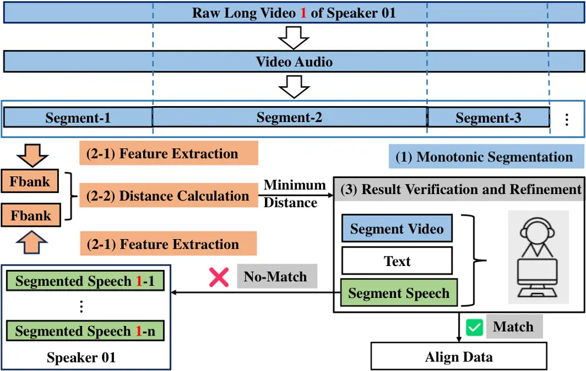

^(†)^(†)footnotetext: \* Corresponding author.

# Advancing Sentence-Level Dysarthric Audio-Visual Speech Recognition via Test-Time Adaptation

Shiyao Wang
[](https://orcid.org/0009-0006-5786-7109)
   Hui Wang
[](https://orcid.org/0009-0003-8057-4644)
   Jiaming Zhou
[](https://orcid.org/0009-0002-4819-4572)
   Shiwan Zhao
[](https://orcid.org/0000-0001-5068-025X)
   Yong Qin✉
[](https://orcid.org/0009-0000-2748-3020)
E-mail <zhaosw@gmail.com> E-mail <qinyong@nankai.edu.cn>
Affiliation: Academy for Advanced Interdisciplinary Studies, Nankai
University, Tianjin, China  
,  
, E-mail [{wangshiyao, wanghui_hlt,
zhoujiaming}@mail.nankai.edu.cn](mailto:%7Bwangshiyao,%20wanghui_hlt,%20zhoujiaming%7D@mail.nankai.edu.cn)

###### Abstract

Dysarthric audio-visual speech recognition (DAVSR) enhances performance
by integrating complementary visual cues. However, existing research is
largely confined to word-level tasks with limited vocabularies, which
severely restricts real-world communication for dysarthric speakers.
Furthermore, performance remains heavily dependent on supervised
fine-tuning with speaker-specific data; significant variations in age,
etiology, and severity cause traditional methods to struggle with unseen
speakers. To address these domain shifts and the scarcity of continuous
multimodal resources, we first introduce a "source speech
search-segmentation" pipeline to construct a structured sentence-level
corpus from raw CDSD videos. We then propose the use of unsupervised
Test-Time Adaptation (TTA) for sentence-level DAVSR using
Sequential-level Generalized Entropy Minimization (SGEM). Our
evaluations across the state-of-the-art AV-SUPERB and ViSpeR frameworks
demonstrate that TTA consistently alleviates Character Error Rate (CER)
degradation for unseen pathological speakers. Paired $`t`$-tests verify
that these improvements are statistically significant ($`p<0.05`$),
highlighting TTA as a promising paradigm for advancing speaker-adaptive
assistive speech interfaces.

###### Keywords: 

Dysarthric audio-visual speech recognition Test-time adaptation
Unsupervised learning Adaptation.

## 1 Introduction

Dysarthric speech recognition \[23, 25, 24, 26\] is a vital catalyst for
social integration, directly enhancing the quality of life for
individuals with speech disorders by enabling voice-command interaction
with smart home devices. By extending standard audio-visual speech
recognition (AVSR) \[14\], DAVSR \[12, 7, 13, 27, 2, 3\] leverages
multi-modal cues—integrating audio signals with visual data such as lip
movements—to provide essential robustness when articulatory impairments
compromise audio clarity. Recent advancements include the use of
Bayesian networks to predict bimodal uncertainty \[12\] and gated neural
networks for dynamic modal fusion \[7\]. Regarding speaker-specific
optimization, researchers have employed speaker-dependent Learning
Hidden Unit Contribution (LHUC) \[19\] for fine-tuned adaptation \[13\],
while neural codec language modeling has been applied to reconstruct
dysarthric speech into intelligible, typical forms \[3\].

Despite the potential of DAVSR, research on sentence-level tasks remains
underdeveloped. Most existing studies are confined to word-level
recognition \[10\] characterized by limited vocabularies and
speaker-specific training. In practice, progress is hindered by two
primary challenges: data scarcity and task complexity. Regarding the
former, publicly accessible dysarthric corpora are generally small-scale
and word-oriented; sentence-level resources are rare and often lack the
precise segmentation required for robust modeling. While the recent CDSD
dataset \[18\] helps mitigate this shortage, its release as raw,
unprocessed video necessitates extensive pre-processing before it can be
effectively utilized for model training. Furthermore, the inherent
heterogeneity of dysarthric speech—driven by diverse ages, etiologies,
and severity levels—complicates continuous speech modeling and severely
limits generalization to unseen speakers. Conventional pipelines
typically rely on target-speaker fine-tuning to bridge this
pronunciation gap; however, this strategy is both data-intensive and
brittle when faced with shifts in speech severity or varying recording
conditions \[20\].

To address data scarcity, we introduce a _source speech
search-segmentation_ procedure (Figure 1) that automatically aligns and
extracts sentence-level units from raw CDSD videos. This pipeline
bridges the data-preparation gap, laying the groundwork for the
systematic study of continuous DAVSR. To address task complexity, we
explore _Test-Time Adaptation_ (TTA) as an unsupervised mechanism to
cope with speaker variability and domain mismatch. TTA adapts models on
unlabeled test samples at inference, reducing the discrepancy between
training and deployment without requiring labeled target data. While TTA
has shown promise in image classification \[22, 8\] and unimodal ASR
\[11, 9\], its potential in the multi-modal DAVSR domain—where labeled
data are scarce and robustness to unseen speakers is critical—remains
largely unexplored.



Figure 1: The workflow of the source speech search-segmentation
procedure. The framework processes raw audio-visual streams through
three core stages: (1) monotonic segmentation to ensure chronological
consistency; (2) Fbank feature extraction and distance calculation to
locate candidates via minimum Euclidean distance; and (3) multi-modal
manual result verification and refinement to filter out no-match cases
and finalize the aligned sentence-level corpus.

The main contributions of this work are summarized as follows:

- •
  We shift the focus of DAVSR research to sentence-level tasks, moving
  beyond restricted word-level vocabularies toward real-world
  communication scenarios.
- •
  We develop a “source speech search-segmentation" method to transform
  raw CDSD video data into structured, sentence-level segments,
  providing a crucial resource for the research community.
- •
  We provide the first systematic validation of TTA for DAVSR across
  multiple state-of-the-art frameworks (AV-SUPERB\[21\] and
  ViSpeR\[15\]), exploring its feasibility and demonstrating potential
  performance improvements for unseen dysarthric speakers under various
  configurations.

## 2 Methods

### 2.1 Source Speech Search-Segmentation

To construct a viable sentence-level DAVSR corpus, we must align
manually annotated speech segments with the unsegmented raw videos in
the CDSD dataset. We propose a "source speech search-segmentation"
method (Fig.1) designed to ensure precise one-to-one correspondence
while preventing alignment redundancy. The procedure consists of three
core stages:

#### Monotonic Segmentation.

We implement a monotonic matching mechanism to enforce temporal
consistency. Specifically, once a speech segment is aligned with a video
clip, all subsequent segments are restricted to the remaining, unmatched
portion of the video. This sequential constraint inherently prevents
repeated matches and ensures that the audio-visual pairs maintain their
original chronological order, significantly enhancing the reliability of
the alignment pipeline.

#### Feature Extraction and Distance Calculation.

We first extract Filter bank (Fbank) features from the pre-segmented
speech utterances. To find the corresponding match, we slide a window
across the audio stream of the raw video to extract candidate segments
of the same duration as the target utterance and compute their Fbank
features. The alignment is then formulated as a distance minimization
problem: we calculate the Euclidean distance between the feature set of
the target utterance and those of all candidate video segments,
selecting the segment that yields the minimum distance as the optimal
match.

#### Result Verification and Refinement.

To ensure high data fidelity, we conduct rigorous manual verification of
the initial alignment results. For utterances where the initial
alignment fails or is deemed inaccurate, the search procedure initiates
an iterative refinement by re-traversing the entire raw video up to
three times to locate the correct segment. If a valid match remains
elusive after these exhaustive traversals, the sample is excluded from
the final dataset to maintain corpus integrity. To guarantee the
reliability of this alignment pipeline, the "Result Verification and
Refinement" stage explicitly involved four independent human annotators.
An audio-visual segment was validated and finalized as an official
"Match" only upon achieving unanimous consensus across the acoustic,
textual, and visual modalities. This rigorous cross-validation and
manual filtering protocol effectively eliminates subjective bias,
ensuring the absolute structural integrity and fidelity of the resulting
sentence-level alignment.

| ID  | Segmented Speech |               | Raw Video |                  | Aligned | Availability |
| --- | ---------------- | ------------- | --------- | ---------------- | ------- | ------------ |
|     | Count            | Range (s)     | Count     | Range (s)        | Data    | Rate         |
| 01  | 1107             | \[0.5, 10.8\] | 22        | \[136.2, 279.6\] | 1107    | 100.0%       |
| 02  | 988              | \[0.4, 12.6\] | 12        | \[237.6, 348.6\] | 968     | 98.0%        |
| 03  | 926              | \[0.4, 15.7\] | 12        | \[154.8, 585.6\] | 912     | 98.5%        |
| 04  | 1035             | \[0.5, 10.4\] | 14        | \[252.6, 307.2\] | 1035    | 100.0%       |
| 06  | 969              | \[0.6, 9.2\]  | 9         | \[297.6, 744.0\] | 967     | 99.8%        |
| 10  | 1129             | \[0.4, 7.7\]  | 18        | \[144.0, 382.2\] | 1101    | 97.5%        |
| 22  | 1866             | \[0.4, 5.6\]  | 16        | \[61.2, 299.4\]  | 1866    | 100.0%       |
| 44  | 1323             | \[0.4, 4.9\]  | 2         | \[393.6, 487.2\] | 294     | 22.2%        |

Table 1: Statistics of the CDSD dataset.

Table 1 summarizes the CDSD dataset statistics before and after this
procedure. We report the quantity and duration of speech segments, raw
video metrics, and the final count of validated audio-visual pairs. We
evaluate the method using the Availability Rate, defined as the ratio of
successfully matched segments to the total pre-segmented count. Notably,
all subjects except Speaker 44 achieved an Availability Rate exceeding
97%. The lower yield for Speaker 44 is attributed to highly ambiguous
pronunciation and minimal labial movement, which impeded both automated
matching and manual verification. Conversely, the clear visemic cues
provided by other speakers facilitated a highly efficient alignment.
Furthermore, even when a speaker fails to articulate a specific phoneme
due to impaired motor control of their vocal organs, human annotators
can successfully verify and match the segment by cross-referencing
visual information—a capability that embodies the foundational rationale
for integrating visual cues into AVSR tasks. These results demonstrate
the efficacy of our method in resolving the CDSD alignment challenge,
providing a robust foundation for sentence-level DAVSR. The segmentation
scripts will be open-sourced to the research community.

Figure 2: TTA was evaluated on two audio-visual speech recognition
frameworks: AV-SUPERB and ViSpeR. Colors indicate different TTA setups,
identifying the audio feature extractor, video feature extractor,
cross-modal fusion layer, encoder, layer normalization (LayerNorm)
layers, and decoder, respectively. Color viewing is recommended.

### 2.2 Architecture and Methodology

To establish a comprehensive evaluation setup, two mainstream AVSR
frameworks with distinct multi-modal processing strategies—AV-SUPERB and
ViSpeR—are utilized as our experimental testbeds, with their detailed
architectural layouts systematically illustrated in Fig. 2. Built upon
these distinct baseline infrastructures, we introduce TTA into the
recognition pipeline to enhance DAVSR performance for unseen speakers.
By leveraging unlabeled test data during inference, the TTA paradigm
operates by dynamically modulating specific trainable components within
these architectures. This design effectively mitigates the severe domain
shifts and speaker variability inherent in dysarthric speech, allowing
the frameworks to unsupervisedly adapt to unseen pathological speech
characteristics while fully preserving their native architectural
advantages.

#### AV-SUPERB.

This framework follows a "pre-trained representation + downstream
adaptation" paradigm. It utilizes a pre-trained AV-HuBERT \[16\]
backbone as the upstream encoder to extract robust multi-modal features.
Specifically, as depicted in Fig. 2(a), the AV-HuBERT upstream
incorporates distinct front-end components—including an audio feature
extractor and a video feature extractor—followed by a post-extraction
projection, 12 Transformer layers, and interleaved LayerNorm layers. The
intermediate outputs from these representations are integrated via
learnable weights and subsequently decoded through a downstream
two-layer BiLSTM for sequence recognition. This detailed hierarchy
provides a granular structural basis for our subsequent layer-specific
TTA configurations.

#### ViSpeR.

In contrast, ViSpeR adopts a decoupled "modality-specific encoding +
cross-modal fusion" approach, establishing a clear structural
distinction from AV-SUPERB’s joint upstream representation. As
illustrated in Fig. 2(b), the audio stream is front-ended by a
Conv1dResNet \[6\], while a Conv3dResNet \[17\] extracts visual features
from lip movements. Crucially, each modality is then independently
processed through a dedicated deep encoder comprising 12 Conformer
layers and 61 interleaved LayerNorm layers. Following cross-modal
fusion, the integrated representations are decoded via two parallel
branches: an autoregressive Transformer decoder (containing 6
Transformer layers and 19 LayerNorm layers) and a non-autoregressive
Connectionist Temporal Classification (CTC) \[5\] decoder. This highly
modular, multi-layer configuration allows for specialized,
modality-isolated feature refinement, providing explicit target layers
for our subsequent block-wise and layer-specific TTA exploration.

#### TTA Mechanism.

We employ SGEM \[9\] as our core TTA mechanism. SGEM adapts model
parameters in an unsupervised manner by minimizing a composite loss
function comprising Generalized Entropy Minimization (GEM) and Negative
Sampling (NS) components. The objective function is defined as:

```math
\mathcal{L}_{\text{GEM}}=\frac{1}{L}\sum_{i=1}^{L}\frac{1}{1-\beta}\log\left(\sum_{j=1}^{C}p_{ij}^{\beta}\right), \tag{1}
```

```math
\mathcal{L}_{\text{NS}}=-\frac{1}{L}\sum_{i=1}^{L}\sum_{j=1}^{C}\mathbb{I}_{[p_{ij}^{\prime}<\tau]}\log(1-p_{ij}), \tag{2}
```

```math
\mathcal{L}_{\text{SGEM}}=\mathcal{L}_{\text{GEM}}+\lambda_{\text{NS}}\mathcal{L}_{\text{NS}}, \tag{3}
```

where $`L`$ denotes the number of speech frames, $`C`$ is the vocabulary
size, and $`p_{ij}`$ is the probability of the $`j`$-th token at the
$`i`$-th frame. The hyperparameters $`\beta`$, $`\lambda_{\text{NS}}`$,
and $`\tau`$ dynamically regulate the adaptation sensitivity to the
sequential outputs. Specifically, the entropic order $`\beta>1`$
flattens the penalty curves of Rényi entropy, scaling the influence of
high-confidence predictions to mitigate gradient vanishing under severe
pathological domain shifts. The threshold $`\tau`$ acts as an
unsupervised decision boundary, isolating low-confidence tokens whose
probabilities fall below $`\tau`$ to explicitly penalize non-diagonal
class confusion at every timestep. Lastly, the weight
$`\lambda_{\text{NS}}`$ balances distribution sharpening and multi-class
correlation reduction, effectively preventing the framework from
degenerating into class collapse during episodic single-utterance
adaptation.

The adaptation of the AVSR framework using SGEM follows a systematic
pipeline:

1.  1.  Initialization: Load the pre-trained model and cache the initial
        parameters to ensure a clean state.
2.  2.  Component selection: Identify specific model components for
        adaptation and set them to a trainable state. In our study, we
        systematically evaluate individual or combined fine-tuning scopes to
        define the optimal adaptation framework, including LayerNorm
        parameters, audio/video feature extractors, specific sub-modules
        within the encoder or decoder infrastructure, and full-parameter
        adaptation of the entire architecture.
3.  3.  Forward pass: Process the sample to obtain output logits.
4.  4.  Loss computation & Update: Calculate the loss and update the
        trainable parameters via gradient descent.
5.  5.  Iterative refinement: Repeat Steps 3–4 for a fixed number of cycles
        to refine the adaptation.
6.  6.  Parameter reset: Upon completing the inference for a given sample,
        reset the model to its original pre-trained state using the cached
        parameters to avoid "catastrophic forgetting" or bias accumulation
        across samples.

## 3 Experiments

### 3.1 Datasets

CN-CVS¹¹ 1 [http://cncvs.cslt.org](http://cncvs.cslt.org) is a
large-scale Mandarin Chinese audio-visual corpus comprising clips from
broadcast news and internet speech shows. It consists of two subsets:

- •
  News: includes approximately 13,000 segments from 28 speakers (35
  hours), characterized by constrained speaking styles and frontal
  camera angles;
- •
  Speech: contains over 193,000 utterances from 2,500+ speakers (273
  hours), featuring more natural prosody and varied head poses.

CDSD²² 2
[http://melab.psych.ac.cn/CDSD.html](http://melab.psych.ac.cn/CDSD.html)
is a Chinese dysarthric speech database. For our experimental framework
and cross-validation protocols, we curate an 8-hour target subset from 8
distinct speakers, with each speaker contributing approximately one hour
of recordings. The detailed duration and quantity statistics across
these subjects are systematically summarized in Table 1. We specifically
select subjects who simultaneously possess both raw, unsegmented video
recordings and corresponding annotated sentence-level speech segments.
The chosen videos are subsequently processed using our proposed source
speech search-segmentation pipeline (Section 2.1), where the localized
lip regions are cropped to facilitate visual feature extraction.

### 3.2 Experimental Setup

#### DAVSR Training Configurations.

We implemented our DAVSR models within the AV-SUPERB framework³³ 3
[https://github.com/roger-tseng/av-superb/tree/main/downstream˙tasks/av˙asr](https://github.com/roger-tseng/av-superb/tree/main/downstream_tasks/av_asr),
utilizing a pre-trained AV-HuBERT backbone⁴⁴ 4
[https://dl.fbaipublicfiles.com/avhubert/model/lrs3/clean-pretrain/base˙lrs3˙iter5.pt](https://dl.fbaipublicfiles.com/avhubert/model/lrs3/clean-pretrain/base_lrs3_iter5.pt)
as the upstream feature extractor and a two-layer BiLSTM for downstream
decoding. We utilized the AV-HuBERT model pre-trained on LRS3 \[1\].
Despite the cross-lingual gap, this large-scale pre-training provides a
robust foundation for extracting phonetic and visemic features. Recent
work \[4\] has validated that AV-HuBERT effectively transfers to
Mandarin tasks, demonstrating its capability to capture articulatory
patterns across different languages. The character dictionary for our
Chinese task comprises 5,536 characters. We evaluated three distinct
training setups:

- •
  AS-1 (LOSO): A Leave-One-Speaker-Out (LOSO) scheme trained exclusively
  on the sentence-level aligned CDSD subset (denoted as "Aligned Data"
  in Table 1). In each fold, the model is trained on seven speakers and
  evaluated on the remaining held-out speaker.
- •
  AS-2 (Cross-domain): Zero-shot evaluation with the model trained
  entirely on the out-of-domain CN-CVS dataset.
- •
  AS-3 (Fine-tuned): The AS-2 model is further fine-tuned on the aligned
  CDSD data following the same LOSO protocol.

To ensure convergence, training was terminated if the training loss
stagnated for 10 consecutive epochs. The checkpoint yielding the minimum
training loss was selected for subsequent testing and TTA experiments.

#### TTA Setup.

We conduct our TTA experiments using both the AV-SUPERB and ViSpeR
frameworks. For AV-SUPERB, the adaptation is initialized using the model
checkpoints obtained from the three training configurations (AS-1, AS-2,
and AS-3). For ViSpeR, TTA is performed on its pre-trained multilingual
model⁵⁵ 5
[https://github.com/m-burchi/ViSpeR](https://github.com/m-burchi/ViSpeR),
which was trained on a massive 5,412-hour multilingual corpus covering
English, Mandarin, Arabic, Spanish, and French, with 787 hours
specifically dedicated to Mandarin. This extensive pre-training provides
a robust multilingual feature space and utilizes a vocabulary of 21,000
tokens to accommodate its broad linguistic coverage.

For all TTA configurations, we employ the AdamW optimizer with a cosine
annealing scheduler, denoting the initial and terminal learning rates as
$`\eta_{s}`$ and $`\eta_{e}`$, respectively. We fix the temperature and
threshold at $`(T,\tau)=(2.5,0.4/C)`$. To ensure strict experimental
consistency, we adopt the baseline hyperparameter configurations
validated by previous SGEM works. Furthermore, our ablation experiments
systematically focus on task-specific component selection scopes (as
summarized in Table 3) rather than exhaustive hyperparameter tuning,
since exploring modular component combinations provides clearer
structural insights into multimodal adaptation dynamics. To investigate
the impact of specific architectural components, we define four
adaptation scopes:

- •
  LayerNorm: Updating exclusively the LayerNorm parameters across the
  sub-structures
  ($`\eta_{s}=2\times 10^{-4},\eta_{e}=2\times 10^{-5},\beta=1.5,\lambda_{\text{NS}}=1`$).
- •
  Feature: Restricting gradient propagation to the front-end features
  extractors, specifically targeting the Audio Feature Extractor and
  Video Feature Extractor blocks
  ($`\eta_{s}=4\times 10^{-5},\eta_{e}=2\times 10^{-5},\beta=1.5,\lambda_{\text{NS}}=1`$).
- •
  Module-Specific: Localizing updates to sequence-level transduction
  blocks. For AV-SUPERB, this evaluates independent encoder or decoder
  blocks. For ViSpeR’s decoupled streams, this fine-tunes the standalone
  audio encoder, video encoder, transformer decoder, or the CTC branch
  ($`\eta_{s}=4\times 10^{-6},\eta_{e}=2\times 10^{-6},\beta=1.25,\lambda_{\text{NS}}=0.5`$).
- •
  All: Setting all architectural parameters across the entire
  multi-modal network to a trainable state simultaneously
  ($`\eta_{s}=4\times 10^{-7},\eta_{e}=2\times 10^{-7},\beta=1.25,\lambda_{\text{NS}}=0.5`$).

Figure 3: Qualitative examples of speech recognition transcripts from
speakers 06 and 44 under their optimal model (ViSpeR), demonstrating the
error-correction capability of the TTA.$`\Delta\text{CER}`$ quantifies
the absolute reduction in CER.

Figure 4: Distribution of testing utterances per speaker, categorized by
the level of CER reduction achieved through TTA across four distinct
evaluation frameworks: AS-1, AS-2, AS-3, and ViSpeR. To compensate for
visual limitations, the samples are binned into four precise CER
improvement intervals
($`\Delta\text{CER}=\text{CER}_{\text{unadapted}}-\text{CER}_{\text{TTA}}`$):
marginal-to-low correction ($`25\%>\Delta\text{CER}\geq 0\%`$, blue
bars), low-to-moderate correction ($`50\%>\Delta\text{CER}\geq 25\%`$,
orange bars), moderate-to-high correction
($`75\%>\Delta\text{CER}\geq 50\%`$, green bars), and significant
correction ($`\Delta\text{CER}\geq 75\%`$, red bars).

### 3.3 Results and Discussions

| Speaker ID | Model  | Baseline | TTA-1 | TTA-3  | TTA-5 | TTA-10 | $`\Delta`$ |
| ---------- | ------ | -------- | ----- | ------ | ----- | ------ | ---------- |
|            | AS-1   | 88.4     | 87.6  | 87.1   | 87.8  | 87.7   | 1.3        |
| 01         | AS-2   | 74.4     | 72.1  | 71.0   | 71.7  | 72.2   | 3.4        |
|            | AS-3   | 75.0     | 73.0  | 72.5   | 72.7  | 73.3   | 2.5        |
|            | ViSpeR | 58.9     | 55.7  | 48.1   | 47.3  | 47.1\* | 11.8       |
|            | AS-1   | 85.2     | 85.5  | 84.3   | 84.3  | 84.4   | 0.9        |
| 02         | AS-2   | 88.2     | 87.6  | 87.4   | 87.4  | 88.1   | 0.8        |
|            | AS-3   | 75.8     | 75.9  | 75.6\* | 76.2  | 76.3   | 0.2        |
|            | ViSpeR | 83.1     | 80.3  | 78.0   | 78.1  | 76.9   | 6.2        |
|            | AS-1   | 88.1     | 89.1  | 88.7   | 89.2  | 88.9   | -0.6       |
| 03         | AS-2   | 86.4     | 87.0  | 86.5   | 88.0  | 87.7   | -0.1       |
|            | AS-3   | 78.0     | 79.9  | 77.3   | 78.2  | 78.5   | 0.7        |
|            | ViSpeR | 74.5     | 72.6  | 68.3   | 68.4  | 66.7\* | 7.8        |
|            | AS-1   | 79.4     | 79.5  | 79.0   | 80.5  | 80.3   | 0.4        |
| 04         | AS-2   | 82.9     | 82.5  | 81.7   | 81.8  | 82.0   | 1.2        |
|            | AS-3   | 57.9     | 57.8  | 56.8   | 57.5  | 57.1   | 1.1        |
|            | ViSpeR | 57.4     | 57.6  | 55.3   | 53.4  | 53.0\* | 4.4        |
|            | AS-1   | 103.2    | 102.1 | 100.3  | 100.5 | 100.5  | 2.9        |
| 06         | AS-2   | 100.1    | 99.4  | 99.2   | 99.3  | 1.0    | 0.9        |
|            | AS-3   | 98.6     | 98.1  | 97.7\* | 98.1  | 98.5   | 0.9        |
|            | ViSpeR | 139.3    | 129.0 | 102.8  | 99.5  | 97.9   | 41.4       |
|            | AS-1   | 92.1     | 92.3  | 91.5   | 92.2  | 92.8   | 0.6        |
| 10         | AS-2   | 92.3     | 92.3  | 92.2   | 92.5  | 92.7   | 0.1        |
|            | AS-3   | 87.6     | 86.5  | 86.5\* | 86.7  | 86.7   | 1.1        |
|            | ViSpeR | 96.7     | 92.4  | 91.0   | 90.5  | 90.3   | 6.4        |
|            | AS-1   | 68.5     | 69.7  | 68.5   | 69.3  | 69.8   | 0.0        |
| 22         | AS-2   | 71.2     | 70.6  | 68.6   | 69.9  | 69.2   | 2.6        |
|            | AS-3   | 56.5     | 56.4  | 54.0   | 56.1  | 54.7   | 2.5        |
|            | ViSpeR | 48.8     | 50.4  | 49.1   | 48.3  | 47.9\* | 0.9        |
|            | AS-1   | 90.1     | 92.6  | 91.0   | 94.1  | 91.7   | -0.9       |
| 44         | AS-2   | 101.4    | 101.1 | 100.6  | 101.0 | 102.2  | 0.8        |
|            | AS-3   | 87.3     | 87.0  | 86.7\* | 87.8  | 86.7   | 0.6        |
|            | ViSpeR | 146.5    | 114.8 | 100.0  | 99.9  | 99.6   | 46.9       |

Table 2: TTA Performance (CER, %) on unseen speakers across various
adaptation iterations. The absolute CER reduction ($`\Delta`$) is
computed as the baseline error minus the optimal adapted error
($`\text{CER}_{\text{Baseline}}-\text{CER}_{\text{Optimal}}`$), with the
latter denoted by the bolded values in each row. The asterisk ($`*`$)
highlights the best recognition performance achieved per speaker across
all evaluated configurations.

Table 2 summarizes the DAVSR performance on unseen speakers before and
after TTA. To ensure an accurate and fair interpretation of these
results, it is essential to clarify that they are not directly
comparable to the previous single-modal baseline results reported in the
original CDSD study \[18\]. While the original baseline leveraged a
substantially larger volume of purely acoustic training speech
(approximately 1 hour per speaker), our multimodal setting is strictly
constrained by the limited availability of paired audio-visual data,
yielding only about one-tenth of an hour of synchronized recordings per
speaker.

Table 2 demonstrates that TTA consistently reduces the CER across most
configurations, establishing a highly viable pathway for unsupervised
model enhancement. While Speakers 03 and 44 exhibited marginal
regressions under AS-1 and AS-2, the CER increases remained below 1%,
and TTA still provided net positive benefits for the most robust
baseline model (AS-3). Speakers 06 and 44 initially presented
exceptionally high CERs due to severe speech impairments, such as
indistinct articulation and abnormal pauses. These severe impairments
initially triggered model hallucinations, leading to meaningless outputs
that further inflated the baseline error rates. However, as illustrated
in Figure 3, TTA achieved noticeable improvements in prediction accuracy
even in these challenging instances where the models initially generated
semantically unrelated outputs.

By analyzing the experimental results across successive adaptation
iterations, we can identify several key patterns and conclusions that
correspond directly to the differing model architectures. As synthesized
in Table 2, across the AV-SUPERB framework settings, the CER reductions
typically plateaued or exhibited marginal fluctuations after three
adaptation iterations. In contrast, the ViSpeR framework demonstrated a
distinct and continuous error reduction trajectory that extended
smoothly up to ten iterations without showing premature optimization
saturation. This persistent self-learning progression is primarily
facilitated by ViSpeR’s extensive 5,412-hour multilingual pre-training,
which endows the model with superior generalization capabilities and
robust self-adaptation performance. Such highly generalized
representations provide stable gradient trajectories during unsupervised
entropy minimization, enabling the model to extract more granular
adjustments from unlabeled target streams over extended cycles. To
rigorously verify the reliability of these performance improvements,
paired $`t`$-tests were executed to compare the unadapted baselines
against the optimal configurations (specifically, Baseline vs. TTA-3 for
AS-3, and Baseline vs. TTA-10 for ViSpeR). The evaluations yielded
$`p`$-values strictly below 0.05 across both scenarios, confirming that
the TTA-driven improvements are statistically significant and
mathematically robust rather than stochastic variations.

|        |                     |          |       |       |       |        |            |
| ------ | ------------------- | -------- | ----- | ----- | ----- | ------ | ---------- |
| Model  | Setting             | Baseline | TTA-1 | TTA-3 | TTA-5 | TTA-10 | $`\Delta`$ |
|        | LayerNorm           | 88.4     | 87.7  | 87.6  | 87.7  | 88.5   | 0.8        |
|        | Feature             | 88.4     | 87.6  | 87.1  | 87.8  | 87.7   | 1.3        |
| AS-1   | Encoder             | 88.4     | 87.7  | 87.5  | 87.9  | 88.7   | 0.9        |
|        | Decoder             | 88.4     | 87.8  | 87.6  | 87.9  | 88.7   | 0.8        |
|        | All                 | 88.4     | 87.6  | 87.6  | 87.7  | 88.2   | 0.8        |
|        | LayerNorm           | 74.4     | 72.4  | 72.1  | 73.1  | 73.2   | 2.3        |
|        | Feature             | 74.4     | 72.1  | 71.0  | 71.7  | 72.2   | 3.4        |
| AS-2   | Encoder             | 74.4     | 72.4  | 72.0  | 73.1  | 73.1   | 2.4        |
|        | Decoder             | 74.4     | 72.7  | 72.3  | 73.5  | 74.1   | 2.1        |
|        | All                 | 74.4     | 72.7  | 72.3  | 73.4  | 73.8   | 2.1        |
|        | LayerNorm           | 75.0     | 73.4  | 73.0  | 73.5  | 73.8   | 2.0        |
|        | Feature             | 75.0     | 73.3  | 72.5  | 73.4  | 73.3   | 2.5        |
| AS-3   | Encoder             | 75.0     | 73.3  | 72.9  | 73.4  | 73.8   | 2.1        |
|        | Decoder             | 75.0     | 73.3  | 73.2  | 73.7  | 74.3   | 1.8        |
|        | All                 | 75.0     | 73.4  | 73.2  | 73.6  | 74.2   | 1.8        |
|        | LayerNorm           | 58.9     | 50.3  | 49.4  | 50.7  | 54.6   | 9.5        |
|        | Feature             | 58.9     | 58.9  | 58.1  | 56.7  | 56.1   | 2.8        |
|        | Audio Encoder       | 58.9     | 52.4  | 49.4  | 49.0  | 51.4   | 9.9        |
| ViSpeR | Video Encoder       | 58.9     | 54.2  | 52.8  | 52.3  | 54.3   | 6.6        |
|        | Transformer Decoder | 58.9     | 59.6  | 60.4  | 60.5  | 60.5   | -0.7       |
|        | CTC Decoder         | 58.9     | 58.9  | 58.9  | 58.9  | 58.9   | 0.0        |
|        | All                 | 58.9     | 55.7  | 48.1  | 47.3  | 47.1   | 11.8       |

Table 3: The performance of different TTA settings for speaker 01 under
various frameworks (CER, %).

Table 3 details the ablation results of different model components under
various TTA configurations. Using Speaker 01 as a representative
scenario, the two frameworks exhibit distinct optimal adaptation
configurations, reflecting their different underlying architectures. To
maintain a concise presentation, the experimental results for the other
seven speakers are omitted from the table, as they exhibit identical
trends and lead to the same architectural conclusions as Speaker 01.

Within the AV-SUPERB framework, the optimal TTA parameter scope is
highly consistent across all three training configurations (AS-1, AS-2,
and AS-3). Specifically, AV-SUPERB consistently achieves its lowest CER
by adapting the upstream front-end feature extractors (the "Feature"
setup). Conversely, updating the downstream sequence decoder (whether
individually as the "Decoder" setup or collectively within the "All"
setup) yields the least optimal improvements. This behavior indicates
that for representation-based modular frameworks like AV-SUPERB,
propagating unsupervised gradients into the downstream recurrent decoder
introduces optimization noise and over-parameterization. Restricting the
self-learning adjustment to the representation space ("Feature")
successfully adapts the front-end to individual domain shifts while
preserving the stable linguistic decoding capacity of the downstream
BiLSTM.

In contrast, the ViSpeR framework exhibits completely different
structural requirements. While partial updates, such as adapting only
the LayerNorm parameters or individual encoder streams, provide notable
error reductions compared to the unadapted baseline, ViSpeR achieves its
absolute optimal performance (yielding a net reduction of 11.8%) when
all architectural parameters are entirely unfrozen ("All" setup).
Crucially, modifying only the Transformer Decoder or the CTC Decoder
yields negligible improvements or, in the case of Transformer Decoder, a
marginal regression of -0.7%. This phenomenon suggests that for tightly
coupled end-to-end architectures like ViSpeR, the modality-specific
encoders and downstream joint-space cross-attention pathways are deeply
interdependent. Unfreezing all parameters prevents representation
mismatch between layers, enabling the multi-modal ResNet front-ends and
downstream decoding networks to cooperatively recalibrate their
alignment weights based on the unsupervised target criteria.

To investigate the granularity of these performance gains at the
utterance level, Figure 4 illustrates the distribution of
sample-specific CER reductions across all eight speakers under the four
evaluation frameworks. For most speakers (e.g., Speakers 01, 02, 03, 04,
06, and 10), the vast majority of utterances fall within the
marginal-to-low improvement tier ($`25\%>\Delta\text{CER}\geq 0\%`$,
blue bars). This indicates that for speakers whose unadapted baseline
recognition was already relatively stable, TTA primarily delivers highly
reliable, small-scale refinements.

In contrast, speakers presenting more complex pathological speech
patterns exhibit higher-magnitude improvements. For Speaker 22, a
substantial portion of samples are successfully shifted into the
moderate-to-high and significant correction tiers. This is particularly
evident under the AS-3 fine-tuned framework, where both the green
($`75\%>\Delta\text{CER}\geq 50\%`$) and red
($`\Delta\text{CER}\geq 75\%`$) bars exceed 200 samples (with the green
bar reaching nearly 240).

The most dramatic architectural and sample-level contrast is observed in
Speaker 44, who initially suffered from exceptionally severe speech
impairments. Under the modular AV-SUPERB configurations (AS-1, AS-2, and
AS-3), Speaker 44 exhibits almost exclusively low-tier or negligible
improvements, with the utterances almost entirely concentrated in the
blue bar ($`25\%>\Delta\text{CER}\geq 0\%`$). Under the zero-shot AS-2
framework, this manifests as a single, exclusive blue bar representing
the entire 294-sample set. However, under the ViSpeR framework, Speaker
44 demonstrates a sample-level transition: the low-tier blue bar is
virtually eliminated, replaced instead by a dominant red bar
($`\Delta\text{CER}\geq 75\%`$) containing nearly 280 samples. This
highly localized, massive correction underscores the powerful synergy
between ViSpeR’s highly generalized multilingual foundation and our TTA
strategy.

## 4 Conclusions

This work investigates the application of TTA to sentence-level DAVSR.
To facilitate this study under severe data scarcity, we construct a
structured multimodal corpus from the raw CDSD database using our
proposed "source speech search-segmentation" pipeline. Our evaluations
across both AV-SUPERB and ViSpeR frameworks suggest that TTA can
partially alleviate performance degradation for unseen pathological
speakers by leveraging unlabeled test data. Although the improvements
are constrained by the inherent heterogeneity of dysarthric speech,
these findings highlight TTA as a promising auxiliary approach for
enhancing model generalizability.

## References

- \[1\] Afouras, T., Chung, J.S., Zisserman, A.: Lrs3-ted: a large-scale
  dataset for visual speech recognition. arXiv preprint
  arXiv:1809.00496 (2018)
- \[2\] Chen, X., Wang, Y., Wu, X., Wang, D., Wu, Z., Liu, X., Meng, H.:
  Exploiting audio-visual features with pretrained av-hubert for
  multi-modal dysarthric speech reconstruction. In: ICASSP 2024-2024
  IEEE International Conference on Acoustics, Speech and Signal
  Processing (ICASSP). pp. 12341–12345. IEEE (2024)
- \[3\] Chen, X., Yang, D., Wang, D., Wu, X., Wu, Z., Meng, H.:
  Colm-dsr: Leveraging neural codec language modeling for multi-modal
  dysarthric speech reconstruction. arXiv preprint
  arXiv:2406.08336 (2024)
- \[4\] Chien, Y.L., Chen, H.H., Yen, M.C., Tsai, S.W., Wang, H.M.,
  Tsao, Y., Chi, T.S.: Audio-visual mandarin electrolaryngeal speech
  voice conversion. arXiv preprint arXiv:2306.06652 (2023)
- \[5\] Graves, A., Fernández, S., Gomez, F., Schmidhuber, J.:
  Connectionist temporal classification: labelling unsegmented sequence
  data with recurrent neural networks. In: Proceedings of the 23rd
  international conference on Machine learning. pp. 369–376 (2006)
- \[6\] He, K., Zhang, X., Ren, S., Sun, J.: Deep residual learning for
  image recognition. In: Proceedings of the IEEE conference on computer
  vision and pattern recognition. pp. 770–778 (2016)
- \[7\] Hu, S., Liu, S., Chang, H.F., Geng, M., Chen, J., Chung, L.W.,
  Hei, T.K., Yu, J., Wong, K.H., Liu, X., et al.: The cuhk dysarthric
  speech recognition systems for english and cantonese. In: INTERSPEECH.
  pp. 3669–3670 (2019)
- \[8\] Khurana, A., Paul, S., Rai, P., Biswas, S., Aggarwal, G.: Sita:
  Single image test-time adaptation. arXiv preprint
  arXiv:2112.02355 (2021)
- \[9\] Kim, C., Park, J., Shim, H., Yang, E.: Sgem: Test-time
  adaptation for automatic speech recognition via sequential-level
  generalized entropy minimization. arXiv preprint
  arXiv:2306.01981 (2023)
- \[10\] Kim, H., Hasegawa-Johnson, M., Perlman, A., Gunderson, J.,
  Huang, T.S., Watkin, K., Frame, S.: Dysarthric speech database for
  universal access research. In: Ninth Annual Conference of the
  International Speech Communication Association (2008)
- \[11\] Lin, G.T., Li, S.W., Lee, H.y.: Listen, adapt, better wer:
  Source-free single-utterance test-time adaptation for automatic speech
  recognition. arXiv preprint arXiv:2203.14222 (2022)
- \[12\] Liu, S., Hu, S., Wang, Y., Yu, J., Su, R., Liu, X., Meng, H.:
  Exploiting visual features using bayesian gated neural networks for
  disordered speech recognition. In: INTERSPEECH. pp. 4120–4124 (2019)
- \[13\] Liu, S., Xie, X., Yu, J., Hu, S., Geng, M., Su, R., Zhang,
  S.X., Liu, X., Meng, H.: Exploiting cross-domain visual feature
  generation for disordered speech recognition. In: Interspeech. pp.
  711–715 (2020)
- \[14\] Ma, P., Haliassos, A., Fernandez-Lopez, A., Chen, H., Petridis,
  S., Pantic, M.: Auto-avsr: Audio-visual speech recognition with
  automatic labels. In: ICASSP 2023-2023 IEEE International Conference
  on Acoustics, Speech and Signal Processing (ICASSP). pp. 1–5.
  IEEE (2023)
- \[15\] Narayan, S., Djilali, Y.A.D., Singh, A., Bihan, E.L., Hacid,
  H.: Visper: Multilingual audio-visual speech recognition. arXiv
  preprint arXiv:2406.00038 (2024)
- \[16\] Shi, B., Hsu, W.N., Lakhotia, K., Mohamed, A.: Learning
  audio-visual speech representation by masked multimodal cluster
  prediction. arXiv preprint arXiv:2201.02184 (2022)
- \[17\] Stafylakis, T., Tzimiropoulos, G.: Combining residual networks
  with lstms for lipreading. arXiv preprint arXiv:1703.04105 (2017)
- \[18\] Sun, M., Gao, M., Kang, X., Wang, S., Du, J., Yao, D., Wang,
  S.J.: Cdsd: Chinese dysarthria speech database. arXiv preprint
  arXiv:2310.15930 (2023)
- \[19\] Swietojanski, P., Li, J., Renals, S.: Learning hidden unit
  contributions for unsupervised acoustic model adaptation. IEEE/ACM
  Transactions on Audio, Speech, and Language Processing 24(8),
  1450–1463 (2016)
- \[20\] Tomanek, K., Seaver, K., Jiang, P.P., Cave, R., Harrell, L.,
  Green, J.R.: An analysis of degenerating speech due to progressive
  dysarthria on asr performance. In: ICASSP 2023-2023 IEEE International
  Conference on Acoustics, Speech and Signal Processing (ICASSP).
  pp. 1–5. IEEE (2023)
- \[21\] Tseng, Y., Berry, L., Chen, Y.T., Chiu, I.H., Lin, H.H., Liu,
  M., Peng, P., Shih, Y.J., Wang, H.Y., Wu, H., et al.: Av-superb: A
  multi-task evaluation benchmark for audio-visual representation
  models. In: ICASSP 2024-2024 IEEE International Conference on
  Acoustics, Speech and Signal Processing (ICASSP). pp. 6890–6894.
  IEEE (2024)
- \[22\] Wang, D., Shelhamer, E., Liu, S., Olshausen, B., Darrell, T.:
  Tent: Fully test-time adaptation by entropy minimization. arXiv
  preprint arXiv:2006.10726 (2020)
- \[23\] Wang, S., Zhao, S., Zhou, J., Kong, A., Qin, Y.: Enhancing
  dysarthric speech recognition for unseen speakers via prototype-based
  adaptation. arXiv preprint arXiv:2407.18461 (2024)
- \[24\] Wang, S., Zhao, S., Zhou, J., Qin, Y.: Zero-and one-shot data
  augmentation for sentence-level dysarthric speech recognition in
  constrained scenarios. arXiv preprint arXiv:2510.16700 (2025)
- \[25\] Wang, S., Zhou, J., Zhao, S., Qin, Y.: Pb-lrdwws system for the
  slt 2024 low-resource dysarthria wake-up word spotting challenge. In:
  2024 IEEE Spoken Language Technology Workshop (SLT). pp. 586–591.
  IEEE (2024)
- \[26\] Wang, S., Zhou, J., Zhao, S., Qin, Y.: A self-training approach
  for whisper to enhance long dysarthric speech recognition. arXiv
  preprint arXiv:2506.22810 (2025)
- \[27\] Yu, C., Su, X., Qian, Z.: Multi-stage audio-visual fusion for
  dysarthric speech recognition with pre-trained models. IEEE
  Transactions on Neural Systems and Rehabilitation Engineering 31,
  1912–1921 (2023)
