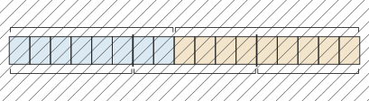
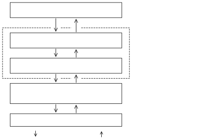
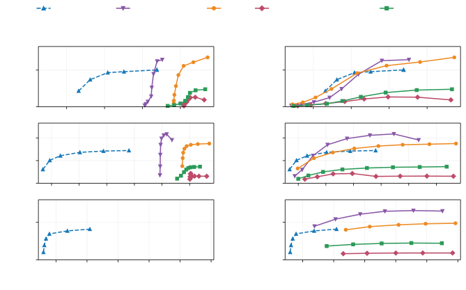

# Flash RNN-T: Memory-Efficient Joint Network and Transducer Loss Computation

Mahmoud Ashraf Affiliation: Tarteel AI
Email: [mahmoud.ashraf@tarteel.ai](mailto:)

###### Abstract

The recurrent neural network transducer (RNN-T) remains a practical
choice for streaming speech recognition, but training requires large
intermediate tensors. We present Flash RNN-T, a joint and loss
implementation combining specialized kernels with optional tiled
recomputation over the full alignment space and vocabulary. Tiled and
untiled Flash form the entire measured throughput-memory frontier on
medium and long workloads. On H100, untiled Flash achieves 24-39% higher
throughput with 26-56% less memory than the fastest baseline on these
workloads wherever it fits. Tiling reduces memory further through
recomputation. On medium, tiled Flash uses ninefold less memory than
that baseline at 16% lower throughput when both use one backward call
per batch. On long, it fits where all tested alternatives with that
backward schedule run out of memory with 80 GB. These comparisons use
each implementation’s lowest-memory configuration reaching at least 95%
of its peak throughput.

## 1 Introduction

RNN-T remains a practical choice for streaming speech recognition, with
recent systems demonstrating accurate recognition under real-time
constraints \[1, 2\]. Training an RNN-T requires marginalizing over
alignments between an input sequence and a target transcript \[3\]. Its
joint network combines encoder and prediction network states at every
valid position in the alignment lattice, producing a distribution over
the vocabulary at each position. For a nonlinear joint, the resulting
hidden states and vocabulary logits can occupy substantially more memory
than the scalar quantities needed by the forward–backward recurrence
\[4, 5\]. This makes the joint network and loss computation natural
targets for memory optimization.

Existing approaches reduce this memory cost by packing valid alignment
positions \[4\] and processing utterances individually \[5\]. However,
avoiding padded positions and processing utterances separately do not,
by themselves, bound the large intermediate tensors produced within a
single utterance. This motivates finer-grained control over their
storage and lifetime.

We introduce Flash RNN-T, a joint and loss implementation combining
specialized GPU kernels with optional tiled checkpointing. Its tiled
variant divides joint network computation into groups of alignment
positions, including within a single utterance. For each group, it
computes the blank and target transition log probabilities needed by the
forward–backward recurrence, while discarding the much larger hidden
states and vocabulary logits. To compute gradients without retaining
these intermediates, we use activation checkpointing \[6\] to recompute
them one group at a time during backpropagation, trading additional
computation for control over their memory footprint. All valid alignment
positions and the full vocabulary are still evaluated, preserving the
RNN-T objective.

We evaluate tiled and untiled Flash against existing implementations and
examine how specialization and recomputation contribute to their
throughput--memory tradeoffs. On the evaluated medium and long
workloads, the two variants together form the entire measured frontier
on both GPUs, offering higher-throughput untiled execution and
lower-memory tiled execution. Code, benchmark scripts and results are
available online.¹¹ 1
[https://github.com/MahmoudAshraf97/flash-rnnt-paper](https://github.com/MahmoudAshraf97/flash-rnnt-paper)

## 2 Background and related work

### 2.1 Joint network and alignment lattice

For an utterance with $`T`$ encoder positions and $`U`$ target labels,
the joint network is evaluated at $`T(U+1)`$ alignment positions,
including the empty target prefix. Let $`e_{t}`$ and $`p_{u}`$ denote
the encoder and prediction network states projected to the joint hidden
dimension, where $`u`$ counts labels already emitted. The nonlinear
joint \[7\] computes

```math
h_{t,u}=\operatorname{Dropout}\!\left(\phi(e_{t}+p_{u})\right),\qquad z_{t,u}=Wh_{t,u}+b, \tag{1}
```

where $`\phi`$ is the activation function, $`h_{t,u}`$ is the hidden
state, and $`W,b`$ project it to logits $`z_{t,u}`$ over the $`V`$
vocabulary symbols, including blank.

Although normalization requires all $`V`$ logits at each position, the
RNN-T forward–backward recurrence needs only the blank and valid
next-target-label log probabilities: $`T(U+1)`$ blank log probabilities
and $`TU`$ target log probabilities per utterance. Conventional batched
training retains the much larger joint intermediates for gradient
computation, so their memory cost accumulates across the batch \[5\].

### 2.2 Memory-efficient transducer computation

Li et al. \[4\] reduce memory consumption by packing valid alignment
positions rather than padding every utterance to the batch’s maximum
lengths, removing padded entries from joint hidden states and vocabulary
logits. They compute logit gradients directly, avoiding intermediate
probability gradients, and overwrite the probability tensor with those
logit gradients to further reduce storage.

GPU implementations also reduce intermediate storage and memory traffic.
Warp-transducer \[8\] retains the raw logits and one normalization value
per alignment position, computing blank and target log probabilities
directly within the forward–backward recurrence instead of storing a
full probability tensor. Apex \[9\] supports packing and merged
softmax/loss differentiation, while also fusing joint addition, ReLU and
dropout to avoid separate tensors for intermediate sums and activations
and reduce memory traffic.

Kuang et al. \[10\] instead reduce the number of alignment positions
evaluated by the expensive nonlinear joint. Their lightweight linear
joint computes compact blank and target log probabilities. These guide
the selection of a narrow target range at each encoder step, restricting
the nonlinear joint’s computation and intermediate storage to that
range. This reduces memory and computation by restricting the alignment
sum rather than changing how the full sum is evaluated.

Without restricting alignments, Braun et al. \[5\] reduce the number of
utterances whose joint intermediates coexist in memory. They compute
joint and loss gradients utterance by utterance, accumulate gradients,
and release utterance-local tensors before propagating through the
batched encoders. Consequently, the large joint intermediates scale with
an individual utterance rather than the entire batch.

Flash RNN-T builds on packing, compact transition log probabilities and
checkpointing to control joint intermediate memory within individual
utterances. We contribute a GPU implementation that couples this
finer-grained memory control with specialized kernels, and quantify its
throughput–memory tradeoffs against existing implementations.

## 3 Implementation

### 3.1 Tiled joint computation and checkpointing

Tiled Flash RNN-T evaluates the joint network in small groups of
alignment positions called tiles. For each tile, it retains the compact
blank and target transition log probabilities while discarding the
larger hidden states and logits, which are recomputed during
backpropagation.

For a batch of $`B`$ utterances, let $`T_{b}`$ and $`U_{b}`$ denote the
encoder and target lengths of utterance $`b`$. We pack the
$`N=\sum_{b=1}^{B}T_{b}(U_{b}+1)`$ valid alignment positions into
approximately balanced tiles of at most $`R`$ positions, which may span
utterance boundaries (Figure 1).



Figure 1: Packing two utterances into tiles with an illustrative limit
of $`R=6`$ alignment positions.

Once all tiles have produced their transition log probabilities, the
forward–backward recurrence computes the loss and its gradients with
respect to them. Because these gradients depend on all valid alignments
of each utterance, joint backpropagation must wait until this
computation is complete. Each tile is then recomputed and differentiated
in turn, releasing its hidden states and logits before processing the
next tile (Figure 2).



Figure 2: Dashed enclosure marks intermediates discarded after each
tile’s forward computation and recomputed during backward. Outputs from
all tiles feed the loss.

The projected encoder and prediction network states remain outside the
checkpoint and are reused during recomputation. A saved seed per tile
reproduces the original dropout mask without retaining it. Tile
recomputation runs inside autograd backward, without changing the
training loop.

### 3.2 Specialized joint and loss kernels

Within each tile, the joint kernel gathers the projected states for
valid alignment positions and fuses addition, activation and dropout,
avoiding intermediate tensors between these operations. Vocabulary
projection uses PyTorch’s matrix multiplication separately. During
backward, the joint kernel fuses the dropout and activation derivatives
with reductions along the encoder and target axes, producing encoder and
prediction network gradients from one read of the hidden-state
gradients.

The normalization kernel reads the full vocabulary logits but returns
only the blank and target log probabilities. During backward, it
computes logit gradients directly from the gradients of these two log
probabilities, overwriting the tile’s logits rather than allocating a
separate gradient tensor.

Copies between packed tiles and lattice tensors calculate their
coordinates to avoid storing an index for every position. The kernel
identifies the utterance from the packed boundaries and subtracts its
starting offset, then obtains the encoder and target coordinates through
integer division and remainder by $`U_{b}+1`$. This mapping places log
probabilities into the lattice during forward and gathers their
gradients into tile order during backward.

### 3.3 Storage and recomputation

Let $`H`$ be the joint hidden dimension and $`V`$ the vocabulary size.
Retaining hidden states and logits for all $`N`$ packed positions
requires $`O(N(H+V))`$ storage. Checkpointing limits these tile-local
tensors to $`O(\min(N,R)(H+V))`$. The compact log probabilities and
forward–backward buffers remain rectangular, requiring
$`O(BT_{\max}(U_{\max}+1))`$ storage, where $`T_{\max},U_{\max}`$ are
the maximum encoder and target lengths in the batch. Projected states,
parameters, gradients and metadata add further storage, so $`R`$
controls the large joint intermediates rather than total device memory.

This reduction requires additional joint computation during backward,
including the vocabulary projection. Smaller tiles reduce peak workspace
but increase the number of kernel launches and partial gradient
accumulations, creating a throughput–memory tradeoff.

## 4 Evaluation methodology

We benchmark joint and loss forward and backward from projected encoder
and prediction network states, including vocabulary projection and
gradients with respect to joint parameters and projected states.

### 4.1 Workloads

We select short and medium workloads from the English subset of Granary
\[11\] and a long workload from the linked long-form training split of
TED-LIUM 3 \[12\] to evaluate performance across realistic sequence
lengths (Table 1). We use 2D bucketing by audio duration and transcript
length, with 30 duration buckets and two transcript-length sub-buckets
each \[13\]. Within each duration band, we select the batch closest to
the band’s median duration, alignment-position count and padding
fraction.

All experiments use $`B=128`$, $`H=640`$, a SentencePiece BPE \[14\]
vocabulary of $`V=1024`$ including blank, 80 ms encoder steps, and joint
dropout of 0.1. We evaluate primarily on NVIDIA H100 GPUs with 80 GB
memory and repeat the experiments on RTX 5090 GPUs with 32 GB to assess
hardware dependence.

| Workload | Mean duration (s) | Encoder length $`T`$ | Transcript length $`U`$ | Valid alignment positions |
| -------- | ----------------- | -------------------- | ----------------------- | ------------------------- |
| Short    | 4.92              | 47–69                | 29–50                   | 282,687                   |
| Medium   | 18.72             | 227–244              | 40–96                   | 2,300,131                 |
| Long     | 69.62             | 851–885              | 325–458                 | 41,122,726                |

Table 1: Representative workload batches.

### 4.2 Comparators and execution controls

We compare tiled and untiled Flash RNN-T with Apex \[9\], NeMo Numba
\[15\] and Optimized Transducer \[16\], an implementation of Li et al.’s
loss optimizations \[4\]. The untiled variant omits tile checkpointing.

Joint inputs and computation use FP16; parameters, parameter gradients,
normalization and the forward–backward recurrence use FP32. The
normalization exception is Numba’s FP16 shared-memory reduction
intermediates; its denominators remain FP32. Optimized Transducer
additionally converts logits to FP32 to reuse their buffer for FP32
gradients, with conversion costs included in timing and memory.

Tiled Flash’s tile limit doubles from 25k to 800k alignment positions.
Other implementations process the full batch or sub-batches of 1–64
utterances, doubling the sub-batch size at each step. Retain keeps
sub-batch graphs until a combined backward call. Release applies Braun
et al.’s sample-wise computation \[5\] to sub-batches, differentiating
each immediately to accumulate parameter and projected-state gradients
while freeing intermediates. Both compute the full-batch mean loss.
Tiled Flash uses tile checkpointing in both panels. Apex uses joint tile
size 4 and joint/loss optimization setting 1.

### 4.3 Measurement and numerical scope

We report throughput as batch size divided by median latency and memory
as PyTorch’s peak allocated memory, including inputs and parameters.
Measurements exclude compilation, autotuning and warm-up. Summary
comparisons select each implementation’s lowest-memory configuration
achieving at least 95% of its peak measured throughput, preserving
near-peak speed while reducing memory. We validate losses and gradients
against reference calculations; the benchmark repository documents the
measurement protocol and correctness tests.

## 5 Results

### 5.1 Comparison with existing implementations

On H100, tiled and untiled Flash together form the entire measured
throughput–memory frontier on medium and long under both schedules
(Figure 3). Apex has the highest peak throughput among external
implementations on all three workloads.

Short presents a tradeoff. Using the 5% selection rule, untiled Flash
uses 60% less memory than Apex under retain with 7.8% lower throughput,
and 73% less memory under release with 6.6% lower throughput.

On medium, the selected tiled Flash configuration reaches 2,839
samples/s at 1.84 GiB, reducing memory ninefold relative to Apex retain
at 16.3% lower throughput. Apex release narrows this memory advantage to
a factor of 3.7, with a similar throughput gap. Untiled Flash instead
improves both metrics over Apex, providing 24–25% higher throughput with
49–56% less memory across the two schedules.

On long, every tested retain configuration of untiled Flash and the
external implementations runs out of memory even with 80 GB, while all
six tiled Flash configurations fit. The selected tiled configuration
reaches 163.6 samples/s at 4.26 GiB, using fourfold less memory than
Apex release at 12.3% lower throughput. Apex release requires a backward
call for each sub-batch, whereas tiled Flash preserves one backward call
per batch. When release scheduling is used, untiled Flash achieves 39%
higher throughput than Apex with 26% less memory.



Figure 3: Throughput–memory tradeoffs under retain and release
scheduling. Points correspond to tile limits for tiled Flash and
sub-batch sizes for the other implementations.

### 5.2 Component implementation ablation

We replace compiled PyTorch \[17\] joint and normalization components
individually and together, under untiled and tiled execution (Table 2).
Compilation specializes to each benchmark shape, so the comparison
measures steady-state performance rather than variable-length training
overhead. All variants share packing and the wavefront recurrence;
untiled variants process the full batch without sub-batching.

| Components        | Short        | Medium       | Long         |
| ----------------- | ------------ | ------------ | ------------ |
| Untiled           |              |              |              |
| Compiled          | 22743 / 2.80 | 3177 / 21.97 | OOM          |
| Specialized joint | 21741 / 2.58 | 3205 / 20.44 | OOM          |
| Specialized norm. | 26564 / 1.65 | 3878 / 11.80 | OOM          |
| Both specialized  | 25333 / 1.44 | 3852 / 10.27 | OOM          |
| Tiled             |              |              |              |
| Compiled          | 17524 / 1.50 | 2448 / 2.16  | 124.2 / 3.49 |
| Specialized joint | 16954 / 1.35 | 2357 / 1.89  | 121.7 / 2.63 |
| Specialized norm. | 19879 / 0.86 | 2834 / 1.29  | 141.4 / 2.58 |
| Both specialized  | 19135 / 0.71 | 2711 / 1.02  | 137.8 / 1.72 |

Table 2: Throughput (samples/s) / peak allocated memory (GiB). Tiled
variants use a tile limit of 200k alignment positions.

Replacing compiled normalization improves tiled throughput by 13–16%.
Adding the specialized joint reduces peak memory by a further 17–33%.
Its throughput effect depends on the GPU, decreasing by 2.5–4.3% on H100
but increasing on RTX 5090. Together, the specialized components remain
9–11% faster than compiled components while using 51–53% less memory.

Even when the joint, vocabulary projection and normalization are
compiled together, tiled Flash achieves 8–9% higher throughput with
42–45% less memory.

### 5.3 Recomputation and release

With the same specialized kernels, tiled checkpointing reduces peak
memory approximately twofold on short and tenfold on medium, at 24.5%
and 29.6% lower throughput, respectively. On long, all full-batch
untiled variants run out of memory, while all tiled variants fit,
including those using compiled PyTorch components.

On medium, switching untiled Flash from retain to release with
16-utterance sub-batches reduces peak memory from 7.89 to 1.70 GiB while
maintaining throughput. On long, release with four-utterance sub-batches
makes untiled execution feasible at 243.0 samples/s and 7.23 GiB, while
every tested retain configuration runs out of memory.

The RTX 5090 experiments show the same medium- and long-workload
frontier advantage, with nearly identical peak memory for matched
configurations. Relative throughput differs across GPUs, however, as
illustrated by the specialized joint’s opposite effects in § 5.2.
Complete RTX 5090 results are available in the benchmark repository.

## 6 Discussion and conclusion

Flash RNN-T improves the measured throughput–memory tradeoff of
joint-and-loss computation while preserving the full alignment space and
vocabulary. On medium and long, tiled and untiled Flash together form
the entire measured frontier on both GPUs. On short, the selected
untiled Flash configurations substantially reduce memory relative to
Apex at modestly lower throughput on H100.

The ablation explains how specialization and checkpointing contribute to
this tradeoff. Specialized normalization improves throughput over
compiled PyTorch, while the specialized joint further reduces memory
with a GPU-dependent throughput effect. Checkpointing trades additional
computation for lower memory, making the long workload feasible even
with compiled components.

Using untiled Flash does not require retaining intermediates for the
entire batch. Sub-batch release makes it feasible on the long workload
and faster than tiled Flash, although it requires more memory and
per-sub-batch backward calls. Tiling instead limits joint intermediate
storage to one tile and preserves a single loss backward call, making
memory reduction available without changing the training loop.

Evaluation covers three corpus-derived batches on two GPU architectures
with one model configuration. Measurements cover joint-and-loss
computation, not end-to-end training throughput. Lattice storage still
grows with sequence length, although large joint intermediates are
bounded by the tile limit. Within this scope, Flash RNN-T offers
lower-memory tiled execution and higher-throughput untiled execution,
both evaluating the full alignment space and vocabulary.

## References

- \[1\] H. Xu, V. Bataev, T. M. Bartley, and J. Balam (2026) Chunk-wise
  attention transducers for fast and accurate streaming speech-to-text.
  In Proc. IEEE ICASSP, pp. 18277–18281. External Links:
  [Document](https://dx.doi.org/10.1109/ICASSP55912.2026.11460802),
  [Link](https://doi.org/10.1109/ICASSP55912.2026.11460802) Cited by:
  §1.
- \[2\] W. Sirichotedumrong, T. Samutsin, S. F. Wani, S.
  Sripaisarnmongkol, and K. Pipatanakul (2026) Typhoon ASR Streaming:
  steerable low-latency Thai speech recognition with real-time shallow
  fusion. In IEEE Spoken Language Technology Workshop (SLT), Demo Track,
  Note: Accepted for publication; arXiv:2609.14991 External Links:
  [Link](https://arxiv.org/abs/2609.14991) Cited by: §1.
- \[3\] A. Graves (2012) Sequence transduction with recurrent neural
  networks. In ICML Workshop on Representation Learning, External Links:
  [Link](https://arxiv.org/abs/1211.3711) Cited by: §1.
- \[4\] J. Li, R. Zhao, H. Hu, and Y. Gong (2019) Improving RNN
  transducer modeling for end-to-end speech recognition. In Proc. IEEE
  ASRU, pp. 114–121. External Links:
  [Document](https://dx.doi.org/10.1109/ASRU46091.2019.9003906),
  [Link](https://doi.org/10.1109/ASRU46091.2019.9003906) Cited by: §1,
  §1, §2.2, §4.2.
- \[5\] S. Braun, E. McDermott, and R. Hsiao (2023) Neural transducer
  training: reduced memory consumption with sample-wise computation. In
  Proc. IEEE ICASSP, pp. 1–5. External Links:
  [Document](https://dx.doi.org/10.1109/ICASSP49357.2023.10095544),
  [Link](https://doi.org/10.1109/ICASSP49357.2023.10095544) Cited by:
  §1, §1, §2.1, §2.2, §4.2.
- \[6\] T. Chen, B. Xu, C. Zhang, and C. Guestrin (2016) Training deep
  nets with sublinear memory cost. arXiv preprint arXiv:1604.06174.
  External Links: [Link](https://arxiv.org/abs/1604.06174) Cited by: §1.
- \[7\] A. Graves, A. Mohamed, and G. Hinton (2013) Speech recognition
  with deep recurrent neural networks. In Proc. IEEE ICASSP,
  pp. 6645–6649. External Links:
  [Document](https://dx.doi.org/10.1109/ICASSP.2013.6638947),
  [Link](https://doi.org/10.1109/ICASSP.2013.6638947) Cited by: §2.1.
- \[8\] M. Huang et al. Warp-transducer: a fast parallel implementation
  of RNN transducer. Note: SoftwareAccessed: Oct. 6, 2026 External
  Links: [Link](https://github.com/HawkAaron/warp-transducer) Cited by:
  §2.2.
- \[9\] NVIDIA Apex transducer joint and loss implementation. Note:
  Software, commit 8a6508aAccessed: Oct. 6, 2026 External Links:
  [Link](https://github.com/NVIDIA/apex) Cited by: §2.2, §4.2.
- \[10\] F. Kuang, L. Guo, W. Kang, L. Lin, M. Luo, Z. Yao, and D.
  Povey (2022) Pruned RNN-T for fast, memory-efficient ASR training. In
  Proc. Interspeech, pp. 2068–2072. External Links:
  [Document](https://dx.doi.org/10.21437/Interspeech.2022-10340),
  [Link](https://doi.org/10.21437/Interspeech.2022-10340) Cited by:
  §2.2.
- \[11\] N. Rao Koluguri, M. Sekoyan, G. Zelenfroynd, S. Meister, S.
  Ding, S. Kostandian, H. Huang, N. Karpov, J. Balam, V. Lavrukhin, Y.
  Peng, S. Papi, M. Gaido, A. Brutti, and B. Ginsburg (2025) Granary:
  speech recognition and translation dataset in 25 European languages.
  In Proc. Interspeech, pp. 3923–3927. External Links:
  [Document](https://dx.doi.org/10.21437/Interspeech.2025-540),
  [Link](https://doi.org/10.21437/Interspeech.2025-540) Cited by: §4.1.
- \[12\] J. D. Fox, D. Raj, N. Delworth, Q. McNamara, C. Miller, and M.
  Jetté (2024) Updated corpora and benchmarks for long-form speech
  recognition. In Proc. IEEE ICASSP, pp. 13246–13250. External Links:
  [Document](https://dx.doi.org/10.1109/ICASSP48485.2024.10446286),
  [Link](https://doi.org/10.1109/ICASSP48485.2024.10446286) Cited by:
  §4.1.
- \[13\] P. Żelasko, K. Dhawan, D. Galvez, K. C. Puvvada, A. Pasad, T.
  Bartley, N. Rao Koluguri, K. Hu, V. Lavrukhin, J. Balam, and B.
  Ginsburg (2025) Training and inference efficiency of encoder-decoder
  speech models. In Proc. IEEE ASRU, pp. 1–7. External Links:
  [Document](https://dx.doi.org/10.1109/ASRU65441.2025.11434640),
  [Link](https://doi.org/10.1109/ASRU65441.2025.11434640) Cited by:
  §4.1.
- \[14\] T. Kudo and J. Richardson (2018) SentencePiece: a simple and
  language independent subword tokenizer and detokenizer for neural text
  processing. In Proc. EMNLP: System Demonstrations, pp. 66–71. External
  Links: [Document](https://dx.doi.org/10.18653/v1/D18-2012),
  [Link](https://doi.org/10.18653/v1/D18-2012) Cited by: §4.1.
- \[15\] NVIDIA and M. Huang NeMo Numba RNN-T loss implementation. Note:
  Software, commit c0188115Accessed: Oct. 6, 2026 External Links:
  [Link](https://github.com/NVIDIA/NeMo) Cited by: §4.2.
- \[16\] F. Kuang Optimized transducer: memory efficient transducer loss
  computation. Note: Software, version 1.4, commit 863667aAccessed: Oct.
  6, 2026 External Links:
  [Link](https://github.com/csukuangfj/optimized_transducer) Cited by:
  §4.2.
- \[17\] J. Ansel, E. Yang, H. He, N. Gimelshein, A. Jain, M.
  Voznesensky, B. Bao, P. Bell, D. Berard, E. Burovski, G. Chauhan, A.
  Chourdia, W. Constable, A. Desmaison, Z. DeVito, E. Ellison, W.
  Feng, J. Gong, M. Gschwind, B. Hirsh, S. Huang, K. Kalambarkar, L.
  Kirsch, M. Lazos, M. Lezcano, Y. Liang, J. Liang, Y. Lu, C. K. Luk, B.
  Maher, Y. Pan, C. Puhrsch, M. Reso, M. Saroufim, M. Y. Siraichi, H.
  Suk, S. Zhang, M. Suo, P. Tillet, X. Zhao, E. Wang, K. Zhou, R.
  Zou, X. Wang, A. Mathews, W. Wen, G. Chanan, P. Wu, and S.
  Chintala (2024) PyTorch 2: faster machine learning through dynamic
  Python bytecode transformation and graph compilation. In Proc. ACM
  ASPLOS, Vol. 2, pp. 929–947. External Links:
  [Document](https://dx.doi.org/10.1145/3620665.3640366),
  [Link](https://doi.org/10.1145/3620665.3640366) Cited by: §5.2.
