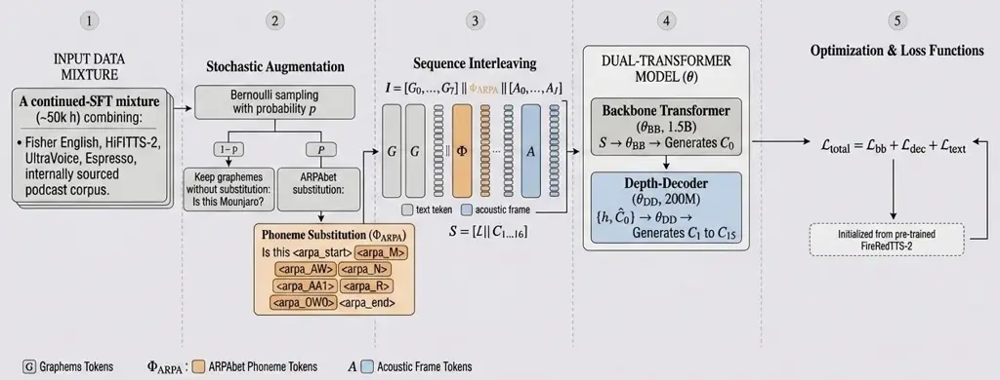

# Pronouncing Hard Words: Phoneme Adaptation of a Pretrained Conversational Text to Speech Model

Yashish M. Siriwardena, Dinesh K. Gnanasekaran, Tanmay Laud, Shinji
Watanabe, Subhabrata Mukherjee, Shanil Puri

###### Abstract

Voice agents built as cascaded automatic speech recognition (ASR)
$`\rightarrow`$ large language model (LLM) $`\rightarrow`$
text-to-speech (TTS) pipelines increasingly rely on _conversational_
TTS: streaming, context conditioned models that adapt delivery to
dialogue history. Such models are natural and expressive but offer
little explicit control over how rare, trust-critical drug names are
pronounced, because these entities are too infrequent, and their
vocabulary too fast-growing, to be covered by any amount of pre-, mid-,
or post-training. We retrofit phoneme controllability onto a pretrained
conversational TTS model without any pre/mid-training, using an ARPAbet
vocabulary extension, continued phoneme-augmented supervised fine-tuning
(SFT), and a training-free inference-time acoustic-biasing step. On a
7,500-clip clinical drug-pronunciation evaluation, our model raises
strict Gemini-judged correctness from $`54.6\%`$ (no phoneme
augmentation) to $`90.7\%`$, outperforming every conversational and
stateless TTS baseline on the automatic metric. Because no training
stage sees a drug name, the entire evaluation is out-of-domain, so the
gains reflect learned pronunciation rather than memorization. In a
blinded, randomized human study, adult listeners judge $`84\%`$ of our
clips correct, versus $`82\%`$ for the strongest baseline, with
overlapping confidence intervals on a stratified subset. Across all 250
matched clips, Gemini agrees with the human majority on $`84.8\%`$ of
binary labels ($`\kappa{=}0.57`$).

###### Index Terms: 

text-to-speech, pronunciation control, phonemes, conversational speech
synthesis, human evaluation, acoustic-biasing

^(†)^(†)address: ¹Hippocratic AI   ²Carnegie Mellon University

## 1 Introduction

Recent TTS systems have moved beyond clean single-speaker narration
toward expressive, controllable, conversational generation. We target
the _voice-agent_ setting, where TTS is the last stage of the pipeline
that turns an agent’s text response into a spoken reply. That pipeline
is usually a cascade; automatic speech recognition (ASR), then a large
language model (LLM), then TTS, though some systems instead use a
speech-to-response model that maps the user’s speech directly to the
agent’s reply before TTS. Either way, the TTS must render each agent
turn in the context of an ongoing conversation; an expert evaluation
reported lower cross-turn coherence for context-agnostic XTTS than for
CSM and context-conditioned Dia variants \[19\]. This favors
conversational TTS models that condition on dialogue history, including
FireRedTTS-2 \[27\], MOSS-TTSD \[31\], CoVoMix2 \[30\], and Sesame CSM
\[23\]. Stateless, single-utterance models such as Qwen3-TTS \[13\] and
CosyVoice 3 \[8\] instead synthesize each turn independently without any
conditioning on the previously generated TTS turns or user input.

Despite this, in the conversational TTS world, explicit pronunciation
control has received comparatively little attention. This matters as
voice agents are deployed in healthcare, where they meet rare,
trust-critical entities whose pronunciations are not recoverable from
spelling alone. Drug names such as Mounjaro and Xiidra are short spans,
but mispronouncing them can dominate the perceived quality of an
interaction. Mispronunciation may also create a safety risk that impedes
clinical deployment.

Classical pipelines exposed pronunciation through lexicons and
grapheme-to-phoneme (G2P) conversion \[15\]. End-to-end models
simplified this but made grapheme-to-sound decisions implicit \[25\].
Prior work explored mixed grapheme/phoneme inputs \[16\], phoneme-aware
encoders such as PnG BERT \[14\], neural lexicon readers \[12\], and
post-hoc correctors \[9\]. These show explicit phonetic information is
useful, but do not answer a practical question raised by current
pretrained conversational TTS systems: can an existing large LLM based
TTS model be adapted to accept phoneme control _without_ any pre/mid
training? This matters because the best systems are trained at a scale
most teams cannot reproduce; FireRedTTS-2 uses 1.1M hours of monologue
plus 300K hours of dialogue speech \[27\], and Qwen3-TTS reports over 5M
hours across 10 languages \[13\]. Purpose-built phoneme-input systems
such as VITS \[17\], FastSpeech2 \[22\], and YourTTS \[4\] do accept
phonemes, but they are stateless, single-utterance models that lack the
context conditioning, zero-shot cloning, and appropriately-expressive
delivery the voice-agent target requires. The problem is therefore not
“does the model accept phonemes” but “can pronunciation control be
retrofitted into a pretrained conversational TTS system without losing
its other capabilities?”

Extending a tokenizer with phoneme tokens is itself standard; our
contributions are the adaptation recipe, a training-free inference
intervention, and a drug-pronunciation evaluation of a conversational
backbone. Concretely: (i) a recipe to retrofit hybrid text/ARPAbet
phoneme control onto a pretrained conversational TTS model (vocabulary
extension $`+`$ phoneme-aware SFT), with the phoneme-annotation rate
swept across six values (0–100%) to select an operating point; (ii) a
training-free inference-time _reference-biasing_ mechanism that
conditions on a preceding-turn pronunciation reference, raising mean
drug-pronunciation accuracy by approximately $`6`$–$`9`$ points and
tightening 5-run variance by approximately $`6`$–$`9\times`$ with no
parameter updates, but requiring a curated recording for each entity;
(iii) a result stronger than every tested baseline in this
curated-reference condition ($`90.7\%`$); and (iv) a
reference-audio-grounded pronunciation evaluation checked against a
blinded, randomized listener study ($`84\%`$ correct on a stratified
subset).¹¹ 1 Audio samples, evaluation labels and Judge prompt:
[https://phoneme-adaptation.netlify.app/](https://phoneme-adaptation.netlify.app/).



Figure 1: Overview of phoneme-aware continued SFT. (1) We assemble a
multi-corpus speech mixture. (2) Stochastic augmentation retains a
word’s graphemes with probability $`1-p`$ or replaces them with ARPAbet
special tokens with probability $`p`$ (illustrated for _Mounjaro_;
illustrative only, as no drug name appears in SFT). (3) Grapheme or
phoneme tokens are interleaved with 16-codebook acoustic frames. (4) The
FireRedTTS-2 backbone predicts the first acoustic codebook, and its
depth decoder predicts the remaining codebooks. (5) Starting from the
pretrained checkpoint, continued SFT jointly optimizes backbone,
depth-decoder, and text losses.

## 2 Related Work

End-to-end systems \[25\] synthesize high-quality speech directly from
text but leave few ways to specify how rare names should be pronounced.
One line retains partial phonetic control: Representation Mixing \[16\]
combines character and phoneme inputs, and \[10\] show limited phonemic
supervision improves controllability. A complementary line corrects
pronunciation post-hoc \[9\]. A third enriches the text representation:
Neural Lexicon Reader \[12\], PnG BERT \[14\], Mixed-Phoneme BERT
\[29\], and XPhoneBERT \[20\]. Production front-ends still treat G2P,
homograph disambiguation, and post-lexical rules as active problems
\[7\]. These works mainly modify encoders, front-ends, or correction
modules, whereas we adapt the text interface of a pretrained
decoder-only conversational TTS model and leave its acoustic stack
intact.

Contemporary TTS systems provide inconsistent pronunciation interfaces:
some use ARPAbet front-ends, others accept optional inline phonetic
tags, and some support IPA \[8, 32\]. Classical phoneme-native models
such as VITS \[17\], FastSpeech2 \[22\], and zero-shot YourTTS \[4\]
accept G2P phonemes directly, but synthesize isolated utterances without
dialogue context. Our goal is therefore not to identify the strongest
phoneme-input system, but to add explicit pronunciation control to a
pretrained conversational model while retaining the capabilities needed
by voice agents.

Preference- and reward-based post-training methods such as DPO and GRPO
require additional optimization; Qwen3-TTS applies DPO to
human-preference pairs \[13\], while GRPO uses group-relative rewards
\[24\]. We instead obtain further pronunciation gains with a
training-free inference-time intervention (Sec. 3.3). Finally, TTS
quality is usually measured on isolated utterances in clean, wideband
audio with automatic predictors (e.g., UTMOSv2 \[2\], DNSMOS) or
standard sets (Seed-TTS \[1\]). We complement these automatic metrics
with adult-listener judgments providing an independent human evaluation.

## 3 Method

### 3.1 Base Model and Input Representation

We start from the post-trained FireRedTTS-2 checkpoint (Apache 2.0), a
long-form, multi-speaker model built around a streaming discrete speech
tokenizer and a dual-transformer autoregressive decoder \[27\]: a large
decoder-only transformer (Qwen2.5-1.5B backbone) predicts the first
acoustic codebook, and a smaller depth decoder (Qwen2.5-200M) fills the
remaining codebooks, for $`\approx`$1.7B parameters total. Each time
step is a 17-dimensional frame: 16 acoustic-codebook coordinates plus
one text-token coordinate, with the audio end-of-segment marker
represented as the all-zero frame. This factorization gives a natural
locus for adaptation: we leave the acoustic tokenizer and decoders
unchanged and modify only the text-side interface. Figure 1 summarizes
our phoneme-aware continued-SFT pipeline; the complete recipe
additionally includes inference-time reference biasing.

### 3.2 Supervised Phoneme Adaptation

We add 131 special tokens to the tokenizer: an extended ARPAbet phone
inventory and two boundary markers, \<\|arpa_start\|\> and
\<\|arpa_end\|\> (full 131-token list on the demo site, Footnote 1). The
original tokenizer has 151,665 text tokens while the embedding table
holds 151,936, so the new symbols occupy unused indices without resizing
the model.

We then continue SFT from the post-trained checkpoint. Each example
retains FireRedTTS-2’s interleaved text–audio format. Eligible ordinary
words are sampled from the CMU Pronouncing Dictionary \[3\] across all
corpora, not only medication-related text. An annotated word is replaced
entirely by phoneme special tokens, while the surrounding sentence
remains plain text. For example, “Please say hello again” may become
“Please say
\<\|arpa_start\|\>\<\|arpa_HH\|\>\<\|arpa_AH0\|\>\<\|arpa_L\|\>\<\|arpa_OW1\|\>\<\|arpa_end\|\>
again.” Thus every phone, as well as the span boundaries, is a distinct
tokenizer special token. The annotation probability is the
phoneme_tagging_rate $`\in[0,1]`$; unannotated words and examples retain
their graphemes to reduce regressions in standard synthesis.

For training, we optimize FireRedTTS-2’s dual-transformer objective with
added emphasis on the new text tokens:

```math
\mathcal{L}_{\mathrm{SFT}}=2\bigl((1-\lambda_{\mathrm{dec}})\mathcal{L}_{\mathrm{bb}}+\lambda_{\mathrm{dec}}\mathcal{L}_{\mathrm{dec}}\bigr)+\lambda_{\mathrm{text}}\mathcal{L}_{\mathrm{text}}, \tag{1}
```

where $`\mathcal{L}_{\mathrm{bb}}`$ is the backbone cross-entropy over
first-codebook tokens, $`\mathcal{L}_{\mathrm{dec}}`$ the depth-decoder
loss over the remaining codebooks (computed on a random one-eighth frame
subset \[27\]), and $`\mathcal{L}_{\mathrm{text}}`$ a text-position term
applied to the new ARPAbet/boundary tokens so their previously unused
slots acquire useful representations. We set
$`\lambda_{\mathrm{dec}}=0.6`$ and $`\lambda_{\mathrm{text}}=0.1`$. The
factor $`2`$ and $`\lambda_{\mathrm{dec}}=0.6`$ follow the inherited
FireRedTTS-2 objective; $`\lambda_{\mathrm{text}}=0.1`$ strengthens
gradients on the new tokens and was not ablated.

### 3.3 Inference-Time Reference Biasing

SFT lets the model read ARPAbet, but pronunciation of a specific hard
entity can still vary across independent generations. To stabilize
_known_ difficult entities at no training cost, we exploit the
backbone’s multi-speaker conversational conditioning. Given the target
“_Take your Mounjaro dose today_,” we prepend \[S1\]: “_Mounjaro_” with
an isolated human recording, then generate the distinct carrier sentence
under \[S2\]. The reference bank contains multiple human speakers, and
\[S1\] and \[S2\] occupy separate speaker slots. No target-utterance
audio is supplied: the isolated \[S1\] example serves only as prior
conversational context rather than teacher forcing the \[S2\]
generation. This requires no parameter updates and needs only a curated
bank of reference pronunciations for the target entities (Sec. 5.2
reports the accuracy and variance gains). This mechanism exploits a
practical advantage of FireRedTTS-2’s conversational architecture:
generation can condition directly on prior text-audio turns. Stateless
baselines on the other hand synthesize each utterance independently and
cannot accept an equivalent acoustic prior-turn prompt.

## 4 Experimental Setup

SFT data. The continued-SFT mixture ($`\sim`$50,000 h) combines Fisher
English \[5, 6\] ($`\sim`$1960 h) for conversation, HiFiTTS-2 \[18\]
($`\sim`$20,000 h) for clean read speech, UltraVoice \[26\] ($`\sim`$830
h) and Expresso \[21\] ($`\sim`$46 h) for expressive,
paralinguistically-rich speech, and an internally sourced conversational
corpus ($`\sim`$28,000 h). The mixture contains _no_ drug names or
clinical templates, so every drug in the evaluation is out-of-domain.

Training. SFT initializes from the post-trained checkpoint and runs up
to 30,000 steps (cap 50 epochs) on 8$`\times`$H200, fused AdamW/bf16,
peak LR $`5\!\times\!10^{-6}`$, cosine decay, 500-step warmup, global
batch 256.

Automatic evaluation. We use two evaluation sets. drug_ref is a
7,500-clip pharmaceutical-pronunciation evaluation which covers 300
drugs $`\times`$ 5 templates $`\times`$ 5 generations. Given no training
stage sees a drug name from this hard 300 drug set, it measures
generalized pronunciation rather than memorization. Seed-TTS \[1\]
measures general synthesis and cloning. For drug pronunciation, a
multimodal judge (Gemini-3.1-Pro at $`T{=}0`$) scores each clip against
a human reference recording as correct/partial/wrong; we report the
strict correct rate (mean $`\pm`$ 5-run $`\sigma`$) plus a wav2vec 2.0
entity-span phoneme error rate (PER) \[28\]. PER is secondary: its
narrow $`20`$–$`26\%`$ range does not resolve large differences in
judged correctness (Table 1), so we compare the reference-grounded judge
with listeners (Sec. 5.5). The 300-item ARPAbet/IPA table was curated
internally, and the corresponding reference pronunciations were recorded
separately from model generation. A group of linguists and clinicians
validated their correctness. For FireRed reference-biasing runs, the
same per-drug recording provides \[S1\] context and the judge reference;
however, the evaluated \[S2\] clip has a different speaker slot and
carrier sentence and is not a reconstruction of that recording.

The baseline set of TTS models used for comparison is representative
rather than exhaustive. Because our target is an interactive voice
agent, selection prioritized recent systems with streaming inference or
published low-latency operation, using TTFA/RTF as practical selection
criteria, alongside proprietary systems with native pronunciation
controls. We do not compare latency numerically because published
measurements use incompatible hardware, serving stacks, and metric
definitions. We also report Seed-TTS-Eval word error rate (WER) and
speaker similarity (SIM) \[1\], and UTMOSv2 \[2\] on drug_ref.

Human evaluation. Twelve adult listeners evaluate a subset of drug_ref
using the same three-point rubric as the Gemini judge: _correct_,
_partial_, or _wrong_ (full rubric on the demo site, Footnote 1). System
identity is blinded and clip order is randomized. The subset uses ten
drugs selected by stratifying candidates across systems and Gemini
labels, with five templates per drug ($`10\times 5=50`$ clips per
system). Each listener rates 73–75 clips, giving three or four
independent ratings per clip. A clip is human-correct with at least two
of three or three of four correct ratings; exact-label ties use the
lower ordinal median. We report majority-vote correct rates with 95%
Wilson CIs and ordinal Krippendorff’s $`\alpha`$ across the three-point
ratings. We compare Gemini with the human majority on the same clips
using binary correct/not-correct agreement, exact three-way agreement,
and Cohen’s $`\kappa`$.

## 5 Results and Discussion

|                              |          |                        |                    |                      |                    |                  |
| ---------------------------- | -------- | ---------------------- | ------------------ | -------------------- | ------------------ | ---------------- |
| Model                        | \#Params | Drug-pron $`\uparrow`$ | PER $`\downarrow`$ | UTMOSv2 $`\uparrow`$ | WER $`\downarrow`$ | SIM $`\uparrow`$ |
| phon_0                       | 1.7B     | 54.6  $`\pm`$  0.3     | 25.61              | 3.49                 | 2.01               | 67.1             |
| phon_20                      | 1.7B     | 86.7  $`\pm`$  0.7     | 22.39              | 3.48                 | 1.81               | 67.2             |
| phon_40                      | 1.7B     | 90.9  $`\pm`$  1.0     | 21.72              | 3.48                 | 1.87               | 67.1             |
| phon_60 (ours)               | 1.7B     | 90.7  $`\pm`$  0.6     | 22.20              | 3.49                 | 1.80               | 67.2             |
| phon_80                      | 1.7B     | 91.5  $`\pm`$  0.3     | 21.41              | 3.49                 | 1.92               | 66.6             |
| phon_100                     | 1.7B     | 91.8  $`\pm`$  0.4     | 21.13              | 3.50                 | 1.81               | 65.6             |
| conversational TTS baselines |          |                        |                    |                      |                    |                  |
| FireRedTTS-2 (base)          | 1.7B     | 52.3  $`\pm`$  0.5     | 25.81              | 3.41                 | 1.95               | 66.5             |
| MOSS-TTS-Realtime \[11\]     | 1.9B     | 53.0  $`\pm`$  0.5     | 24.27              | 3.24                 | 1.97               | 68.9             |
| stateless TTS baselines      |          |                        |                    |                      |                    |                  |
| CosyVoice3 (CMU-ARPA)        | 1.5B     | 82.6  $`\pm`$  1.2     | 25.52              | 3.62                 | 2.22               | 72.0             |
| VoxCPM2                      | 2B       | 86.1  $`\pm`$  0.7     | 22.03              | 3.45                 | 1.84               | 75.3             |
| ElevenLabs Turbo v2 (IPA)    | —        | 73.4  $`\pm`$  0.5     | 20.51              | 3.46                 | —                  | —                |
| ElevenLabs v3 (plain)        | —        | 68.0  $`\pm`$  0.6     | 20.03              | 3.38                 | —                  | —                |
| ElevenLabs v3 (IPA)          | —        | 60.9  $`\pm`$  0.5     | 20.59              | 3.35                 | —                  | —                |
| Inworld TTS-2 (IPA)          | —        | 51.5  $`\pm`$  1.1     | 26.06              | 3.69                 | —                  | —                |

Table 1: Pronunciation, acoustic quality, and Seed-TTS-Eval results.
Baselines are grouped into _conversational_ (context-conditioned) and
_stateless_ (single-utterance) TTS. \#Params is total published/inferred
parameter count (backbone + decoder where applicable; — denotes an
undisclosed proprietary API). Drug-pron is Gemini-judged correctness
(%), mean $`\pm`$ 5-run $`\sigma`$; PER is Wav2Vec2 entity-span phoneme
error rate (%); phon_0 and FireRedTTS-2 base receive plain graphemes;
the remaining FireRed variants receive ARPAbet and FireRed-specific
reference biasing. CosyVoice3 receives CMU-ARPAbet; ElevenLabs and
Inworld rows marked IPA receive inline IPA; rows marked plain, VoxCPM2,
and MOSS receive graphemes. External systems receive no FireRed biasing.
Baseline WER/SIM values are reported Seed-TTS-Eval Test-EN results from
\[32\]; values for our variants use the same evaluation protocol. Best
value per column in bold.

### 5.1 SFT Unlocks Phoneme Control

The phon_0 control receives the same continued SFT mixture and compute
but no phoneme augmentation, and is evaluated using plain graphemes. It
reaches $`54.6\%`$ Drug-pron accuracy, only $`2.3`$ pp above the
untouched FireRedTTS-2 base model ($`52.3\%`$), showing that continued
SFT alone explains little of the gain. At $`20\%`$ phoneme annotation,
with ARPAbet supplied at inference, accuracy reaches $`86.7\%`$, while
PER moves only from $`25.61\%`$ to $`22.39\%`$, consistent with its
limited resolution. Beyond this the sweep plateaus: phon_40–phon_100
cluster near $`91\%`$ accuracy and $`21`$–$`22\%`$ PER, so we treat the
sweep as a model-selection tool rather than a quantity to maximize
blindly.

### 5.2 Reference Biasing Stabilizes Known Entities

As discussed in Sec. 3.3, inference-time biasing (Table 2) improves
every non-trivial checkpoint by approximately $`6`$–$`9`$ points and
tightens 5-run $`\sigma`$ by approximately $`6`$–$`9\times`$; only
FireRed rows in Table 1 use it. It assumes a reference pronunciation is
available, so it complements rather than replaces phoneme adaptation;
the no-bias $`84.2\%`$ result isolates the phoneme-aware SFT
contribution from this contextual cue. We adopt phon_60 as our operating
point on a composite ranking over pronunciation and general quality: it
has the lowest reported Seed-TTS-Eval WER ($`1.80\%`$), stable UTMOSv2,
and comes within $`1.1`$ pp of the top drug-pron rate; phon_100 is
numerically best on pronunciation but has lower SIM.

| Variant  | w/ biasing $`\uparrow`$ | no biasing $`\uparrow`$ |
| -------- | ----------------------- | ----------------------- |
| phon_60  | 90.7  $`\pm`$  0.6      | 84.2  $`\pm`$  3.4      |
| phon_100 | 91.8  $`\pm`$  0.4      | 83.2  $`\pm`$  3.4      |

Table 2: Inference-time biasing ablation (Drug-pron mean % $`\pm`$ 5-run
$`\sigma`$).

### 5.3 Phoneme-Input TTS Baselines

To understand if classical G2P front-ends already solve this, we
evaluated FastSpeech2/FastPitch \[22, 33\], VITS \[17\], and YourTTS
\[4\] on drug_ref under the same Gemini protocol, both with their
default G2P and with correct CMU ARPAbet injected directly (Table 3).
Default G2P reaches $`31`$–$`42\%`$ and oracle phonemes reach
$`39.6`$–$`66.3\%`$, showing that accepting phoneme input alone does not
guarantee correct acoustic realization of hard entities. These systems
are not matched to our model in capacity or training data, so this is
primarily a diagnostic comparison.

| System                  | G2P front-end$`\uparrow`$ | Oracle phonemes$`\uparrow`$ |
| ----------------------- | ------------------------- | --------------------------- |
| FastSpeech2 / FastPitch | 31.0                      | 66.3                        |
| VITS (LJSpeech)         | 41.7                      | 55.2                        |
| YourTTS                 | 32.6                      | 39.6                        |
| Ours (phon_60)          | —                         | 90.7                        |

Table 3: Diagnostic phoneme-input comparison on drug_ref (Gemini-judged
strict correct %). Oracle: correct CMU ARPAbet.

### 5.4 General TTS Quality

Across the sweep, Seed-TTS-Eval WER stays in a tight $`1.80`$–$`2.01\%`$
band, SIM stays near $`67`$, and UTMOSv2 is flat (Table 1), indicating
that adaptation preserves these reported general-quality metrics.

### 5.5 Human Evaluation

Adult-listener pronunciation evaluation. Listeners judge phon_60 correct
on 42 of 50 clips ($`84\%`$, 95% CI: $`71.5`$–$`91.7\%`$), compared with
$`82\%`$ for VoxCPM2; its interval overlaps those of all baselines on
this 50-clip/system subset (Table 4). Pairwise exact agreement is
$`79.7\%`$; ordinal Krippendorff’s $`\alpha`$ is $`0.58`$ (95% bootstrap
CI: $`0.49`$–$`0.67`$), indicating moderate inter-rater reliability.
Across all 250 clips, human–Gemini agreement is $`84.8\%`$ for binary
correct/not-correct labels ($`\kappa{=}0.57`$, 95% bootstrap CI:
$`0.44`$–$`0.68`$) and $`82.4\%`$ for exact three-way labels. Gemini
marks $`79.6\%`$ correct versus $`74.8\%`$ by human majority; this
$`4.8`$-point difference is not significant (paired McNemar
$`p{=}0.07`$). Although the $`12`$-point Gemini–human gap for phon_60
may partly reflect its shared bias/judge reference, the no-bias FireRed
base also has an $`8`$-point gap and therefore we treat the $`84\%`$
human rate as the conservative estimate.

| System              | Gemini (95% CI) $`\uparrow`$ | Human (95% CI) $`\uparrow`$ |
| ------------------- | ---------------------------- | --------------------------- |
| phon_60 (ours)      | 96.0 \[86.5,98.9\]           | 84.0 \[71.5,91.7\]          |
| FireRedTTS-2 (base) | 70.0 \[56.2,80.9\]           | 62.0 \[48.2,74.1\]          |
| MOSS-TTS-Realtime   | 68.0 \[54.2,79.2\]           | 68.0 \[54.2,79.2\]          |
| VoxCPM2             | 88.0 \[76.2,94.4\]           | 82.0 \[69.2,90.2\]          |
| ElevenLabs Turbo v2 | 76.0 \[62.6,85.7\]           | 78.0 \[64.8,87.2\]          |

Table 4: Adult-listener drug-pronunciation correctness (%) on a subset
of drug_ref, stratified across systems and Gemini labels ($`50`$ clips
per system; three or four ratings per clip). A clip is correct when at
least two of three or three of four listeners assign _correct_. Gemini
scores the same clips. Brackets give 95% Wilson CIs.

## 6 Conclusion

We present a recipe for retrofitting ARPAbet control onto a pretrained
conversational TTS backbone using vocabulary extension, phoneme-aware
SFT, and FireRed-specific reference biasing. With a curated per-drug
recording bank, the selected model reaches a result stronger than every
tested baseline ($`90.7\%`$), versus $`84.2\%`$ without biasing. In a
blinded, randomized human evaluation, adult listeners judge $`84\%`$ of
its clips correct, compared with VoxCPM2’s $`82\%`$ on the stratified
subset, with overlapping confidence intervals.

FireRedTTS-2 is a case study rather than evidence of
architecture-independent generalization: phoneme-aware SFT may transfer
to models with modifiable text embeddings and continued-SFT support,
whereas reference biasing requires multi-turn acoustic conditioning. The
recipe remains English- and ARPAbet-only, sensitive to
phoneme-annotation quality, and limited by its curated bank to _known_
hard entities; transfer to other phoneme alphabets and backbones remains
future work.

## 7 Compliance with Ethical Standards

This work was supported by Hippocratic AI, which employs Y.M.S., D.K.G.,
T.L., S.M., and S.P.; the authors report no other relevant interests.
Adult listeners were employee volunteers recruited company-wide;
participation was voluntary, informed consent was obtained, and no
personally identifying information is reported or released. The study
was approved by Hippocratic AI’s internal ethics committee.

## References

- \[1\] P. Anastassiou et al. (2024) Seed-TTS: a family of high-quality
  versatile speech generation models. arXiv:2406.02430. External Links:
  [Link](https://arxiv.org/abs/2406.02430) Cited by: §2, §4, §4.
- \[2\] K. Baba, W. Nakata, Y. Saito, and H. Saruwatari (2024) The T05
  system for the VoiceMOS challenge 2024: transfer learning from deep
  image classifier to naturalness MOS prediction of high-quality
  synthetic speech. arXiv:2409.09305. External Links:
  [Link](https://arxiv.org/abs/2409.09305) Cited by: §2, §4.
- \[3\] Carnegie Mellon University Speech Group (2014) The CMU
  Pronouncing Dictionary. Note: CMU Speech Group Cited by: §3.2.
- \[4\] E. Casanova, J. Weber, C. D. Shulby, A. C. Junior, E. Gölge,
  and M. A. Ponti (2022) YourTTS: towards zero-shot multi-speaker TTS
  and zero-shot voice conversion for everyone. In Proc. ICML, Vol. 162,
  pp. 2709–2720. External Links:
  [Link](https://proceedings.mlr.press/v162/casanova22a.html) Cited by:
  §1, §2, §5.3.
- \[5\] C. Cieri, D. Graff, O. Kimball, D. Miller, and K. Walker (2004)
  Fisher English training speech part 1. Note: LDC, LDC2004S13 External
  Links: [Link](https://catalog.ldc.upenn.edu/LDC2004S13) Cited by: §4.
- \[6\] C. Cieri, D. Graff, O. Kimball, D. Miller, and K. Walker (2005)
  Fisher English training speech part 2. Note: LDC, LDC2005S13 External
  Links: [Link](https://catalog.ldc.upenn.edu/LDC2005S13) Cited by: §4.
- \[7\] G. Comini, S. Ribeiro, F. Yang, H. Shim, and J.
  Lorenzo-Trueba (2023) Multilingual context-based pronunciation
  learning for text-to-speech. In Proc. Interspeech, pp. 631–635.
  External Links:
  [Document](https://dx.doi.org/10.21437/Interspeech.2023-861),
  [Link](https://www.isca-archive.org/interspeech_2023/comini23_interspeech.html)
  Cited by: §2.
- \[8\] Z. Du et al. (2025) CosyVoice 3: towards in-the-wild speech
  generation via scaling-up and post-training. arXiv:2505.17589.
  External Links: [Link](https://arxiv.org/abs/2505.17589) Cited by: §1,
  §2.
- \[9\] J. Fong, H. Tang, and S. King (2023) Spell4TTS:
  acoustically-informed spellings for improving text-to-speech
  pronunciations. In Proc. SSW, pp. 8–13. External Links:
  [Document](https://dx.doi.org/10.21437/SSW.2023-2),
  [Link](https://www.isca-archive.org/ssw_2023/fong23_ssw.html) Cited
  by: §1, §2.
- \[10\] J. Fong, J. Taylor, and S. King (2020) Testing the limits of
  representation mixing for pronunciation correction in end-to-end
  speech synthesis. In Proc. Interspeech, pp. 4019–4023. External Links:
  [Document](https://dx.doi.org/10.21437/Interspeech.2020-2618),
  [Link](https://www.isca-archive.org/interspeech_2020/fong20_interspeech.html)
  Cited by: §2.
- \[11\] Y. Gong et al. (2026) MOSS-TTS technical report.
  arXiv:2603.18090. External Links:
  [Link](https://arxiv.org/abs/2603.18090) Cited by: Table 1.
- \[12\] M. He, J. Yang, L. He, and F. Soong (2022) Neural lexicon
  reader: reduce pronunciation errors in end-to-end TTS by leveraging
  external textual knowledge. In Proc. Interspeech, pp. 441–445.
  External Links:
  [Document](https://dx.doi.org/10.21437/Interspeech.2022-420),
  [Link](https://www.isca-archive.org/interspeech_2022/he22b_interspeech.html)
  Cited by: §1, §2.
- \[13\] H. Hu et al. (2026) Qwen3-TTS technical report.
  arXiv:2601.15621. External Links:
  [Link](https://arxiv.org/abs/2601.15621) Cited by: §1, §1, §2.
- \[14\] Y. Jia, H. Zen, J. Shen, Y. Zhang, and Y. Wu (2021) PnG BERT:
  augmented BERT on phonemes and graphemes for neural TTS. In Proc.
  Interspeech, pp. 151–155. External Links:
  [Document](https://dx.doi.org/10.21437/Interspeech.2021-1757),
  [Link](https://www.isca-archive.org/interspeech_2021/jia21_interspeech.html)
  Cited by: §1, §2.
- \[15\] D. Jurafsky and J. H. Martin (2000) Speech and language
  processing: an introduction to natural language processing,
  computational linguistics, and speech recognition. 1st edition,
  Prentice Hall. Note: ARPAbet notation system, pp. 94–95 Cited by: §1.
- \[16\] K. Kastner, J. F. Santos, Y. Bengio, and A. C. Courville (2019)
  Representation mixing for TTS synthesis. In Proc. ICASSP, External
  Links: [Link](https://arxiv.org/abs/1811.07240) Cited by: §1, §2.
- \[17\] J. Kim, J. Kong, and J. Son (2021) Conditional variational
  autoencoder with adversarial learning for end-to-end text-to-speech.
  In Proc. ICML, Vol. 139, pp. 5530–5540. External Links:
  [Link](https://arxiv.org/abs/2106.06103) Cited by: §1, §2, §5.3.
- \[18\] R. Langman et al. (2025) HiFiTTS-2: a large-scale high
  bandwidth speech dataset. arXiv:2506.04152. External Links:
  [Link](https://arxiv.org/abs/2506.04152) Cited by: §4.
- \[19\] H. Liu and Z. Zhang (2025) On the cost and benefits of training
  context with utterance or full conversation training: a comparative
  study. arXiv:2505.07202. Cited by: §1.
- \[20\] L. T. Nguyen, T. Pham, and D. Q. Nguyen (2023) XPhoneBERT: a
  pre-trained multilingual model for phoneme representations for
  text-to-speech. arXiv:2305.19709. External Links:
  [Link](https://arxiv.org/abs/2305.19709) Cited by: §2.
- \[21\] T. A. Nguyen et al. (2023) EXPRESSO: a benchmark and analysis
  of discrete expressive speech resynthesis. arXiv:2308.05725. External
  Links: [Document](https://dx.doi.org/10.48550/arXiv.2308.05725),
  [Link](https://arxiv.org/abs/2308.05725) Cited by: §4.
- \[22\] Y. Ren et al. (2021) FastSpeech 2: fast and high-quality
  end-to-end text to speech. In Proc. ICLR, External Links:
  [Link](https://openreview.net/forum?id=piLPYqxtWuA) Cited by: §1, §2,
  §5.3.
- \[23\] Sesame AI Labs (2024) CSM: conversational speech model. Note:
  [https://github.com/SesameAILabs/csm](https://github.com/SesameAILabs/csm)
  Cited by: §1.
- \[24\] Z. Shao et al. (2024) DeepSeekMath: pushing the limits of
  mathematical reasoning in open language models. arXiv:2402.03300.
  External Links: [Link](https://arxiv.org/abs/2402.03300) Cited by: §2.
- \[25\] J. Shen et al. (2018) Natural TTS synthesis by conditioning
  WaveNet on mel spectrogram predictions. In Proc. ICASSP, External
  Links: [Link](https://arxiv.org/abs/1712.05884) Cited by: §1, §2.
- \[26\] W. Tu et al. (2025) UltraVoice: scaling fine-grained
  style-controlled speech conversations for spoken dialogue models.
  arXiv:2510.22588. External Links:
  [Link](https://arxiv.org/abs/2510.22588) Cited by: §4.
- \[27\] K. Xie, F. Shen, J. Li, F. Xie, X. Tang, and Y. Hu (2025)
  FireRedTTS-2: towards long conversational speech generation for
  podcast and chatbot. arXiv:2509.02020. External Links:
  [Link](https://arxiv.org/abs/2509.02020) Cited by: §1, §1, §3.1, §3.2.
- \[28\] Q. Xu, A. Baevski, and M. Auli (2021) Simple and effective
  zero-shot cross-lingual phoneme recognition. arXiv:2109.11680.
  External Links: [Link](https://arxiv.org/abs/2109.11680) Cited by: §4.
- \[29\] G. Zhang et al. (2022) Mixed-phoneme BERT: improving BERT with
  mixed phoneme and sup-phoneme representations for text to speech. In
  Proc. Interspeech, pp. 456–460. External Links:
  [Document](https://dx.doi.org/10.21437/Interspeech.2022-621),
  [Link](https://www.isca-archive.org/interspeech_2022/zhang22i_interspeech.html)
  Cited by: §2.
- \[30\] L. Zhang et al. (2025) CoVoMix2: advancing zero-shot dialogue
  generation with fully non-autoregressive flow matching. In Proc.
  NeurIPS, External Links: [Link](https://arxiv.org/abs/2506.00885)
  Cited by: §1.
- \[31\] Y. Zhang et al. (2026) MOSS-TTSD: text to spoken dialogue
  generation. arXiv:2603.19739. External Links:
  [Link](https://arxiv.org/abs/2603.19739) Cited by: §1.
- \[32\] Y. Zhou et al. (2025) VoxCPM: tokenizer-free TTS for
  context-aware speech generation and true-to-life voice cloning.
  arXiv:2509.24650. External Links:
  [Link](https://arxiv.org/abs/2509.24650) Cited by: §2, Table 1.
- \[33\] A. Łańcucki (2021) FastPitch: parallel text-to-speech with
  pitch prediction. In Proc. ICASSP, External Links:
  [Link](https://arxiv.org/abs/2006.06873) Cited by: §5.3.
