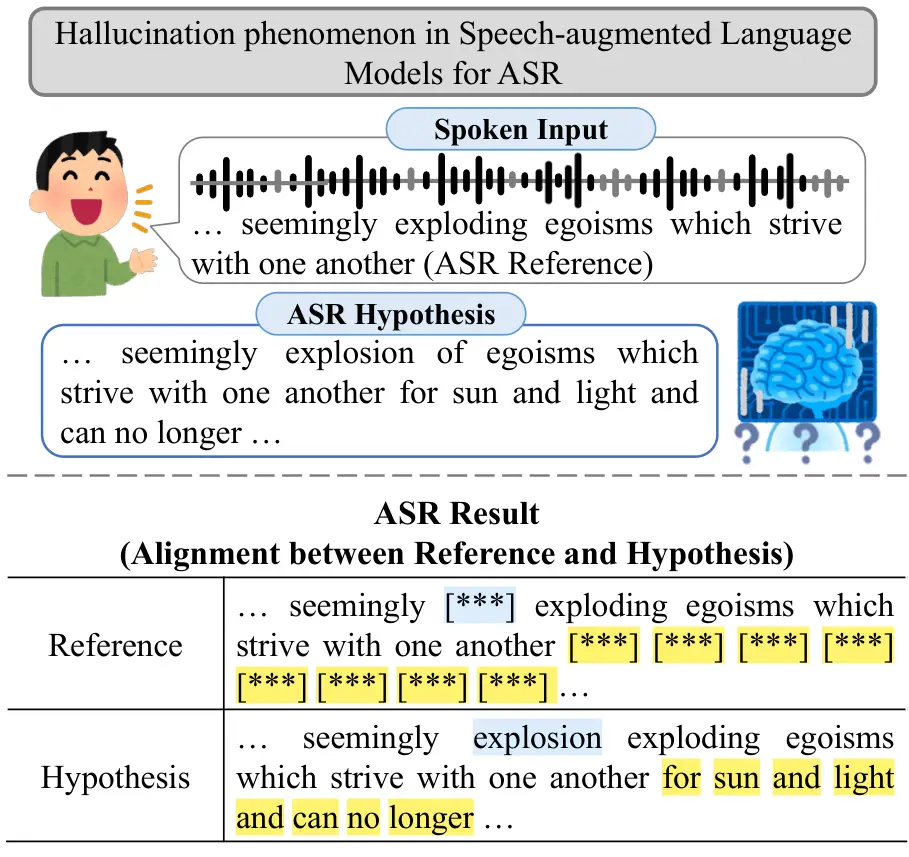
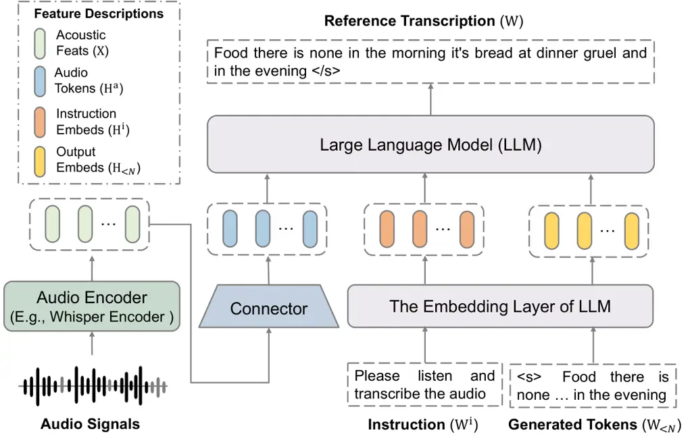
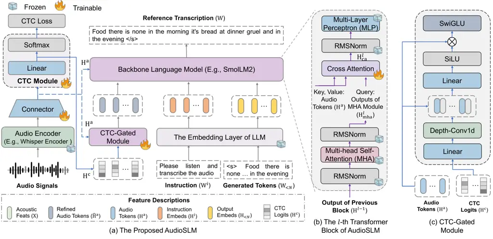
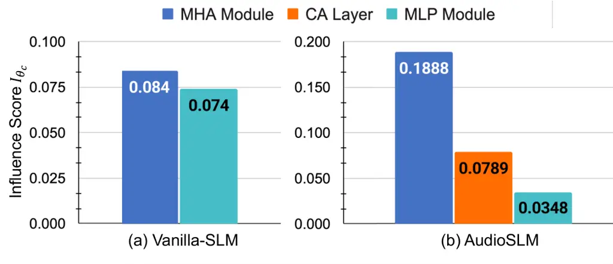

Yan Guo Chao Chen

# Probing and Mitigating Hallucinations in Speech-augmented Language Models for Automatic Speech Recognition via Small Language Models

Bi-Cheng    Jhih-Rong    Fu-An    Berlin

###### Abstract

The widespread success of large language models in natural language
processing has spurred the development of speech-augmented language
models (SLMs) to extend their reasoning capabilities from textual inputs
to spoken ones. Despite impressive performance, SLMs remain susceptible
to hallucinations, posing challenges in practical utility. To this end,
we first probe hallucinations in SLMs for automatic speech recognition
(ASR) via the lens of causal mediation and behavioral analysis. To
mitigate fabricated ASR hypotheses, we propose AudioSLM, a compact yet
effective ASR framework built upon a small language model, which
leverages alignment cues and cross-attention layers to synergistically
bolster acoustic modeling and cross-modal interactions. Experiments on
LibriSpeech reveal that hallucinations arise from multi-head
self-attention modules with an excessive attention bias towards textual
tokens. AudioSLM considerably eases ASR hallucinations and outperforms
some LLM-based ASR models.

###### keywords

speech-augmented language model, hallucination, cross-modal alignment,
alignment information, automatic speech recognition

^(†)^(†)address: National Taiwan Normal University, Taiwan
^(†)^(†)email: {80847001s, jhihrong, fuanchao, berlin}@ntnu.edu.tw

## 1 Introduction

As witnessed by the impressive success of large language models (LLMs)
in the natural language processing community, a growing interest has
surged in broadening LLM capabilities to process and understand speech
signals \[1, 2\]. By coupling a speech encoder with a language model,
speech-augmented language models (SLMs) have demonstrated promising
performance in transducing complex acoustic patterns into contextually
relevant outputs (e.g., transcriptions, captions, and intents), serving
as a more natural and direct interface for human-AI interaction \[3,
4\]. However, the phenomenon of hallucinations persists, as SLMs
inadvertently generate content that diverges from the spoken inputs,
posing an arduous challenge to the reliability and practical deployment
of current SLMs.

Existing literature in natural language processing and computer vision
suggests that hallucinations primarily arise from insufficient grounding
on input modalities \[5\]. Early studies reveal that hallucinated words
often emerge as backbone language models over-prioritize linguistic
priors and rely heavily on previously generated tokens, sidelining the
information provided by visual and textual modalities \[6\]. To curb the
over-reliance on language priors, several methods have been proposed,
which broadly fall into two active strands of research. The first line
of research centers on post-processing strategies, such as post-hoc
corrections \[7, 8\] and specialized decoding algorithms \[9\]. Another
research direction aims to reduce the lexical co-occurrence bias
inherent in backbone language models via data augmentation and
preference optimization \[10, 11, 12\].



Figure 1: A running example illustrates ASR hallucination for an SLM. We
define hallucinated words as a special case of insertion error, where
fabricated words are highlighted in yellow and general standard inserted
words are marked in blue.

Despite significant strides in mitigating hallucinations for
vision-language and text-only models, this issue remains relatively
underexplored in SLMs. In response, this paper focuses exclusively on
their impacts on automatic speech recognition (ASR), systematically
investigating the underlying causes of hallucinations in SLMs. As
illustrated in Figure 1, we first characterize hallucinated words as a
specific subtype of insertion error, referring to additional (or
fabricated) tokens in the ASR hypothesis that lack corresponding
references after the alignment process. Next, a series of analyses are
conducted to uncover the causal contributions of internal components
within SLM to fabricated token generation through the lens of
attribution and intervention \[13\]. Finally, we propose AudioSLM, a
compact yet effective framework built upon a small language model that
mitigates ASR hallucinations through two complementary strategies. Our
method first leverages alignment features from a Connectionist Temporal
Classification (CTC) module to provide reliable temporal cues for better
acoustic modeling, and further enhances the backbone model with
cross-attention layers to facilitate fine-grained alignment between
acoustic and textual modalities. Through causal mediation analysis on
the SLM components, we find that multi-head self-attention (MHA) modules
contribute more significantly to hallucinations than multi-layer
perceptron (MLP) modules. A closer inspection of the attention weights
on hallucinated tokens reveals a pronounced tendency to over-prioritize
textual context. Extensive experiments conducted on the LibriSpeech
dataset with SmolLM2 model family \[14\] as the backbone demonstrate the
effectiveness of our method in mitigating hallucinations while achieving
competitive performance compared to some prior arts of LLM-based ASR
methods.



Figure 2: SLM architecture for ASR, comprising a speech encoder for
acoustic feature extraction, a connector network for modality bridging,
and an LLM for text generation.

## 2 Preliminary and Problem Statement

Hallucination Error Rate for ASR. We formally define the hallucination
error rate (HER) as the ratio of the hallucinated tokens to the total
number of reference (ground-truth) tokens:

```math
\displaystyle\textrm{HER}=\frac{\lvert\textrm{Hallucinated Tokens}\rvert}{\lvert\textrm{Reference Tokens}\rvert}, \tag{1}
```

where the hallucinated tokens are identified as additional recognized
tokens after the alignment process.  
Speech-augmented Language Models (SLMs) for ASR. Instruction fine-tuning
endows LLMs with the ability to transcribe speech by prompting them with
acoustic features and task instructions \[15, 16\]. As shown in Figure
2, an archetype of SLMs comprises three components: a speech encoder, a
connector network, and an LLM. The speech encoder, typically adapted
from a speech foundation model (e.g., Whisper \[17\]), extracts
high-level acoustic features
$`\mathrm{X}=(\mathbf{x}_{1},\mathbf{x}_{2},\cdots,\mathbf{x}_{T^{{}^{\prime}}})`$
from audio signals. To bridge the modality gap, the connector network
compresses and projects $`\mathrm{X}`$ into a sequence of audio tokens
$`\mathrm{H}^{\mathrm{a}}=(\mathbf{h}_{1}^{\mathrm{a}},\mathbf{h}_{2}^{\mathrm{a}},\cdots,\mathbf{h}_{T}^{\mathrm{a}})`$,
with a sampling rate of $`k`$ (i.e., $`T=T^{{}^{\prime}}/k`$). By
prepending $`\mathrm{H}^{\mathrm{a}}`$ with the textual embeddings of an
instruction sequence $`\mathrm{W}^{\mathrm{i}}`$ (i.e., task
descriptions of ASR \[18\]), the LLM then operates autoregressively over
a reference transcription $`\mathrm{W}=(w_{1},w_{2},\cdots,w_{N})`$,
modeling the likelihood of the next word emitted. The speech recognition
process via an SLM can be expressed as:

```math
\displaystyle\mathcal{P}(\mathrm{W}|\mathrm{W}^{\mathrm{i}},\mathrm{X})=\prod_{n=1}^{N+1}\mathcal{P}(w_{n}|\mathrm{W}_{<n},\mathrm{W}^{\mathrm{i}},\mathrm{X}), \tag{2}
```

where $`\mathrm{W}_{<n}`$ is the sequence of previously generated
tokens. The conditional probability of generating the $`n`$-th token
$`w_{n}`$ is:

```math
\displaystyle\mathcal{P}(w_{n}|\mathrm{W}_{<n},\mathrm{W}^{\mathrm{i}},\mathrm{X})=\mathrm{Softmax}(\mathrm{Lin}(\mathbf{h}_{n})), \tag{3}
```

```math
\displaystyle\mathbf{h}_{n}=\mathrm{LLM}(\mathrm{H}_{<n},\mathrm{H}^{\mathrm{i}},\mathrm{H}^{\mathrm{a}}), \tag{4}
```

where the hidden representation $`\mathbf{h}_{n}`$ is derived from the
LLM, conditioned on $`\mathrm{H}^{\mathrm{a}}`$, and the embeddings of
instruction and previous outputs (viz. $`\mathrm{H}^{\mathrm{i}}`$ and
$`\mathrm{H}_{<n}`$). In the training phase, we freeze the pretrained
language model and integrate the LoRA module for efficient parameter
adaptation.  
Causal Mediation Analysis of Hallucinations. To diagnose hallucinations
in SLMs, causal mediation analysis is leveraged to quantify the
contributions of internal components in the backbone model (viz. MHA and
MLP modules). We employ a knockout strategy through zero-ablation to
selectively neutralize a target component $`\theta_{c}`$ in the SLM
$`\theta_{M}`$ by zeroing the outputs of $`\theta_{c}`$ while preserving
the remaining architecture and functionality intact \[19, 20\]. For an
ASR hypothesis $`\hat{\mathrm{W}}`$, the influence score
$`I_{\theta_{c}}`$ of $`\theta_{c}`$ on a set of hallucinated words
$`\mathcal{H}`$ is quantified as:

```math
\begin{split}I_{\theta_{c}}=\frac{1}{L}\sum_{t=1}^{T}&\mathbbm{1}\{\hat{w}_{t}\in\mathcal{H}\}\cdot\bigl|\mathcal{P}_{\theta_{M}}(\hat{w}_{t}|\hat{\mathrm{W}}_{<t},\mathrm{W}^{\mathrm{i}},\mathrm{X})\\
&-\mathcal{P}_{\theta_{M\setminus c}}(\hat{w}_{t}|\hat{\mathrm{W}}_{<t},\mathrm{W}^{\mathrm{i}},\mathrm{X})\bigr|.\end{split} \tag{5}
```

Here, $`L`$ is the total number of hallucinated words in
$`\mathcal{H}`$, and $`\theta_{M\setminus c}`$ represents the model
$`\theta_{M}`$ with component $`\theta_{c}`$ knocked out.
$`\mathbbm{1}\{\cdot\}`$ is an indicator function, $`\hat{w}_{t}`$
denotes the token generated at time step $`t`$ based on the previously
generated sequence $`\hat{\mathrm{W}}_{<t}`$. A high influence score
indicates that $`\theta_{c}`$ has a strong contribution to hallucination
generation.

## 3 Mitigating Hallucination via AudioSLM

As shown in Figure 3, AudioSLM enhances temporal cues and cross-modal
alignment at both the input feature level and the neural architecture
level. At input feature level, we derive a sequence of alignment
features from the CTC module and incorporate them into the SLM via a
CTC-Gated module. At neural architectural level, the Transformer blocks
in the backbone language model are augmented with cross-attention layers
to bolster the cross-modal alignment while preserving computational
efficiency.



Figure 3: The structure of AudioSLM for ASR to mitigate hallucination
errors. As depicted in (a) the audio encoder and the connector first
extract audio tokens from the audio signals, which are then transformed
into alignment features via the CTC module and passed through the
Gated-CTC module to provide the backbone language model with temporal
cues; (b) the proposed Transformer block in AudioSLM, which facilitates
fine-grained alignment across acoustic and linguistic modalities via a
cross-attention layer; and (c) the Gated-CTC module, which leverages CTC
logits to dynamically gate and refine the audio tokens.



Figure 4: Comparison of influence scores for MHA and MLP modules, along
with the cross-attention layer, for (a) Vanilla-SLM and (b) AudioSLM.

Alignment Feature Integration for AudioSLM. We build a CTC module on top
of the connector to extract the logit vectors
$`\mathrm{H}^{\mathrm{c}}`$ as alignment features, which are expected to
render temporal cues via the CTC objective. Specifically, the CTC
objective aligns audio tokens $`\mathrm{H}^{\mathrm{a}}`$ with the
reference transcription $`\mathrm{W}`$ by marginalizing over all valid
alignments and maximizing the conditional likelihood
$`\mathcal{P}(\mathrm{W}|\mathrm{H}^{\mathrm{a}})`$ as:

```math
\displaystyle\mathcal{P}(\mathrm{W}|\mathrm{H}^{\mathrm{a}})=\sum_{\mathrm{A}\in\mathcal{B}^{-1}(\mathrm{W})}\mathcal{P}(\mathrm{A}|\mathrm{H}^{\mathrm{a}})\approx\sum_{\mathrm{A}\in\mathcal{B}^{-1}(\mathrm{W})}\prod_{t=1}^{T}\mathcal{P}(a_{t}|\mathrm{H}^{\mathrm{a}}), \tag{6}
```

where $`\mathrm{A}=(a_{1},a_{2},\cdots,a_{T})`$ denotes a valid
alignment sequence drawn from the set $`\mathcal{B}^{-1}(\mathrm{W})`$,
which contains all possible alignment paths compatible with
$`\mathrm{W}`$.

Figure 5: Averaged attention weights over audio and text tokens for
hallucinated and non-hallucinated words in the Vanilla-SLM, where the
shaded areas are the standard error of attention weights across all
heads.

The token emission probability at time $`t`$ and the corresponding logit
feature extraction are expressed as:

```math
\displaystyle\mathcal{P}(a_{t}|\mathrm{H}^{a})=\mathrm{Softmax}(\mathbf{h}_{t}^{\mathrm{c}}), \tag{7}
```

```math
\displaystyle\mathbf{h}_{t}^{\mathrm{c}}=\mathrm{Lin}(\mathbf{h}_{t}^{\mathrm{a}}), \tag{8}
```

where $`\mathrm{Lin(\cdot)}`$ denotes a linear transform projecting the
hidden dimension into the vocabulary size of LLM. We then collect these
logit features along the time axis to form the alignment features
$`\mathrm{H}^{\mathrm{c}}=(\mathbf{h}_{1}^{\mathrm{c}},\mathbf{h}_{2}^{\mathrm{c}},\cdots,\mathbf{h}_{T}^{\mathrm{c}})`$.
To fuse the audio tokens $`\mathrm{H}^{\mathrm{a}}`$ with alignment
information in a fine-grained manner, the CTC-Gated module is employed.
As shown in Figure 3(c), CTC-Gated module produces refined audio tokens
via element-wise gating and a Swish-Gated Linear Unit (SwiGLU) layer
\[1\]:

```math
\displaystyle\hat{\mathrm{H}}^{\mathrm{a}}=\mathrm{SwiGLU}(\mathrm{H}^{\mathrm{a}}+\mathrm{G}^{\mathrm{c}}\otimes\mathrm{H}^{\mathrm{a}}), \tag{9}
```

```math
\displaystyle\mathrm{G}^{\mathrm{c}}=\sigma(\mathrm{Lin}_{2}([\mathrm{DC}(\mathrm{Lin}_{1}(\mathrm{H}^{\mathrm{c}}));\mathrm{H}^{\mathrm{a}}])), \tag{10}
```

where $`\otimes`$ denotes the element-wise dot product. The gating
vectors $`\mathrm{G}^{\mathrm{c}}`$ are computed by projecting
$`\mathrm{H}^{\mathrm{c}}`$ from the vocabulary space to the hidden
dimension via a linear projection $`\mathrm{Lin}_{1}(\cdot)`$. A
depth-wise convolutional layer $`\mathrm{DC}(\cdot)`$ with a kernel size
of $`3\times 1`$ is then applied to capture local temporal dependencies.
The resulting features are then concatenated with
$`\mathrm{H}^{\mathrm{a}}`$ and transformed via a linear layer
$`\mathrm{Lin}_{2}(\cdot)`$, followed by a sigmoid activation
$`\sigma(\cdot)`$ to produce the gating vectors.  
Cross-Attention Layer for Transformer Block. As illustrated in Figure
3(b), the cross-attention layer is inserted between the MHA module and
the MLP module. During training, we update only the parameters of the
cross-attention layer, while keeping all others frozen. In the $`l`$-th
Transformer block, the MHA module computes the contextualized
representations $`\mathrm{H}_{\mathrm{mha}}^{l}`$ via the self-attention
over the outputs of previous block $`\mathrm{H}^{l-1}`$. The
cross-attention layer then takes $`\mathrm{H}_{\mathrm{mha}}^{l}`$ as
queries and attends to the audio tokens $`\mathrm{H}^{\mathrm{a}}`$ for
cross-modal alignment. The resulting representations,
$`\mathrm{H}_{\mathrm{ca}}^{l}`$, are then processed by the MLP module
to produce the block output $`\mathrm{H}^{l}`$:

```math
\displaystyle\mathrm{H}_{\mathrm{mha}}^{l}=\mathrm{MHA}(\mathrm{H}^{l-1});\mathrm{H}_{\mathrm{ca}}^{l}=\mathrm{CA}(\mathrm{H}_{\mathrm{mha}}^{l},\mathrm{H}^{\mathrm{a}}), \tag{11}
```

```math
\displaystyle\mathrm{H}^{l}=\mathrm{MLP}(\mathrm{H}_{\mathrm{ca}}^{l}), \tag{12}
```

where $`\mathrm{CA}(\cdot)`$ is cross-attention layer.

## 4 Experiments

### 4.1 Experimental Settings

Dataset. We conducted ASR experiments on the LibriSpeech corpus, a
benchmark dataset for automatic speech recognition. We used the
train-clean-100 subset for training, while evaluating on the
dev-clean/other and test-clean/other sets.  
Implementation Details. The audio encoder in AudioSLM was grafted from
Whisper-large-v2, comprising 12 Transformer layers with 20 attention
heads and a hidden dimension of 1280. The connector module consisted of
a 3-layer convolutional neural network with a kernel size of 5,
achieving a subsampling rate of 4. For the backbone model, we employed
SmolLM-2-135M \[14\], which consisted of 30 LLaMA blocks, each with 9
attention heads and a hidden size of 576. All models were trained for 30
epochs using a cosine learning rate scheduler with a maximum learning
rate of 1e-4. During inference, the decoder beam size was set to 5. Our
source code is publicly available at
https://github.com/bicheng1225/AudioSLM.  
Comparative Methods. We compare our proposed AudioSLM with the following
top-of-the-line methods. As standard benchmarks in ASR system, CTC,
RNN-T, and Joint CTC-Atten models leverage the Transformer architecture
and are optimized through end-to-end objectives, including CTC, RNNT,
and the hybrid encoder-decoder framework \[21\]. LLM-Guided Decoder
\[22\] employs a large language model (i.e., LLaMA2-Chat-7B) as a
front-end feature extractor, with an ASR decoder that refines hypotheses
by conditioning on both textual representations and acoustic
information. Vanilla-SLM is the variant of AudioSLM that adopts
SmolLM2-135M as the backbone without any CTC-related components or
cross-attention layers.

|               |                   |                    |                    |                    |                    |
| ------------- | ----------------- | ------------------ | ------------------ | ------------------ | ------------------ |
| Model         | CORR%$`\uparrow`$ | SUB%$`\downarrow`$ | DEL%$`\downarrow`$ | INS%$`\downarrow`$ | HER%$`\downarrow`$ |
| Vanilla-SLM   | 94.58             | 4.78               | 0.63               | 3.69               | 52.01              |
| AudioSLM      | 94.16             | 5.20               | 0.64               | 0.74               | 8.69               |
| -w/o CA       | 93.97             | 5.37               | 0.66               | 3.50               | 11.96              |
| -w/o CTC-Gate | 93.93             | 5.55               | 0.52               | 1.52               | 14.67              |

Table 1: Detailed ASR Performance and hallucination error rates (HER%)
of SLMs on the Dev-clean.

### 4.2 Experimental Results

Causal Mediation Analysis of Hallucination in the SLM. At the outset of
experiments, we first compare the influence scores of the MHA and MLP to
Vanilla-SLM and AudioSLM in Figure 4(a), and then quantify the
contribution of the introduced cross-attention (CA) layers to our model
in Figure 4(b). As shown in Figure 4(a), both the MHA and MLP modules
are critical for the generation of hallucinated words; however, the
removal of MHA modules results to a larger impact than that of MLP
modules. A consistent trend is observed in our AudioSLM, where MHA
modules continue to exert the most profound influence, followed by the
CA layers, both of which surpass the impact of the MLP modules in Figure
4(b).  
Analyzing Hallucination Patterns through Attention Weights. Building on
the causal mediation analysis, we investigate the distributions of
attention weights for hallucinated and non-hallucinated words to uncover
distinct behavioral patterns. Figure 5 illustrates the attention weights
in the MHA layers of the Vanilla-SLM, where weights assigned to audio
and text tokens are averaged across heads and normalized by their
respective sequence lengths. For non-hallucinated words, as shown in
Figure 5(a), attention weights exhibit an interleaving pattern across
modalities, with text tokens dominating at shallower layers and audio
tokens gaining prominence in deeper layers. In contrast, from Figure
5(b), it is evident that the attention weights for hallucinated words
are overwhelmingly skewed toward text tokens across all Transformer
blocks, with negligible attention allocated to audio ones. This result
aligns with the findings in computer vision \[23, 10\], where object
hallucinations are attributed to an over-reliance on language priors,
nearly setting aside visual information.  
Detailed ASR Performance and HER of SLMs on Dev-clean. Table 1
summarizes the detailed ASR performance of the SLMs, reporting the
correct recognition rate (CORR), substitution (SUB), deletion (DEL),
insertion (INS), and hallucination error rates (HER). First, compared to
Vanilla-SLM, AudioSLM significantly reduces the HER from 52.01% to
8.69%, accompanied by a marked improvement in insertion errors. However,
these gains come at the cost of a slight degradation in other metrics
(viz, CORR, SUB, DEL). Next, an ablation study is conducted to evaluate
the contribution of each component in AudioSLM by separately removing
the cross-attention layers (w/o CA) and the CTC-Gated module (w/o
CTC-Gate). From the second part of Table 1, it is evident that both
proposed components are pivotal to alleviating hallucination, as the
removal of either leads to an increase in HER compared to AudioSLM.
Furthermore, these two components are complementary, as the CTC-Gate
targets insertion errors and the CA layers are dedicated to suppressing
hallucinations. These results suggest that temporal filtering via
CTC-Gate effectively removes redundant frames, while strengthened
cross-modal alignment via CA layers prevents the language model from
relying solely on linguistic priors.

|                           |               |         |       |          |       |
| ------------------------- | ------------- | ------- | ----- | -------- | ----- |
| Model                     | Used LLM      | Dev WER |       | Test WER |       |
|                           |               | Clean   | Other | Clean    | Other |
| CTC \[24\]                | \-            | 11.20   | 21.40 | 11.40    | 22.00 |
| RNN-T \[24\]              | \-            | 9.70    | 21.50 | 9.80     | 22.20 |
| CTC-Atten \[22\]          | \-            | 7.20    | 17.50 | 7.50     | 18.00 |
| LLM-Guided Decoder \[22\] | LLaMA-7B-Chat | 6.20    | 16.50 | 6.70     | 16.90 |
| Vanilla-SLM               | SmolLM2-135M  | 9.11    | 13.75 | 10.82    | 13.93 |
| AudioSLM                  | SmolLM2-135M  | 6.58    | 12.29 | 7.11     | 11.92 |
|                           | SmolLM2-360M  | 5.79    | 10.69 | 6.04     | 11.07 |
|                           | SmolLM2-1.7B  | 4.69    | 8.75  | 4.71     | 10.21 |

Table 2: ASR Performance (WER%) of AudioSLM and Comparative Methods on
the LibriSpeech-100 Dataset.

Benchmarking SLMs on the Librispeech. Table 2 compares AudioSLM with
several strong baselines on the LibriSpeech test sets in terms of word
error rate (WER). From this table, a consistent performance gain is
observed, where AudioSLM (w/ SmolLM2-135M) outperforms the Vanilla-SLM
and conventional architectures (e.g., CTC, RNN-T, and AED) under both
clean and noisy conditions. In comparison with the LLM-Guided Decoder,
AudioSLM (w/ SmolLM-135M) stands out on the dev-other and test-other,
suggesting that our model exhibits greater robustness to acoustic
variability and background noise. These findings are consistent with
prior efforts on cold and deep fusion architectures, which sought to
integrate language models into end-to-end ASR systems. \[25, 26\].
Finally, as the backbone model scales up, AudioSLM (w/ SmolLM2-1.7B)
exhibits improved performance relative to both the LLM-Guided Decoder
and its smaller-scale variants, validating the scalability and
flexibility of the proposed architecture. Notably, in our empirical
results, the HER(%) for AudioSLM on Dev-clean rises from 8.69 to 10.64
and 12.76 as the backbone scales from 135M to 360M and 1.7B,
respectively. This inverse scaling aligns with the observations in \[17,
27\], suggesting that larger speech foundation models are more
susceptible to hallucinations due to their stronger language priors.

## 5 Conclusion and Future Work

In this paper, we have put forward AudioSLM for ASR to mitigate
hallucination. Through causal and behavioral analysis, we identified
that hallucinations primarily stem from attention weights biased toward
textual representations. By incorporating alignment information and
cross-attention layers, AudioSLM effectively reduced HER while
maintaining competitive ASR performance. In future work, we plan to
investigate training-free methods to suppress hallucinations via
decoding strategies \[23, 28, 29\].

## 6 Acknowledgments

This work was supported in part by Realtek Semiconductor Corporation
under Grant Numbers 113KK01103 and 114KK01005. Any findings do not
necessarily reflect those of the sponsors.

## 7 Generative AI Use Disclosure

The authors utilized Gemini-3-Flash to refine the wording clarity of
this manuscript. We maintained full control over the research content
and remain responsible for the accuracy and integrity of the
experimental results and the presented figures.

## References

- \[1\] H. Touvron, L. Martin, K. Stone, P. Albert, A. Almahairi, Y.
  Babaei, N. Bashlykov, S. Batra, P. Bhargava, S. Bhosale, et al. (2023)
  Llama 2: open foundation and fine-tuned chat models. arXiv preprint
  arXiv:2307.09288. Cited by: §1, §3.
- \[2\] B. Han, L. Zhou, S. Liu, S. Chen, L. Meng, Y. Qian, Y. Liu, S.
  Zhao, J. Li, and F. Wei (2024) Vall-e r: robust and efficient
  zero-shot text-to-speech synthesis via monotonic alignment. arXiv
  preprint arXiv:2406.07855. Cited by: §1.
- \[3\] W. Cui, D. Yu, X. Jiao, Z. Meng, G. Zhang, Q. Wang, S. Y. Guo,
  and I. King (2025) Recent advances in speech language models: a
  survey. In Proceedings of the Annual Meeting of the Association for
  Computational Linguistics (ACL), pp. 13943–13970. Cited by: §1.
- \[4\] Z. Peng, J. Yu, W. Wang, Y. Chang, Y. Sun, L. Dong, Y. Zhu, W.
  Xu, H. Bao, Z. Wang, et al. (2025) Vibevoice technical report. arXiv
  preprint arXiv:2508.19205. Cited by: §1.
- \[5\] V. Agarwal, R. Shetty, and M. Fritz (2020) Towards causal vqa:
  revealing and reducing spurious correlations by invariant and
  covariant semantic editing. In Proceedings of the IEEE/CVF Conference
  on Computer Vision and Pattern Recognition (CVPR), pp. 9690–9698.
  Cited by: §1.
- \[6\] Y. Wu, Y. Zhao, S. Zhao, Y. Zhang, X. Yuan, G. Zhao, and N.
  Jiang (2022) Overcoming language priors in visual question answering
  via distinguishing superficially similar instances. In Proceedings of
  the International Conference on Computational Linguistics,
  pp. 5721–5729. Cited by: §1.
- \[7\] L. Huang, W. Yu, W. Ma, W. Zhong, Z. Feng, H. Wang, Q. Chen, W.
  Peng, X. Feng, B. Qin, et al. (2025) A survey on hallucination in
  large language models: principles, taxonomy, challenges, and open
  questions. ACM Transactions on Information Systems 43 (2), pp. 1–55.
  Cited by: §1.
- \[8\] S. Lee, S. H. Park, Y. Jo, and M. Seo (2024) Volcano: mitigating
  multimodal hallucination through self-feedback guided revision. In
  Proceedings of the Conference of the North American Chapter of the
  Association for Computational Linguistics: Human Language Technologies
  (NAACL-HLT), pp. 391–404. Cited by: §1.
- \[9\] J. M. Kim, A. Koepke, C. Schmid, and Z. Akata (2023) Exposing
  and mitigating spurious correlations for cross-modal retrieval. In
  Proceedings of the IEEE/CVF Conference on Computer Vision and Pattern
  Recognition (CVPR), pp. 2585–2595. Cited by: §1.
- \[10\] Y. Xie, G. Li, X. Xu, and M. Kan (2024) V-dpo: mitigating
  hallucination in large vision language models via vision-guided direct
  preference optimization. In Findings of the Association for
  Computational Linguistics: EMNLP, pp. 13258–13273. Cited by: §1, §4.2.
- \[11\] Z. Sun, S. Shen, S. Cao, H. Liu, C. Li, Y. Shen, C. Gan, L.
  Gui, Y. Wang, Y. Yang, et al. (2024) Aligning large multimodal models
  with factually augmented rlhf. In Findings of the Association for
  Computational Linguistics: ACL, pp. 13088–13110. Cited by: §1.
- \[12\] Z. Zhao, B. Wang, L. Ouyang, X. Dong, J. Wang, and C. He (2025)
  Beyond multimodal hallucinations: enhancing lvlms through
  hallucination-aware direct preference optimization. In Proceedings of
  the IEEE International Conference on Multimedia and Expo (ICME),
  pp. 1–6. Cited by: §1.
- \[13\] I. Covert, S. Lundberg, and S. Lee (2021) Explaining by
  removing: a unified framework for model explanation. Journal of
  Machine Learning Research 22 (209), pp. 1–90. Cited by: §1.
- \[14\] L. B. Allal, A. Lozhkov, E. Bakouch, G. M. Blázquez, G.
  Penedo, L. Tunstall, A. Marafioti, H. Kydlíček, A. P. Lajarín, V.
  Srivastav, et al. (2025) SmolLM2: when smol goes big–data-centric
  training of a small language model. arXiv preprint arXiv:2502.02737.
  Cited by: §1, §4.1.
- \[15\] X. Shi, X. Wang, Z. Guo, Y. Wang, P. Zhang, X. Zhang, Z.
  Guo, H. Hao, Y. Xi, B. Yang, et al. (2026) Qwen3-asr technical report.
  arXiv preprint arXiv:2601.21337. Cited by: §2.
- \[16\] X. Gong, A. Lv, Z. Wang, and Y. Qian (2024) Contextual biasing
  speech recognition in speech-enhanced large language model.. In
  Proceedings of the Interspeech (INTERSPEECH), Cited by: §2.
- \[17\] A. Radford, J. W. Kim, T. Xu, G. Brockman, C. McLeavey, and I.
  Sutskever (2023) Robust speech recognition via large-scale weak
  supervision. In Proceedings of the International Conference on Machine
  Learning (ICML), pp. 28492–28518. Cited by: §2, §4.2.
- \[18\] Y. Liu, L. Pai, Y. Wang, B. Yan, H. Wang, C. Lin, J. Xu, and B.
  Chen (2025) PRIME: novel prompting strategies for effective biasing
  word recognition in contextualized asr. In IEEE Automatic Speech
  Recognition and Understanding Workshop (ASRU), Vol. , pp. 1–7.
  External Links:
  [Document](https://dx.doi.org/10.1109/ASRU65441.2025.11434592) Cited
  by: §2.
- \[19\] K. Wang, A. Variengien, A. Conmy, B. Shlegeris, and J.
  Steinhardt (2022) Interpretability in the wild: a circuit for indirect
  object identification in gpt-2 small. arXiv preprint arXiv:2211.00593.
  Cited by: §2.
- \[20\] T. Yang, Z. Li, J. Cao, and C. Xu (2025) Understanding and
  mitigating hallucination in large vision-language models via modular
  attribution and intervention. In Proceedings of the International
  Conference on Learning Representations (ICLR), Cited by: §2.
- \[21\] S. Watanabe, T. Hori, S. Kim, J. R. Hershey, and T.
  Hayashi (2017) Hybrid ctc/attention architecture for end-to-end speech
  recognition. IEEE Journal of Selected Topics in Signal Processing 11
  (8), pp. 1240–1253. Cited by: §4.1.
- \[22\] Y. Higuchi, T. Ogawa, and T. Kobayashi (2025) Harnessing the
  zero-shot power of instruction-tuned large language model for guiding
  end-to-end speech recognition. In Proceedings of the IEEE
  International Conference on Acoustics, Speech and Signal Processing
  (ICASSP), pp. 1–5. Cited by: §4.1, Table 2, Table 2.
- \[23\] S. Leng, H. Zhang, G. Chen, X. Li, S. Lu, C. Miao, and L.
  Bing (2024) Mitigating object hallucinations in large vision-language
  models through visual contrastive decoding. In Proceedings of the
  IEEE/CVF Conference on Computer Vision and Pattern Recognition (CVPR),
  pp. 13872–13882. Cited by: §4.2, §5.
- \[24\] Y. Higuchi, B. Yan, S. Arora, T. Ogawa, T. Kobayashi, and S.
  Watanabe (2022) BERT meets ctc: new formulation of end-to-end speech
  recognition with pre-trained masked language model. In Findings of the
  Association for Computational Linguistics: EMNLP, pp. 5486–5503. Cited
  by: Table 2, Table 2.
- \[25\] A. Sriram, H. Jun, S. Satheesh, and A. Coates (2017) Cold
  fusion: training seq2seq models together with language models. arXiv
  preprint arXiv:1708.06426. Cited by: §4.2.
- \[26\] E. Tsunoo, Y. Kashiwagi, C. P. Narisetty, and S.
  Watanabe (2022) Residual Language Model for End-to-end Speech
  Recognition. In Proceedings of the Interspeech (INTERSPEECH),
  pp. 3899–3903. External Links:
  [Document](https://dx.doi.org/10.21437/Interspeech.2022-10557), ISSN
  2958-1796 Cited by: §4.2.
- \[27\] Y. Peng, Y. Sudo, M. Shakeel, and S. Watanabe (2024) OWSM-ctc:
  an open encoder-only speech foundation model for speech recognition,
  translation, and language identification. In Proceedings of the Annual
  Meeting of the Association for Computational Linguistics (ACL),
  pp. 10192–10209. Cited by: §4.2.
- \[28\] L. Zhao, Y. Deng, W. Zhang, and Q. Gu (2024) Mitigating object
  hallucination in large vision-language models via image-grounded
  guidance. arXiv preprint arXiv:2402.08680. Cited by: §5.
- \[29\] R. Adiga, B. Nushi, and V. Chandrasekaran (2025) Attention
  speaks volumes: localizing and mitigating bias in language models. In
  Proceedings of the Annual Meeting of the Association for Computational
  Linguistics (ACL), pp. 26403–26423. Cited by: §5.
