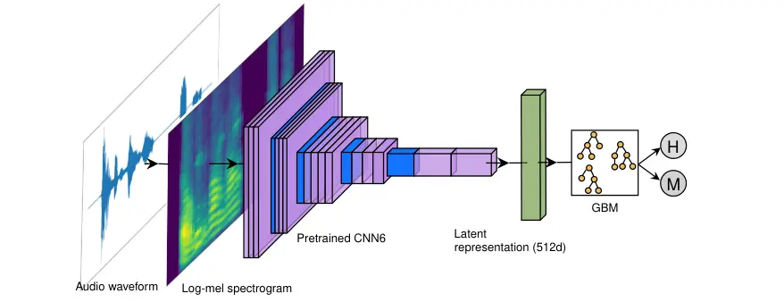

# Multilingual Voicemail and Answering Machine Detection via Pretrained Audio Embeddings and Gradient Boosting Machines

Kemal Altwlkany    Muamer Paric ^(†)^(†)thanks: This is a preprint
version. The peer-reviewed article is available at:^(†)^(†)thanks:
[https://doi.org/10.1007/978-3-032-37870-5_32](https://doi.org/10.1007/978-3-032-37870-5_32)

###### Abstract

Answering machine detection (AMD) is a fundamental task in telephony
that classifies whether an answered call is picked up by a human or a
voicemail (machine). Despite its widespread use across cloud
communication platforms, existing approaches rely on proprietary systems
with undisclosed architectures, or require computationally expensive
models that cannot operate in real time. We propose a lightweight AMD
system that combines pretrained audio embeddings with gradient boosting
machines, trained to prioritize the correct detection of human-answered
calls. We evaluate seven models across two datasets: three models that
we propose, a proprietary industry model, two prior academic approaches,
and a large language model baseline that relies on automatic speech
recognition. Furthermore, we release OpenAMD¹¹ 1 Available at:
[https://doi.org/10.5281/zenodo.21234058](https://doi.org/10.5281/zenodo.21234058),
the first publicly available AMD dataset comprising of more than 500
recordings in 7 languages. Our best model achieves the highest precision
across both datasets while maintaining low inference latency. We assess
the robustness of models to additive noise and packet loss, and perform
tests of statistical significance to discover per-language and
per-gender model performance. Finally, we evaluate our model on an
out-of-domain task of detecting robocalls, where it achieves 94.34%
recall without any additional training, which is comparable to the
industry standard.

###### Index Terms: 

voicemail, answering machine, audio classification, audio embeddings,
gradient boosting machine

^(†)^(†)address: ¹Infobip  
²Faculty of Science, University of Sarajevo

## 1 Introduction

Answering machine detection (AMD) is a common task in telephony with the
goal of classifying the first few seconds of an answered telephone call
to determine who had answered the call: a human or an answering machine.
The problem originates because it is not possible to distinguish
answering machines from humans in telephony from signaling protocols,
i.e. two common signaling protocols: Session Initiation Protocol (SIP)
\[35\] and Signaling System No.7 (SS7) \[17\] do not carry information
about who answered the call.

The term answering machine is a broad term encapsulating any form of
automated telephone answer and includes interactive voice responses
(IVRs) and voicemails, regardless of whether they are artificially
synthesized or human-recorded voicemails. The problem is framed from the
caller’s perspective, i.e. the caller wants to know whether the callee
is a human, or an answering machine. AMD usually operates on a few
seconds of the call after which the caller is provided with information
about who answered the call. Based on the result, the caller can
determine the further progression of the call.

### 1.1 Challenges

The task is challenging due to several reasons. First, detection must be
performed within a limited time, as phone calls are terminated in real
time. If detection is not performed soon enough, there is a risk that
the callee will hang up. Second, the bandwidth of telephony audio is
limited; the international standard codec for telephony is G.711 \[18\],
specifically its PCMA and PCMU variants. These codecs operate at
$`8\text{\,}\mathrm{kHz}`$ sampling rate and introduce non-linear
quantization effects: 16-bit audio is compressed into 8-bit audio at a
logarithmic scale. Furthermore, audio encoded with G.711 is bandlimited
between $`300\text{\,}\mathrm{Hz}`$ and $`3400\text{\,}\mathrm{Hz}`$,
meaning a portion of the spectral content of speech is filtered out.
Third, the acoustic characteristics of voicemails vary depending on the
callee’s country, telecom operator, and language. Some voicemails are
artificially synthesized messages, while some are prerecorded messages
by real humans. Finally, it is often not possible to know the speaking
language of the callee based on just their phone number, meaning that
solutions that rely on transcribing the call must be multilingual.

### 1.2 Practical Importance

Despite its limited presence in academic literature, AMD is a core
component in telephony and in modern communication platforms, having
found its application across multiple tasks. We identify four principal
use cases that motivate the development of an accurate AMD model.

#### 1.2.1 Privacy protection in anonymized calls

Many communication platforms offer user anonymization such as number
masking \[36, 38, 42\]. This is a common feature in driver, delivery,
and marketplace applications. However, if a user does not answer a
masked call it can reach their voicemail system and some voicemail
systems might reveal the true identity to the caller, e.g.: “You’ve
reached 061 23…”. AMD enables platforms to detect voicemails that would
reveal the true identity of the user, thereby preserving their privacy.

#### 1.2.2 Countermeasures for robocall fraud

Robocalling is the practice of making large volumes of automated calls,
often for fraudulent purposes. It is a well-documented problem in
telecommunications security, with fraudsters stealing millions of
dollars per year \[30, 31\]. Prior research has shown that robocallers
use AMD to determine when humans picked up calls in order to maximize
the effectiveness of their attacks \[40\]. A deeper understanding of AMD
can help the security community in three ways: (i) analyzing the
detection techniques employed by robocallers, (ii) developing
adversarial countermeasures that can deceive attacker AMD systems and
thereby reduce the effectiveness of robocall attacks, and (iii) adapting
AMD models for the downstream task of robocall detection itself, an
approach taken in this paper as well.

#### 1.2.3 Public notification systems

Government agencies, educational institutions, and emergency services
rely on voice calls to deliver information. If the callee does not pick
up, they can use AMD to leave messages in the callee’s voicemail box
such as document submission, school closers, vaccination reminders,
emergency alerts, etc.

#### 1.2.4 Commercial campaign and call center optimization

Voice campaigns are widely used in telemarketing, appointment reminders,
and customer engagement. When a human answers the call, they can be
provided with the information, but if a machine answers the call, the
caller can optimize costs by not interacting with the machine, or a
message can be left automatically. Cost savings can be substantial, as
it is estimated that about 40-60% of calls are answered by voicemail and
in the US \[3\], with an estimated 2.5-4% of the working population
employed in call centers \[7, 4\].

### 1.3 Paper Contributions

1.  1.  We propose a lightweight AMD model based on pretrained audio
        embeddings and gradient boosting machines that prioritizes human
        detection rate. The model was derived through hyperparameter
        optimization and a model-capacity ablation where the gradient
        boosting component was replaced with logistic regression while
        keeping the remainder of the process fixed.
2.  2.  To the best of our knowledge, we release the first AMD dataset that
        is publicly available. This dataset contains 233 human recordings
        and 300 machine recordings in 7 languages. We refer to this dataset
        as the OpenAMD dataset and describe it in more detail later.
3.  3.  We compare our approach against 2 competitor models, 1
        state-of-the-art proprietary model, and 1 baseline model that uses
        automatic speech recognition and a large language model to perform
        AMD. These comparisons are followed by a detailed study of the
        robustness and biases of AMD models, with respect to their
        performance across different languages and genders, as well as their
        robustness to noise and networking issues that can occur in
        practice. Finally, the performance of our model is evaluated on an
        out-of-domain task of detecting robocalls.

## 2 Related Work

Figure 1: High-level overview of our proposed method. We compute the
log-mel spectrogram from the input audio waveform and extract
512-dimensional clip-wise embeddings using PANNs CNN6 \[20\]. We train a
GBM model on the binary classification task of AMD by using the CNN6
embeddings as inputs.

Many telecommunication and cloud communication platforms provide AMD,
such as Telnyx \[37\], Twilio \[41\], Amazon AWS \[3\], Infobip \[16\],
ElevenLabs \[9\], and others. The exact implementations are unknown,
with the claimed accuracies, multilingual support, inference latency,
and features varying depending on the provider.

Prior to the widespread adoption of machine learning, early AMD systems
used hand-crafted features and heuristics. A prominent example is
Asterisk \[43, 23\], an open-source private branch exchange (PBX).
Asterisk’s AMD \[26\] uses energy-based measures to detect speech and
applies a temporal heuristic: short responses are labeled as human, long
greetings as voicemail. This approach is simple and computationally
efficient but lags behind modern models. It fails when humans use long
greetings or voicemail greetings are short, and its speech detector
cannot distinguish background noise from silence - any sufficiently
energetic signal is treated as speech.

The approach of Gomez et al. \[14\] uses automatic speech recognition
(ASR) and relies on three features: (i) the time required to answer the
phone, (ii) the percentage of silence in the first three seconds of the
call, and (iii) the recognized sequence of words using the ASR module.
These features are combined into an empirically derived function that
estimates the probability that a call is answered by a human. Although
this resulted in improved performance, the reliance on language-specific
keywords limits generalization to multilingual settings. The system was
evaluated on a small dataset of 100 phone calls with only 21 machines.

Anisimov et al. \[4\] proposed the first deep learning based approach to
AMD. They train a convolutional neural network (CNN) to classify calls
as human or machine. The input to the CNN are mel-frequency cepstral
coefficients (MFCCs) \[1, 24\] extracted from the first 2.5 seconds of
the call. The authors reported an accuracy of 94% on a dataset of 850
samples per both classes.

In \[2\], the authors addressed several of the previously reported
limitations by proposing a recurrent neural network (RNN) architecture.
Their approach extracted embeddings from YAMNet \[15\], an audio tagging
model based on the MobileNet architecture \[34\], and fed those
embeddings into a gated recurrent unit (GRU) network. The system
achieved 96.7% balanced accuracy on a dataset of approximately 4,200
calls.

Finally, \[8\] is a large AMD model that was trained by fine-tuning
Meta’s XLS-R \[5\], a self-supervised cross-lingual speech model that is
based on wav2vec 2.0 \[6\]. The model contains 300 million parameters
and was pretrained on more than $`436\,000`$ hours of speech. The AMD
version was fine-tuned on English only and achieves 98% accuracy.

### 2.1 Pretrained Audio Representations

The use of pretrained audio representations for downstream tasks has
become a popular paradigm in audio and specifically speech-based machine
learning applications \[6, 10\]. Models are trained on large quantities
of unlabeled data and fine-tuned on small sets of labeled data.

In \[20\], Kong et al. train a variety of neural networks on the task of
audio tagging and achieve state-of-the-art results on several downstream
audio pattern recognition tasks such as acoustic scene classification,
music classification, sound event detection, etc. The authors proposed
various neural architectures that rely on: conventional CNNs
(architectures such as AlexNet and VGG-like), ResNets, MobileNets,
one-dimensional CNNs such as DaiNet and LeeNet, and a newly proposed
Wavegram-Logmel-CNN architecture. The authors jointly refer to these
various networks as pretrained audio neural networks (PANNs). The CNN14
model from PANNs was used as the encoder in CLAP, a contrastive
language-audio pretraining approach \[10\]. Another PANNs model, CNN6,
which is based on AlexNet \[21\] achieves a mean average precision (mAP)
of 0.343 on AudioSet \[13\], compared to their best performing
Wavegram-Logmel-CNN model which achieves 0.439 mAP, but has 81 million
parameters compared to the CNN6’s 4.8 million.

## 3 Method

We formulate AMD as a binary classification task. Given a raw audio
signal of length $`T`$ sampled at $`f_{s}`$, the goal is to predict a
label $`y\in\{\textsc{human},\textsc{machine}\}`$, with humans being the
negative and machines the positive class. In practice, $`T`$ is bounded
by a configurable detection window, typically between 1 and 5 seconds
for most AMD applications \[37, 41, 16, 3, 9\], and $`f_{s}`$ is
$`8\text{\,}\mathrm{kHz}`$ for narrowband telephony \[18\].

Our approach decomposes the task into two stages: (i) a fixed feature
extractor that maps the raw audio waveform into a compact embedding
vector, and (ii) a lightweight classifier that operates on this
embedding. This decoupled design allows the classifier to be replaced or
updated independently of the feature extractor, and avoids the
computational cost of end-to-end fine-tuning. A high level overview of
our proposed method is provided by Figure 1.

### 3.1 CNN6 Audio Embeddings

For the feature extraction stage, we use CNN6 from the PANNs \[20\]
collection of pretrained audio models. The CNN6 model takes as input a
64-channel log-mel spectrogram; its architecture consists of four
convolutional blocks with $`5\times 5`$ kernels, batch normalization,
ReLU activations, and average pooling, followed by two fully connected
layers, totaling 4.8 million parameters. We only use the first fully
connected layer of CNN6 that produces a 512-dimensional latent
representation (embedding) of the audio input. CNN6 acts as a frozen
feature extractor: given an input audio segment $`\mathbf{x}`$, we
compute the embedding
$`\mathbf{e}=f_{\text{CNN6}}(\mathbf{x})\in\mathbb{R}^{512}`$ without
updating any network parameters.

### 3.2 LightGBM Classifier

We train a LightGBM \[19\] classifier on the 512-dimensional CNN6
embeddings. LightGBM is a gradient boosting framework \[12, 27\] that
constructs an ensemble of decision trees using histogram-based
algorithms \[22\] for efficient split finding. Compared to neural
classifiers operating on the same embedding space, gradient boosting
offers two advantages for the AMD use case: (i) the models produced by
LightGBM are extremely lightweight, enabling real-time inference on
CPU-only environments, (ii) tree-based ensembles are inherently
regularized through mechanisms such as max depth, minimum leaf samples,
and feature subsampling, thereby reducing the risk of overfitting on
small datasets.

### 3.3 Training data

We train our GBM model on a proprietary dataset of about $`3500`$
manually labeled recordings, of which $`800`$ are human and $`2700`$
machines. The audio recordings are real, industry examples of AMD and
are already transcoded via G.711 \[18\], with the presence of background
and static noise. Although most of the recordings are in English, the
dataset does contain recordings in other languages.

To the best of our knowledge, we were unable to find any publicly
available datasets for AMD. This comes to no surprise given the high
sensitivity of the topic from a user privacy perspective, making it
difficult to record and publish data. The lack of publicly available AMD
datasets makes it difficult to reproduce and verify the models.

#### 3.3.1 OpenAMD Dataset

We introduce the OpenAMD dataset, a multilingual AMD dataset that
contains realistic recordings of answered phone calls, both by humans
and by machines, comprising 533 recordings in total.

The human samples in the dataset were obtained by recording phone calls
from users that participated in the study, as we found the recordings to
be more natural when participants would answer the phone instead of
speak into a recording device in a studio environment. In total we have
8 different speakers in 6 languages.

We used Azure Cognitive Services Neural TTS \[25\] to synthesize machine
samples in 7 languages (English, Chinese (Mandarin), Arabic, German,
etc.), containing a total of 44 different voices, balanced in terms of
gender.

Since the voicemails are neurally synthesized, we simulate realistic
telephony conditions by introducing augmentations such as adding ringing
tones, silent gaps and pauses, and simulating pick-up clicks of calls
being connected. Furthermore, we downsample all audio to
$`8\text{\,}\mathrm{kHz}`$ and transcode it using G.711 \[18\], randomly
altering between PCMA and PCMU. This process introduces the non-linear
quantization artifacts, bandwidth limitation, and dynamic range
compression characteristic of telephony-grade audio, making the
synthetic samples more acoustically similar to real recordings in the
training set.

We make the OpenAMD dataset publicly available and accompany the audio
recordings with useful metadata: speaker ID (or neural voice for
machines), speaker gender, recording text (for both humans and
machines), and recording language.

| Model                     | Accuracy                   | Precision                  | Recall                     | Specificity                | F1                         |
| ------------------------- | -------------------------- | -------------------------- | -------------------------- | -------------------------- | -------------------------- |
| RNN-YAMNet \[2\]          | $`83.35\pm 2.25`$          | $`87.72\pm 3.04`$          | $`74.40\pm 4.04`$          | $`91.04\pm 2.43`$          | $`80.49\pm 2.56`$          |
| AMD-Infobip \[16\]        | $`88.09\pm 1.86`$          | $`92.09\pm 2.59`$          | $`81.20\pm 3.55`$          | $`94.01\pm 1.96`$          | $`86.29\pm 2.44`$          |
| CNN6-LogReg (our)         | $`85.61\pm 2.38`$          | $`91.55\pm 2.65`$          | $`75.87\pm 4.43`$          | $`93.99\pm 1.89`$          | $`82.96\pm 2.73`$          |
| CNN6-GBM-balanced (our)   | $`85.91\pm 2.46`$          | $`92.33\pm 2.95`$          | $`75.83\pm 3.83`$          | $`94.59\pm 2.27`$          | $`83.25\pm 3.03`$          |
| CNN6-GBM (our)            | $`85.20\pm 2.10`$          | $`\mathbf{94.70}\pm 2.37`$ | $`72.02\pm 4.08`$          | $`\mathbf{96.54}\pm 1.49`$ | $`81.80\pm 2.81`$          |
| wav2vec-vm-fine \[8\]     | $`84.72\pm 2.21`$          | $`87.77\pm 2.99`$          | $`77.79\pm 3.87`$          | $`90.68\pm 2.13`$          | $`82.46\pm 2.83`$          |
| whisper-GPT5.4 (baseline) | $`\mathbf{91.09}\pm 1.59`$ | $`86.58\pm 3.40`$          | $`\mathbf{95.53}\pm 1.86`$ | $`87.28\pm 2.77`$          | $`\mathbf{90.83}\pm 1.80`$ |

Table 1: Performance of AMD models on proprietary dataset.

Figure 2: Critical difference diagram showing the average ranks of the
models across accuracy.

### 3.4 Experimental setup

All results that we present are aggregates over 5 repeated experiment
runs and are computed at a 95% confidence interval using the bootstrap
approach \[39\]. Experiments were performed on an NVIDIA DGX B200
platform.

#### 3.4.1 Baseline models

We establish a high-quality baseline AMD model that transcribes calls
using ASR and uses an LLM to classify them based on the transcript as
human or machine. The transcription model needs to be a large
multilingual model, and the LLM needs to be sufficiently powerful to
understand the task at hand. We opted for Whisper \[33\] (large-v3-turbo
model) and for ChatGPT5.4. Whisper has close to 800 million parameters,
while the exact number of parameters of ChatGPT-5.4 is undisclosed, but
widely estimated to surpass 2 trillion parameters. This approach does
therefore not scale well and would not be of practical use, as AMD must
be a resource efficient model that can run in real time on a CPU.
However, it can be beneficial to use this approach as a baseline given
its large predictive capability.

Regarding existing approaches, we compare to RNN-YAMNet \[2\] and
wav2vec-vm-finetune \[8\], and a proprietary state-of-the-art model
AMD-Infobip \[16\].

#### 3.4.2 GBM models

We hypothesize that, given the AMD use cases described in the
introductory section, it is of paramount importance for the model to
classify humans correctly. In particular, the model should prioritize
precision and specificity, since falsely classifying humans as machines
may lead to worse outcomes than falsely classifying machines as humans.
Therefore, we provide three model versions:

- •
  CNN6-GBM, our primary model, prioritizes precision and specificity,
  thus minimizing the chance of wrongly classifying humans
- •
  CNN6-GBM-balanced, our balanced model that provides a good trade-off
  between recall and specificity
- •
  CNN6-LogReg, a model trained using logistic regression instead of GBM,
  with the goal of investigating the contribution of the non-linear
  gradient boosting component and whether CNN6 produces linearly
  separable embeddings

## 4 Results

### 4.1 Proprietary dataset

Table 1 provides the benchmarks of all 7 models on a proprietary dataset
(different from the training set). The whisper-GPT-5.4 baseline provides
the best balanced performance such as accuracy and F1-score, but the
CNN6-GBM model has the best specificity and precision.

We compared the accuracy of the 7 classifiers using the Friedman test
which showed a statistically significant difference among classifiers
($`\chi^{2}(6)=448.78,\,\,p\ll 1e\text{-}10`$), with Kendall’s
$`W=.748`$, indicating a large degree of consistency in classifier
rankings. Post-hoc Nemenyi tests with Holm-Bonferroni correction were
used to compare average ranks across classifiers and showed that models
CNN6-GBM, CNN6-GBM-balanced, CNN6-LogReg, and wav2vec-vm-finetune do not
differ significantly in terms of accuracy, whereas whisper-GPT-5.4 and
AMD-Infobip are significantly better than other models, while RNN-YAMNet
is the worst ranked model. This is illustrated by the critical
difference diagram in Figure 2.

We repeated the procedure but analyzed specificity among the 7
classifiers and obtained:
($`\chi^{2}(6)=523.04,\,\,p\ll 1e\text{-}10`$), with Kendall’s
$`W=.872`$, indicating an even larger degree of consistency in
classifier rankings among specificity compared to accuracy. Post-hoc
Nemenyi tests with Holm-Bonferroni correction showed that our CNN6-GBM
differs significantly from other models, while there is no statistically
significant difference between the performance of AMD-Infobip and
CNN6-LogReg, and between RNN-YAMNet and wav2vec-vm-finetune. This is
illustrated in Figure 3.

Figure 3: Critical difference diagram showing the average ranks of the
models across specificity.

| Model                      | Accuracy           | Precision          | Recall             | Specificity        | F1                 |
| -------------------------- | ------------------ | ------------------ | ------------------ | ------------------ | ------------------ |
| RNN-YAMNet \[2\]           | 94.56 $`\pm`$ 2.06 | 91.69 $`\pm`$ 3.38 | 99.33 $`\pm`$ 1.06 | 88.41 $`\pm`$ 4.36 | 95.36 $`\pm`$ 1.88 |
| AMD-Infobip \[16\]         | 91.74 $`\pm`$ 2.44 | 88.55 $`\pm`$ 3.64 | 98.00 $`\pm`$ 1.82 | 83.69 $`\pm`$ 4.98 | 93.04 $`\pm`$ 2.19 |
| CNN6-LogReg (our)          | 88.74 $`\pm`$ 2.81 | 87.97 $`\pm`$ 3.73 | 92.67 $`\pm`$ 3.14 | 83.69 $`\pm`$ 4.72 | 90.26 $`\pm`$ 2.70 |
| CNN6-GBM-balanced (our)    | 91.93 $`\pm`$ 2.44 | 92.41 $`\pm`$ 3.12 | 93.33 $`\pm`$ 2.94 | 90.13 $`\pm`$ 4.04 | 92.87 $`\pm`$ 2.26 |
| CNN6-GBM (our)             | 92.50 $`\pm`$ 2.44 | 95.14 $`\pm`$ 2.64 | 91.33 $`\pm`$ 3.51 | 93.99 $`\pm`$ 3.12 | 93.20 $`\pm`$ 2.38 |
| wav2vec-vm-finetune \[8\]  | 84.43 $`\pm`$ 3.00 | 95.02 $`\pm`$ 2.97 | 76.33 $`\pm`$ 4.72 | 94.85 $`\pm`$ 2.99 | 84.66 $`\pm`$ 3.23 |
| whisper-GPT-5.4 (baseline) | 91.56 $`\pm`$ 2.44 | 87.61 $`\pm`$ 3.52 | 99.00 $`\pm`$ 1.30 | 81.97 $`\pm`$ 5.05 | 92.96 $`\pm`$ 2.08 |

Table 2: Performance of AMD models on OpenAMD dataset.

Figure 4: Accuracy of AMD models in noisy and poor network quality
conditions. Left: audio is distorted by noise (x-axis indicates SNR).
Right: audio is corrupted by packet loss. Shaded areas and black bars
indicate the 95% CI.

### 4.2 OpenAMD dataset

We now benchmark the models on the OpenAMD dataset and provide the
results in Table 2. The ranks of the models differ compared to the
proprietary dataset, with the exception of CNN6-GBM being the best
performing model in terms of precision on both datasets. On the OpenAMD
dataset, RNN-YAMNet obtains the best accuracy, recall, and F1 scores,
with wav2vec-vm-finetune now achieving the best specificity.

#### 4.2.1 Robustness to noise and coding artifacts

In Figure 4 we show the performance of the models during non-ideal
conditions: when the audio has been corrupted with noise or when packet
loss is present in the network (simulated using the Gilbert-Elliot model
\[29\]). The results indicate that the whisper-GPT-5.4 model is most
robust to noise distortions, whereas the GBM-based models are the worst
performing models for noisy audio. The GBM-based models maintain good
performance in poor network quality conditions, with RNN-YAMNet and
AMD-Infobip being the most robust models for packet loss.

#### 4.2.2 Per-language performance

We analyzed whether the performance of the models depends on the
language of the callee/voicemail. A chi-squared test of independence was
performed on each model’s accuracy across different languages, with
Holm-Bonferroni correction for multiple comparisons. Six of the models
showed no statistically significant language dependence, i.e. the
accuracies of the models are independent of the language. For
wav2vec-vm-finetune we obtained ($`\chi^{2}(4)=20.28,\,\,p=0.003`$) with
Cramer’s $`V=0.218`$ indicating a statistically significant but small
association, i.e. the model’s performance depends on the language, but
not strongly. We hypothesize that this might be due to the model being
fine-tuned on English recordings only, thereby degrading the previously
learned knowledge of the XLS-R model \[5\].

#### 4.2.3 Per-gender performance

We ran a separate Fisher’s exact test for machine recall and for human
specificity to see if male vs. female recordings of humans/machines get
correctly detected at the same rate. The recall and specificity per each
model are provided by Figure 5. For machine recall, only
wav2vec-vm-fintune exhibited a significant gender disparity (odds ratio
$`OR=.068,\,\,p<.001`$) indicating that male voicemails are
$`\approx 15`$ times as likely to be misclassified as human. For human
specificity, no statistically significant results were obtained,
although RNN-YAMnet provides a relatively large gap between the
performance in male vs. female specificity.

Figure 5: Machine recall and human specificity, per gender and per
model. Black bars indicate the 95% CI.

### 4.3 Inference latency

In Table 3 we show the inference latency of the CNN6-based models and
wav2vec-vm-finetune. Note that we did not have access to the inference
latency information of the RNN-YAMNet, AMD-Infobip, and whisper-GPT-5.4
models, but it is clear that the latter cannot operate in real-time
given its reliance on Whisper \[33\] and ChatGPT-5.4. The average
latency of CNN6-based models is two orders of magnitude less than that
of the wav2vec-vm-finetune model, with the balanced GBM model having a
more variable inference latency compared to other CNN6-based models.

| Model               | Mean   | Median | Std    |
| ------------------- | ------ | ------ | ------ |
| CNN6-GBM            | 1.23   | 1.21   | 0.092  |
| CNN6-GBM-balanced   | 1.36   | 1.33   | 0.358  |
| CNN6-LogReg         | 1.19   | 1.18   | 0.062  |
| wav2vec-vm-finetune | 131.99 | 132.85 | 14.179 |

Table 3: Inference latency of AMD models (in milliseconds).

### 4.4 Ablation study

We performed a grid search on the parameters of CNN6-GBM, summarized in
Table 4. From the results it appears that our model has found “sweet
spots”; optimal parameter configurations are located “in the middle”,
with no parameter taking extreme values. Increasing the number of
estimators beyond 200 yields no positive gains, nor does increasing the
number of leaves beyond 61. Additionally, we argue that the
non-linearity of gradient boosting results in a small but noticeable
performance improvement as opposed to logistic regression, as can be
inferred by comparing the performances of the CNN6-GBM and CNN6-LogReg
models. CNN6-LogReg performs worse than CNN6-GBM in terms of accuracy,
precision, and F1-score on the OpenAMD dataset, with the difference in
specificity greater than 10% on average. Given that the AMD-LogReg
inference latency is on average $`0.04\text{\,}\mathrm{ms}`$ faster, we
argue that the performance boost provided by GBM is worth the negligible
increase in computational complexity.

| Parameter            | Search space                  | Selected |
| -------------------- | ----------------------------- | -------- |
| Learning rate        | {0.03, 0.1, 0.3}              | 0.1      |
| Number of estimators | {50, 100, 200, 300, 400, 500} | 200      |
| Num leaves           | {17, 31, 41, 51, 61, 127}     | 61       |
| Min child samples    | {5, 10, 20, 30, 50, 100, 200} | 50       |

Table 4: CNN6-GBM hyperparameter search space and selected values.

### 4.5 Transfer to Out-of-Domain Task

We use the CNN6-GBM model as-is and apply it to an out-of-domain task of
detecting robocalls \[40, 30, 31\] without any additional training or
fine-tuning. We use the dataset from the US Federal Trade Commission
(FTC) \[32\] that contains 1432 robocalls (all positive samples) and
manage to detect 1351 robocalls, which is a recall rate of 94.34%, close
to the industry standard of 93-97% \[11, 28\]. We hope that the
performance of CNN6-GBM could be further improved by additional training
so that it could be used to detect fraudulent robocalls.

### 4.6 Discussion

We proposed three CNN6-based models, with significantly lower inference
time than competitor approaches. Our best performing model CNN6-GBM,
tuned to prioritize the rate of human detection provided the best
precision on both datasets and is statistically the best performing
model in terms of specificity on the first dataset. We argue that the
high precision rate is due to our goal of minimizing false positives; we
want to ensure that the model is very confident before it classifies a
call as voicemail, thereby reducing the chances of falsely categorizing
humans as machines. Removing the non-linear gradient boosting component
impacts performance as indicated by the CNN6-LogReg model, while
yielding minimal improvements in inference latency. The hyperparameter
optimization study showed that increasing the number of estimators or
leaves improves the model’s predictive capabilities up to a certain
point, after which no improvement gains were seen. There is room for
improvement regarding noise robustness, as the CNN6-based models perform
worse than competitors in this area, although they maintain decent
performance during poor network conditions. The CNN6-based models showed
no bias in terms of language or gender, implying that the models learned
to generalize well and can be used in multilingual settings, regardless
of the language or gender of the speaker.

## 5 Conclusion

In this paper we showed a new approach to AMD by using pretrained audio
neural networks and combining them with gradient boosting machines. Our
model reaches comparable accuracy to the industry standard and current
state-of-the-art, it is the best performing model in terms of precision
while maintaining high specificity, thereby maximizing the correct
detection rate of humans. We created OpenAMD, a multilingual and diverse
dataset and make it publicly available. Our analysis shows that our
models generalize well and are not biased to any language or gender. The
robustness to packet loss is good, although there is room for
improvement regarding robustness to additive noise. Finally, our model
showed to perform well on the out-of-domain task of robocall detection
without any additional training or fine-tuning.

## References

- \[1\] Z. K. Abdul and A. K. Al-Talabani (2022) Mel frequency cepstral
  coefficient and its applications: a review. Ieee Access 10,
  pp. 122136–122158. Cited by: §2.
- \[2\] K. Altwlkany, S. Delalić, E. Selmanović, A. Alihodžić, and I.
  Lovrić (2024) A recurrent neural network approach to the answering
  machine detection problem. In 2024 47th MIPRO ICT and Electronics
  Convention (MIPRO), pp. 85–90. Cited by: §2, §3.4.1, Table 1, Table 2.
- \[3\] Amazon AWS (2026) Best practices for answering machine
  detection. Note:
  [https://docs.aws.amazon.com/connect/latest/adminguide/outbound-campaign-best-practices.html](https://docs.aws.amazon.com/connect/latest/adminguide/outbound-campaign-best-practices.html)\[Online\]
  Accessed: 2026-05-11 Cited by: §1.2.4, §2, §3.
- \[4\] N. Anisimov, M. Olkhovsky, and K. Kishinsky (2023) Answering
  machines detection in contact centers using convolutional neural
  networks. FizTech-USA. Cited by: §1.2.4, §2.
- \[5\] A. Babu, C. Wang, A. Tjandra, K. Lakhotia, Q. Xu, N. Goyal, K.
  Singh, P. von Platen, Y. Saraf, J. Pino, A. Baevski, A. Conneau,
  and M. Auli (2022) XLS-R: Self-supervised Cross-lingual Speech
  Representation Learning at Scale. In Interspeech 2022, pp. 2278–2282.
  External Links:
  [Document](https://dx.doi.org/10.21437/Interspeech.2022-143), ISSN
  2958-1796 Cited by: §2, §4.2.2.
- \[6\] A. Baevski, Y. Zhou, A. Mohamed, and M. Auli (2020) Wav2vec 2.0:
  a framework for self-supervised learning of speech representations.
  Advances in neural information processing systems 33, pp. 12449–12460.
  Cited by: §2.1, §2.
- \[7\] Communications Workers of America Federal Call Center Factsheet.
  Note:
  [https://cwa-union.org/sites/default/files/federal_call_center_factsheet\_.pdf](https://cwa-union.org/sites/default/files/federal_call_center_factsheet_.pdf)\[Online\]
  Accessed: 2026-05-11 Cited by: §1.2.4.
- \[8\] J. Downie (2025) wav2vec-vm-finetune. Note:
  [https://huggingface.co/jakeBland/wav2vec-vm-finetune](https://huggingface.co/jakeBland/wav2vec-vm-finetune)\[Online\]
  Accessed: 2026-05-11 Cited by: §2, §3.4.1, Table 1, Table 2.
- \[9\] ElevenLabs (2026) Voicemail detection. Note:
  [https://elevenlabs.io/docs/eleven-agents/customization/tools/system-tools/voicemail-detection](https://elevenlabs.io/docs/eleven-agents/customization/tools/system-tools/voicemail-detection)\[Online\]
  Accessed: 2026-05-11 Cited by: §2, §3.
- \[10\] B. Elizalde, S. Deshmukh, M. Al Ismail, and H. Wang (2023) Clap
  learning audio concepts from natural language supervision. In ICASSP
  2023-2023 IEEE International Conference on Acoustics, Speech and
  Signal Processing (ICASSP), pp. 1–5. Cited by: §2.1, §2.1.
- \[11\] B. Elizalde and D. Emmanouilidou (2022) Detection of robocall
  and spam calls using acoustic features of incoming voicemails.
  Proceedings of Meetings on Acoustics 45 (1), pp. 060004. External
  Links: ISSN 1939-800X,
  [Document](https://dx.doi.org/10.1121/2.0001533) Cited by: §4.5.
- \[12\] J. H. Friedman (2001) Greedy function approximation: a gradient
  boosting machine. Annals of statistics, pp. 1189–1232. Cited by: §3.2.
- \[13\] J. F. Gemmeke, D. P. Ellis, D. Freedman, A. Jansen, W.
  Lawrence, R. C. Moore, M. Plakal, and M. Ritter (2017) Audio set: an
  ontology and human-labeled dataset for audio events. In 2017 IEEE
  international conference on acoustics, speech and signal processing
  (ICASSP), pp. 776–780. Cited by: §2.1.
- \[14\] J. A. Gómez, L. M. Montes-Novella, and J. Garcıa (2014)
  Answering machine detector for call centers. In Proc. iberSPEECH 2014,
  pp. 198–207. Cited by: §2.
- \[15\] Google (2020) YAMNet: A deep net for audio classification.
  Note:
  [https://github.com/tensorflow/models/tree/master/research/audioset/yamnet](https://github.com/tensorflow/models/tree/master/research/audioset/yamnet)\[Online\]
  Accessed: 2026-05-11 Cited by: §2.
- \[16\] Infobip (2026) Automated machine detection. Note:
  [https://www.infobip.com/docs/voice-and-video/calls#automated-machine-detection-understanding-calls-api](https://www.infobip.com/docs/voice-and-video/calls#automated-machine-detection-understanding-calls-api)\[Online\]
  Accessed: 2026-05-11 Cited by: §2, §3.4.1, Table 1, §3, Table 2.
- \[17\] International Telecommunication Union (1988) Introduction to
  CCITT Signalling System No. 7. ITU-T Recommendation Technical Report
  Q.700, International Telecommunication Union, Geneva, Switzerland.
  External Links: [Link](https://www.itu.int/rec/T-REC-Q.700) Cited by:
  §1.
- \[18\] International Telecommunication Union (1988) Pulse code
  modulation (PCM) of voice frequencies. ITU-T Recommendation Technical
  Report G.711, International Telecommunication Union, Geneva,
  Switzerland. External Links:
  [Link](https://www.itu.int/rec/T-REC-G.711-198811-I/en) Cited by:
  §1.1, §3.3.1, §3.3, §3.
- \[19\] G. Ke, Q. Meng, T. Finley, T. Wang, W. Chen, W. Ma, Q. Ye,
  and T. Liu (2017) LightGBM: a highly efficient gradient boosting
  decision tree. In Advances in Neural Information Processing Systems
  (NeurIPS), Vol. 30, pp. 3146–3154. Cited by: §3.2.
- \[20\] Q. Kong, Y. Cao, T. Iqbal, Y. Wang, W. Wang, and M. D.
  Plumbley (2020) Panns: large-scale pretrained audio neural networks
  for audio pattern recognition. IEEE/ACM Transactions on Audio, Speech,
  and Language Processing 28, pp. 2880–2894. Cited by: Figure 1, §2.1,
  §3.1.
- \[21\] A. Krizhevsky, I. Sutskever, and G. E. Hinton (2012) Imagenet
  classification with deep convolutional neural networks. Advances in
  neural information processing systems 25. Cited by: §2.1.
- \[22\] P. Li, Q. Wu, and C. Burges (2007) Mcrank: learning to rank
  using multiple classification and gradient boosting. Advances in
  neural information processing systems 20. Cited by: §3.2.
- \[23\] L. Madsen, J. Van Meggelen, and R. Bryant (2011) Asterisk: the
  definitive guide. " O’Reilly Media, Inc.". Cited by: §2.
- \[24\] A. Mehrish, N. Majumder, R. Bharadwaj, R. Mihalcea, and S.
  Poria (2023) A review of deep learning techniques for speech
  processing. Information Fusion 99, pp. 101869. Cited by: §2.
- \[25\] Microsoft (2026) Azure Speech Studio. Note:
  [https://speech.microsoft.com/](https://speech.microsoft.com/)\[Online\]
  Accessed: 2026-05-11 Cited by: §3.3.1.
- \[26\] E. Minaj (2020) Optimization of answering machine detection
  application in asterisk. Master’s Thesis, Lappeenranta-Lahti
  University of Technology (LUT University), Lappeenranta, Finland.
  External Links: [Link](https://lutpub.lut.fi/handle/10024/161698)
  Cited by: §2.
- \[27\] A. Natekin and A. Knoll (2013) Gradient boosting machines, a
  tutorial. Frontiers in neurorobotics 7, pp. 63623. Cited by: §3.2.
- \[28\] S. Pandit, K. Sarker, R. Perdisci, M. Ahamad, and D.
  Yang (2023) Combating robocalls with phone virtual assistant mediated
  interaction. In 32nd USENIX Security Symposium (USENIX Security 23),
  pp. 463–479. Cited by: §4.5.
- \[29\] J. Pieper (2023) Relationships between gilbert-elliot burst
  error model parameters and error statistics. Technical report
  Institute for Telecommunication Sciences. Cited by: §4.2.1.
- \[30\] S. Prasad, E. Bouma-Sims, A. K. Mylappan, and B. Reaves (2020)
  Who’s calling? characterizing robocalls through audio and metadata
  analysis. In 29th USENIX Security Symposium (USENIX Security 20),
  pp. 397–414. Cited by: §1.2.2, §4.5.
- \[31\] S. Prasad, A. Nahapetyan, and B. Reaves (2025) Characterizing
  robocalls with multiple vantage points. In 2025 IEEE Symposium on
  Security and Privacy (SP), pp. 19–36. Cited by: §1.2.2, §4.5.
- \[32\] S. Prasad and B. Reaves (2023) Robocall audio from the ftc’s
  project point of no entry. North Carolina State University, Tech. Rep.
  TR-2023-1. Cited by: §4.5.
- \[33\] A. Radford, J. W. Kim, T. Xu, G. Brockman, C. McLeavey, and I.
  Sutskever (2023) Robust speech recognition via large-scale weak
  supervision. In International conference on machine learning,
  pp. 28492–28518. Cited by: §3.4.1, §4.3.
- \[34\] M. Sandler, A. Howard, M. Zhu, A. Zhmoginov, and L. Chen (2018)
  Mobilenetv2: inverted residuals and linear bottlenecks. In Proceedings
  of the IEEE conference on computer vision and pattern recognition,
  pp. 4510–4520. Cited by: §2.
- \[35\] E. Schooler, J. Rosenberg, H. Schulzrinne, A. Johnston, G.
  Camarillo, J. Peterson, R. Sparks, and M. J. Handley (2002) SIP:
  Session Initiation Protocol. Request for Comments, RFC Editor. Note:
  RFC 3261 External Links:
  [Document](https://dx.doi.org/10.17487/RFC3261),
  [Link](https://www.rfc-editor.org/info/rfc3261) Cited by: §1.
- \[36\] Sinch (2026) Protect privacy with number masking. Note:
  [https://sinch.com/voice/programmable-voice/number-masking/](https://sinch.com/voice/programmable-voice/number-masking/)\[Online\]
  Accessed: 2026-05-11 Cited by: §1.2.1.
- \[37\] Telnyx (2026) Answering Machine Detection. Note:
  [https://developers.telnyx.com/docs/voice/programmable-voice/answering-machine-detection](https://developers.telnyx.com/docs/voice/programmable-voice/answering-machine-detection)\[Online\]
  Accessed: 2026-05-11 Cited by: §2, §3.
- \[38\] Telnyx (2026) Phone number masking. Note:
  [https://telnyx.com/use-cases/phone-number-masking](https://telnyx.com/use-cases/phone-number-masking)\[Online\]
  Accessed: 2026-05-11 Cited by: §1.2.1.
- \[39\] Trevor Hastie and Robert Tibshirani and Jerome Friedman (2009)
  The Elements of Statistical Learning – Data Mining, Inference, and
  Prediction. Springer, New York. Cited by: §3.4.
- \[40\] H. Tu, A. Doupé, Z. Zhao, and G. Ahn (2016) Sok: everyone hates
  robocalls: a survey of techniques against telephone spam. In 2016 IEEE
  Symposium on Security and Privacy (SP), pp. 320–338. Cited by: §1.2.2,
  §4.5.
- \[41\] Twilio (2026) Answering Machine Detection. Note:
  [https://www.twilio.com/docs/voice/answering-machine-detection](https://www.twilio.com/docs/voice/answering-machine-detection)\[Online\]
  Accessed: 2026-05-11 Cited by: §2, §3.
- \[42\] Twilio (2026) What are Masked Phone Numbers?. Note:
  [https://www.twilio.com/docs/glossary/what-are-masked-phone-numbers](https://www.twilio.com/docs/glossary/what-are-masked-phone-numbers)\[Online\]
  Accessed: 2026-05-11 Cited by: §1.2.1.
- \[43\] J. Van Meggelen, L. Madsen, and J. Smith (2007) Asterisk: the
  future of telephony. " O’Reilly Media, Inc.". Cited by: §2.
