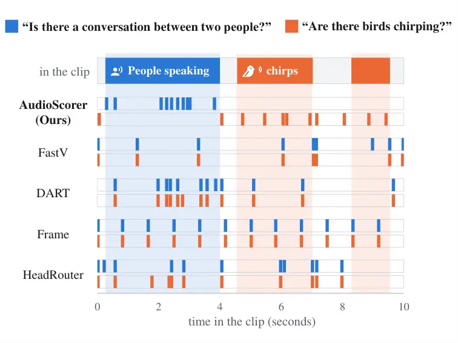

# AudioScorer: Learning Question-Aware Token Relevance for Large Audio Language Models

Marwan Farag Affiliation: Institute of Signal Processing
Affiliation: and System Theory (ISS) Affiliation: University of
Stuttgart Affiliation: Stuttgart, Germany
Email: [marwan.farag@iss.uni-stuttgart.de](mailto:)    Bin Yang
Affiliation: Institute of Signal Processing Affiliation: and System
Theory (ISS) Affiliation: University of Stuttgart
Affiliation: Stuttgart, Germany
Email: [bin.yang@iss.uni-stuttgart.de](mailto:)

###### Abstract

Large Audio Language Models (LALMs) reason over speech, environmental
sounds, music, and other acoustic information. However, their audio
encoders produce dense token sequences that make long-form audio costly
to process. Existing audio pruning methods reduce this cost using
heuristics such as attention, representation similarity, or temporal
sampling, but do not explicitly learn which tokens are most useful for a
given question. We propose AudioScorer, a lightweight model that scores
audio tokens according to the user question. It is trained by distilling
the ranking of audio tokens under the frozen LALM’s answer-gradient
saliency, together with downstream answer supervision. Compared with
other pruning methods, AudioScorer achieves the best or tied-best result
at $`10\%`$ token retention on $`7`$ of $`10`$ semantic and acoustic
tasks, including speech recognition, emotion recognition, and
audio-scene classification.

## 1 Introduction

Multimodal Large Language Models (MLLMs) extend LLM reasoning to
modalities such as vision and audio Alayrac et al. (2022); Li et al.
(2023); Liu et al. (2023); OpenAI (2023). Particularly, Large Audio
Language Models (LALMs) Chu et al. (2023); Tang et al. (2024); Ghosh et
al. (2026); Xu et al. (2025b) encode audio into dense embedding
sequences projected into the LLM input space. Since the number of audio
tokens grows with duration, long recordings substantially increase
decoder cost. For example, Qwen2-Audio Chu et al. (2024) processes about
$`25`$ audio tokens per second, yielding roughly $`750`$ tokens for a
$`30`$-second clip. A given question, however, may depend on only a
fraction of them, motivating task-aware token pruning.



Figure 1: Question-dependent token selection for the same audio.
AudioScorer adapts its selection to the question under a fixed budget.
Audio and token-to-time mapping from Wang et al. (2026).

Figure 2: Overview of AudioScorer. It learns audio-token relevance from
answer-gradient targets and downstream answer supervision. At inference,
the scores drive Top-$`K`$ pruning after early decoder layers.

Existing pruning methods reduce token cost in MLLMs using signals such
as attention Chen et al. (2024); He et al. (2026); Zhang et al. (2025),
redundancy Wen et al. (2025), temporal sampling He et al. (2025), or
learned relevance. Question-aware audio pruning is also established Lin
et al. (2025), while learned relevance prediction has been explored in
vision Takezoe et al. (2026). Existing question-aware pruning methods
largely rely on predefined signals, while learned relevance predictors
are typically question-independent. Learning audio-token utility jointly
from the question and downstream answer quality thus remains
underexplored. This motivates our central question: _Can a scoring
network learn question-conditioned audio-token relevance from signals of
downstream answer utility?_

We introduce AudioScorer, a lightweight question-conditioned scorer
trained by distilling the frozen LALM’s gradient-based ranking of audio
tokens according to how strongly the correct answer depends on them,
together with downstream answer supervision. Figure 1 shows that
AudioScorer’s token selection changes more with the question for the
same audio clip than that of the other pruning methods. At $`10\%`$
token retention on AudioMarathon He et al. (2025), AudioScorer is best
or tied-best on $`7`$ of $`10`$ tasks and leads on Speech Content, Audio
Classification, and Speaker Information. Notably, ASR reaches a
$`31.25\%`$ word accuracy rate (WAR), compared with $`5.15\%`$ for the
strongest baseline. Our codebase will be released upon publication to
support reproducibility.

## 2 Method

### 2.1 Design Hypotheses

Our goal is to retain the audio tokens most useful for answering the
user’s question under a fixed token budget. We build AudioScorer around
two hypotheses. (H1) Token relevance depends on the question: the same
audio token may be useful for one question and irrelevant for another.
(H2) The frozen LALM can serve as a relevance teacher: given the
question and reference answer, gradient-based sensitivity of the answer
likelihood provides a useful signal of audio-token relevance.

### 2.2 AudioScorer Design

Figure 2 illustrates AudioScorer and its integration with the frozen
LALM. Its design follows directly from the two hypotheses above.

#### Question-conditioned scoring (H1).

We encode the question with bge-base-en-v1.5 Xiao et al. (2024) and use
a lightweight cross-attention layer in which each audio token attends to
the question tokens. A scoring head maps the resulting
question-conditioned representation to one score per audio token,
allowing the same recording to receive different rankings for different
questions.

|           |             | Speech Content |           |           |           | Audio Classification |        |           |           | Speaker Information |           |       |           | Audio     | Prefill |
| --------- | ----------- | -------------- | --------- | --------- | --------- | -------------------- | ------ | --------- | --------- | ------------------- | --------- | ----- | --------- | --------- | ------- |
|           |             |                |           |           |           |                      |        |           |           |                     |           |       |           | auth.     | compute |
| Keep      | Method      | ASR            | SCR       | SER       | Avg.      | SED                  | MC     | ASC       | Avg.      | ER                  | SAR       | SGR   | Avg.      | SD        | TFLOPs  |
| $`100\%`$ | Unpruned    | 97.68          | 82.81     | 24.02     | 68.17     | 70.18                | 100.00 | 70.31     | 80.16     | 33.82               | 15.53     | 99.63 | 49.66     | 90.11     | 46.04   |
|           | FastV       | 97.03          | 82.62     | 24.52^(†) | 68.06     | 69.82                | 100.00 | 70.62^(†) | 80.15     | 33.04               | 15.97^(†) | 98.98 | 49.33     | 87.53     | 35.83   |
|           | SpeechPrune | 91.31          | 80.51     | 24.95^(†) | 65.59     | 68.59                | 100.00 | 70.22     | 79.60     | 35.14^(†)           | 15.87^(†) | 98.90 | 49.97^(†) | 93.93^(†) | 35.93   |
| $`70\%`$  | DART        | 95.93          | 82.87^(†) | 25.14^(†) | 67.98     | 69.84                | 100.00 | 70.50^(†) | 80.11     | 36.52^(†)           | 15.90^(†) | 99.19 | 50.54^(†) | 93.09^(†) | 35.88   |
|           | Frame       | 95.28          | 82.71     | 25.03^(†) | 67.67     | 70.19^(†)            | 100.00 | 70.93^(†) | 80.37^(†) | 34.33^(†)           | 15.03     | 98.98 | 49.45     | 85.03     | 35.83   |
|           | HeadRouter  | 97.22          | 83.20^(†) | 22.74     | 67.72     | 69.31                | 100.00 | 70.99^(†) | 80.10     | 31.82               | 16.19^(†) | 99.27 | 49.09     | 80.92     | 35.84   |
|           | AudioScorer | 97.49          | 82.99^(†) | 25.00^(†) | 68.49^(†) | 69.45                | 100.00 | 71.03^(†) | 80.16     | 34.67^(†)           | 15.09     | 99.49 | 49.75^(†) | 82.47     | 35.99   |
|           | FastV       | 92.26          | 82.53     | 25.31^(†) | 66.70     | 70.15                | 100.00 | 71.20^(†) | 80.45^(†) | 35.27^(†)           | 16.55^(†) | 98.18 | 50.00^(†) | 70.80     | 26.27   |
|           | SpeechPrune | 68.26          | 72.15     | 22.47     | 54.29     | 67.92                | 100.00 | 68.83     | 78.92     | 40.76^(†)           | 17.88^(†) | 98.76 | 52.47^(†) | 85.02     | 26.34   |
| $`40\%`$  | DART        | 85.21          | 77.08     | 25.15^(†) | 62.48     | 65.87                | 100.00 | 70.44^(†) | 78.77     | 37.98^(†)           | 14.09     | 99.05 | 50.37^(†) | 79.22     | 26.32   |
|           | Frame       | 86.47          | 79.84     | 25.11^(†) | 63.81     | 69.43                | 100.00 | 71.17^(†) | 80.20^(†) | 32.78               | 13.42     | 98.62 | 48.27     | 72.79     | 26.27   |
|           | HeadRouter  | 93.28          | 80.58     | 24.52^(†) | 66.13     | 70.19^(†)            | 100.00 | 71.07^(†) | 80.42^(†) | 27.11               | 16.11^(†) | 97.69 | 46.97     | 63.40     | 26.28   |
|           | AudioScorer | 96.94          | 83.25^(†) | 23.85     | 68.01     | 69.10                | 100.00 | 71.78^(†) | 80.29^(†) | 34.19^(†)           | 14.42     | 99.19 | 49.27     | 71.01     | 26.43   |
|           | FastV       | 0.00           | 69.20     | 21.61     | 30.27     | 70.62^(†)            | 99.26  | 67.48     | 79.12     | 31.25               | 15.55^(†) | 94.29 | 47.03     | 35.72     | 17.35   |
|           | SpeechPrune | 0.00           | 58.45     | 21.04     | 26.50     | 62.21                | 99.04  | 61.31     | 74.19     | 39.60^(†)           | 13.03     | 96.27 | 49.63     | 50.03     | 17.40   |
| $`10\%`$  | DART        | 0.00           | 58.50     | 20.89     | 26.46     | 62.27                | 99.15  | 64.89     | 75.44     | 40.65^(†)           | 14.60     | 96.97 | 50.74^(†) | 33.63     | 17.40   |
|           | Frame       | 0.00           | 59.22     | 21.33     | 26.85     | 64.18                | 100.00 | 61.45     | 75.21     | 35.83^(†)           | 11.79     | 95.17 | 47.60     | 39.17     | 17.35   |
|           | HeadRouter  | 5.15           | 64.81     | 19.24     | 29.73     | 66.97                | 100.00 | 66.54     | 77.84     | 31.93               | 13.08     | 95.39 | 46.80     | 40.16     | 17.35   |
|           | AudioScorer | 31.25          | 74.57     | 25.14^(†) | 43.65     | 67.82                | 100.00 | 71.24^(†) | 79.69     | 43.75^(†)           | 14.67     | 97.19 | 51.87^(†) | 32.97     | 17.51   |

Table 1: AudioMarathon results on Qwen2.5-Omni-3B: WAR for ASR and
Macro-F1 otherwise. Avg. is the unweighted mean of each three-task
category; Audio Authenticity contains only SD. Single/double vertical
rules separate category averages/categories. Bold/underlining mark the
best/second-best pruning scores per retention ratio; ^(†) marks scores
above unpruned. Prefill compute: mean TFLOPs to the first token over the
same $`80`$ randomly sampled duration-stratified clips. ASR: automatic
speech recognition; SCR: speech content reasoning; SER: speech entity
recognition; SED: sound event detection; MC: music classification; ASC:
audio scene classification; ER: emotion recognition; SAR: speaker age
recognition; SGR: speaker gender recognition; SD: deepfake detection.

#### LALM-guided relevance distillation (H2).

For each training example, we feed the full audio and question to the
frozen LALM, teacher-force the reference answer, and backpropagate its
log-likelihood to the audio tokens at the decoder input. Each token’s
gradient norm measures the local sensitivity of the answer to that
token. We normalize these values into soft token-level targets that
supervise AudioScorer’s ranking. We complement this with downstream
answer supervision. We scale each audio token by its predicted score:
higher-scoring tokens are suppressed less than lower-scoring tokens. At
inference, soft weighting is replaced by hard Top-$`K`$ pruning after
layer $`\ell_{p}`$. Full details are provided in Appendix A.

## 3 Experiments

#### Models and evaluation.

We evaluate AudioScorer on Qwen2.5-Omni-3B Xu et al. (2025a) using
AudioMarathon He et al. (2025) and MMAU-Pro Kumar et al. (2026). We
compare against the following baselines: FastV Chen et al. (2024),
DART Wen et al. (2025), uniform frame sampling He et al. (2025),
HeadRouter He et al. (2026), and SpeechPrune Lin et al. (2025) at
matched $`70\%`$, $`40\%`$, and $`10\%`$ retention. All methods prune
after decoder layer $`\ell_{p}=2`$, so the first two layers process the
full sequence. The same ranking is reused across retention ratios.

| Method      | $`70\%`$  | $`40\%`$  | $`10\%`$ |
| ----------- | --------- | --------- | -------- |
| Unpruned    | 48.57     | 48.57     | 48.57    |
| FastV       | 48.53     | 48.78^(†) | 47.17    |
| SpeechPrune | 48.14     | 47.86     | 46.01    |
| DART        | 48.45     | 47.90     | 46.27    |
| Frame       | 48.42     | 48.20     | 46.41    |
| HeadRouter  | 48.64^(†) | 49.00^(†) | 46.16    |
| AudioScorer | 49.18^(†) | 49.53^(†) | 48.51    |

Table 2: MMAU-Pro official weighted scores at three retention ratios.
Bold, underlining, and ^(†) follow Table 1.

|                            | $`70\%`$ retention |       |       |       | $`40\%`$ retention |       |       |       | $`10\%`$ retention |       |       |       |
| -------------------------- | ------------------ | ----- | ----- | ----- | ------------------ | ----- | ----- | ----- | ------------------ | ----- | ----- | ----- |
| Variant                    | SC                 | AC    | SI    | AA    | SC                 | AC    | SI    | AA    | SC                 | AC    | SI    | AA    |
| AudioScorer (full)         | 68.49              | 80.16 | 49.75 | 82.47 | 68.01              | 80.29 | 49.27 | 71.01 | 43.65              | 79.69 | 51.87 | 32.97 |
| w/o question conditioning  | 68.13              | 79.95 | 49.55 | 81.06 | 68.48              | 80.31 | 49.67 | 64.76 | 41.84              | 80.26 | 51.22 | 31.36 |
| w/o relevance distillation | 67.90              | 79.93 | 49.70 | 38.92 | 63.04              | 80.30 | 50.04 | 35.64 | 27.72              | 73.12 | 48.41 | 44.03 |
| w/o both                   | 66.92              | 80.83 | 49.74 | 81.23 | 64.96              | 80.41 | 41.44 | 43.98 | 27.58              | 75.42 | 34.15 | 54.54 |
| w/o downstream CE          | 68.33              | 80.38 | 49.53 | 84.13 | 68.29              | 80.69 | 49.01 | 79.64 | 31.20              | 74.02 | 51.71 | 51.06 |
| Single-layer scoring head  | 68.16              | 80.50 | 49.17 | 82.21 | 68.48              | 80.42 | 49.12 | 67.81 | 35.74              | 80.50 | 51.03 | 32.35 |
| Hard Top-$`K`$ + STE       | 68.49              | 80.07 | 49.22 | 84.52 | 68.30              | 80.40 | 49.77 | 71.29 | 34.46              | 75.15 | 51.61 | 52.71 |

Table 3: AudioMarathon ablations by category: SC = Speech Content, AC =
Audio Classification, SI = Speaker Information, and AA = Audio
Authenticity. Scores are unweighted task means; bold marks the best
result in each column. The joint ablation (w/o both) removes question
conditioning via cross-attention and relevance distillation. CE denotes
cross-entropy. STE denotes the straight-through estimator Bengio et al.
(2013).

### 3.1 Results

Figure 3: Deleting the top-ranked audio tokens on $`500`$ random equally
drawn AudioMarathon samples: a steeper drop indicates better evidence
localization.

Figure 4: AudioMarathon subtask scores at $`10\%`$ retention, normalized
to the unpruned model (WAR for ASR, Macro-F1 otherwise).

#### Does learned token scoring preserve answer quality?

The benefit of AudioScorer is most pronounced on speech tasks under
aggressive compression. At $`10\%`$ retention, it improves Speech
Content by $`13.38`$ points over the strongest baseline, as shown in
Table 1. This improvement is substantially larger than those observed
for Audio Classification ($`0.57`$ points) and Speaker Information
($`1.13`$ points). SpeechPrune leads on Audio Authenticity. AudioScorer
is best or tied-best on seven subtasks; its Speech Content advantage
includes ASR ($`31.25`$ versus $`5.15`$ for HeadRouter) and SCR
($`74.57`$ versus $`69.20`$ for FastV). At $`40\%`$ and $`70\%`$, it
also leads on Speech Content. On MMAU-Pro, it achieves the highest
weighted score among pruning methods at all three budgets and, at
$`10\%`$ retention, stays within $`0.06`$ points of the unpruned model
($`48.51`$ versus $`48.57`$), as shown in Table 2. Appendix C gives all
category results. Figure 3 further shows that deleting each method’s
highest-ranked tokens degrades AudioScorer most on average, supporting
the informativeness of its ranking. AudioScorer’s selection is
relatively cheap: it adds on average $`0.16`$ TFLOPs over Frame, which
prunes at the same depth without scoring, i.e., $`0.4`$–$`0.9\%`$ of
total prefilling compute as shown in Table 1.

#### How does pruning sensitivity vary across tasks?

Figure 4 shows strong task-dependent sensitivity to pruning. At $`10\%`$
retention, ASR nearly collapses for most methods and SD degrades
substantially, while MC, SGR, SED, and ASC remain more robust. ER is a
notable exception: pruning improves it for most methods, with the
largest gain for AudioScorer ($`33.82\!\rightarrow\!43.75`$). MMAU-Pro
shows a similar effect, where $`40\%`$ retention improves the weighted
score from $`48.57`$ to $`49.53`$. One possible explanation is that
pruning filters irrelevant context and mitigates _lost-in-the-middle_
effects Liu et al. (2024), though our results do not establish this as
the sole cause.

## 4 Ablation Study

Table 3 shows that both of our supervision signals are important,
especially under aggressive pruning. Relevance distillation has the
largest effect: removing it substantially degrades Speech Content and
Audio Classification at $`10\%`$ retention. Removing downstream CE
causes a similar but smaller decline. This supports their complementary
roles: gradient-based targets provide explicit token-level relevance
supervision, whereas CE directly optimizes the retained evidence for
answer quality. Simplifying the scoring head to a single linear layer
reduces Speech Content performance at $`10\%`$ retention. Replacing soft
weighting with hard Top-$`K`$ training using a straight-through
estimator (STE) Bengio et al. (2013) also hurts Speech Content and Audio
Classification at $`10\%`$ retention, while remaining competitive or
slightly better at $`40\%`$ and $`70\%`$. This suggests that soft
weighting is most helpful when pruning is aggressive. Question
cross-attention has a smaller and more task-dependent effect, suggesting
that much of the gain comes from learned relevance supervision, with
explicit question conditioning providing additional adaptation. No
component is uniformly beneficial across all categories. Full subtask
results are provided in Appendix D.

## 5 Related Work

FastV Chen et al. (2024) uses attention-based ranking, DART Wen et al.
(2025) removes redundant tokens, and AudioMarathon He et al. (2025)
evaluates these methods for long audio alongside uniform sampling.
SpeechPrune Lin et al. (2025) combines speech–text similarity with
approximated attention, while HeadRouter He et al. (2026) uses
calibrated head profiles. Other methods reduce tokens through merging
rather than pruning Xiang et al. (2026); Bolya et al. (2023).
LearnPruner Takezoe et al. (2026) learns question-independent vision
pruning, introducing question conditioning only later within the
decoder. AudioScorer instead learns question-conditioned audio-token
relevance from reference-answer gradients and downstream supervision,
contributing a new supervision and pruning design for audio.

## 6 Conclusion

AudioScorer learns question-conditioned audio-token relevance using
supervision from a frozen LALM. At aggressive retention budgets, it
improves speech recognition, audio classification, and speaker
information modeling over pruning baselines. The category-level
trade-offs motivate further work on task-adaptive selection for
efficient long-form audio understanding.

## Limitations

Our experiments are limited to Qwen2.5-Omni-3B and the audio modality.
Moreover, performance gains are not uniform across tasks under
aggressive pruning. For example, audio authenticity detection degrades
substantially at $`10\%`$ retention. Improvements over competing methods
should therefore be interpreted in the context of these task-dependent
trade-offs.

Question conditioning yields modest and task-dependent gains in our
ablations. Neither our training datasets nor the evaluation benchmarks
directly target question-specific token selection. AudioScorer is
trained from individual audio–question–answer examples, without explicit
supervision that contrasts which evidence should be selected for
different questions on the same recording. Likewise, the benchmarks
evaluate downstream task performance rather than question-dependent
changes in the selected evidence. We therefore cannot determine whether
the modest gains reflect a limitation of the conditioning mechanism or
of the used evaluation. More controlled question-switching data would
allow this effect to be assessed directly. Our evaluation is subject to
benchmark limitations. To the best of our knowledge, AudioMarathon had
not been published in a peer-reviewed venue at the time of submission.

## References

- Abu-El-Haija et al. (2016) S. Abu-El-Haija, N. Kothari, J. Lee, P.
  Natsev, G. Toderici, B. Varadarajan, and S. Vijayanarasimhan
  Youtube-8m: a large-scale video classification benchmark. arXiv
  preprint arXiv:1609.08675. Cited by: §A.1.
- Alayrac et al. (2022) J. Alayrac, J. Donahue, P. Luc, A. Miech, I.
  Barr, Y. Hasson, K. Lenc, A. Mensch, K. Millican, M. Reynolds, et al.
  Flamingo: a visual language model for few-shot learning. Advances in
  neural information processing systems 35, pp. 23716–23736. Cited by:
  §1.
- Bengio et al. (2013) Y. Bengio, N. Léonard, and A. Courville
  Estimating or propagating gradients through stochastic neurons for
  conditional computation. arXiv preprint arXiv:1308.3432. Cited by:
  Table 3, §4.
- Bolya et al. (2023) D. Bolya, C. Fu, X. Dai, P. Zhang, C.
  Feichtenhofer, and J. Hoffman Token merging: your vit but faster. In
  International Conference on Learning Representations, External Links:
  [Link](https://openreview.net/forum?id=JroZRaRw7Eu) Cited by: §5.
- Busso et al. (2008) C. Busso, M. Bulut, C. Lee, A. Kazemzadeh, E.
  Mower, S. Kim, J. N. Chang, S. Lee, and S. S. Narayanan IEMOCAP:
  interactive emotional dyadic motion capture database. Language
  resources and evaluation 42 (4), pp. 335–359. Cited by: §A.1.
- Chen et al. (2024) L. Chen, H. Zhao, T. Liu, S. Bai, J. Lin, C. Zhou,
  and B. Chang An image is worth 1/2 tokens after layer 2: plug-and-play
  inference acceleration for large vision-language models. In European
  Conference on Computer Vision, pp. 19–35. Cited by: §1, §3, §5.
- Chu et al. (2024) Y. Chu, J. Xu, Q. Yang, H. Wei, X. Wei, Z. Guo, Y.
  Leng, Y. Lv, J. He, J. Lin, et al. Qwen2-audio technical report. arXiv
  preprint arXiv:2407.10759. Cited by: §1.
- Chu et al. (2023) Y. Chu, J. Xu, X. Zhou, Q. Yang, S. Zhang, Z.
  Yan, C. Zhou, and J. Zhou Qwen-audio: advancing universal audio
  understanding via unified large-scale audio-language models. arXiv
  preprint arXiv:2311.07919. Cited by: §1.
- Deshmukh et al. (2023) S. Deshmukh, B. Elizalde, and H. Wang Audio
  retrieval with wavtext5k and CLAP training. In 24th Annual Conference
  of the International Speech Communication Association, Interspeech
  2023, Dublin, Ireland, August 20-24, 2023, N. Harte, J.
  Carson-Berndsen, and G. Jones (Eds.), pp. 2948–2952. External Links:
  [Link](https://doi.org/10.21437/Interspeech.2023-1136),
  [Document](https://dx.doi.org/10.21437/INTERSPEECH.2023-1136) Cited
  by: §A.1.
- Ghosh et al. (2026) S. Ghosh, A. Goel, J. Kim, S. Kumar, Z. Kong, S.
  Lee, C. Yang, R. Duraiswami, D. Manocha, R. Valle, et al. Audio
  flamingo 3: advancing audio intelligence with fully open large audio
  language models. Advances in Neural Information Processing Systems 38,
  pp. 41819–41886. Cited by: §A.1, §1.
- He et al. (2026) P. He, Y. Luo, X. Liu, X. Liu, J. Deng, Y. Du, B.
  Li, X. Gui, Y. Chen, and L. Zhang HeadRouter: dynamic head-weight
  routing for task-adaptive audio token pruning in large audio language
  models. arXiv preprint arXiv:2604.23717. Cited by: §1, §3, §5.
- He et al. (2025) P. He, Z. Wen, Y. Wang, Y. Wang, X. Liu, J. Huang, Z.
  Lei, Z. Gu, X. Jin, J. Yang, et al. Audiomarathon: a comprehensive
  benchmark for long-context audio understanding and efficiency in audio
  llms. arXiv preprint arXiv:2510.07293. Cited by: §1, §1, §3, §5.
- Kim et al. (2019) C. D. Kim, B. Kim, H. Lee, and G. Kim Audiocaps:
  generating captions for audios in the wild. In Proceedings of the 2019
  Conference of the North American Chapter of the Association for
  Computational Linguistics: Human Language Technologies, Volume 1 (Long
  and Short Papers), pp. 119–132. Cited by: §A.1.
- Kumar et al. (2026) S. Kumar, Š. Sedláček, V. Lokegaonkar, F.
  López, W. Yu, N. Anand, H. Ryu, L. Chen, M. Plička, M. Hlaváček, et
  al. Mmau-pro: a challenging and comprehensive benchmark for holistic
  evaluation of audio general intelligence. In Proceedings of the AAAI
  Conference on Artificial Intelligence, Vol. 40, pp. 22688–22697. Cited
  by: Table 4, §3.
- Li et al. (2023) J. Li, D. Li, S. Savarese, and S. Hoi Blip-2:
  bootstrapping language-image pre-training with frozen image encoders
  and large language models. In International conference on machine
  learning, pp. 19730–19742. Cited by: §1.
- Lin et al. (2025) Y. Lin, Y. Fu, J. Zhang, Y. Liu, J. Zhang, J.
  Sun, H. H. Li, and Y. Chen Speechprune: context-aware token pruning
  for speech information retrieval. In 2025 IEEE International
  Conference on Multimedia and Expo (ICME), pp. 1–6. Cited by: Appendix
  B, §1, §3, §5.
- Liu et al. (2023) H. Liu, C. Li, Q. Wu, and Y. J. Lee Visual
  instruction tuning. Advances in neural information processing systems
  36, pp. 34892–34916. Cited by: §1.
- Liu et al. (2024) N. F. Liu, K. Lin, J. Hewitt, A. Paranjape, M.
  Bevilacqua, F. Petroni, and P. Liang Lost in the middle: how language
  models use long contexts. Transactions of the association for
  computational linguistics 12, pp. 157–173. Cited by: §3.1.
- Loshchilov and Hutter (2019) I. Loshchilov and F. Hutter Decoupled
  weight decay regularization. In International Conference on Learning
  Representations, External Links:
  [Link](https://openreview.net/forum?id=Bkg6RiCqY7) Cited by: §A.1.
- Melechovsky et al. (2024) J. Melechovsky, Z. Guo, D. Ghosal, N.
  Majumder, D. Herremans, and S. Poria Mustango: toward controllable
  text-to-music generation. In Proceedings of the 2024 Conference of the
  North American Chapter of the Association for Computational
  Linguistics: Human Language Technologies (Volume 1: Long Papers),
  pp. 8293–8316. Cited by: §A.1.
- OpenAI (2023) OpenAI GPT-4V(ision) System Card. External Links:
  [Link](https://cdn.openai.com/papers/GPTV_System_Card.pdf) Cited by:
  §1.
- Panayotov et al. (2015) V. Panayotov, G. Chen, D. Povey, and S.
  Khudanpur Librispeech: an asr corpus based on public domain audio
  books. In 2015 IEEE international conference on acoustics, speech and
  signal processing (ICASSP), pp. 5206–5210. Cited by: §A.1.
- Park et al. (2024) S. J. Park, C. W. Kim, H. Rha, M. Kim, J.
  Hong, J. H. Yeo, and Y. M. Ro Let’s go real talk: spoken dialogue
  model for face-to-face conversation. In Proceedings of the 62nd Annual
  Meeting of the Association for Computational Linguistics (Volume 1:
  Long Papers), pp. 16334–16348. Cited by: §A.1.
- Stafford (2024) G. Stafford Deepfake audio detection dataset v4.
  HuggingFace. External Links:
  [Link](https://huggingface.co/datasets/garystafford/deepfake-audio-detection)
  Cited by: §A.1.
- Takezoe et al. (2026) R. Takezoe, Y. Li, Z. Bo, A. Hou, M. Guang,
  and K. Long Learnpruner: rethinking attention-based token pruning in
  vision language models. In International Conference on Learning
  Representations, pp. 66381–66400. Cited by: §1, §5.
- Tang et al. (2024) C. Tang, W. Yu, G. Sun, X. Chen, T. Tan, W. Li, L.
  Lu, Z. Ma, and C. Zhang Salmonn: towards generic hearing abilities for
  large language models. In International Conference on Learning
  Representations, pp. 16607–16629. Cited by: §1.
- Wang et al. (2026) H. Wang, Y. Li, S. Ma, H. Liu, and X. Wang
  Listening between the frames: bridging temporal gaps in large
  audio-language models. In Proceedings of the AAAI Conference on
  Artificial Intelligence, Vol. 40, pp. 26233–26241. Cited by: Figure 1.
- Wen et al. (2025) Z. Wen, Y. Gao, S. Wang, J. Zhang, Q. Zhang, W.
  Li, C. He, and L. Zhang Stop looking for “important tokens” in
  multimodal language models: duplication matters more. In Proceedings
  of the 2025 Conference on Empirical Methods in Natural Language
  Processing, pp. 9972–9991. Cited by: §1, §3, §5.
- Xiang et al. (2026) B. Xiang, T. Guo, X. Chen, and Y. Han Do we need
  distinct representations for every speech token? unveiling and
  exploiting redundancy in large speech language models. In Findings of
  the Association for Computational Linguistics: ACL 2026,
  pp. 15069–15087. Cited by: §5.
- Xiao et al. (2024) S. Xiao, Z. Liu, P. Zhang, N. Muennighoff, D. Lian,
  and J. Nie C-Pack: packed resources for general Chinese embeddings. In
  Proceedings of the 47th International ACM SIGIR Conference on Research
  and Development in Information Retrieval, pp. 641–649. External Links:
  [Document](https://dx.doi.org/10.1145/3626772.3657878) Cited by: §A.2,
  §2.2.
- Xu et al. (2025a) J. Xu, Z. Guo, J. He, H. Hu, T. He, S. Bai, K.
  Chen, J. Wang, Y. Fan, K. Dang, B. Zhang, X. Wang, Y. Chu, and J. Lin
  Qwen2.5-omni technical report. arXiv preprint arXiv:2503.20215. Cited
  by: §A.2, §3.
- Xu et al. (2025b) J. Xu, Z. Guo, H. Hu, Y. Chu, X. Wang, J. He, Y.
  Wang, X. Shi, T. He, X. Zhu, et al. Qwen3-omni technical report. arXiv
  preprint arXiv:2509.17765. Cited by: §1.
- Zhang et al. (2025) Y. Zhang, C. Fan, J. Ma, W. Zheng, T. Huang, K.
  Cheng, D. A. Gudovskiy, T. Okuno, Y. Nakata, K. Keutzer, and S. Zhang
  SparseVLM: visual token sparsification for efficient vision-language
  model inference. In Forty-second International Conference on Machine
  Learning, ICML 2025, Vancouver, BC, Canada, July 13-19, 2025, A.
  Singh, M. Fazel, D. Hsu, S. Lacoste-Julien, F. Berkenkamp, T.
  Maharaj, K. Wagstaff, and J. Zhu (Eds.), Proceedings of Machine
  Learning Research, Vol. 267. External Links:
  [Link](https://proceedings.mlr.press/v267/zhang25s.html) Cited by: §1.

## Appendix A AudioScorer Architecture and Training Details

We describe the configuration of the reported Qwen2.5-Omni-3B
checkpoint. The LALM, including its audio encoder, remains frozen. We
train only the scorer and its question-conditioning components; the
gradient teacher described below has no parameters.

### A.1 Training Details

The supervised mixture covers speech transcription, dialogue, sound
description, music understanding, speaker characteristics, emotion, and
audio authenticity. LibriSpeech Panayotov et al. (2015) supplies
transcription and gender-label examples. MultiDialog and IEMOCAP are
drawn from the LongAudio-XL resources Ghosh et al. (2026); Park et al.
(2024); Busso et al. (2008); AudioCaps Kim et al. (2019) provides sound
captions. WavText5K, YouTube-8M, and MusicBench use the AudioSkills-XL
resources Ghosh et al. (2026); Deshmukh et al. (2023); Abu-El-Haija et
al. (2016); Melechovsky et al. (2024). Audio-authenticity examples come
from the deepfake-audio-detection dataset Stafford (2024). We train for
three epochs on a single NVIDIA A6000 GPU using AdamW Loshchilov and
Hutter (2019) with a learning rate of $`10^{-4}`$. Training AudioScorer
takes approximately $`9`$ GPU-hours. To balance the training sources, we
randomly sample $`1{,}000`$ examples from each dataset without
replacement using a fixed seed of $`42`$. The selected subsets remain
fixed across epochs. Final evaluation uses the available $`6{,}347`$
AudioMarathon and $`5{,}305`$ MMAU-Pro examples.

### A.2 Question-Conditioned Scoring

Let $`\mathbf{X}=\{\mathbf{x}_{i}\}_{i=1}^{N}`$ denote the projected
audio tokens. We encode the user question with
BAAI/bge-base-en-v1.5 Xiao et al. (2024), producing token-level
representations $`\mathbf{T}=\{\mathbf{t}_{j}\}_{j=1}^{L}`$, where $`L`$
is the number of question tokens. These representations are projected
into the scorer space and used as keys and values for cross-attention
with the audio tokens.

Of the question encoder’s $`109.48`$M parameters, only the final two
transformer layers ($`14.18`$M) and pooler ($`0.59`$M) are trainable;
the remaining $`94.72`$M are frozen. A trainable projection and
LayerNorm ($`1.58`$M parameters) map $`\mathbf{T}`$ into the scorer
space. The complete question-encoder module contains $`111.06`$M
parameters, of which $`16.35`$M are trainable.

A grouped-query cross-attention layer uses audio tokens as queries and
question tokens as keys and values:

```math
\mathbf{C}=\operatorname{CrossAttn}(\mathbf{X},\mathbf{T}),\qquad\mathbf{c}_{i}=\mathbf{C}_{i}. \tag{1}
```

The cross-attention layer follows the Qwen2.5-Omni-3B Xu et al. (2025a)
configuration, using hidden size $`2048`$, $`16`$ query heads, $`2`$
key/value heads, and head dimension $`128`$.

A scoring head $`f`$, an MLP with dimensions
$`2048\!\rightarrow\!4096\!\rightarrow\!1024\!\rightarrow\!1`$, maps the
question-conditioned representation $`\mathbf{c}_{i}`$ of each token to
a logit, and a sigmoid turns the logit into the token score:

```math
s_{i}=\sigma\!\left(f(\mathbf{c}_{i})\right)\in(0,1). \tag{2}
```

Overall, AudioScorer has $`50.15`$M trainable parameters, of which
$`16.35`$M belong to the question encoder and its projection. Together
with the $`94.72`$M frozen parameters of the question encoder, it
contains $`144.87`$M parameters. Relative to the approximately $`3.72`$B
parameters of the frozen audio-language path of Qwen2.5-Omni-3B
(language model plus audio encoder), AudioScorer corresponds to about
$`3.89\%`$ of the base model size, while its trainable parameters
correspond to about $`1.35\%`$.

### A.3 Training Losses

AudioScorer is trained with two losses: the answer-based gradient-rank
distillation loss $`\mathcal{L}_{\mathrm{rank}}`$ and the answer
likelihood loss $`\mathcal{L}_{\mathrm{ans}}`$. Both are computed from
the reference answer through the frozen LALM, but on different inputs:
$`\mathcal{L}_{\mathrm{rank}}`$ from a separate pass on the unweighted
audio tokens and $`\mathcal{L}_{\mathrm{ans}}`$ on the score-weighted
audio tokens.

#### Answer-based gradient-rank distillation loss.

We first provide AudioScorer with explicit token-level relevance targets
derived from the gradient saliency of the frozen LALM.

Let $`\mathbf{X}=\{\mathbf{x}_{i}\}_{i=1}^{N}`$ denote the sequence of
$`N`$ projected audio embeddings, with
$`\mathbf{x}_{i}\in\mathbb{R}^{D}`$ the $`i`$-th embedding, $`q`$ the
user question, and $`\mathbf{y}=\{y_{m}\}_{m=1}^{M}`$ the reference
answer of $`M`$ tokens. For every training example, we run one
additional teacher-forced pass of the frozen LALM on the _unweighted_
audio sequence and compute the log-likelihood of the reference answer,

```math
J=\sum_{m=1}^{M}\log p(y_{m}\mid y_{<m},q,\mathbf{X}), \tag{3}
```

where $`y_{<m}`$ denotes the reference-answer tokens preceding position
$`m`$.

We measure the saliency of audio token $`\mathbf{x}_{i}`$ by the
Euclidean norm of the gradient of $`J`$ with respect to its embedding at
the input of the first decoder layer:

```math
g_{i}=\left\lVert\frac{\partial J}{\partial\mathbf{x}_{i}}\right\rVert_{2},\qquad i=1,\ldots,N. \tag{4}
```

Here, $`g_{i}\in\mathbb{R}_{\geq 0}`$ measures the local sensitivity of
the reference-answer likelihood to token $`\mathbf{x}_{i}`$; a larger
value indicates greater sensitivity.

Because inference uses hard Top-$`K`$ pruning, only the relative
ordering of the token scores determines which tokens are retained; their
absolute magnitudes do not affect the selection. We therefore retain
only the within-example ranking induced by $`\{g_{i}\}_{i=1}^{N}`$:

```math
u_{i}=\frac{\operatorname{rank}(g_{i})}{N-1}\in[0,1], \tag{5}
```

where $`\operatorname{rank}(g_{i})\in\{0,\ldots,N-1\}`$ assigns rank
$`0`$ to the least salient token and rank $`N-1`$ to the most salient.
Thus, $`u_{i}`$ is the normalized saliency rank of token $`i`$.

We map the normalized rank to a continuous target using a smooth,
monotonically increasing function $`\phi`$:

```math
\tau_{i}=\phi(u_{i})\in(0,1), \tag{6}
```

where $`\tau_{i}`$ denotes the distillation target for audio token
$`i`$. In our experiments, $`\phi`$ is a sigmoid centered at the median
rank, assigning targets above $`0.5`$ to the more salient half of the
tokens and below $`0.5`$ to the less salient half.

The targets supervise AudioScorer’s predicted scores $`s_{i}`$ through

```math
\mathcal{L}_{\mathrm{rank}}=\frac{1}{N}\sum_{i=1}^{N}\left(s_{i}-\tau_{i}\right)^{2}. \tag{7}
```

The teacher is computed online during training, has no trainable
parameters, and requires one additional forward and backward pass
through the frozen LALM per training example. Because computing
$`\tau_{i}`$ requires the reference answer, the teacher is used only
during training. At inference, AudioScorer predicts the token scores
directly from the audio and question.

#### Answer likelihood loss.

Gradient-rank relevance distillation provides explicit token-level
supervision, but does not directly optimize whether the predicted scores
preserve the information needed to generate the reference answer. We
therefore complement $`\mathcal{L}_{\mathrm{rank}}`$ with downstream
answer supervision.

Using the predicted score $`s_{i}`$, we softly weight each projected
audio embedding as

```math
\tilde{\mathbf{x}}_{i}=\left[\epsilon+(1-\epsilon)s_{i}\right]\mathbf{x}_{i},\qquad\epsilon=0.01, \tag{8}
```

where $`\epsilon`$ is a small residual weight that prevents low-scoring
tokens from being completely removed during training. We denote the
resulting weighted sequence by
$`\tilde{\mathbf{X}}=\{\tilde{\mathbf{x}}_{i}\}_{i=1}^{N}`$.

The weighted sequence is passed through the frozen LALM, and we minimize
the negative log-likelihood of the same reference answer:

```math
\mathcal{L}_{\mathrm{ans}}=-\sum_{m=1}^{M}\log p(y_{m}\mid y_{<m},q,\tilde{\mathbf{X}}). \tag{9}
```

Although the LALM parameters remain frozen, gradients from
$`\mathcal{L}_{\mathrm{ans}}`$ propagate through it to AudioScorer,
encouraging scores that preserve information useful for answering the
question. During training, soft weighting is applied before the audio
enters the LLM, so all decoder layers process the weighted sequence. At
inference, the full sequence is instead processed through the first
$`\ell_{p}`$ decoder layers before hard Top-$`K`$ pruning is applied.

#### Overall objective.

The complete objective sums the answer-based gradient-rank distillation
loss and the answer likelihood loss with equal weight:

```math
\mathcal{L}=\mathcal{L}_{\mathrm{rank}}+\mathcal{L}_{\mathrm{ans}}. \tag{10}
```

|                |           |           |           |           |         |           |           |           |           |           |           |           |           |
| -------------- | --------- | --------- | --------- | --------- | ------- | --------- | --------- | --------- | --------- | --------- | --------- | --------- | --------- |
| Method         | Speech    | Sound     | Music     | Voice     | Spatial | Multi     | Open      | Instr.    | So–Mu     | Mu–Sp     | So–Sp     | So–Mu–Sp  | Avg.      |
| 100% retention |           |           |           |           |         |           |           |           |           |           |           |           |           |
| Unpruned       | 46.80     | 41.07     | 55.36     | 42.76     | 46.15   | 38.37     | 3.210     | 37.93     | 42.00     | 36.96     | 32.95     | 57.14     | 48.57     |
| 70% retention  |           |           |           |           |         |           |           |           |           |           |           |           |           |
| FastV          | 46.58     | 40.88     | 55.08     | 44.83^(†) | 45.85   | 37.91     | 3.210     | 39.08^(†) | 46.00^(†) | 36.96     | 32.95     | 57.14     | 48.53     |
| SpeechPrune    | 45.45     | 42.41^(†) | 55.57^(†) | 39.31     | 43.69   | 35.35     | 3.220^(†) | 37.93     | 40.00     | 36.96     | 36.36^(†) | 57.14     | 48.14     |
| DART           | 45.57     | 41.36^(†) | 55.57^(†) | 43.10^(†) | 44.62   | 37.91     | 3.247^(†) | 40.23^(†) | 42.00     | 36.96     | 29.55     | 71.43^(†) | 48.45     |
| Frame          | 47.03^(†) | 41.36^(†) | 56.21^(†) | 41.03     | 40.92   | 37.21     | 3.184     | 40.23^(†) | 44.00^(†) | 39.13^(†) | 32.95     | 71.43^(†) | 48.42     |
| HeadRouter     | 46.80     | 40.78     | 55.99^(†) | 43.45^(†) | 44.92   | 37.44     | 3.189     | 43.68^(†) | 40.00     | 36.96     | 35.23^(†) | 57.14     | 48.64^(†) |
| AudioScorer    | 48.71^(†) | 42.22^(†) | 55.71^(†) | 43.10^(†) | 42.77   | 40.23^(†) | 3.194     | 40.23^(†) | 44.00^(†) | 32.61     | 34.09^(†) | 57.14     | 49.18^(†) |
| 40% retention  |           |           |           |           |         |           |           |           |           |           |           |           |           |
| FastV          | 46.46     | 42.79^(†) | 55.78^(†) | 43.10^(†) | 44.92   | 34.88     | 3.204     | 43.68^(†) | 44.00^(†) | 36.96     | 36.36^(†) | 57.14     | 48.78^(†) |
| SpeechPrune    | 43.10     | 44.41^(†) | 55.29     | 38.62     | 42.77   | 34.88     | 3.194     | 37.93     | 42.00     | 36.96     | 34.09^(†) | 57.14     | 47.86     |
| DART           | 45.01     | 43.55^(†) | 55.71^(†) | 43.10^(†) | 37.54   | 35.12     | 3.221^(†) | 28.74     | 36.00     | 34.78     | 32.95     | 71.43^(†) | 47.90     |
| Frame          | 45.45     | 44.03^(†) | 55.50^(†) | 42.07     | 40.62   | 34.88     | 3.164     | 36.78     | 40.00     | 36.96     | 32.95     | 85.71^(†) | 48.20     |
| HeadRouter     | 46.58     | 42.98^(†) | 56.28^(†) | 46.55^(†) | 43.38   | 35.58     | 3.209     | 37.93     | 44.00^(†) | 39.13^(†) | 32.95     | 57.14     | 49.00^(†) |
| AudioScorer    | 49.72^(†) | 43.17^(†) | 55.36     | 45.17^(†) | 40.31   | 39.53^(†) | 3.186     | 47.13^(†) | 46.00^(†) | 36.96     | 36.36^(†) | 57.14     | 49.53^(†) |
| 10% retention  |           |           |           |           |         |           |           |           |           |           |           |           |           |
| FastV          | 43.88     | 43.84^(†) | 54.72     | 37.93     | 43.08   | 31.63     | 3.191     | 26.44     | 38.00     | 41.30^(†) | 28.41     | 71.43^(†) | 47.17     |
| SpeechPrune    | 38.16     | 45.94^(†) | 53.10     | 37.24     | 42.77   | 33.26     | 3.164     | 21.84     | 32.00     | 36.96     | 28.41     | 57.14     | 46.01     |
| DART           | 38.27     | 46.13^(†) | 52.40     | 40.69     | 43.08   | 33.26     | 3.248^(†) | 21.84     | 34.00     | 28.26     | 30.68     | 57.14     | 46.27     |
| Frame          | 39.51     | 46.61^(†) | 52.82     | 38.62     | 44.00   | 32.56     | 3.173     | 19.54     | 30.00     | 30.43     | 32.95     | 85.71^(†) | 46.41     |
| HeadRouter     | 40.18     | 45.56^(†) | 53.31     | 39.66     | 42.77   | 32.09     | 3.148     | 17.24     | 28.00     | 26.09     | 28.41     | 85.71^(†) | 46.16     |
| AudioScorer    | 46.35     | 46.80^(†) | 54.37     | 40.34     | 40.92   | 33.95     | 3.208     | 34.48     | 38.00     | 34.78     | 37.50^(†) | 57.14     | 48.51     |

Table 4: Detailed MMAU-Pro results at all retention ratios. Avg. is the
official MMAU-Pro weighted Kumar et al. (2026) score across all
categories, as in Table 2. Open-Ended QA is scored from $`0`$ to $`5`$.
Mixed-domain abbreviations are So = Sound, Mu = Music, and Sp = Speech.
Bold and underlining denote the best and second-best distinct pruning
results within each retention ratio; ^(†) denotes scores above the
corresponding unpruned result.

|                            |                |       |       |       |                      |        |       |       |                     |       |       |       |       |
| -------------------------- | -------------- | ----- | ----- | ----- | -------------------- | ------ | ----- | ----- | ------------------- | ----- | ----- | ----- | ----- |
|                            | Speech Content |       |       |       | Audio Classification |        |       |       | Speaker Information |       |       |       | Audio |
|                            |                |       |       |       |                      |        |       |       |                     |       |       |       | auth. |
| Variant                    | ASR            | SCR   | SER   | Avg.  | SED                  | MC     | ASC   | Avg.  | ER                  | SAR   | SGR   | Avg.  | SD    |
| 70% retention              |                |       |       |       |                      |        |       |       |                     |       |       |       |       |
| AudioScorer (full)         | 97.49          | 82.99 | 25.00 | 68.49 | 69.45                | 100.00 | 71.03 | 80.16 | 34.67               | 15.09 | 99.49 | 49.75 | 82.47 |
| w/o question-conditioning  | 97.42          | 82.88 | 24.08 | 68.13 | 68.24                | 100.00 | 71.60 | 79.95 | 34.61               | 14.62 | 99.41 | 49.55 | 81.06 |
| w/o relevance distillation | 97.41          | 83.55 | 22.75 | 67.90 | 68.66                | 100.00 | 71.13 | 79.93 | 35.04               | 15.15 | 98.91 | 49.70 | 38.92 |
| w/o both                   | 97.66          | 83.68 | 19.43 | 66.92 | 70.60                | 100.00 | 71.88 | 80.83 | 34.30               | 16.52 | 98.40 | 49.74 | 81.23 |
| w/o downstream CE          | 97.58          | 82.84 | 24.58 | 68.33 | 69.88                | 100.00 | 71.26 | 80.38 | 33.63               | 15.56 | 99.41 | 49.53 | 84.13 |
| Single-layer scoring head  | 97.51          | 82.97 | 24.01 | 68.16 | 69.81                | 100.00 | 71.68 | 80.50 | 32.85               | 15.17 | 99.49 | 49.17 | 82.21 |
| Hard Top-$`K`$ + STE       | 97.53          | 83.57 | 24.36 | 68.49 | 69.35                | 100.00 | 70.85 | 80.07 | 32.25               | 15.92 | 99.49 | 49.22 | 84.52 |
| 40% retention              |                |       |       |       |                      |        |       |       |                     |       |       |       |       |
| AudioScorer (full)         | 96.94          | 83.25 | 23.85 | 68.01 | 69.10                | 100.00 | 71.78 | 80.29 | 34.19               | 14.42 | 99.19 | 49.27 | 71.01 |
| w/o question-conditioning  | 96.75          | 83.54 | 25.16 | 68.48 | 69.02                | 100.00 | 71.90 | 80.31 | 34.39               | 15.73 | 98.90 | 49.67 | 64.76 |
| w/o relevance distillation | 86.97          | 80.16 | 21.99 | 63.04 | 69.54                | 100.00 | 71.37 | 80.30 | 37.29               | 15.91 | 96.92 | 50.04 | 35.64 |
| w/o both                   | 96.25          | 80.20 | 18.43 | 64.96 | 68.56                | 100.00 | 72.66 | 80.41 | 30.01               | 16.55 | 77.77 | 41.44 | 43.98 |
| w/o downstream CE          | 96.38          | 83.08 | 25.42 | 68.29 | 70.17                | 100.00 | 71.89 | 80.69 | 33.81               | 14.03 | 99.20 | 49.01 | 79.64 |
| Single-layer scoring head  | 96.90          | 83.18 | 25.36 | 68.48 | 69.10                | 100.00 | 72.15 | 80.42 | 33.73               | 14.66 | 98.98 | 49.12 | 67.81 |
| Hard Top-$`K`$ + STE       | 96.96          | 82.55 | 25.39 | 68.30 | 69.08                | 100.00 | 72.13 | 80.40 | 34.86               | 15.48 | 98.98 | 49.77 | 71.29 |
| 10% retention              |                |       |       |       |                      |        |       |       |                     |       |       |       |       |
| AudioScorer (full)         | 31.25          | 74.57 | 25.14 | 43.65 | 67.82                | 100.00 | 71.24 | 79.69 | 43.75               | 14.67 | 97.19 | 51.87 | 32.97 |
| w/o question-conditioning  | 28.33          | 75.17 | 22.03 | 41.84 | 68.67                | 100.00 | 72.11 | 80.26 | 42.15               | 14.95 | 96.56 | 51.22 | 31.36 |
| w/o relevance distillation | 0.00           | 61.89 | 21.27 | 27.72 | 62.93                | 90.69  | 65.74 | 73.12 | 45.44               | 15.70 | 84.08 | 48.41 | 44.03 |
| w/o both                   | 0.00           | 61.23 | 21.51 | 27.58 | 68.60                | 89.52  | 68.15 | 75.42 | 23.82               | 12.10 | 66.53 | 34.15 | 54.54 |
| w/o downstream CE          | 1.65           | 70.72 | 21.24 | 31.20 | 66.54                | 99.26  | 56.27 | 74.02 | 43.28               | 12.86 | 98.98 | 51.71 | 51.06 |
| Single-layer scoring head  | 13.19          | 73.84 | 20.20 | 35.74 | 68.60                | 100.00 | 72.89 | 80.50 | 43.26               | 13.75 | 96.07 | 51.03 | 32.35 |
| Hard Top-$`K`$ + STE       | 16.89          | 65.46 | 21.02 | 34.46 | 69.12                | 96.02  | 60.31 | 75.15 | 44.00               | 15.31 | 95.52 | 51.61 | 52.71 |

Table 5: Detailed AudioMarathon ablations on Qwen2.5-Omni-3B. ASR uses
WAR; other subtasks use Macro-F1. Avg. is the unweighted mean within
each three-task category; Audio Authenticity contains only SD. Task
abbreviations follow Table 1. Bold/underlining mark the best/second-best
scores per retention ratio; ties receive the same formatting. The joint
ablation (w/o both) removes cross-attention with the question and
gradient relevance distillation.

## Appendix B SpeechPrune Baseline Implementation

We reimplement SpeechPrune Lin et al. (2025) while preserving its
training-free, two-stage selection procedure. The first stage ranks
temporal audio groups using speech–question cosine similarity, while the
second stage further filters the retained representation using
first-layer attention.

The original method uses a fixed intermediate budget of $`750`$ tokens.
Because our evaluation compares all pruning methods at matched final
token budgets, we replace this fixed value with a sample-dependent
intermediate budget. Given the requested final number of retained
tokens, we divide the required token removals approximately equally
between the similarity and attention stages.

For the attention stage, we interpret token importance as the mean
received attention across query positions and attention heads. After
both stages, the selected tokens are restored to their original temporal
order and removed tokens are discarded after decoder layer
$`\ell_{p}=2`$, the same pruning depth as all other methods.

## Appendix C MMAU-Pro Results

Table 4 reports detailed MMAU-Pro results across all categories and
retention ratios, including the official weighted score (Avg.) already
reported in Table 2.

AudioScorer achieves the highest weighted score at all three retention
ratios: $`49.18`$, $`49.53`$, and $`48.51`$ at $`70\%`$, $`40\%`$, and
$`10\%`$, respectively. At $`70\%`$ and $`40\%`$ retention, it exceeds
both the unpruned model ($`48.57`$) and the strongest pruning baseline
($`48.64`$ and $`49.00`$). The largest margin appears at $`10\%`$
retention, where AudioScorer exceeds the strongest baseline by $`1.34`$
points while remaining within $`0.06`$ points of the unpruned model. It
largely preserves Speech performance ($`46.35`$ vs. $`46.80`$ unpruned),
outperforming the next-best method ($`43.88`$), and leads on Sound,
Multi-Audio, and Instruction Following. This is consistent with
AudioMarathon, where its largest advantages also appear in
speech-related tasks under aggressive compression.

The mixed-domain results show additional gains, particularly for
Sound–Music and Sound–Speech at $`40\%`$ retention and Sound–Speech at
$`10\%`$. However, these subsets contain only $`7`$–$`88`$ examples, so
their differences should be interpreted cautiously. Overall, the gains
remain task-dependent: at $`10\%`$ retention, Frame performs better on
Spatial, FastV on Music, and DART on Voice.

## Appendix D Additional Ablation Analysis

Table 5 reports the complete ablation results across all ten
AudioMarathon subtasks at $`70\%`$, $`40\%`$, and $`10\%`$ retention,
revealing effects that are less apparent in the category averages.

#### Variant definitions.

The _w/o question conditioning_ variant removes scorer cross-attention.
The frozen LALM still receives the question. The _w/o relevance
distillation_ variant removes gradient-derived targets but retains
cross-attention and downstream CE. The joint ablation (_w/o both_)
removes cross-attention and distillation. _w/o downstream CE_ retains
only distillation. The single-layer variant replaces the multilayer
scoring head with a linear layer. STE replaces soft weighting with hard
Top-$`K`$ selection and a straight-through estimator.

#### Speech Content subtasks.

ASR is particularly sensitive to the training objectives under
aggressive pruning. At $`10\%`$ retention, removing relevance
distillation reduces ASR from $`31.25`$ to $`0.00`$; removing downstream
CE, using a linear scoring head, and using STE reduce it to $`1.65`$,
$`13.19`$, and $`16.89`$, respectively. SCR is more robust, although
removing distillation or using STE still lowers performance. Removing
question cross-attention reduces ASR and SER by approximately $`3`$
points each while slightly improving SCR. At larger budgets, most
variants retain near-unpruned ASR performance, indicating that these
differences matter most under severe compression.

#### Audio Classification and Speaker Information subtasks.

Within Audio Classification, ASC is particularly sensitive to downstream
CE and the training relaxation. At $`10\%`$ retention, removing CE
reduces ASC from $`71.24`$ to $`56.27`$, while STE lowers it to
$`60.31`$. Removing relevance distillation instead affects all three
subtasks, including a decline in MC from $`100.00`$ to $`90.69`$. In
Speaker Information, the effects are concentrated in specific subtasks.
Removing relevance distillation lowers SGR from $`97.19`$ to $`84.08`$
at $`10\%`$ retention. Removing both distillation and cross-attention
causes larger declines in SGR ($`66.53`$) and ER ($`23.82`$), whereas
removing cross-attention alone has relatively little effect.

#### Budget-dependent effects.

At $`40\%`$ and $`70\%`$ retention, the linear head and STE often match
or slightly outperform the full model on individual subtasks, including
ASC and SER. Their disadvantages emerge at $`10\%`$, especially for ASR
and ASC. Removing distillation sharply reduces SD at the larger budgets
but improves it at $`10\%`$, where STE and removing downstream CE also
help. Component benefits therefore depend on both retention budget and
subtask evidence requirements.
