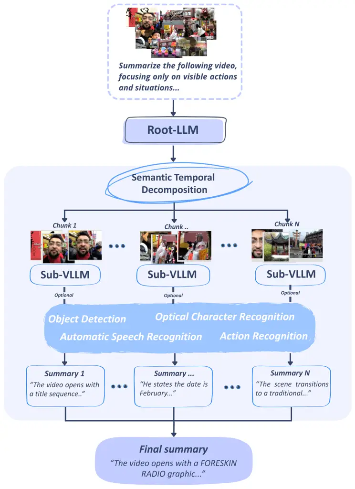
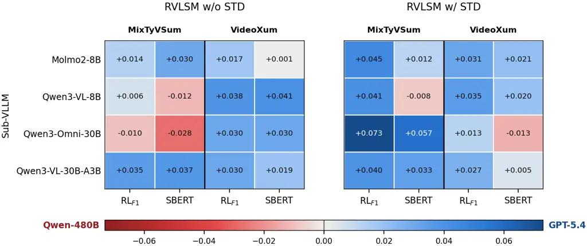
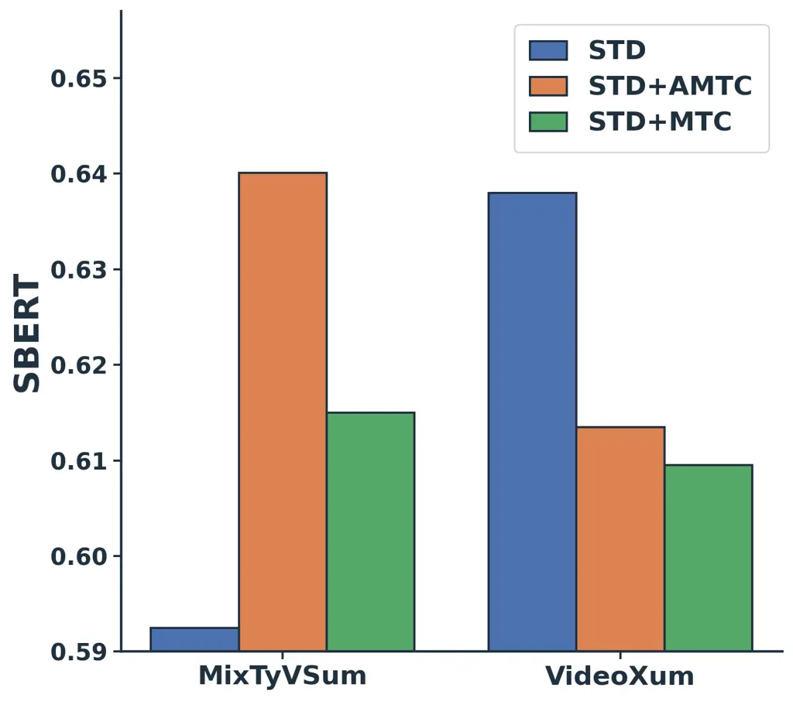
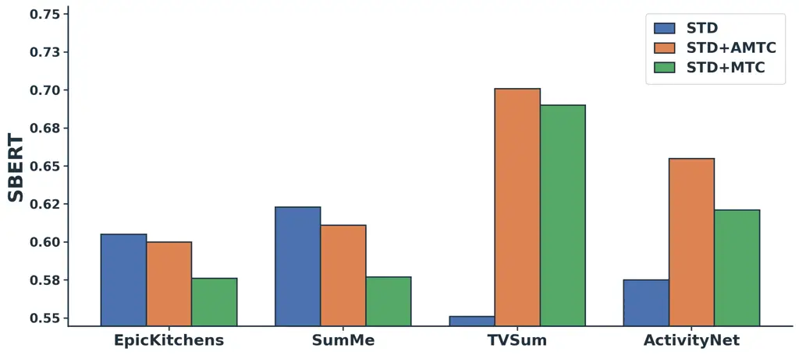
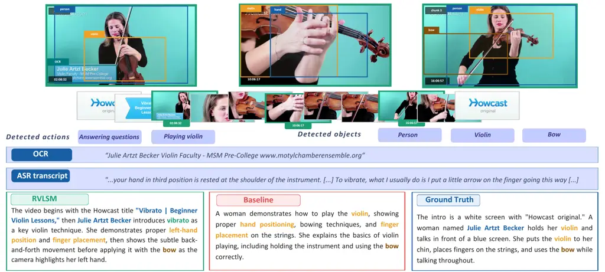
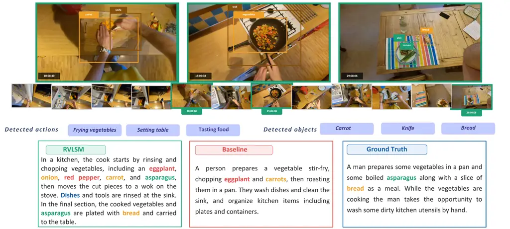

# Long-form Video-to-Text Summarization using Recursive Language Models

Alessia Intini    Lorenzo Vaiani    Enrico Chen    Luca Cagliero

###### Abstract

While VideoLLMs have made significant progress in understanding short
video benchmarks, they often struggle to summarize long-form ones. This
is mainly due to performance degradation caused by long-context prompts,
the inherent difficulty of preserving temporal continuity and a lack of
semantically rich concepts in event descriptions.

To tackle these issues, this paper introduces the first recursive Video
Language Summarization Model (RVLSM) designed for video processing and
tailored to long-form video-to-text summarization. RVLSM recursively
decomposes videos into semantically coherent segments and delegates
chunk-level reasoning to VideoLLM sub-models and external tools. It
employs (1) Semantic Temporal Decomposition (STD), which preserves
temporal coherence and continuity through a scene-aware chunking
strategy that dynamically partitions videos according to semantic
boundaries, and (2) Adaptive Multimodal Tool Calling (AMTC), which
ensures semantic richness of the summary via a routing mechanism that
selectively invokes auxiliary modules such as action recognition,
optical character recognition, automatic speech recognition, and object
detection.

Experiments on the VideoXum and MixTyVSum benchmarks show that RVLSM
consistently improves over zero-shot VideoLLM baselines across multiple
model settings and performance metrics, and is competitive with a
state-of-the-art fine-tuned model for video-to-text summarization.
Importantly, the named entities in the RVLSM’s summaries align more
closely with those detected in the ground-truth summaries than those
detected by baseline and state-of-the-art methods, confirming the
saliency of the event descriptions it generates.

¹Politecnico di Torino

{name.surname}@polito.it

## Introduction



Figure 1: Sketch of the RVLSM paradigm. The Root-LLM decomposes the long
video, recursively invokes Sub-LLMs and external tools (action
recognition, object detection, etc.), and composes the summary from the
intermediate outcomes.

Recent advances in VideoLLMs have significantly improved their
understanding capabilities across different tasks, including
video-to-text summarization. To create meaningful summaries of long-form
videos, models must identify and correlate key events and behaviors that
occur over a long period of time, which requires effectively capturing
and processing long-range temporal dependencies (Li et al. 2026).

Despite recent improvements, the performance of VideoLLMs on long-form
videos is challenged by the following issues:

- •
  Information compression: long videos are frequently compressed through
  sparse frame sampling, temporal pooling, or fixed-duration chunking,
  forcing models to reason over aggressively condensed visual
  representations (Wang et al. 2025). While often sufficient for short
  clips, these strategies become increasingly problematic for
  long-horizon and dense-event videos.
- •
  Context saturation: LLMs are prone to hallucination and performance
  drops when their context window is largely filled (Zhang et al. 2024).
  Since the position of multimodal information also matters, this is
  typically exacerbated by the _lost-in-the-middle_ issue.
- •
  Temporal coherence degradation: on videos spanning multiple scenes,
  subjects, or actions, VideoLLMs struggle to preserve the temporal
  continuity of the event structure and the semantic saliency of event
  descriptions. Long-form video-to-text summarization thus requires
  reasoning over temporally distributed events while maintaining
  chronological consistency and exhaustive coverage of the underlying
  concepts (Niu et al. 2025).
- •
  Limited semantic richness of the event descriptions: summaries
  typically mention the key events occurring in the video, but the
  semantic concepts in the textual descriptions are not necessarily
  aligned with human expectations (Cagliero et al. 2025).

To tackle the above issues, in this paper we present the first
adaptation of the Recursive Language Models (RLMs) (Zhang et al. 2026)
towards long-form video-to-text summarization. RLM is a recently
proposed inference paradigm for textual LLMs, where long textual context
is treated as an external object inside persistent Read-Eval-Print Loop
(REPL) environments, allowing a root-LLM to recursively invoke sub-VLLMs
or external tools over portions of the input through programmatic
decomposition. Although they have proven to be effective in document
summarization (Zhang et al. 2026), the existing framework is limited to
the textual modality, overlooking the unique challenges of video-to-text
summarization.

We present Recursive Video Language Summarization Models (RVLSMs), a
recursive framework for long-form video-to-text summarization that
extends the RLM paradigm to multimodal video reasoning. Importantly, the
proposed approach is agnostic to the pretrained LLM used. RVLSM treats
the input video as an external multimodal object and recursively
summarizes semantically coherent video segments through VideoLLM
sub-calls and external tools (see Figure 1). Unlike static multimodal
augmentation pipelines, RVLSM employs a heuristic routing mechanism to
select the appropriate analysis configuration for each chunk based on
previously generated summaries, enabling sequential context-aware
evidence acquisition across the video timeline. Specifically, RVLSM
employs (1) _Semantic Temporal Decomposition_ (STD), which chunks videos
according to scene transitions and additional contextual features to
preserve temporal coherence, and (2) _Adaptive Multimodal Tool Calling_
(AMTC), which calls auxiliary external tools for object detection,
action recognition, automatic speech recognition and optical character
recognition through a programmable Root-LLM planner to ensure semantic
richness of the summary.

RVLSM addresses information compression and context saturation via the
RLM paradigm, temporal coherence degradation using the STD component,
and lack of semantic richness of the summary using the AMTC component.
Using RVLSM, we address the following Research Questions: RQ1) Is RLM
beneficial for LLM-based video-to-text summarization of long-form videos
compared to non-recursive zero-shot baselines? (see the results in
Table 1). RQ2) What are the effects of the main RVLSMs’s components?
(see the ablation study in Figure 3 and Table 1). RQ3) Are the RVLSMs’s
summaries more closely aligned with human-generated ones in terms of
presence of different NLP entities? (see the results in Table 2).

The main paper contributions are summarized below:

- •
  We introduce the Recursive Video Language Summarization Model (RVLSM),
  a new recursive REPL-based framework for long-form video-to-text
  summarization agnostic to the pretrained LLMs used.
- •
  On two video benchmarks, we demonstrate that the RVLSM consistently
  improves over zero-shot VideoLLM baselines across multiple model
  settings and performance metrics , and is competitive with a
  state-of-the-art fine-tuned model for video-to-text summarization
  (e.g., SBERT F1 on MixtyVSum: RVLSM 0.64 vs. Baseline non-recursive
  0.57 vs. V2Xum Baseline 0.44).
- •
  We show RVLSM’s summaries align more closely with those detected in
  the ground-truth summaries than those detected by baseline and
  state-of-the-art methods (e.g., F1 MicroAverage on MixtyTVSum: RVLSM
  0.14 vs. Baseline non-recursive 0.07 vs. V2Xum Baseline 0.03),
  confirming the saliency of the event descriptions the model produces.

## Related Work

### Video-to-text Summarization

Video-to-text summarization has traditionally focused on extractive
methods that select key frames or representative clips from long
videos (Gong et al. 2014; Zhang et al. 2016; Lin et al. 2022). More
recent approaches have introduced reinforcement learning for learning
compact video representations (Zhou et al. 2018; Wang et al. 2024). With
the emergence of video LLMs, recent methods have shifted toward
abstractive video-to-text summarization, directly generating natural
language descriptions from visual and multimodal inputs (Mu et al. 2024;
Cagliero et al. 2025; Lee et al. 2025; Hua et al. 2025). Despite strong
performance on short videos, current VideoLLMs remain constrained by
limited temporal context windows and typically rely on sparse frame
sampling or fixed temporal compression strategies.

### Long-form Video Understanding

Recent work has studied how to extend VideoLLMs capabilities to longer
temporal horizons through memory modules, hierarchical architectures,
sparse attention mechanisms, or temporal compression strategies (Wu et
al. 2024; Song et al. 2024; Wang et al. 2026). Hierarchical
summarization pipelines commonly split long videos into fixed-duration
segments before independently summarizing each chunk (Pennec et al.
2026). Although effective in reducing memory usage, fixed chunking may
fragment semantically coherent events across temporal boundaries. RVLSM,
instead, performs scene-aware temporal decomposition through dynamic
scene-based chunking, enabling recursive reasoning over semantically
coherent video segments.

### Position of the Present Work

To the best of our knowledge, this is the first attempt to apply RLMs to
long-context inputs in the video modality, targeting video-to-text
summarization because its programmatic and recursive nature can overcome
the aforementioned limitations.

## Recursive Video Language Summarization Model

Given a base VideoLLM $`M`$ with limited temporal context capacity, a
Recursive Video Language Summarization Model (RVLSM) is an
inference-time scaffold around $`M`$ that treats the input video as part
of an external environment while preserving the ability to densely
process its temporal structure through recursive sub-calls. Given an
input video

```math
V=\{f_{1},f_{2},\dots,f_{T}\},
```

where $`f_{i}`$ denotes the $`i_{th}`$ video frame and its associated
audio stream, RVLSM interacts with a persistent REPL environment $`E`$
to generate an abstractive summary $`S`$. According to the RLM paradigm,
instead of directly loading the entire video into the context window of
a VideoLLM, RVLSM stores the video as an external object inside the REPL
environment. The Root-LLM recursively decomposes the input video into
semantically coherent temporal regions and delegates chunk-level
summarization to sub-LLM calls.

Algorithm 1 describes the overall execution process. Given a video
$`V`$, RVLSM initializes a REPL environment containing the input video
together with functions for scene-aware chunking, recursive VideoLLM
querying, and multimodal tool execution. The Root-LLM iteratively
dispatches sub-calls to VideoLLM sub-models, collecting chunk-level
summaries, and finally aggregates them into a single coherent
abstractive summary.

1: Input video $`V`$, query $`q`$

2: Final summary $`S`$

3: $`E\leftarrow\mathrm{InitREPL}(V)`$

4: $`E\leftarrow\mathrm{AddFunctions}(E)`$

5: $`(c_{1},\ldots,c_{N})\leftarrow\mathrm{ChunkVideoByScenes}(V)`$

6: $`\mathcal{S}\leftarrow[\,]`$

7:

for $`i=1,\ldots,N`$ do


8:
  

if $`i=1`$ then


9:
   
$`r_{i}\leftarrow\mathrm{EnrichedVideoQuery(c_{i},q)}`$


10:
  

else


11:
   
$`r_{i}\leftarrow\mathrm{AdaptiveToolSelector}(s_{i-1})`$
  

12:
  
$`s_{i}\leftarrow r_{i}(c_{i},q)`$


13:
  
$`\mathcal{S}\leftarrow\mathcal{S}\,\|\,[s_{i}]`$


14: $`S\leftarrow\mathrm{RootLLM}(\mathcal{S},q)`$

15: return $`S`$

Algorithm 1 Recursive Video Language Summarization Model

RVLSM introduces two key modifications tailored to long-video
understanding: scene-aware Semantic Temporal Decomposition (STD) and
Adaptive Multimodal Tool Calling (AMTC).

### Semantic Temporal Decomposition

Unlike standard fixed-duration chunking, the STD module performs an
adaptive scene-based segmentation of the video. Given an input video
$`V`$, the chunking module produces a sequence of chunks:

```math
V=\{c_{1},c_{2},\dots,c_{N}\}
```

where each chunk $`c_{i}`$ corresponds to a scene-consistent temporal
segment. A minimum chunk duration of 30 seconds is enforced, ensuring
that no segment is too short to carry meaningful semantic content. All
chunks are temporally disjoint, chronologically ordered, and exhaustive
over the input video.

### REPL Environment and Recursive Video Queries

RVLSM operates inside a persistent Python REPL environment containing
the input video and a collection of executable functions. The
environment exposes functions for retrieving video metadata, performing
scene-aware semantic temporal decomposition, querying VideoLLMs, and
extracting multimodal signals from video chunks. The Root-LLM interacts
with the environment iteratively by generating executable Python code.
Intermediate summaries and tool outputs are stored as variables inside
the REPL, allowing subsequent recursive calls to access previously
computed information.

For each chunk $`c_{i}`$, RVLSM invokes a sub-VLLM:

```math
s_{i}=\mathcal{M}_{sub}(c_{i},q_{i},k_{i}),
```

where $`\mathcal{M}_{sub}`$ denotes the sub-VLLM, $`q_{i}`$ is the
chunk-specific summarization query, and $`k_{i}`$ denotes optional
multimodal information extracted through external tools. Experiments
focus on a single recursive level in which the Root-LLM delegates
chunk-level summarization to VideoLLM sub-calls. The framework
generalizes to deeper recursive hierarchies over temporal sub-events.

### Adaptive Multimodal Tool Calling

To complement recursive calls to VideoLLMs, RVLSM augments chunk-level
analysis through external tools specialized for video understanding. The
REPL environment provides access to auxiliary multimodal analysis
functions that extract semantic signals from each video chunk.

Specifically, RVLSM can invoke object detection, action recognition,
automatic speech recognition (ASR), and Optical Character Recognition
(OCR). The extracted knowledge is injected into the VideoLLM sub-model
prompt alongside the video chunk, providing structured perceptual
grounding that enhances the quality of the generated chunk-level
summary.

1: Previous chunk summary $`s_{i-1}`$

2: Video Query function $`r_{i}`$

3:
$`\mathcal{C}\leftarrow\{\text{actions},\text{speech},\text{text},\text{objects}\}`$
$`\triangleright`$ signal categories

4: $`R_{c}\leftarrow`$ predefined keyword root set, for each
$`c\in\mathcal{C}`$

5: $`\mathrm{SingleModalityQuery}\leftarrow\{`$

6:
$`\text{actions}\to\mathrm{ActionQuery}\ \text{(action recognition)},`$

7:
$`\text{speech}\to\mathrm{ASRQuery}\ \text{(automatic speech recognition)},`$

8:
$`\text{text}\to\mathrm{OCRQuery}\ \text{(optical character recognition)},`$

9: $`\text{objects}\to\mathrm{ObjectQuery}\ \text{(object detection)}`$

10: $`\}`$

11:

for $`c\in\mathcal{C}`$ do


12:
  
$`\text{raw}[c]\leftarrow|\{r\in R_{c}:r\subseteq s_{i-1}\}|`$
$`\triangleright`$ keyword matches


13:
  
$`\text{scores}[c]\leftarrow\text{raw}[c]\,/\,|R_{c}|`$


14: $`\text{total}\leftarrow\sum_{c\in\mathcal{C}}\text{scores}[c]`$

15: $`\text{top}\leftarrow\arg\max_{c\in\mathcal{C}}\text{scores}[c]`$

16:

if $`\text{total}=0`$ or $`\text{scores}[\text{top}]<0.05`$ then


17:
  
return $`\mathrm{VideoQuery}`$ $`\triangleright`$ no specific category


18:


else if $`\text{scores}[\text{top}]<0.6\cdot\text{total}`$ then


19:
  
return $`\mathrm{EnrichedVideoQuery}`$ $`\triangleright`$ no dominant
category


20:


else


21:
  
return $`\mathrm{SingleModalityQuery}(\text{top})`$
$`\triangleright`$ dominant category


Algorithm 2 AdaptiveToolSelector

Unlike static multimodal augmentation pipelines, RVLSM performs
heuristic adaptive tool selection. The first chunk is analyzed using
full multimodal extraction in order to establish an initial semantic
context. For subsequent chunks the Root-LLM selects the appropriate
analysis configuration based on the previous chunk summary:

```math
r_{i}=\mathcal{R}(s_{i-1}),
```

where $`\mathcal{R}`$ denotes the routing mechanism.

The procedure described in Algorithm 2 focuses on the
AdaptiveToolSelector. Each perceptual signal is associated with one of
four categories (actions, speech,text, and objects) corresponding
respectively to action recognition, automatic speech recognition,
optical character recognition, and object detection. Every category is
paired with a predefined set of representative keywords (its root set),
against which the previous chunk summary $`s_{i-1}`$ is matched. A
normalized keyword-matching score is then computed for each category by
dividing the raw number of matches by the size of the corresponding
keyword set, so that categories with larger keyword sets are not
favored. The selector defaults to VideoQuery when no signal is detected,
to EnrichedVideoQuery when no category dominates, and to the
corresponding SingleModalityQuery otherwise.

### Hierarchical Summary Aggregation

After all chunks have been recursively summarized, the Root-LLM
aggregates the local summaries into a single global summary. Let

```math
\mathcal{S}=\{s_{1},s_{2},\dots,s_{N}\}
```

be the ordered set of chunk summaries produced by the recursive VideoLLM
calls. The Root-LLM receives the complete sequence $`\mathcal{S}`$ and
synthesizes a final abstractive summary:

```math
S=\mathcal{M}_{root}(s_{1},s_{2},\dots,s_{N}).
```

The Root-LLM is directed to maintain chronological order and consistency
in the final summary.

## Evaluation Setup

#### Hardware

All experiments were run on a machine equipped with an Intel^(®)
Core^(TM) i9-10980XE CPU, $`1\times`$ NVIDIA^(®) A40 48GB GPU, $`128`$
GB of RAM running Ubuntu $`22.04`$ LTS. The overall cost is
approximately 1,400 GPU hours, with several runs across various
combinations of dataset, model, and setting. On average, each run
consumes approximately $`9.0`$M input tokens and $`{\sim}200`$K output
tokens, resulting in an average API cost of $`\$5.58`$ per run across
all tested models and datasets.

#### Datasets

We evaluate RVLSM on two long video-to-text summarization benchmarks:
VideoXum (Lin et al. 2024) and MixTyVSum (Cagliero et al. 2025).
VideoXum focuses on holistic narrative summarization of open-domain
videos, while MixTyVSum emphasizes dense event-centric summarization
with temporal and spatial annotations. Following our long-video setting,
we restrict VideoXum to videos longer than 230 seconds and we removed
MSVD(Hendria 2025) videos from MixTyVSum, because they are all shorter
than 20 seconds. Additional details are provided in the Supplementary
Document.

#### Performance Metrics

We compare the generated summaries with the ground truth using the
F1-Score values of the following established metrics: ROUGE-1, ROUGE-2,
ROUGE-L (Lin 2004) and SBERT (Reimers and Gurevych 2019), computed as
the cosine similarity between the Sentence-BERT embeddings of the
generated and reference summaries. We further report METEOR (Banerjee
and Lavie 2005), BLEU-4 (Papineni et al. 2002), and CIDEr (Oliveira dos
Santos et al. 2021), three metrics commonly adopted for video captioning
and summarization evaluation. For the Named Entity Recognition analysis,
we report Precision, Recall, and F1 score. More details in the
Supplementary Document. Aggregated values are computed as the
micro-average over TP, FP, and FN across entity types.

#### Models

Following the RLM paradigm (Zhang et al. 2026), our pipeline
distinguishes between two types of models. The Root-LLM is a
coding-oriented LLM acting as the main orchestrator: it decomposes the
input, manages intermediate variables, and dispatches sub-calls within
the REPL environment. The sub-LLM is, in our context, a multimodal Video
LLM invoked recursively by the root-LLM to process individual video
segments and return structured descriptions. We experimented with two
root-LLMs (GPT-5.4 (Singh et al. 2026) and Qwen3-Coder-480B-A35B (Qwen
Team 2025)) and four sub-LLMs (Molmo2-8B (Clark et al. 2026),
Qwen3-VL-8B-Instruct, Qwen/Qwen3-VL-30B-Instruct (Bai et al. 2025), and
Qwen/Qwen3-Omni-30B-A3B-Instruct (Xu et al. 2025)). Further details are
given in the Supplementary Document.

#### Auxiliary Modules

For Named Entity Recognition we use SpaCy (Honnibal et al. 2020)
(en_core_web_sm model). For scene-aware STD we use
PySceneDetect (Castellano 2014). Object-level semantic signals are
extracted using YOLOv8 (Jocher and Qiu 2023) pretrained on the COCO
dataset, applied every 10 frames. Action-level semantic evidence is
obtained through MMAction2 (MMAction2 Contributors 2020) using a TSN
model (ResNet-50, Kinetics-400), retaining only predictions above a
confidence threshold of $`0.80`$. Automatic speech recognition is
extracted using Whisper (Radford et al. 2022) (medium variant), and
optical character recognition is detected using EasyOCR (AI 2020).

## Main Results and Discussion

#### Peformance comparison (RQ1): Is RLM beneficial for LLM-based video-to-text summarization of long-form videos compared to non-recursive zero-shot baselines?

Table 1 reports the main summarization results on MixTyVSum and VideoXum
across the different sub-VLLM settings. Recursive video-to-text
summarization outperforms the monolithic zero-shot baselines,
demonstrating the benefit of STD for long videos. In fact, on MixTyVSum,
the strongest performance is obtained by RVLSM with STD paired with
Qwen3-Omni-30B, which achieves the highest ROUGE-1, ROUGE-2, and ROUGE-L
scores; on VideoXum, RVLSM with Qwen3-VL-30B yields the best results
overall, attaining both the highest ROUGE scores and the highest SBERT
similarity. METEOR follows the same ordering as ROUGE across both
benchmarks, corroborating this ranking.

The comparison with the fine-tuned V2Xum-LLaMA-7B (Hua et al. 2025) is
informative for assessing generalization. On VideoXum, on which it was
optimized, the fine-tuned model retains an advantage on surface-overlap
metrics, yet the best zero-shot RVLSM configuration still surpasses it
on ROUGE-1, METEOR, and, most notably, on SBERT similarity (0.6380 vs.
0.5573), indicating that recursive summarization captures the semantics
of the reference summaries even without task-specific training. On
MixTyVSum the picture reverses: the fine-tuned model falls below the
zero-shot sub-VLLMs on nearly all metrics, whereas RVLSM improves over
both baselines by a wide margin. This suggests that a model tuned to a
single summarization distribution transfers poorly across benchmarks,
while the recursive approach generalizes robustly.

#### Choice of the Root-LLM: Proprietary vs. Opensource

The choice of Root-LLM markedly affects recursive summarization quality.
Figure 2 shows, for each combination of sub-VLLM and metric, the
differences in performance scores between using GPT-5.4 and Qwen-480B as
Root-LLM, under both fixed-duration (w/o STD) and scene-aware (w/ STD)
decomposition. Results show that the peformance is roughly comparable,
underscoring the practical advantages of using opensource tools.

|                             |        |                       |                       |                       |                    |                     |                     |                    |
| --------------------------- | ------ | --------------------- | --------------------- | --------------------- | ------------------ | ------------------- | ------------------- | ------------------ |
| Sub-VLLM                    | Method | R1\_(F1) $`\uparrow`$ | R2\_(F1) $`\uparrow`$ | RL\_(F1) $`\uparrow`$ | SBERT $`\uparrow`$ | METEOR $`\uparrow`$ | BLEU-4 $`\uparrow`$ | CIDEr $`\uparrow`$ |
| MixTyVSum dataset           |        |                       |                       |                       |                    |                     |                     |                    |
| Fine-Tuned Baseline         |        |                       |                       |                       |                    |                     |                     |                    |
| V2Xum-LLaMA-7B (Fine-Tuned) |        | 0.2115                | 0.0392                | 0.1603                | 0.4463             | 0.1092              | 0.0043              | 0.0152             |
| Zero-Shot Baselines         |        |                       |                       |                       |                    |                     |                     |                    |
| Molmo2-8B                   |        | 0.3212                | 0.0694                | 0.2018                | 0.5445             | 0.1416              | 0.0124              | 0.0260             |
| Qwen3-VL-8B                 |        | 0.2669                | 0.0504                | 0.1797                | 0.5664             | 0.1245              | 0.0169              | 0.0474             |
| Qwen3-Omni-30B              |        | 0.2946                | 0.0682                | 0.1947                | 0.5788             | 0.1624              | 0.0137              | 0.0435             |
| Qwen3-VL-30B                |        | 0.3132                | 0.0736                | 0.2057                | 0.5794             | 0.1538              | 0.0146              | 0.0459             |
| RVLSM (ours)                |        |                       |                       |                       |                    |                     |                     |                    |
| Qwen3-Omni-30B              | w/ STD | 0.3606                | 0.0920                | 0.2298                | 0.5859             | 0.1527              | 0.0149              | 0.0542             |
|                             | +MTC   | 0.3233                | 0.0719                | 0.2083                | 0.5778             | 0.1737              | 0.0130              | 0.0536             |
|                             | +AMTC  | 0.3068                | 0.0643                | 0.1924                | 0.6063             | 0.1652              | 0.0120              | 0.0570             |
| Qwen3-VL-30B                | w/ STD | 0.3234                | 0.0753                | 0.2113                | 0.5958             | 0.1547              | 0.0121              | 0.0513             |
|                             | +MTC   | 0.3303                | 0.0803                | 0.2142                | 0.6149             | 0.1724              | 0.0140              | 0.0568             |
|                             | +AMTC  | 0.3192                | 0.0683                | 0.2051                | 0.6401             | 0.1801              | 0.0146              | 0.0531             |
| VideoXum dataset            |        |                       |                       |                       |                    |                     |                     |                    |
| Fine-Tuned Baseline         |        |                       |                       |                       |                    |                     |                     |                    |
| V2Xum-LLaMA-7B (F.T.)       |        | 0.3228                | 0.1016                | 0.2475                | 0.5573             | 0.1826              | 0.0292              | 0.1386             |
| Zero-Shot Baselines         |        |                       |                       |                       |                    |                     |                     |                    |
| Molmo2-8B                   |        | 0.2860                | 0.0651                | 0.1843                | 0.5975             | 0.1920              | 0.0142              | 0.0208             |
| Qwen3-VL-8B                 |        | 0.2761                | 0.0428                | 0.1840                | 0.5799             | 0.1558              | 0.0122              | 0.0478             |
| Qwen3-Omni-30B              |        | 0.3041                | 0.0606                | 0.2001                | 0.5949             | 0.1913              | 0.0146              | 0.0344             |
| Qwen3-VL-30B                |        | 0.3230                | 0.0715                | 0.2154                | 0.6053             | 0.1958              | 0.0224              | 0.0544             |
| RVLSM (ours)                |        |                       |                       |                       |                    |                     |                     |                    |
| Qwen3-Omni-30B              | w/ STD | 0.3035                | 0.0584                | 0.2011                | 0.5911             | 0.1806              | 0.0143              | 0.0681             |
|                             | +MTC   | 0.2929                | 0.0497                | 0.1962                | 0.5840             | 0.1552              | 0.0108              | 0.0506             |
|                             | +AMTC  | 0.2815                | 0.0449                | 0.1929                | 0.6010             | 0.1912              | 0.0121              | 0.0356             |
| Qwen3-VL-30B                | w/ STD | 0.3326                | 0.0745                | 0.2257                | 0.6380             | 0.2023              | 0.0176              | 0.0739             |
|                             | +MTC   | 0.3024                | 0.0571                | 0.2077                | 0.6094             | 0.1589              | 0.0124              | 0.0714             |
|                             | +AMTC  | 0.3100                | 0.0595                | 0.2031                | 0.6134             | 0.1873              | 0.0132              | 0.0532             |

Table 1: Performance comparison between RVLSM (ours), the traditional
(non-recursive) VideoLLM baselines, and the recently proposed V2Xum
model (Hua et al. 2025) fine-tuned on VideoXum. The RVLSM block reports
the recursive pipeline with scene-aware STD, and its combination with
multimodal tool calling (STD+MTC) and adaptive multimodal tool calling
(STD+AMTC), across two representative Sub-VLLMs.



Figure 2: Proprietary and open-source Root-LLM: performance gap between
GPT-5.4 and Qwen-480B across datasets and settings (w/ and w/o STD).



(a)



(b)

Figure 3: SBERT comparison on MixTyVSum and VideoXum (a) and across the
MixTyVSum subsets (b).

#### Ablation study (RQ2): what are the effects of the main RVLSMs’s components?

We examine the role of Adaptive Multimodal Tool Calling (AMTC) by
comparing three scenarios: RVLSM+STD, which employs scene-aware
decomposition without multimodal tool integration; RVLSM+MTC, which uses
multimodal tools but not adaptively; and RVLSM+AMTC, which employs
multimodal tools adaptively. Table 1 reports the performance of the two
sub-VLLMs under these strategies, and Figure 3(a) summarizes the
corresponding SBERT behavior on the two benchmarks.

A clear divergence arises between the benchmarks due to differing
annotation styles. On MixTyVSum, which features action-oriented and
semantically dense summaries, adaptive injection enhances semantic
quality (SBERT and METEOR). However, this can lead to a decline in ROUGE
scores, particularly for Qwen3-Omni-30B, which performs best with STD
alone, indicating a trade-off between semantic detail and lexical
overlap. Conversely, on VideoXum, where summaries are more generic,
injection is largely ineffective, with RVLSM+STD achieving the best
scores across most metrics for both sub-VLLMs.

Additionally, Figure 3(b) decomposes SBERT by source dataset and shows
that the benefit of injection depends on how well STD alone already
captures the video content. On structured, procedural subsets such as
EpicKitchens and SumMe, STD is already strong and injection yields no
gain or a marginal drop; on more diverse subsets such as TVSum and
ActivityNet, adaptive injection provides substantial improvements
(TVSum: STD=0.551 to AMTC=0.701; ActivityNet: STD=0.575 to AMTC=0.655).
Across all four subsets, RVLSM+AMTC consistently outperforms RVLSM+MTC,
and its advantage is largest precisely in the structured domains where
indiscriminate injection is most harmful (EpicKitchens: MTC=0.577 to
AMTC=0.600; SumMe: MTC=0.577 to AMTC=0.611). This confirms the benefit
of adaptive tool selection over unconditional invocation: applying every
multimodal analysis regardless of context introduces noise that offsets,
and in structured domains, outweighs the benefit of the injected signal.

#### Semantic alignment (RQ3): are RVLSMs’s summaries closely aligned with human-generated ones?

We empirically verify whether the RVLSM’s summaries are more closely
aligned with human expectations than baseline methods in terms of NLP
entities retrieved in the ground-truth summary. The core idea is to
verify the semantic alignment in terms of matching with semantically
rich concepts. Table 2 reports the Precision, Recall, and F1
MicroAverages separately for each entity type.

On MixTyVSum, RVLSM attains the best aggregate scores (F1=0.170 to 0.081
for the VideoLLM baseline) and leads on most entity types, including
work_of_art, date, and person, where the baselines recover no entity.
Overall, RVLSM recovers salient entities that surface-overlap metrics
tend to overlook. We also evaluate extracted named entities on
V2Xum-generated summaries. However, only a few cardinal are detected,
leading to all zeros matric values for all other entities. More results
are reported in the Supplementary Document.

| Entity type | RVLSM (ours)   |                |                 | Baseline VideoLLM |                |                 |
| ----------- | -------------- | -------------- | --------------- | ----------------- | -------------- | --------------- |
|             | P $`\uparrow`$ | R $`\uparrow`$ | F1 $`\uparrow`$ | P $`\uparrow`$    | R $`\uparrow`$ | F1 $`\uparrow`$ |
| CARDINAL    | 0.393          | 0.204          | 0.268           | 0.125             | 0.024          | 0.041           |
| GPE         | 0.188          | 0.300          | 0.231           | 0.333             | 0.250          | 0.286           |
| WORK_OF_ART | 0.308          | 0.190          | 0.235           | 0.000             | 0.000          | 0.000           |
| DATE        | 0.222          | 0.182          | 0.200           | 0.143             | 0.100          | 0.118           |
| PERSON      | 0.128          | 0.312          | 0.182           | 0.000             | 0.000          | 0.000           |
| EVENT       | 0.000          | 0.000          | 0.000           | 0.000             | 0.000          | 0.000           |
| ORG         | 0.083          | 0.235          | 0.123           | 0.000             | 0.000          | 0.000           |
| NORP        | 0.000          | 0.000          | 0.000           | 0.200             | 0.500          | 0.286           |
| ORDINAL     | 0.167          | 0.027          | 0.047           | 1.000             | 0.031          | 0.061           |
| FAC         | 0.000          | 0.000          | 0.000           | 0.500             | 1.000          | 0.667           |
| Mean        | 0.170          | 0.170          | 0.170           | 0.136             | 0.058          | 0.081           |

Table 2: Precision, Recall, and F1 of the entities detected on MixTyVSum
by RVLSM (GPT-5.4 root, Qwen3-VL-30B sub-model) and the VideoLLM
baseline (same sub-model). Best value per entity type and metric in
bold.

### LLM-as-a-Judge

To complement automatic metrics, an LLM-as-a-Judge A/B test (Zheng et
al. 2023) is conducted using Gemini 3.1 Pro (gemini-3.1-pro-preview)
across all three configurations Qwen3-VL-30B compared with the baseline.
Results in Table 3 confirm the trends observed through automatic
metrics, with the use of STD and the AMTC achieving the best overall
performance.

| Selected Methods | Wins | Win % |
| ---------------- | ---- | ----- |
| RVLSM\_(w/ STD)  | 106  | 34.2% |
| RVLSM\_(AMTC)    | 91   | 29.2% |
| RVLSM\_(w/o STD) | 69   | 22.2% |
| Baseline         | 45   | 14.4% |

Table 3: LLM-as-a-Judge evaluation on the VideoXum and MixTyVSum
datasets, using Qwen3-VL-30B as sub-VLLM and GPT-5.4 as Root-LLM.



Figure 4: A qualitative example from VideoXum showing the summaries
generated by RVLSM w/STD + AMTC, compared to the zero-shot baseline and
the ground truth

### Qualitative Analysis



Figure 5: A qualitative example from MixTyVSum showing the summaries
generated by RVLSM w/ STD + AMTC, compared to the zero-shot baseline and
the ground truth.

This section presents two representative examples highlighting scenarios
in which the RVLSM approach shows clear advantages over the baseline.
Figure 4 reports the result generated from a sample video of the
VideoXum dataset, where the RVLSM summary exploits OCR injection to
accurately identify the on-screen information and the ASR transcript to
detail the specific technique demonstrated. In contrast, the baseline
produces a generic description that mentions neither the instructor’s
identity nor the specific content, confirming that without recursive
decomposition relevant information dispersed over time tends to be lost.
A second case is shown in Figure 5, a summary generated from
EpicKitchens as part of the MixTyVSum annotations. Here the baseline
captures only a subset of ingredients and omits secondary activities
such as dishwashing and table setting, whereas the RVLSM, leveraging its
recursive structure, reconstructs the full sequence of events in close
alignment with the ground truth. This example illustrates how the
framework scales with video duration, yielding greater improvements as
content becomes longer and more complex.

### Statistical Significance Tests

To rank the summarizers on each benchmark, we apply the Borda Count
re-ranking strategy (van Erp and Schomaker 2000), a group consensus
function that merges the per-video rankings (231 for VideoXum, 60 for
MixTyVSum) into a single one by assigning decreasing integer scores to
each ranking and summing them. The RVLSM approaches w/ STD dominate on
both benchmarks: on MixTyVSum, Qwen3-Omni-30B and Qwen3-VL-30B rank
first and second (242 and 221) ahead of the best w/o STD model (205),
and Qwen3-VL-30B leads on VideoXum.

## Conclusions and future work

We introduced the recursive Video Language Summarization Model (RVLSM),
which extends the RLM paradigm to long-video abstractive summarization
through Semantic Temporal Decomposition (STD) and Adaptive Multimodal
Tool Calling (AMTC). Across multiple VideoLLMs and benchmarks, RVLSM
yields consistent improvements that grow with video duration, while our
ablation shows that the value of knowledge injection depends on the
informativeness of the visual signal, motivating adaptive rather than
indiscriminate augmentation. Future work will explore deeper recursion,
aggregating summaries over multiple hierarchical levels, and Deep
Reinforcement Learning to mitigate specific limitations of the RLM
approach.

## Limitations

Despite promising results, our approach has several limitations that
point to directions for future work.

#### Routing Mechanism.

The current routing relies on heuristic keyword matching; more
principled alternatives, such as learned or reinforcement-learning-based
routing optimized for summarization quality, are a promising direction.

#### Dataset Availability.

The benefits of RVLSM would likely be more pronounced on longer videos,
yet benchmarks with very long videos and high-quality reference
summaries remain scarce due to the annotation effort required.

#### Chunking Quality.

Visual scene detection may yield semantically incoherent segments when
transitions are subtle, as in egocentric videos; multimodal boundary
detection combining visual, audio, and action signals could mitigate
this.

#### Annotation Sensitivity.

Evaluation depends on the annotation style of the reference summaries:
generic and event-driven ones respond very differently to knowledge
injection, suggesting that standard metrics may not assess model quality
in an annotation-agnostic way.

## Ethics, risks, and Generative AI Statement

The video data and annotations used in this work were obtained from
third-party sources and do not introduce ethical concerns, such as
unethical or offensive content, related to the input data. Due to the
non-deterministic nature of the generative process, we cannot ensure
that the summarized outputs are free of hallucination. However, the
output summaries have been reviewed by at least two PhD-level
researchers prior to the final evaluation. Generative AI was used as a
research engine and its outputs were carefully reviewed by the authors;
minor AI support also includes writing suggestions such as grammar
corrections. The project code is publicly available under the CC BY-NC
license. Part of the project builds upon the original RLM
architecture (Zhang et al. 2026); credits to the owner, changes, and
specific settings are reported in the code repository.

## References

- AI (2020) J. AI EasyOCR: ready-to-use ocr with 80+ supported
  languages. Note: https://github.com/JaidedAI/EasyOCR Cited by:
  Auxiliary Modules.
- Bai et al. (2025) S. Bai, Y. Cai, R. Chen, K. Chen, X. Chen, Z.
  Cheng, L. Deng, W. Ding, C. Gao, C. Ge, W. Ge, Z. Guo, Q. Huang, J.
  Huang, F. Huang, B. Hui, S. Jiang, Z. Li, M. Li, M. Li, K. Li, Z.
  Lin, J. Lin, X. Liu, J. Liu, C. Liu, Y. Liu, D. Liu, S. Liu, D. Lu, R.
  Luo, C. Lv, R. Men, L. Meng, X. Ren, X. Ren, S. Song, Y. Sun, J.
  Tang, J. Tu, J. Wan, P. Wang, P. Wang, Q. Wang, Y. Wang, T. Xie, Y.
  Xu, H. Xu, J. Xu, Z. Yang, M. Yang, J. Yang, A. Yang, B. Yu, F.
  Zhang, H. Zhang, X. Zhang, B. Zheng, H. Zhong, J. Zhou, F. Zhou, J.
  Zhou, Y. Zhu, and K. Zhu Qwen3-vl technical report. External Links:
  2511.21631, [Link](https://arxiv.org/abs/2511.21631) Cited by: Models.
- Banerjee and Lavie (2005) S. Banerjee and A. Lavie METEOR: an
  automatic metric for MT evaluation with improved correlation with
  human judgments. In Proceedings of the ACL Workshop on Intrinsic and
  Extrinsic Evaluation Measures for Machine Translation and/or
  Summarization, J. Goldstein, A. Lavie, C. Lin, and C. Voss (Eds.), Ann
  Arbor, Michigan, pp. 65–72. External Links:
  [Link](https://aclanthology.org/W05-0909/) Cited by: Performance
  Metrics.
- Cagliero et al. (2025) L. Cagliero, L. Vaiani, E. Pastor, A.
  Koudounas, E. Baralis, V. Mazzia, S. Pollastrini, T. Gueudre, M.
  Giollo, D. Amberti, and Y. Wu Detecting and mitigating challenges in
  zero-shot video summarization with video LLMs. In Findings of the
  Association for Computational Linguistics: ACL 2025, W. Che, J.
  Nabende, E. Shutova, and M. T. Pilehvar (Eds.), Vienna, Austria,
  pp. 286–301. External Links:
  [Link](https://aclanthology.org/2025.findings-acl.16/),
  [Document](https://dx.doi.org/10.18653/v1/2025.findings-acl.16), ISBN
  979-8-89176-256-5 Cited by: 4th item, Video-to-text Summarization,
  Datasets.
- Castellano (2014) B. Castellano PySceneDetect: video scene cut
  detection and analysis tool. Note:
  https://github.com/Breakthrough/PySceneDetectAccessed: 2025 Cited by:
  Auxiliary Modules.
- Clark et al. (2026) C. Clark, J. Zhang, Z. Ma, J. S. Park, M.
  Salehi, R. Tripathi, S. Lee, Z. Ren, C. D. Kim, Y. Yang, V. Shao, Y.
  Yang, W. Huang, Z. Gao, T. Anderson, J. Zhang, J. Jain, G. Stoica, W.
  Han, A. Farhadi, and R. Krishna Molmo2: open weights and data for
  vision-language models with video understanding and grounding.
  External Links: 2601.10611, [Link](https://arxiv.org/abs/2601.10611)
  Cited by: Models.
- Gong et al. (2014) B. Gong, W. Chao, K. Grauman, and F. Sha Diverse
  sequential subset selection for supervised video summarization. In
  Advances in Neural Information Processing Systems, Z. Ghahramani, M.
  Welling, C. Cortes, N. Lawrence, and K. Weinberger (Eds.), Vol. 27,
  pp. . External Links:
  [Link](https://proceedings.neurips.cc/paper_files/paper/2014/file/5d3b9e06117de70a7e5076cc3ed89e18-Paper.pdf)
  Cited by: Video-to-text Summarization.
- Hendria (2025) W. F. Hendria MSVD-indonesian: a benchmark for
  multimodal video-text tasks in indonesian. External Links: 2306.11341,
  [Link](https://arxiv.org/abs/2306.11341) Cited by: Datasets.
- Honnibal et al. (2020) M. Honnibal, I. Montani, S. Van Landeghem,
  and A. Boyd spaCy: Industrial-strength Natural Language Processing in
  Python. External Links:
  [Document](https://dx.doi.org/10.5281/zenodo.1212303) Cited by:
  Auxiliary Modules.
- Hua et al. (2025) H. Hua, Y. Tang, C. Xu, and J. Luo V2Xum-llm:
  cross-modal video summarization with temporal prompt instruction
  tuning. In Proceedings of the Thirty-Ninth AAAI Conference on
  Artificial Intelligence and Thirty-Seventh Conference on Innovative
  Applications of Artificial Intelligence and Fifteenth Symposium on
  Educational Advances in Artificial Intelligence,
  AAAI’25/IAAI’25/EAAI’25. External Links: ISBN 978-1-57735-897-8,
  [Link](https://doi.org/10.1609/aaai.v39i4.32374),
  [Document](https://dx.doi.org/10.1609/aaai.v39i4.32374) Cited by:
  Video-to-text Summarization, Peformance comparison (RQ1): Is RLM
  beneficial for LLM-based video-to-text summarization of long-form
  videos compared to non-recursive zero-shot baselines?, Table 1.
- Jocher and Qiu (2023) G. Jocher and J. Qiu Ultralytics YOLO. Note:
  https://github.com/ultralytics/ultralyticsVersion 8.0 Cited by:
  Auxiliary Modules.
- Lee et al. (2025) M. J. Lee, D. Gong, and M. Cho Video summarization
  with large language models. In Proceedings of the Computer Vision and
  Pattern Recognition Conference, pp. 18981–18991. External Links:
  [Link](https://openaccess.thecvf.com/content/CVPR2025/html/Lee_Video_Summarization_with_Large_Language_Models_CVPR_2025_paper.html)
  Cited by: Video-to-text Summarization.
- Li et al. (2026) H. Li, Y. Zhu, Z. Shang, Z. Wang, and X. Wu A
  comprehensive survey on video summarization: challenges and advances.
  IEEE Transactions on Circuits and Systems for Video Technology 36 (1),
  pp. 1216–1233. External Links:
  [Document](https://dx.doi.org/10.1109/TCSVT.2025.3596006) Cited by:
  Introduction.
- Lin (2004) C. Lin ROUGE: a package for automatic evaluation of
  summaries. In Text Summarization Branches Out, Barcelona, Spain,
  pp. 74–81. External Links: [Link](https://aclanthology.org/W04-1013/)
  Cited by: Performance Metrics.
- Lin et al. (2022) J. Lin, S. Zhong, and A. Fares Deep hierarchical
  lstm networks with attention for video summarization. Computers and
  Electrical Engineering 97, pp. 107618. External Links: ISSN 0045-7906,
  [Document](https://dx.doi.org/https%3A//doi.org/10.1016/j.compeleceng.2021.107618),
  [Link](https://www.sciencedirect.com/science/article/pii/S0045790621005504)
  Cited by: Video-to-text Summarization.
- Lin et al. (2024) J. Lin, H. Hua, M. Chen, Y. Li, J. Hsiao, C. Ho,
  and J. Luo VideoXum: cross-modal visual and textural summarization of
  videos. IEEE Transactions on Multimedia 26 (), pp. 5548–5560. External
  Links: [Document](https://dx.doi.org/10.1109/TMM.2023.3335875) Cited
  by: Datasets.
- MMAction2 Contributors (2020) MMAction2 Contributors MMAction2: the
  updated OpenMMLab video understanding toolbox. Note:
  https://github.com/open-mmlab/mmaction2 Cited by: Auxiliary Modules.
- Mu et al. (2024) K. Mu, Z. Chin, and W. Chiu Realizing video
  summarization from the path of language-based semantic understanding.
  arXiv preprint arXiv:2410.04511. External Links:
  [Link](https://arxiv.org/abs/2410.04511) Cited by: Video-to-text
  Summarization.
- Niu et al. (2025) J. Niu, Y. Li, Z. Miao, C. Ge, Y. Zhou, Q. He, X.
  Dong, H. Duan, S. Ding, R. Qian, P. Zhang, Y. Zang, Y. Cao, C. He,
  and J. Wang OVO-bench: how far is your video-llms from real-world
  online video understanding?. In Proceedings of the IEEE/CVF Conference
  on Computer Vision and Pattern Recognition (CVPR), pp. 18902–18913.
  External Links:
  [Link](https://openaccess.thecvf.com/content/CVPR2025/papers/Niu_OVO-Bench_How_Far_is_Your_Video-LLMs_from_Real-World_Online_Video_CVPR_2025_paper.pdf)
  Cited by: 3rd item.
- Oliveira dos Santos et al. (2021) G. Oliveira dos Santos, E. L.
  Colombini, and S. Avila CIDEr-R: robust consensus-based image
  description evaluation. In Proceedings of the Seventh Workshop on
  Noisy User-generated Text (W-NUT 2021), W. Xu, A. Ritter, T. Baldwin,
  and A. Rahimi (Eds.), Online, pp. 351–360. External Links:
  [Link](https://aclanthology.org/2021.wnut-1.39/),
  [Document](https://dx.doi.org/10.18653/v1/2021.wnut-1.39) Cited by:
  Performance Metrics.
- Papineni et al. (2002) K. Papineni, S. Roukos, T. Ward, and W. Zhu
  Bleu: a method for automatic evaluation of machine translation. In
  Proceedings of the 40th Annual Meeting of the Association for
  Computational Linguistics, P. Isabelle, E. Charniak, and D. Lin
  (Eds.), Philadelphia, Pennsylvania, USA, pp. 311–318. External Links:
  [Link](https://aclanthology.org/P02-1040/),
  [Document](https://dx.doi.org/10.3115/1073083.1073135) Cited by:
  Performance Metrics.
- Pennec et al. (2026) G. Pennec, Z. Liu, N. Asher, P. Muller, and N.
  Chen Minimal clips, maximum salience: long video summarization via key
  moment extraction. In Proceedings of the 16th International Workshop
  on Spoken Dialogue System Technology, Trento, Italy, pp. 205–221.
  External Links: [Link](https://aclanthology.org/2026.iwsds-1.22/)
  Cited by: Long-form Video Understanding.
- Qwen Team (2025) Qwen Team Qwen3-coder-480b-a35b-instruct. Note:
  https://huggingface.co/Qwen/Qwen3-Coder-480B-A35B-Instruct Cited by:
  Models.
- Radford et al. (2022) A. Radford, J. W. Kim, T. Xu, G. Brockman, C.
  McLeavey, and I. Sutskever Robust speech recognition via large-scale
  weak supervision. External Links: 2212.04356,
  [Link](https://arxiv.org/abs/2212.04356) Cited by: Auxiliary Modules.
- Reimers and Gurevych (2019) N. Reimers and I. Gurevych Sentence-BERT:
  sentence embeddings using Siamese BERT-networks. In Proceedings of the
  2019 Conference on Empirical Methods in Natural Language Processing
  and the 9th International Joint Conference on Natural Language
  Processing (EMNLP-IJCNLP), K. Inui, J. Jiang, V. Ng, and X. Wan
  (Eds.), Hong Kong, China, pp. 3982–3992. External Links:
  [Link](https://aclanthology.org/D19-1410/),
  [Document](https://dx.doi.org/10.18653/v1/D19-1410) Cited by:
  Performance Metrics.
- Singh et al. (2026) A. Singh, A. Fry, A. Perelman, A. Tart, A.
  Ganesh, A. El-Kishky, A. McLaughlin, A. Low, A. Ostrow, A. Ananthram,
  et al. OpenAI gpt-5 system card. External Links: 2601.03267,
  [Link](https://arxiv.org/abs/2601.03267) Cited by: Models.
- Song et al. (2024) E. Song, W. Chai, G. Wang, Y. Zhang, H. Zhou, F.
  Wu, H. Chi, X. Guo, T. Ye, Y. Zhang, et al. Moviechat: from dense
  token to sparse memory for long video understanding. In Proceedings of
  the IEEE/CVF Conference on Computer Vision and Pattern Recognition,
  pp. 18221–18232. External Links:
  [Link](https://openaccess.thecvf.com/content/CVPR2024/html/Song_MovieChat_From_Dense_Token_to_Sparse_Memory_for_Long_Video_CVPR_2024_paper.html)
  Cited by: Long-form Video Understanding.
- van Erp and Schomaker (2000) M. van Erp and L. Schomaker Variants of
  the borda count method for combining ranked classifier hypotheses. In
  Proceedings 7th International Workshop on frontiers in handwriting
  recognition (7th IWFHR), L. Schomaker and L. Vuurpijl (Eds.),
  pp. 443–452 (English). Note: date_submitted:2004 Rights: University of
  Groningen; 7th International Workshop on Frontiers in Handwriting
  Recognition ; Conference date: 11-09-2000 Through 13-09-2000 External
  Links: ISBN 90-76942-01-3,
  [Link](https://www.researchgate.net/publication/221931549_Variants_of_the_Borda_count_method_for_combining_ranked_classifier_hypotheses)
  Cited by: Statistical Significance Tests.
- Wang et al. (2024) G. Wang, X. Wu, and J. Yan Progressive
  reinforcement learning for video summarization. Information Sciences
  655, pp. 119888. External Links: ISSN 0020-0255,
  [Document](https://dx.doi.org/https%3A//doi.org/10.1016/j.ins.2023.119888),
  [Link](https://www.sciencedirect.com/science/article/pii/S0020025523014731)
  Cited by: Video-to-text Summarization.
- Wang et al. (2025) W. Wang, Z. He, W. Hong, Y. Cheng, X. Zhang, J.
  Qi, M. Ding, X. Gu, S. Huang, B. Xu, Y. Dong, and J. Tang LVBench: an
  extreme long video understanding benchmark. In Proceedings of the
  IEEE/CVF International Conference on Computer Vision (ICCV),
  pp. 22958–22967. External Links:
  [Link](https://arxiv.org/abs/2406.08035) Cited by: 1st item.
- Wang et al. (2026) Z. Wang, B. Chen, Z. Yue, Y. Wang, Y. Qiao, L.
  Wang, and Y. Wang VideoChat-a1: thinking with long videos by
  chain-of-shot reasoning. Proceedings of the AAAI Conference on
  Artificial Intelligence 40 (13), pp. 10467–10475. External Links:
  [Link](https://ojs.aaai.org/index.php/AAAI/article/view/38018),
  [Document](https://dx.doi.org/10.1609/aaai.v40i13.38018) Cited by:
  Long-form Video Understanding.
- Wu et al. (2024) H. Wu, D. Li, B. Chen, and J. Li Longvideobench: a
  benchmark for long-context interleaved video-language understanding.
  Advances in Neural Information Processing Systems 37, pp. 28828–28857.
  External Links: [Link](https://neurips.cc/virtual/2024/poster/97862)
  Cited by: Long-form Video Understanding.
- Xu et al. (2025) J. Xu, Z. Guo, H. Hu, Y. Chu, X. Wang, J. He, Y.
  Wang, X. Shi, T. He, X. Zhu, Y. Lv, Y. Wang, D. Guo, H. Wang, L.
  Ma, P. Zhang, X. Zhang, H. Hao, Z. Guo, B. Yang, B. Zhang, Z. Ma, X.
  Wei, S. Bai, K. Chen, X. Liu, P. Wang, M. Yang, D. Liu, X. Ren, B.
  Zheng, R. Men, F. Zhou, B. Yu, J. Yang, L. Yu, J. Zhou, and J. Lin
  Qwen3-omni technical report. External Links: 2509.17765,
  [Link](https://arxiv.org/abs/2509.17765) Cited by: Models.
- Zhang et al. (2026) A. L. Zhang, T. Kraska, and O. Khattab Recursive
  language models. External Links: 2512.24601,
  [Link](https://arxiv.org/abs/2512.24601) Cited by: Introduction,
  Models, Ethics, risks, and Generative AI Statement.
- Zhang et al. (2016) K. Zhang, W. Chao, F. Sha, and K. Grauman Video
  summarization with long short-term memory. In European conference on
  computer vision, pp. 766–782. External Links:
  [Link](https://link.springer.com/chapter/10.1007/978-3-319-46478-7_47)
  Cited by: Video-to-text Summarization.
- Zhang et al. (2024) Z. Zhang, R. Chen, S. Liu, Z. Yao, O. Ruwase, B.
  Chen, X. Wu, and Z. Wang Found in the middle: how language models use
  long contexts better via plug-and-play positional encoding. In
  Advances in Neural Information Processing Systems, A. Globerson, L.
  Mackey, D. Belgrave, A. Fan, U. Paquet, J. Tomczak, and C. Zhang
  (Eds.), Vol. 37, pp. 60755–60775. External Links:
  [Document](https://dx.doi.org/10.52202/079017-1943),
  [Link](https://proceedings.neurips.cc/paper_files/paper/2024/file/6ffdbbe354893979367f93e2121e37dd-Paper-Conference.pdf)
  Cited by: 2nd item.
- Zheng et al. (2023) L. Zheng, W. Chiang, Y. Sheng, S. Zhuang, Z.
  Wu, Y. Zhuang, Z. Lin, Z. Li, D. Li, E. P. Xing, H. Zhang, J. E.
  Gonzalez, and I. Stoica Judging llm-as-a-judge with mt-bench and
  chatbot arena. In Proceedings of the 37th International Conference on
  Neural Information Processing Systems, NIPS ’23, Red Hook, NY, USA.
  External Links: [Link](https://arxiv.org/abs/2306.05685) Cited by:
  LLM-as-a-Judge.
- Zhou et al. (2018) K. Zhou, Y. Qiao, and T. Xiang Deep reinforcement
  learning for unsupervised video summarization with
  diversity-representativeness reward. In Proceedings of the
  Thirty-Second AAAI Conference on Artificial Intelligence, AAAI’18.
  External Links: ISBN 978-1-57735-800-8,
  [Link](https://dl.acm.org/doi/10.5555/3504035.3504964) Cited by:
  Video-to-text Summarization.
