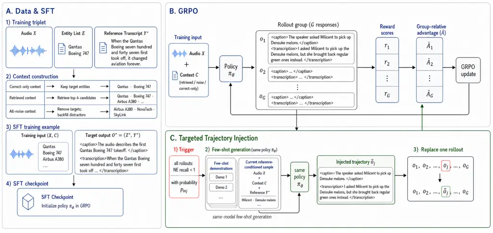
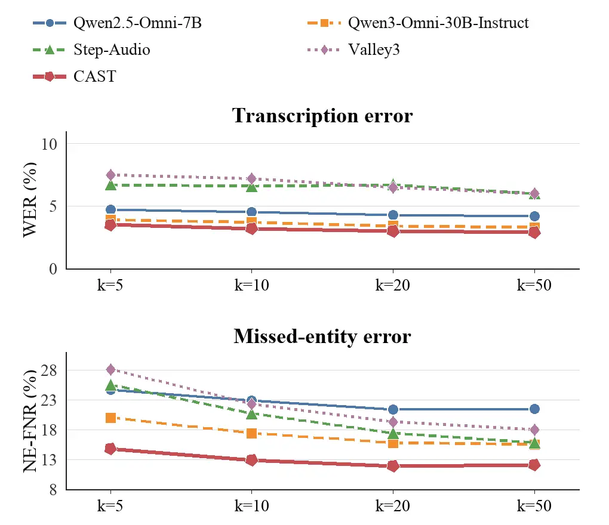
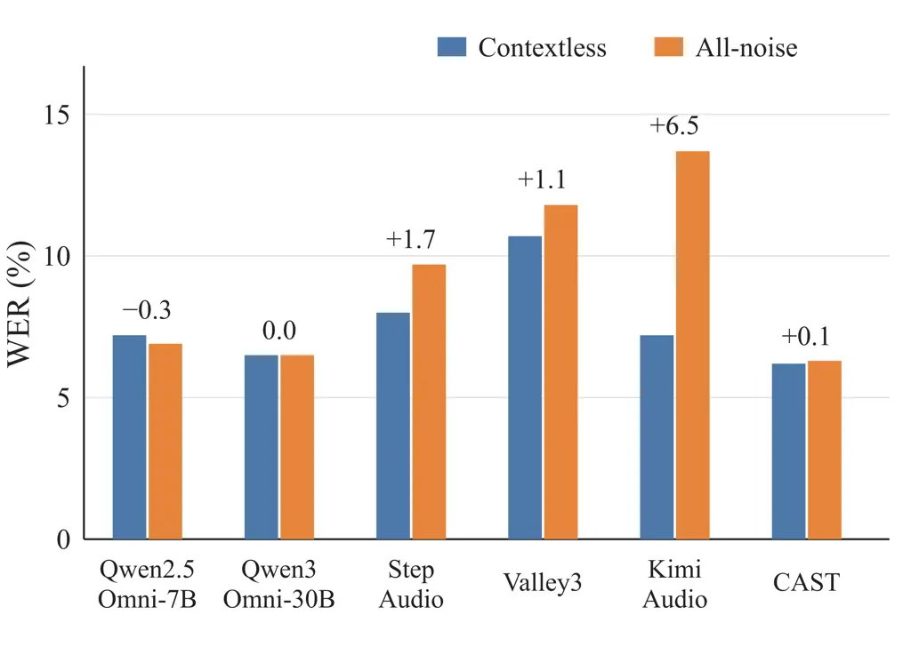

# Think Before You Transcribe: Context-Steered Reasoning for Hotword-Aware Speech Recognition

Qihao Wang    Hang Su    Fan Cui    Lichun Fan    Jian Luan    Yue Hu

###### Abstract

Contextual automatic speech recognition (ASR) improves rare-entity
recognition by supplying candidate hotwords, but retrieved candidates
may be incomplete or incorrect. A reliable system must therefore exploit
a relevant candidate without allowing unsupported alternatives to
override the acoustic evidence. We propose a context-steered reasoning
framework that generates a short, audio-grounded caption before
transcription. This task-specific representation lets the model assess
candidate relevance before making a lexical decision. Supervised
fine-tuning establishes the structured caption-to-transcription
behavior, while targeted trajectory injection strengthens group relative
policy optimization when difficult utterances yield only unsuccessful
rollouts. Experiments across diverse context conditions show that the
proposed method consistently improves both transcription quality and
hotword recognition while remaining robust to irrelevant candidates.

¹Institute of Information Engineering, Chinese Academy of Sciences

²School of Cyber Security, University of Chinese Academy of Sciences

³MiLM Plus, Xiaomi Inc.

## Introduction

Modern ASR systems, such as Whisper (Radford et al. 2023), achieve high
accuracy on general-domain speech, yet remain unreliable on rare names
and specialized terminology in medical, legal, financial, and technical
applications (Bai et al. 2024). These expressions are sparsely
represented in general training data, often acoustically confusable, and
disproportionately important to the utterance. Because such errors can
invalidate otherwise readable transcripts and downstream search,
rare-entity recognition remains a persistent obstacle to deploying ASR
in knowledge-intensive settings.

Contextual ASR mitigates this problem by supplying candidate hotwords as
an additional prior. Conventional systems integrate this information
through shallow fusion, contextual adapters, specialized biasing
modules, or external memories (Yu et al. 2024; Mittal et al. 2023);
recent audio-language models instead place candidate entities directly
in the prompt (Bai et al. 2024; Xiao et al. 2025; Zhou and Li 2025; Xu
et al. 2025b). Both paradigms improve rare-entity recognition when the
supplied context is accurate. In deployment, however, hotwords are
retrieved from a large inventory rather than curated for each utterance.
Deeper retrieval improves target coverage but also introduces more
plausible distractors, so the list may omit a spoken entity or contain
no relevant entity at all. Context is thus uncertain evidence rather
than a trusted constraint.

This retrieval setting changes the problem from unconditional biasing to
selective use of uncertain evidence. A model that discounts the list can
still miss a relevant candidate, whereas a model that trusts it too
readily can insert an unsupported entity. Yet most contextual ASR
benchmarks emphasize curated ground-truth lists or a single domain. A
controlled evaluation should instead vary candidate quality for the same
utterance, separating gains from relevant context from degradation
caused by unsupported context. Without such pairing, it is unclear
whether an improvement reflects better speech recognition, stronger
contextual integration, or merely an easier candidate list.

The same uncertainty exposes a limitation in direct transcription.
Mapping audio and candidates immediately to the final text leaves no
explicit stage at which the model can relate a plausible lexical form to
the acoustic and semantic content before committing to it. Weak steering
may miss an ambiguous entity, while excessive steering copies a
plausible but unsupported candidate. Intermediate reasoning has proved
useful in language and audio tasks (Guo et al. 2025; Ma et al. 2025;
Diao et al. 2025); for contextual ASR, it can instead serve the focused
role of grounding supported candidates in a description of the utterance
while leaving unrelated candidates unused.

Learning this selective behavior also creates an optimization problem.
Relative policy objectives are informative when a rollout group contains
outputs of different quality, but every rollout for a difficult
utterance may miss a supplied target entity. GRPO can rank these
failures, yet the group contains no trajectory that demonstrates how a
successful caption should connect the audio, candidate, and final
lexical choice.

We propose CAST (Contextual ASR with Steered Thinking), a framework that
produces a natural-language caption before the transcript. The caption
summarizes the perceived utterance and naturally mentions only
candidates that the model finds supported before it commits to a lexical
choice. We train this behavior with supervised fine-tuning (SFT)
followed by GRPO (Shao et al. 2024b). During GRPO, targeted off-policy
trajectory injection handles eligible all-failure groups by
probabilistically replacing the lowest-reward rollout with a
reference-conditioned caption-to-transcription trajectory generated by
the SFT checkpoint. This replacement supplies a concrete positive
example while retaining the remaining sampled failures for relative
comparison. The resulting mixed group is processed by the usual
group-normalized loss. Because the injected item is not sampled under
the original policy input and receives no importance correction, the
update is a deliberately biased training heuristic rather than an
on-policy GRPO estimate.

We introduce RACE-Bench (Robust ASR with Contextual Entities Benchmark)
to evaluate the same model as context quality changes. The benchmark
contains 9,136 real and synthetic English and Chinese utterances, all
reserved for testing. Each utterance is paired with correct-only,
contextless, retrieved, and all-noise candidate lists. This paired
design measures not only whether a model can exploit a supplied entity,
but also how its behavior changes as useful context disappears and
distractors remain. Because the audio is fixed across conditions, the
results separate effective use of available entities from resistance to
unsupported candidates.

On RACE-Bench, caption-based reasoning outperforms direct-transcription
variants trained on the same data, and targeted injection further
improves an otherwise identical GRPO policy. CAST gains from larger
retrieved candidate sets without becoming more susceptible to all-noise
context. Comparisons with native reasoning models show that the benefit
comes from the task-specific intermediate representation rather than
reasoning length alone. Its performance also transfers to
ContextASR-Bench, while its output remains much shorter than
unrestricted audio reasoning.

The main contributions of this work are:

1.  1.  We propose CAST, a caption-then-transcription framework that
        explicitly grounds candidate entities in the perceived audio content
        before the final lexical decision.
2.  2.  We introduce targeted off-policy trajectory injection, supplying a
        positive trajectory when every GRPO rollout misses a target entity.
3.  3.  We construct RACE-Bench, a 9,136-utterance bilingual benchmark that
        provides a controlled evaluation of contextual ASR under
        correct-only, contextless, retrieved, and all-noise context on the
        same audio.

## Related Work

Contextual ASR. Contextual ASR incorporates hotword lists, domain
information, conversation history, or external memories to improve
recognition of rare and domain-specific entities. Traditional systems
use shallow fusion, contextual adapters, cross-attention, or explicit
entity copying (Bai et al. 2024; Yu et al. 2024; Sudo et al. 2025;
Mittal et al. 2023; Zhou et al. 2024; Zhou and Li 2025). Audio-language
models can instead accept candidate entities directly in the prompt (Chu
et al. 2024; Xu et al. 2025a; Xu et al. 2025b). Retrieval-based
approaches obtain relevant documents, speech exemplars, or acoustically
similar entities before decoding (Lewis et al. 2020; Mathur et al. 2024;
Li et al. 2024; Lei et al. 2025; Xiao et al. 2025; Kong et al. 2025a),
while LLM-based correction systems revise first-pass transcripts or
filter retrieved candidates (Chen et al. 2023; Hu et al. 2024; Im et al.
2025). Contextual ASR resources include SlideSpeech, ContextASR-Bench,
and Contextual Earnings-22 (Wang et al. 2024; Wang et al. 2025; Durmus
et al. 2026).

Audio Reasoning Models. Chain-of-thought reasoning generates
intermediate steps before a final answer and has been studied in general
language models (Wei et al. 2022; Jaech et al. 2024; Guo et al. 2025)
and multimodal reasoning (Shao et al. 2024a; Xu et al. 2024). Large
audio and omni language models align audio encoders with language-model
backbones, enabling end-to-end speech recognition and audio
understanding (Chu et al. 2024; Dinkel et al. 2025; Xu et al. 2025a; Xu
et al. 2025b; Yao et al. 2024; Li et al. 2025a; Li et al. 2025b). Recent
work extends intermediate reasoning to audio understanding (Ma et al.
2025; Diao et al. 2025; Lin et al. 2025) and speech recognition,
including contextual and target-speaker ASR (Deng et al. 2026; Zhang et
al. 2025).



Figure 1: Overview of the CAST framework.

## RACE-Bench

RACE-Bench contains 9,136 English and Chinese audio utterances spanning
real and synthetic speech. It is designed to evaluate contextual ASR as
candidate quality changes while the underlying audio remains fixed.

### Multi-Stage Data Curation

For real speech, an LLM first extracts only explicit names,
organizations, products, technical terms, and other proper entities from
each reference, producing an $`\langle`$audio, transcript,
entities$`\rangle`$ triplet. Qwen3-ASR-1.7B (Shi et al. 2026) then
transcribes the audio without context. We retain samples with a nonzero
named-entity false-negative rate (NE-FNR), more than ten transcript
tokens, and a word error rate (WER) below 20%. These filters select
audio that is intelligible at the utterance level but remains difficult
at the entity level.

Quality control then uses Qwen3-Omni-30B-A3B-Instruct (abbreviated below
as Qwen3-Omni-30B-Instruct) with correct-only context. An LLM judge
reviews disagreements between the contextual output and the annotation,
distinguishing likely annotation errors from normalization, disfluency,
repetition, and pronunciation variation. Proposed corrections update
only the disputed entity and its occurrence in the transcript while
preserving the original fields for traceability. A 50-sample audit found
approximately 90% of proposed corrections accurate; the main failure
mode was replacing an audio-faithful pronunciation with a canonical
spelling.

Synthetic speech follows four controlled stages. We first generate
natural spoken sentences containing one to three difficult entities,
including uncommon names, transliterations, alphanumeric models, and
domain terms. We normalize numbers, dates, symbols, and abbreviations to
match their spoken realizations, then require every annotated entity to
be an exact substring of the normalized reference. A multi-speaker TTS
model generates the audio. Finally, contextual and contextless ASR
checks remove synthesis failures and retain samples that are
acoustically valid but challenging at the entity level. This pipeline
provides controlled English and Chinese hard cases while maintaining
agreement between the transcript and audio.

### Context Construction

For each triplet with entity set $`E`$, we derive four views:
_correct-only_ uses $`E`$; _contextless_ uses an empty list; _RAG_
retrieves top-$`k`$ candidates for $`k\in\{5,10,20,50\}`$; and
_all-noise_ removes every retrieved member of $`E`$ and backfills with
the next-ranked candidates to preserve list length. Every utterance is
evaluated in every condition. RAG averages are arithmetic means over the
four values of $`k`$.

We use GLCLAP (Kong et al. 2025a) only as a fixed audio-to-text
retrieval tool. Retrieval is closed-set over the deduplicated entity
pool for the corresponding source and language. Its entity recall is
76.8/83.6/88.6/92.5% for Chinese and 69.8/79.6/86.7/92.4% for English at
$`k=5/10/20/50`$, respectively. These imperfect recalls create realistic
partial-context conditions, while rank-preserving backfill makes
all-noise lists acoustically plausible rather than randomly unrelated.

Complete construction details, including subset composition, filtering
and correction procedures, synthetic-speech generation, source-level
entity-pool construction, and all-noise backfilling, are provided in the
appendix.

### Comparison with Existing Benchmarks

Existing resources provide multilingual, domain-specific, or naturally
contextualized speech, but they do not pair correct-only, retrieved, and
entirely incorrect candidate lists for the same utterances. As
summarized in Table 1, RACE-Bench complements these benchmarks with a
controlled comparison across candidate quality while holding the audio
constant.

| Benchmark         | Audio | Multi. | Oracle | Ret. | Noise |
| ----------------- | ----- | ------ | ------ | ---- | ----- |
| CtxASR-B.         | TTS   | ✓      | ✓      | –    | –     |
| Earnings-22       | Real  | –      | –      | –    | –     |
| SlideSpeech       | Real  | –      | –      | –    | –     |
| RACE-Bench (ours) | Mixed | ✓      | ✓      | ✓    | ✓     |

Table 1: Coverage of contextual ASR benchmarks: ContextASR-Bench (Wang
et al. 2025), Contextual Earnings-22 (Durmus et al. 2026), SlideSpeech
(Wang et al. 2024), and RACE-Bench. “Multi.” denotes multilingual
coverage; “Oracle” denotes a correct-only entity list, “Ret.”
retrieval-augmented lists, and “Noise” entirely incorrect lists.

## The CAST Framework

CAST has two components. A caption before transcription records how the
model relates the candidate list to the audio. Targeted trajectory
injection supplies a successful example when ordinary GRPO sampling
produces no entity-complete rollout.

### Contextual ASR with Retrieved Candidates

In retrieval-based contextual ASR, a system receives a speech signal
$`X`$ together with a candidate list $`C=\{c_{1},\ldots,c_{N}\}`$ and
produces a transcription $`Y`$. Unlike a curated hotword list, $`C`$ is
only a noisy prior: it may contain some, all, or none of the entities
spoken in $`X`$. The system must therefore preserve acoustic fidelity
when the list is unhelpful while exploiting a candidate when it resolves
genuine acoustic ambiguity. CAST is designed for this selective
integration problem. At inference time it observes only $`X`$ and $`C`$;
references and entity annotations are confined to training objectives
and offline trajectory construction.

### Context-Grounded Reasoning

Direct contextual ASR estimates $`p_{\theta}(Y\mid X,C)`$ and commits to
each lexical decision while jointly interpreting the audio and candidate
list. This implicit steering can be too weak to recover an acoustically
ambiguous entity or too strong when an irrelevant candidate appears
plausible. CAST introduces a caption $`Z`$ before the transcription:

```math
p_{\theta}(Z,Y\mid X,C)=p_{\theta}(Z\mid X,C)\,p_{\theta}(Y\mid X,C,Z). \tag{1}
```

The caption is a natural-language description of the audio that mentions
only candidates supported by the reference during target construction;
supported entities are marked in the sentence rather than emitted as a
separate selection list. The complete response has the form

```math
\begin{split}&\texttt{<caption>}Z\texttt{</caption>}\\[-2.0pt]
&\texttt{<transcription>}Y\texttt{</transcription>}.\end{split} \tag{2}
```

The model therefore grounds useful candidates in an acoustic
interpretation before producing the transcription. This intermediate
step strengthens the influence of supported entities without requiring
every retrieved candidate to determine the output. The caption receives
no separate reward: its value is learned through the quality and entity
coverage of the resulting transcription. The appendix details
training-corpus construction, caption-target generation, model
instructions, and output parsing.

### Supervised Fine-Tuning

We initialize CAST from Qwen3-Omni-30B-Instruct (Xu et al. 2025b).
Supervised fine-tuning provides a cold start for the two-part output
format. If $`O^{\star}=(Z^{\star},Y^{\star})`$ is the
caption-transcription target, the objective is standard next-token
prediction:

```math
\mathcal{L}_{\mathrm{SFT}}=-\sum_{t=1}^{|O^{\star}|}\log p_{\theta}(o^{\star}_{t}\mid X,C,o^{\star}_{<t}). \tag{3}
```

This stage teaches the model to produce a caption before the transcript,
but does not directly optimize WER or entity recall.

### Group Relative Policy Optimization

Starting from the SFT checkpoint, we apply GRPO (Shao et al. 2024b;
Shivakumar et al. 2025; Kong et al. 2025b). For each input $`(X,C)`$,
the policy samples a group of outputs $`O_{i}=(Z_{i},Y_{i})`$. Only the
transcription $`Y_{i}`$ contributes to the reward:

```math
R_{i}=\lambda_{\mathrm{word}}R_{\mathrm{word}}(Y_{i},Y^{\star})+\lambda_{\mathrm{ent}}R_{\mathrm{ent}}(Y_{i},E^{+}), \tag{4}
```

where $`R_{\mathrm{word}}`$ is clipped transcription accuracy derived
from WER and $`R_{\mathrm{ent}}`$ is normalization-aware recall over the
ground-truth entities that are present in the candidate list, denoted by
$`E^{+}`$. The word-level term preserves overall fidelity, while the
entity term increases the learning signal on acoustically ambiguous
targets. No separate format, caption, length, or hallucination reward is
used.¹¹ 1 All experiments use $`\lambda_{\mathrm{word}}=0.8`$,
$`\lambda_{\mathrm{ent}}=0.2`$, and a rollout group size of $`G=8`$. The
appendix gives the exact normalization, multiplicity, empty-set, and
malformed-output rules.

Following standard GRPO, we normalize the total rewards within each
group to obtain token-level advantages, optimize the clipped
policy-ratio objective, and regularize against the SFT reference policy
with a Kullback–Leibler (KL) penalty. Implementation hyperparameters are
reported in Experimental Setup.

### Targeted Off-Policy Trajectory Injection

Standard GRPO assumes that relative differences within a sampled group
provide a useful learning signal. Contextual ASR exposes a specific
failure of this assumption: for a difficult input, every rollout may
miss at least one supplied target entity. Although the failures can
still be ranked, none demonstrates how the entity should be grounded in
the caption and carried into a correct transcription. Targeted injection
closes this optimization gap by placing one successful trajectory into
precisely such a group.

For rollout $`i`$, let $`q_{i}`$ denote recall over the provided target
entities $`E^{+}`$. We trigger injection when $`E^{+}`$ is nonempty and

```math
\max_{i\in\{1,\ldots,G\}}q_{i}<1. \tag{5}
```

Thus, even the best rollout in the group is incomplete. For an eligible
group, we inject with probability $`p=0.5`$; otherwise the group follows
ordinary GRPO. Contexts without a provided target entity do not satisfy
the eligibility condition.

After SFT and before GRPO, we construct one stored trajectory for each
training example using the SFT checkpoint $`\pi_{\mathrm{SFT}}`$. A
three-shot prompt demonstrates how an audio signal, candidate list, and
reference transcript map to the required caption. For the current
example, $`\pi_{\mathrm{SFT}}`$ receives the correct audio $`X`$,
candidate list $`C`$, and reference transcript $`Y^{\star}`$, and
generates only the caption:

```math
Z_{\mathrm{off}}\sim\pi_{\mathrm{SFT}}\!\left(\cdot\mid X,C,Y^{\star},\mathcal{D}_{3\mathrm{shot}}\right). \tag{6}
```

We then assemble the generated caption with the reference transcription:

```math
O^{\mathrm{off}}=\left(Z_{\mathrm{off}},Y^{\star}\right). \tag{7}
```

The trajectory is off-policy because caption generation has access to
the answer and its transcript is inserted from the reference. It is not
sampled from the current policy under the original input $`(X,C)`$.

When injection is selected, we identify the rollout with the lowest
combined reward in Eq. 4 and replace that single rollout with
$`O^{\mathrm{off}}`$. We then recompute both reward components for all
eight outputs. The injected output participates in the same reward
normalization, advantage computation, and clipped loss implementation as
the other seven outputs, without importance weighting for the
behavior-policy mismatch. The resulting gradient is therefore biased
relative to on-policy GRPO. We use the procedure as an empirical
group-repair heuristic: it introduces one entity-complete trajectory
while retaining seven sampled failures, whereas non-injected eligible
groups preserve ordinary exploration.

The appendix gives the prompt construction and complete injection
procedure.

## Experiments

| WER / NE-WER / NE-FNR (%; $`\downarrow`$) |                |                |                |                |
| ----------------------------------------- | -------------- | -------------- | -------------- | -------------- |
| Model                                     | Correct-only   | Contextless    | All-noise      | RAG avg.       |
| Models without explicit reasoning         |                |                |                |                |
| Qwen2-Audio                               | 22.8/19.0/21.3 | 23.3/50.8/59.5 | 26.7/51.4/58.8 | 28.9/50.0/34.9 |
| Qwen2.5-Omni-3B                           | 4.2/14.0/14.8  | 8.2/45.2/52.8  | 8.8/42.8/50.5  | 5.3/22.2/24.7  |
| Qwen2.5-Omni-7B                           | 3.2/11.4/13.2  | 7.2/40.0/46.4  | 6.9/37.1/43.2  | 4.4/20.5/22.6  |
| Qwen3-Omni-30B-Instruct                   | 2.6/9.2/10.3   | 6.5/38.0/44.2  | 6.5/35.7/42.2  | 3.6/15.2/17.2  |
| Step-Audio                                | 4.4/15.5/16.1  | 8.0/45.7/51.8  | 9.7/45.6/51.5  | 6.5/19.2/19.8  |
| Kimi-Audio                                | 5.4/25.2/29.3  | 7.2/39.6/45.9  | 13.7/41.5/46.8 | 10.3/30.3/30.5 |
| Instruct-SFT                              | 2.0/4.8/4.8    | 6.7/39.7/46.3  | 6.6/37.1/44.0  | 3.4/14.9/16.0  |
| Instruct-GRPO                             | 2.0/4.5/4.2    | 6.7/39.8/46.2  | 6.5/36.6/43.2  | 3.4/14.2/15.8  |
| Models with explicit reasoning            |                |                |                |                |
| Qwen3-Omni-30B-Think                      | 3.3/11.7/13.1  | 7.6/43.4/51.7  | 8.4/43.3/51.2  | 4.5/18.1/20.2  |
| Valley3                                   | 4.7/11.6/12.5  | 10.7/52.3/61.4 | 11.8/48.3/56.6 | 6.8/20.7/21.9  |
| Think-SFT                                 | 2.4/12.5/5.8   | 7.4/46.6/53.1  | 7.0/43.0/49.4  | 3.8/17.5/18.5  |
| Think-GRPO                                | 2.4/5.4/5.4    | 7.5/46.8/53.4  | 7.1/46.3/49.4  | 3.8/16.6/18.2  |
| CAST (ours)                               | 1.9/3.6/3.4    | 6.2/34.6/40.4  | 6.3/33.8/40.0  | 3.2/11.8/12.9  |

Table 2: Results on RACE-Bench across external audio-language models and
controlled 30B variants. Systems are grouped by whether they produce an
explicit intermediate reasoning output. All metrics are percentages and
lower is better. Bold and underlining mark the best and second-best
values in each metric column. RAG is the arithmetic mean over
top-$`k\in\{5,10,20,50\}`$.

### Experimental Setup

We evaluate on RACE-Bench and ContextASR-Bench (Wang et al. 2025). We
report WER for overall transcription, named-entity word error rate
(NE-WER) within aligned entity spans, and exact-match NE-FNR for missed
ground-truth entities. Under irrelevant context, named-entity
false-positive rate (NE-FPR) measures the proportion of output entities
copied from the noise list. All values are percentages and lower is
better; the appendix specifies normalization, alignment, denominator,
and empty-context rules.

The baselines cover direct and reasoning-capable audio-language models
at different scales: Qwen2-Audio (Chu et al. 2024), Qwen2.5-Omni-3B and
7B (Xu et al. 2025a), Qwen3-Omni-30B-Instruct and Qwen3-Omni-30B-Think
(Xu et al. 2025b), Step-Audio (Huang et al. 2025), Valley3 (Chen et al.
2026), and Kimi-Audio (Kimi Team et al. 2025). Table 2 includes every
system evaluated on RACE-Bench, while Table 3 includes systems with
corresponding ContextASR-Bench results.

We construct controlled variants from the same 30B base model.
Instruct-SFT and Instruct-GRPO transcribe directly without caption tags,
whereas Think-SFT and Think-GRPO retain the base model’s native
reasoning format. CAST-SFT uses the context-grounded caption without
reinforcement learning. The no-injection baseline shares the CAST-SFT
checkpoint, caption format, 2,298 GRPO prompts, group size, reward, and
optimization settings with CAST, but uses ordinary rollout.

SFT uses 5,000 synthetic examples, and GRPO uses 298 post-SFT bad cases
plus 2,000 new examples. The appendix reports the context-setting
mixture, balanced retrieval sizes, and construction of these training
records.

For SFT, we apply low-rank adaptation (LoRA) with rank 8 and scaling
factor 32 to all linear layers while freezing the audio encoder and
aligner. We train for three epochs with learning rate
$`5\times 10^{-5}`$, a 5% warmup ratio, minimum learning rate
$`10^{-6}`$, maximum sequence length 2,048, and global batch size 32.
For GRPO, we retain the same LoRA configuration and train for three
epochs with learning rate $`10^{-5}`$ and global batch size 128. We use
the checkpoint at the end of this fixed training schedule rather than
selecting one on an evaluation benchmark. We use $`G=8`$ generations per
input, maximum input length 2,048, maximum completion length 1,024,
temperature 1.0, top-$`p`$ 0.85, KL coefficient 0.001, and clipping
parameter 0.2. Training uses eight GPUs with expert parallel size 8.

All supported models are deployed and evaluated with vLLM under matched
settings. Models not supported by vLLM use the officially recommended
inference implementation. Every context-capable system receives the same
audio and candidate list, and evaluation uses the parsed transcript.

### Main Results

Table 2 first demonstrates why correct-only evaluation is insufficient.
Qwen3-Omni-30B-Instruct reaches an NE-FNR of 10.3 when every target
entity is supplied, but the value rises by 6.9 points under retrieved
context and by 33.9 points without context. The correct-only score
therefore substantially overestimates performance in a deployment-like
retrieval setting. Entirely incorrect context exposes a different
failure mode: Kimi-Audio’s WER rises from 7.2 without context to 13.7
with an all-noise list. These two patterns are not interchangeable.
Missing targets reveal dependence on oracle coverage, whereas the
degradation from contextless to all-noise input reveals susceptibility
to unsupported lexical cues.

CAST achieves the lowest errors in every RACE-Bench setting. The
advantage is largest on the entity-sensitive metrics: its correct-only
NE-FNR is 3.4, compared with 10.3 for Qwen3-Omni-30B-Instruct and 13.2
for Qwen2.5-Omni-7B. Under retrieved context, the corresponding values
are 12.9, 17.2, and 22.6. This result is not obtained by
indiscriminately following the list. CAST also has the lowest
contextless and all-noise WER, and the two values differ by only 0.1
point. The main comparison therefore supports both sides of selective
contextualization: exploiting relevant evidence and remaining stable
when no supplied candidate is correct.

| WER / NE-WER / NE-FNR (%; $`\downarrow`$) |                |                  |                 |                   |
| ----------------------------------------- | -------------- | ---------------- | --------------- | ----------------- |
| Model                                     | English Speech | English Dialogue | Mandarin Speech | Mandarin Dialogue |
| Models without explicit reasoning         |                |                  |                 |                   |
| Qwen2-Audio                               | 11.5/27.3/35.1 | 14.0/33.0/32.9   | 9.9/24.1/30.0   | 7.0/22.8/26.2     |
| Qwen2.5-Omni-3B                           | 4.0/7.8/9.7    | 4.8/14.4/12.9    | 2.1/10.6/14.1   | 3.1/15.1/15.2     |
| Qwen2.5-Omni-7B                           | 4.0/7.4/8.7    | 5.3/11.8/9.2     | 1.8/9.8/12.2    | 2.4/14.1/13.2     |
| Kimi-Audio                                | 2.9/6.7/8.0    | 4.7/13.5/11.3    | 2.0/11.1/15.3   | 2.9/15.9/16.7     |
| Qwen3-Omni-30B-Instruct                   | 1.1/1.7/0.3    | 4.4/21.3/1.2     | 0.8/5.4/0.4     | 1.6/13.4/0.7      |
| Instruct-SFT                              | 1.1/1.2/0.0    | 2.0/4.0/0.3      | 0.4/4.3/0.1     | 0.7/7.6/0.3       |
| Instruct-GRPO                             | 1.1/1.2/0.1    | 1.9/3.9/0.2      | 0.4/4.3/0.1     | 0.7/7.6/0.2       |
| Models with explicit reasoning            |                |                  |                 |                   |
| Think-SFT                                 | 1.4/1.2/0.1    | 2.4/4.7/0.3      | 0.5/4.2/0.2     | 0.8/7.5/0.3       |
| Think-GRPO                                | 1.3/1.2/0.1    | 2.4/5.2/0.3      | 0.5/4.3/0.1     | 0.8/7.6/0.3       |
| CAST (ours)                               | 1.1/1.1/0.1    | 1.8/4.4/0.2      | 0.5/4.7/0.1     | 0.8/7.0/0.2       |

Table 3: Results on ContextASR-Bench for systems with corresponding
evaluations, grouped by whether they produce an explicit intermediate
reasoning output. All metrics are percentages and lower is better; bold
and underlining mark the best and second-best values in each metric
column.

Table 3 reports the corresponding ContextASR-Bench results. CAST obtains
NE-FNR values of 0.1, 0.2, 0.1, and 0.2 across its four subsets,
improving over Qwen3-Omni-30B-Instruct in each case. On English
Dialogue, it reduces NE-WER from 21.3 to 4.4 and WER from 4.4 to 1.8.
Together with Table 2, these results show strong recognition with
correct context as well as robustness when context is missing,
retrieved, or incorrect.

### Retrieval-Augmented Context



Figure 2: WER and NE-FNR as retrieval size increases on RACE-Bench.

Increasing $`k`$ improves the probability that a target entity is
retrieved, but it also enlarges the set of distractors that may bias
decoding. Figure 2 shows that CAST remains strongest in both WER and
NE-FNR across all retrieval sizes. Its transcription error stays stable
while its missed-entity error decreases as retrieval coverage grows,
followed by only mild saturation at the largest list.
Qwen3-Omni-30B-Instruct also benefits from larger lists, but retains a
consistent gap, while Valley3 and Step-Audio show weaker or less regular
improvements. CAST therefore converts broader hotword coverage into
recognition gains without allowing the additional candidates to dominate
the acoustic evidence.

### Incorrect-Context Robustness



Figure 3: WER under contextless and all-noise input on RACE-Bench.

Figure 3 tests whether an entirely incorrect list distorts the
transcript. CAST changes minimally from contextless to all-noise input,
whereas Kimi-Audio, Step-Audio, and Valley3 exhibit clear WER
degradation. NE-FPR provides complementary evidence by measuring whether
entities are copied directly from the noise list. Although
Qwen2.5-Omni-7B attains a slightly lower NE-FPR, it has weaker entity
recall when relevant context is available. CAST combines a low
false-activation rate with the strongest all-noise NE-FNR among the
displayed systems, indicating that its robustness does not come from
ignoring contextual information altogether.

### Ablations

Table 4 isolates trajectory injection against the matched GRPO baseline.

| WER / NE-WER / NE-FNR (%; $`\downarrow`$) |               |               |                |
| ----------------------------------------- | ------------- | ------------- | -------------- |
| Setting                                   | Inject        | Baseline      | $`\Delta`$     |
| Correct-only                              | 1.9/3.6/3.4   | 2.5/7.6/8.3   | -0.6/-4.0/-4.9 |
| Contextless                               | 6.2/34.6/40.4 | 6.9/39.8/46.3 | -0.7/-5.2/-6.0 |
| All-noise                                 | 6.3/33.8/40.0 | 6.8/36.9/43.7 | -0.5/-3.2/-3.7 |
| RAG avg.                                  | 3.2/11.8/12.9 | 3.7/14.7/16.5 | -0.5/-2.9/-3.6 |

Table 4: Direct comparison between trajectory injection and the
otherwise matched GRPO baseline on RACE-Bench. All metrics are
percentages and lower is better. Bold marks the better system;
$`\Delta`$ is inject minus baseline, so negative values favor injection.

Injection improves all three metrics in every setting relative to the
otherwise matched GRPO baseline. The improvements extend to contextless
and all-noise evaluation, even though these inputs contain no supplied
target entity and cannot trigger replacement during training. This
suggests that repairing eligible all-failure groups changes the learned
transcription policy rather than merely memorizing the injected
examples. The complete ablations in the appendix separate direct
transcription, caption supervision, GRPO, injection, and the two reward
terms. Together, they show that the caption defines the intended
intermediate behavior, while targeted injection is needed to turn that
behavior into consistent entity-recognition gains without sacrificing
transcript fidelity.

### Discussion

The main results distinguish task-specific contextual reasoning from
unrestricted chain-of-thought. The native Qwen3-Omni-30B-Think model and
Valley3 both generate explicit reasoning, yet remain behind CAST on
contextual entity recognition. Think-SFT and Think-GRPO use the same 30B
base model and task data but still do not match CAST, showing that
additional training of a generic reasoning format is insufficient. The
Instruct-SFT and Instruct-GRPO variants are more competitive in several
correct-context conditions, but their RACE-Bench results remain weaker
when retrieval is incomplete or incorrect. The ContextASR-Bench results
further show that the advantage of the context-grounded caption is not
confined to the newly constructed benchmark. These comparisons concern
transcription behavior rather than caption faithfulness, since the
caption receives no independent correctness reward.

#### Output Length and Estimated Latency

|                         |             |                 |
| ----------------------- | ----------- | --------------- |
| Model                   | Avg. tokens | Est. decode (s) |
| Ground-truth transcript | 27.3        | –               |
| Qwen2.5-Omni-3B         | 27.8        | 0.2             |
| Qwen2.5-Omni-7B         | 27.7        | 0.3             |
| Qwen3-Omni-30B-Instruct | 27.9        | 0.2             |
| Qwen3-Omni-30B-Think    | 892.4       | 6.5             |
| Valley3                 | 245.7       | 3.0             |
| CAST (ours)             | 65.1        | 0.5             |

Table 5: Average output length and approximate decoding cost.

CAST averages 65.1 output tokens, compared with 892.4 for
Qwen3-Omni-30B-Think and 245.7 for Valley3. To estimate decoding cost,
we use the official batch-one BF16 speeds of Qwen3-4B, Qwen3-8B, and
Qwen3-30B-A3B on one NVIDIA H20 as proxies for the 3B, 7–8B, and 30B-A3B
systems, respectively (Qwen Team 2025); the estimates exclude audio
encoding and prefill. CAST is longer than direct transcription because
it includes a caption, but remains much closer to the
reference-transcript length than the unrestricted reasoning models. Its
estimated decoding cost is also substantially lower, giving it a
stronger accuracy–efficiency trade-off. These values are analytical
estimates rather than end-to-end measurements, and actual latency
depends on the serving stack, batching, and audio length.

## Limitations

RACE-Bench currently covers only English and Chinese, so broader
linguistic and acoustic variation remains untested. In addition, CAST is
evaluated with a 30B-A3B base model; whether the same reasoning and
injection strategy remains effective for substantially smaller models
requires further study.

## Conclusion

We introduce RACE-Bench, a 9,136-utterance benchmark that evaluates
contextual ASR under correct-only, contextless, retrieved, and entirely
incorrect candidate lists. We propose CAST, whose context-grounded
caption provides a compact reasoning step for using supported hotwords
while rejecting unsupported ones. We further introduce targeted
off-policy trajectory injection to repair GRPO groups in which every
rollout misses a supplied entity. Experiments on RACE-Bench and
ContextASR-Bench show that CAST improves contextual entity recognition
and retrieval robustness while remaining substantially more efficient
than unrestricted audio reasoning.

## References

- Bai et al. (2024) Y. Bai, J. Chen, J. Chen, W. Chen, Z. Chen, C.
  Ding, L. Dong, Q. Dong, Y. Du, K. Gao, L. Gao, Y. Guo, M. Han, et al.
  Seed-asr: understanding diverse speech and contexts with llm-based
  speech recognition. CoRR abs/2407.04675. External Links:
  [Link](https://doi.org/10.48550/arXiv.2407.04675),
  [Document](https://dx.doi.org/10.48550/ARXIV.2407.04675), 2407.04675
  Cited by: Introduction, Introduction, Related Work.
- Chen et al. (2023) C. Chen, Y. Hu, C. H. Yang, S. M. Siniscalchi, P.
  Chen, and E. S. Chng HyPoradise: an open baseline for generative
  speech recognition with large language models. In Advances in Neural
  Information Processing Systems, Vol. 36. External Links:
  [Link](https://papers.neurips.cc/paper_files/paper/2023/hash/6492267465a7ac507be1f9fd1174e78d-Abstract-Datasets_and_Benchmarks.html)
  Cited by: Related Work.
- Chen et al. (2026) Z. Chen, G. Zhou, Q. Yin, Z. Zhao, H. Yao, P.
  Xia, M. Yang, C. Chen, and M. Qiu Valley3: scaling omni foundation
  models for e-commerce. External Links: 2605.01278,
  [Link](https://arxiv.org/abs/2605.01278) Cited by: Experimental Setup.
- Chu et al. (2024) Y. Chu, J. Xu, Q. Yang, H. Wei, X. Wei, Z. Guo, Y.
  Leng, Y. Lv, J. He, J. Lin, C. Zhou, and J. Zhou Qwen2-audio technical
  report. CoRR abs/2407.10759. External Links:
  [Link](https://doi.org/10.48550/arXiv.2407.10759),
  [Document](https://dx.doi.org/10.48550/ARXIV.2407.10759), 2407.10759
  Cited by: Related Work, Related Work, Experimental Setup.
- Deng et al. (2026) K. Deng, R. Fan, B. Ren, Y. Wang, and J. Li Speech
  llms are contextual reasoning transcribers. External Links:
  2604.00610, [Link](https://arxiv.org/abs/2604.00610) Cited by: Related
  Work.
- Diao et al. (2025) X. Diao, C. Zhang, K. Kong, W. Wu, C. Ma, Z.
  Ouyang, P. Qing, S. Vosoughi, and J. Gui SoundMind: rl-incentivized
  logic reasoning for audio-language models. In Proceedings of the 2025
  Conference on Empirical Methods in Natural Language Processing,
  pp. 528–540. External Links:
  [Link](https://aclanthology.org/2025.emnlp-main.27/),
  [Document](https://dx.doi.org/10.18653/v1/2025.emnlp-main.27) Cited
  by: Introduction, Related Work.
- Dinkel et al. (2025) H. Dinkel, G. Li, J. Liu, J. Luan, Y. Niu, X.
  Sun, T. Wang, Q. Xiao, J. Zhang, and J. Zhou MiDashengLM: efficient
  audio understanding with general audio captions. CoRR abs/2508.03983.
  External Links: [Link](https://doi.org/10.48550/arXiv.2508.03983),
  [Document](https://dx.doi.org/10.48550/ARXIV.2508.03983), 2508.03983
  Cited by: Related Work.
- Durmus et al. (2026) B. Durmus, C. Cen, E. Pacheco, A. Okan, and A.
  Orhon Contextual earnings-22: a speech recognition benchmark with
  custom vocabulary in the wild. External Links: 2604.07354,
  [Link](https://arxiv.org/abs/2604.07354) Cited by: Related Work, Table
  1.
- Guo et al. (2025) D. Guo, D. Yang, H. Zhang, J. Song, R. Zhang, R.
  Xu, Q. Zhu, S. Ma, P. Wang, X. Bi, et al. DeepSeek-r1: incentivizing
  reasoning capability in llms via reinforcement learning. CoRR
  abs/2501.12948. External Links:
  [Link](https://doi.org/10.48550/arXiv.2501.12948),
  [Document](https://dx.doi.org/10.48550/ARXIV.2501.12948), 2501.12948
  Cited by: Introduction, Related Work.
- Hu et al. (2024) Y. Hu, C. Chen, C. Qin, Q. Zhu, E. S. Chng, and R. Li
  Listen again and choose the right answer: a new paradigm for automatic
  speech recognition with large language models. In Findings of the
  Association for Computational Linguistics: ACL 2024, pp. 666–679.
  External Links:
  [Document](https://dx.doi.org/10.18653/v1/2024.findings-acl.37),
  [Link](https://aclanthology.org/2024.findings-acl.37/) Cited by:
  Related Work.
- Huang et al. (2025) A. Huang, B. Wu, B. Wang, C. Yan, C. Hu, C. Feng,
  et al. Step-audio: unified understanding and generation in intelligent
  speech interaction. External Links: 2502.11946,
  [Link](https://arxiv.org/abs/2502.11946) Cited by: Experimental Setup.
- Im et al. (2025) S. Im, W. Lee, J. An, Y. Kim, J. Ok, and G. Lee
  DeRAGEC: denoising named entity candidates with synthetic rationale
  for ASR error correction. In Findings of the Association for
  Computational Linguistics: ACL 2025, pp. 15181–15193. External Links:
  [Document](https://dx.doi.org/10.18653/v1/2025.findings-acl.786),
  [Link](https://aclanthology.org/2025.findings-acl.786/) Cited by:
  Related Work.
- Jaech et al. (2024) A. Jaech, A. Kalai, A. Lerer, A. Richardson, A.
  El-Kishky, A. Low, A. Helyar, A. Madry, A. Beutel, A. Carney, et al.
  OpenAI o1 system card. CoRR abs/2412.16720. External Links:
  [Link](https://doi.org/10.48550/arXiv.2412.16720),
  [Document](https://dx.doi.org/10.48550/ARXIV.2412.16720), 2412.16720
  Cited by: Related Work.
- Kimi Team et al. (2025) Kimi Team, D. Ding, Z. Ju, Y. Leng, S. Liu, T.
  Liu, et al. Kimi-audio technical report. External Links: 2504.18425,
  [Link](https://arxiv.org/abs/2504.18425) Cited by: Experimental Setup.
- Kong et al. (2025a) Y. Kong, F. Cui, L. Guo, H. Dinkel, L. Fan, J.
  Zhang, and J. Luan GLCLAP: a novel contrastive learning pre-trained
  model for contextual biasing in asr. In Interspeech 2025,
  pp. 5173–5177. External Links:
  [Document](https://dx.doi.org/10.21437/Interspeech.2025-550) Cited by:
  Related Work, Context Construction.
- Kong et al. (2025b) Y. Kong, J. Hou, J. Tang, B. Zhu, J. Zhang, and S.
  Xue Contextual biasing for LLM-based ASR with hotword retrieval and
  reinforcement learning. External Links: 2512.21828,
  [Link](https://arxiv.org/abs/2512.21828) Cited by: Group Relative
  Policy Optimization.
- Lei et al. (2025) Z. Lei, X. Na, M. Xu, E. Pusateri, C. V. Gysel, Y.
  Zhang, S. Han, and Z. Huang Contextualization of ASR with LLM using
  phonetic retrieval-based augmentation. In IEEE International
  Conference on Acoustics, Speech and Signal Processing, pp. 1–5.
  External Links: [Link](https://arxiv.org/abs/2409.15353) Cited by:
  Related Work.
- Lewis et al. (2020) P. Lewis, E. Perez, A. Piktus, F. Petroni, V.
  Karpukhin, N. Goyal, H. Küttler, M. Lewis, W. Yih, T. Rocktäschel, S.
  Riedel, and D. Kiela Retrieval-augmented generation for
  knowledge-intensive NLP tasks. In Advances in Neural Information
  Processing Systems, Vol. 33, pp. 9459–9474. External Links:
  [Link](https://proceedings.neurips.cc/paper/2020/hash/6b493230205f780e1bc26945df7481e5-Abstract.html)
  Cited by: Related Work.
- Li et al. (2025a) B. Li, Y. Li, Z. Li, C. Liu, W. Liu, G. Niu, Z.
  Tan, H. Xu, Z. Yao, T. Yuan, D. Zhou, Y. Zhuang, S. Yan, G. Dai,
  and Y. Wang Megrez-omni technical report. CoRR abs/2502.15803.
  External Links: [Link](https://doi.org/10.48550/arXiv.2502.15803),
  [Document](https://dx.doi.org/10.48550/ARXIV.2502.15803), 2502.15803
  Cited by: Related Work.
- Li et al. (2024) S. Li, H. Shang, D. Wei, J. Guo, Z. Li, X. He, M.
  Zhang, and H. Yang LA-RAG: enhancing LLM-based ASR accuracy with
  retrieval-augmented generation. CoRR abs/2409.08597. External Links:
  [Document](https://dx.doi.org/10.48550/arXiv.2409.08597),
  [Link](https://arxiv.org/abs/2409.08597) Cited by: Related Work.
- Li et al. (2025b) Y. Li, J. Liu, T. Zhang, S. Chen, T. Li, Z. Li, L.
  Liu, L. Ming, G. Dong, D. Pan, et al. Baichuan-omni-1.5 technical
  report. CoRR abs/2501.15368. External Links:
  [Link](https://doi.org/10.48550/arXiv.2501.15368),
  [Document](https://dx.doi.org/10.48550/ARXIV.2501.15368), 2501.15368
  Cited by: Related Work.
- Lin et al. (2025) Z. Lin, Y. Gao, X. Zhao, Y. Yang, and J. Sang Mind
  with eyes: from language reasoning to multimodal reasoning. CoRR
  abs/2503.18071. External Links:
  [Link](https://doi.org/10.48550/arXiv.2503.18071),
  [Document](https://dx.doi.org/10.48550/ARXIV.2503.18071), 2503.18071
  Cited by: Related Work.
- Ma et al. (2025) Z. Ma, Z. Chen, Y. Wang, E. S. Chng, and X. Chen
  Audio-cot: exploring chain-of-thought reasoning in large audio
  language model. CoRR abs/2501.07246. External Links:
  [Link](https://doi.org/10.48550/arXiv.2501.07246),
  [Document](https://dx.doi.org/10.48550/ARXIV.2501.07246), 2501.07246
  Cited by: Introduction, Related Work.
- Mathur et al. (2024) P. Mathur, Z. Liu, K. Li, Y. Ma, G. Karen, Z.
  Ahmed, D. Manocha, and X. Zhang DOC-RAG: ASR language model
  personalization with domain-distributed co-occurrence retrieval
  augmentation. In Proceedings of the 2024 Joint International
  Conference on Computational Linguistics, Language Resources and
  Evaluation, pp. 5132–5139. External Links:
  [Link](https://aclanthology.org/2024.lrec-main.457/) Cited by: Related
  Work.
- Mittal et al. (2023) A. Mittal, S. Sarawagi, P. Jyothi, G. Saon,
  and G. Kurata Speech-enriched memory for inference-time adaptation of
  ASR models to word dictionaries. In Proceedings of the 2023 Conference
  on Empirical Methods in Natural Language Processing, H. Bouamor, J.
  Pino, and K. Bali (Eds.), Singapore, pp. 14820–14835. External Links:
  [Link](https://aclanthology.org/2023.emnlp-main.916/),
  [Document](https://dx.doi.org/10.18653/v1/2023.emnlp-main.916) Cited
  by: Introduction, Related Work.
- Qwen Team (2025) Qwen Team Speed benchmark. Note:
  https://qwen.readthedocs.io/en/stable/getting_started/speed_benchmark.htmlAccessed:
  2026-07-29 Cited by: Output Length and Estimated Latency.
- Radford et al. (2023) A. Radford, J. W. Kim, T. Xu, G. Brockman, C.
  McLeavey, and I. Sutskever Robust speech recognition via large-scale
  weak supervision. In International Conference on Machine Learning,
  ICML 2023, 23-29 July 2023, Honolulu, Hawaii, USA, A. Krause, E.
  Brunskill, K. Cho, B. Engelhardt, S. Sabato, and J. Scarlett (Eds.),
  Proceedings of Machine Learning Research, Vol. 202, pp. 28492–28518.
  External Links:
  [Link](https://proceedings.mlr.press/v202/radford23a.html) Cited by:
  Introduction.
- Shao et al. (2024a) H. Shao, S. Qian, H. Xiao, G. Song, Z. Zong, L.
  Wang, Y. Liu, and H. Li Visual cot: advancing multi-modal language
  models with a comprehensive dataset and benchmark for chain-of-thought
  reasoning. In Advances in Neural Information Processing Systems 38:
  Annual Conference on Neural Information Processing Systems 2024,
  NeurIPS 2024, Vancouver, BC, Canada, December 10 - 15, 2024, A.
  Globersons, L. Mackey, D. Belgrave, A. Fan, U. Paquet, J. M. Tomczak,
  and C. Zhang (Eds.), External Links:
  [Link](http://papers.nips.cc/paper_files/paper/2024/hash/0ff38d72a2e0aa6dbe42de83a17b2223-Abstract-Datasets_and_Benchmarks_Track.html)
  Cited by: Related Work.
- Shao et al. (2024b) Z. Shao, P. Wang, Q. Zhu, R. Xu, J. Song, X.
  Bi, H. Zhang, M. Zhang, Y. K. Li, Y. Wu, and D. Guo DeepSeekMath:
  pushing the limits of mathematical reasoning in open language models.
  CoRR abs/2402.03300. External Links:
  [Link](https://doi.org/10.48550/arXiv.2402.03300),
  [Document](https://dx.doi.org/10.48550/ARXIV.2402.03300), 2402.03300
  Cited by: Introduction, Group Relative Policy Optimization.
- Shi et al. (2026) X. Shi, X. Wang, Z. Guo, Y. Wang, P. Zhang, X.
  Zhang, Z. Guo, H. Hao, Y. Xi, B. Yang, J. Xu, J. Zhou, and J. Lin
  Qwen3-ASR technical report. External Links: 2601.21337,
  [Link](https://arxiv.org/abs/2601.21337) Cited by: Multi-Stage Data
  Curation.
- Shivakumar et al. (2025) P. G. Shivakumar, Y. Gu, A. Gandhe, and I.
  Bulyko Group relative policy optimization for speech recognition.
  External Links: 2509.01939, [Link](https://arxiv.org/abs/2509.01939)
  Cited by: Group Relative Policy Optimization.
- Sudo et al. (2025) Y. Sudo, Y. Fujita, A. Kojima, T. Mizumoto, and L.
  Liu OWSM-Biasing: contextualizing open whisper-style speech models for
  automatic speech recognition with dynamic vocabulary. External Links:
  2506.09448, [Link](https://arxiv.org/abs/2506.09448) Cited by: Related
  Work.
- Wang et al. (2024) H. Wang, F. Yu, X. Shi, Y. Wang, S. Zhang, and M.
  Li SlideSpeech: A large scale slide-enriched audio-visual corpus. In
  IEEE International Conference on Acoustics, Speech and Signal
  Processing, ICASSP 2024, Seoul, Republic of Korea, April 14-19, 2024,
  pp. 11076–11080. External Links:
  [Link](https://doi.org/10.1109/ICASSP48485.2024.10448079),
  [Document](https://dx.doi.org/10.1109/ICASSP48485.2024.10448079) Cited
  by: Related Work, Table 1.
- Wang et al. (2025) H. Wang, L. Ma, D. Guo, X. Wang, L. Xie, J. Xu,
  and J. Lin ContextASR-bench: A massive contextual speech recognition
  benchmark. CoRR abs/2507.05727. External Links:
  [Link](https://doi.org/10.48550/arXiv.2507.05727),
  [Document](https://dx.doi.org/10.48550/ARXIV.2507.05727), 2507.05727
  Cited by: Related Work, Table 1, Experimental Setup.
- Wei et al. (2022) J. Wei, X. Wang, D. Schuurmans, M. Bosma, B.
  Ichter, F. Xia, E. H. Chi, Q. V. Le, and D. Zhou Chain-of-thought
  prompting elicits reasoning in large language models. In Advances in
  Neural Information Processing Systems, Vol. 35. External Links:
  [Link](https://proceedings.neurips.cc/paper_files/paper/2022/hash/9d5609613524ecf4f15af0f7b31abca4-Abstract-Conference.html)
  Cited by: Related Work.
- Xiao et al. (2025) C. Xiao, Z. Hou, D. Garcia-Romero, and K. J. Han
  Contextual ASR with retrieval augmented large language model. In 2025
  IEEE International Conference on Acoustics, Speech and Signal
  Processing, ICASSP 2025, Hyderabad, India, April 6-11, 2025, pp. 1–5.
  External Links:
  [Link](https://doi.org/10.1109/ICASSP49660.2025.10890057),
  [Document](https://dx.doi.org/10.1109/ICASSP49660.2025.10890057) Cited
  by: Introduction, Related Work.
- Xu et al. (2024) G. Xu, P. Jin, H. Li, Y. Song, L. Sun, and L. Yuan
  LLaVA-cot: let vision language models reason step-by-step. CoRR
  abs/2411.10440. External Links:
  [Link](https://doi.org/10.48550/arXiv.2411.10440),
  [Document](https://dx.doi.org/10.48550/ARXIV.2411.10440), 2411.10440
  Cited by: Related Work.
- Xu et al. (2025a) J. Xu, Z. Guo, J. He, H. Hu, T. He, S. Bai, K.
  Chen, J. Wang, Y. Fan, K. Dang, B. Zhang, X. Wang, Y. Chu, and J. Lin
  Qwen2.5-omni technical report. CoRR abs/2503.20215. External Links:
  [Link](https://doi.org/10.48550/arXiv.2503.20215),
  [Document](https://dx.doi.org/10.48550/ARXIV.2503.20215), 2503.20215
  Cited by: Related Work, Related Work, Experimental Setup.
- Xu et al. (2025b) J. Xu, Z. Guo, H. Hu, Y. Chu, X. Wang, J. He, Y.
  Wang, X. Shi, T. He, X. Zhu, et al. Qwen3-omni technical report. CoRR
  abs/2509.17765. External Links:
  [Link](https://arxiv.org/abs/2509.17765) Cited by: Introduction,
  Related Work, Related Work, Supervised Fine-Tuning, Experimental
  Setup.
- Yao et al. (2024) Y. Yao, T. Yu, A. Zhang, C. Wang, J. Cui, H. Zhu, T.
  Cai, H. Li, W. Zhao, Z. He, Q. Chen, H. Zhou, Z. Zou, H. Zhang, S.
  Hu, Z. Zheng, J. Zhou, J. Cai, X. Han, G. Zeng, D. Li, Z. Liu, and M.
  Sun MiniCPM-v: A GPT-4V level MLLM on your phone. CoRR abs/2408.01800.
  External Links: [Link](https://doi.org/10.48550/arXiv.2408.01800),
  [Document](https://dx.doi.org/10.48550/ARXIV.2408.01800), 2408.01800
  Cited by: Related Work.
- Yu et al. (2024) F. Yu, H. Wang, X. Shi, and S. Zhang LCB-net:
  long-context biasing for audio-visual speech recognition. External
  Links: 2401.06390, [Link](https://arxiv.org/abs/2401.06390) Cited by:
  Introduction, Related Work.
- Zhang et al. (2025) Y. Zhang, H. Su, L. Fan, Z. Luo, and J. Luan
  Thinking in cocktail party: chain-of-thought and reinforcement
  learning for target speaker automatic speech recognition. External
  Links: 2509.15612, [Link](https://arxiv.org/abs/2509.15612) Cited by:
  Related Work.
- Zhou et al. (2024) S. Zhou, Z. Li, Y. Hong, M. Zhang, Z. Wang, and B.
  Huai CopyNE: better contextual ASR by copying named entities. In
  Proceedings of the 62nd Annual Meeting of the Association for
  Computational Linguistics, pp. 2675–2686. External Links:
  [Document](https://dx.doi.org/10.18653/v1/2024.acl-long.147),
  [Link](https://aclanthology.org/2024.acl-long.147/) Cited by: Related
  Work.
- Zhou and Li (2025) S. Zhou and Z. Li Improving contextual ASR via
  multi-grained fusion with large language models. CoRR abs/2507.12252.
  External Links: [Link](https://doi.org/10.48550/arXiv.2507.12252),
  [Document](https://dx.doi.org/10.48550/ARXIV.2507.12252), 2507.12252
  Cited by: Introduction, Related Work.
