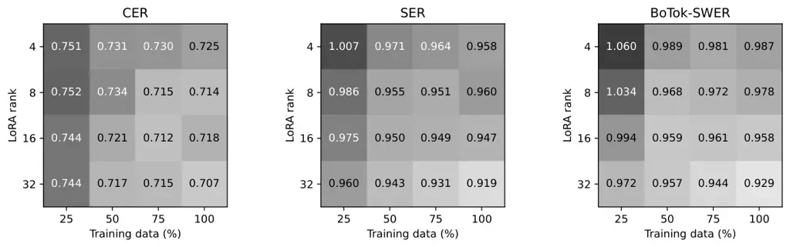

# Evaluating Tibetan Speech Recognition Across Dialects and Adaptation Regimes: A Multi-Granularity Analysis

Jacob Moore Affiliation: Lawrence Technological University, Southfield,
MI, USA    Sheng Li Affiliation: Institute of Science Tokyo, Yokohama,
JapanCorresponding authors: Jacob Moore and Sheng Li (jmoore10@ltu.edu,
sheng.li@ieee.org)

###### Abstract

Tibetan speech recognition is usually evaluated with character or
syllable error rates because the writing system does not mark word
boundaries. These metrics can rank systems differently and respond
differently to adaptation failures. We combine character error rate,
syllable error rate, and segmented word error rate in one evaluation
framework. We use dictionary-based, neural, and language-model-based
segmentation and compare their boundaries with expert annotations. We
evaluate five ASR architectures on Lhasa Tibetan, then test zero-shot
transfer and target-corpus adaptation on five additional corpus subsets.
We also vary LoRA rank and training-data size to examine adaptation
failure. The results show that a lower character error does not always
lead to a lower syllable or segmented-word error. These ranking
differences persist across corpora. Metric correlations also weaken in
some unsuccessful adaptation settings. Higher LoRA ranks improve
syllable and segmented-word scores but remain worse than full
fine-tuning in the tested range. A standardized phonological
representation provides another view of spelling errors. These findings
support evaluation at several linguistic levels and motivate better
segmentation and adaptation methods for low-resource ASR.

Index terms—Tibetan speech recognition, cross-dialect transfer,
segmented word error rate, low-resource languages, low-rank adaptation.

## I. Introduction

Automatic speech recognition (ASR) converts speech into text. Evaluation
should measure both spelling accuracy and accuracy at larger linguistic
units. Tibetan marks syllable boundaries with the tsek, but does not
consistently separate words with spaces. A word may contain one or
several syllables. Computing word error rate (WER) therefore requires
word segmentation.

Most Tibetan ASR studies report character error rate (CER). Some also
report syllable error rate (SER) \[1, 2, 3\]. CER is easy to calculate
because it requires no word segmentation. However, a small character
error can affect a whole syllable or multi-syllable word. Metrics at
different levels can therefore favor models with different error
patterns.

Our earlier IEEE Access study evaluated Tibetan ASR with segmented word
error rate (SWER) \[4\]. It applied Botok, BERT-UPOS, and Gemini
segmentation before computing WER. Character-level and higher-level
scores ranked models differently on NICT-Tib1. LoRA and quantized LoRA
also performed poorly. That study used one Lhasa read-speech corpus and
one adapter rank. It left two questions open. Do these metric
differences occur in other corpora and dialects? Can larger adapters or
more training data improve the poor adaptation results?

We address both questions in a common experimental design. We use the
updated Lhasa reference and evaluate its five checkpoints on five
additional corpus subsets. We also fine-tune each architecture on each
target subset. The target data cover Amdo, Kham, Lhasa, and Shigatse
speech. On NICT-Tib1, we test four LoRA ranks at four training-data
fractions. A standardized phonological representation provides a
separate view of spelling differences.

We study three sources of variation: architecture, corpus and dialect
shift, and adapter capacity. Metric behavior changes across these
settings. Syllable and segmented-word scores can reverse CER rankings.
Their correlations with CER can also weaken after unsuccessful
adaptation. Each SWER variant uses its own segmentation procedure, so
its scores depend on the resulting token sequences.

The contributions are as follows.

1.  1.  We combine character-, syllable-, and segmented-word evaluation. We
        distinguish tokenization, score aggregation, and utterance-level
        correlation.
2.  2.  We extend a five-architecture Lhasa benchmark with 25 zero-shot
        transfer evaluations and 25 target-corpus adaptation runs across
        five additional corpus subsets.
3.  3.  We test 16 LoRA rank-by-data configurations and three new
        full-fine-tuning baselines under a fixed epoch budget.
4.  4.  We analyze model rankings, failure modes, and metric correlations.
        We use these findings to guide Tibetan ASR evaluation.

The transfer experiments and rank ablation extend our published SWER
study \[4\]. Cross-corpus differences include recording conditions,
speakers, text domains, and dialect.

## II. Background and Related Work

### A. Tibetan units and segmentation

Tibetan syllables can contain several orthographic components, including
prefixes, superscripts, subscripts, vowel marks, and suffixes. Written
forms can preserve distinctions that pronunciation reduces \[5\]. Short
grammatical particles also carry important information. Evaluation at
the character, syllable, and word levels, therefore, describes different
aspects of the transcript.

Dictionary segmentation finds lexical entries in a sequence of
syllables. Botok provides a public implementation \[6\]. It keeps an
unrecognized syllable as a separate token. An ASR error can therefore
break a dictionary match and split one word into several tokens.
BoTok-SWER reflects both transcription errors and their effects on
dictionary segmentation.

Statistical and neural segmenters use context to predict boundaries.
Earlier methods include conditional random fields \[7\] and
CNN-BiLSTM-CRF models \[8\]. Tibetan transformer models also support
contextual analysis \[9\]. BERT-UPOS uses Tibetan BERT in a
part-of-speech pipeline \[10\]. We use its returned entities as
evaluation units. These units may differ from linguistic word
boundaries.

Segmentation also affects ASR evaluation in other writing systems. Ni
and Leung showed that Chinese segmentation standards and algorithms
change the reported WER \[11\]. A segmented-word score should therefore
specify its segmenter and tokenization standard.

### B. Recognition architectures and adaptation

Wav2Vec 2.0 and HuBERT learn speech representations through
self-supervised pretraining \[12, 13\]. Their ASR models use
connectionist temporal classification (CTC). CTC converts acoustic
outputs into token sequences by collapsing repeats and removing blanks
\[14\]. Whisper uses an acoustic encoder and an autoregressive decoder
trained on multilingual speech-text data \[15\]. These systems differ in
pretraining data, decoding objectives, and output representations. Their
comparison, therefore, reflects complete systems, not decoder
architecture alone.

LoRA introduces a low-rank update to a frozen weight matrix \[16\]. For
a matrix $`W_{0}`$, the adapted weight is

```math
W=W_{0}+\frac{\alpha}{r}BA, \tag{1}
```

where $`A`$ and $`B`$ are trainable factors, and $`r`$ is the adapter
rank. Quantized LoRA trains adapters on a quantized base model. QLoRA is
a prominent implementation \[17\]. Rank controls the available update
space. Training data and optimization determine how the model uses that
space. We test several ranks and data fractions to examine these
factors.

## III. Evaluation Framework

### A. Error rates at three granularities

Let $`R_{i}`$ and $`H_{i}`$ denote the normalized reference and
hypothesis for utterance $`i`$. For a tokenization function $`T`$, the
normalized edit error is

```math
E_{i}(T)=\frac{d(T(R_{i}),T(H_{i}))}{|T(R_{i})|}, \tag{2}
```

where $`d`$ is the Levenshtein edit distance. CER uses character units;
SER uses tsek-delimited syllables. For an automatic word segmenter
$`s`$, we define

```math
\mathrm{SWER}_{s}=\frac{S_{s}+D_{s}+I_{s}}{N_{s}}, \tag{3}
```

where the edits align $`s(R)`$ and $`s(H)`$, and $`N_{s}`$ is the
reference-token count. Insertions can cause an error rate to exceed one,
meaning that the edit count exceeds the reference length.

Botok produces BoTok-SWER, BERT-UPOS produces BERT-SWER, and Gemini 2.5
Flash Lite produces Gem-SWER. Both reference and hypothesis are
segmented independently using the same method. BoTok-SWER and BERT-SWER
cover the full test sets. Gem-SWER is available only for the original
500-utterance NICT-Tib1 subset; it was not computed for the cross-corpus
or rank-ablation extensions.

The Gemini prompt requests pipe-delimited words and preserves the
original Tibetan characters and tsek marks. Temperature is zero. The
original study excluded per-utterance Gem-SWER values above 3.0 as
segmentation failures. This threshold can also remove genuine ASR
errors. Character-preservation checks provide a more direct way to
detect invalid segmentation.

### B. Boundary agreement

The original boundary study sampled 100 NICT-Tib1 test utterances,
stratified by speaker. One expert annotated 2,634 inter-syllable
positions. Each position received a binary label indicating whether a
word boundary followed that syllable. Botok, Gemini, BERT-UPOS, and
Claude Haiku segmented the same reference transcriptions independently.
Claude served as an additional comparison and was not used to produce an
ASR score.

We measure agreement with boundary F1 and Cohen’s $`\kappa`$. Boundary
rate is the fraction of inter-syllable positions marked as word
boundaries. Gemini has the highest agreement with the expert (Table 1).
Botok marks more boundaries and produces units closer to syllables. This
study uses one annotator and clean Lhasa references. Boundary accuracy
on ASR hypotheses and other dialects remains untested.

| Method       | Boundary rate | $`\kappa`$ | F1    |
| ------------ | ------------- | ---------- | ----- |
| Human        | 41.1          | —          | —     |
| Botok        | 86.7          | 0.027      | 0.569 |
| BERT-UPOS    | 67.5          | 0.372      | 0.693 |
| Gemini       | 42.4          | 0.656      | 0.799 |
| Claude Haiku | 44.3          | 0.333      | 0.617 |

Table 1: Boundary agreement on 100 NICT-Tib1 reference utterances,
reproduced from \[4\]. Rates are percentages.

BoTok-SWER measures errors under dictionary segmentation. Gem-SWER
measures errors under LLM segmentation. Both depend on their
tokenization rules. Neither directly measures listener comprehension or
downstream task accuracy.

### C. Aggregation and uncertainty

For $`n`$ utterances, let $`e_{i}`$ be the edit count and $`N_{i}`$ the
reference-token count. We distinguish

```math
\displaystyle E_{\mathrm{micro}} \displaystyle=\frac{\sum_{i}e_{i}}{\sum_{i}N_{i}}, \tag{4}
```

```math
\displaystyle E_{\mathrm{macro}} \displaystyle=\frac{1}{n}\sum_{i}\frac{e_{i}}{N_{i}}. \tag{5}
```

Micro-averaging weights reference tokens equally. Macro-averaging
weights utterances equally. Both can use utterance bootstrap sampling.
Each micro bootstrap sample recomputes the ratio of total edits to total
reference tokens. Each macro sample recomputes the mean utterance error.

We retain the reported macro-averaged confidence intervals (CIs), based
on 10,000 utterance bootstrap samples. Primary corpus-level tables are
labeled separately. Pearson correlations use per-utterance scores within
each model-corpus cell unless stated otherwise. They describe how errors
vary across utterances rather than how metrics rank different models.

Paired bootstrap differences assess model comparisons directly. Overlap
between separate CIs does not establish equivalence. We report the
extension’s model differences descriptively because its reports do not
include the raw predictions needed for new paired tests. With few test
speakers, utterance-level CIs mainly describe uncertainty over the
sampled utterances.

### D. Standardized phonological rendering

We compute the standardized phonological error rate (PER) by mapping
both transcripts through bophono’s implementation of Tournadre’s Manual
of Standard Tibetan scheme, then calculating character edit errors. All
corpora use the same mapping. This score shows how spelling differences
change under a standard pronunciation representation. It does not
measure dialect-specific pronunciations against manually annotated
phones.

## IV. Experimental Design

### A. Corpora and splits

Table 2 summarizes the six corpus subsets. NICT-Tib1 provides the
original Lhasa benchmark \[18\]. Its 20 speakers are split into 17
training speakers and three test speakers. The test set contains 1,547
utterances.

We use the official XBMU-AMDO31 split and custom speaker-disjoint splits
for four TIBMD@MUC subsets \[19, 20\]. The subsets cover Amdo, Kham,
Lhasa, and Shigatse. Their transcripts originally separate syllables
with spaces. We replace these spaces with tsek marks to match the
NICT-Tib1 evaluation convention.

| Corpus       | Dialect or variety           | Utterances     | Speakers | Split source                  |
| ------------ | ---------------------------- | -------------- | -------- | ----------------------------- |
| NICT-Tib1    | Lhasa/Central                | 15,099 / 1,547 | 17 / 3   | Original study                |
| XBMU-AMDO31  | Amdo                         | 18,539 / 2,041 | 52 / 6   | Official OpenSLR 133 split    |
| MUC Amdo     | Amdo                         | 18,820 / 4,134 | 19 / 4   | Custom speaker-disjoint split |
| MUC Kham     | Kham                         | 4,005 / 429    | 10 / 2   | Custom speaker-disjoint split |
| MUC Lhasa    | Lhasa                        | 26,830 / 3,519 | 40 / 8   | Custom speaker-disjoint split |
| MUC Shigatse | Central, distinct from Lhasa | 6,835 / 3,894  | 3 / 1    | Custom speaker-disjoint split |

Table 2: Corpus subsets and speaker-disjoint splits. MUC denotes
TIBMD@MUC. Counts are training/test counts.

MUC Shigatse has one test speaker, and Kham has two. The results
therefore describe these corpus subsets, with limited coverage of
speaker variation within each dialect.

### B. Architectures and optimization

We compare Whisper Tiny, Base, and Small with Wav2Vec 2.0 Base and
HuBERT Base. All target-corpus runs start from pretrained models.

The cross-corpus adaptation runs use 4,000 optimizer steps, 500 warmup
steps, a per-device batch size of two, and eight gradient accumulation
steps. The effective batch size is 16. Training uses fp16 and gradient
checkpointing. Learning rates are $`3.75\times 10^{-5}`$,
$`2.5\times 10^{-5}`$, and $`1.25\times 10^{-5}`$ for Whisper Tiny,
Base, and Small, respectively, and $`10^{-4}`$ for both CTC systems. CTC
models use corpus-specific vocabularies with matching training and
decoding blank/pad identifiers.

A fixed step budget gives different epoch counts across training sets.
HuBERT completes 2.39 epochs on MUC Lhasa and 15.94 on MUC Kham. The
protocol fixes optimizer updates, while data exposure varies with corpus
size.

### C. Four complementary experiments

Experiment 1: original Lhasa benchmark. The earlier study compared five
architectures. It also tested six settings for each Whisper size:
standard fine-tuning, 8-bit and 4-bit post-training quantization,
unquantized LoRA, and LoRA with 8-bit or 4-bit base weights. Adapters
used rank eight, $`\alpha=16`$, and dropout 0.1. They targeted the key,
query, value, and output projections, plus both feed-forward layers in
every Whisper block. We retain the reported bit-width labels for these
earlier quantized settings.

Experiment 2: zero-shot transfer. We evaluate the five NICT-Tib1
checkpoints on each of the five additional test subsets. This gives 25
evaluations. The models have Tibetan training but no target-corpus
adaptation.

Experiment 3: target-corpus adaptation. We fine-tune each architecture
on each target training subset using the fixed-step protocol. This gives
25 runs. Each transfer-adaptation comparison uses the same target test
set.

Experiment 4: rank-by-data ablation. We adapt Whisper Small on NICT-Tib1
with ranks $`r\in\{4,8,16,32\}`$ and data fractions
$`f\in\{25,50,75,100\}\%`$. We sample utterances from the same 17
training speakers to preserve speaker diversity. Setting $`\alpha=2r`$
keeps $`\alpha/r`$ constant. Learned update norms can still differ
across ranks.

Each of the 16 LoRA runs uses 4.24 epochs. This fixes the number of data
passes, so smaller subsets receive fewer optimizer updates. Three
full-fine-tuning runs use 25%, 50%, and 75% of the data. The 100%
reference CER is 0.086; this condition was not rerun in the grid. We
merge each trained adapter into the shared pretrained Whisper Small
model before decoding. The grid tests unquantized LoRA.

### D. Gap analysis

For each LoRA cell, we define the descriptive gap

```math
G=\mathrm{BoTok\mbox{-}SWER}-\mathrm{CER}. \tag{6}
```

The technical report fits $`G`$ to rank, data percentage, and their
interaction using ordinary least squares:

```math
G=\beta_{0}+\beta_{r}r+\beta_{f}f+\beta_{rf}rf+\epsilon, \tag{7}
```

Here, $`f`$ is measured in percentage points. The gap compares errors
with different token denominators, so we use it as a diagnostic measure.
The regression uses 16 runs without repeated seeds. Its coefficient
tests are exploratory.

## V. Results

### A. Updated Lhasa reference

Table 3 lists the updated NICT-Tib1 reference results. Wav2Vec2 has the
lowest CER at 0.075, followed by Whisper Small at 0.086. CER and SER are
strongly correlated within each model. The cross-corpus results below
show whether they also favor the same models.

| Model         | CER   | $`r`$(CER,SER) | $`r`$(CER,BoTok) | $`r`$(SER,BoTok) | $`r`$(SER,BERT) |
| ------------- | ----- | -------------- | ---------------- | ---------------- | --------------- |
| Whisper Tiny  | 0.121 | 0.923          | 0.788            | 0.913            | 0.914           |
| Whisper Base  | 0.107 | 0.925          | 0.783            | 0.904            | 0.920           |
| Whisper Small | 0.086 | 0.929          | 0.795            | 0.921            | 0.923           |
| Wav2Vec2 Base | 0.075 | 0.886          | 0.839            | 0.868            | 0.921           |
| HuBERT Base   | 0.134 | 0.874          | 0.785            | 0.817            | 0.908           |

Table 3: Updated NICT-Tib1 reference from the cross-corpus report.
Correlations are within-model, per-utterance Pearson correlations. The
report does not separately label the aggregation of this reference CER
column.

Whisper Small’s full-data full-fine-tuning reference CER is 0.086. At
rank eight with full data, LoRA gives CER 0.714, SER 0.960, BoTok-SWER
0.978, BERT-SWER 0.951, and standardized PER 0.667. These values follow
the updated cross-corpus and LoRA reports.

### B. Zero-shot transfer

Table 4 reports the 25 transfer evaluations. Error rates are high on the
additional corpora, including MUC Lhasa. Transfer loss therefore
includes corpus differences as well as dialect differences.

The ranking reversal remains clear on the Amdo subsets. On XBMU-AMDO31,
Wav2Vec2 has the lowest CER at 0.472, while Whisper Small has lower SER
(0.762 versus 0.869) and BoTok-SWER (1.014 versus 1.157). On MUC Amdo,
Wav2Vec2 again has the lowest CER at 0.552, but Whisper Small performs
better on SER, BoTok-SWER, and BERT-SWER. Character-level preservation
therefore does not identify the best higher-granularity output in these
transfer settings.

The same pattern appears within Central Tibetan. On MUC Lhasa, Wav2Vec2
has CER 0.382 versus Whisper Small’s 0.520, but Whisper Small has lower
SER and both segmented-word scores. On Shigatse, the corresponding CER
values are 0.343 and 0.427, whereas BoTok-SWER favors Whisper Small at
0.797 versus 0.917. These comparisons show that the evaluation issue
extends beyond the original test corpus.

| Corpus       | Model    | CER   | SER   | BoTok-SWER | BERT-SWER |
| ------------ | -------- | ----- | ----- | ---------- | --------- |
| XBMU Amdo    | W-Tiny   | 0.532 | 0.832 | 1.147      | 1.060     |
|              | W-Base   | 0.500 | 0.793 | 1.104      | 1.030     |
|              | W-Small  | 0.491 | 0.762 | 1.014      | 0.964     |
|              | Wav2Vec2 | 0.472 | 0.869 | 1.157      | 1.123     |
|              | HuBERT   | 0.502 | 0.919 | 1.207      | 1.168     |
| MUC Amdo     | W-Tiny   | 0.664 | 0.945 | 1.224      | 1.121     |
|              | W-Base   | 0.642 | 0.924 | 1.201      | 1.107     |
|              | W-Small  | 0.625 | 0.896 | 1.173      | 1.098     |
|              | Wav2Vec2 | 0.552 | 0.972 | 1.237      | 1.185     |
|              | HuBERT   | 0.594 | 1.015 | 1.288      | 1.243     |
| MUC Kham     | W-Tiny   | 0.626 | 0.918 | 1.233      | 1.119     |
|              | W-Base   | 0.664 | 0.934 | 1.268      | 1.146     |
|              | W-Small  | 0.596 | 0.873 | 1.181      | 1.104     |
|              | Wav2Vec2 | 0.514 | 0.898 | 1.184      | 1.130     |
|              | HuBERT   | 0.543 | 0.927 | 1.195      | 1.163     |
| MUC Lhasa    | W-Tiny   | 0.594 | 0.800 | 1.017      | 0.995     |
|              | W-Base   | 0.541 | 0.744 | 0.945      | 0.952     |
|              | W-Small  | 0.520 | 0.705 | 0.896      | 0.918     |
|              | Wav2Vec2 | 0.382 | 0.731 | 0.960      | 0.978     |
|              | HuBERT   | 0.419 | 0.788 | 1.023      | 1.039     |
| MUC Shigatse | W-Tiny   | 0.510 | 0.704 | 0.934      | 0.937     |
|              | W-Base   | 0.472 | 0.659 | 0.868      | 0.891     |
|              | W-Small  | 0.427 | 0.601 | 0.797      | 0.840     |
|              | Wav2Vec2 | 0.343 | 0.680 | 0.917      | 0.972     |
|              | HuBERT   | 0.392 | 0.757 | 1.011      | 1.043     |

Table 4: Zero-shot evaluation of NICT-Tib1-trained checkpoints. All
values are reported as micro-averages from the cross-corpus report.
W-Tiny/Base/Small denote Whisper models. Test counts are in Table 2.

### C. Target-corpus adaptation

Table 5 reports the 25 target-corpus training runs. Adaptation improves
the four scores for every model on both Amdo subsets. For example,
Whisper Small on XBMU-AMDO31 improves from CER 0.491 to 0.144 and from
BoTok-SWER 1.014 to 0.295. On MUC Amdo, its BoTok-SWER falls from 1.173
to 0.292.

After adaptation, Wav2Vec2 still has the lowest CER on both Amdo
subsets, while Whisper Small has the lowest SER and segmented-word
scores. On XBMU-AMDO31, Wav2Vec2 achieves CER 0.105 compared with
Whisper Small’s 0.144; BoTok-SWER instead favors Whisper Small, 0.295
versus 0.353. On MUC Amdo, the difference is larger at the syllable and
word levels: Whisper Small has SER 0.222 and BoTok-SWER 0.292, compared
with 0.319 and 0.466 for Wav2Vec2.

Kham is more difficult under this protocol. All five models have higher
CER after target-corpus adaptation than under transfer. However, the
Whisper models and Wav2Vec2 have lower BoTok-SWER after adaptation. For
Whisper Small, CER rises from 0.596 to 0.679, while BoTok-SWER falls
from 1.181 to 1.078. The metrics therefore move in opposite directions
on the same model and test set. Corpus size and training exposure vary
together, which limits the interpretation of this result.

HuBERT produces empty predictions on MUC Kham and MUC Lhasa after
adaptation. All four micro error rates equal one because every reference
token is deleted. The lack of score variation also limits correlation
analysis. These failures occur at both ends of the reported epoch range,
so epoch exposure alone does not explain them.

| Corpus       | Model    | CER   | SER   | BoTok-SWER | BERT-SWER |
| ------------ | -------- | ----- | ----- | ---------- | --------- |
| MUC Kham     | W-Tiny   | 0.693 | 0.930 | 1.015      | 0.983     |
|              | W-Base   | 0.726 | 0.976 | 1.093      | 1.073     |
|              | W-Small  | 0.679 | 0.931 | 1.078      | 1.041     |
|              | Wav2Vec2 | 0.603 | 0.894 | 0.990      | 0.963     |
|              | HuBERT   | 1.000 | 1.000 | 1.000      | 1.000     |
| XBMU Amdo    | W-Tiny   | 0.178 | 0.278 | 0.391      | 0.466     |
|              | W-Base   | 0.162 | 0.249 | 0.345      | 0.426     |
|              | W-Small  | 0.144 | 0.216 | 0.295      | 0.380     |
|              | Wav2Vec2 | 0.105 | 0.229 | 0.353      | 0.419     |
|              | HuBERT   | 0.163 | 0.365 | 0.557      | 0.611     |
| MUC Amdo     | W-Tiny   | 0.218 | 0.323 | 0.429      | 0.490     |
|              | W-Base   | 0.189 | 0.275 | 0.366      | 0.430     |
|              | W-Small  | 0.160 | 0.222 | 0.292      | 0.355     |
|              | Wav2Vec2 | 0.148 | 0.319 | 0.466      | 0.529     |
|              | HuBERT   | 0.200 | 0.422 | 0.597      | 0.674     |
| MUC Lhasa    | W-Tiny   | 0.373 | 0.506 | 0.614      | 0.669     |
|              | W-Base   | 0.348 | 0.469 | 0.572      | 0.633     |
|              | W-Small  | 0.315 | 0.410 | 0.498      | 0.571     |
|              | Wav2Vec2 | 0.233 | 0.468 | 0.630      | 0.689     |
|              | HuBERT   | 1.000 | 1.000 | 1.000      | 1.000     |
| MUC Shigatse | W-Tiny   | 0.359 | 0.528 | 0.676      | 0.709     |
|              | W-Base   | 0.332 | 0.485 | 0.628      | 0.664     |
|              | W-Small  | 0.296 | 0.421 | 0.550      | 0.597     |
|              | Wav2Vec2 | 0.233 | 0.497 | 0.708      | 0.754     |
|              | HuBERT   | 0.226 | 0.480 | 0.690      | 0.735     |

Table 5: Standard fine-tuning on each target corpus under the fixed
4,000-step budget. All values are reported as micro-averages. HuBERT
outputs are empty on MUC Kham and MUC Lhasa.

### D. Correlation changes across regimes

We compute correlations within each model-corpus cell. On the NICT-Tib
reference predictions, CER-SER correlations range from 0.874 to 0.929.
For Whisper Small, CER-SER is 0.929, and SER-BoTok-SWER is 0.921.
Utterances with more errors at one level generally have more errors at
the other levels, even when the metrics favor different architectures.

CTC correlations weaken on Kham. Wav2Vec2’s CER-BoTok-SWER correlation
falls from 0.797 on XBMU-AMDO31 to 0.151 on Kham. CER-SER falls from
0.909 to 0.695, and BoTok-BERT falls from 0.804 to 0.044. The relation
between metrics thus changes with the corpus and adaptation setting.

For Whisper, CER-SER correlations are at least 0.86 across transfer and
target-adaptation cells. They are lower in the LoRA grid. Strong
within-model correlations can therefore coexist with different
architecture rankings. Poor adapter training can also weaken these
correlations.

### E. Rank-by-data ablation

Table 6 reports the 19 new training configurations. Every LoRA cell
remains far worse than the full-fine-tuning baselines. Increasing rank
helps, especially at full data. From rank four to rank 32, SER falls
from 0.958 to 0.919 and BoTok-SWER falls from 0.987 to 0.929. CER
changes from 0.725 to 0.707. Greater capacity therefore improves all
three measures, but the absolute error remains high.

More data also tends to improve performance. At rank 32, increasing the
fraction from 25% to 100% reduces CER from 0.744 to 0.707 and BoTok-SWER
from 0.972 to 0.929. At rank eight, CER improves with data while
BoTok-SWER is lowest at 50%, so the changes are not strictly monotonic
across every metric and rank.

Full fine-tuning with 25% of the data gives CER 0.455 and BoTok-SWER
0.641. Both are below the best LoRA values of 0.707 and 0.929. Full
fine-tuning improves further at 50% and 75% data. Its full-data
reference CER is 0.086. Thus, increasing rank and data within the tested
LoRA grid does not recover full-fine-tuning performance.

| Rank/method         | Data (%) | CER   | SER   | BoTok-SWER | BERT-SWER | Std. PER |
| ------------------- | -------- | ----- | ----- | ---------- | --------- | -------- |
| 4                   | 25       | 0.751 | 1.007 | 1.060      | 1.055     | 0.741    |
| 4                   | 50       | 0.731 | 0.971 | 0.989      | 1.038     | 0.704    |
| 4                   | 75       | 0.730 | 0.964 | 0.981      | 0.956     | 0.694    |
| 4                   | 100      | 0.725 | 0.958 | 0.987      | 0.962     | 0.686    |
| 8                   | 25       | 0.752 | 0.986 | 1.034      | 1.032     | 0.740    |
| 8                   | 50       | 0.734 | 0.955 | 0.968      | 0.969     | 0.699    |
| 8                   | 75       | 0.715 | 0.951 | 0.972      | 0.961     | 0.673    |
| 8                   | 100      | 0.714 | 0.960 | 0.978      | 0.951     | 0.667    |
| 16                  | 25       | 0.744 | 0.975 | 0.994      | 0.983     | 0.717    |
| 16                  | 50       | 0.721 | 0.950 | 0.959      | 0.950     | 0.683    |
| 16                  | 75       | 0.712 | 0.949 | 0.961      | 0.949     | 0.671    |
| 16                  | 100      | 0.718 | 0.947 | 0.958      | 0.949     | 0.678    |
| 32                  | 25       | 0.744 | 0.960 | 0.972      | 0.957     | 0.713    |
| 32                  | 50       | 0.717 | 0.943 | 0.957      | 0.946     | 0.678    |
| 32                  | 75       | 0.715 | 0.931 | 0.944      | 0.933     | 0.669    |
| 32                  | 100      | 0.707 | 0.919 | 0.929      | 0.932     | 0.662    |
| full FT             | 25       | 0.455 | 0.563 | 0.641      | 0.743     | 0.431    |
| full FT             | 50       | 0.408 | 0.474 | 0.530      | 0.654     | 0.394    |
| full FT             | 75       | 0.398 | 0.455 | 0.502      | 0.626     | 0.390    |
| full FT (reference) | 100      | 0.086 | —     | —          | —         | —        |

Table 6: Whisper Small rank-by-data ablation on NICT-Tib1. The supplied
report does not explicitly label the aggregation of this grid; values
are preserved as reported. Standardized PER uses the common MST
rendering. Full FT means full fine-tuning. The full-data reference
provides CER only and was not rerun in the grid.

The gap regression gives a rank coefficient of $`-0.00207`$
($`p=0.0375`$), a data coefficient of $`-0.00040`$ ($`p=0.1223`$), and
an interaction coefficient of $`0.000011`$ ($`p=0.3996`$). The model has
$`R^{2}=0.596`$. Because it includes an uncentered interaction, the rank
coefficient applies at zero data. Within the tested range, the fitted
rank slope is $`-0.00207+0.000011f`$. We interpret these estimates with
the observed grid. The data coefficient’s $`p`$ value does not rule out
a data effect.

Mean per-cell CER-SER correlation increases from 0.489 at rank four to
0.663 at rank 32 (Table 7). Mean CER-BoTok-SWER correlation rises from
0.233 to 0.336, with a non-monotonic intermediate value at rank eight.
The full-fine-tuning subset models have much higher correlations.
Increasing rank thus improves part of the correlation structure, but
does not restore the full-fine-tuning behavior within this grid.

| Group        | Cells | CER-SER | CER-BoTok |
| ------------ | ----- | ------- | --------- |
| Full FT      | 3     | .955    | .846      |
| LoRA rank 4  | 4     | .489    | .233      |
| LoRA rank 8  | 4     | .516    | .190      |
| LoRA rank 16 | 4     | .581    | .279      |
| LoRA rank 32 | 4     | .663    | .336      |

Table 7: Mean within-cell Pearson correlations in the ablation. Means
average model-cell correlations, rather than pooling utterances.



Figure 1: The reported LoRA grid. Increasing capacity and data improves
many cells, but all remain above the newly trained full-fine-tuning
baselines in Table 6. Values and labels reproduce the extension report.

### F. Standardized phonological scores

Standardized PER is often lower than orthographic CER in the macro
results. The mean relative reduction is 19.1% across 25 transfer cells
and 13.4% across 23 non-collapsed adaptation cells. These aggregate
values follow the cross-corpus report.

For in-domain XBMU-AMDO31 Whisper Small, macro CER is 0.127 and
standardized PER is 0.106. On Kham, the values are 0.699 and 0.616. The
standard mapping removes some orthographic distinctions, but substantial
error remains on Kham. Since all varieties use a Lhasa-based mapping,
the scores describe standardized representations rather than actual
dialect-specific pronunciation.

## VI. Discussion

### A. What segmented-word evaluation adds

Two patterns emerge. First, the lowest CER often does not identify the
lowest SER or SWER. This occurs on the original corpus and on additional
Amdo and Central Tibetan subsets. Second, within-model correlations
weaken in some difficult adaptation settings, especially the LoRA grid
and Wav2Vec2 on Kham.

SER uses explicit syllable boundaries, so it requires no inferred word
boundaries. In several comparisons, it selects the same model as SWER.
SWER adds information about errors under a specific word segmentation
procedure. Its value should therefore be assessed alongside SER as well
as CER.

Botok can split a corrupted multi-syllable word into shorter tokens.
This can increase the error count after segmentation. BERT-UPOS and
Gemini use different boundaries and produce different score scales.
Segment length, reference-token count, and hypothesis boundaries all
affect SWER.

Gemini agrees best with the expert in the original Lhasa boundary study.
The cross-corpus experiments use Botok and BERT-UPOS, whose boundaries
were not validated on Amdo or Kham. Dialect-specific boundary
annotations would help interpret their scores.

### B. What the ablation establishes

Higher rank improves several LoRA scores, but all tested configurations
remain worse than the new full-fine-tuning baselines. The tested
increases in capacity and data therefore reduce errors without resolving
the adaptation failure.

Several training choices may affect the remaining gap, including adapter
placement, learning rate, update count, checkpoint selection, and
decoding. The design fixes $`\alpha/r`$ and epoch count. It still allows
learned update norms and optimizer update counts to vary. Repeated seeds
and further optimization tests would help separate these effects.

The grid tests unquantized adapters merged into the base model before
decoding. Extending its capacity findings to quantized LoRA requires a
separate controlled comparison.

### C. Aggregation as part of the evaluation

For a fixed tokenization and nonempty reference, micro error is a
reference-length-weighted average of per-utterance error. The difference
from macro error is

```math
E_{\mathrm{micro}}-E_{\mathrm{macro}}=\frac{\operatorname{Cov}(N_{i},E_{i})}{\overline{N}}. \tag{8}
```

A positive difference means that longer references tend to have higher
utterance error rates. Short-reference errors receive more relative
weight in the macro average.

For Whisper Tiny transferred to XBMU-AMDO31, micro BERT-SWER is 1.060
and macro BERT-SWER is 0.493. The gap shows how reference-length
weighting changes the score. Repetition loops also occur in some
predictions. Their contribution to the two aggregates requires
per-utterance counts.

### D. Practical reporting recommendations

Tibetan ASR evaluation should report CER and SER together. A named
segmented-word score is also useful when word-level processing matters.
Every table should state its aggregation. Micro and macro scores should
use the same per-utterance edit counts.

SWER reporting should specify the segmenter version, configuration,
normalization, and handling of malformed output. LLM segmentation also
needs a fixed prompt and character-preservation checks. Boundary
agreement should be assessed on both clean references and ASR
hypotheses.

Model comparisons should use paired differences on the same test
utterances. Correlation analyses should state whether they use
individual cells, cell averages, or pooled predictions. Empty
predictions and repetition loops should be counted separately to
identify failure types.

### E. Scope and reproducibility

The original study provides a public evaluation package and a
100-utterance boundary dataset. This study uses the updated cross-corpus
and LoRA reference scores, correlations, and regression results. Raw
per-utterance counts would allow further paired analyses.

Reproduction requires model identifiers and revisions, speaker splits,
random seeds, and data-sampling lists. It also requires optimizer
settings, adapter targets, checkpoint selection, decoding arguments, and
segmenter versions. Released scoring records should include
per-utterance edit counts and separate micro and macro aggregates.
Quantization experiments should specify the bit-width implementation.

The experiments cover read speech with limited test-speaker diversity.
Future work should evaluate conversational speech, listener
comprehension, and downstream translation or retrieval. Multiple
boundary annotators and dialect-specific phonological mappings would
also improve the evaluation.

## VII. Conclusion

We evaluated Tibetan ASR across architectures, corpora, and adaptation
settings. Lower character error did not consistently lead to lower
syllable or segmented-word error. Several ranking reversals persisted
across corpora. Metric correlations also changed under difficult
adaptation conditions. Higher LoRA ranks improved some scores but
remained worse than full fine-tuning within the tested grid.
Standardized phonological scores provided another view of spelling
errors. These results support evaluation at several linguistic levels,
with explicit choices for segmentation and aggregation. Future work
should link these scores to dialect-aware human judgments and downstream
performance and improve adaptation under limited supervision.

## References

- \[1\] S. Qin, L. Wang, and S. Li (2022) Improving low-resource tibetan
  end-to-end ASR by multilingual and multilevel unit modeling. Journal
  of Audio, Speech and Music Processing. Note: Article 2 Cited by: §1.
- \[2\] Y. Zhao, J. Yue, X. Xu, L. Wu, and X. Li (2019) End-to-end-based
  tibetan multitask speech recognition. IEEE Access 7,
  pp. 162519–162529. Cited by: §1.
- \[3\] Y. Liu, Y. Zhao, and X. Xu (2024) Exploring task-diverse
  meta-learning on tibetan multi-dialect speech recognition. Journal of
  Audio, Speech and Music Processing. Note: Article 37 Cited by: §1.
- \[4\] J. Moore, S. Li, and P. Lauren (2026) Evaluating tibetan ASR
  with segmented word error rate: beyond character-level metrics. IEEE
  Access 14, pp. 101790–101805. External Links:
  [Document](https://dx.doi.org/10.1109/ACCESS.2026.3709206) Cited by:
  §1, §1, Table 1.
- \[5\] N. Tournadre (2003) Manual of standard tibetan: language and
  civilization. Snow Lion, Ithaca, NY, USA. Cited by: §2.1.
- \[6\] OpenPecha Botok: tibetan tokenizer. Note:
  [https://github.com/OpenPecha/Botok](https://github.com/OpenPecha/Botok)
  Cited by: §2.1.
- \[7\] H. Liu, M. Nuo, L. Ma, J. Wu, and Y. He (2011) Tibetan word
  segmentation as syllable tagging using conditional random field. In
  Proceedings of the 25th Pacific Asia Conference on Language,
  Information and Computation, pp. 168–177. External Links:
  [Link](https://aclanthology.org/Y11-1018/) Cited by: §2.1.
- \[8\] L. Wang, H. Yang, X. Xing, and Y. Yan (2019) Tibetan word
  segmentation method based on CNN-BiLSTM-CRF model. In International
  Conference on Asian Language Processing, pp. 319–324. Cited by: §2.1.
- \[9\] S. Liu, J. Deng, Y. Sun, and X. Zhao (2022) TiBERT: tibetan
  pre-trained language model. In IEEE International Conference on
  Systems, Man, and Cybernetics, pp. 2956–2961. Cited by: §2.1.
- \[10\] K. Yasuoka (2022) Esupar: efficient string universal POS and
  ARc. Note:
  [https://github.com/KoichiYasuoka/esupar](https://github.com/KoichiYasuoka/esupar)
  Cited by: §2.1.
- \[11\] C. Ni and C.-C. Leung (2014) Investigation of using different
  chinese word segmentation standards and algorithms for automatic
  speech recognition. In 9th International Symposium on Chinese Spoken
  Language Processing, pp. 44–48. Cited by: §2.1.
- \[12\] A. Baevski, Y. Zhou, A. Mohamed, and M. Auli (2020) Wav2vec
  2.0: a framework for self-supervised learning of speech
  representations. In Advances in Neural Information Processing Systems,
  Vol. 33, pp. 12449–12460. Cited by: §2.2.
- \[13\] W. Hsu, B. Bolte, Y. H. Tsai, K. Lakhotia, R. Salakhutdinov,
  and A. Mohamed (2021) HuBERT: self-supervised speech representation
  learning by masked prediction of hidden units. IEEE/ACM Transactions
  on Audio, Speech, and Language Processing 29, pp. 3451–3460. Cited by:
  §2.2.
- \[14\] A. Graves (2012) Connectionist temporal classification. In
  Supervised Sequence Labelling with Recurrent Neural Networks,
  pp. 61–93. Cited by: §2.2.
- \[15\] A. Radford, J. W. Kim, T. Xu, G. Brockman, C. McLeavey, and I.
  Sutskever (2023) Robust speech recognition via large-scale weak
  supervision. In International Conference on Machine Learning,
  pp. 28492–28518. Cited by: §2.2.
- \[16\] E. J. Hu, Y. Shen, P. Wallis, Z. Allen-Zhu, Y. Li, S. Wang, L.
  Wang, and W. Chen (2022) LoRA: low-rank adaptation of large language
  models. In International Conference on Learning Representations, Cited
  by: §2.2.
- \[17\] T. Dettmers, A. Pagnoni, A. Holtzman, and L. Zettlemoyer (2023)
  QLoRA: efficient finetuning of quantized LLMs. External Links:
  2305.14314 Cited by: §2.2.
- \[18\] K. Soky, Z. Gong, and S. Li (2022) NICT-Tib1: a public speech
  corpus of Lhasa dialect for benchmarking tibetan language speech
  recognition systems. In 25th Oriental COCOSDA, pp. 1–5. Cited by:
  §4.1.
- \[19\] Northwest Minzu University (2025) XBMU-AMDO31: a speech
  recognition dataset for the Amdo dialect of tibetan. Note:
  [https://www.openslr.org/133/](https://www.openslr.org/133/) Cited by:
  §4.1.
- \[20\] Y. Zhao, X. Xu, J. Yue, W. Song, X. Li, L. Wu, and Q. Ji (2020)
  An open speech resource for tibetan multi-dialect and multitask
  recognition. International Journal of Computer Science and Engineering
  22 (2/3), pp. 297–304. Note: Corpus distributed via OpenSLR 124 Cited
  by: §4.1.
