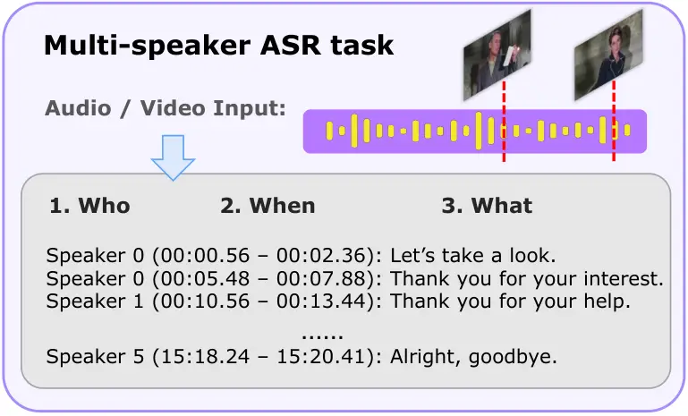
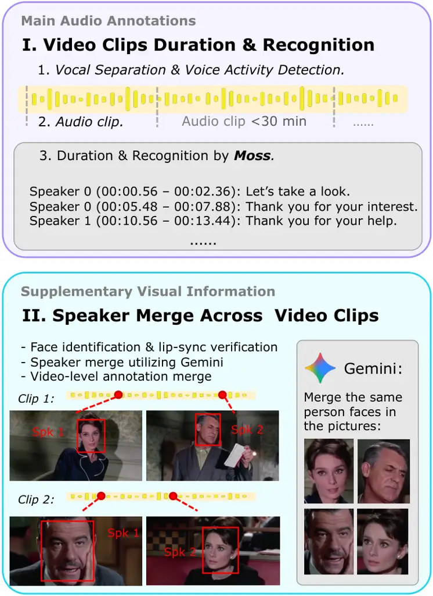
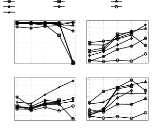
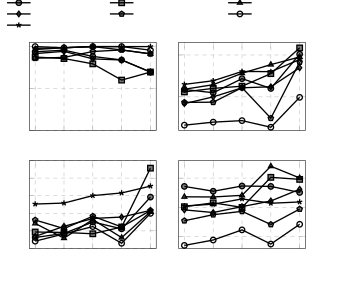
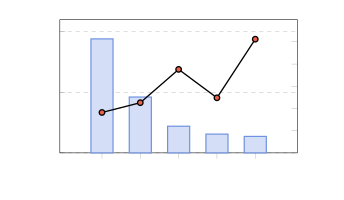
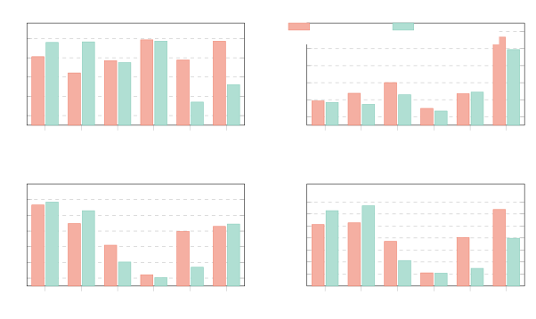

# Omnilingual-MsASR: Benchmarking Multimodal, Multilingual, Long-Form Multi-Speaker ASR of Omni Large Language Models

Yuan Ge Affiliation:  Northeastern University, China Affiliation: 
Alibaba Token Hub, Alibaba    Pei Zhang Affiliation:  Alibaba Token Hub,
Alibaba    Xize Cheng Affiliation:  Alibaba Token Hub, Alibaba   
Lingzhou Mu Affiliation:  Alibaba Token Hub, Alibaba    Mingyang Wang
Affiliation:  Alibaba Token Hub, Alibaba    Jin Xu Affiliation:  Alibaba
Token Hub, Alibaba    Baosong Yang, Shengxiang Gao, Jingbo Zhu, Zhengtao
Yu, Tong Xiao ^(†)^(†)thanks: Corresponding author. Affiliation: 
Northeastern University, China Affiliation:  Alibaba Token Hub, Alibaba
Affiliation:  Kunming University of Science and Technology Affiliation: 
NiuTrans Research

###### Abstract

Omni-modal large language models (LLMs) have achieved remarkable
progress in audio and video understanding. However, existing models
struggle with long-form, multi-speaker videos, especially in
understanding the entire video and recognizing who says what and when.
To characterize the capability limit of current omni LLMs and guide
future model development, we introduce OmniLingual-MsASR, a
multilingual, multimodal benchmark for long-form Multi-speaker Automatic
Speech Recognition (MsASR) covering six languages, recordings up to 30
minutes, and scenarios with up to 20 speakers. OmniLingual-MsASR
provides parallel audio and video inputs to evaluate models’ cross-modal
consistency and their ability to exploit complementary cues across
modalities. Extensive evaluations of leading omni-modal LLMs reveal
substantial performance bottlenecks, while their tcpWERs frequently
exceed $`100\%`$. These findings highlight fine-grained temporal
localization, speaker disambiguation, and cross-modal synergy as key
challenges for future omni-modal foundation models ¹¹ 1 Our work is
available at
[https://github.com/QwenLM/Omnilingua-Bench/tree/main/Omnilingua-MSpeaker](https://github.com/QwenLM/Omnilingua-Bench/tree/main/Omnilingua-MSpeaker)..

## 1 Introduction

Omni large language models (LLMs) have recently achieved remarkable
progress in audio understanding (Arora et al., 2025; Guo et al., 2026).
Multi-speaker automatic speech recognition (MsASR) reflects this ability
by transcribing audio into structured text that specifies who speaks,
when each utterance begins and ends, and what is said (He and Whitehill,
2025; Wang et al., 2024; Lin et al., 2025; Shi et al., 2026), as shown
in Fig. 1. Such transcription grounds downstream tasks such as speech
translation and voice interaction.

However, existing benchmarks fail to probe the boundary of omni LLMs’
audio-visual transcription, where videos in practice are long-form,
multilingual, and multi-speaker. Traditional MsASR datasets annotate
speaker identity, utterance boundaries, and transcripts, but cover only
monolingual English or Chinese (Kraaij et al., 2005; Fu et al., 2021; Yu
et al., 2022; Cornell et al., 2023). Multilingual dialogue benchmarks
push forward language coverage, but the audio durations remain far
shorter than the context-window limits of modern LLMs (Wang et al.,
2021; Sinhamahapatra et al., 2026; Mu et al., 2026). Moreover, these
benchmarks overlook the potential of the visual modality to aid speaker
identification and transcription.



Figure 1: Overview of the MsASR task. The model is required to jointly
predicting speaker identities (who), timestamps (when), and text
transcriptions (what) in a structured format as shown in Sec. 4.2.

We introduce OmniLingual-MsASR, a multimodal, multilingual, and
long-form multi-speaker ASR benchmark that reflects the real
audio-visual transcription capability boundary of omni LLMs. We collect
publicly available videos on diverse topics spanning six languages,
namely Spanish, French, Japanese, Korean, Russian, and Thai, with audio
durations ranging from short clips of around 20 seconds to long videos
of about 30 minutes, each containing up to 20 speakers. The MsASR
annotations combine an automatic pipeline built from frontier tools with
careful manual verification by experienced language experts. The
resulting OmniLingual-MsASR comprises roughly 50 videos per language
across the six languages, totaling 297 long-form multi-speaker ASR
instances.

We conduct extensive evaluations of leading omni-modal LLMs, including
two open-source models and seven frontier commercial omni LLMs.
Empirical results reveal that while current models achieve robust
linguistic transcription, precise temporal grounding remains a major
bottleneck: Gemini family omni-LLMs exhibit low cpWER (e.g., 0.23–0.44)
but drastically worse tcpWER that frequently exceeds 1.0. Furthermore,
model efficacy deteriorates sharply as context scales. Extending audio
inputs toward 30 minutes compounds timestamp errors, and scaling speaker
counts from two to over seven drives overall speaker confusion from 9.1%
to 25.6%, causing Gemini 3.7 Flash’s cpWER to surge from 0.387 to 1.113.
Finally, our parallel audio-video benchmark uncover divergent
cross-modal integration strategies across architectures: while visual
cues markedly boost temporal localization for Doubao-Seed-2.0-Lite, they
act as confounding noise that degrades temporal grounding for Gemini 3.7
Flash. These findings highlight that fine-grained temporal estimation,
multi-speaker disambiguation, and cross-modal synergy remain critical
for future omni-modal foundation models. Our contributions are:

- •
  We introduce OmniLingual-MsASR, a multimodal, multilingual, and
  long-form multi-speaker ASR benchmark featuring paralleled audio and
  video inputs.
- •
  We develop a reliable annotation pipeline that integrates audio and
  visual cues to generate high-quality pseudo-labels, followed by human
  refinement under standardized guidelines to ensure final data quality.
- •
  We conduct a systematic evaluation across widely leading commercial
  and open-source LLMs, highlighting the current strengths and key
  challenges in long-form MsASR.

## 2 Related Work

### 2.1 Omni-modal Large Language Models

Recent omni-modal large language models extend text-centric LLMs toward
unified perception across text, vision, audio, and video, as exemplified
by GPT-4o (OpenAI, 2024), Gemini 2.5 (Comanici et al., 2025), and
Qwen3.8-Omni (Team, 2026b). Their audio capabilities have been evaluated
on increasingly diverse tasks, including speech recognition, audio
question answering, acoustic understanding and reasoning (Yang et al.,
2024; Ge et al., 2026a; S Sakshi et al., 2025; Ge et al., 2026b).

However, broad audio competence does not necessarily imply reliable
speaker-aware transcription. Recent studies reveal a substantial gap
between understanding what was said and identifying who said it (Wang et
al., 2025; Kwon et al., 2026). By requiring models to bind linguistic
content to persistent speaker identities across turns and overlaps,
speaker-aware transcription provides a concrete, though not exhaustive,
indicator of fine-grained conversational understanding.

### 2.2 Long-Form Video Understanding

Long-form video understanding evaluates whether models can retain,
retrieve, and reason over information distributed across extended
temporal contexts. EgoSchema (Mangalam et al., 2023), LongVideoBench (Wu
et al., 2024), MLVU (Zhou et al., 2025), and Video-MME (Fu et al., 2025)
extend video-language evaluation to minute- or hour-long inputs, with an
emphasis on long-range memory, information retrieval, and temporal
reasoning.

The emergence of Omni LLMs has further expanded this setting from
predominantly visual-language inputs to joint audio-visual perception.
LongVALE (Geng et al., 2025) introduces temporally grounded
vision-audio-language events, while OmniVideoBench (Li et al., 2026),
LVOmniBench (Tao et al., 2026) and Mula-bench (Yang et al., 2026)
evaluate cross-modal reasoning over extended audio-visual contexts (Tao
et al., 2026; Yang et al., 2026). However, their question-answering and
event-description objectives do not capture dense speaker-aware
transcription, which requires jointly preserving speech content, speaker
identity, and temporal boundaries.


Figure 2: Benchmark composition of OmniLingual-MsASR in three views:
languages, audio duration and speaker count. For each view we shows case
quantity, category labels, and necessary explanations.

### 2.3 Multilingual Multi-Speaker ASR

Multi-speaker ASR aims to recover speaker attributed transcripts from
conversations containing multiple, potentially overlapping speakers.
Unlike conventional ASR, which determines what was said, or speaker
diarization, which determines who spoke when, multi-speaker ASR must
jointly resolve speech content and speaker attribution.

Meeting corpora and challenges such as AMI (Carletta et al., 2006),
CHiME-6 (Watanabe et al., 2020b), Aishell-3 (Shi et al., 2021),
AliMeeting (Yu et al., 2022), and NOTSOFAR-1 (Vinnikov et al., 2024)
have established standard evaluation settings for multi-speaker
transcription. Recent efforts such as Muscat (Sinhamahapatra et al., 2026) and MLC-SLM (Mu et al., 2026) further extend conversational speech
modeling to multilingual conditions. Nevertheless, existing benchmarks
remain concentrated on short-form audio, acoustic domains, or
specialized sepeech systems without omni LLMs.

Multi speaker ASR methods have progressed from modular diarization,
separation, and ASR pipelines to permutation-invariant and serialized
end-to-end modeling (Yu et al., 2017; Kanda et al., 2020), followed by
LLM-based systems such as MT-LLM and SpeakerLM (Meng et al., 2025; Yin
et al., 2026). Although these systems demonstrate the feasibility of
LLM-based multi-speaker transcription, existing evaluations provide only
limited evidence about general-purpose omni LLMs (Kwon et al., 2026;
Tawara et al., 2026). Their robustness across languages, recording
durations, speaker counts, and overlap conditions therefore remains
insufficiently characterized.

## 3 OmniLingual-MsASR

### 3.1 Overview

In this section, we introduce OmniLingual-MsASR, a multimodal,
multilingual, and long-form MsASR benchmark designed to probe the
capability boundaries of omni LLMs in real-world audio-visual
transcription. As shown in Fig. 2, OmniLingual-MsASR comprises 297
instances spanning six diverse languages, with 50 instances each for
Spanish, Japanese, Korean, Thai, and Russian, alongside 47 instances for
French.

To assess model scalability across extended temporal contexts, instance
durations range from 20 s short clips to 30 min long-form videos.
Considering the sample distribution across durations, we stratify
OmniLingual-MsASR into five tiers partitioned by cutoffs at 1, 3, 8, and
15 minutes, as shown in the middle panel of Fig. 2.

Furthermore, speaker density serves as a critical indicator of MsASR
complexity. OmniLingual-MsASR scales up to 20 speakers per instance to
challenge omni LLMs at their limits. To maintain balanced sample sizes
across subsets, we aggregate instances into discrete categories,
specifically consolidating cases with five to six speakers and those
with seven or more speakers, thereby facilitating a robust evaluation of
speaker identity, detailed in the right panel of Fig. 2.

Notably, OmniLingual-MsASR provides parallel evaluation for both
audio-only and audio-visual MsASR. For human listeners, speaker
identification relies on purely acoustic signals is inherently
challenging, especially under high vocal similarity. Conversely, visual
information such as facial appearance provides crucial speaker cues.
Through this dual-eval setup, we explore whether omni LLMs have
surpassed the inflection point where visual context effectively enhances
speaker identification, or redundant visual signals conversely introduce
noise that impact model performance.

### 3.2 Data Source

To ensure public accessibility and reproducibility, we collected
long-form video candidates ranging from 1.5 to 2 hours from YouTube,
initially sourcing 10 videos per language. We then conducted manual
filtering to discard videos with fewer than two speakers, as well as
variety shows with excessive speech overlap, which poses significant
annotation challenges. The resulting corpus consists of multilingual,
multi-speaker long-form videos spanning diverse domains, including
meetings, podcasts, news broadcasts, TV dramas, speeches, prayers, and
daily vlogs.



Figure 3: Overview of automatic data pipeline. The pipeline first
leverages audio models to segment and annotate individual clips,
followed by visual models to identify and consolidate cross-clip speaker
identities into pseudo MsASR annotations of long-form videos.

### 3.3 Automatic Data Pipeline

To generate high-quality pseudo labels, our automated pipeline leverages
frontier models for scalable annotation, as illustrated in Fig. 3. To
annotate long-form videos that exceed model context limits, the pipeline
first acoustically segments raw videos into clips, subsequently
generates clip-level annotations using MOSS Transcribe Diarize 0.9B, and
finally reconciles cross-clip speaker identities using complementary
visual cues to form unified long-form annotations of the whole videos.

#### Audio-Centric Pseudo Labeling.

Given the diverse acoustic noise in YouTube videos, we first apply
MossFormer2_SE for speech enhancement to improve annotation robustness.
Because full-length recordings ($`\sim`$2 hours) exceed the context
window of MOSS Transcribe Diarize 0.9B, we segment the video streams
into parallel video and audio sub-30-minute clips. To prevent bisecting
utterances, we utlize Voice Activity Detection and split clips
exclusively along silence intervals. Finally, each clip is processed by
MOSS Transcribe Diarize 0.9B to extract multi-speaker ASR pseudo-labels,
comprising speaker durations and transcriptions.

#### Visual-Aided Cross-Clip Identity Merging.

Independently annotating individual clips introduces fragmented, local
speaker IDs for the same individual across clips as shown in Fig. 3.
Audio-only clustering struggles as fixed acoustic embedding thresholds
fail to balance inner-speaker diversity against inter-speaker timbre
similarity. Therefore, we leverage visual facial cues to globally align
speaker identities. Specifically, we utilize SyncNet (Chung and
Zisserman, 2016) for lip-sync verification to identify active speaking
faces, and then prompt Gemini 3.1 Pro with paired local speaker IDs and
face crops to resolve cross-clip identities. Then, utterance timestamps
are subsequently shifted to the global timeline. To ensure balanced
durations and category distributions, benchmark samples are sampled as
sub-segments with potential overlap from these merged video annotations.

### 3.4 Linguistic Expert Annotation

Following the automatic data pipeline, we implemented a rigorous
three-stage verification protocol: Annotation, Review, and
Spot-checking.

The first two stages were conducted by linguistic experts, who verified
the alignment of speaker identities, timestamps, and transcriptions
against the corresponding videos. Specifically, annotators first
corrected the pipeline outputs, after which an independent, disjoint
pool of experts reviewed the annotations to ensure quality. In the final
stage, the authors audited a randomly sampled subset. Constrained by
multilingual proficiency, this check primarily focused on
language-agnostic attributes, namely speaker labels and timestamps.
Detailed annotation guidelines are provided in Appendix A.

### 3.5 Ethical and Privacy Audit

Following expert verification, we collected approximately 60 annotated
instances per language, from which 50 instances were carefully curated
to form a preliminary benchmark, prioritizing balanced temporal
distribution and content diversity.

Subsequently, we conducted an ethical and privacy audit. During this
stage, three French instances were found to contain Personally
Identifiable Information (PII), specifically authentic social media
handles and email addresses. To mitigate privacy leakage risks and
adhere to ethical research standards, we removed these instances,
yielding a finalized benchmark of 297 high quality samples.

## 4 Experiments

### 4.1 Experimental Setup

#### Baseline models.

We conduct extensive evaluations of frontier omni-modal LLMs.
Open-source models include task-specific MOSS Transcribe Diarize 0.9B
(AI et al., 2026) and omni LLM Qwen3-Omni-30B-A3B (Xu et al., 2025). We
also evaluate top-tier commercial models including Gemini 3.1 Pro,
Gemini 3.7 Flash, Gemini 3.8 Flash, Qwen3.5-Omni-Plus (Team, 2026a),
Qwen3.8-Omni-Flash (Team, 2026b), Muse Spark 1.2, and
Doubao-Seed-2.0-Lite.

#### Inference hyperparameter.

For all models, we retain the default inference hyperparameter settings
to elicit optimal model performance. The open-source model runs on 8x
A100 GPUs.

### 4.2 Evaluate Metrics

To evaluate the MsASR performance, we use four metrics: parse rate,
diarization error rate (DER) (Shafey et al., 2019), concatenated
minimum-permutation word error rate (cpWER) (Watanabe et al., 2020a),
and time-constrained permutation WER (tcpWER) (von Neumann et al.,
2023).

#### Parse rate

measures the instruction following capability of omni LLMs. We require
omni LLMs to output speaker id, timestamp, and text as follow:


Few cases that models fail to follow the instruction or degenerate into
repetitive generation, rendering their outputs unparsable. We exclude
such cases from the three WER metrics, so that a few outliers with
extremely high error rates do not distort the overall assessment of
model capability.

#### DER

measures who spoke when while ignoring the transcribed content, which is
defined as:

```math
\text{DER}=\frac{T_{\text{miss}}+T_{\text{fa}}+T_{\text{conf}}}{T_{\text{total}}} \tag{1}
```

where $`T_{\text{miss}}`$ is the missed-speech time, $`T_{\text{fa}}`$
is the false-alarm time, and $`T_{\text{conf}}`$ is the
speaker-confusion time, while $`T_{\text{total}}`$ denotes the total
reference speaking time. We use a forgiveness collar of $`0.5`$ s around
each reference boundary in DER.

#### cpWER

jointly scores transcription and speaker attribution while ignoring the
timestamps:

```math
\text{cpWER}=\frac{S+D+I}{N} \tag{2}
```

where $`S`$, $`D`$, and $`I`$ are the total numbers of substituted,
deleted, and inserted words summed over all speakers under the speaker
pairing that minimizes the total edit distance between the per-speaker
concatenated transcripts, and $`N`$ is the total number of reference
words.

#### tcpWER

augments cpWER by allowing a reference and hypothesis word to be aligned
only when their timestamps are close, so temporally misplaced words are
penalized even if the text is correct:

```math
\text{cpWER}=\frac{S_{\tau}+D_{\tau}+I_{\tau}}{N} \tag{3}
```

where $`S_{\tau}`$, $`D_{\tau}`$, and $`I_{\tau}`$ are the substituted,
deleted, and inserted word counts obtained when only words whose
timestamps lie within the collar $`\tau`$ are allowed to be aligned, and
$`N`$ is the total number of reference words as above. We use a temporal
collar of $`\tau=5`$ s in tcpWER.

|                                                         |       |       |       |        |       |       |       |        |       |       |       |        |
| ------------------------------------------------------- | ----- | ----- | ----- | ------ | ----- | ----- | ----- | ------ | ----- | ----- | ----- | ------ |
| Model                                                   | es    |       |       |        | fr    |       |       |        | ja    |       |       |        |
|                                                         | Parse | DER   | cpWER | tcpWER | Parse | DER   | cpWER | tcpWER | Parse | DER   | cpWER | tcpWER |
| I. Frontier Commercial Omni-Modal Large Language Models |       |       |       |        |       |       |       |        |       |       |       |        |
| gemini 3.1 pro                                          | 90    | 0.628 | 0.257 | 1.385  | 88    | 0.567 | 0.373 | 1.248  | 90    | 0.599 | 0.423 | 1.311  |
| gemini 3.7 flash                                        | 84    | 0.516 | 0.294 | 0.921  | 76    | 0.637 | 0.348 | 1.050  | 88    | 0.565 | 0.410 | 0.987  |
| gemini 3.8 flash                                        | 98    | 0.590 | 0.230 | 1.079  | 98    | 0.738 | 0.440 | 1.322  | 96    | 0.677 | 0.441 | 1.325  |
| qwen3.5-omni-plus                                       | 76    | 0.383 | 0.395 | 0.864  | 84    | 0.360 | 0.439 | 0.799  | 94    | 0.464 | 0.577 | 0.873  |
| qwen3.8-omni-flash                                      | 100   | 0.160 | 0.267 | 0.344  | 100   | 0.178 | 0.362 | 0.453  | 98    | 0.085 | 0.329 | 0.360  |
| muse spark 1.2                                          | 100   | 0.696 | 0.678 | 1.038  | 98    | 0.779 | 0.782 | 1.090  | 100   | 0.757 | 0.804 | 1.034  |
| doubao-seed-2.0-lite                                    | 86    | 0.390 | 0.288 | 0.865  | 90    | 0.532 | 0.437 | 1.041  | 90    | 0.447 | 0.424 | 0.990  |
| II. Open Source Omni-Modal Large Language Model         |       |       |       |        |       |       |       |        |       |       |       |        |
| qwen3-omni-30b-thinking                                 | 80    | 0.532 | 0.469 | 0.996  | 77    | 0.694 | 0.672 | 1.251  | 74    | 0.561 | 0.597 | 1.058  |
| III. Expert Diarization Model                           |       |       |       |        |       |       |       |        |       |       |       |        |
| moss-transcribe-diarize                                 | 100   | 0.115 | 0.206 | 0.213  | 100   | 0.187 | 0.348 | 0.377  | 100   | 0.059 | 0.273 | 0.276  |
| Model                                                   | ko    |       |       |        | ru    |       |       |        | th    |       |       |        |
|                                                         | Parse | DER   | cpWER | tcpWER | Parse | DER   | cpWER | tcpWER | Parse | DER   | cpWER | tcpWER |
| I. Frontier Commercial Omni-Modal Large Language Models |       |       |       |        |       |       |       |        |       |       |       |        |
| gemini 3.1 pro                                          | 92    | 0.589 | 0.302 | 1.275  | 90    | 0.567 | 0.436 | 1.344  | 90    | 0.806 | 1.352 | 1.828  |
| gemini 3.7 flash                                        | 70    | 0.662 | 0.315 | 1.044  | 86    | 0.737 | 0.453 | 1.230  | 88    | 0.684 | 1.654 | 2.099  |
| gemini 3.8 flash                                        | 94    | 0.697 | 0.317 | 1.185  | 100   | 0.662 | 0.402 | 1.189  | 96    | 1.059 | 2.457 | 2.988  |
| qwen3.5-omni-plus                                       | 96    | 0.634 | 0.611 | 0.887  | 90    | 0.305 | 0.388 | 0.676  | 90    | 0.855 | 1.217 | 1.432  |
| qwen3.8-omni-flash                                      | 100   | 0.171 | 0.277 | 0.405  | 100   | 0.185 | 0.305 | 0.491  | 98    | 0.682 | 1.323 | 1.412  |
| muse spark 1.2                                          | 96    | 0.763 | 0.807 | 1.066  | 100   | 0.722 | 0.780 | 1.040  | 98    | 0.732 | 0.995 | 1.117  |
| doubao-seed-2.0-lite                                    | 88    | 0.517 | 0.467 | 0.952  | 90    | 0.575 | 0.466 | 1.042  | 88    | 0.619 | 1.011 | 1.306  |
| II. Open Source Omni-Modal Large Language Model         |       |       |       |        |       |       |       |        |       |       |       |        |
| qwen3-omni-30b-thinking                                 | 82    | 0.826 | 0.673 | 1.280  | 82    | 0.661 | 0.769 | 1.452  | 58    | 0.804 | 1.081 | 1.230  |
| III. Expert Diarization Model                           |       |       |       |        |       |       |       |        |       |       |       |        |
| moss-transcribe-diarize                                 | 96    | 0.091 | 0.197 | 0.202  | 100   | 0.163 | 0.271 | 0.298  | 100   | 0.420 | 0.841 | 0.929  |

Table 1: Multi-speaker ASR results of six languages: Spanish (es),
French (fr), Japanese (ja), Korean (ko), Russian (ru), and Thai (th).
Parse(%) is the format parse rate of model output. Lower is better for
three multi-speaker speech recognition metrics: DER($`\downarrow`$),
cpWER($`\downarrow`$), and tcpWER($`\downarrow`$).

## 5 Results and Deep Analysis

### 5.1 Main Results

In this section, we present the main evaluation results of frontier
omni-LLMs across six languages on OmniLingual-MsASR. First, output
parsing rates reveal disparities in multilingual instruction following.
While most commercial models achieve consistently high parse rates,
notable degradations occur with Gemini 3.7 Flash on fr and ko, as well
as Qwen3.5-Omni-Plus on es, both falling below 80%. This highlights the
uneven multilingual instruction-following capability in omni LLMs.

Second, current models excel at transcription but struggle with temporal
alignment. Across es, fr, ja, ko, and ru, cpWER is consistently and
substantially lower than both DER and tcpWER for the Gemini, Muse Spark,
and Doubao series. This indicates that while these models can
differentiate speakers and transcribe linguistic content, they lack the
capability to precisely estimate time boundaries. In contrast, the Qwen
series significantly outperforms other models on DER, demonstrating a
clear advantage in speech duration.

Third, Thai presents unique acoustic challenges. Performance on Thai is
markedly inferior across all evaluated models. We attribute this to
intrinsic video difficulty: human inspection reveals higher timbre
similarity among Thai speakers, which considerably complicates speaker
identification.

Fourth, frontier commercial omni-LLMs substantially outperform their
open-source counterparts and approach specialized diarization models.
Notably, Qwen3-Omni-30B falls markedly behind the best commercial
results. Furthermore, while general-purpose omni-LLMs are comparable to
the task-specific MOSS-Transcribe-Diarize-0.9B, MOSS still retains a
clear lead over nearly all competing models in all languages.

Overall, MOSS-Transcribe-Diarize-7B and Qwen3.8-Omni-Flash delivers the
strongest overall performance on OmniLingual-MsASR benchmark,
consistently ranking in the top three across virtually all evaluation
metrics.



Figure 4: Performance across audio durations on OmniLingual-MsASR. Omni
LLMs performance generally degrade as audio duration increase. Audio
duration categories detalied at Fig. 2.

### 5.2 Analysis of Audio Duration

#### Analysis of DER components.

While our primary results show that current models excel at
transcription, they struggle with temporal alignment. To determine
whether the high DER stems from speaker misidentification or imprecise
timestamp prediction, we dissect DER into its three components as
described in Eq. 1: missed speech $`T_{\text{miss}}`$, false alarm
$`T_{\text{fa}}`$, and speaker confusion $`T_{\text{conf}}`$. Averaged
across seven models, missed speech constitutes the majority 31.7% of the
overall 54.4% DER, whereas false alarm and speaker confusion account for
only 10.2% and 12.5%, respectively. This further confirms that the
bottleneck of current models lies primarily in accurate timestamp
prediction rather than speaker discrimination.

#### Model performance with longer audio duration.

Long-form audio understanding remains a key challenge for omni LLMs. In
this section, we investigate their MsASR performance across varying
audio lengths. Specifically, OmniLingual-MsASR spans audio durations
from 20 seconds to 30 minutes, partitioned into five duration buckets,
as detailed in middle sub-figure of Fig 2.

As illustrated in Fig. 4, model performance generally degrades as audio
duration increases. Notably, Doubao-Seed-2.0-Lite and Gemini 3.7 Flash
exhibit a marked drop in parseability rate within the 15–30 minute
range. Furthermore, the time-sensitive metrics DER and tcpWER
consistently deteriorate on longer inputs, whereas this trend is far
less pronounced for cpWER. This disparity indicates that temporal
perception errors in omni LLMs compound over extended contexts, leading
to degraded timestamp accuracy.



Figure 5: Performance across speaker counts on OmniLingual-MsASR. Omni
LLM performance generally degrades with increasing speaker numbers.

### 5.3 Analysis of Speaker Number



Figure 6: Analysis of speaker identification. Blue bars represents the
quantity of cases per category, and the red line gives the speaker
confusion rate.

Disentangling multiple speakers remains a non-trivial challenge for
omni-LLMs. In this section, we investigate the impact of speaker count
on MsASR performance. While OmniLingual-MsASR contains up to 20
speakers, we partition the speaker counts into five categories as shown
on right side of Fig 2, and exclude a single-speaker outlier to maintain
a balanced sample distribution.



Figure 7: Comparison between audio and video MsASR, where $`\Delta`$
represents the advantage of visual modality.

As illustrated in Fig. 5, the parse rates of omni LLMs remain largely
stable, suggesting that their instruction-following capability does not
degrade with acoustic complexity. However, metrics factoring in speaker
identification (DER, cpWER, and tcpWER) deteriorate substantially as the
number of speakers grows. Notably, the cpWER of Gemini 3.7 Flash surges
from $`0.387`$ with two speakers to $`1.113`$ in the most crowded
setting.

Fig. 6 further reports the speaker confusion rate:

```math
\text{SCR}=\frac{T_{\text{conf}}}{T_{\text{total}}} \tag{4}
```

Experimental results reveal a pronounced upward trajectory despite a
slight fluctuation at five speakers. These findings highlight that
robust speaker identification in multi-speaker scenarios remains an open
challenge for omni-modal LLMs.

### 5.4 Multi-speaker Video ASR

Prior benchmarks predominantly overlook the visual modality’s potential
to facilitate speaker identification and transcription. Human perception
naturally integrates visual and acoustic cues: listeners direct their
gaze toward the sound source to disambiguate speakers under acoustic
ambiguity. Motivated by this, OmniLingual-MsASR establish a parallel
evaluation comparing audio-only and audio-visual (video) MsASR. We
investigate whether current omni-modal LLMs have passed the inflection
point where visual context effectively enhances MsASR, or whether
redundant visual signals conversely introduce confounding noise.

As illustrated in Fig. 7, the visual modality does not consistently
benefit MsASR. In terms of parsing rate, neither modality exhibits a
uniform advantage: the Qwen family shows near-identical adherence across
settings, the Gemini family yields higher parsing rates with video
inputs, whereas other models perform better with audio. This discrepancy
reflects a latent modality gap and highlights divergent cross-modal
alignment strategies across models. Notably, Qwen3.8-omni-flash
demonstrates high cross-modal consistency across both settings.
Intriguingly, while Doubao-seed-2.0-lite achieves comparable cpWER
between modalities, its video MsASR substantially outperforms the audio
counterpart in tcpWER and DER, indicating that visual cues significantly
aid Doubao’s temporal boundary and timestamp prediction. Conversely,
Gemini-3.7 exhibits an inverted trend: video context improves cpWER but
degrades tcpWER and DER, suggesting that visual signals hinder Gemini’s
temporal grounding capabilities. Further DER analysis shows that video
inputs aid speech activity detection, reducing the speaker miss rate by
0.15, while failing to improve speaker discrimination, resulting in a
0.014 increase in speaker confusion.

Experimental findings of this paper highlight fine-grained temporal
localization, speaker disambiguation, and cross-modal synergy as key
challenges for future omni-modal foundation models.

## 6 Conclusions

We present OmniLingual-MsASR, a multimodal, multilingual, and long-form
benchmark for multi-speaker ASR of omni LLMs. It comprises 297 instances
with parallel audio and video inputs across six languages. Further, we
conduct extensive experiments on frontier omni LLMs, revealing that
temporal grounding and speaker disambiguation remain key bottlenecks. We
hope OmniLingual-MsASR will facilitate progress in temporal grounding,
speaker disambiguation, and audio-visual integration for omni-modal
LLMs.

## Limitations

The pseudo-labels of OmniLingual-MsASR are generated by MOSS Transcribe
Diarize and Gemini 3.1 Pro, and we notice that timestamps are corrected
during expert verification only when obvious errors are found. This may
bias the evaluation in favor of MOSS Transcribe Diarize, particularly on
time-sensitive metrics. Additionally, inference with commercial APIs is
stochastic, so the exact reproducibility of the OmniLingual-MsASR
benchmark results cannot be guaranteed.

## Ethical Considerations

#### Data source and release.

All videos are publicly available on YouTube, and Omnilingual-MsASR is
released for non-commercial research only, in accordance with the
platform’s terms of service. Speaker labels are anonymous indices local
to each video and are not linked to real-world identities. We will
remove any instance upon request from the content owner or a depicted
individual.

#### Privacy.

Facial cues are used only to link speakers within the same video during
annotation, and face crops are not part of the released benchmark. A
dedicated privacy audit identified three French instances containing
personally identifiable information, namely real social media handles
and email addresses, and these instances were removed.

#### Annotators.

The verification was carried out by professional linguistic experts who
were informed of the research purpose and fairly compensated through the
company. No personal information about annotators was collected.

#### Potential misuse.

Speaker-attributed transcription of long-form video could be misused for
surveillance or for profiling individuals. Omnilingual-MsASR is designed
solely to evaluate model capabilities, and we discourage its use for
identifying or tracking specific people.

## References

- AI et al. (2026) M. AI, D. Yu, Z. Lin, H. Chen, C. Yang, Y. Zhang, J.
  Chen, K. Chen, L. Fan, Y. Jiang, et al. MOSS transcribe diarize
  technical report. arXiv preprint arXiv:2601.01554. Cited by: §4.1.
- Arora et al. (2025) S. Arora, K. W. Chang, C. M. Chien, Y. Peng, H.
  Wu, Y. Adi, E. Dupoux, H. Y. Lee, K. Livescu, and S. Watanabe On the
  landscape of spoken language models: a comprehensive survey.
  Transactions on Machine Learning Research. Cited by: §1.
- Carletta et al. (2006) J. Carletta, S. Ashby, S. Bourban, M. Flynn, M.
  Guillemot, T. Hain, J. Kadlec, V. Karaiskos, W. Kraaij, M.
  Kronenthal, G. Lathoud, M. Lincoln, A. Lisowska, I. McCowan, W.
  Post, D. Reidsma, and P. Wellner The AMI meeting corpus: a
  pre-announcement. In Machine Learning for Multimodal Interaction,
  pp. 28–39. External Links:
  [Document](https://dx.doi.org/10.1007/11677482%5F3) Cited by: §2.3.
- Chung and Zisserman (2016) J. S. Chung and A. Zisserman Out of time:
  automated lip sync in the wild. In Workshop on Multi-view Lip-reading,
  ACCV, Cited by: §3.3.
- Comanici et al. (2025) G. Comanici, E. Bieber, M. Schaekermann, I.
  Pasupat, N. Sachdeva, I. Dhillon, M. Blistein, O. Ram, D. Zhang, E.
  Rosen, et al. Gemini 2.5: pushing the frontier with advanced
  reasoning, multimodality, long context, and next generation agentic
  capabilities. arXiv preprint arXiv:2507.06261. External Links:
  [Document](https://dx.doi.org/10.48550/arXiv.2507.06261),
  [Link](https://arxiv.org/abs/2507.06261) Cited by: §2.1.
- Cornell et al. (2023) S. Cornell, M. S. Wiesner, S. Watanabe, D.
  Raj, X. Chang, P. Garcia, Y. Masuyam, Z. Wang, S. Squartini, and S.
  Khudanpur The chime-7 dasr challenge: distant meeting transcription
  with multiple devices in diverse scenarios. In Proc. CHiME 2023,
  pp. 1–6. Cited by: §1.
- Fu et al. (2025) C. Fu, Y. Dai, Y. Luo, L. Li, S. Ren, R. Zhang, Z.
  Wang, C. Zhou, Y. Shen, M. Zhang, P. Chen, Y. Li, S. Lin, S. Zhao, K.
  Li, T. Xu, X. Zheng, E. Chen, C. Shan, R. He, and X. Sun Video-MME:
  the first-ever comprehensive evaluation benchmark of multi-modal LLMs
  in video analysis. In Proceedings of the IEEE/CVF Conference on
  Computer Vision and Pattern Recognition, pp. 24108–24118. External
  Links: [Link](https://arxiv.org/abs/2405.21075) Cited by: §2.2.
- Fu et al. (2021) Y. Fu, L. Cheng, S. Lv, Y. Jv, Y. Kong, Z. Chen, Y.
  Hu, L. Xie, J. Wu, H. Bu, et al. AISHELL-4: an open source dataset for
  speech enhancement, separation, recognition and speaker diarization in
  conference scenario. In Proc. Interspeech 2021, pp. 3665–3669. Cited
  by: §1.
- Ge et al. (2026a) Y. Ge, J. Zhang, X. Liu, B. Li, X. Ma, C. Wang, K.
  Ye, Y. Du, L. Zhang, Y. Huang, T. Xiao, Z. Yu, and J. Zhu SageLM: a
  multi-aspect and explainable large language model for speech
  judgement. Proceedings of the AAAI Conference on Artificial
  Intelligence 40 (36), pp. 30807–30815. External Links:
  [Link](https://ojs.aaai.org/index.php/AAAI/article/view/40338),
  [Document](https://dx.doi.org/10.1609/aaai.v40i36.40338) Cited by:
  §2.1.
- Ge et al. (2026b) Y. Ge, H. Zhao, A. Hao, J. Zhang, B. Li, X. Liu, C.
  Wang, J. Wang, B. Zhou, B. Liu, J. Zhu, Z. Yu, and T. Xiao On the
  emotion understanding of synthesized speech. In Proceedings of the
  64th Annual Meeting of the Association for Computational Linguistics
  (Volume 1: Long Papers), M. Liakata, V. P. Moreira, J. Zhang, and D.
  Jurgens (Eds.), San Diego, California, United States, pp. 8209–8223.
  External Links: [Link](https://aclanthology.org/2026.acl-long.372/),
  [Document](https://dx.doi.org/10.18653/v1/2026.acl-long.372), ISBN
  979-8-89176-390-6 Cited by: §2.1.
- Geng et al. (2025) T. Geng, J. Zhang, Q. Wang, T. Wang, J. Duan,
  and F. Zheng LongVALE: vision-audio-language-event benchmark towards
  time-aware omni-modal perception of long videos. In Proceedings of the
  IEEE/CVF Conference on Computer Vision and Pattern Recognition,
  pp. 18959–18969. Cited by: §2.2.
- Guo et al. (2026) Z. Guo, W. Cui, G. Lin, D. Tan, J. Li, Q. Zheng, D.
  Wang, J. Xiong, H. Shi, J. Jia, et al. A survey of audio reasoning in
  multimodal foundation models. arXiv preprint arXiv:2605.21008. Cited
  by: §1.
- He and Whitehill (2025) X. He and J. Whitehill Survey of end-to-end
  multi-speaker automatic speech recognition for monaural audio.
  Computer Speech & Language, pp. 101925. Cited by: §1.
- Kanda et al. (2020) N. Kanda, Y. Gaur, X. Wang, Z. Meng, and T.
  Yoshioka Serialized output training for end-to-end overlapped speech
  recognition. In Proceedings of Interspeech, pp. 2797–2801. External
  Links: [Document](https://dx.doi.org/10.21437/Interspeech.2020-999)
  Cited by: §2.3.
- Kraaij et al. (2005) W. Kraaij, T. Hain, M. Lincoln, and W. Post The
  ami meeting corpus. In Proc. International Conference on Methods and
  Techniques in Behavioral Research, pp. 1–4. Cited by: §1.
- Kwon et al. (2026) Y. Kwon, T. Kang, H. Yoon, and C. O. Kim M3-SLU:
  evaluating speaker-attributed reasoning in multimodal large language
  models. In Proceedings of the Fifteenth Language Resources and
  Evaluation Conference, pp. 5722–5736. External Links:
  [Document](https://dx.doi.org/10.63317/5giy6mqijruy),
  [Link](https://aclanthology.org/2026.lrec-1.451/) Cited by: §2.1,
  §2.3.
- Li et al. (2026) C. Li, Y. Chen, Y. Ji, J. Xu, Z. Cui, S. Li, Y.
  Zhang, Z. Song, D. Zhang, Y. He, et al. Omnivideobench: towards
  audio-visual understanding evaluation for omni mllms. In International
  Conference on Learning Representations, Vol. 2026, pp. 138214–138236.
  Cited by: §2.2.
- Lin et al. (2025) Y. Lin, M. Cheng, Z. Li, B. Tang, and M. Li
  Diarization-aware multi-speaker automatic speech recognition via large
  language models. arXiv preprint arXiv:2506.05796. Cited by: §1.
- Mangalam et al. (2023) K. Mangalam, R. Akshulakov, and J. Malik
  EgoSchema: a diagnostic benchmark for very long-form video language
  understanding. In Advances in Neural Information Processing Systems,
  Vol. 36. External Links:
  [Document](https://dx.doi.org/10.52202/075280-2004),
  [Link](https://arxiv.org/abs/2308.09126) Cited by: §2.2.
- Meng et al. (2025) L. Meng, S. Hu, J. Kang, Z. Li, Y. Wang, W. Wu, X.
  Wu, X. Liu, and H. Meng Large language model can transcribe speech in
  multi-talker scenarios with versatile instructions. In IEEE
  International Conference on Acoustics, Speech and Signal Processing,
  External Links:
  [Document](https://dx.doi.org/10.48550/arXiv.2409.08596),
  [Link](https://arxiv.org/abs/2409.08596) Cited by: §2.3.
- Mu et al. (2026) B. Mu, P. Guo, Z. Sun, S. Wang, H. Liu, M. Shao, L.
  Xie, E. S. Chng, L. Xiao, Q. Feng, et al. Summary on the multilingual
  conversational speech language model challenge: datasets, tasks,
  baselines, and methods. In ICASSP 2026-2026 IEEE International
  Conference on Acoustics, Speech and Signal Processing (ICASSP),
  pp. 19442–19446. Cited by: §1, §2.3.
- OpenAI (2024) OpenAI GPT-4o system card. arXiv preprint
  arXiv:2410.21276. External Links:
  [Document](https://dx.doi.org/10.48550/arXiv.2410.21276),
  [Link](https://arxiv.org/abs/2410.21276) Cited by: §2.1.
- S Sakshi et al. (2025) S Sakshi, U. Tyagi, S. Kumar, A. Seth, R.
  Selvakumar, O. Nieto, R. Duraiswami, S. Ghosh, and D. Manocha MMAU: a
  massive multi-task audio understanding and reasoning benchmark. In
  International Conference on Learning Representations, External Links:
  [Link](https://arxiv.org/abs/2410.19168) Cited by: §2.1.
- Shafey et al. (2019) L. E. Shafey, H. Soltau, and I. Shafran Joint
  speech recognition and speaker diarization via sequence transduction.
  In Proc. Interspeech 2019, pp. 396–400. Cited by: §4.2.
- Shi et al. (2026) X. Shi, X. Wang, Z. Guo, Y. Wang, P. Zhang, X.
  Zhang, Z. Guo, H. Hao, Y. Xi, B. Yang, et al. Qwen3-asr technical
  report. arXiv preprint arXiv:2601.21337. Cited by: §1.
- Shi et al. (2021) Y. Shi, H. Bu, X. Xu, S. Zhang, and M. Li AISHELL-3:
  a multi-speaker mandarin tts corpus. In Proc. Interspeech 2021,
  pp. 2756–2760. Cited by: §2.3.
- Sinhamahapatra et al. (2026) S. Sinhamahapatra, T. Nguyen, Y. Oğuz, E.
  Ugan, J. Niehues, and A. Waibel MUSCAT: multilingual, scientific
  conversation benchmark. arXiv preprint arXiv:2604.15929. Cited by: §1,
  §2.3.
- Tao et al. (2026) K. Tao, Y. Zheng, J. Xu, W. Du, K. Shao, H. Wang, X.
  Chen, X. Jin, J. Zhu, B. Yu, W. Wang, J. Liu, C. Qin, Y. Zhang, M.
  Yang, and H. Wang LVOmniBench: pioneering long audio-video
  understanding evaluation for omnimodal LLMs. arXiv preprint
  arXiv:2603.19217. External Links:
  [Document](https://dx.doi.org/10.48550/arXiv.2603.19217),
  [Link](https://arxiv.org/abs/2603.19217) Cited by: §2.2.
- Tawara et al. (2026) N. Tawara, S. Cornell, A. Polok, M. Delcroix, L.
  Burget, and S. Watanabe Who spoke what when? evaluating spoken
  language models for conversational ASR with semantic and overlap-aware
  metrics. arXiv preprint arXiv:2603.22709. External Links:
  [Document](https://dx.doi.org/10.48550/arXiv.2603.22709),
  [Link](https://arxiv.org/abs/2603.22709) Cited by: §2.3.
- Team (2026a) Q. Team Qwen3. 5-omni technical report. arXiv preprint
  arXiv:2604.15804. Cited by: §4.1.
- Team (2026b) Q. Team Qwen3. 8-omni: towards native omni-modal agents.
  arXiv preprint arXiv:2609.25611. Cited by: §2.1, §4.1.
- Vinnikov et al. (2024) A. Vinnikov, A. Ivry, A. Hurvitz, I.
  Abramovski, S. Koubi, I. Gurvich, S. Peer, X. Xiao, B. M. Elizalde, N.
  Kanda, X. Wang, S. Shaer, S. Yagev, Y. Asher, S. Sivasankaran, Y.
  Gong, M. Tang, H. Wang, and E. Krupka NOTSOFAR-1 challenge: new
  datasets, baseline, and tasks for distant meeting transcription. In
  Proceedings of Interspeech, pp. 5003–5007. External Links:
  [Document](https://dx.doi.org/10.21437/Interspeech.2024-1788) Cited
  by: §2.3.
- von Neumann et al. (2023) T. von Neumann, C. Boeddeker, M. Delcroix,
  and R. Haeb-Umbach MeetEval: a toolkit for computation of word error
  rates for meeting transcription systems. In Proc. CHiME 2023,
  pp. 27–32. Cited by: §4.2.
- Wang et al. (2021) C. Wang, M. Riviere, A. Lee, A. Wu, C. Talnikar, D.
  Haziza, M. Williamson, J. Pino, and E. Dupoux VoxPopuli: a large-scale
  multilingual speech corpus for representation learning,
  semi-supervised learning and interpretation. In Proceedings of the
  59th Annual Meeting of the Association for Computational Linguistics
  and the 11th International Joint Conference on Natural Language
  Processing (Volume 1: Long Papers), pp. 993–1003. Cited by: §1.
- Wang et al. (2024) Q. Wang, Y. Huang, G. Zhao, E. Clark, W. Xia,
  and H. Liao DiarizationLM: speaker diarization post-processing with
  large language models. In Proc. Interspeech 2024, pp. 3754–3758. Cited
  by: §1.
- Wang et al. (2025) S. Wang, Z. Sun, Z. Lin, C. Wang, Z. Pan, and L.
  Xie MSU-Bench: towards understanding the conversational multi-talker
  scenarios. arXiv preprint arXiv:2508.08155. External Links:
  [Document](https://dx.doi.org/10.48550/arXiv.2508.08155),
  [Link](https://arxiv.org/abs/2508.08155) Cited by: §2.1.
- Watanabe et al. (2020a) S. Watanabe, M. Mandel, J. Barker, E.
  Vincent, A. Arora, X. Chang, S. Khudanpur, V. Manohar, D. Povey, D.
  Raj, et al. CHiME-6 challenge: tackling multispeaker speech
  recognition for unsegmented recordings. In Proc. CHiME 2020, pp. 1–7.
  Cited by: §4.2.
- Watanabe et al. (2020b) S. Watanabe, M. Mandel, J. Barker, E.
  Vincent, A. Arora, X. Chang, S. Khudanpur, V. Manohar, D. Povey, D.
  Raj, D. Snyder, A. S. Subramanian, J. Trmal, B. B. Yair, C.
  Boeddeker, Z. Ni, Y. Fujita, S. Horiguchi, N. Kanda, T. Yoshioka,
  and N. Ryant CHiME-6 challenge: tackling multispeaker speech
  recognition for unsegmented recordings. In 6th International Workshop
  on Speech Processing in Everyday Environments, pp. 1–7. External
  Links: [Document](https://dx.doi.org/10.21437/CHiME.2020-1) Cited by:
  §2.3.
- Wu et al. (2024) H. Wu, D. Li, B. Chen, and J. Li LongVideoBench: a
  benchmark for long-context interleaved video-language understanding.
  In Advances in Neural Information Processing Systems, Vol. 37.
  External Links: [Document](https://dx.doi.org/10.52202/079017-0907),
  [Link](https://arxiv.org/abs/2407.15754) Cited by: §2.2.
- Xu et al. (2025) J. Xu, Z. Guo, H. Hu, Y. Chu, X. Wang, J. He, Y.
  Wang, X. Shi, T. He, X. Zhu, et al. Qwen3-omni technical report. arXiv
  preprint arXiv:2509.17765. Cited by: §4.1.
- Yang et al. (2024) Q. Yang, J. Xu, W. Liu, Y. Chu, Z. Jiang, X.
  Zhou, Y. Leng, Y. Lv, Z. Zhao, C. Zhou, and J. Zhou AIR-bench:
  benchmarking large audio-language models via generative comprehension.
  In Proceedings of the 62nd Annual Meeting of the Association for
  Computational Linguistics, pp. 1979–1998. External Links:
  [Document](https://dx.doi.org/10.18653/v1/2024.acl-long.109),
  [Link](https://aclanthology.org/2024.acl-long.109/) Cited by: §2.1.
- Yang et al. (2026) Z. Yang, X. Zhang, Z. Bi, P. Zhang, X. Cheng, J.
  Xu, B. Yang, and S. Nakamura MuLA-bench: a multilingual long-form
  audio understanding benchmark via multi-tier auditing. arXiv preprint
  arXiv:2609.23416. Cited by: §2.2.
- Yin et al. (2026) H. Yin, Y. Chen, C. Deng, L. Cheng, H. Wang, C.
  Tan, Q. Chen, W. Wang, and X. Li SpeakerLM: end-to-end versatile
  speaker diarization and recognition with multimodal large language
  models. In Proceedings of the AAAI Conference on Artificial
  Intelligence, External Links: [Link](https://arxiv.org/abs/2508.06372)
  Cited by: §2.3.
- Yu et al. (2017) D. Yu, M. Kolbæk, Z. Tan, and J. Jensen Permutation
  invariant training of deep models for speaker-independent multi-talker
  speech separation. In IEEE International Conference on Acoustics,
  Speech and Signal Processing, pp. 241–245. External Links:
  [Document](https://dx.doi.org/10.1109/ICASSP.2017.7952154) Cited by:
  §2.3.
- Yu et al. (2022) F. Yu, S. Zhang, Y. Fu, L. Xie, S. Zheng, Z. Du, W.
  Huang, P. Guo, Z. Yan, B. Ma, et al. M2MeT: the icassp 2022
  multi-channel multi-party meeting transcription challenge. In ICASSP
  2022-2022 IEEE International Conference on Acoustics, Speech and
  Signal Processing (ICASSP), pp. 6167–6171. Cited by: §1, §2.3.
- Zhou et al. (2025) J. Zhou, Y. Shu, B. Zhao, B. Wu, Z. Liang, S.
  Xiao, M. Qin, X. Yang, Y. Xiong, B. Zhang, T. Huang, and Z. Liu MLVU:
  benchmarking multi-task long video understanding. In Proceedings of
  the IEEE/CVF Conference on Computer Vision and Pattern Recognition,
  pp. 13691–13701. Cited by: §2.2.

## Appendix A Specifics Document about Human Annotation Guidelines

In this section, we introduce the annotation guidelines of linguistic
expert annotation and review. The detailed instructions are shown below:

\tl_set:Ne\tagbox

tagbox

#### Languages:

Spanish, French, Japanese, Korean, Thai, Russian

Each expert is responsible only for their assigned language.

#### Data Format:

\tagbox

60 data entries per language; each entry is on a separate sheet, as
shown below.

![[Uncaptioned
image]](arxiv-2610-29455v1--128748b73821.figures/figure-3.webp)

#### Field Descriptions:

- •
  id: Task ID
- •
  YouTube: Video URL
- •
  start_time / end_time: Start and end timestamps of the video clip
  corresponding to \tagboxthis entry
- •
  Starting from Row 6, \tagboxeach row is a \tagboxspeaker diarization
  record, including:
  - $`\circ`$
    start: Speaker speechstart timestamp
  - $`\circ`$
    end: Speaker speech end timestamp
  - $`\circ`$
    speaker: Speaker ID, 0-indexed
  - $`\circ`$
    text: Transcribed content of the speaker
  - $`\circ`$
    Each record must contain only one speaker

#### Task Description:

1.  1.  Open the YouTube video link and skip forward to \tagboxstart_time.
2.  2.  Verify whether the speech activity between \tagboxstart_time and
        \tagboxend_time matches all \tagboxspeaker diarization records (this
        requires verifying the correctness of speaker identity, timestamps,
        and speech content).
3.  3.  Corrections (Add / Delete / Modify):

    1.  a.
        If the timestamps, speaker, or speech content are incorrect,
        modify them directly in place.
    1.  b.
        If a single \tagboxspeaker diarization record actually contains
        multiple speakers, it must be split into separate records. e.g.,
        If the segment in Row 10 actually has 3 speakers (speaker 0,
        speaker 1, speaker 2) speaking sequentially, insert two rows
        below Row 10. These three rows should separately record each
        speaker’s start and end times (start, end), label the speaker
        with the corresponding ID, and transcribe the actual spoken
        text.
    1.  c.
        If an annotator identifies an unindexed speaker, simply add a
        new speaker ID. e.g., If there are actually three distinct
        speakers in the clip above, use speaker 2 where necessary.
    1.  d.
        \tagbox
        Timestamps must be annotated to one decimal place.

#### Notes:

- •
  If the video begins with group singing/chorus, treat the ensemble as a
  \tagboxsingle speaker.
- •
  If one or two individuals speak first followed by group singing (where
  the transitions are clearly audible), each speaker and the subsequent
  singing must be segmented and labeled separately.

## Appendix B Inference Prompt for MsASR

The prompt configuration of OmniLingual-MsASR utilized for omni-LLMs
inference is detailed below.


For video MsASR, we utilize the same prompt, except that "audio" is
replaced with "video". Note that the inference settings of
MOSS-Transcribe-Diarize-0.9B are consistent with the official
implementation, as specialized models do not require task-specific
prompts. Similarly, the output of MOSS is parsed following the default
format, in contrast to Sec. 4.2.

## Appendix C Data Statement and License

#### Data Usage Statement.

For third-party original audio/video, this dataset provides only index
references and text annotation results. It does not include, copy or
redistribute any such original audio/video content. It is for academic
research only, not for commercial use, and the copyright of such
original audio/video content belongs to its respective creators and
rights holders. When accessing and using the referenced material, users
must comply with the terms of service of the original content platforms.

#### License.

The above indexes and text annotations are licensed under CC BY-NC 4.0
(Attribution–NonCommercial 4.0 International). License text:
[https://creativecommons.org/licenses/by-nc/4.0/legalcode.en](https://creativecommons.org/licenses/by-nc/4.0/legalcode.en).
This license applies only to the indexes and annotations provided by
this repository and does not cover any rights in the original
audio/video content.

#### Offensive content.

During the benchmark build process, we discovered that some of the data
contained profanity and other offensive content. We removed the data
containing offensive content.
