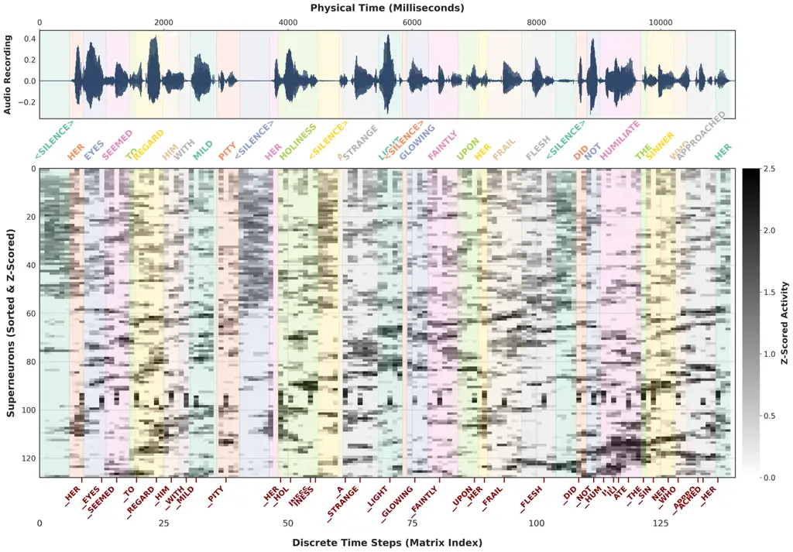
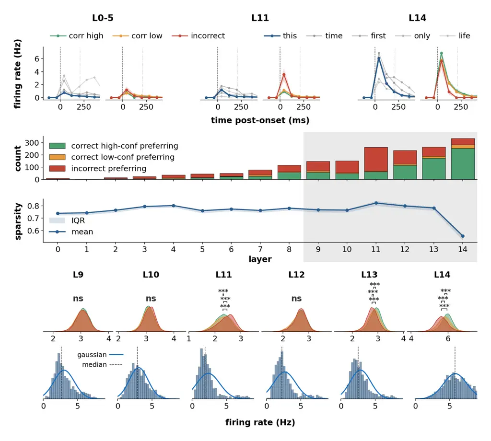
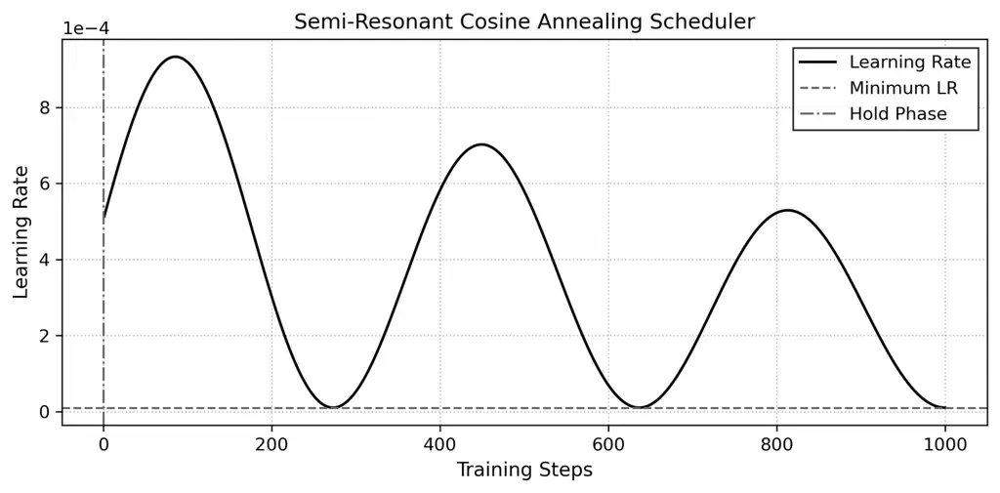
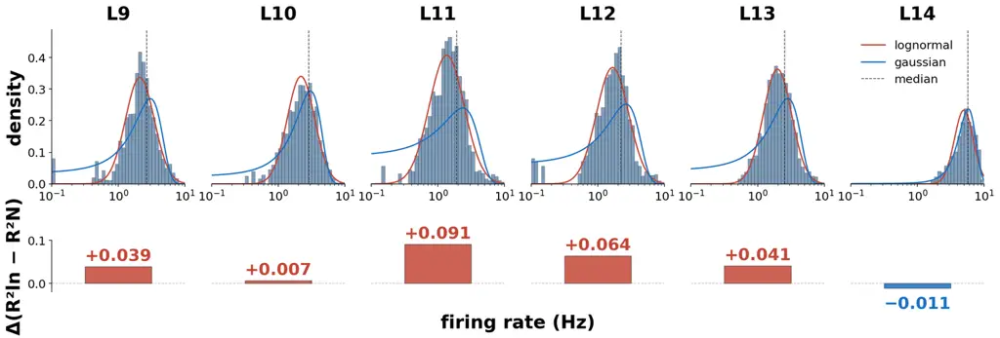
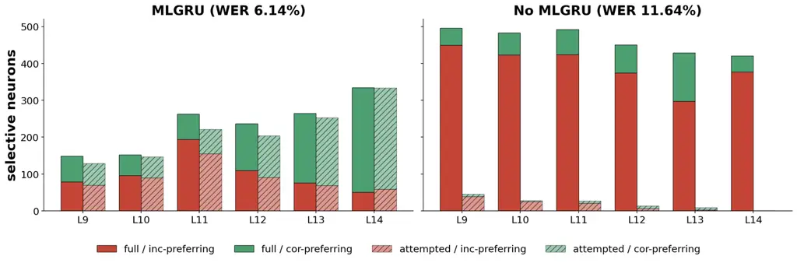

# Bio-Inspired Auditory Processing: Coupling Parallel Resonate-and-Fire Dynamics with Ternary Recurrent Networks for Speech Recognition

Pavlos Poulos  Katelyn Sadorf  Themos Stafylakis  Costas A. Anastassiou
Affiliation: Department of Informatics, Athens University of Economics
and Business, Greece Affiliation: Archimedes AI, Athena Research Center,
Greece Affiliation: California Institute of Technology, USA
Affiliation: Cedars-Sinai Medical Center, USA  
{pav.poulos, tstafylakis}@aueb.gr, {ksadorf, costas}@caltech.edu
Email: [costas.anastassiou@csmc.edu](mailto:)

###### Abstract

Spiking Neural Networks (SNNs) promise energy-efficient inference
through sparse, event-driven computation, yet remain constrained on
continuous, context-dependent tasks such as automatic speech recognition
(ASR). A key bottleneck is the Leaky Integrate-and-Fire (LIF) neuron,
whose membrane decay erases information across pauses and phonetic
boundaries while it must both extract features and retain long-range
context. Inspired by cortical separation of nonlinear filtering and
somatic integration, we introduce the Spiking Ternary GRU (stGRU): a
ternary-weight gated recurrent unit performs temporal filtering, while
downstream Resonate-and-Fire (RF) neurons generate the binary spike
stream driving the next block’s event pathway. This makes binary event
transmission a native training constraint rather than a separate
deployment-time activation quantization step; together with ternary
weights, learned projections avoid dense floating-point matrix MACs.
Trained end-to-end on LibriSpeech-960, Small, Medium, and Large stGRUs
reach $`8.09\%`$, $`7.04\%`$, and $`6.44\pm 0.17\%`$ WER on test-clean
without an external language model. To our knowledge, these are the
first matrix-MAC-free spiking networks without a learned ANN sequence
decoder to achieve single-digit WER on LibriSpeech. The architecture
also achieves $`10.88\%`$ test CER on Aishell-1 ($`9.28\%`$ on dev) when
trained from scratch. Internally, trained networks develop a
depth-graded hierarchy: shallow layers act as fast acoustic filters,
while deep layers form slower semantic integrators whose latent
representations segregate into part-of-speech manifolds and word-level
spike events. Deep-layer firing rates follow lognormal distributions
with a sparsity gradient, mirroring hierarchical processing observed in
human cortex in vivo. Our biologically grounded architecture combines
competitive ASR with favorable modeled compute and memory cost while
exposing interpretable internal dynamics.

|     |
| --- |
|     |

## 1 Introduction



Figure 1: Acoustic alignment, internal population activity, and semantic
manifold emergence in stGRU. (Top) Input acoustic waveform (LibriSpeech
test utterance) aligned with ground-truth word boundaries (color-shaded
spans) and internal spiking representations across physical time (top
axis) and discrete network timesteps (bottom axis). The central heatmap
displays the $`Z`$-scored activity of 128 superneurons (co-active neural
clusters sorted via Rastermap Stringer et al. (2025)), with darker
pixels indicating higher population firing. Red labels beneath the
raster mark subword BPE token emissions predicted by the CTC readout
layer (leading underscores denote new word onsets; consecutive identical
tokens are collapsed into a single emission; CTC blanks omitted for
clarity). (Bottom) 2D UMAP projections of latent representations across
network depth (layers 0, 6, 10, and 14). Internal states progressively
disentangle into distinct semantic and syntactic clusters, color-coded
by part of speech: verbs (red), nouns (blue), and pronouns (green).

(a) Proposed Architecture

(b) Energy Efficiency Frontier

(c) Memory Efficiency Frontier

Figure 2: Architecture and efficiency comparisons. (a) stGRU block
architecture. (b) LibriSpeech test-clean WER versus estimated arithmetic
energy over the 19,440 s evaluation set. (c) WER versus theoretical
parameter storage in decimal MB. The Large stGRU WER is a six-seed mean;
energy estimates correspond to the reported profiling run.

Spiking Neural Networks (SNNs) promise highly energy-efficient inference
by leveraging sparse, event-driven computations Roy et al. (2019). Yet
they remain fundamentally constrained on continuous, context-dependent
tasks such as automatic speech recognition (ASR) Bittar and Garner
(2022); Song et al. (2025); Wu et al. (2020). The primary bottleneck
lies in the standard Leaky Integrate-and-Fire (LIF) neuron Gerstner and
Kistler (2002); Maass (1997), whose intrinsic membrane decay erases
critical context across pauses and phonetic boundaries Bellec et al.
(2018); Zenke and Ganguli (2018). Consequently, while continuous ANNs
achieve state-of-the-art ASR performance Gulati et al. (2020); Vaswani
et al. (2017), their reliance on dense multiply-accumulate (MAC)
operations incurs prohibitive memory and energy costs Horowitz
(2014)-leaving a critical gap for energy-constrained applications.

Prior spiking ASR systems largely resorted to hybrid architectures
pairing a spiking encoder with a dense, floating-point ANN sequence
decoder, forfeiting the energy benefits of a truly edge-ready system
Bittar and Garner (2022); Song et al. (2025); Wu et al. (2020). Deep
event-driven architectures are further hindered by an
$`\mathcal{O}(L^{2})`$ training bottleneck arising from sequential
recurrent dependencies Neftci et al. (2019); Werbos (1990) and
discontinuous spike resets Lee et al. (2016); Neftci et al. (2019).
Together, these limitations motivate separating rich temporal filtering
from discrete event communication while keeping learned projections
matrix-MAC-free.

A complementary limitation appears in MatMul-free recurrent models:
ternary weights remove dense learned matrix products, but the MLGRU
backbone retains continuous activations, so deployment on low-precision
neuromorphic hardware requires a separate activation-quantization stage
Zhu et al. (2024). This motivates our central question: can the
activation constraint itself be learned while retaining gated long-range
temporal filtering?

We answer this by treating spiking as a trainable activation interface
for the event-driven pathway. In stGRU, a ternary MLGRU performs
nonlinear temporal filtering, while a downstream RF neuron emits the
binary spike stream that drives the next block’s event pathway. In the
ternary backbone, weights discretize what the network stores; RF spikes
discretize what its event pathway communicates. Crucially, the spike
constraint is present during optimization rather than imposed only at
deployment. This separation also mirrors cortical neurons, where gated
nonlinear processing precedes somatic integration Gidon et al. (2020);
Häusser and Mel (2003); London and Häusser (2005); Mel (1991); Mel
(1992); Shai et al. (2014); Shai et al. (2015). This
storage–communication duality is central to stGRU. Our primary
contributions are as follows:

Train-Time Dual Discretization & matrix-MAC-free ASR.

stGRU pairs ternary learned weights with an RF-generated binary event
stream, moving activation discretization into training rather than
leaving it solely to deployment. To our knowledge, it is the first
matrix-MAC-free SNN without a learned ANN sequence decoder to achieve
single-digit WER on LibriSpeech Panayotov et al. (2015): Small, Medium,
and Large stGRUs reach 8.09%, 7.04%, and $`6.44\pm 0.17\%`$ on
test-clean without an external LM. Training from scratch on Aishell-1 Bu
et al. (2017) yields 10.88% test CER (9.28% dev), close to the
VGG-BiLSTM baseline (10.7% test CER) but below the strongest dense and
hybrid systems in Table S5, providing cross-lingual evidence that the
architecture transfers from English to Mandarin ASR.

Exceptional Performance-to-Model-Size Trade-off. Operating at
$`1.95\text{ mJ/s}`$ (Small) and $`3.42\text{ mJ/s}`$ (Large), stGRU
operates far below continuous Transformers ($`8.80\text{ mJ/s}`$) and
Conformers ($`11.28\text{ mJ/s}`$) Gulati et al. (2020); Horowitz
(2014). For the Large Conv1D–MLGRU–ReLU baseline, ternarizing the
weights changes test-clean WER from 5.83% to 6.49%, an increase of 0.66
percentage points, while the modeled arithmetic-energy rate changes from
33.48 to 4.10 mJ/s (seed 3407). Ternary INT2 weights reduce the Large
models to 122.22 MB on LibriSpeech and 167.84 MB on Aishell-1, yielding
a favorable modeled energy–storage trade-off.

Emergent ACC-like Error-Monitoring. Layer L11 autonomously develops an
ACC-like error-monitoring signature Alexander and Brown (2018); Bryden
et al. (2019): incorrect words trigger elevated firing, peak sparsity
(0.83), and heavy-tailed lognormal rate statistics
($`\Delta R^{2}=+0.091`$ over Gaussian).

Decision Confidence & Autonomous ACC$`\rightarrow`$PFC Handoff. At L14,
the coding regime inverts into a prefrontal cortex (PFC)-like commitment
state Kiani and Shadlen (2009); Rutishauser et al. (2015):
high-confidence correct words elicit peak firing, sparsity drops, and
distributions shift to Gaussian. Together, these signatures suggest an
autonomous ACC$`\rightarrow`$PFC-like functional handoff Alexander and
Brown (2018) emerging within a single artificial sequence model.

## 2 Related Work

While dense continuous models (Transformers, Conformers, CitriNet)
define state-of-the-art ASR Hou et al. (2024); Majumdar et al. (2021);
Radford et al. (2022), their reliance on dense multiply-accumulate (MAC)
operations incurs prohibitive compute and memory costs Horowitz (2014).
MatMul-free MLGRU combines ternary weights with continuous activations;
its Loihi 2 mapping therefore separately quantizes activations and
retains 16-bit precision after 8-bit quantization substantially degrades
accuracy Zhu et al. (2024).

Motivated by biological efficiency, Spiking Neural Networks (SNNs) have
been adapted for speech via surrogate gradients Bittar and Garner
(2022); Wu et al. (2020), TCNs Bai et al. (2018), and Spike-driven
Transformers Yao et al. (2023); Yao et al. (2024). However, existing
ternary spiking speech models remain heavily restricted: QT-SNN Wang et
al. (2025) targets only isolated keyword spotting, whereas DyTr-SNN Wang
et al. (2023) is evaluated solely on single-speaker LJSpeech without
reporting WER and relies on a dense continuous 6-layer Transformer
decoder. More broadly, leading SNN ASR baselines (GSU Hao et al. (2024),
Spike-driven Transformer Yao et al. (2024), IML-Spikeformer Song et al.
(2025)) depend on continuous 6-layer ANN decoders to maintain
competitive accuracy Song et al. (2025). While their encoders use sparse
accumulate (AC) operations, continuous decoders reintroduce a
floating-point bottleneck and serialized execution, compromising edge
viability.

stGRU bridges these two lines of work: it retains ternary MLGRU
filtering but trains an RF-generated binary event interface end-to-end,
making event discretization part of the model rather than a
post-training hardware conversion. Deferred scaling keeps learned
backbone projections matrix-MAC-free, while direct CTC decoding avoids a
learned ANN sequence decoder.

## 3 Methodology

### 3.1 Ternary Projections with Deferred Weight Scaling

We use ternary BitLinear projections Ma et al. (2024); Zhu et al.
(2024). For a full-precision shadow-weight matrix
$`W\in\mathbb{R}^{m\times d}`$, let
$`\gamma_{W}=(md)^{-1}\sum_{i,j}|W_{ij}|`$ and quantize by

```math
\widetilde{W}=\operatorname{RoundClip}\left(\frac{W}{\gamma_{W}+\epsilon},-1,1\right),\qquad\widetilde{W}_{ij}\in\{-1,0,+1\}. \tag{1}
```

The shadow weights are trained with a straight-through estimator (STE)
Bengio et al. (2013) and QAT warmup (Appendix C.1).

Let $`V`$ denote the input presented to a projection after its shared
input normalization. The three ablation modes differ only in the
placement or omission of the weight scale:

```math
\displaystyle Y_{\mathrm{naive}} \displaystyle=V(\gamma_{W}\widetilde{W})^{\top}, \tag{2}
```

```math
\displaystyle Y_{\mathrm{proposed}} \displaystyle=(V\widetilde{W}^{\top})\gamma_{W},
```

```math
\displaystyle Y_{\mathrm{none}} \displaystyle=V\widetilde{W}^{\top}.
```

The naive and proposed modes are algebraically equivalent for fixed
$`V`$, $`\widetilde{W}`$, and $`\gamma_{W}`$. Naive scaling folds
$`\gamma_{W}`$ into the weights, producing a floating-point weight
matrix. Deferred scaling instead accumulates through ternary weights
using additions and subtractions, then applies $`\gamma_{W}`$ to the
output. The None mode omits this scale entirely. Thus the proposed mode
avoids dense floating-point matrix MACs in the learned projection, but
retains an output scaling operation. We write this operator as

```math
\mathcal{T}(V,\widetilde{W},\gamma_{W})_{i}=\gamma_{W}\sum_{j=1}^{d}\widetilde{W}_{ij}V_{j},\qquad i=1,\ldots,m. \tag{3}
```

The same scale placement applies to a temporal depthwise projection. Let
$`V\in\mathbb{R}^{T\times C}`$ be the input to that projection and
$`\widetilde{W}_{dw}\in\{-1,0,+1\}^{K\times C}`$ its ternary kernel.
With a weight scale $`\gamma_{dw}`$, we define

```math
\mathcal{T}_{dw}(V,\widetilde{W}_{dw},\gamma_{dw})_{t,c}=\gamma_{dw}\sum_{k}\widetilde{W}_{dw,k,c}V_{t+k,c}. \tag{4}
```

The temporal sum therefore uses additions and subtractions through
ternary weights; $`\gamma_{dw}`$ is applied after that sum. This avoids
folding a floating-point scale into every kernel weight. In the ablation
(Table S8), deferred scaling reduces the modeled energy rate by about
$`5\times`$ relative to naive scaling, with comparable test-clean WER
(Small: 8.09% vs. 8.15%; Large: 6.14% vs. 6.44%). Omitting the scale
instead worsens test-clean WER to 9.44% and 7.51%, respectively.

### 3.2 Parallel Spiking-Ternary Block Architecture

To bypass the prohibitive $`\mathcal{O}(L^{2})`$ training bottleneck of
recurrent networks and discontinuous resets Werbos (1990), the
Spiking-Ternary GRU Block decouples recurrent filtering from spike
emission, enabling global parallel unrolling in $`\mathcal{O}(L\log L)`$
time while avoiding dense learned matrix MACs at inference.

Acoustic features are initially mapped by a pre-encoder into discrete
spike trains $`S^{(0)}_{t}\in\{0,1\}^{C}`$. At block $`l`$, temporal
features are extracted from the incoming discrete spike sequence
$`S^{(l)}\in\{0,1\}^{T\times C}`$ via a depthwise-separable operator
pair consisting of a 1D temporal depthwise convolution and a pointwise
channel projection:

```math
X_{dw}=\mathcal{T}_{dw}(S^{(l)},\widetilde{W}_{dw},\gamma_{dw}),\quad X=\mathcal{T}(X_{dw},\widetilde{W}_{pw},\gamma_{pw}) \tag{5}
```

where $`\widetilde{W}_{pw}\in\{-1,0,+1\}^{C\times C}`$ denotes the
ternary pointwise weights and $`\gamma_{pw}`$ their scale.

We adapt the MLGRU of Zhu et al. (2024) with deferred-scaling ternary
projections, RMS-normalized gating, and a ternary output projection. For
brevity, we denote gate-specific ternary projections as
$`\mathcal{T}_{k}(V)\triangleq\mathcal{T}(V,\widetilde{W}_{k},\gamma_{k})`$
for $`k\in\{c,f,g\}`$. For input representation
$`X_{t}\in\mathbb{R}^{C}`$, the gates are computed as
$`C_{t}=\text{SiLU}(\mathcal{T}_{c}(X_{t}))`$,
$`F_{t}=\sigma(\mathcal{T}_{f}(X_{t}))`$, and
$`G_{t}=\text{RMSNorm}(\mathcal{T}_{g}(X_{t}))`$, updating state and
output via:

```math
\displaystyle H_{t} \displaystyle=F_{t}\odot H_{t-1}+C_{t}\odot(1-F_{t}) \tag{6}
```

```math
\displaystyle O_{t} \displaystyle=\mathcal{T}(G_{t}\odot\text{SiLU}(H_{t}),\widetilde{W}_{o},\gamma_{o}) \tag{7}
```

Because Equation 6 is strictly element-wise (no dense $`Wh_{t-1}`$
products), intermediate representations are computed globally across
sequence length $`T`$ via an associative parallel scan Gu et al. (2021);
Smith et al. (2022).

Channels are mixed via a ternary SwiGLU block stabilized by learnable
ReZero vectors $`\alpha\in\mathbb{R}^{C}`$ Bachlechner et al. (2021)
(Appendix C.2):

```math
\displaystyle U_{t} \displaystyle=\text{SiLU}(\mathcal{T}(O_{t},\widetilde{W}_{\text{gate}},\gamma_{\text{gate}}))\odot\mathcal{T}(O_{t},\widetilde{W}_{\text{up}},\gamma_{\text{up}}) \tag{8}
```

```math
\displaystyle Z_{t} \displaystyle=X_{t}+\alpha\odot\mathcal{T}(U_{t},\widetilde{W}_{\text{down}},\gamma_{\text{down}}) \tag{9}
```

To prevent vanishing gradients and stabilize variance across depth, the
continuous residual stream $`Z^{(l)}\in\mathbb{R}^{C}`$ updates via:

```math
Z^{(l)}_{t}=\text{RMSNorm}(Z^{(l-1)}_{t})+\alpha^{{}^{\prime}}\odot\text{RMSNorm}(Z_{t}) \tag{10}
```

The stabilized residual $`Z^{(l)}_{t}`$ serves as the input current to
the Parallel Resonate-and-Fire (PRF) neuron Huang et al. (2024). Unlike
standard LIF neurons which enforce sequential BPTT due to hard reset
subtractions ($`V_{th}S_{t-1}`$), PRF folds resets into a complex decay
factor $`\tilde{\gamma}=-\frac{1}{\tau}+i\theta`$. Under Euler
discretization over timestep $`\Delta`$, membrane integration unfolds
linearly:

```math
U_{t}=\exp\left(-\frac{\Delta}{\tau}\right)\left(\cos(\Delta\theta)+i\sin(\Delta\theta)\right)U_{t-1}+\Delta Z^{(l)}_{t} \tag{11}
```

Because temporal integration is independent of output spikes, membrane
potentials $`U_{1:T}`$ evaluate globally in the frequency domain via
Fast Fourier Transform ($`\mathcal{F}`$) Cooley and Tukey (1965); Gu et
al. (2021) using decay kernel
$`K_{1:T}=(\Delta A^{0},\dots,\Delta A^{T-1})`$ with
$`A=\exp(\Delta\tilde{\gamma})`$:

```math
U_{1:T}=\mathcal{F}^{-1}(\mathcal{F}(Z^{(l)}_{1:T})\odot\mathcal{F}(K_{1:T})) \tag{12}
```

Finally, the continuous potentials are folded back into the binary
domain for the $`(l+1)`$-th block by applying a Heaviside step function
strictly to the real component:

```math
S^{(l+1)}_{t}=\mathcal{H}(\Re\{U_{t}\}-V_{th}) \tag{13}
```

Surrogate gradients (Multi-Gaussian Yin et al. (2021)) train this binary
event interface end-to-end, so the next block is optimized on the same
discrete spike stream used at inference. The MLGRU recurrence admits an
associative scan and PRF integration an $`\mathcal{O}(L\log L)`$ FFT
implementation; empirically, training is 3.1$`\times`$–3.4$`\times`$
faster than the parameter-matched LIF variants (Tables S7, S9).

|                                                                                                                                             |            |              |                      |                    |                  |                   |
| ------------------------------------------------------------------------------------------------------------------------------------------- | ---------- | ------------ | -------------------- | ------------------ | ---------------- | ----------------- |
| Architecture                                                                                                                                | Params (M) | Weight Type  | Memory               | Energy rate (mJ/s) | WER (%)          |                   |
|                                                                                                                                             |            |              | (MB)                 | (mJ/s)             | test-clean       | test-other        |
| Continuous Artificial Neural Networks (ANNs)                                                                                                |            |              |                      |                    |                  |                   |
| Moritz et al. Moritz et al. (2019)                                                                                                          | 70.0       | FP32         | $`280.0^{\dagger}`$  | \-                 | $`5.4`$          | $`16.1`$          |
| Park et al. Park et al. (2019)                                                                                                              | 360.0      | FP32         | $`1440.0^{\dagger}`$ | \-                 | $`2.8`$          | $`6.8`$           |
| Whisper-Small Radford et al. (2022)                                                                                                         | 244.0      | FP16         | $`488.0^{\dagger}`$  | \-                 | $`3.1`$          | $`7.4`$           |
| ResNet-BiGRU Reza et al. (2022)                                                                                                             | 33.0       | FP32         | $`132.8^{\dagger}`$  | \-                 | $`15.6`$         | \-                |
| Quantized RNN-T Zhen et al. (2022)                                                                                                          | 27.8       | FP8          | $`27.8^{\dagger}`$   | \-                 | $`8.70`$         | $`22.36`$         |
| Quantized RNN-T Zhen et al. (2022)                                                                                                          | 27.8       | FP4          | $`13.9^{\dagger}`$   | \-                 | $`8.78`$         | $`22.54`$         |
| Transformer ^(∗) Hou et al. (2024)                                                                                                          | 112.0      | FP32         | $`448.0^{\dagger}`$  | 8.80^(††)          | $`8.2`$          | $`15.2`$          |
| Transformer++ ^(∗) Hou et al. (2024)                                                                                                        | 112.0      | FP32         | $`448.0^{\dagger}`$  | 8.69^(††)          | $`6.0`$          | $`11.8`$          |
| Conformer ^(∗) Hou et al. (2024)                                                                                                            | 136.0      | FP32         | $`544.0^{\dagger}`$  | 11.28^(††)         | $`5.7`$          | $`10.8`$          |
| CitriNet-1024 Majumdar et al. (2021)                                                                                                        | 143.1      | FP32         | $`572.4^{\dagger}`$  | 17.18^(††)         | $`2.52`$         | $`6.22`$          |
| Hybrid Spiking Neural Networks (SNNs) & Dense ANN Decoder/LM                                                                                |            |              |                      |                    |                  |                   |
| Deep FC SNN (LS-360h) Wu et al. (2020)                                                                                                      | \-         | FP32         | \-                   | \-                 | $`9.4`$          | \-                |
| 1 Spiking RNN + 3 LSTM Bittar and Garner (2022)                                                                                             | \-         | FP32         | \-                   | \-                 | $`3.51`$         | \-                |
| 4 Spiking RNN + 0 LSTM Bittar and Garner (2022)                                                                                             | \-         | FP32         | \-                   | \-                 | $`9.94`$         | \-                |
| GSU (+ 6-layer ANN Dec) ^(∗∗) Hao et al. (2024)                                                                                             | 185.0      | FP32         | $`740.4^{\dagger}`$  | \-                 | $`12.8`$         | $`32.1`$          |
| Spike-driven Trans. (+ 6-layer ANN Dec) ^(∗∗) Yao et al. (2024)                                                                             | 99.0       | FP32         | $`397.2^{\dagger}`$  | \-                 | $`10.5`$         | $`25.7`$          |
| IML-Spikeformer (+ 6-layer ANN Dec) Song et al. (2025)                                                                                      | 99.0       | FP32         | $`397.2^{\dagger}`$  | 4.96^(††)          | 3.4              | 7.9               |
| Ours (Structural Baselines, FP32 & W/O Learned ANN Sequence Decoder)                                                                        |            |              |                      |                    |                  |                   |
| Large (Linear $`\rightarrow`$ RF)                                                                                                           | 77.01      | FP32^(‡)     | 117.28               | 1.30               | 17.34            | 33.64             |
| Large (Conv1D $`\rightarrow`$ RF)                                                                                                           | 77.58      | FP32^(‡)     | 119.56               | 2.22               | 11.64            | 26.20             |
| Ours (Parameter-Matched Baselines, Continuous Dense ReLU Activations)                                                                       |            |              |                      |                    |                  |                   |
| Small (Conv1D $`\rightarrow`$ MLGRU $`\rightarrow`$ ReLU)                                                                                   | 132.66     | FP32         | 530.63               | 22.12              | 7.25             | 19.14             |
| Medium (Conv1D $`\rightarrow`$ MLGRU $`\rightarrow`$ ReLU)                                                                                  | 204.16     | FP32         | 816.63               | 26.25              | 6.41             | 17.29             |
| Large (Conv1D $`\rightarrow`$ MLGRU $`\rightarrow`$ ReLU)                                                                                   | 329.39     | FP32         | 1317.55              | 33.48              | 5.83             | 16.11             |
| Small (Conv1D $`\rightarrow`$ MLGRU $`\rightarrow`$ ReLU)                                                                                   | 132.66     | Ternary INT2 | 72.01                | 2.60               | 7.74             | 20.26             |
| Medium (Conv1D $`\rightarrow`$ MLGRU $`\rightarrow`$ ReLU)                                                                                  | 204.16     | Ternary INT2 | 90.16                | 3.13               | 6.68             | 17.71             |
| Large (Conv1D $`\rightarrow`$ MLGRU $`\rightarrow`$ ReLU)                                                                                   | 329.39     | Ternary INT2 | 121.96               | 4.10               | 6.49             | 17.40             |
| Ours (matrix-MAC-free, Ternary Spiking Networks & W/O Learned ANN Sequence Decoder)                                                         |            |              |                      |                    |                  |                   |
| Ours Large (Streaming) (Conv1D $`\rightarrow`$ MLGRU $`\rightarrow`$ RF)                                                                    | 329.45     | Ternary INT2 | 122.22               | 3.51               | 9.11             | 22.13             |
| Ours Small (Conv1D $`\rightarrow`$ MLGRU $`\rightarrow`$ RF)                                                                                | 132.68     | Ternary INT2 | 72.09                | 1.95               | 8.09             | 20.79             |
| Ours Medium (Conv1D $`\rightarrow`$ MLGRU $`\rightarrow`$ RF)                                                                               | 204.20     | Ternary INT2 | 90.31                | 2.49               | 7.04             | 18.74             |
| Ours Large (Conv1D $`\rightarrow`$ MLGRU $`\rightarrow`$ RF)                                                                                | 329.45     | Ternary INT2 | 122.22               | 3.42               | $`6.44\pm 0.17`$ | $`17.49\pm 0.23`$ |
| ^(†) Theoretical memory size computed based on parameter count and format precision (FP32 = 4 Bytes, FP16 = 2 Bytes, INT2 = 0.25 Bytes).    |            |              |                      |                    |                  |                   |
| ^(††) Our Reproduced results by publicly available data.                                                                                    |            |              |                      |                    |                  |                   |
| ^(∗) Trained on 2.5k hours of various datasets as cited in Hou et al. (2024).                                                               |            |              |                      |                    |                  |                   |
| ^(∗∗) Reproduced by Song et al. (2025).                                                                                                     |            |              |                      |                    |                  |                   |
| ^(‡) Structural baselines use an INT2 ternary downsampler and FP32 downstream weights; unmarked FP32 variants also use an FP32 downsampler. |            |              |                      |                    |                  |                   |

Table 1: Comprehensive Architectural Comparison on LibriSpeech-960 ASR.
All reported WER results evaluate the standalone acoustic model without
an external language model. The Large RF WER is mean $`\pm`$ standard
deviation over six seeds; other in-house rows and arithmetic-energy
rates correspond to seed 3407.

## 4 Experiments

We evaluate the Spiking Ternary GRU (stGRU) on LibriSpeech-960 and
Aishell-1 Panayotov et al. (2015); Bu et al. (2017) implemented in
SpeechBrain Ravanelli et al. (2022) across 8 AMD Instinct MI250X GCDs on
the LUMI supercomputer. Acoustic inputs (80-dimensional log-Mel
filterbanks at 50 Hz) undergo $`4\times`$ temporal subsampling via a
ternary 2D CNN frontend (512 and 1024 channels), followed by an MLGRU
layer coupled with a Parallel Resonate-and-Fire (PRF) neuron acting as a
pre-encoder that emits discrete spikes at a reduced rate of 12.5 Hz. The
subsequent stGRU backbone applies 1D depthwise convolutions with kernel
sizes up to $`K=63`$ across 1024 channels (Appendix A), trained
end-to-end via CTC loss Graves et al. (2006) with Semi-Resonant Cosine
Annealing (Appendix C.3). All primary metrics evaluate the standalone
acoustic model; an optional OpenSLR 4-gram language model¹¹ 1
[https://www.openslr.org/11/](https://www.openslr.org/11/) is decoded
(Table S6) via non-neural CPU hash lookups and is therefore excluded
from neural energy profiling.

Performance and Efficiency Benchmarks. We benchmark against continuous
ANNs (Transformer, Conformer, CitriNet Vaswani et al. (2017); Hou et al.
(2024); Gulati et al. (2020); Majumdar et al. (2021)) and the hybrid SNN
IML-Spikeformer Song et al. (2025), calculating theoretical energy via
45 nm CMOS constants (4.6 pJ/FP-MAC, 0.9 pJ/sparse-AC,
17.5 pJ/PRF-update Horowitz (2014); Huang et al. (2024)). As reported in
Table 1, Small, Medium, and Large stGRUs achieve standalone WERs of
8.09%, 7.04%, and $`6.44\pm 0.17\%`$ on LibriSpeech test-clean without
an external LM (optional 4-gram LM yields $`5.95\pm 0.16\%`$; Table S6),
setting the first single-digit WERs for matrix-MAC-free SNNs without a
learned ANN sequence decoder. A bounded-latency streaming variant with
320 ms look-ahead attains 9.11% WER at 3.51 mJ/s (Table 1). A separately
trained stGRU achieves 10.88% test CER on Aishell-1 and 9.28% on dev
(Table S5).

Parameter-matched ablations isolate individual design choices (Table 1,
Table S7): quantizing from FP32 to ternary weights cuts memory by
$`7.4\times`$–$`10.8\times`$ with negligible loss
($`5.83\%\to 6.49\%`$). At the Large scale, discrete PRF spikes surpass
continuous ternary ReLUs in both WER and energy ($`6.14\%`$ at 3.42 mJ/s
vs. $`6.49\%`$ at 4.10 mJ/s; widening to 33.48 mJ/s for FP32 ReLUs;
Table S7). Under the same analytical 45 nm arithmetic-cost model, our
estimate for IML-Spikeformer allocates 2.73 mJ/s to its FP32 frontend
and 1.68 mJ/s to its ANN decoder, whereas the stGRU estimate includes
0.05 mJ/s for active-weight accumulation in its FP32 CTC readout
(Table S3). These are operation-based estimates, not measured hardware
energy. Upgrading from Linear $`\to`$ RF to the full ternary stack adds
$`<5`$ MB and $`+2.12`$ mJ/s while reducing test-clean WER by 11.20%
percentage points for seed 3407 ($`17.34\%\to 6.14\%`$).



Figure 3: Depth-graded coding emerges in trained Spiking-Ternary
networks. Row 1: PSTH of word-selective neurons at shallow (L0–5),
uncertainty (L11), and commitment (L14) depths. Each panel pair shows
responses to a target word (“this,” blue) against acoustically similar
competitors (gray), with the right sub-panel split by outcome (green:
high-conf correct; orange: low-conf correct; red: incorrect). Row 2:
Per-layer counts of outcome-selective neurons (matched-AUC, FDR
$`q<0.001`$); correct-preferring neurons are sub-classified by high-
vs. low-confidence via median CTC log-probability. Selectivity grows
from L0–L5 to L11–L14 ($`<50`$ vs. $`>250`$ neurons), and the bipartite
partition reverses across depth: incorrect-preferring neurons peak at
L11 ($`n=194`$), high-confidence-correct-preferring at L14 ($`n=254`$).
Row 3: Population sparsity (per-word silent fraction) across encoder
depth, with shaded IQR. Row 4: Population firing rate distributions for
L9–L14 split by outcome (brackets: pairwise Mann–Whitney U-test with
Bonferroni correction; ns: panels with at least one non-significant
comparison). Row 5: Per-neuron firing rate histograms for L9–L14 with
Gaussian fit overlaid.

## 5 Neuromorphic Interpretation

Having established favorable modeled efficiency on English and Mandarin
ASR, we now examine whether the network’s internal representations
exhibit functional analogies to cortical decision signals. Echoing the
parallel, distributed processing of human auditory cortex Hamilton et
al. (2021); Bhaya-Grossman and Chang (2022), deep layers (L10–L14)
autonomously partition into functionally distinct subpopulations whose
activity statistics mimic those of neurons in human cortex during
perceptual decisions. We substantiate this below.

### 5.1 Error-Monitoring Signature in L11 Mimics the Human Medial Frontal Cortex

At L11, incorrect words result in significantly higher population firing
than either high- or low-confidence correct words (Fig. 3, row 4)
analogous to error-related activity associated with anterior cingulate
cortex (ACC) Alexander and Brown (2018); Bryden et al. (2019). The error
code is carried by a subpopulation of neurons: incorrect-preferring
neurons outnumber high-confidence-correct neurons ($`n=194`$ vs. $`64`$;
Fig. 3, top). L11 also exhibits the sparsest spiking activity from all
layers (Fig. 3, row 3), placing it in the recruitment-based regime
characteristic of cortical error monitoring. The response is also
temporally appropriate for an error signal: incorrect-preferring neurons
exhibit a sharp post-onset transient that decays before the CTC emission
window, on the timescale of error detection rather than sustained
stimulus encoding. Per-neuron firing rates at L11 follow a lognormal
distribution (Fig. S2) as observed in cortical recall populations. It
follows that directionality, recruitment, timing, and distribution align
with an ACC-like role of L11.

### 5.2 Decision-Confidence Signature in L14 Mimics the Prefrontal Cortex

L14, in turn, exhibits different behavior to L11. In L14 the highest
spike rate corresponds to high-confidence correct words while
low-confidence correct words are between the high-confidence and
incorrect distributions. This graded confidence axis is absent at L11
and mimics the behavior observed in primate lateral intraparietal (LIP)
and human medial temporal lobe (MTL) Kiani and Shadlen (2009);
Rutishauser et al. (2015). At the level of decision hierarchy,
prefrontal cortex (PFC) is the area where confidence signals from
upstream regions are converted into committed action. The composition of
the selective population inverts in parallel: high-confidence-correct
neurons dominate ($`n=254`$ vs. $`58`$ incorrect-preferring; Fig. 3,
top). PSTH responses broaden in turn, replacing the narrow error-only
transient at L11 with large, sustained post-onset peaks across all three
outcome conditions—the response shape expected of a layer broadcasting a
committed token rather than gating a selective monitoring signal.
Moreover, population sparsity decreases significantly from L11 to L14
and the per-neuron firing-rate changes from lognormal to near-Gaussian
($`\Delta R^{2}=-0.011`$, the only negative value in the recall
hierarchy; Fig. S2). The latter indicates broad recruitment rather than
selective monitoring with L14 emulating human PFC behavior.

### 5.3 Autonomous ACC-to-PFC Handoff Within a Single Network

The transition between L11 and L14 proceeds gradually through L12–L13 in
a functional handoff. L12 acts as the inflection layer where responses
to all categories become similar (Fig. 3, bottom, ns), the population
code’s directionality reverses, and the spike rate lognormality
gradually decays from L11 ($`+0.091`$) through L12 ($`+0.064`$) and L13
($`+0.041`$) before vanishing at L14 ($`-0.011`$). Selectivity
composition, sparsity, firing-rate directionality, and distribution
shape move together along this trajectory, consistent with a continuous
functional gradient. This structure mimics the ACC with its error and
surprise signals Alexander and Brown (2018) while PFC implements the
downstream control that converts those signals into committed decisions.
Critically, this handoff is implemented within a single recurrent
network rather than across brain regions: a network trained end-to-end
on CTC, with no architectural prior favoring functional segregation,
partitions its deep layers into error-monitoring and confidence-readout
subpopulations whose responses, sparsity, and firing-rate statistics
jointly track signatures observed in human cortex in vivo. We note that
this partition is not incidental to depth or spiking activity alone: in
an ablated variant without MLGRU gating, deep-layer outcome selectivity
collapses by 95.5% once empty-emission trials are controlled for, versus
8.1% in the full model (Supp. Fig. S3). This ablation supports a role
for MLGRU gating in the observed outcome-selective activity. This
mirrors cortical pyramidal neurons, where nonlinear dendritic filtering
precedes somatic integration London and Häusser (2005); Mel (1992);
Poirazi et al. (2003); Shai et al. (2015) and subthreshold resonance
bridges temporal context across pauses Bellec et al. (2018); Giraud and
Poeppel (2012): upstream recurrent gating provides the temporal
substrate necessary for downstream somatic integrators to develop
decision-level outcome selectivity.

#### Limitations.

Our energy estimates use analytical operation counts and 45 nm CMOS
constants. QAT also retains full-precision shadow weights and their
training overhead: the forward weights become ternary after warmup,
while the straight-through estimator updates the continuous weights
during backpropagation. Furthermore, while our design eliminates all
dense $`\mathcal{O}(C^{2})`$ floating-point matrix multiplications, the
model is not entirely multiplication-free: continuous element-wise
multiplications persist in recurrent gating, residual scaling, RMSNorm,
and neuron dynamics. These operations are element-wise rather than dense
$`O(C^{2})`$ matrix multiplications, but deploying them on pure
addition-only or integer-only edge silicon still requires specialized
arithmetic units or approximations. Performance remains weaker on
test-other than on test-clean. Finally, mitigating the capacity limits
of 2-bit weights required wide channels and temporal kernels of up to
$`K=63`$, despite the low precision of their weights.

## 6 Conclusion

We introduced stGRU, an ASR architecture combining deferred-scaling
ternary projections, gated recurrent filtering, and resonant spiking
integration. At inference, its learned projections avoid dense matrix
MACs, while the Large model reaches $`6.44\pm 0.17\%`$ LibriSpeech
test-clean WER without an external language model and a separately
trained Aishell-1 model reaches 10.88% test CER. The modeled
arithmetic-energy and parameter-storage results show a favorable
efficiency trade-off, subject to the accounting limits above.

Conceptually, stGRU couples complementary low-precision constraints in
the event-driven backbone: ternary learned projections constrain
synaptic weights, while RF neurons make the inter-block event stream
binary during training rather than relying on a separate deployment-time
activation-quantization step. Spiking thus serves not only as neuronal
dynamics but as an end-to-end optimized binary communication bottleneck.
Despite this constraint, deep layers still develop error-to-confidence
selectivity and structured sparsity, suggesting that efficient
event-driven communication can coexist with rich internal organization.

## References

- Alexander and Brown (2018) W. H. Alexander and J. W. Brown Frontal
  cortex function derives from hierarchical predictive coding.
  Scientific Reports. Cited by: §1, §1, §5.1, §5.3.
- Bachlechner et al. (2021) T. C. Bachlechner, B. P. Majumder, H. H.
  Mao, G. W. Cottrell, and J. McAuley ReZero is all you need: fast
  convergence at large depth. Conference on Uncertainty in Artificial
  Intelligence. Cited by: §3.2.
- Bai et al. (2018) S. Bai, J. Z. Kolter, and V. Koltun An empirical
  evaluation of generic convolutional and recurrent networks for
  sequence modeling. arXiv: Learning. Cited by: Table S5, §2.
- Bellec et al. (2018) G. Bellec, D. Salaj, A. Subramoney, R.
  Legenstein, and W. Maass Long short-term memory and learning-to-learn
  in networks of spiking neurons. Neural Information Processing Systems.
  Cited by: §1, §5.3.
- Bengio et al. (2013) Y. Bengio, N. Léonard, and A. Courville
  Estimating or propagating gradients through stochastic neurons for
  conditional computation. arXiv: Learning. Cited by: §3.1.
- Bhaya-Grossman and Chang (2022) I. Bhaya-Grossman and E. F. Chang
  Speech computations of the human superior temporal gyrus.. Annual
  Review of Psychology. External Links:
  [Document](https://dx.doi.org/10.1146/annurev-psych-022321-035256)
  Cited by: §5.
- Bittar and Garner (2022) A. Bittar and P. N. Garner Surrogate gradient
  spiking neural networks as encoders for large vocabulary continuous
  speech recognition. ArXiv. External Links:
  [Document](https://dx.doi.org/10.48550/arxiv.2212.01187) Cited by: §1,
  §1, §2, Table 1, Table 1.
- Bryden et al. (2019) D. W. Bryden, A. T. Brockett, E. Blume, K.
  Heatley, A. Zhao, and M. R. Roesch Single neurons in anterior
  cingulate cortex signal the need to change action during performance
  of a stop-change task that induces response competition. Cerebral
  Cortex. Cited by: §1, §5.1.
- Bu et al. (2017) H. Bu, J. Du, X. Na, B. Wu, and H. Zheng AISHELL-1:
  an open-source mandarin speech corpus and a speech recognition
  baseline. Oriental COCOSDA International Conference on Speech Database
  and Assessments. External Links:
  [Document](https://dx.doi.org/10.1109/icsda.2017.8384449) Cited by:
  §1, §4.
- Cooley and Tukey (1965) J. Cooley and J. Tukey An algorithm for the
  machine calculation of complex fourier series. External Links:
  [Document](https://dx.doi.org/10.1090/s0025-5718-1965-0178586-1) Cited
  by: §3.2.
- Gerstner and Kistler (2002) W. Gerstner and W. M. Kistler Spiking
  neuron models: single neurons, populations, plasticity. External
  Links: [Document](https://dx.doi.org/10.1017/cbo9780511815706) Cited
  by: §1.
- Gidon et al. (2020) A. Gidon, T. A. Zolnik, P. Fidzinski, F.
  Bolduan, A. Papoutsi, P. Poirazi, M. Holtkamp, I. Vida, and M. E.
  Larkum Dendritic action potentials and computation in human layer 2/3
  cortical neurons. Science 367 (6473), pp. 83–87. External Links:
  [Document](https://dx.doi.org/10.1126/science.aax6239) Cited by: §1.
- Giraud and Poeppel (2012) A. Giraud and D. Poeppel Cortical
  oscillations and speech processing: emerging computational principles
  and operations.. Nature Neuroscience. External Links:
  [Document](https://dx.doi.org/10.1038/nn.3063) Cited by: §5.3.
- Graves et al. (2006) A. Graves, S. Fernández, F. J. Gomez, and J.
  Schmidhuber Connectionist temporal classification: labelling
  unsegmented sequence data with recurrent neural networks. ICML.
  External Links: [Document](https://dx.doi.org/10.1145/1143844.1143891)
  Cited by: §D.2, §4.
- Gu et al. (2021) A. Gu, K. Goel, and C. R’e Efficiently modeling long
  sequences with structured state spaces. International Conference on
  Learning Representations. Cited by: §3.2, §3.2.
- Gulati et al. (2020) A. Gulati, J. Qin, C. Chiu, N. Parmar, Y.
  Zhang, J. Yu, W. Han, S. Wang, Z. Zhang, Y. Wu, and R. Pang Conformer:
  convolution-augmented transformer for speech recognition. Interspeech.
  External Links:
  [Document](https://dx.doi.org/10.21437/interspeech.2020-3015) Cited
  by: 2nd item, §1, §1, §4.
- Hamilton et al. (2021) L. S. Hamilton, Y. Oganian, J. A. Hall,
  and E. F. Chang Parallel and distributed encoding of speech across
  human auditory cortex.. Cell. External Links:
  [Document](https://dx.doi.org/10.1016/j.cell.2021.07.019) Cited by:
  §5.
- Hao et al. (2024) X. Hao, C. Ma, Q. Yang, J. Wu, and K. C. Tan Towards
  ultra-low-power neuromorphic speech enhancement with
  spiking-fullsubnet. arXiv (Cornell University). External Links:
  [Document](https://dx.doi.org/10.48550/arxiv.2410.04785) Cited by:
  Table S5, §2, Table 1.
- Häusser and Mel (2003) M. Häusser and B. W. Mel Dendrites: bug or
  feature?. Current Opinion in Neurobiology. External Links:
  [Document](https://dx.doi.org/10.1016/s0959-4388%2803%2900075-8) Cited
  by: §1.
- Horowitz (2014) M. Horowitz 1.1 computing’s energy problem (and what
  we can do about it). IEEE International Solid-State Circuits
  Conference. External Links:
  [Document](https://dx.doi.org/10.1109/isscc.2014.6757323) Cited by:
  §D.1, §D.2, §1, §1, §2, §4.
- Hou et al. (2024) Z. Hou, G. Huybrechts, A. Bhatia, D.
  Garcia-Romero, K. J. Han, and K. Kirchhoff Revisiting convolution-free
  transformer for speech recognition. Interspeech. External Links:
  [Document](https://dx.doi.org/10.21437/interspeech.2024-588) Cited by:
  1st item, 2nd item, 3rd item, §D.2, Table S3, Table S3, Table S3, §2,
  Table 1, Table 1, Table 1, Table 1, §4.
- Huang et al. (2024) Y. Huang, Z. Liu, C. Feng, X. Lin, H. Ren, H.
  Fu, Y. Zhou, H. Xing, and B. Cheng PRF: parallel resonate and fire
  neuron for long sequence learning in spiking neural networks.
  arXiv.org. External Links:
  [Document](https://dx.doi.org/10.48550/arxiv.2410.03530) Cited by:
  §D.1, §3.2, §4.
- Kiani and Shadlen (2009) R. Kiani and M. N. Shadlen Representation of
  confidence associated with a decision by neurons in the parietal
  cortex. Science. Cited by: §1, §5.2.
- Lee et al. (2016) J. H. Lee, T. Delbruck, and M. Pfeiffer Training
  deep spiking neural networks using backpropagation.. Frontiers in
  Neuroscience. External Links:
  [Document](https://dx.doi.org/10.3389/fnins.2016.00508) Cited by: §1.
- London and Häusser (2005) M. London and M. Häusser DENDRITIC
  computation. Annual Review of Neuroscience. External Links:
  [Document](https://dx.doi.org/10.1146/annurev.neuro.28.061604.135703)
  Cited by: §1, §5.3.
- Ma et al. (2024) S. Ma, H. Wang, L. Ma, L. Wang, W. Wang, S. Huang, L.
  Dong, R. Wang, J. Xue, and F. Wei The era of 1-bit llms: all large
  language models are in 1.58 bits. arXiv.org. External Links:
  [Document](https://dx.doi.org/10.48550/arxiv.2402.17764) Cited by:
  §3.1.
- Maass (1997) W. Maass Networks of spiking neurons: the third
  generation of neural network models. Transactions of The Society for
  Computer Simulation International. External Links:
  [Document](https://dx.doi.org/10.5555/281543.281637) Cited by: §1.
- Majumdar et al. (2021) S. Majumdar, J. Balam, O. Hrinchuk, V.
  Lavrukhin, V. Noroozi, and B. Ginsburg Citrinet: closing the gap
  between non-autoregressive and autoregressive end-to-end models for
  automatic speech recognition.. arXiv: Audio and Speech Processing.
  Cited by: §2, Table 1, §4.
- Mel (1991) B. W. Mel The clusteron: toward a simple abstraction for a
  complex neuron. In Advances in Neural Information Processing
  Systems, J. Moody, S. Hanson, and R. P. Lippmann (Eds.), Vol. 4,
  pp. 35–42. Cited by: §1.
- Mel (1992) B. W. Mel NMDA-based pattern discrimination in a modeled
  cortical neuron. Neural Computation 4 (4), pp. 502–517. External
  Links: [Document](https://dx.doi.org/10.1162/neco.1992.4.4.502) Cited
  by: §1, §5.3.
- Moritz et al. (2019) N. Moritz, T. Hori, and J. L. Roux Triggered
  attention for end-to-end speech recognition. IEEE International
  Conference on Acoustics, Speech, and Signal Processing. External
  Links: [Document](https://dx.doi.org/10.1109/icassp.2019.8683510)
  Cited by: Table 1.
- Neftci et al. (2019) E. O. Neftci, H. Mostafa, and F. Zenke Surrogate
  gradient learning in spiking neural networks: bringing the power of
  gradient-based optimization to spiking neural networks. arXiv: Neural
  and Evolutionary Computing. External Links:
  [Document](https://dx.doi.org/10.1109/msp.2019.2931595) Cited by: §1.
- Panayotov et al. (2015) V. Panayotov, G. Chen, D. Povey, and S.
  Khudanpur Librispeech: an asr corpus based on public domain audio
  books. IEEE International Conference on Acoustics, Speech, and Signal
  Processing. External Links:
  [Document](https://dx.doi.org/10.1109/icassp.2015.7178964) Cited by:
  §1, §4.
- Park et al. (2019) D. S. Park, W. Chan, Y. Zhang, C. Chiu, B.
  Zoph, E. D. Cubuk, and Q. V. Le SpecAugment: a simple data
  augmentation method for automatic speech recognition.. conference of
  the international speech communication association. External Links:
  [Document](https://dx.doi.org/10.21437/interspeech.2019-2680) Cited
  by: Table 1.
- Poirazi et al. (2003) P. Poirazi, T. Brannon, and B. W. Mel Pyramidal
  neuron as two-layer neural network. Neuron 37 (6), pp. 989–999.
  External Links: ISSN 0896-6273,
  [Document](https://dx.doi.org/https%3A//doi.org/10.1016/S0896-6273%2803%2900149-1),
  [Link](https://www.sciencedirect.com/science/article/pii/S0896627303001491)
  Cited by: §5.3.
- Radford et al. (2022) A. Radford, J. W. Kim, T. Xu, G. Brockman, C.
  McLeavey, and I. Sutskever Robust speech recognition via large-scale
  weak supervision. International Conference on Machine Learning.
  External Links:
  [Document](https://dx.doi.org/10.48550/arxiv.2212.04356) Cited by: §2,
  Table 1.
- Ravanelli et al. (2022) M. Ravanelli, T. Parcollet, P. Plantinga, A.
  Rouhe, S. Cornell, L. Lugosch, C. Subakan, N. Dawalatabad, A. Heba, J.
  Zhong, J. Chou, S. Yeh, S. Fu, C. Liao, E. Rastorgueva, F. Grondin, W.
  Aris, H. Na, Y. Gao, R. D. Mori, and Y. Bengio SpeechBrain: a
  general-purpose speech toolkit. arXiv: Audio and Speech Processing.
  Cited by: Table S5, §4.
- Reza et al. (2022) S. Reza, M. C. Ferreira, J.J.M.
  Machado, J. M. R. S. Tavares, S. Reza, M. C. Ferreira, J.J.M. Machado,
  and J. M. R. S. Tavares A customized residual neural network and
  bi-directional gated recurrent unit-based automatic speech recognition
  model. Expert systems with applications. External Links:
  [Document](https://dx.doi.org/10.1016/j.eswa.2022.119293) Cited by:
  Table 1.
- Roy et al. (2019) K. Roy, A. Jaiswal, and P. Panda Towards spike-based
  machine intelligence with neuromorphic computing.. Nature. External
  Links: [Document](https://dx.doi.org/10.1038/s41586-019-1677-2) Cited
  by: §1.
- Rutishauser et al. (2015) U. Rutishauser, S. Ye, M. Koroma, O.
  Tudusciuc, I. B. Ross, J. M. Chung, and A. N. Mamelak Representation
  of retrieval confidence by single neurons in the human medial temporal
  lobe. Nature Neuroscience. Cited by: §1, §5.2.
- Shai et al. (2015) A. S. Shai, C. A. Anastassiou, M. E. Larkum, and C.
  Koch Physiology of layer 5 pyramidal neurons in mouse primary visual
  cortex: coincidence detection through bursting. PLOS Computational
  Biology 11 (3), pp. e1004090. External Links:
  [Document](https://dx.doi.org/10.1371/journal.pcbi.1004090) Cited by:
  §1, §5.3.
- Shai et al. (2014) A. S. Shai, C. Koch, and C. A. Anastassiou
  Spike-timing control by dendritic plateau potentials in the presence
  of synaptic barrages. Frontiers in Computational Neuroscience 8,
  pp. 89. External Links:
  [Document](https://dx.doi.org/10.3389/fncom.2014.00089) Cited by: §1.
- Smith et al. (2022) J. Smith, A. Warrington, and S. W. Linderman
  Simplified state space layers for sequence modeling. arXiv.org.
  External Links:
  [Document](https://dx.doi.org/10.48550/arxiv.2208.04933) Cited by:
  §3.2.
- Song et al. (2025) Z. Song, S. Zhang, Y. Chou, J. Wu, and H. Li
  IML-spikeformer: input-aware multi-level spiking transformer for
  speech processing. arXiv.org. External Links:
  [Document](https://dx.doi.org/10.48550/arxiv.2507.07396) Cited by: 4th
  item, §D.2, Table S3, Table S5, Table S5, §1, §1, §2, Table 1, Table
  1, §4.
- Stan and Rhodes (2023) M. I. Stan and O. Rhodes Learning long
  sequences in spiking neural networks. arXiv.org. External Links:
  [Document](https://dx.doi.org/10.48550/arxiv.2401.00955) Cited by:
  Table S5, Table S5.
- Stringer et al. (2025) C. Stringer, L. Zhong, A. Syeda, F. Du, M.
  Kesa, and M. Pachitariu Rastermap: a discovery method for neural
  population recordings. Nature Neuroscience 28 (1), pp. 201–212.
  External Links:
  [Document](https://dx.doi.org/10.1038/s41593-024-01783-4) Cited by:
  Figure 1.
- Vaswani et al. (2017) A. Vaswani, N. M. Shazeer, N. Parmar, J.
  Uszkoreit, L. Jones, A. N. Gomez, L. Kaiser, and I. Polosukhin
  Attention is all you need. Neural Information Processing Systems.
  Cited by: 1st item, §1, §4.
- Wang et al. (2023) Q. Wang, T. Zhang, M. Han, Y. Wang, D. Zhang,
  and B. Xu Complex dynamic neurons improved spiking transformer network
  for efficient automatic speech recognition. In Proceedings of the
  Thirty-Seventh AAAI Conference on Artificial Intelligence and
  Thirty-Fifth Conference on Innovative Applications of Artificial
  Intelligence and Thirteenth Symposium on Educational Advances in
  Artificial Intelligence, AAAI’23/IAAI’23/EAAI’23. External Links: ISBN
  978-1-57735-880-0, [Link](https://doi.org/10.1609/aaai.v37i1.25081),
  [Document](https://dx.doi.org/10.1609/aaai.v37i1.25081) Cited by: §2.
- Wang et al. (2025) S. Wang, D. Zhang, A. Belatreche, Y. Xiao, H.
  Qing, W. Wei, M. Zhang, and Y. Yang Ternary spike-based neuromorphic
  signal processing system. Neural Networks 187, pp. 107333. External
  Links: ISSN 0893-6080,
  [Document](https://dx.doi.org/https%3A//doi.org/10.1016/j.neunet.2025.107333),
  [Link](https://www.sciencedirect.com/science/article/pii/S0893608025002126)
  Cited by: §2.
- Werbos (1990) P. Werbos Backpropagation through time: what it does and
  how to do it. Proceedings of the IEEE. External Links:
  [Document](https://dx.doi.org/10.1109/5.58337) Cited by: §1, §3.2.
- Wu et al. (2020) J. Wu, E. Yilmaz, M. Zhang, H. Li, and K. C. Tan Deep
  spiking neural networks for large vocabulary automatic speech
  recognition. Frontiers in Neuroscience. External Links:
  [Document](https://dx.doi.org/10.3389/fnins.2020.00199) Cited by: §1,
  §1, §2, Table 1.
- Yao et al. (2024) M. Yao, J. Hu, T. Hu, Y. Xu, Z. Zhou, Y. Tian, B.
  Xu, and G. Li Spike-driven transformer v2: meta spiking neural network
  architecture inspiring the design of next-generation neuromorphic
  chips. arXiv.org. External Links:
  [Document](https://dx.doi.org/10.48550/arxiv.2404.03663) Cited by: §2,
  Table 1.
- Yao et al. (2023) M. Yao, J. Hu, Z. Zhou, L. Yuan, Y. Tian, B. Xu,
  and G. Li Spike-driven transformer. arXiv.org. External Links:
  [Document](https://dx.doi.org/10.48550/arxiv.2307.01694) Cited by:
  Table S5, §2.
- Yin et al. (2021) B. Yin, F. Corradi, and S. M. Bohte Accurate and
  efficient time-domain classification with adaptive spiking recurrent
  neural networks. Nature Machine Intelligence. External Links:
  [Document](https://dx.doi.org/10.1038/s42256-021-00397-w) Cited by:
  §3.2.
- Zenke and Ganguli (2018) F. Zenke and S. Ganguli SuperSpike:
  supervised learning in multilayer spiking neural networks. Neural
  Computation. External Links:
  [Document](https://dx.doi.org/10.1162/neco%5Fa%5F01086) Cited by: §1.
- Zhen et al. (2022) K. Zhen, M. H. Radfar, H. Nguyen, G. P. Strimel, N.
  Susanj, and A. Mouchtaris Sub-8-bit quantization for on-device speech
  recognition: a regularization-free approach. Spoken Language
  Technology Workshop. External Links:
  [Document](https://dx.doi.org/10.1109/slt54892.2023.10022821) Cited
  by: Table 1, Table 1.
- Zhu et al. (2024) R. Zhu, Y. Zhang, E. Sifferman, T. Sheaves, Y.
  Wang, D. Richmond, P. Zhou, and J. Eshraghian Scalable matmul-free
  language modeling. arXiv.org. External Links:
  [Document](https://dx.doi.org/10.48550/arxiv.2406.02528) Cited by: §1,
  §2, §3.1, §3.2.

## Appendix A Architectural Configurations and Streaming Setup

Table S1 details the layer-by-layer configurations for the Small,
Medium, and Large variants of our proposed stGRU architecture. The
network hierarchically scales its temporal receptive field, mapping
sequences from basic phonetic structures up to extended sentence and
paragraph-level contexts. Across all scales, the temporal convolutions
utilize a fixed channel dimension of 1024, a stride of 1, and a dilation
of 1. Capacity is scaled by uniformly increasing the depth within each
linguistic stage, culminating in a 15-layer Large variant that
introduces an exclusive fifth stage with a receptive field of $`K=63`$.

| Linguistic Stage           | Channels | Kernel Size | Number of Layers |        |       |
| -------------------------- | -------- | ----------- | ---------------- | ------ | ----- |
|                            |          |             | Small            | Medium | Large |
| Stage 1 (Phonemes)         | 1024     | 11          | 1                | 2      | 3     |
| Stage 2 (Syllables)        | 1024     | 21          | 1                | 2      | 3     |
| Stage 3 (Words)            | 1024     | 39          | 1                | 2      | 3     |
| Stage 4 (Sentences)        | 1024     | 51          | 1                | 2      | 3     |
| Stage 5 (Extended Context) | 1024     | 63          | –                | –      | 3     |
| Total stGRU Layers         |          |             | 4                | 8      | 15    |

Table S1: Detailed architectural configurations for the Small, Medium,
and Large stGRU variants. The receptive field expands progressively
across stages to capture hierarchical linguistic features.

### A.1 Streaming Implementation via Asymmetric Padding

To enable the 320 ms look-ahead streaming variant evaluated in Section
4, we bound future context. Following the $`4\times`$ spatio-temporal
subsampling of the 50 Hz acoustic features, our pre-encoder operates at
an internal frame rate of 12.5 Hz, where each discrete temporal step
represents exactly 80 ms of audio. Standard temporal convolutions
utilize symmetric padding, inherently violating streaming constraints by
continually pulling from future acoustic frames. To resolve this, we
adopt an asymmetric padding strategy. By eliminating right-sided padding
across the majority of the network and deliberately restricting it to
accumulate exactly 4 future frames at specific intermediate layers, we
bound the network’s total future receptive field to exactly 320 ms
($`4\times 80`$ ms). This bounds algorithmic look-ahead compliance
without altering the core matrix-MAC-free MLGRU dynamics.

## Appendix B Reproducibility, Training Infrastructure, and Hyperparameters

All model training and empirical evaluations were executed on the LUMI
supercomputer cluster using a single LUMI-G node equipped with 4 AMD
Instinct MI250X modules, which expose 8 Graphics Compute Dies (GCDs)
addressed as independent devices by the runtime. The execution pipeline
was containerized using Singularity. Distributed Data Parallel (DDP)
training was conducted across the 8 GCDs using torchrun with the c10d
backend.

|                                                                                                                                         |                                             |                                                                       |
| --------------------------------------------------------------------------------------------------------------------------------------- | ------------------------------------------- | --------------------------------------------------------------------- |
| Component                                                                                                                               | Hyperparameter                              | Value / Initialization                                                |
| PRF Dynamics                                                                                                                            | Membrane Time Constant ($`\tau`$)           | Target $`1.0`$ (with $`\mathcal{N}(0,0.05)`$ jitter on $`\tau^{-1}`$) |
|                                                                                                                                         | Resonant Frequency ($`\theta`$)             | Linear spread $`\in[0,\pi/2]`$ + $`\mathcal{N}(0,0.02)`$ jitter       |
|                                                                                                                                         | Integration Step ($`dt`$)                   | Target $`1.0`$ + $`\mathcal{N}(0,0.05)`$ jitter                       |
|                                                                                                                                         | Spike Threshold ($`V_{thr}`$)               | Target $`1.0`$ + $`\mathcal{N}(0,0.05)`$ jitter                       |
| Optimization                                                                                                                            | SRCA Peak Learning Rate ($`\eta_{\max}`$)   | $`10^{-3}`$                                                           |
|                                                                                                                                         | SRCA Valley Learning Rate ($`\eta_{\min}`$) | $`10^{-5}`$                                                           |
|                                                                                                                                         | QAT Warmup Steps                            | 10,990 steps (10% of total)                                           |
| Tokenization                                                                                                                            | LibriSpeech-960                             | SentencePiece BPE (10,000 Vocabulary)                                 |
|                                                                                                                                         | Aishell-1                                   | BERT-base-Chinese tokenizer (21,128-token vocabulary)                 |
| CTC Decoding                                                                                                                            | Beam Size                                   | 512                                                                   |
|                                                                                                                                         | Language Model Weight ($`\alpha`$)          | 0.8                                                                   |
|                                                                                                                                         | Word Insertion Penalty ($`\beta`$)          | 1.2                                                                   |
| Note: All four PRF parameters ($`\tau,\theta,dt,V_{thr}`$) are defined as trainable variables jointly optimized during backpropagation. |                                             |                                                                       |

Table S2: Key hyperparameters for PRF neuronal dynamics, optimization,
tokenization, and CTC decoding.

## Appendix C Algorithmic Derivations and Pseudocode

### C.1 Quantization-Aware Training (QAT) Warmup Strategy

To mitigate the optimization instability and “quantization shock”
associated with aggressively discretizing a randomly initialized
network, we employ a progressive QAT warmup strategy. Let $`W`$ be the
continuous full-precision weight matrix. We compute the scaled weights
normalized by the absolute mean $`\gamma_{W}`$:

```math
W_{\text{scaled}}=\frac{W}{\gamma_{W}+\epsilon},\quad W_{\text{ternary}}=\max\left(-1,\min\left(1,\text{round}(W_{\text{scaled}})\right)\right) \tag{S1}
```

During forward passes, we construct an effective weight matrix
$`W_{\text{effective}}`$ using a scheduling parameter
$`\alpha_{\text{qat}}\in[0,1]`$:

```math
W_{\text{effective}}=(1-\alpha_{\text{qat}})W_{\text{scaled}}+\alpha_{\text{qat}}W_{\text{ternary}},\quad\alpha_{\text{qat}}=\min\left(1,\frac{\text{step}}{N_{\text{warmup}}}\right) \tag{S2}
```

At $`\alpha_{\text{qat}}=0`$, the network operates in a purely
continuous domain. As $`\alpha_{\text{qat}}\to 1`$, the network is
progressively constrained to ternary representations. Backpropagation
passes gradients directly through $`W_{\text{effective}}`$ via the
Straight-Through Estimator (STE) to update the continuous latent weights
$`W`$.

### C.2 Deep Residual Stabilization via Channel-Wise Scaling

To ensure stable signal propagation across deep layers without adding
matrix multiplications, we introduce a layer-wise learnable parameter
vector $`\alpha\in\mathbb{R}^{C}`$. Let $`\mathcal{F}(X_{t})`$ represent
the discrete transformation of the $`l`$-th Spiking-Ternary block. The
residual update is modulated via element-wise multiplication:

```math
Z_{t}=X_{t}+\alpha\odot\mathcal{F}(X_{t}) \tag{S3}
```

The vector $`\alpha`$ is initialized to zero (or $`10^{-4}`$),
preserving identity gradient flow during early epochs. Because
$`\alpha`$ is a 1D vector applied element-wise, it requires only $`C`$
sparse floating-point multiplications per timestep, completely bypassing
dense matrix operations.

### C.3 Semi-Resonant Cosine Annealing (SRCA)

Let $`\eta_{\max}`$ and $`\eta_{\min}`$ denote the peak and anchored
valley learning rates. Defining $`S_{\text{hold}}`$ as the holding
period, $`S_{\text{decay}}=S_{\text{total}}-S_{\text{hold}}`$, and
$`c=2.75`$ as the number of cosine cycles, the cycle progress for
$`t>S_{\text{hold}}`$ is
$`C_{t}=c(t-S_{\text{hold}})/S_{\text{decay}}`$. The learning rate
$`\eta_{t}`$ is governed by:

```math
\eta_{t}=\begin{cases}\eta_{\max}&\text{if }t\leq S_{\text{hold}}\\
\eta_{\min}+\frac{1}{2}(\eta_{\max}-\eta_{\min})\cdot\gamma^{C_{t}}\cdot\big(1+\cos(2\pi(C_{t}+\phi_{\text{start}}))\big)&\text{if }t>S_{\text{hold}}\end{cases} \tag{S4}
```

where $`\gamma=0.75`$ is the exponential decay factor and
$`\phi_{\text{start}}=0.75`$ initializes the scheduler at the valley
phase for a warmup sweep (Figure S1).



Figure S1: Semi-Resonant Cosine Annealing (SRCA) learning rate schedule
with initial holding period ($`S_{\text{hold}}=150`$), followed by 2.75
cosine cycles with exponential peak decay ($`\gamma=0.75`$) and initial
phase offset ($`\phi_{\text{start}}=0.75`$).

1: $`S^{(l-1)}\in\{0,1\}^{T\times C}`$, Continuous residual
$`Z^{(l-1)}\in\mathbb{R}^{T\times C}`$

2: Ternary weights $`\widetilde{W}`$ and structural scales $`\gamma`$
for all projections

3: $`\alpha,\alpha^{\prime}\in\mathbb{R}^{C}`$, Initial MLGRU hidden
state $`H_{0}`$, PRF decay kernel $`K_{1:T}`$

4: // 1. Temporal Feature Extraction & MLGRU Update

5: for $`t=1`$ to $`T`$ do

6:
  $`X_{dw,t}\leftarrow\mathcal{T}_{dw}(S^{(l-1)},\widetilde{W}_{dw},\gamma_{dw})_{t}`$
$`\triangleright`$ Depthwise matrix-MAC-free operator

7:
  $`X_{t}\leftarrow\mathcal{T}(X_{dw,t},\widetilde{W}_{pw},\gamma_{pw})`$
$`\triangleright`$ Pointwise projection

8:
  $`C_{t}\leftarrow\text{SiLU}(\mathcal{T}(X_{t},\widetilde{W}_{c},\gamma_{c}))`$

9:
  $`F_{t}\leftarrow\sigma(\mathcal{T}(X_{t},\widetilde{W}_{f},\gamma_{f}))`$

10:
  $`G_{t}\leftarrow\text{RMSNorm}(\mathcal{T}(X_{t},\widetilde{W}_{g},\gamma_{g}))`$

11:   $`H_{t}\leftarrow F_{t}\odot H_{t-1}+C_{t}\odot(1-F_{t})`$
$`\triangleright`$ Element-wise parallel scan recurrence

12:
  $`O_{t}\leftarrow\mathcal{T}(G_{t}\odot\text{SiLU}(H_{t}),\widetilde{W}_{o},\gamma_{o})`$

13: end for

14: // 2. SwiGLU Channel Mixing & Residual Highway

15: for $`t=1`$ to $`T`$ do

16:
  $`U^{\prime}_{t}\leftarrow\text{SiLU}(\mathcal{T}(O_{t},\widetilde{W}_{\text{gate}},\gamma_{\text{gate}}))\odot\mathcal{T}(O_{t},\widetilde{W}_{\text{up}},\gamma_{\text{up}})`$

17:
  $`Z_{t}\leftarrow\text{RMSNorm}(X_{t}+\alpha\odot\mathcal{T}(U^{\prime}_{t},\widetilde{W}_{\text{down}},\gamma_{\text{down}}))`$

18:
  $`Z^{(l)}_{t}\leftarrow\text{RMSNorm}(Z^{(l-1)}_{t})+\alpha^{\prime}\odot Z_{t}`$

19: end for

20: // 3. Parallel Resonate-and-Fire (PRF) Somatic Integration

21:
$`U_{1:T}\leftarrow\mathcal{F}^{-1}\big(\mathcal{F}(Z^{(l)}_{1:T})\odot\mathcal{F}(K_{1:T})\big)`$
$`\triangleright`$ Frequency-domain global parallel integration

22: $`S^{(l)}_{1:T}\leftarrow\mathcal{H}(\Re\{U_{1:T}\}-V_{\text{th}})`$
$`\triangleright`$ Binary spike emission for next block

23: return $`S^{(l)}_{1:T},Z^{(l)}_{1:T}`$

Algorithm S1 End-to-End Spiking-Ternary Block Forward Pass (with
Normalized Residuals)

### C.4 Deferred Scaling in Temporal Depthwise Projections

For an input $`V\in\mathbb{R}^{T\times C}`$, ternary kernel
$`\widetilde{W}_{dw}\in\{-1,0,+1\}^{K\times C}`$, and scalar
$`\gamma_{dw}`$, the naive and deferred forms are

```math
\displaystyle X^{\mathrm{naive}}_{t,c} \displaystyle=\sum_{k}(\gamma_{dw}\widetilde{W}_{dw,k,c})V_{t+k,c}, \tag{S5}
```

```math
\displaystyle X^{\mathrm{deferred}}_{t,c} \displaystyle=\gamma_{dw}\sum_{k}\widetilde{W}_{dw,k,c}V_{t+k,c}.
```

They are algebraically equal. In the deferred form, a kernel coefficient
of $`+1`$, $`-1`$, or $`0`$ selects addition, subtraction, or omission
of the corresponding input value. The accumulated output is then scaled
by $`\gamma_{dw}`$. Input normalization, when used, precedes both forms
and does not distinguish the two modes. Deferred scaling removes
floating-point multiplication by learned kernel weights inside the
temporal sum; it does not remove the post-accumulation scaling
operation.

## Appendix D Hardware-Calibrated Energy and Memory Profiling

### D.1 Dynamic Energy Formulation and Readout Derivation

Synaptic projection energy scales proportionally with input firing rate
$`FR\in[0,1]`$ and non-zero weight density $`NZ\in[0,1]`$. In standard
45 nm CMOS technology, floating-point Multiply-Accumulate (MAC)
operations consume $`E_{\text{MAC}}=4.6`$ pJ, while floating-point
Accumulate (AC) additions consume $`E_{\text{AC}}=0.9`$ pJ Horowitz
(2014).

MLGRU Gate Energy (over $`T`$ timesteps):

1.  1.  Spike-Ternary Depthwise Conv ($`\mathcal{T}_{dw}`$):
        $`\mathcal{O}(K\cdot C)`$ operation requiring
        $`T\cdot K\cdot C\cdot FR\cdot NZ`$ operations at $`E_{\text{AC}}`$.
2.  2.  Pointwise Conv ($`\mathcal{T}`$): $`\mathcal{O}(C^{2})`$ operation
        requiring $`T\cdot C^{2}\cdot NZ`$ operations at $`E_{\text{AC}}`$.
3.  3.  Gate Projections ($`\mathcal{T}`$): Candidate and gate
        representations require $`3T\cdot C^{2}\cdot NZ`$ operations at
        $`E_{\text{AC}}`$.
4.  4.  Output Projection ($`\mathcal{T}`$): Gated recurrent activations
        require $`T\cdot C^{2}\cdot NZ`$ operations at $`E_{\text{AC}}`$.

SwiGLU Channel Mixing Energy: With hidden expansion
$`E_{\text{swi}}=4.0`$, Up and Gate projections require
$`8T\cdot C^{2}\cdot NZ`$ operations, and Down projection requires
$`4T\cdot C^{2}\cdot NZ`$ operations, totaling
$`12T\cdot C^{2}\cdot NZ\cdot E_{\text{AC}}`$.

Neuronal Update Energy: Discrete membrane updates per PRF neuron require
4 multiplications and 3 additions per timestep Huang et al. (2024).
Under 45 nm CMOS ($`3.7`$ pJ/mult, $`0.9`$ pJ/add),
$`E_{\text{PRF}}\approx 17.5`$ pJ. Across $`C`$ channels and $`T`$
timesteps, this contributes a deterministic
$`T\cdot C\cdot E_{\text{PRF}}`$ cost.

Connectionist Temporal Classification (CTC) Readout Energy: The CTC
linear readout projects the final layer’s hidden representations to the
vocabulary dimension ($`V=10{,}000`$ for LibriSpeech; $`V=21{,}128`$ for
Aishell-1). Because this projection operates on unquantized
full-precision weights $`W_{\text{ctc}}\in\mathbb{R}^{V\times C}`$
(accounting for the 10.24 M non-ternary parameter remainder, or 40.96 MB
at FP32), its computational costing requires explicit disambiguation:

- •
  Input Representation: The input entering the readout is the binary
  spike train emitted by the final PRF somatic layer
  $`S^{(L)}\in\{0,1\}^{T\times C}`$.
- •
  Multiplier-Free Accumulation: For any output vocabulary token
  $`v\in[1,V]`$ at timestep $`t`$, the logit evaluates as:

  ```math
  y_{t,v}=\sum_{c=1}^{C}W_{\text{ctc},v,c}\cdot S^{(L)}_{t,c}=\sum_{c:S^{(L)}_{t,c}=1}W_{\text{ctc},v,c} \tag{S6}
  ```

  Because $`S^{(L)}_{t,c}\in\{0,1\}`$, scalar weight multiplication by
  zero is bypassed, and multiplication by one reduces to an identity
  fetch. Consequently, the ideal sparse implementation of the linear
  readout fetches active FP32 weights and accumulates them without
  floating-point multiplication. This statement concerns readout
  arithmetic; weight-fetch energy is not included in our estimate.

- •
  Arithmetic Verification: LibriSpeech test-clean comprises 5.40 hours
  (19,440 s). Downsampled at 12.5 Hz, the evaluation sequence spans
  $`N=19{,}440\times 12.5=243{,}000`$ discrete frames. The dense
  dimension product is
  $`N\cdot C\cdot V=243{,}000\times 1024\times 10{,}000\approx 2.488\times 10^{12}`$
  theoretical operations. In continuous FP32 baselines, dense
  activations trigger continuous MACs at $`4.6`$ pJ:

  ```math
  E_{\text{baseline}}=2.488\times 10^{12}\times 4.6\,\text{pJ}\approx 11.45\,\text{J}\quad\left(0.59\,\text{mJ/s}\right) \tag{S7}
  ```

  which directly matches the 11.51 J reported for our parameter-matched
  FP32 baselines in Table S4. In contrast, for our spiking network, the
  active operation count scales by the empirical final-layer firing rate
  $`FR\approx 42.85\%`$ and executes at $`E_{\text{AC}}=0.9`$ pJ:

  ```math
  E_{\text{stGRU}}=\left(2.488\times 10^{12}\times 0.4285\right)\times 0.9\,\text{pJ}\approx 1.066\times 10^{12}\times 0.9\,\text{pJ}\approx\mathbf{0.96\,\text{J}}\quad\left(\mathbf{0.05\,\text{mJ/s}}\right) \tag{S8}
  ```

  This confirms the exact derivation of the 0.96 J figure reported in
  Tables S3 and S4.

### D.2 Theoretical Energy Estimation Methodology for Baselines

To benchmark dynamic energy consumption against continuous ANNs and
hybrid SNNs, we dynamically calculate Multiply-Accumulate (MAC) and
Accumulate (AC) operations per audio sample following canonical
analytical profiling conventions Horowitz (2014); Hou et al. (2024);
Song et al. (2025). All continuous baselines replace autoregressive
generation with an FP32 Connectionist Temporal Classification (CTC)
linear readout costing $`N\cdot d\cdot V`$ MACs Graves et al. (2006);
Hou et al. (2024). The baseline architectures are decomposed as follows:

- •
  Vanilla Transformer Vaswani et al. (2017); Hou et al. (2024): The core
  encoder operations consist of Multi-Head Attention (MHA) and a single
  Feed-Forward Network (FFN) per block. The MHA mechanism scales with
  sequence length $`N`$ and hidden dimension $`d`$, requiring
  $`4d^{2}N+2dN^{2}`$ MACs ($`3d^{2}N`$ for $`Q,K,V`$ projections,
  $`d^{2}N`$ for output projection, and $`2dN^{2}`$ for attention
  context matrix products). The standard FFN (expansion factor 4)
  requires $`8d^{2}N`$ MACs. Front-end acoustic subsampling uses dense
  strided 2D convolutions.
- •
  Conformer Gulati et al. (2020); Hou et al. (2024): To capture local
  acoustic context, the Conformer block introduces a depthwise
  convolution module adding $`K\cdot d\cdot N`$ MACs per block for
  kernel size $`K`$. Furthermore, it adopts the Macaron layout,
  sandwiching attention between two half-step FFN modules, doubling FFN
  compute to $`16d^{2}N`$ MACs per block.
- •
  Transformer++ Hou et al. (2024): Discards 2D convolutional
  down-sampling in favor of linear frame-stacking
  ($`r\cdot d_{\text{input}}\times d`$) and removes internal encoder
  convolutions, while retaining the Macaron dual-FFN structure
  ($`16d^{2}N`$ MACs).
- •
  Hybrid Spiking Architectures (IML-Spikeformer) Song et al. (2025):
  Features are downsampled via a continuous FP32 2D frontend incurring
  53.13 J (2.73 mJ/s) of dense MACs. Its spiking encoder uses HD-RepSSA
  ($`ND^{2}`$ ops), ChannelMLP ($`8ND^{2}`$), and attention matrix ops
  ($`2N^{2}D`$) scaled across simulation window $`T=6`$ and average
  firing rate $`R\approx 18\%`$ (10.58 J / 0.54 mJ/s). However, total
  inference remains heavily dominated by its dense 6-layer FP32
  autoregressive Transformer decoder (32.72 J / 1.68 mJ/s). Whereas IML
  repeats dynamics over $`T=6`$ simulation timesteps per frame, stGRU
  operates at $`T=1`$ without multi-step latency.

1: Model $`\mathcal{M}`$, Dataset $`\mathcal{D}`$, Process constants
$`E_{\text{AC}}=0.9`$ pJ, $`E_{\text{PRF}}=17.5`$ pJ

2: Total Dynamic Energy $`E_{\text{total}}`$

3: $`E_{\text{total}}\leftarrow 0`$

4: for each batch $`X\in\mathcal{D}`$ do

5:   Record forward-pass intermediate activations across all layers
$`\mathcal{L}\in\mathcal{M}`$

6:   for each layer $`\mathcal{L}\in\mathcal{M}`$ do

7:    if $`\mathcal{L}`$ is a Synaptic Ternary Layer then

8:
     $`NZ\leftarrow\text{count}(\mathcal{L}.weight\neq 0)/\text{total}(\mathcal{L}.weight)`$

9:
     $`FR\leftarrow(\text{input}\in\{0,1\})\;?\;[\text{count}(\mathcal{L}.input=1)/\text{total}(\mathcal{L}.input)]:1.0`$

10:
     $`\text{ActiveOps}\leftarrow\text{TheoreticalOps}(\mathcal{L})\cdot FR\cdot NZ`$

11:
     $`E_{\text{total}}\leftarrow E_{\text{total}}+(\text{ActiveOps}\cdot E_{\text{AC}})`$

12:    else if $`\mathcal{L}`$ is a Neuronal PRF Layer then

13:
     $`E_{\text{total}}\leftarrow E_{\text{total}}+(\text{total}(\mathcal{L}.output)\cdot E_{\text{PRF}})`$

14:    end if

15:   end for

16: end for

17: return $`E_{\text{total}}`$

Algorithm S2 Profiled Arithmetic-Energy Estimate

|                                                               |                                                    |         |         |        |                                         |         |         |       |                   |
| ------------------------------------------------------------- | -------------------------------------------------- | ------- | ------- | ------ | --------------------------------------- | ------- | ------- | ----- | ----------------- |
| Architecture                                                  | Estimated Arithmetic Energy (Joules over 19,440 s) |         |         |        | Estimated Arithmetic-Energy Rate (mJ/s) |         |         |       | Dense Matrix MACs |
|                                                               | Sub-Sampler                                        | Encoder | Decoder | Total  | Sub-Sampler                             | Encoder | Decoder | Total |                   |
| Continuous Artificial Neural Networks (ANNs)                  |                                                    |         |         |        |                                         |         |         |       |                   |
| Transformer 112M Hou et al. (2024)                            | 53.13                                              | 117.01  | 1.16    | 171.31 | 2.73                                    | 6.01    | 0.06    | 8.80  | Yes               |
| Transformer++ 112M Hou et al. (2024)                          | 0.18                                               | 167.73  | 1.16    | 169.08 | 0.009                                   | 8.623   | 0.06    | 8.69  | Yes               |
| Conformer 136M Hou et al. (2024)                              | 53.13                                              | 165.19  | 1.16    | 219.49 | 2.73                                    | 8.49    | 0.06    | 11.28 | Yes               |
| Hybrid Spiking Neural Networks (SNNs) & Dense ANN Decoder     |                                                    |         |         |        |                                         |         |         |       |                   |
| IML-Spikeformer Song et al. (2025)                            | 53.13                                              | 10.58   | 32.72   | 96.45  | 2.73                                    | 0.54    | 1.68    | 4.96  | Yes (Hybrid)      |
| Ours (Ternary SNNs)                                           |                                                    |         |         |        |                                         |         |         |       |                   |
| Ours Small (Conv1D $`\rightarrow`$ MLGRU $`\rightarrow`$ RF)  | 27.46                                              | 9.86    | 0.92    | 38.24  | 1.41                                    | 0.50    | 0.04    | 1.95  | No                |
| Ours Medium (Conv1D $`\rightarrow`$ MLGRU $`\rightarrow`$ RF) | 27.03                                              | 20.58   | 0.94    | 48.55  | 1.39                                    | 1.05    | 0.05    | 2.49  | No                |
| Ours Large (Conv1D $`\rightarrow`$ MLGRU $`\rightarrow`$ RF)  | 26.73                                              | 39.01   | 0.96    | 66.70  | 1.374                                   | 2.006   | 0.05    | 3.42  | No                |

Table S3: Estimated arithmetic-energy decomposition on LibriSpeech
test-clean (5.40 hours; 19,440 s). For the continuous ANN comparisons,
the downstream column is a modeled FP32 CTC readout; for IML-Spikeformer
it is a six-layer ANN decoder; for stGRU it is active-weight
accumulation in an FP32 CTC readout driven by binary spikes; see
Appendix D.1). Estimates omit normalization, activation functions,
residual scaling, memory traffic, and decoding/search.

|                                                                                                                                             |                                                   |          |             |                                      |        |       |         |                                         |       |      |       |
| ------------------------------------------------------------------------------------------------------------------------------------------- | ------------------------------------------------- | -------- | ----------- | ------------------------------------ | ------ | ----- | ------- | --------------------------------------- | ----- | ---- | ----- |
| Scale                                                                                                                                       | Architecture Variant                              | Prec.    | Memory (MB) | Estimated Arithmetic Energy (Joules) |        |       |         | Estimated Arithmetic-Energy Rate (mJ/s) |       |      |       |
|                                                                                                                                             |                                                   |          |             | Sub                                  | Enc    | Dec   | Total   | Sub                                     | Enc   | Dec  | Total |
| Dataset: LibriSpeech test-clean (5.40 Hours — 19,440 s)                                                                                     |                                                   |          |             |                                      |        |       |         |                                         |       |      |       |
| Small                                                                                                                                       | Linear $`\rightarrow`$ RF                         | FP32^(‡) | 70.79       | 24.62                                | 0.22   | 0.82  | 25.66   | 1.26                                    | 0.01  | 0.04 | 1.31  |
|                                                                                                                                             | Conv1D $`\rightarrow`$ RF                         | FP32^(‡) | 71.28       | 26.25                                | 4.72   | 0.86  | 31.83   | 1.35                                    | 0.24  | 0.04 | 1.63  |
|                                                                                                                                             | MLGRU $`\rightarrow`$ ReLU                        | FP32     | 513.32      | 338.47                               | 75.48  | 11.51 | 425.46  | 17.40                                   | 3.88  | 0.59 | 21.87 |
|                                                                                                                                             | MLGRU $`\rightarrow`$ RF                          | INT2     | 70.98       | 24.02                                | 9.20   | 0.87  | 34.09   | 1.23                                    | 0.47  | 0.04 | 1.74  |
|                                                                                                                                             | Conv1D $`\rightarrow`$ MLGRU $`\rightarrow`$ ReLU | FP32     | 530.63      | 338.47                               | 80.34  | 11.51 | 430.32  | 17.40                                   | 4.13  | 0.59 | 22.12 |
|                                                                                                                                             | Conv1D $`\rightarrow`$ MLGRU $`\rightarrow`$ RF   | INT2     | 72.09       | 27.46                                | 9.86   | 0.92  | 38.24   | 1.41                                    | 0.50  | 0.04 | 1.95  |
| Medium                                                                                                                                      | Linear $`\rightarrow`$ RF                         | FP32^(‡) | 87.69       | 23.22                                | 0.36   | 0.84  | 24.42   | 1.19                                    | 0.02  | 0.04 | 1.25  |
|                                                                                                                                             | Conv1D $`\rightarrow`$ RF                         | FP32^(‡) | 88.69       | 26.41                                | 9.44   | 0.88  | 36.73   | 1.35                                    | 0.48  | 0.04 | 1.87  |
|                                                                                                                                             | MLGRU $`\rightarrow`$ ReLU                        | FP32     | 782.01      | 338.47                               | 150.97 | 11.51 | 500.95  | 17.40                                   | 7.76  | 0.59 | 25.75 |
|                                                                                                                                             | MLGRU $`\rightarrow`$ RF                          | INT2     | 88.09       | 25.32                                | 19.36  | 0.89  | 45.57   | 1.30                                    | 0.99  | 0.04 | 2.33  |
|                                                                                                                                             | Conv1D $`\rightarrow`$ MLGRU $`\rightarrow`$ ReLU | FP32     | 816.63      | 338.47                               | 160.68 | 11.51 | 510.66  | 17.40                                   | 8.26  | 0.59 | 26.25 |
|                                                                                                                                             | Conv1D $`\rightarrow`$ MLGRU $`\rightarrow`$ RF   | INT2     | 90.31       | 27.03                                | 20.58  | 0.94  | 48.55   | 1.39                                    | 1.05  | 0.05 | 2.49  |
| Large                                                                                                                                       | Linear $`\rightarrow`$ RF                         | FP32^(‡) | 117.28      | 24.00                                | 0.57   | 0.88  | 25.45   | 1.23                                    | 0.03  | 0.04 | 1.30  |
|                                                                                                                                             | Conv1D $`\rightarrow`$ RF                         | FP32^(‡) | 119.56      | 24.77                                | 17.70  | 0.93  | 43.40   | 1.27                                    | 0.91  | 0.04 | 2.22  |
|                                                                                                                                             | MLGRU $`\rightarrow`$ ReLU                        | FP32     | 1252.23     | 338.47                               | 283.07 | 11.51 | 633.05  | 17.40                                   | 14.55 | 0.59 | 32.54 |
|                                                                                                                                             | MLGRU $`\rightarrow`$ RF                          | INT2     | 118.02      | 27.95                                | 36.86  | 0.86  | 65.67   | 1.43                                    | 1.89  | 0.04 | 3.36  |
|                                                                                                                                             | Conv1D $`\rightarrow`$ MLGRU $`\rightarrow`$ ReLU | FP32     | 1317.55     | 338.47                               | 301.40 | 11.51 | 651.38  | 17.40                                   | 15.49 | 0.59 | 33.48 |
|                                                                                                                                             | Conv1D $`\rightarrow`$ MLGRU $`\rightarrow`$ RF   | INT2     | 122.22      | 26.73                                | 39.01  | 0.96  | 66.70   | 1.374                                   | 2.006 | 0.05 | 3.42  |
| Dataset: Aishell-1 test (10.03 Hours — 36,108 s)                                                                                            |                                                   |          |             |                                      |        |       |         |                                         |       |      |       |
| Small                                                                                                                                       | Linear $`\rightarrow`$ RF                         | FP32^(‡) | 116.41      | 57.55                                | 0.40   | 2.90  | 60.85   | 1.59                                    | 0.011 | 0.08 | 1.68  |
|                                                                                                                                             | Conv1D $`\rightarrow`$ RF                         | FP32^(‡) | 116.91      | 60.20                                | 8.78   | 2.70  | 71.68   | 1.66                                    | 0.24  | 0.07 | 1.97  |
|                                                                                                                                             | MLGRU $`\rightarrow`$ ReLU                        | FP32     | 558.98      | 629.77                               | 140.45 | 45.27 | 815.49  | 17.44                                   | 3.89  | 1.24 | 22.57 |
|                                                                                                                                             | MLGRU $`\rightarrow`$ RF                          | INT2     | 116.61      | 59.71                                | 18.33  | 2.98  | 81.02   | 1.65                                    | 0.50  | 0.08 | 2.23  |
|                                                                                                                                             | Conv1D $`\rightarrow`$ MLGRU $`\rightarrow`$ ReLU | FP32     | 576.25      | 629.77                               | 149.49 | 45.27 | 824.53  | 17.44                                   | 4.14  | 1.25 | 22.83 |
|                                                                                                                                             | Conv1D $`\rightarrow`$ MLGRU $`\rightarrow`$ RF   | INT2     | 117.72      | 63.58                                | 19.81  | 3.00  | 86.39   | 1.76                                    | 0.55  | 0.08 | 2.39  |
| Medium                                                                                                                                      | Linear $`\rightarrow`$ RF                         | FP32^(‡) | 133.32      | 59.64                                | 0.51   | 2.55  | 62.70   | 1.65                                    | 0.01  | 0.07 | 1.73  |
|                                                                                                                                             | Conv1D $`\rightarrow`$ RF                         | FP32^(‡) | 134.32      | 60.01                                | 17.56  | 2.84  | 80.41   | 1.66                                    | 0.48  | 0.08 | 2.22  |
|                                                                                                                                             | MLGRU $`\rightarrow`$ ReLU                        | FP32     | 827.64      | 629.77                               | 280.90 | 45.27 | 955.94  | 17.44                                   | 7.77  | 1.25 | 26.46 |
|                                                                                                                                             | MLGRU $`\rightarrow`$ RF                          | INT2     | 133.71      | 59.83                                | 36.15  | 3.00  | 98.98   | 1.65                                    | 1.00  | 0.08 | 2.73  |
|                                                                                                                                             | Conv1D $`\rightarrow`$ MLGRU $`\rightarrow`$ ReLU | FP32     | 862.26      | 629.77                               | 298.98 | 45.27 | 974.02  | 17.44                                   | 8.28  | 1.25 | 26.97 |
|                                                                                                                                             | Conv1D $`\rightarrow`$ MLGRU $`\rightarrow`$ RF   | INT2     | 135.94      | 62.26                                | 39.78  | 3.01  | 105.05  | 1.72                                    | 1.10  | 0.08 | 2.90  |
| Large                                                                                                                                       | Linear $`\rightarrow`$ RF                         | FP32^(‡) | 162.91      | 57.76                                | 0.78   | 2.59  | 61.13   | 1.60                                    | 0.02  | 0.07 | 1.69  |
|                                                                                                                                             | Conv1D $`\rightarrow`$ RF                         | FP32^(‡) | 165.18      | 59.19                                | 32.93  | 2.99  | 95.11   | 1.63                                    | 0.91  | 0.08 | 2.62  |
|                                                                                                                                             | MLGRU $`\rightarrow`$ ReLU                        | FP32     | 1297.86     | 629.77                               | 526.69 | 45.27 | 1201.73 | 17.44                                   | 14.58 | 1.25 | 33.28 |
|                                                                                                                                             | MLGRU $`\rightarrow`$ RF                          | INT2     | 163.65      | 62.23                                | 68.72  | 3.06  | 134.01  | 1.72                                    | 1.90  | 0.08 | 3.70  |
|                                                                                                                                             | Conv1D $`\rightarrow`$ MLGRU $`\rightarrow`$ ReLU | FP32     | 1363.17     | 629.77                               | 560.79 | 45.27 | 1235.83 | 17.44                                   | 15.53 | 1.25 | 34.23 |
|                                                                                                                                             | Conv1D $`\rightarrow`$ MLGRU $`\rightarrow`$ RF   | INT2     | 167.84      | 61.22                                | 76.29  | 2.95  | 140.46  | 1.69                                    | 2.11  | 0.08 | 3.88  |
| ^(‡) Structural baselines use an INT2 ternary downsampler and FP32 downstream weights; unmarked FP32 variants also use an FP32 downsampler. |                                                   |          |             |                                      |        |       |         |                                         |       |      |       |

Table S4: Stage-by-Stage Dynamic Energy Profiling across Model Scales
and Architectures for LibriSpeech and Aishell-1.

|                                                                                                                                             |            |              |                      |             |         |       |
| ------------------------------------------------------------------------------------------------------------------------------------------- | ---------- | ------------ | -------------------- | ----------- | ------- | ----- |
| Architecture                                                                                                                                | Params (M) | Weight Type  | Memory               | Energy rate | CER (%) |       |
|                                                                                                                                             |            |              | (MB)                 | (mJ/s)      | dev     | test  |
| Continuous Artificial Neural Networks (ANNs)                                                                                                |            |              |                      |             |         |       |
| VGG-BiLSTM Ravanelli et al. (2022)                                                                                                          | 93.30      | FP32         | $`373.0^{\dagger}`$  | –           | 9.7     | 10.7  |
| Binary S4D^(∗) Stan and Rhodes (2023)                                                                                                       | 21.00      | FP32         | $`84.0^{\dagger}`$   | –           | 10.3    | 11.9  |
| Transformer^(∗) Stan and Rhodes (2023)                                                                                                      | 61.90      | FP32         | $`247.6^{\dagger}`$  | –           | 5.1     | 5.6   |
| Hybrid Spiking Neural Networks (SNNs) & Dense ANN Decoder/LM                                                                                |            |              |                      |             |         |       |
| LIF^(∗) Song et al. (2025)                                                                                                                  | 22.96      | FP32         | $`91.84^{\dagger}`$  | –           | 13.8    | 15.7  |
| Spiking TCN (+ 6-layer ANN Dec)^(∗) Bai et al. (2018)                                                                                       | 23.35      | FP32         | $`93.40^{\dagger}`$  | –           | 11.4    | 13.7  |
| GSU (+ 6-layer ANN Dec)^(∗) Hao et al. (2024)                                                                                               | 60.74      | FP32         | $`242.96^{\dagger}`$ | –           | 10.9    | 12.6  |
| Spike-driven Trans. (+ 6-layer ANN Dec)^(∗) Yao et al. (2023)                                                                               | 30.35      | FP32         | $`121.40^{\dagger}`$ | –           | 10.2    | 11.9  |
| IML-Spikeformer (+ 6-layer ANN Dec) Song et al. (2025)                                                                                      | 61.89      | FP32         | $`247.56^{\dagger}`$ | –           | 5.2     | 5.7   |
| Ours (Structural Baselines, FP32 & W/O Learned ANN Sequence Decoder)                                                                        |            |              |                      |             |         |       |
| Large (Linear $`\rightarrow`$ RF)                                                                                                           | 88.42      | FP32^(‡)     | 162.91               | 1.69        | 19.95   | 22.92 |
| Large (Conv1D $`\rightarrow`$ RF)                                                                                                           | 88.98      | FP32^(‡)     | 165.18               | 2.62        | 10.81   | 12.52 |
| Ours (Parameter-Matched Baselines, Continuous Dense ReLU Activations)                                                                       |            |              |                      |             |         |       |
| Small (Conv1D $`\rightarrow`$ MLGRU $`\rightarrow`$ ReLU)                                                                                   | 144.06     | FP32         | 576.25               | 22.83       | 10.37   | 11.84 |
| Medium (Conv1D $`\rightarrow`$ MLGRU $`\rightarrow`$ ReLU)                                                                                  | 215.56     | FP32         | 862.26               | 26.97       | 11.00   | 12.60 |
| Large (Conv1D $`\rightarrow`$ MLGRU $`\rightarrow`$ ReLU)                                                                                   | 340.79     | FP32         | 1363.17              | 34.23       | 10.62   | 12.24 |
| Small (Conv1D $`\rightarrow`$ MLGRU $`\rightarrow`$ ReLU)                                                                                   | 144.06     | Ternary INT2 | 117.64               | 3.56        | 10.19   | 11.68 |
| Medium (Conv1D $`\rightarrow`$ MLGRU $`\rightarrow`$ ReLU)                                                                                  | 215.56     | Ternary INT2 | 135.79               | 4.11        | 10.60   | 12.35 |
| Large (Conv1D $`\rightarrow`$ MLGRU $`\rightarrow`$ ReLU)                                                                                   | 340.79     | Ternary INT2 | 167.58               | 5.18        | 9.98    | 11.42 |
| Ours (matrix-MAC-free, Ternary Spiking Networks & W/O Learned ANN Sequence Decoder)                                                         |            |              |                      |             |         |       |
| Ours Small (Conv1D $`\rightarrow`$ MLGRU $`\rightarrow`$ RF)                                                                                | 144.08     | Ternary INT2 | 117.72               | 2.39        | 10.49   | 12.36 |
| Ours Medium (Conv1D $`\rightarrow`$ MLGRU $`\rightarrow`$ RF)                                                                               | 215.60     | Ternary INT2 | 135.94               | 2.90        | 9.66    | 11.44 |
| Ours Large (Conv1D $`\rightarrow`$ MLGRU $`\rightarrow`$ RF)                                                                                | 340.86     | Ternary INT2 | 167.84               | 3.88        | 9.28    | 10.88 |
| ^(†) Theoretical memory computed from parameter count and format precision.                                                                 |            |              |                      |             |         |       |
| ^(∗) Reproduced results based on publicly available data. Reported numbers correspond to seed 3407.                                         |            |              |                      |             |         |       |
| ^(‡) Structural baselines use an INT2 ternary downsampler and FP32 downstream weights; unmarked FP32 variants also use an FP32 downsampler. |            |              |                      |             |         |       |

Table S5: Comprehensive Architectural Comparison on Aishell-1 Mandarin
ASR. Evaluated on Character Error Rate (CER %). Memory sizes are
theoretical footprints based on parameter counts and precision formats.

| Test Set   | 4-gram LM | Seed 1 | Seed 10 | Seed 100 | Seed 1000 | Seed 10000 | Seed 3407 | Mean $`\pm`$ Std           |
| ---------- | --------- | ------ | ------- | -------- | --------- | ---------- | --------- | -------------------------- |
| test-clean | Without   | 6.53   | 6.60    | 6.33     | 6.46      | 6.58       | 6.14      | $`\mathbf{6.44\pm 0.17}`$  |
|            | With      | 6.01   | 6.12    | 5.86     | 5.98      | 6.09       | 5.66      | $`5.95\pm 0.16`$           |
| test-other | Without   | 17.49  | 17.74   | 17.18    | 17.74     | 17.55      | 17.28     | $`\mathbf{17.49\pm 0.23}`$ |
|            | With      | 16.54  | 16.77   | 16.28    | 16.75     | 16.58      | 16.30     | $`16.53\pm 0.21`$          |

Table S6: Large Model WER (%) on LibriSpeech across 6 Random Seeds.

|                                                                                                                                             |                                                   |           |            |             |                  |                   |                    |
| ------------------------------------------------------------------------------------------------------------------------------------------- | ------------------------------------------------- | --------- | ---------- | ----------- | ---------------- | ----------------- | ------------------ |
| Scale                                                                                                                                       | Architecture Variant                              | Precision | Params (M) | Memory (MB) | Error Rate (%)   |                   | Energy rate (mJ/s) |
|                                                                                                                                             |                                                   |           |            |             | test-clean / Dev | test-other / Test |                    |
| Part I: LibriSpeech-960 Evaluation (WER %)                                                                                                  |                                                   |           |            |             |                  |                   |                    |
| Small                                                                                                                                       | Linear $`\rightarrow`$ RF                         | FP32^(‡)  | 65.39      | 70.79       | 19.46            | 35.40             | 1.31               |
|                                                                                                                                             | Conv1D $`\rightarrow`$ RF                         | FP32^(‡)  | 65.51      | 71.28       | 14.96            | 30.39             | 1.63               |
|                                                                                                                                             | MLGRU $`\rightarrow`$ ReLU                        | FP32      | 128.33     | 513.32      | 14.46            | 28.75             | 21.87              |
|                                                                                                                                             | MLGRU $`\rightarrow`$ RF                          | Ternary   | 128.35     | 70.98       | 15.95            | 30.87             | 1.74               |
|                                                                                                                                             | Conv1D $`\rightarrow`$ MLGRU $`\rightarrow`$ ReLU | FP32      | 132.66     | 530.63      | 7.25             | 19.14             | 22.12              |
|                                                                                                                                             | Conv1D $`\rightarrow`$ MLGRU $`\rightarrow`$ ReLU | Ternary   | 132.66     | 72.01       | 7.74             | 20.26             | 2.60               |
|                                                                                                                                             | Conv1D $`\rightarrow`$ MLGRU $`\rightarrow`$ LIF  | Ternary   | 132.67     | 72.07       | 8.18             | 20.65             | 1.87               |
|                                                                                                                                             | Conv1D $`\rightarrow`$ MLGRU $`\rightarrow`$ RF   | Ternary   | 132.68     | 72.09       | 8.09             | 20.79             | 1.95               |
| Medium                                                                                                                                      | Linear $`\rightarrow`$ RF                         | FP32^(‡)  | 69.61      | 87.69       | 18.38            | 34.72             | 1.25               |
|                                                                                                                                             | Conv1D $`\rightarrow`$ RF                         | FP32^(‡)  | 69.86      | 88.69       | 13.20            | 28.10             | 1.87               |
|                                                                                                                                             | MLGRU $`\rightarrow`$ ReLU                        | FP32      | 195.50     | 782.01      | 12.87            | 26.87             | 25.75              |
|                                                                                                                                             | MLGRU $`\rightarrow`$ RF                          | Ternary   | 195.54     | 88.09       | 14.50            | 29.18             | 2.33               |
|                                                                                                                                             | Conv1D $`\rightarrow`$ MLGRU $`\rightarrow`$ ReLU | FP32      | 204.16     | 816.63      | 6.41             | 17.29             | 26.25              |
|                                                                                                                                             | Conv1D $`\rightarrow`$ MLGRU $`\rightarrow`$ ReLU | Ternary   | 204.16     | 90.16       | 6.68             | 17.71             | 3.13               |
|                                                                                                                                             | Conv1D $`\rightarrow`$ MLGRU $`\rightarrow`$ LIF  | Ternary   | 204.18     | 90.27       | 7.30             | 18.72             | 3.21               |
|                                                                                                                                             | Conv1D $`\rightarrow`$ MLGRU $`\rightarrow`$ RF   | Ternary   | 204.20     | 90.31       | 7.04             | 18.74             | 2.49               |
| Large                                                                                                                                       | Linear $`\rightarrow`$ RF                         | FP32^(‡)  | 77.01      | 117.28      | 17.34            | 33.64             | 1.30               |
|                                                                                                                                             | Conv1D $`\rightarrow`$ RF                         | FP32^(‡)  | 77.58      | 119.56      | 11.64            | 26.20             | 2.22               |
|                                                                                                                                             | MLGRU $`\rightarrow`$ ReLU                        | FP32      | 313.06     | 1252.23     | 12.13            | 25.24             | 32.54              |
|                                                                                                                                             | MLGRU $`\rightarrow`$ RF                          | Ternary   | 313.12     | 118.02      | 13.53            | 28.09             | 3.36               |
|                                                                                                                                             | Conv1D $`\rightarrow`$ MLGRU $`\rightarrow`$ ReLU | FP32      | 329.39     | 1317.55     | 5.83             | 16.11             | 33.48              |
|                                                                                                                                             | Conv1D $`\rightarrow`$ MLGRU $`\rightarrow`$ ReLU | Ternary   | 329.39     | 121.96      | 6.49             | 17.40             | 4.10               |
|                                                                                                                                             | Conv1D $`\rightarrow`$ MLGRU $`\rightarrow`$ LIF  | Ternary   | 329.43     | 122.15      | 7.05             | 18.36             | 3.21               |
|                                                                                                                                             | Conv1D $`\rightarrow`$ MLGRU $`\rightarrow`$ RF   | Ternary   | 329.45     | 122.22      | 6.14             | 17.28             | 3.42               |
|                                                                                                                                             | Large (320ms Look-Ahead)                          | Ternary   | 329.45     | 122.22      | 9.11             | 22.13             | 3.51               |
| Part II: Aishell-1 Evaluation (CER %)                                                                                                       |                                                   |           |            |             |                  |                   |                    |
| Small                                                                                                                                       | Linear $`\rightarrow`$ RF                         | FP32^(‡)  | 76.79      | 116.41      | 21.20            | 24.51             | 1.68               |
|                                                                                                                                             | Conv1D $`\rightarrow`$ RF                         | FP32^(‡)  | 76.92      | 116.91      | 12.68            | 14.77             | 1.97               |
|                                                                                                                                             | MLGRU $`\rightarrow`$ ReLU                        | FP32      | 139.74     | 558.98      | 18.32            | 20.67             | 22.57              |
|                                                                                                                                             | MLGRU $`\rightarrow`$ RF                          | Ternary   | 139.76     | 116.61      | 17.66            | 19.87             | 2.23               |
|                                                                                                                                             | Conv1D $`\rightarrow`$ MLGRU $`\rightarrow`$ ReLU | FP32      | 144.06     | 576.25      | 10.37            | 11.84             | 22.83              |
|                                                                                                                                             | Conv1D $`\rightarrow`$ MLGRU $`\rightarrow`$ ReLU | Ternary   | 144.06     | 117.64      | 10.19            | 11.68             | 3.56               |
|                                                                                                                                             | Conv1D $`\rightarrow`$ MLGRU $`\rightarrow`$ LIF  | Ternary   | 144.08     | 117.69      | 9.15             | 10.59             | 2.18               |
|                                                                                                                                             | Conv1D $`\rightarrow`$ MLGRU $`\rightarrow`$ RF   | Ternary   | 144.08     | 117.72      | 10.49            | 12.36             | 2.39               |
| Medium                                                                                                                                      | Linear $`\rightarrow`$ RF                         | FP32^(‡)  | 81.02      | 133.32      | 21.20            | 24.51             | 1.73               |
|                                                                                                                                             | Conv1D $`\rightarrow`$ RF                         | FP32^(‡)  | 81.27      | 134.32      | 11.63            | 13.68             | 2.22               |
|                                                                                                                                             | MLGRU $`\rightarrow`$ ReLU                        | FP32      | 206.91     | 827.64      | 17.52            | 19.77             | 26.46              |
|                                                                                                                                             | MLGRU $`\rightarrow`$ RF                          | Ternary   | 206.95     | 133.71      | 18.03            | 20.51             | 2.73               |
|                                                                                                                                             | Conv1D $`\rightarrow`$ MLGRU $`\rightarrow`$ ReLU | FP32      | 215.56     | 862.26      | 11.00            | 12.60             | 26.97              |
|                                                                                                                                             | Conv1D $`\rightarrow`$ MLGRU $`\rightarrow`$ ReLU | Ternary   | 215.56     | 135.79      | 10.60            | 12.35             | 4.11               |
|                                                                                                                                             | Conv1D $`\rightarrow`$ MLGRU $`\rightarrow`$ LIF  | Ternary   | 215.59     | 135.90      | 9.19             | 10.76             | 2.72               |
|                                                                                                                                             | Conv1D $`\rightarrow`$ MLGRU $`\rightarrow`$ RF   | Ternary   | 215.60     | 135.94      | 9.66             | 11.44             | 2.90               |
| Large                                                                                                                                       | Linear $`\rightarrow`$ RF                         | FP32^(‡)  | 88.42      | 162.91      | 19.95            | 22.92             | 1.69               |
|                                                                                                                                             | Conv1D $`\rightarrow`$ RF                         | FP32^(‡)  | 88.98      | 165.18      | 10.81            | 12.52             | 2.62               |
|                                                                                                                                             | MLGRU $`\rightarrow`$ ReLU                        | FP32      | 324.46     | 1297.86     | 16.40            | 18.58             | 33.28              |
|                                                                                                                                             | MLGRU $`\rightarrow`$ RF                          | Ternary   | 324.53     | 163.65      | 16.69            | 18.98             | 3.70               |
|                                                                                                                                             | Conv1D $`\rightarrow`$ MLGRU $`\rightarrow`$ ReLU | FP32      | 340.79     | 1363.17     | 10.62            | 12.24             | 34.23              |
|                                                                                                                                             | Conv1D $`\rightarrow`$ MLGRU $`\rightarrow`$ ReLU | Ternary   | 340.79     | 167.58      | 9.98             | 11.42             | 5.18               |
|                                                                                                                                             | Conv1D $`\rightarrow`$ MLGRU $`\rightarrow`$ LIF  | Ternary   | 340.84     | 167.77      | 8.45             | 10.05             | 3.71               |
|                                                                                                                                             | Conv1D $`\rightarrow`$ MLGRU $`\rightarrow`$ RF   | Ternary   | 340.86     | 167.84      | 9.28             | 10.88             | 3.88               |
| ^(‡) Structural baselines use an INT2 ternary downsampler and FP32 downstream weights; unmarked FP32 variants also use an FP32 downsampler. |                                                   |           |            |             |                  |                   |                    |

Table S7: Component-Wise Ablation: Model Scale, Architecture, and Weight
Precision across LibriSpeech and Aishell-1. Isolates individual
contributions of low-precision weights, sequence gating, and discrete
spiking activations. Reported numbers correspond to seed 3407.

| Model | Scaling Mode                                 | WER (%)    |            | Sparsity (%) |        | Energy rate |
| ----- | -------------------------------------------- | ---------- | ---------- | ------------ | ------ | ----------- |
|       |                                              | test-clean | test-other | Activation   | Weight | (mJ/s)      |
| Small | Naive ($`X(\widetilde{W}\gamma)^{\top}`$)    | 8.15       | 20.92      | 12.93        | 41.53  | 9.78        |
|       | Proposed ($`(X\widetilde{W}^{\top})\gamma`$) | 8.09       | 20.79      | 12.84        | 41.76  | 1.95        |
|       | None ($`X\widetilde{W}^{\top}`$)             | 9.44       | 22.61      | 14.44        | 39.81  | 2.21        |
| Large | Naive ($`X(\widetilde{W}\gamma)^{\top}`$)    | 6.44       | 17.43      | 17.36        | 38.57  | 17.74       |
|       | Proposed ($`(X\widetilde{W}^{\top})\gamma`$) | 6.14       | 17.28      | 17.08        | 39.15  | 3.42        |
|       | None ($`X\widetilde{W}^{\top}`$)             | 7.51       | 19.20      | 19.64        | 38.16  | 3.75        |

Table S8: Placement of the weight scale in Small and Large stGRUs. All
modes share input normalization. Naive folds $`\gamma`$ into the
weights; Proposed applies it after ternary accumulation; None omits it.
Proposed has substantially lower modeled arithmetic-energy rate than
Naive, while omitting $`\gamma`$ worsens test-clean WER at both scales.
Energy rates use the stated 45 nm operation costs and exclude an
external language model.

| Model Size | Neuron Type | Training Time (10 epochs)      |
| ---------- | ----------- | ------------------------------ |
| Small      | LIF         | 8h 53m                         |
| Small      | PRF         | 2h 40m ($`3.3\times`$ speedup) |
| Medium     | LIF         | 14h 35m                        |
| Medium     | PRF         | 4h 44m ($`3.1\times`$ speedup) |
| Large      | LIF         | 25h 00m                        |
| Large      | PRF         | 7h 21m ($`3.4\times`$ speedup) |

Table S9: Empirical Training Throughput for 10 Epochs on
LibriSpeech-960: PRF vs. LIF on 8 AMD Instinct MI250X GCDs.

## Appendix E Neuromorphic Interpretation and Analysis

Per-neuron firing rates were evaluated across the LibriSpeech evaluation
set. Neurons firing below 0.1 Hz were excluded as recording-duration
artifacts ($`\leq 2`$ of 1024 neurons per layer; $`n=1022`$–$`1024`$ per
layer). For each layer, we fit lognormal and Gaussian distributions to
empirical firing rates and evaluated $`R^{2}`$ as the squared Pearson
correlation between empirical and fitted CDFs. We report
$`\Delta R^{2}=R^{2}_{\text{ln}}-R^{2}_{\mathcal{N}}`$ as the per-layer
measure of lognormal superiority. Lognormality peaks at L11
($`+0.091`$), persists through L12–L13 ($`+0.064`$, $`+0.041`$), and
slightly favors Gaussian at L14 ($`-0.011`$), capturing the transition
from an error-monitoring regime to a broad recruitment readout (Figure
S2).



Figure S2: Depth-dependent change in firing-rate fits (L9–L14). Top:
log-axis firing-rate histograms with lognormal (red) and Gaussian (blue)
fits. Bottom: $`\Delta R^{2}=R^{2}_{\mathrm{ln}}-R^{2}_{\mathcal{N}}`$;
the lognormal fit has its largest advantage at L11 ($`+0.091`$), while
the Gaussian fit is slightly better at L14 ($`-0.011`$).



Figure S3: Outcome-selective neuron counts (L9–L14) for full vs.
attempted-emission-only trial pools, MLGRU vs. no-MLGRU (Large
variants). Selective neuron counts per layer, split by outcome
preference (incorrect-preferring, red; correct-preferring, green). Left:
Full MLGRU (Conv1D $`\rightarrow`$ MLGRU $`\rightarrow`$ RF).
Empty-emission rate on incorrect words is 13.82%; restricting to
attempted emissions reduces aggregate selective count by only 8.1%.
Right: Ablated variant without MLGRU (Conv1D $`\rightarrow`$ RF).
Empty-emission rate is 57.76%; restricting to attempted emissions
collapses aggregate selective count by 95.5%, supporting a role for
MLGRU gating for the emergent error-monitoring property.
