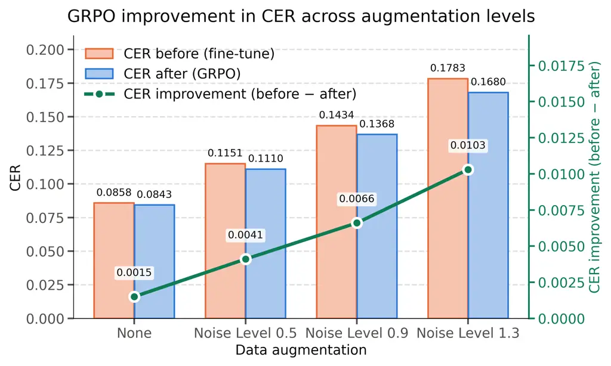
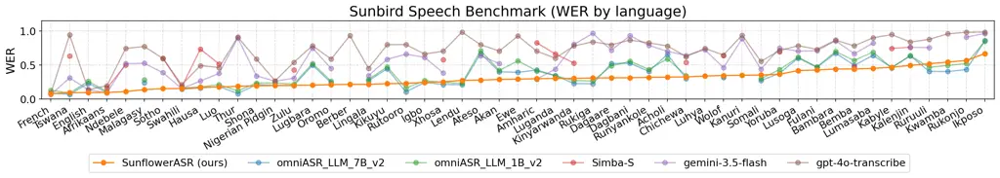
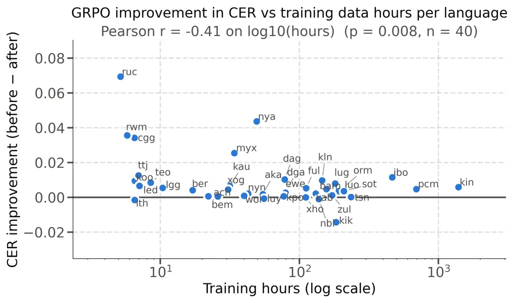

# GROUP RELATIVE POLICY OPTIMISATION IMPROVES MULTILINGUAL SPEECH RECOGNITION IN LOW-RESOURCE LANGUAGES

Tim Wenjie Hu    Evelyn Nafula Ouma    Benjamin Akera    John A. Quinn

###### Abstract

Autoregressive encoder-decoder speech recognition models trained with
teacher forcing can suffer from exposure bias, limiting their ability to
recover from their own prediction errors at inference time. Recent work
has shown that reinforcement learning with Group Relative Policy
Optimisation (GRPO) improves speech recognition in major languages with
LLM-based models. We extend this line of work to smaller, non-LLM
encoder-decoder ASR models, using Whisper-large-v3 as a case study
across 51 African languages. The benefits of this approach are most
pronounced when training data is scarce or when input audio is noisy or
degraded. Our resulting model, SunflowerASR, achieves the best published
macro-averaged WER on the AfriVox-v2 (0.227) and SimbaBench (0.372)
benchmarks, and is publicly available.

###### Index Terms: 

speech recognition, low-resource languages, reinforcement learning.

^(†)^(†)address: Sunbird AI, Uganda

## 1 Introduction

Autoregressive speech recognition models such as Whisper \[8\] are
typically trained only with supervised fine-tuning (SFT). This creates a
risk of exposure bias: the model receives a training signal only for the
case where it has been exactly correct about every preceding token,
leaving it poorly prepared to recover from mistakes during inference.

Reinforcement learning methods provide an alternative, more
representative of conditions at deployment time, where we generate
entire rollouts from input audio sequences and then score each one as a
whole. Recent work has shown that Group Relative Policy Optimisation
(GRPO) \[9\], applied to a speech encoder attached to an Llama3 LLM
decoder, can improve robustness on major European languages \[10\], and
is effective at reducing insertion errors such as hallucinations and
repetition glitches with another LLM-based model, Qwen2-Audio-7B, in
English \[11\]. It has also been demonstrated that GRPO outperforms SFT
in English when adapting a Llama-based ASR decoder using synthetic
speech \[6\].

In this work, we investigate whether these benefits extend to smaller,
non-LLM encoder-decoder architectures, and to languages with scarce
training data. We take the case of Whisper-large-v3 \[8\] (1.55B
parameters) and set up GRPO training with the objective of minimising
character error rate (CER). We train a single model to transcribe 51
African languages, with per-language training data ranging from 5.2
hours (Ruruuli) to 1,392 hours (Kinyarwanda), and observe consistent
improvements, which are most pronounced for noisy test audio and for
languages with scarce training data. Our resulting model, SunflowerASR,
achieves the best published average WER (per-language rankings vary) on
the AfriVox-v2 and SimbaBench benchmarks, and can be accessed at
[https://hf.co/Sunbird/SunflowerASR-51-african-languages](https://hf.co/Sunbird/SunflowerASR-51-african-languages).

## 2 Datasets and base model

#### Training corpus

The training corpus combines 110 dataset subsets covering 51 African
languages, a mean of 2.2 independent sources per language. Sources
include Common Voice \[2\], African Voices \[7\], Waxal \[4\] and other
publicly available datasets. Full source and language level details are
available in our [Hugging Face
release](https://huggingface.co/Sunbird/SunflowerASR-51-african-languages).
After filtering it holds 3.82 M clips totalling 7 412 hours of speech.
Training rows are filtered to remove suspected noisy labels, using an
intermediate ASR model checkpoint, and then sample packed.



Figure 1: CER before (supervised fine-tuning only) and after GRPO for
Whisper-large-v3 on 51 African languages. The improvement becomes more
pronounced at increasing levels of background noise.

#### Supervised fine-tuning

We carry out full parameter fine tuning of the 1.55 B parameters of the
Whisper-large-v3 model from OpenAI \[8\]. Training runs for 5 epochs
over the packed corpus with a per-device batch of 64 packed samples and
4 gradient accumulation steps, an effective batch of 256 packed samples,
or roughly 1.7 hours of audio per optimiser step, giving approximately
4 300 optimiser steps per epoch. Audio augmentation is applied on the
fly, including additive noise drawn from a corpus of Ugandan ambient
sound recordings, and modifications to speed and bandwidth. We use a
peak learning rate of $`2\times 10^{-5}`$ with 100 warmup steps and
cosine decay, and label smoothing of $`0.1`$.

## 3 Reinforcement learning with GRPO

Supervised fine-tuning optimises the per-token likelihood of one
reference transcript, so the model only ever receives a training signal
for the case in which it has been exactly right about every preceding
token. Group relative policy optimisation (GRPO) instead optimises the
sequence-level metric we report. For a clip $`x`$ with reference
transcript $`y`$, the policy $`\pi_{\theta}`$ samples a group of $`G`$
complete transcripts $`\{\hat{y}_{1},\dots,\hat{y}_{G}\}`$, each is
scored by a reward, and the group’s own mean is used as the baseline
against which its members are ranked:

```math
r_{i}=-\min\big(\mathrm{CER}(\hat{y}_{i},y),\,1\big),\qquad A_{i}=\frac{r_{i}-\mathrm{mean}(\mathbf{r})}{\mathrm{std}(\mathbf{r})}. \tag{1}
```

Probability mass is then moved towards the rollouts with positive
advantage, under a token-level normalised objective with a KL penalty of
$`\beta=0.01`$ against the initial policy.

#### Selecting examples with headroom

In Equation 1, advantages are defined relative to the group, so a clip
whose $`G`$ rollouts all receive the same reward produces $`A_{i}=0`$
for every member and contributes no gradient at all, however hard that
clip is in absolute terms. Both failure modes are common in a
51-language corpus: clips the model already transcribes perfectly, and
clips it fails on so completely that every rollout is equally wrong.
GRPO can learn to make improvements for the clips on which the model is
capable of a good transcript but does not reliably produce one.

To measure this directly, we use the SFT checkpoint in sampling mode
over a random sample of the training data, generating $`10`$ transcripts
per clip. For each clip we then compute the headroom,

```math
g=\mathrm{median}_{i}\ \mathrm{CER}(\hat{y}_{i},y)\;-\;\min_{i}\ \mathrm{CER}(\hat{y}_{i},y)\ , \tag{2}
```

the gap between the CER of a typical sample and that of the best sample
in the group. A large $`g`$ means a better transcript is already inside
the model’s sampling distribution, and only needs to be made more
probable. We keep the $`200`$ clips with the largest $`g`$ from each
training data subset, totalling $`15,285`$ clips. Section 4.1 ablates
this choice against drawing the same number of clips per subset at
random.

#### Training

GRPO training is applied to the decoder of the model only, 906 M of the
model’s 1.55B parameters. We generate $`G=10`$ rollouts per training
example, with 64 distinct clips per update for a batch size of 640 at
peak learning rate $`10^{-5}`$. The batch is deliberately large for a
run of this length. Because the training set is shuffled across all 51
languages, a batch of 64 clips draws on many languages at once, and a
single update is therefore an average over them rather than a step that
improves whichever language a small batch happened to contain. This is
the main practical difference we found between the multilingual and the
single-language case: with small batches, updates tend to improve one
language at the expense of others. Section 4.1 ablates the batch size
directly. The Whisper encoder is frozen and only the decoder is trained,
on the hypothesis is that GRPO is most effective at correcting decoding
errors such as spelling, word choice and orthographic convention.

## 4 Results

We evaluate SunflowerASR, our final GRPO model, on three benchmarks,
shown per language in Fig. 2 and Tables 1 and 2. The first is our own
Sunbird Speech Benchmark \[1\], which we assemble from the held-out test
splits of the 110 dataset subsets of the training corpus (Section 2),
capped at 200 clips each. It scores $`20,213`$ clips over 51 languages
drawn from 28 source corpora, and is the only one of the three that
covers the full language range of the model. The second is
AfriVox-v2 \[3\], an in-the-wild benchmark of $`251`$ h aggregating the
Africa Next Voices, Waxal and AfriVox v1 corpora over a 10-domain
taxonomy spanning health, finance, government and agriculture; it is
largely spontaneous rather than read, and we score $`111,051`$ clips in
the 14 languages that have metrics reported in their paper. The third is
SimbaBench \[5\], which aggregates read and conversational speech from
Common Voice, BembaSpeech, Lwazi, NCHLT and regional collections. On all
three benchmarks, our final model has superior accuracy to all published
alternatives: see Figure 2 and Tables 1 and 2.



Figure 2: WER by language on the Sunbird Speech Benchmark, comparing
SunflowerASR against external baselines. Languages are sorted by the WER
of SunflowerASR.

|             | Sunflower  | Sahara | Gemini  | Omni-CTC |       |       | Simba |
| ----------- | ---------- | ------ | ------- | -------- | ----- | ----- | ----- |
| Language    | ASR (ours) | v2     | 3 Flash | 7B       | 1B    | 300M  | S     |
| Swahili     | 0.108      | 0.071  | 0.076   | 0.077    | 0.097 | 0.152 | 0.150 |
| Tswana      | 0.116      | 0.140  | 0.275   | 0.142    | 0.210 | 0.277 | 0.604 |
| Kinyarwanda | 0.133      | 0.066  | 0.165   | 0.104    | 0.138 | 0.215 | 0.591 |
| Sotho       | 0.152      | 0.195  | 0.346   | 0.421    | 0.473 | 0.533 | 0.596 |
| Luganda     | 0.160      | 0.393  | 0.315   | 0.422    | 0.428 | 0.483 | 0.341 |
| Zulu        | 0.161      | 0.256  | 0.237   | 0.202    | 0.256 | 0.346 | 0.396 |
| Xhosa       | 0.166      | 0.206  | 0.292   | 0.200    | 0.256 | 0.344 | 0.501 |
| Shona       | 0.209      | 0.249  | 0.368   | 0.286    | 0.322 | 0.425 | —     |
| Amharic     | 0.251      | 0.253  | 0.249   | 0.327    | 0.374 | 0.490 | 0.716 |
| Hausa       | 0.288      | 0.285  | 0.269   | 0.502    | 0.366 | 0.401 | 0.835 |
| Yoruba      | 0.316      | 0.271  | 0.296   | 0.361    | 0.365 | 0.438 | 0.723 |
| Fulani      | 0.343      | 0.352  | 0.729   | 0.557    | 0.569 | 0.588 | —     |
| Akan        | 0.347      | 0.307  | 0.456   | 0.447    | 0.497 | 0.549 | —     |
| Igbo        | 0.425      | 0.287  | 0.425   | 0.459    | 0.395 | 0.446 | 0.998 |
| Overall     | 0.227      | 0.238  | 0.321   | 0.322    | 0.339 | 0.406 | 0.586 |

Table 1: WER by language on AfriVox-v2 for the 14 languages with
published baselines, which report WER only. Simba-S is our own
evaluation; it does not cover three of the languages, and its macro is
over the other eleven.

|             | SunflowerASR | OmniASR | Simba | Simba | Gemini  |
| ----------- | ------------ | ------- | ----- | ----- | ------- |
| Language    | (Ours)       | LLM-7 B | S     | M     | 2.5 Pro |
| Hausa       | 0.167        | 0.169   | 0.641 | 0.291 | 0.219   |
| Luganda     | 0.220        | 0.171   | 0.227 | 0.357 | 0.421   |
| Swahili     | 0.246        | 0.156   | 0.163 | 0.252 | 0.168   |
| Kinyarwanda | 0.251        | 0.192   | 0.531 | 0.367 | 0.463   |
| Luo         | 0.297        | 0.271   | 0.391 | 0.442 | 0.494   |
| Igbo        | 0.304        | 0.362   | 0.777 | 0.850 | 0.428   |
| Afrikaans   | 0.312        | 0.279   | 0.145 | 0.313 | 0.158   |
| Wolof       | 0.324        | 0.583   | 0.581 | 0.586 | 1.830   |
| Yoruba      | 0.335        | 0.232   | 0.201 | 0.415 | 0.524   |
| Kabyle      | 0.349        | 0.287   | 0.604 | 0.643 | 0.933   |
| Tswana      | 0.353        | 0.489   | 0.187 | 0.306 | 0.464   |
| Bemba       | 0.374        | 0.392   | 0.391 | 0.437 | 0.635   |
| Sotho       | 0.441        | 0.634   | 0.210 | 0.327 | 0.495   |
| Ndebele     | 0.444        | 0.588   | 0.246 | 0.358 | 0.413   |
| Zulu        | 0.459        | 0.401   | 0.585 | 0.333 | 0.359   |
| Xhosa       | 0.466        | 0.448   | 0.272 | 0.383 | 0.466   |
| Chichewa    | 0.545        | 0.609   | 0.223 | 0.468 | 0.428   |
| Kalenjin    | 0.580        | 0.700   | 0.713 | 0.734 | 0.959   |
| Amharic     | 0.600        | 0.234   | 0.330 | 0.525 | 0.457   |
| Overall     | 0.372        | 0.379   | 0.390 | 0.442 | 0.543   |

Table 2: WER by language on SimbaBench over the 19 languages in common.
Baselines from the public leaderboard.

To evaluate the benefits of GRPO specifically, compared to the SFT-only
initial checkpoint, we create three additional versions of 51-language
evaluation set, with noise drawn from a corpus of Ugandan street
recordings at three mean relative amplitudes, $`0.5`$, $`0.9`$ and
$`1.3`$, and also score the undegraded audio as a control. CER is
consistently better after GRPO, and the improvement grows monotonically
with the severity of the degradation, as shown in Fig. 1.

GRPO mainly repairs failures under acoustic stress, and the low-resource
languages with the less supervised data gain the most. Fig. 3
illustrates each language’s CER improvement against the hours of
supervised audio it contributed to the training corpus, for which there
is a correlation of $`r=-0.41`$ on $`\log_{10}`$ hours, with 35 of 40
languages improving.



Figure 3: Per-language CER improvement from GRPO against the number of
hours of supervised training data for that language.

#### Practical deployment audio

Table 3 reports the effect of GRPO on Sunbird’s _salt-practical-eval_
set, a 60-clip validation set assembled to reflect real deployment. The
recordings were collected in Uganda and cover Ugandan English (28 clips)
and Luganda (32 clips) across three deployment settings: citizen
feedback gathered outside hospitals and government offices,
conversations recorded at the call centre of a bank, and phone-in
contributions to an interactive radio programme. The audio is
spontaneous and conversational, captured in noisy public spaces, with
overlapping turns, hesitation and backchannel markers, and frequent
code-switching from Luganda into English for domain vocabulary and
numerals. GRPO improves both metrics in both languages more
significantly than for benchmark test data: the aggregate reduction is
$`6.2\%`$ relative on WER and $`9.7\%`$ relative on CER.

### 4.1 Ablations

Three ablations isolate the contribution of the reinforcement objective
itself, of the clip selection of Section 3, and of the batch size of
Section 3; results are in Table 4.

GRPO against further supervised training on the same clips. GRPO adds an
extra epoch of training over a curated $`15,285`$-clip subset, so its
gain could in principle come from that extra pass rather than from the
reinforcement signal. We test this by continuing _supervised_
fine-tuning from the same checkpoint for one further epoch over exactly
the clips GRPO was given. This regresses the model on both WER and CER
(Table 4). The same data is thus useful under a reinforcement objective
and harmful under a supervised one.

Selecting examples with headroom. Replacing the headroom ranking of
Equation 2 with $`200`$ clips drawn uniformly at random from each
subset, everything else held fixed, gives WER $`0.4220`$ and CER
$`0.1714`$. Random selection still improves on the supervised
checkpoint, but it recovers only about two thirds of the CER gain,
$`-3.9\%`$ against $`-5.8\%`$ relative.

Batch size. Reducing the batch from $`64`$ distinct clips to $`16`$, at
the same $`G=10`$ and over the same selected clips, gives WER $`0.4243`$
and CER $`0.1689`$. The regression is smaller than for the other two
ablations and is clearer on WER ($`-0.8\%`$ against $`-1.8\%`$ relative)
than on CER, but its direction matches the argument of Section 3: with
$`51`$ languages shuffled together, $`16`$ clips is a thin sample of the
language set, and an update is correspondingly likely to benefit only
the languages that batch happened to contain.

|                   |       |        |       |             |        |       |             |
| ----------------- | ----- | ------ | ----- | ----------- | ------ | ----- | ----------- |
|                   |       | WER    |       |             | CER    |       |             |
| Scenario          | $`n`$ | Before | After | $`\Delta`$  | Before | After | $`\Delta`$  |
| _Ugandan English_ |       |        |       |             |        |       |             |
| Citizen feedback  | 12    | 0.324  | 0.282 | $`-13.0\%`$ | 0.223  | 0.182 | $`-18.0\%`$ |
| Call centre       | 16    | 0.302  | 0.273 | $`-9.4\%`$  | 0.213  | 0.182 | $`-14.8\%`$ |
| _Luganda_         |       |        |       |             |        |       |             |
| Citizen feedback  | 8     | 0.705  | 0.683 | $`-3.0\%`$  | 0.324  | 0.317 | $`-2.2\%`$  |
| Radio phone-in    | 15    | 0.535  | 0.528 | $`-1.4\%`$  | 0.140  | 0.132 | $`-5.4\%`$  |
| Call centre       | 9     | 0.602  | 0.565 | $`-6.2\%`$  | 0.272  | 0.265 | $`-2.5\%`$  |
| All               | 60    | 0.423  | 0.397 | $`-6.2\%`$  | 0.215  | 0.194 | $`-9.7\%`$  |

Table 3: Effect of GRPO on the Sunbird _salt-practical-eval_ set, by
deployment scenario and language.

| Variant                         | WER    | $`\Delta`$  | CER    | $`\Delta`$  |
| ------------------------------- | ------ | ----------- | ------ | ----------- |
| SFT checkpoint (initialisation) | 0.4279 | —           | 0.1783 | —           |
| $`+`$ 1 further SFT epoch       | 0.4794 | $`+12.0\%`$ | 0.2089 | $`+17.2\%`$ |
| GRPO, random clips per subset   | 0.4220 | $`-1.4\%`$  | 0.1714 | $`-3.9\%`$  |
| GRPO, 16 clips per batch        | 0.4243 | $`-0.8\%`$  | 0.1689 | $`-5.3\%`$  |
| GRPO, full (SunflowerASR)       | 0.4201 | $`-1.8\%`$  | 0.1680 | $`-5.8\%`$  |

Table 4: Ablations on the noise-$`1.3`$ set ($`20,347`$ rows), with all
variants starting from the same SFT checkpoint.

| Measure                                      | SFT     | GRPO    |
| -------------------------------------------- | ------- | ------- |
| Word substitutions                           | 114,755 | 115,272 |
| Character substitutions                      | 165,096 | 160,220 |
| Mean char. edit distance per substitution    | 3.437   | 3.385   |
| Substitutions within $`\leq 1`$ edit         | 26.7%   | 27.4%   |
| Substitutions within $`\leq 2`$ edits        | 44.9%   | 45.8%   |
| Total char. cost of substitutions            | 394,368 | 390,231 |
| Long words cut to $`\leq`$ half their length | 18.8%   | 18.0%   |

Table 5: Substitution quality on the $`20,124`$ rows where neither model
loops.

| Lang.   | Reference          | SFT heard                 | GRPO heard       | Edits        |
| ------- | ------------------ | ------------------------- | ---------------- | ------------ |
| Oromo   | libiraal           | liibiraaldimookiraasiitti | liibiraal        | 17 $`\to`$ 1 |
| Rukonjo | ngerikulhakulhania | ebyo                      | erikulhakulhania | 17 $`\to`$ 2 |
| Shona   | vobva              | rwakachenerukira          | wobva            | 15 $`\to`$ 1 |
| Luganda | bibili             | ebitakyalabirwaako        | bibiri           | 14 $`\to`$ 1 |
| Ruruuli | ebyankulakulana    | mbe                       | ebyangulagulana  | 14 $`\to`$ 2 |
| Kanuri  | k e nasartiyende   | d e                       | k e nasartiyande | 13 $`\to`$ 1 |
| Zulu    | amabhayisikili     | i                         | mubhayisikili    | 13 $`\to`$ 2 |
| Rutooro | baali              | batarukwegesaana          | baaba            | 13 $`\to`$ 2 |
| Somali  | dheellitirka       | wax                       | dheelitirka      | 12 $`\to`$ 1 |
| Kwamba  | ndia               | ndibhakazwisikilangu      | ndiabho          | 16 $`\to`$ 3 |

Table 6: Cases where the supervised model heard a fragment or an
unrelated word and GRPO heard a near-miss spelling.

### 4.2 Characterisation of improvements

To understand the nature of the improvements, we aligned the $`20,347`$
hypotheses of the noise-$`1.3`$ set against the references, and observed
two different mechanisms. The first is the suppression of degenerate
decoding. Under acoustic stress the supervised model sometimes falls
into a repetition loop and emits hundreds of words for a short
utterance. There are 223 rows ($`1.1\%`$ of the evaluation) for which
the SFT-only model becomes stuck in a loop. GRPO repairs these decoding
failures, and this accounts for the WER gain.

On the remaining $`20,124`$ rows the two models are wrong about equally
often; word substitutions are flat at $`+0.5\%`$, yet character
substitutions fall by $`3.0\%`$. The characteristic supervised failure
is to replace a word either with a fragment or with an unrelated long
compound, while GRPO returns a near-miss spelling that tracks the
acoustics through to the end of the word (Table 6).

## 5 Conclusion

We have shown that GRPO transfers from LLM-decoder systems to a smaller
non-LLM encoder-decoder model, in a multilingual, low-resource and noisy
setting. The benefits increase for languages with fewer data resources
(e.g. tens of hours of audio), and in test time conditions with
challenging audio. Selection of training examples with headroom and
appropriate batch sizing are helpful to attain improvements in accuracy.
This therefore appears to be a widely generalisable post-training method
for autoregressive ASR models.

## References

- \[1\] S. AI (2026) Sunbird speech benchmark: a multilingual asr test
  set for 51 african languages. Note:
  [https://huggingface.co/datasets/Sunbird/speech-benchmark](https://huggingface.co/datasets/Sunbird/speech-benchmark)
  Cited by: §4.
- \[2\] R. Ardila, M. Branson, K. Davis, M. Kohler, J. Meyer, M.
  Henretty, R. Morais, L. Saunders, F. M. Tyers, and G. Weber (2020)
  Common voice: a massively-multilingual speech corpus. In Proceedings
  of the 12th Language Resources and Evaluation Conference (LREC),
  pp. 4218–4222. Cited by: §2.
- \[3\] B. Awobade, G. Z. Ashungafac, and T. Olatunji (2026) AfriVox-v2:
  a domain-verticalized benchmark for in-the-wild african speech
  recognition. Cited by: §4.
- \[4\] A. Diack, P. Nelson, K. Agbesi, A. Nakalembe, M.
  MohamedKhair, V. Dube, et al. (2026) WAXAL: a large-scale multilingual
  African language speech corpus. External Links: 2602.02734,
  [Link](https://arxiv.org/abs/2602.02734) Cited by: §2.
- \[5\] A. A. Elmadany, S. Y. Kwon, H. O. Toyin, A. Alcoba Inciarte, H.
  Aldarmaki, and M. Abdul-Mageed (2025) Voice of a continent: mapping
  Africa’s speech technology frontier. In Proceedings of the 2025
  Conference on Empirical Methods in Natural Language Processing, C.
  Christodoulopoulos, T. Chakraborty, C. Rose, and V. Peng (Eds.),
  Suzhou, China, pp. 11039–11061. External Links:
  [Link](https://aclanthology.org/2025.emnlp-main.559/),
  [Document](https://dx.doi.org/10.18653/v1/2025.emnlp-main.559), ISBN
  979-8-89176-332-6 Cited by: §4.
- \[6\] S. Kumar, Y. Labrak, H. Watawana, S. Burdisso, E.
  Villatoro-Tello, K. Hacioğlu, P. Motlicek, and A. Stolcke (2026) When
  synthetic speech is all you have: better call GRPO. arXiv preprint
  arXiv:2607.08409. Cited by: §1.
- \[7\] P. Ogayo, G. Neubig, and A. W. Black (2022) Building African
  voices. In Proc. Interspeech, pp. 1263–1267. Cited by: §2.
- \[8\] A. Radford, J. W. Kim, T. Xu, G. Brockman, C. McLeavey, and I.
  Sutskever (2023) Robust speech recognition via large-scale weak
  supervision. In Proceedings of the 40th International Conference on
  Machine Learning, Proceedings of Machine Learning Research, Vol. 202,
  pp. 28492–28518. Cited by: §1, §1, §2.
- \[9\] Z. Shao, P. Wang, Q. Zhu, R. Xu, J. Song, X. Bi, H. Zhang, M.
  Zhang, Y. K. Li, Y. Wu, and D. Guo (2024) DeepSeekMath: pushing the
  limits of mathematical reasoning in open language models. External
  Links: 2402.03300, [Link](https://arxiv.org/abs/2402.03300) Cited by:
  §1.
- \[10\] P. G. Shivakumar, Y. Gu, A. Gandhe, and I. Bulyko (2025) Group
  relative policy optimization for speech recognition. External Links:
  2509.01939, [Link](https://arxiv.org/abs/2509.01939) Cited by: §1.
- \[11\] T. Xiong, R. Chen, W. Li, W. Zhang, and Q. Xie (2026) Grounded
  in sound: reinforcement learning with a frozen acoustic judge to curb
  ASR insertion hallucinations. External Links: 2609.14455,
  [Link](https://arxiv.org/abs/2609.14455) Cited by: §1.
