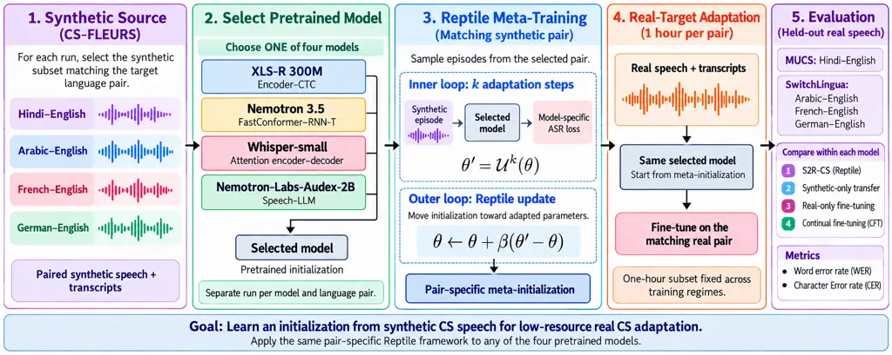
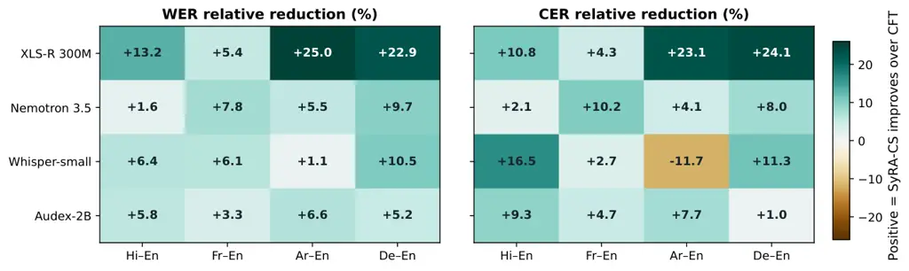
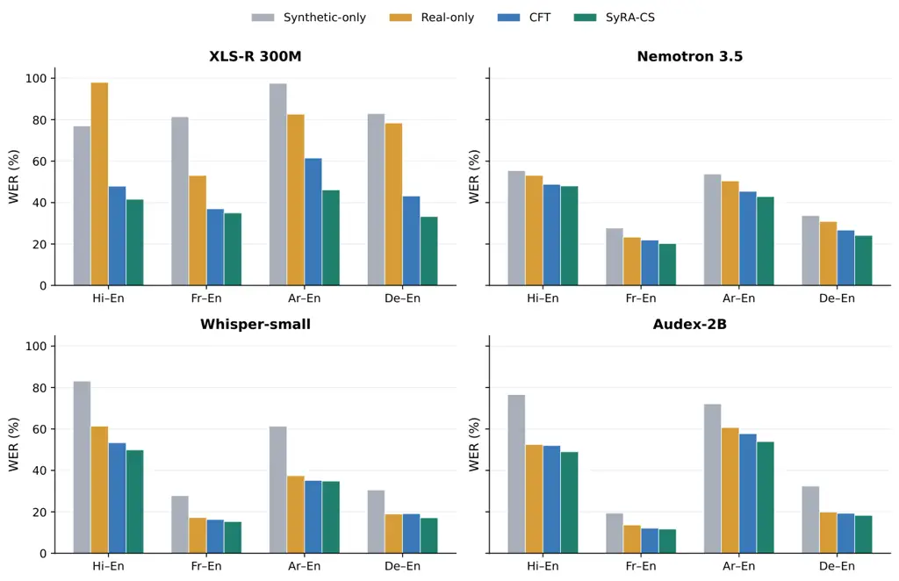
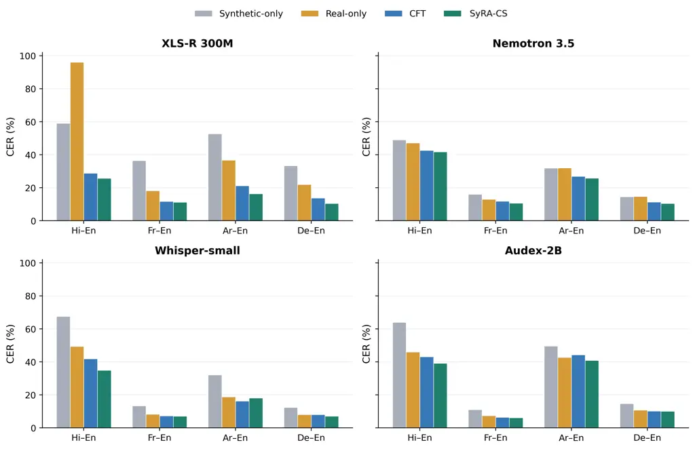
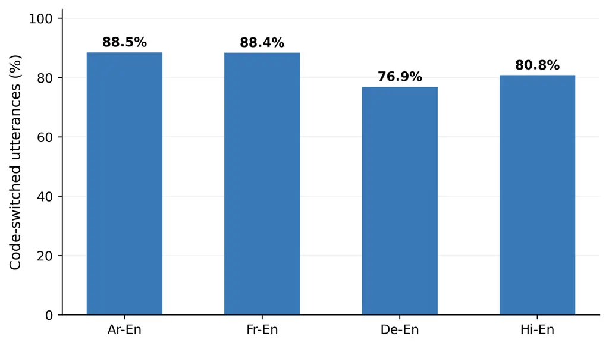
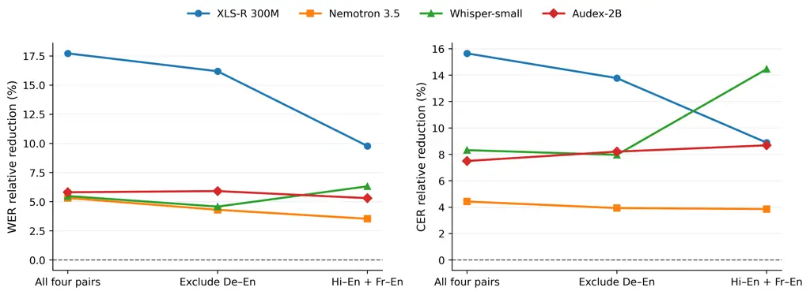

# SyRA-CS: Synthetic-to-Real Adaptation for Code-Switched ASR with Meta-Learning

Fadel Thior    Ahmer Tabassum    Haania Siddiqui    Hanan Aldarmaki   
Thamar Solorio Affiliation: Mohamed bin Zayed University of Artificially
Intelligence Email: [fadel.thior@mbzuai.ac.ae](mailto:)

###### Abstract

Code-switched (CS) automatic speech recognition (ASR) remains difficult
because real CS speech is scarce and synthetic speech does not fully
match it. We investigate whether synthetic CS speech is more useful for
learning an adaptation-friendly initialization than for ordinary
continual fine-tuning. We propose SyRA-CS, a pair-specific
synthetic-to-real adaptation framework based on Reptile meta-learning.
For each language pair and pretrained model, we meta-train on the
corresponding synthetic CS-FLEURS subset and then adapt using one hour
of labeled real target speech. We evaluate four architectural settings:
Encoder–CTC, FastConformer–RNN-T, Attention Encoder–Decoder (AED) and
Speech-LLM. Experiments cover on Arabic-, French-, German-, and
Hindi-English, against synthetic-only transfer, real-only fine-tuning,
and continual fine-tuning. SyRA-CS improves over continual fine-tuning
on WER in all 16 model–pair comparisons and on CER in 15 of 16, with
relative macro WER reductions of 17.7% for XLS-R and 5.3–5.8% for the
other three models. The gains hold across the tested models but vary in
size across architectures, language pairs and metrics.

## 1 Introduction

Code-switching (CS)—the alternation of two or more languages within a
conversation or utterance—is a common phenomenon in multilingual
communities, but presents additional challenges for Automatic Speech
Recognition (ASR) systems. The challenge is both linguistic and
data-centric: real CS corpora are expensive to collect and transcribe,
and switching patterns vary with speaker community, accent, discourse
function, topic, and orthographic convention. As a result, ASR models
trained for one CS condition often degrade under another (Sitaram et
al., 2019; Lyu et al., 2010; Li and Fung, 2012).

Synthetic CS speech offers an attractive way to cheaply expand
supervision data (Yan et al., 2025; Dhawan et al., 2023), but synthetic
speech does not perfectly match real speech. Synthetic utterances may
have cleaner acoustics, less speaker and accent variability. Therefore,
simply fine-tuning on synthetic CS speech may overfit to synthetic
regularities instead of generalizing to real CS recognition. An
alternative approach is meta-learning: a method that trains a model to
_become adaptable_, by repeatedly simulating small adaptation episodes
and updating the parameters so that a few gradient steps on a new,
data-scarce task lead to good performance (Finn et al., 2017). The
output is not a final recognizer but an initialization from which
fine-tuning on a small labeled set is fast and stable. This paper asks a
focused question: _under a limited real data budget, can a meta-learned
initialization from synthetic CS speech adapt better to real CS speech
compared to standard training strategies?_ We use Reptile (Nichol et
al., 2018) because it is a first-order meta-learning algorithm that
repeatedly simulates adaptation episodes and moves the initialization
toward parameters that are easy to reach after a few gradient steps: our
contribution is not a new meta-learning optimizer or a benchmark of all
meta-learning algorithms (Section 4.1). Instead, we test whether a
lightweight meta-initializer is useful for synthetic-to-real CS ASR
under severe target scarcity. We train one Reptile initialization for
each combination of language pair and pretrained model. Our experiments
cover four architectural settings: XLS-R 300M with a CTC prediction head
(Babu et al., 2021), Nemotron 3.5 with a FastConformer–RNN-T
architecture (NVIDIA, 2026a), Whisper-small with an attention
encoder–decoder architecture (OpenAI, 2026), and Nemotron-Labs-Audex-2B
as a Speech-LLM (NVIDIA, 2026b). Within each model–pair combination, the
training regimes start from the same pretrained checkpoint and use the
corresponding synthetic CS-FLEURS subset. Methods requiring real-domain
adaptation use the same one-hour labeled target subset. Hindi-English is
evaluated on MUCS 2021 (Diwan et al., 2021), while Arabic-English,
French-English, and German-English are evaluated on SwitchLingua (Xie et
al., 2025). This design evaluates within-pair synthetic-to-real
adaptation across different pretrained ASR systems; it does not learn a
shared multilingual meta-initialization. Our contributions are:

- •
  We formulate pair-specific synthetic-to-real code-switched ASR as a
  data-efficient meta-learning problem, using synthetic speech to learn
  an initialization for adaptation with one hour of labeled real target
  speech
- •
  We investigate Reptile across four architectural settings:
  Encoder–CTC, FastConformer–RNN-T, attention encoder–decoder, and
  Speech-LLM, using comparisons against synthetic-only transfer,
  real-only fine-tuning, and continual fine-tuning within each
  pretrained model.
- •
  We characterize the code-switching profile of each real target set
  (switching ratio) and assess the robustness of the gains to the two
  smallest evaluation sets.

## 2 Related Work

### 2.1 Multilingual self-supervised

Self-supervised speech learning has become the dominant paradigm for
low-resource ASR. Baevski et al. (2020) introduced wav2vec 2.0, which
learns contextualized acoustic representations from raw unlabeled audio
and can then be fine-tuned with limited transcribed speech. HuBERT
improved masked prediction with cluster-based targets (Hsu et al.,
2021), and XLS-R scaled the wav2vec 2.0 recipe to nearly half a million
hours of multilingual audio across 128 languages (Babu et al., 2021).
Large multilingual speech resources such as FLEURS (Conneau et al.,
2022), Common Voice (Ardila et al., 2020), VoxPopuli (Wang et al.,
2021), and MMS (Pratap et al., 2023) have further strengthened
multilingual transfer.

### 2.2 Code-switched ASR and synthetic data

A recent systematic review of end-to-end CS-ASR studies notes that,
although data augmentation is widely used, it remains less explored than
many model-centric approaches (Agro et al., 2025). In response, recent
studies have used synthetic text and speech to improve low-resource
code-switched ASR. Several works explore how synthetic code-switched
data can be created or leveraged when real code-switched speech is
scarce. Nguyen and Tran (2025b) show that ASR systems can be trained
with synthetic phrase-level code-switching derived from monolingual
resources, while Nguyen and Tran (2025a) propose AsyncSwitch, which
adapts models on large amounts of code-switched text before aligning
this knowledge with limited paired speech. More broadly, Hamed et al.
(2025) find that the value of synthetic code-switched data depends
strongly on its quality and the downstream task. At the same time,
recent work has introduced stronger benchmarks and architectures for
code-switched ASR. Yan et al. (2025) present CS-FLEURS, a multilingual
benchmark covering 113 unique code-switched language pairs, and show
that synthetic training data improves performance on both seen and
unseen pairs. Ugan et al. (2024) show that bilingual ASR systems still
struggle on realistic code-switching benchmarks, while Ye et al. (2024)
propose a mixture-of-experts architecture to better handle language
switching in streaming and non-streaming settings. Earlier work also
explored semi-supervised and unified approaches (Tazakka et al., 2024;
Dhawan et al., 2023). Overall, these works show that synthetic data is
becoming an important tool for code-switched ASR, especially in
low-resource settings where real code-switched speech is scarce. They
also suggest that the main challenge is not only generating more data,
but generating data that is linguistically and acoustically useful for
adaptation.



Figure 1: Overview of the Pair-Specific Synthetic-to-Real Reptile
Adaptation Framework for Code-Switched ASR.

### 2.3 Meta-learning for ASR

Meta-learning is well suited to low-resource ASR because it explicitly
learns parameters that can adapt quickly to new conditions with limited
supervision. Early work applied MAML-style meta-learning to end-to-end
ASR, learning initializations from high-resource languages that adapt
quickly to low-resource targets (Hsu et al., 2020), and Winata et al.
(2020) extended this idea to code-switched speech with meta-transfer
learning, which draws episodes from monolingual corpora so that the
initialization transfers to limited real CS data. Our work differs in
that episodes are sampled from _synthetic_ CS speech of the same
language pair and the meta-learner is first-order Reptile rather than
MAML. Recent ASR work has strengthened this direction: Meta-Adapter
shows that meta-initialized adapters improve self-supervised speech
adaptation for low-resource languages (Chen et al., 2024), SMILE extends
meta-learning to few-shot multilingual ASR through speech meta
in-context learning (Hsu and Lee, 2024), and MetaMixSpeech shows that
task augmentation can improve generalization in multilingual
low-resource ASR (Chen et al., 2025). Together, these studies motivate
meta-learning as an effective framework for fast speech adaptation under
severe data scarcity. Related ideas also appear in multilingual NLP,
where targeted adaptation has been shown to improve transfer to
low-resource language families (Downey et al., 2024). In code-switched
ASR, recent work such as AsyncSwitch emphasizes adaptation to limited
paired code-switched speech after prior exposure to code-switched
resources (Nguyen and Tran, 2025a).

## 3 Data, Model, and Evaluation

### 3.1 Backbones and architecture scope

We evaluate SyRA-CS with four pretrained models spanning different ASR
architectures:

- •
  XLS-R 300M (Encoder-CTC): wav2vec2-xls-r-300m, with a linear CTC
  prediction head (Babu et al., 2021).
- •
  Nemotron 3.5 (FastConformer–RNN-T): a FastConformer encoder with an
  RNN-T decoder (NVIDIA, 2026a).
- •
  Whisper-small (AED): an attention-based Transformer encoder–decoder
  (OpenAI, 2026).
- •
  Nemotron-Labs-Audex-2B (Speech-LLM): an audio-text language model used
  for speech transcription (NVIDIA, 2026b).

The synthetic CS-FLEURS data and real target data provide supervised
training and adaptation examples. They are not used for additional
self-supervised pretraining.

Let $`a`$ index the pretrained model and let $`\theta`$ denote its
trainable parameters. Reptile operates on these parameters using the
model-specific transcription objective:

```math
\mathcal{L}_{a}=\begin{cases}\mathcal{L}_{\mathrm{CTC}},&a=\text{XLS-R},\\
\mathcal{L}_{\mathrm{RNNT}},&a=\text{Nemotron},\\
\mathcal{L}_{\mathrm{AR}},&a\in\{\text{Whisper},\text{Audex}\},\end{cases} \tag{1}
```

CTC marginalizes over frame-level alignments compatible with the
transcript (Graves et al., 2006), whereas RNN-T uses a transducer
alignment objective. For the autoregressive models, the transcription
objective is

```math
\mathcal{L}_{\mathrm{AR}}(\theta;x,y)=-\sum_{u=1}^{|y|}\log p_{\theta}(y_{u}\mid y_{<u},x,c_{a}), \tag{2}
```

where $`c_{a}`$ denotes any model-specific task tokens or transcription
prompt. For the Speech-LLM, this expression describes loss on the target
transcription tokens. Across models, parameter counts, pretraining
histories, tokenization, and decoding mechanisms differ. The cross-model
experiments therefore examine whether the benefit of Reptile extends
across architectural settings; absolute differences between models
cannot be attributed to architecture alone.

### 3.2 Source tasks: CS-FLEURS data

Our synthetic source data are drawn from CS-FLEURS (Yan et al., 2025), a
corpus of synthetic code-switched speech spanning multiple language
pairs. We use four code-switched subsets from XTTS version as it
contains training data for our meta learning experiments: Hindi-English
(6 hours), French-English (10.28h), Arabic-English (4.51 hours) and
German-English (9.37 hours), where each subset corresponds to one
language pair and the reported durations denote the total amount of
synthetic training audio available for that pair. For a model $`a`$ and
target pair $`p`$, synthetic episodes are sampled only from the
corresponding source subset $`S_{p}`$. Thus, each meta-training run
learns a model-specific, pair-specific initialization rather than an
initialization trained jointly across language pairs.

### 3.3 Target tasks: MUCS and Switchlingua data

We evaluate adaptation under real-world code-switched conditions using
all four pairs as target tasks. Real-world Hindi-English speech data is
from MUCS (Diwan et al., 2021), French-English (2.64 hours),
Arabic-English (1.43 hours) and German-English (1.40 hours) are from the
SwitchLingua dataset (Xie et al., 2025). SwitchLingua provides real
audio recordings from bilingual speakers, but the spoken prompts are
generated code-switched text samples. Thus, the target audio is human
speech, while the linguistic content follows a synthetic-script
collection protocol. Unlike SwitchLingua, MUCS Hindi-English is
extracted from human spoken tutorials. The speech is therefore real
instructional audio, and the code-switching primarily arises from
technical lecture content rather than from generated code-switched text.
For each target pair, we randomly select a 1-hour labeled subset for
adaptation and evaluate final performance on the corresponding real
code-switched test set. As CS speech data is scarce, this setup is
intentionally low-resource and is designed to measure how effectively a
model trained on synthetic code-switched speech can transfer to real
speech with only a small amount of target-domain supervision.

### 3.4 Metrics and Text normalization

We report Word Error Rate (WER) and Character Error Rate (CER) using
Levenshtein edit distance (Levenshtein, 1966):

```math
\displaystyle\mathrm{WER} \displaystyle=\frac{S+D+I}{N_{w}}, \tag{3}
```

```math
\displaystyle\mathrm{CER} \displaystyle=\frac{S_{c}+D_{c}+I_{c}}{N_{c}}.
```

The same normalization is applied to references and hypotheses for all
systems before scoring: unicode normalization, removal of markup
artifacts, punctuation stripping, whitespace normalization, and case
normalization for Latin-script text. We do not introduce system-specific
post-processing. For Arabic-English, the evaluation uses the same common
normalization pipeline and does not apply additional Arabic-specific
orthographic collapsing unless explicitly configured in the released
scoring script. WER and CER are standard and comparable across all four
pairs; we complement them with a description of the code-switching
profile of each test set. Multi-reference WER (Ali et al., 2015) and
PolyWER (Kadaoui et al., 2024) are not used here because MUCS and
SwitchLingua provide a single reference per utterance; constructing
alternative references manually would introduce subjective normalization
choices.

## 4 Meta Learning Adaptation

Let
$`\mathcal{P}=\{\text{ara-eng},\text{fra-eng},\text{deu-eng},\text{hin-eng}\}`$
and
$`\mathcal{A}=\{\mathrm{XLSR},\mathrm{Nemotron},\mathrm{Whisper},\mathrm{Audex}\}`$.
For each pair $`p\in\mathcal{P}`$, let $`S_{p}`$ denote its synthetic
CS-FLEURS source set, $`A_{p}`$ its one-hour real adaptation set, and
$`E_{p}`$ its held-out real evaluation set. For each model
$`a\in\mathcal{A}`$, we learn a separate initialization
$`\theta_{a,p}^{\mathrm{meta}}`$ starting from that model’s pretrained
initialization $`\theta_{a,0}`$. The symbol $`\theta`$ denotes the
parameters updated during training. At meta-iteration $`t`$, each
synthetic episode $`i`$ starts from
$`\theta_{a,p,i}^{(0)}=\theta_{a,p,t}`$. It performs $`k_{a}`$ inner
updates using the model-specific loss from Section 3.1:

```math
\displaystyle\theta_{a,p,i}^{(j+1)} \displaystyle=\theta_{a,p,i}^{(j)}-\alpha_{a}\nabla_{\theta}\mathcal{L}_{a}\bigl(\theta_{a,p,i}^{(j)};B_{p,i}^{(j)}\bigr), \tag{4}
```

where $`B_{p,i}^{(j)}\subset S_{p}`$ is a synthetic minibatch and
$`j=0,\ldots,k_{a}-1`$. This notation expresses a gradient step; the
optimizer used in each implementation is reported with the experimental
configuration.

Let $`\widetilde{\theta}_{a,p,i}=\theta_{a,p,i}^{(k_{a})}`$. For a
meta-batch of $`m_{a}`$ episodes, the Reptile update is

```math
\displaystyle\theta_{a,p,t+1} \displaystyle=\theta_{a,p,t} \tag{5}
```

```math
\displaystyle+\frac{\beta_{a,t}}{m_{a}}\sum_{i=1}^{m_{a}}\bigl(\widetilde{\theta}_{a,p,i}-\theta_{a,p,t}\bigr),
```

where $`\beta_{a,t}`$ is the outer step size. The update uses parameter
displacements without differentiating through the inner optimization
trajectory.

After meta-training, the initialization is adapted to the one-hour real
subset:

```math
\displaystyle\phi_{a,p}^{(0)} \displaystyle=\theta_{a,p}^{\mathrm{meta}}, \tag{6}
```

```math
\displaystyle\phi_{a,p}^{(u+1)} \displaystyle=\phi_{a,p}^{(u)}-\eta_{a}\nabla_{\phi}\mathcal{L}_{a}\bigl(\phi_{a,p}^{(u)};B_{p}^{(u)}\bigr),
```

where $`B_{p}^{(u)}\subset A_{p}`$. The resulting model
$`\phi_{a,p}^{\star}`$ is evaluated on $`E_{p}`$. Neither meta-training
nor target adaptation uses evaluation examples.

### 4.1 Why First-Order Meta-Learning?

Reptile is particularly suitable for our setting because it avoids
differentiating through the inner optimization trajectory (Nichol et
al., 2018). In MAML, after $`k`$ inner updates
$`\theta^{\prime}_{\tau}=U_{\tau}^{k}(\theta)`$, the meta-update
requires

```math
\theta\leftarrow\theta-\beta\nabla_{\theta}\mathcal{L}^{\mathrm{out}}_{\tau}\left(U_{\tau}^{k}(\theta)\right),
```

and therefore backpropagates through the sequence of inner-loop
optimization steps. In its standard form, this introduces second-order
derivatives and substantial memory and computational overhead. This
overhead is particularly relevant when repeatedly adapting large
pretrained speech models, including CTC, transducer, encoder–decoder,
and Speech-LLM systems. Reptile instead uses the parameter displacement

```math
\theta\leftarrow\theta+\beta(\theta^{\prime}_{\tau}-\theta),
```

without differentiating through the trajectory that produced
$`\theta^{\prime}_{\tau}`$. The outer update can therefore be applied
across our four architectural settings while the inner loop uses each
model’s transcription objective. Our hypothesis is that repeated
adaptation on synthetic CS episodes produces an initialization that
transfers more effectively to limited real target speech than ordinary
synthetic-domain fine-tuning. This hypothesis is tested through
within-model comparisons against CFT. Reptile’s first-order formulation
reduces the derivative overhead associated with standard second-order
MAML, but does not remove the cost of repeated inner-loop training.

## 5 Experiments and Results

### 5.1 Baselines and Reproducibility

For each model $`a`$ and language pair $`p`$, we compare four training
regimes:

- •
  Synthetic-only transfer: train from the model’s pretrained checkpoint
  on $`S_{p}`$ and evaluate directly on $`E_{p}`$, without real
  adaptation.
- •
  Real-only fine-tuning: fine-tunes the pretrained model on $`A_{p}`$
  only.
- •
  Continual fine-tuning (CFT): train first on $`S_{p}`$ and then adapt
  on $`A_{p}`$.
- •
  SyRA-CS: learn a Reptile initialization from episodes sampled from
  $`S_{p}`$, then adapt on $`A_{p}`$.

Within each model–pair combination, all regimes start from the same
pretrained checkpoint. Methods using real adaptation share the same
one-hour subset, and all methods are evaluated on the same held-out set.
Trainable parameter scope, tokenization, transcript normalization, and
inference settings are fixed across regimes within each model. CFT is
the closest baseline because it uses the same synthetic source set and
real target subset as SyRA-CS. Their comparison tests the value of
episodic Reptile training relative to ordinary sequential training.
Table 1 reports the Reptile configuration for each model.

|                                                |                      |                                         |
| ---------------------------------------------- | -------------------- | --------------------------------------- |
| Setting                                        | XLS-R 300M           | Nemotron 3.5 / Whisper-small / Audex-2B |
| Architecture                                   | Encoder–CTC          | FastConformer–RNN-T / AED / Speech-LLM  |
| Trainable parameters                           | Full model           | Full model                              |
| Meta-iterations                                | 500                  | 500                                     |
| Inner steps $`k_{a}`$                          | 50                   | 50                                      |
| Inner learning rate $`\alpha_{a}`$             | $`3\times 10^{-4}`$  | $`2\times 10^{-5}`$                     |
| Outer step size $`\beta_{a}`$                  | 0.1                  | 0.1                                     |
| Batch size                                     | 2                    | 2                                       |
| Target fine-tuning epochs                      | 50                   | 50                                      |
| GPU                                            | $`1\times`$ RTX 4090 | RTX A4500                               |
| Setting: model-specific, pair-specific Reptile |                      |                                         |
| Pairs: ara-eng, fra-eng, deu-eng, hin-eng      |                      |                                         |
| Source: corresponding CS-FLEURS subset         |                      |                                         |
| Target: 1h per pair; MUCS and SwitchLingua     |                      |                                         |

Table 1: Reptile configurations. The grouped column reports shared
settings; architectures follow the model order.

### 5.2 Main results

Table 2 compares the four training regimes within each pretrained model,
and SyRA-CS improves over CFT in all 16 model–pair WER comparisons and
in 15 of the 16 CER comparisons, and attains the lowest error among the
four regimes in 31 of the 32 model–pair–metric cells. Macro averages
over the four pairs are computed from the rounded scores in Table 2;
relative macro reductions are computed from the macro error rates rather
than by averaging the pair-level reductions in Figure 2.

|                                     |           |                    |                    |                    |                    |                    |                    |                    |                    |
| ----------------------------------- | --------- | ------------------ | ------------------ | ------------------ | ------------------ | ------------------ | ------------------ | ------------------ | ------------------ |
| Training regime                     | Real data | Hindi-English      |                    | French-English     |                    | Arabic-English     |                    | German-English     |                    |
|                                     |           | WER $`\downarrow`$ | CER $`\downarrow`$ | WER $`\downarrow`$ | CER $`\downarrow`$ | WER $`\downarrow`$ | CER $`\downarrow`$ | WER $`\downarrow`$ | CER $`\downarrow`$ |
| XLS-R 300M (Encoder–CTC)            |           |                    |                    |                    |                    |                    |                    |                    |                    |
| Synthetic-only transfer             | 0h        | 0.770              | 0.590              | 0.814              | 0.364              | 0.976              | 0.527              | 0.830              | 0.333              |
| Real-only fine-tuning               | 1h        | 0.980              | 0.960              | 0.531              | 0.182              | 0.827              | 0.367              | 0.784              | 0.219              |
| CFT from synthetic                  | 1h        | 0.479              | 0.288              | 0.370              | 0.117              | 0.615              | 0.212              | 0.432              | 0.137              |
| SyRA-CS (ours)                      | 1h        | 0.416              | 0.257              | 0.350              | 0.112              | 0.461              | 0.163              | 0.333              | 0.104              |
| Nemotron 3.5 (FastConformer–RNN-T)  |           |                    |                    |                    |                    |                    |                    |                    |                    |
| Synthetic-only transfer             | 0h        | 0.554              | 0.490              | 0.277              | 0.160              | 0.538              | 0.319              | 0.337              | 0.145              |
| Real-only fine-tuning               | 1h        | 0.531              | 0.472              | 0.233              | 0.130              | 0.504              | 0.320              | 0.309              | 0.147              |
| CFT from synthetic                  | 1h        | 0.488              | 0.426              | 0.219              | 0.118              | 0.454              | 0.269              | 0.267              | 0.113              |
| SyRA-CS (ours)                      | 1h        | 0.480              | 0.417              | 0.202              | 0.106              | 0.429              | 0.258              | 0.241              | 0.104              |
| Whisper-small (AED)                 |           |                    |                    |                    |                    |                    |                    |                    |                    |
| Synthetic-only transfer             | 0h        | 0.831              | 0.675              | 0.278              | 0.133              | 0.613              | 0.321              | 0.305              | 0.124              |
| Real-only fine-tuning               | 1h        | 0.614              | 0.494              | 0.172              | 0.082              | 0.374              | 0.188              | 0.189              | 0.080              |
| CFT from synthetic                  | 1h        | 0.533              | 0.418              | 0.163              | 0.073              | 0.352              | 0.162              | 0.191              | 0.080              |
| SyRA-CS (ours)                      | 1h        | 0.499              | 0.349              | 0.153              | 0.071              | 0.348              | 0.181              | 0.171              | 0.071              |
| Nemotron-Labs-Audex-2B (Speech-LLM) |           |                    |                    |                    |                    |                    |                    |                    |                    |
| Synthetic-only transfer             | 0h        | 0.766              | 0.640              | 0.194              | 0.110              | 0.721              | 0.496              | 0.324              | 0.147              |
| Real-only fine-tuning               | 1h        | 0.525              | 0.460              | 0.136              | 0.074              | 0.607              | 0.427              | 0.199              | 0.107              |
| CFT from synthetic                  | 1h        | 0.520              | 0.431              | 0.121              | 0.064              | 0.577              | 0.443              | 0.193              | 0.102              |
| SyRA-CS (ours)                      | 1h        | 0.490              | 0.391              | 0.117              | 0.061              | 0.539              | 0.409              | 0.183              | 0.101              |

Table 2: Synthetic-to-real CS ASR performance across four pretrained
models. WER and CER are reported as fractions. Real data denotes labeled
target speech used for adaptation.

#### Largest gains for XLS-R.

The encoder–CTC model benefits most: macro WER falls from 0.4740 to
0.3900 (17.7%) and macro CER from 0.1885 to 0.1590 (15.6%). The largest
pair-level gains are on Arabic-English (WER 0.615 $`\rightarrow`$ 0.461)
and German-English (0.432 $`\rightarrow`$ 0.333). XLS-R also has the
weakest CFT baseline of the four models, leaving the most room for
improvement.

#### Smaller but consistent gains for the other models.

Nemotron 3.5 and Audex-2B improve both metrics on every pair, with macro
WER/CER reductions of 5.3%/4.4% and 5.8%/7.5%, respectively. Audex gains
most on Arabic-English (WER 0.577 $`\rightarrow`$ 0.539) and
Hindi-English (0.520 $`\rightarrow`$ 0.490). Whisper-small improves WER
on every pair (5.5% macro) and macro CER by 8.3%, driven mainly by
Hindi-English (CER 0.418 $`\rightarrow`$ 0.349). Its Arabic-English
result is the only regression: WER decreases slightly (0.352
$`\rightarrow`$ 0.348) while CER increases (0.162 $`\rightarrow`$
0.181), so pair-level conclusions can depend on the metric.

#### Variation across models and language pairs.

Figure 2 shows pair-level relative reductions against CFT. WER
reductions range from 5.4% to 25.0% for XLS-R, 1.6% to 9.7% for
Nemotron, 1.1% to 10.5% for Whisper, and 3.3% to 6.6% for Audex. All
four models improve both WER and CER on Hindi-English, French-English,
and German-English. On Hindi-English, WER improves by 13.2%, 1.6%, 6.4%,
and 5.8% for XLS-R, Nemotron, Whisper, and Audex, respectively. Because
Hindi-English differs from the SwitchLingua pairs in corpus, domain, and
switching density (Section 5.3) simultaneously, these results cannot
isolate switching density as a driver of the gains.

#### Other baselines.

Synthetic-only transfer yields the highest error in 28 of 32 cells,
confirming a substantial synthetic-to-real gap. CFT outperforms
real-only fine-tuning in 29 of 32 cells (exceptions: Whisper
German-English WER, a tie on Whisper German-English CER, and Audex
Arabic-English CER), making it a strong baseline. Real-only XLS-R nearly
fails on Hindi-English (WER 0.980), which inflates its macro score, so
we treat CFT as the primary comparison. Because CFT and SyRA-CS use the
same synthetic subset and the same one-hour real subset, their gap
reflects the training strategy rather than additional data.

### 5.3 Code-switching profile and Robustness checks



Figure 2: Relative WER and CER reductions of SyRA-CS against CFT,
computed as
$`100(e_{\mathrm{CFT}}-e_{\mathrm{SyRA}})/e_{\mathrm{CFT}}`$. Positive
values indicate improvement; negative values indicate higher error.



Figure 3: Pair-level WER for all four models and training regimes.
Values are percentages; lower is better.



Figure 4: Pair-level CER for all four models and training regimes.
Values are percentages; lower is better.

Figure 5 shows that code-switched utterances account for 88.5% of
Arabic-English, 88.4% of French-English, 76.9% of German-English, and
80.8% of Hindi-English test utterances. Hindi-English has the highest
reported switching density, at 2.996 switches per utterance. These
statistics establish substantial mixed-language coverage, but do not
identify which linguistic phenomena account for a model’s improvements.



Figure 5: Code-switching ratio in each target test set.



Figure 6: Sensitivity of relative macro WER/CER reduction to the
retained language pairs. Positive values favor SyRA-CS. Lines connect
subset summaries; they do not represent a time trend or uncertainty
intervals.Each retained pair receives equal weight.

#### Robustness to small evaluation sets.

German-English and Arabic-English contain only 1.40 and 1.43 hours of
real speech before the one-hour adaptation split, leaving 104 and 218
test utterances. To assess dependence on these sets, we recompute the
CFT–SyRA-CS macro comparison after excluding German-English and then
after excluding both pairs (Figure 6). Without German-English, relative
macro WER reductions are 16.2% for XLS-R, 4.3% for Nemotron, 4.6% for
Whisper, and 5.9% for Audex, with CER reductions of 13.8%, 3.9%, 8.0%,
and 8.2%. Retaining only Hindi-English and French-English, WER
reductions are 9.8%, 3.5%, 6.3%, and 5.3%, and CER reductions are 8.9%,
3.9%, 14.5%, and 8.7%. All four models therefore keep positive macro
gains on both metrics in every subset. XLS-R’s gain shrinks as its two
strongest pairs are removed, whereas Whisper’s CER gain grows once its
Arabic-English regression is excluded. These exclusions are descriptive
sensitivity checks, not significance tests. All averages weight pairs
equally; pooled error rates and paired uncertainty estimates require
utterance-level edit statistics, and variability across training seeds
and adaptation subsets is not assessed here.

## 6 Discussion

The results support the central hypothesis: synthetic CS speech is more
effective when used to learn an adaptation-friendly initialization than
when used only through ordinary sequential fine-tuning. This is shown by
the consistent SyRA-CS improvements over CFT, the closest matched
baseline. The largest Reptile benefit appears where the pretrained model
is furthest from a usable CS recognizer. XLS-R is pretrained only with
self-supervision and its CTC head is learned from scratch, so the
initialization carries the most weight: real-only fine-tuning nearly
fails on Hindi-English (WER 0.980), and SyRA-CS yields the largest gain
(17.7% macro WER). Nemotron, Whisper, and Audex already have supervised
ASR pretraining, start from stronger CFT baselines, and gain less
(5.3–5.8%). This suggests that a meta-learned initialization matters
most when the backbone lacks task-specific supervision, although a
single model per architecture prevents a causal claim. Whisper’s
Arabic-English result does not contradict this picture. Its WER improves
while its CER worsens, a pattern that indicates character-level edits
_within_ otherwise correctly recognized words rather than additional
word errors; this is the signature of Arabic orthographic variation that
our shared, script-agnostic normalization does not collapse. We
therefore read the regression as a normalization artifact rather than a
failure of the initialization. Practically, SyRA-CS uses no data beyond
what CFT uses, making it a low-cost alternative under a one-hour
real-data budget, provided the additional meta-training compute is
acceptable.

## 7 Conclusion

We introduced SyRA-CS, a pair-specific Reptile framework for
synthetic-to-real CS ASR adaptation. Across four pretrained models
spanning encoder–CTC, FastConformer–RNN-T, AED, and Speech-LLM
architectures, and with the same synthetic source data and one-hour real
adaptation budget within each model, SyRA-CS lowers WER relative to
continual fine-tuning in all 16 model–pair comparisons and CER in 15,
with relative macro WER reductions of 5.3% to 17.7%. Gains are largest
for XLS-R, smaller but consistent for the other three models, and remain
positive when the two smallest evaluation sets are excluded. These
results are consistent with the intended role of Reptile: learning a
lightweight initialization that specializes readily to real CS speech.
Future work will add compute-matched controls, multi-seed significance
testing, CS diagnostics for all models, additional language pairs and
more spontaneous speech corpora.

## Limitations

This study has four main limitations.

#### Pair-specific adaptation.

Reptile is applied in a pair-specific setting rather than as a shared
multilingual meta-learner. Thus, the experiments evaluate within-pair
synthetic-to-real adaptation $`p\rightarrow p`$, not a shared
initialization $`\theta_{a,p}^{\mathrm{meta}}`$ trained jointly over all
$`\{S_{p}\}_{p\in\mathcal{P}}`$ for cross-pair meta-transfer. The
results therefore support pair-specific Reptile adaptation, not
universal multilingual meta-initialization.

#### Unexplored synthetic and real data requirements.

We evaluate SyRA-CS using fixed synthetic-source datasets and a one-hour
labeled real adaptation budget, without systematically varying either
data volume. The experiments therefore do not establish the minimum
amount of synthetic or real speech needed to achieve a given level of
recognition accuracy, nor how these two data sources trade off during
adaptation. Controlled data-scaling experiments are needed to
characterize these requirements and identify diminishing returns from
additional data.

#### Model coverage and attribution of gains.

Although the study includes four architectural settings, each is
represented by a single pretrained model. Differences in model capacity,
pretraining, tokenization, trainable parameter scope, and optimization
prevent attributing differences in Reptile’s effectiveness to
architecture alone. Gains are also not uniform (Whisper’s Arabic-English
CER increases under SyRA-CS). Finally, we do not compare Reptile with
alternative meta-learning algorithms such as MAML or its first-order
variant, so we cannot determine whether the benefit is specific to
Reptile.

#### Statistical reliability.

All results come from a single training seed and a single random
one-hour adaptation subset per pair. German-English and Arabic-English
retain only 104 and 218 test utterances after the adaptation split, so
several pair-level differences (e.g., Nemotron Hindi-English WER,
$`+1.6\%`$; Whisper Arabic-English WER, $`+1.1\%`$) are likely within
seed and subset variance. The subset analysis in Section 5.3 is a
descriptive sensitivity check, not a significance test; paired
utterance-level statistics and multi-seed runs are needed before the
smaller gains can be considered reliable.

## References

- Agro et al. (2025) M. T. Agro, A. Kulkarni, K. Kadaoui, Z. Talat,
  and H. Aldarmaki Code-switching in end-to-end automatic speech
  recognition: a systematic literature review. External Links:
  2507.07741, [Link](https://arxiv.org/abs/2507.07741) Cited by: §2.2.
- Ali et al. (2015) A. Ali, W. Magdy, P. Bell, and S. Renais
  Multi-reference wer for evaluating asr for languages with no
  orthographic rules. In 2015 IEEE Workshop on Automatic Speech
  Recognition and Understanding (ASRU), Vol. , pp. 576–580. External
  Links: [Document](https://dx.doi.org/10.1109/ASRU.2015.7404847) Cited
  by: §3.4.
- Ardila et al. (2020) R. Ardila, M. Branson, K. Davis, M. Henretty, M.
  Kohler, J. Meyer, R. Moreno, F. Saunders, F. M. Tyers, and G. Weber
  Common voice: a massively-multilingual speech corpus. In Proceedings
  of the 12th Language Resources and Evaluation Conference,
  pp. 4218–4222. Cited by: §2.1.
- Babu et al. (2021) A. Babu, A. Tjandra, K. Lakhotia, Q. Xu, N.
  Goyal, K. Singh, P. von Platen, Y. Saraf, J. Pino, A. Conneau, et al.
  XLS-R: self-supervised cross-lingual speech representation learning at
  scale. arXiv preprint arXiv:2111.09296. Cited by: §1, §2.1, 1st item.
- Baevski et al. (2020) A. Baevski, Y. Zhou, A. Mohamed, and M. Auli
  Wav2vec 2.0: a framework for self-supervised learning of speech
  representations. In Advances in Neural Information Processing Systems,
  Vol. 33, pp. 12449–12460. Cited by: §2.1.
- Chen et al. (2024) Y. Chen, H. Zhang, X. Yang, W. Zhang, and D. Qu
  Meta-adapter for self-supervised speech models: a solution to
  low-resource speech recognition challenges. In Proceedings of the 2024
  Joint International Conference on Computational Linguistics, Language
  Resources and Evaluation (LREC-COLING 2024), Torino, Italia,
  pp. 11215–11221. External Links:
  [Link](https://aclanthology.org/2024.lrec-main.979/) Cited by: §2.3.
- Chen et al. (2025) Y. Chen, H. Zhang, W. Zhang, X. Yang, D. Qu, and Y.
  Liu MetaMixSpeech: meta task augmentation for low-resource speech
  recognition. In Findings of the Association for Computational
  Linguistics: EMNLP 2025, Suzhou, China. External Links:
  [Link](https://aclanthology.org/2025.findings-emnlp.202/) Cited by:
  §2.3.
- Conneau et al. (2022) A. Conneau, M. Ma, S. Khanuja, Y. Zhang, V.
  Axelrod, S. Dalmia, J. Riesa, C. Rivera, and A. Bapna FLEURS: few-shot
  learning evaluation of universal representations of speech. arXiv
  preprint arXiv:2205.12446. Cited by: §2.1.
- Dhawan et al. (2023) V. Dhawan, D. Rekesh, and B. Ginsburg Unified
  model for code-switching speech recognition and language
  identification based on concatenated tokenizer. In Proceedings of the
  Workshop on Computational Approaches to Code Switching, pp. 51–62.
  Cited by: §1, §2.2.
- Diwan et al. (2021) A. Diwan, R. Vaideeswaran, S. Shah, A. Singh, S.
  Raghavan, S. Khare, V. Unni, S. Vyas, A. Rajpuria, C. Yarra, A.
  Mittal, P. K. Ghosh, P. Jyothi, K. Bali, V. Seshadri, S. Sitaram, S.
  Bharadwaj, J. Nanavati, R. Nanavati, and K. Sankaranarayanan MUCS
  2021: multilingual and code-switching asr challenges for low resource
  indian languages. In Proceedings of Interspeech 2021, pp. 2686–2690.
  External Links:
  [Document](https://dx.doi.org/10.21437/Interspeech.2021-278),
  [Link](https://www.isca-archive.org/interspeech_2021/diwan21_interspeech.html)
  Cited by: §1, §3.3.
- Downey et al. (2024) C. M. Downey, T. Blevins, D. Serai, D. Parikh,
  and S. Steinert-Threlkeld Targeted multilingual adaptation for
  low-resource language families. In Findings of the Association for
  Computational Linguistics: EMNLP 2024, Miami, Florida, USA,
  pp. 15647–15663. External Links:
  [Link](https://aclanthology.org/2024.findings-emnlp.918/) Cited by:
  §2.3.
- Finn et al. (2017) C. Finn, P. Abbeel, and S. Levine Model-agnostic
  meta-learning for fast adaptation of deep networks. In Proceedings of
  the 34th International Conference on Machine Learning, pp. 1126–1135.
  Cited by: §1.
- Graves et al. (2006) A. Graves, S. Fernéndez, F. Gomez, and J.
  Schmidhuber Connectionist temporal classification: labelling
  unsegmented sequence data with recurrent neural networks. In
  Proceedings of the 23rd International Conference on Machine Learning
  (ICML ’06), pp. 369–376. Cited by: §3.1.
- Hamed et al. (2025) I. Hamed, T. Vu, and N. Habash The impact of
  code-switched synthetic data quality is task dependent: insights from
  mt and asr. In Proceedings of the 7th Workshop on Computational
  Approaches to Linguistic Code-Switching, pp. 6–17. Cited by: §2.2.
- Hsu et al. (2020) J. Hsu, Y. Chen, and H. Lee Meta learning for
  end-to-end low-resource speech recognition. In Proceedings of the IEEE
  International Conference on Acoustics, Speech and Signal Processing
  (ICASSP), pp. 7844–7848. Cited by: §2.3.
- Hsu and Lee (2024) M. Hsu and H. Lee SMILE: speech meta in-context
  learning for low-resource language automatic speech recognition. arXiv
  preprint arXiv:2409.10429. External Links:
  [Link](https://arxiv.org/abs/2409.10429) Cited by: §2.3.
- Hsu et al. (2021) W. Hsu, B. Bolte, Y. H. Tsai, K. Lakhotia, R.
  Salakhutdinov, and A. Mohamed HuBERT: self-supervised speech
  representation learning by masked prediction of hidden units. IEEE/ACM
  Transactions on Audio, Speech, and Language Processing 29,
  pp. 3451–3460. Cited by: §2.1.
- Kadaoui et al. (2024) K. Kadaoui, M. A. Ali, H. O. Toyin, I. Mohammed,
  and H. Aldarmaki PolyWER: a holistic evaluation framework for
  code-switched speech recognition. In Findings of the Association for
  Computational Linguistics: EMNLP 2024, Y. Al-Onaizan, M. Bansal,
  and Y. Chen (Eds.), Miami, Florida, USA, pp. 6144–6153. External
  Links: [Link](https://aclanthology.org/2024.findings-emnlp.356/),
  [Document](https://dx.doi.org/10.18653/v1/2024.findings-emnlp.356)
  Cited by: §3.4.
- Levenshtein (1966) V. I. Levenshtein Binary codes capable of
  correcting deletions, insertions, and reversals. Soviet Physics
  Doklady 10 (8), pp. 707–710. Cited by: §3.4.
- Li and Fung (2012) Y. Li and P. Fung Mixed error rate for
  code-switching speech recognition. 2012 IEEE International Conference
  on Acoustics, Speech and Signal Processing, pp. 5535–5538. Cited by:
  §1.
- Lyu et al. (2010) D. Lyu, T. Tan, E. S. Chng, and H. Li SEAME: a
  mandarin-english code-switching speech corpus in south-east asia. In
  Proceedings of INTERSPEECH, pp. 1986–1989. Cited by: §1.
- Nguyen and Tran (2025a) T. Nguyen and H. Tran AsyncSwitch:
  asynchronous text-speech adaptation for code-switched asr. arXiv
  preprint arXiv:2506.14190. Cited by: §2.2, §2.3.
- Nguyen and Tran (2025b) T. Nguyen and H. Tran Can we train asr systems
  on code-switch without real code-switch data? case study for
  singapore’s languages. arXiv preprint arXiv:2506.14177. Cited by:
  §2.2.
- Nichol et al. (2018) A. Nichol, J. Achiam, and J. Schulman On
  first-order meta-learning algorithms. arXiv preprint arXiv:1803.02999.
  Cited by: §1, §4.1.
- NVIDIA (2026a) NVIDIA Nemotron 3.5 asr model card. Note:
  [https://huggingface.co/nvidia/nemotron-3.5-asr-streaming-0.6b](https://huggingface.co/nvidia/nemotron-3.5-asr-streaming-0.6b)Accessed
  October 2026 Cited by: §1, 2nd item.
- NVIDIA (2026b) NVIDIA Nemotron-labs-audex-2b model card. Note:
  [https://huggingface.co/nvidia/Nemotron-Labs-Audex-2B](https://huggingface.co/nvidia/Nemotron-Labs-Audex-2B)Accessed
  October 2026 Cited by: §1, 4th item.
- OpenAI (2026) OpenAI Whisper-small model card. Note:
  [https://huggingface.co/openai/whisper-small](https://huggingface.co/openai/whisper-small)Accessed
  October 2026 Cited by: §1, 3rd item.
- Pratap et al. (2023) V. Pratap, A. Tjandra, B. Shi, P. Tomasello, A.
  Babu, S. Kundu, A. Elkahky, Z. Ni, A. Vyas, M. Fazel-Zarandi, A.
  Baevski, Y. Adi, X. Zhang, W. Hsu, A. Conneau, and M. Auli Scaling
  speech technology to 1,000+ languages. arXiv preprint
  arXiv:2305.13516. Cited by: §2.1.
- Sitaram et al. (2019) S. Sitaram, K. Chandu, S. K. Rallabandi,
  and A. W. Black A survey of code-switched speech and language
  processing. arXiv preprint arXiv:1904.00784. Cited by: §1.
- Tazakka et al. (2024) R. V. M. Tazakka, D. P. Lestari, A.
  Purwarianti, D. Tanaya, K. Azizah, and S. Sakti Indonesian-english
  code-switching speech recognition using the machine speech chain based
  semi-supervised learning. In Proceedings of the 3rd Annual Meeting of
  the Special Interest Group on Under-resourced Languages@ LREC-COLING
  2024, pp. 143–148. Cited by: §2.2.
- Ugan et al. (2024) E. Y. Ugan, N. Pham, and A. Waibel DECM: evaluating
  bilingual asr performance on a code-switching/mixing benchmark. In
  Proceedings Of The 2024 Joint International Conference On
  Computational Linguistics, Language Resources And Evaluation
  (LREC-COLING 2024), pp. 4468–4475. Cited by: §2.2.
- Wang et al. (2021) C. Wang, M. Riviere, A. Lee, A. Wu, C. Talnikar, D.
  Haziza, M. Williamson, J. Pino, and E. Dupoux VoxPopuli: a large-scale
  multilingual speech corpus for representation learning,
  semi-supervised learning and interpretation. In Proceedings of the
  59th Annual Meeting of the Association for Computational Linguistics
  and the 11th International Joint Conference on Natural Language
  Processing, pp. 993–1003. Cited by: §2.1.
- Winata et al. (2020) G. I. Winata, S. Cahyawijaya, Z. Lin, Z. Liu, P.
  Xu, and P. Fung Meta-transfer learning for code-switched speech
  recognition. In Proceedings of the 58th Annual Meeting of the
  Association for Computational Linguistics, pp. 3770–3776. Cited by:
  §2.3.
- Xie et al. (2025) P. Xie, X. Liu, Y. Bie, T. W. Chan, Y. Song, Y.
  Wang, H. Chen, and K. Chen SwitchLingua: the first large-scale
  multilingual and multi-ethnic code-switching dataset. In Advances in
  Neural Information Processing Systems 38: Datasets and Benchmarks
  Track, Note: Poster External Links:
  [Link](https://openreview.net/forum?id=N5BB7Or30g) Cited by: §1, §3.3.
- Yan et al. (2025) B. Yan, I. Hamed, S. Shimizu, V. Lodagala, W.
  Chen, O. Iakovenko, B. Talafha, A. Hussein, A. Polok, K. Chang, et al.
  CS-FLEURS: a massively multilingual and code-switched speech dataset.
  arXiv preprint arXiv:2509.14161. Cited by: §1, §2.2, §3.2.
- Ye et al. (2024) S. Ye, S. Chen, X. Hu, and X. Xu Sc-moe: switch
  conformer mixture of experts for unified streaming and non-streaming
  code-switching asr. arXiv preprint arXiv:2406.18021. Cited by: §2.2.
