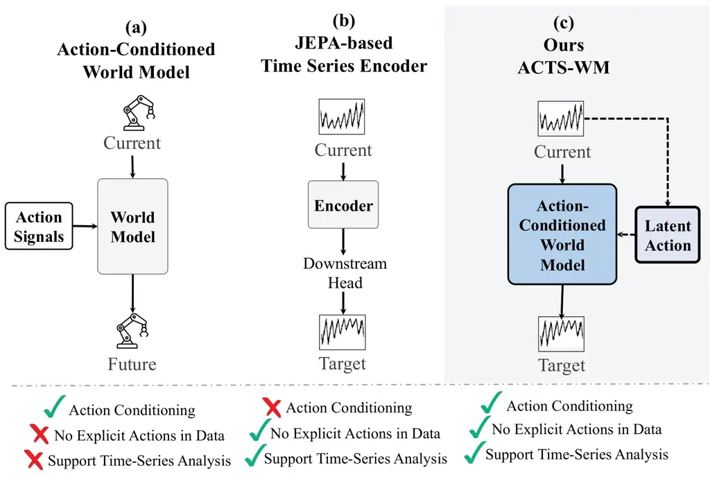
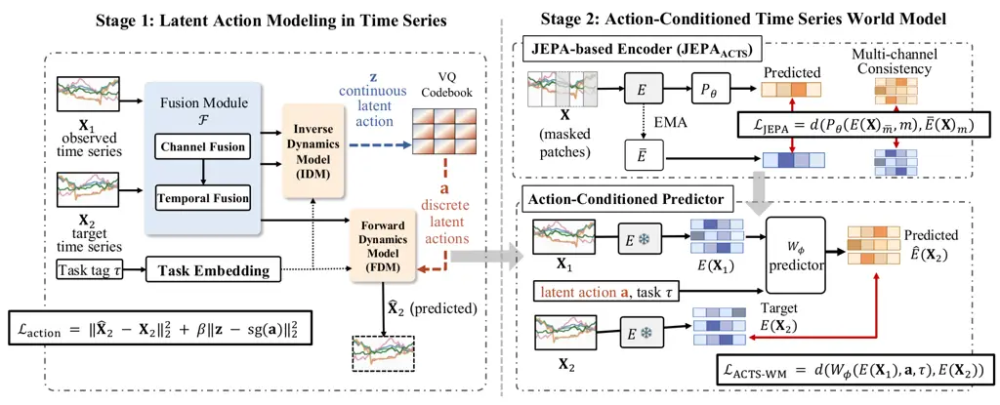
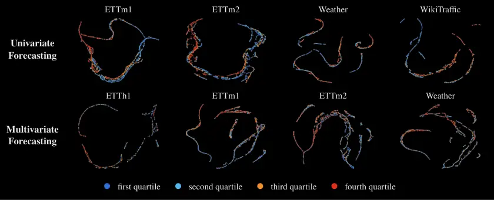
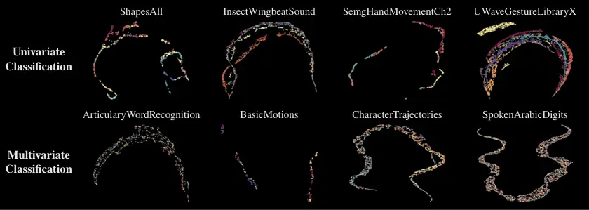
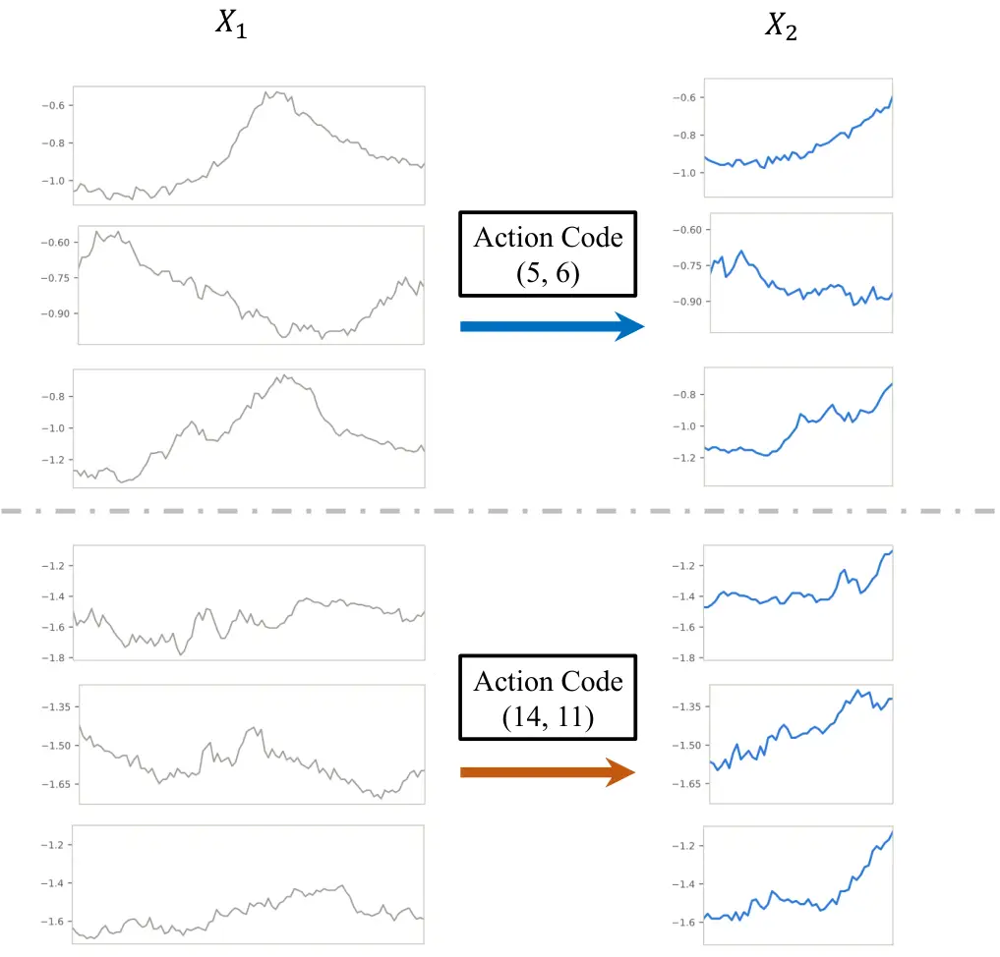

# Self-Supervised Latent Action-Conditioned World Modeling for Time Series

DOI: [XXXXXXX.XXXXXXX](https://doi.org/XXXXXXX.XXXXXXX)CCS: Information
systems Data miningCCS: Computing methodologies Learning latent
representations

Chia-Han Kuo^(∗) Affiliation: National Yang Ming Chiao Tung University
email: <ruckuo.cs15@nycu.edu.tw> , Chengshuai Zhao^(∗)
Affiliation: Arizona State University email: <czhao93@asu.edu> , Huan
Liu Affiliation: Arizona State University email: <huanliu@asu.edu> and
Lo Pang-Yun Ting Affiliation: National Yang Ming Chiao Tung University
email: <lpyting@nycu.edu.tw>

2027

###### Abstract.

Time-series data play an important role in various tasks, such as
weather forecasting, web traffic analysis, and speech recognition.
Recently, pioneering studies have increasingly adopted Joint-Embedding
Predictive Architecture (JEPA) based encoders to learn time-series
representations through latent-space prediction. However, they often
overlook the underlying factors governing transitions between
time-series observations. In this work, we hypothesize that _explicitly
modeling the information behind changes in time series can facilitate
time-series modeling_. Building on this hypothesis, we propose ACTS-WM,
a self-supervised latent action-conditioned world model framework for
time-series analysis. First, we introduce a latent action modeling
approach that infers the underlying information behind time-series
transitions as _latent actions_, without requiring explicit action
annotations. We then develop a JEPA-based encoder and an
action-conditioned world model to predict target time-series
representations conditioned on the learned latent actions and task
information. We evaluate ACTS-WM across 4 representative tasks on 22
datasets from diverse domains, covering univariate and multivariate
forecasting and classification. Comprehensive experiments demonstrate
that ACTS-WM can improve downstream performance over pretrained
JEPA-based encoders by learning complementary representations.

###### Keywords: 

Time-Series Analysis, World Models, Latent Action Models,
Joint-Embedding Predictive Architecture, Self-Supervised Learning

^(\$\*\$)^(\$\*\$)footnotetext: Equal contribution.

## 1. Introduction



Figure 1. Model comparison. (a) Conventional action-conditioned world
models in robotics rely on explicit action signals. (b) JEPA-based
time-series encoders learn representations without explicit action
conditioning. (c) ACTS-WM learns latent actions from observational time
series, enabling action-conditioned world modeling for time-series
analysis without requiring explicit action signals.

Time-series data play a pivotal role across modern data-driven systems,
ranging from weather forecasting and energy monitoring to real-time
speech recognition (Fu et al., 2025; Zhou et al., 2021; Shi et al.,
2021). In Web ecosystems, modern online services continuously generate
massive volumes of time-series data, including Web traffic, user
activity logs, and network monitoring signals (Zhang et al., 2026a; Ren
et al., 2019), providing abundant resources for web knowledge discovery.
Recently, time-series foundation models (Goswami et al., 2024; Cohen et
al., 2024; Liu et al., 2025a) have emerged as a state-of-the-art
technique to leverage substantial time-series data. By embedding
temporal data into a condensed latent space, they learn general-purpose
representations supporting various tasks, including forecasting and
classification.

To improve generalization across tasks and domains, recent studies have
increasingly explored self-supervised representation learning for time
series (Fraikin et al., 2024; Nie et al., 2023). Among these approaches,
Joint-Embedding Predictive Architectures (JEPA) (LeCun and others,
2022), which learn representations by predicting target embeddings from
contextual observations in latent space, demonstrate effectiveness
across downstream time-series tasks (ENNADIR et al., 2024; He et al.,
2026; Dutta et al., 2026).

Despite this progress, existing approaches primarily learn
representations from observed temporal patterns without explicitly
modeling the information underlying how time series change over time.
Such information can characterize temporal transitions that are
predictive of future dynamics while revealing invariant semantics shared
across observations, thereby providing informative signals for both
forecasting and classification. For example, pioneering studies in
visual control and robotics have explored learning latent
actions (Schmidt and Jiang, 2024; Ye et al., 2025) from observed
transitions. Inspired by this intuition, we hypothesize that _explicitly
modeling the information underlying temporal changes can provide richer
supervisory signals and facilitate more effective time-series
representation learning._

However, modeling the information underlying temporal changes in time
series presents several challenges. (i) Unlike conventional settings
such as robotics (Assran et al., 2025; Ortiz-Haro et al., 2026; Wu et
al., 2023; Guo et al., 2026), where an agent interacts with its
environment through explicit control actions and observes the resulting
state transitions, time-series data are typically collected as _passive
observations_ without corresponding action signals, as shown in
Figure 1. As a result, the latent factors that drive transitions between
observations are not directly available and must instead be inferred
from the observed temporal evolution itself. (ii) Further, multivariate
time series can contain varying numbers of channels across datasets,
making it difficult to model temporal transitions within a unified
framework. These challenges call for a general mechanism that can infer
latent transition factors from observed changes while remaining robust
to heterogeneous and dataset-specific channel configurations.

To address these challenges, we propose ACTS-WM (Action-Conditioned
Time-Series World Modeling), a self-supervised latent action-conditioned
world modeling framework for time-series analysis. ACTS-WM explicitly
learns latent actions from observed time series and then leverages an
action-conditioned world model for downstream forecasting and
classification. Specifically, ACTS-WM consists of two stages. First, we
introduce self-supervised latent action modeling to learn discrete
latent actions from observed time-series transitions without requiring
action annotations. We further learn to infer these actions from
observed time series alone, enabling their use when target time series
are unavailable. Second, we pretrain a JEPA-based time-series encoder to
learn informative latent representations of time-series observations. We
then develop an action-conditioned world model that incorporates the
learned latent actions to model transitions between observations in the
encoder’s latent representation space. Through task-conditioned
modeling, ACTS-WM is able to provide complementary latent
representations to support downstream forecasting and classification
within a unified framework.

Key Takeaways. Our contributions are summarized as follows:

- •
  We propose a novel perspective for time-series representation
  learning. We argue that the latent factors underlying transitions
  between observations provide valuable supervisory signals for learning
  transferable representations.
- •
  Building on the hypothesis, we develop a task-conditioned latent
  action modeling approach that captures temporal evolution and
  variations among time series of the same class.
- •
  We propose ACTS-WM. To the best of our knowledge, it is the first
  self-supervised latent action-conditioned world-modeling framework
  tailored for time-series analysis.
- •
  To validate the hypothesis, we conduct extensive experiments across
  univariate and multivariate forecasting and classification tasks on 22
  time-series datasets from diverse domains. The results demonstrate the
  effectiveness of ACTS-WM in providing complementary representations,
  while further ablation studies and qualitative analyses reveal
  meaningful transition patterns captured by the learned latent actions.

## 2. Related Work



Figure 2. Overview of ACTS-WM.

### 2.1. Time Series Analysis

For time-series analysis models, we explore time series foundation
models and JEPA-based time-series models. Recent studies have explored
various approaches to time-series foundation models. These studies
introduce novel architectures that achieve remarkable performance on
multi-domain benchmarks. MOMENT (Goswami et al., 2024) and UniTS (Gao et
al., 2024) learn expressive representations that can be directly adapted
to various downstream tasks. Toto (Cohen et al., 2024), Moirai (Woo et
al., 2024; Liu et al., 2025a; Liu et al., 2025b), and Time-MoE (Shi et
al., 2025), also learn expressive representations but focus on
forecasting ability.

In parallel, Joint-Embedding Predictive Architectures (JEPA) (LeCun and
others, 2022) have gained increasing attention in time-series analysis.
TS-JEPA (ENNADIR et al., 2024) and CHARM (Dutta et al., 2026) adapt the
JEPA architecture to various time-series analysis tasks. HEPA (Petersen
et al., 2026) and SC-JEPA (He et al., 2026) learn to predict future
latent representations and apply them to rare-event prediction and
anomaly detection. LaT-PFN (Verdenius et al., 2024) further combines
JEPA with zero-shot forecasting capabilities. Beyond representation
learning, JEPA-based time-series world models have explored
incorporating additional action signals, such as mechanical states and
control inputs (Qi et al., 2026; Shaj et al., 2023) or external
information from other modalities (Dai et al., 2026).

### 2.2. World Models

World models aim to capture the dynamics of the physical world and
support a wide range of downstream tasks. Dreamer 4 (Hafner et al., 2025) learns a scalable latent dynamics model, while DIAMOND (Alonso et
al., 2024) adopts a diffusion model as a pixel-space world model. Both
then train policies via reinforcement learning in imagination. Extending
the JEPA framework, V-JEPA 2-AC (Assran et al., 2025) plans in latent
space to control robot arms for picking and placing objects given a goal
image. H-JEPA (Zhang et al., 2026b) further introduces a hierarchy of
latent world models that enables long-horizon planning at multiple
timescales. Video-generation-based world models such as COSMOS (Agarwal
et al., 2026) and Genie (Bruce et al., 2024) generate physically
plausible, action-controllable videos. Some works aim to combine policy
models and world models. PaW (Lu et al., 2026) employs a single
pretrained large language model (LLM) to jointly train a policy and a
world model, while CoLA-World (Wang et al., 2026) jointly trains a
latent action model (LAM) with a pretrained video world model, allowing
the two to co-evolve.

### 2.3. Latent Action Models

To learn dynamics from observational data without explicit action
labels, recent studies (Schmidt and Jiang, 2024; Ye et al., 2025; Gao et
al., 2025; Wang et al., 2026) have explored latent action learning to
infer action representations directly from observed transitions. These
studies employ inverse dynamics models (IDMs) or latent action encoders
to infer latent actions from observed transitions, and forward dynamics
models (FDMs) or latent action decoders to predict subsequent
observations conditioned on the inferred actions. LAPO (Schmidt and
Jiang, 2024), LAPA (Ye et al., 2025) and CoLA-World (Wang et al., 2026)
further quantize the learned latent actions into a discrete action
space.

Despite these advances, most time-series models do not explicitly model
the underlying information governing transitions between observations.
Existing world models primarily focus on visual and language domains,
while time-series world models often rely on additional action signals,
such as system states or control inputs. Although latent action models
enable modeling transitions without explicit action labels, they have
mainly been explored in video-based settings. In our work, ACTS-WM aims
to learn latent actions directly from time-series observations and uses
them to condition world modeling without requiring action annotations.

## 3. Preliminaries and Problem Definition

### 3.1. Problem Formulation

Let $`\mathbf{X}\in\mathbb{R}^{C\times T}`$ denote a time series with
$`C`$ channels and $`T`$ time steps, where $`C>1`$ corresponds to the
multivariate setting. Given time-series observations collected from
multiple domains, we define the pretraining dataset as:
$`\mathcal{D}=\{(\mathbf{X}_{1}^{(i)},\mathbf{X}_{2}^{(i)},\tau^{(i)})\}_{i=1}^{N}`$,
where $`\mathbf{X}_{1}\in\mathbb{R}^{C\times T_{1}}`$ denotes the
observed time series, and
$`\mathbf{X}_{2}\in\mathbb{R}^{C\times T_{2}}`$ denotes the target time
series. For instance, in forecasting tasks, $`\mathbf{X}_{2}`$
represents the subsequent temporal segment following $`\mathbf{X}_{1}`$.
The task tag $`\tau`$ indicates whether the observation pair
($`\mathbf{X}_{1}`$, $`\mathbf{X}_{2}`$) corresponds to a forecasting
task with a specified prediction horizon or a classification task.

Given the pretraining dataset $`\mathcal{D}`$, ACTS-WM aims to learn
latent actions that capture the underlying transition information
between time-series observations without requiring explicit action
annotations. At the evaluation phase, given an unseen time series
$`\mathbf{X}^{\prime}_{1}`$ from either a pretraining domain or a
previously unseen domain, along with a task tag $`\tau`$, ACTS-WM infers
a latent action and uses it to predict the latent representations of the
target time series. These predicted representations are subsequently
used for downstream forecasting and classification.

### 3.2. Inverse and Forward Dynamics Models

Inverse and Forward dynamics models are two main components in recent
latent action models to learn latent actions from video data, as
discussed in Sec. 2.3. The inverse dynamics model (IDM) $`p_{IDM}`$
infers latent actions $`z_{t}`$ from past observations
$`\{o_{t-k},...,o_{t}\}`$ and future observation $`o_{t+1}`$, while the
forward dynamics model (FDM) $`p_{FDM}`$ reconstructs the future
observation $`o_{t+1}`$ given the past observations and a latent action
obtained from IDM. These processes are formulated as:

```math
z_{t}\sim p_{\mathrm{IDM}}(\cdot\mid o_{t-k},\ldots,o_{t},o_{t+1}),
```

```math
\hat{o}_{t+1}\sim p_{\mathrm{FDM}}(\cdot\mid o_{t-k},\ldots,o_{t},z_{t}).
```

In studies (Schmidt and Jiang, 2024; Ye et al., 2025; Wang et al.,
2026), vector quantization (Gray, 1984) is further applied to latent
actions before passing them to the FDM, serving as an information
bottleneck that prevents the IDM from simply copying future observations
into the action representation.

In our work, we build upon these approaches and extend latent action
modeling to time-series data.

## 4. Methodology

Our ACTS-WM framework consist of two stages, as shown in Figure 2: (1)
_Latent Action Modeling_ learns discrete latent actions from observed
time series (Sec. 4.1), and (2) _Action-Conditioned Time Series World
Model_ uses the learned actions and a JEPA-based encoder to predict
representations of target time series (Sec. 4.2).

### 4.1. Latent Action Modeling in Time Series

In our work, the underlying information that explains the transition
between observed and target time-series observations is regarded as a
_latent action_. Building upon the latent action learning framework
described in Sec. 3.2, we introduce several designs to learn latent
actions from time-series data.

Given an observation pair
$`(\mathbf{X}_{1},\mathbf{X}_{2},\tau)\in\mathcal{D}`$, we first encode
the time-series observations $`(\mathbf{X}_{1},\mathbf{X}_{2})`$ and
task information $`\tau`$ separately. These representations are then
incorporated into the inverse and forward dynamics models to learn
latent actions.

#### 4.1.1. Channel and Temporal Fusions

To accommodate varying numbers of channels and sequence lengths in
time-series data, we develop a fusion module $`\mathcal{F}`$ consisting
of two components: Channel Fusion and Temporal Fusion. For Channel
Fusion, we first fuse features from each channel independently using
shared convolutional layers, followed by multi-head self-attention and
learnable-query attention pooling to capture and aggregate cross-channel
dependencies. Temporal Fusion then employs dilated temporal
convolutional networks (TCNs) (Bai et al., 2018; Lin et al., 2021) to
capture multi-scale temporal patterns. Given a time series
$`\mathbf{X}\in\mathbb{R}^{C\times T}`$, its encoding process is
formulated as:

```math
\mathcal{F}(\mathbf{X})=\operatorname{Fusion}_{\text{temporal}}\left(\operatorname{Fusion}_{\text{channel}}(\mathbf{X})\right)\in\mathbb{R}^{d_{\text{fuse}}}, \tag{1}
```

where $`d_{\text{fuse}}`$ is the dimension of the resulting
representation. The extracted features are subsequently used for latent
action modeling.

#### 4.1.2. Task Embedding

To distinguish different types of transitions, including forecasting
with different prediction horizons and classification, we introduce
learnable Task Embeddings. Given a task tag $`\tau`$, its embedding is
obtained as:

```math
\mathbf{e}_{\tau}=\mathbf{E}\cdot\mathbf{I}_{\tau}, \tag{2}
```

where $`\mathbf{I}_{\tau}`$ denotes the one-hot vector corresponding to
the task tag $`\tau`$, and $`\mathbf{E}`$ is a learnable embedding table
with embedding dimension $`d_{\tau}`$. Each task tag is assigned a
unique index to construct its one-hot vector. The embedding table is
optimized jointly with the model parameters through the training
objective, allowing the model to learn task-specific representations.

#### 4.1.3. Inverse and Forward Dynamics Models

Building upon the preceding designs, we redesign the inverse dynamics
model (IDM) $`f_{\mathrm{IDM}}`$ to infer a continuous latent action
from an observation pair
$`(\mathbf{X}_{1},\mathbf{X}_{2},\tau)\in\mathcal{D}`$. Since
$`\mathbf{X}_{1}`$ and $`\mathbf{X}_{2}`$ may have different sequence
lengths, we employ the fusion module $`\mathcal{F}`$ (Sec. 4.1.1) to map
them into fixed-dimensional representations of the same dimension. These
representations are then combined with the task embedding
$`\mathbf{e}_{\tau}`$ (Sec. 4.1.2) to infer the latent action
$`\mathbf{z}`$:

```math
\displaystyle\mathbf{z}=f_{IDM}(\mathcal{F}(\mathbf{X}_{1}),\mathcal{F}(\mathbf{X}_{2}),e_{\tau}) \tag{3}
```

```math
\displaystyle=\mathbf{W}_{2}\left[\operatorname{ReLU}\left(\mathbf{W}_{1}[\mathcal{F}(\mathbf{X}_{1});\mathcal{F}(\mathbf{X}_{2})]\right);\mathbf{e}_{\tau}\right],
```

where $`\mathbf{W}_{1}`$ and $`\mathbf{W}_{2}`$ are learnable projection
matrices, and $`[\cdot;\cdot]`$ denotes concatenation. The inferred
action $`\mathbf{z}`$ represents the transition of the observation pair
and is shared across all channels.

Following  (Schmidt and Jiang, 2024; Ye et al., 2025; Wang et al.,
2026), the continuous action $`\mathbf{z}`$ is then quantized into a
discrete latent action $`\mathbf{a}=VQ(\mathbf{z})`$ using vector
quantization (details in Sec. 4.1.4). Correspondingly, we redesign the
forward dynamics model (FDM) $`f_{\mathrm{FDM}}`$ to reconstruct the
target observation $`\mathbf{X}_{2}`$ from $`\mathbf{X}_{1}`$ and the
quantized latent action $`\mathbf{a}`$, formulated as:

```math
\hat{\mathbf{X}}_{2}=f_{\mathrm{FDM}}(\mathcal{F}(\mathbf{X}_{1}),\mathbf{a},\mathbf{e}_{\tau}), \tag{4}
```

where $`\hat{\mathbf{X}}_{2}`$ denotes the reconstructed target
observation. Specifically, we employ a one-dimensional
U-Net (Ronneberger et al., 2015) with shared weights across channels to
accommodate varying numbers of channels. The FDM incorporates the
quantized latent action $`\mathbf{a}`$, the fused representation
$`\mathcal{F}(\mathbf{X}_{1})`$, and the task embedding
$`\mathbf{e}_{\tau}`$ as conditioning information.

Finally, the IDM $`f_{\mathrm{IDM}}`$ and FDM $`f_{\mathrm{FDM}}`$ are
jointly trained to minimize the reconstruction loss for time series
$`\mathbf{X}_{2}`$ and a quantization loss that encourages the
continuous latent action to remain close to its quantized representation
using the following objective:

```math
\displaystyle\mathcal{L}_{\mathrm{action}}=\left\|f_{FDM}(F(\mathbf{X}_{1}),F(\mathbf{X}_{2}),e_{\tau})-\mathbf{X}_{2}\right\|_{2}^{2} \tag{5}
```

```math
\displaystyle+\beta\cdot\left\|f_{IDM}(\mathcal{F}(\mathbf{X}_{1}),\mathcal{F}(\mathbf{X}_{2}),e_{\tau})-\operatorname{sg}(\mathbf{a})\right\|_{2}^{2},
```

where the first term measures the reconstruction error, and the second
term denotes the quantization loss weighted by $`\beta`$. Here,
$`\operatorname{sg}(\cdot)`$ denotes the stop-gradient operator. This
objective encourages the IDM to encode information relevant to the
transition toward $`\mathbf{X}_{2}`$ in the latent action.

#### 4.1.4. Latent Action Selection

We describe the latent action quantization process and how latent
actions are obtained at the evaluation phase by using the latent policy.

Latent Action Quantization. Following previous studies (Schmidt and
Jiang, 2024; Ye et al., 2025; Wang et al., 2026), vector quantization is
applied to the continuous latent action $`\mathbf{z}`$ to introduce an
information bottleneck. Specifically, a codebook is constructed
consisting of $`K`$ code vectors, each with dimension
$`d_{\text{code}}`$, and the continuous latent action $`\mathbf{z}`$ is
divided into $`M`$ slots. Each slot is quantized by selecting its
nearest code vector from the codebook, and the selected vectors are
concatenated to form the quantized latent action
$`\mathbf{a}=VQ(\mathbf{z})`$. The codebook vectors are updated using an
exponential moving average, while $`K`$ determines the number of
available codes and $`M`$ determines the number of code selections per
action.

Latent Policy. Following LAPO (Schmidt and Jiang, 2024), since
$`\mathbf{X}_{2}`$ is unavailable at the evaluation phase, we train a
latent policy $`\pi(\mathbf{X}_{1},\tau)`$ to infer latent actions from
observed time series $`\mathbf{X}_{1}`$ and the task tag $`\tau`$ alone.
With the pretrained IDM frozen, the latent policy is trained to regress
the continuous latent actions produced by the IDM from observation
pairs. At the evaluation phase, the policy’s output is quantized using
the learned codebook to obtain the latent action.

### 4.2. Action-Conditioned Time-Series World Model

After learning latent actions from time-series observations, we develop
an action-conditioned world model by adapting a JEPA-based encoder for
time-series representation learning and training a predictor to infer
representations of target observations.

#### 4.2.1. JEPA-based Encoder

We build upon V-JEPA 2 (Assran et al., 2025), which learns predictive
spatiotemporal representations from video data, making it suitable for
time-series modeling. To adapt it to time-series data, we introduce
one-dimensional temporal patches and channel-independent encoding with
shared weights, allowing the model to handle varying numbers of
channels. The adapted encoder $`E`$ maps a time series
$`\mathbf{X}\in\mathbb{R}^{C\times T}`$ to its latent representation:
$`E:\mathbb{R}^{C\times T}\rightarrow\mathbb{R}^{C\times N\times d_{\text{jepa}}},`$
where $`N`$ is the number of temporal patches and $`d_{\text{jepa}}`$ is
the representation dimension. During pretraining, we employ
interior-block and suffix masking and retain the exponential moving
average (EMA) target encoder of V-JEPA 2, which provides stable
representations for masked prediction.

To further account for dependencies across channels, we introduce a
multi-channel consistency term. Given the predicted and target
representations $`\hat{\mathbf{E}}`$ and $`\mathbf{E}`$, respectively,
we define the multi-channel distance function as:

```math
d(\hat{\mathbf{E}},\mathbf{E})=\frac{1}{C}\left[\sum_{c=1}^{C}\left\|\hat{\mathbf{E}}_{c}-\mathbf{E}_{c}\right\|_{1}+\lambda\left\|\tfrac{1}{C}\textstyle\sum_{c=1}^{C}\hat{\mathbf{E}}_{c}-\tfrac{1}{C}\textstyle\sum_{c=1}^{C}\mathbf{E}_{c}\right\|_{1}\right], \tag{6}
```

where $`\hat{\mathbf{E}}_{c}`$ and $`\mathbf{E}_{c}`$ denote the
predicted and target representations of channel $`c`$ at the masked
positions, respectively, and $`\lambda`$ weights the multi-channel
consistency term.

Given a binary temporal mask $`\mathbf{m}`$ indicating the masked patch
positions and its complement $`\bar{\mathbf{m}}`$ (unmasked positions),
our JEPA-based encoder $`E`$ and predictor $`P_{\theta}`$ are jointly
trained to minimize:

```math
\mathcal{L}_{\mathrm{JEPA}}=d\left(P_{\theta}(E(\mathbf{X})_{\bar{\mathbf{m}}},\mathbf{m}),\bar{E}(\mathbf{X})_{\mathbf{m}}\right), \tag{7}
```

where $`E(\mathbf{X})_{\bar{\mathbf{m}}}`$ denotes the representations
encoded from the unmasked patches, $`P_{\theta}`$ predicts the
representations at the masked positions, and
$`\bar{E}(\mathbf{X})_{\mathbf{m}}`$ denotes the corresponding target
representations obtained from the EMA target encoder.

By optimizing Eq. 7, the JEPA-based encoder $`E`$ learns latent
representations of time-series observations for subsequent world
modeling.

#### 4.2.2. Action-Conditioned Predictor

V-JEPA 2-AC (Assran et al., 2025) is a latent action-conditioned world
model post-trained from V-JEPA 2. Building upon this approach, we adapt
its action-conditioned predictor $`W_{\phi}`$ (with parameters $`\phi`$)
to model transitions between time-series representations. Given the
JEPA-based encoder $`E`$, the quantized latent action $`\mathbf{a}`$,
and the task tag $`\tau`$, the predictor estimates the representation of
target observation $`\mathbf{X}_{2}`$ as:
$`W_{\phi}(E(\mathbf{X}_{1}),\mathbf{a},\tau)`$. We then optimize the
action-conditioned predictor $`W_{\phi}`$ using the multi-channel
distance function $`d`$ introduced in Eq. 6:

```math
\mathcal{L}_{\mathrm{ACTS-WM}}=d\left(W_{\phi}(E(\mathbf{X}_{1}),\mathbf{a},\tau),(E(\mathbf{X}_{2}))\right). \tag{8}
```

Overall, the training objectives of ACTS-WM are as follows:

```math
\displaystyle\min_{\phi} \displaystyle\mathcal{L}_{\mathrm{ACTS-WM}} \tag{9}
```

```math
\displaystyle\mathrm{s.t.} \displaystyle\theta_{\mathrm{action}}^{*}=\arg\min_{\theta_{\mathrm{action}}}\mathcal{L}_{\mathrm{action}},
```

```math
\displaystyle\theta_{\mathrm{JEPA}}^{*}=\arg\min_{\theta_{\mathrm{JEPA}}}\mathcal{L}_{\mathrm{JEPA}},
```

where $`\theta_{\mathrm{action}}`$ and $`\theta_{\mathrm{JEPA}}`$ are
parameters of latent action modeling and JEPA pretraining, respectively.

Finally, by optimizing Eq. 9, ACTS-WM learns to predict target
representations for time-series observations across different domains,
sequence lengths, and numbers of channels, supporting different
downstream tasks. While ACTS-WM is developed based on V-JEPA 2, the
framework can also be integrated with other JEPA-based encoders and
general time-series representation models.

## 5. Experiments

### 5.1. Experimental Setup

#### 5.1.1. Dataset.

We collect univariate and multivariate time-series datasets from various
sources, including the UEA (Bagnall et al., 2018) and UCR (Dau et al., 2019) archives, forecasting benchmarks from Autoformer (Wu et al.,
2021), WebTraffic (Early et al., 2024), and WikiTraffic (Godahewa et
al., 2021; Godahewa et al., 2022). We use 21 datasets for ACTS-WM
pretraining and 22 for downstream evaluation. Dataset details and usage
are summarized in Table 4, while preprocessing and data splits are
described in Appendix A.2.

#### 5.1.2. Baselines.

We compare ACTS-WM with publicly available JEPA-based time-series
encoders: TS-JEPA (ENNADIR et al., 2024) and SC-JEPA (He et al., 2026).
We also evaluate our JEPA-based encoder (Sec. 4.2.1), adapted from
V-JEPA 2 to time series, denoted as “JEPA$`{}_{\text{ACTS}}`$”.

For downstream evaluation, we employ task-specific heads for all
methods: _Linear_, _Ridge_, and _NLH_ (non-linear head) for forecasting,
and _Linear_, _MLP_, and _SVM_ for classification. Using these heads, we
evaluate three representation settings for each JEPA-based encoder:

- •
  “Base” uses only the pretrained encoder’s representations.
- •
  “Pred. Only” uses only the representations of the target time series
  predicted by ACTS-WM.
- •
  “Obs.+Pred.” concatenates the representation of the observed time
  series from the JEPA-based encoder and the representation of the
  target time series by ACTS-WM.

Since TS-JEPA supports only univariate inputs, we evaluate it only on
univariate tasks. Detailed settings for baselines and downstream heads
are provided in Appendix A.3.

Dataset Metric Base + ACTS-WM (Pred. Only) + ACTS-WM (Obs.+Pred.)
JEPA$`{}_{\text{ACTS}}`$ TS-JEPA SC-JEPA JEPA$`{}_{\text{ACTS}}`$
TS-JEPA SC-JEPA JEPA$`{}_{\text{ACTS}}`$ TS-JEPA SC-JEPA Univariate Time
Series Forecasting MSE 1.167 1.047 1.413 1.063^(⋆) 0.972^(⋆) 1.363^(⋆)
1.164^(⋆) 1.040^(⋆) 1.906 WikiTraffic$`\ddagger`$ MAE 0.705 0.664 0.807
0.652^(⋆) 0.610^(⋆) 0.773^(⋆) 0.704^(⋆) 0.677 0.981 MSE 0.007 0.002
0.003 0.003^(⋆) 0.001^(⋆) 0.003 0.007 0.002 0.003 Weather MAE 0.045
0.031 0.038 0.042^(⋆) 0.025^(⋆) 0.038 0.046 0.028^(⋆) 0.044 MSE 0.100
0.097 1.631 0.084^(⋆) 0.157 0.728^(⋆) 0.086^(⋆) 0.091^(⋆) 1.739 ETTh1
MAE 0.248 0.240 1.142 0.220^(⋆) 0.310 0.710^(⋆) 0.227^(⋆) 0.234^(⋆)
1.093^(⋆) MSE 0.478 0.402 1.478 0.351^(⋆) 0.351^(⋆) 1.358^(⋆) 0.444^(⋆)
0.396^(⋆) 2.140 ETTh2 MAE 0.516 0.508 1.018 0.467^(⋆) 0.456^(⋆)
0.985^(⋆) 0.497^(⋆) 0.500^(⋆) 1.197 MSE 0.044 0.045 1.312 0.035^(⋆)
0.045 0.793^(⋆) 0.043^(⋆) 0.054 0.775^(⋆) ETTm1 MAE 0.158 0.160 0.990
0.135^(⋆) 0.158^(⋆) 0.753^(⋆) 0.155^(⋆) 0.177 0.736^(⋆) MSE 0.184 0.197
1.602 0.138^(⋆) 0.184^(⋆) 1.673 0.175^(⋆) 0.133^(⋆) 1.073^(⋆) ETTm2 MAE
0.332 0.352 1.063 0.286^(⋆) 0.332^(⋆) 1.043^(⋆) 0.324^(⋆) 0.270^(⋆)
0.865^(⋆) Win rate vs. Base MSE – – – 100% 67% 67% 83% 67% 33% MAE – – –
100% 83% 83% 83% 67% 50% Multivariate Time Series Forecasting MSE 0.257
– 0.590 0.238^(⋆) – 0.471^(⋆) 0.259 – 0.514^(⋆) Weather MAE 0.225 –
0.500 0.238 – 0.418^(⋆) 0.225 – 0.456^(⋆) MSE 1.218 – 1.321 0.678^(⋆) –
1.129^(⋆) 1.196^(⋆) – 1.209^(⋆) ETTh1 MAE 0.742 – 0.888 0.557^(⋆) –
0.825^(⋆) 0.737^(⋆) – 0.855^(⋆) MSE 0.366 – 1.890 0.276^(⋆) – 1.395^(⋆)
0.297^(⋆) – 2.084 ETTh2 MAE 0.423 – 1.080 0.376^(⋆) – 0.922^(⋆)
0.396^(⋆) – 1.142 MSE 0.597 – 1.434 0.489^(⋆) – 1.105^(⋆) 0.564^(⋆) –
1.599 ETTm1 MAE 0.513 – 0.924 0.456^(⋆) – 0.805^(⋆) 0.503^(⋆) – 0.987
MSE 0.161 – 1.913 0.152^(⋆) – 1.596^(⋆) 0.156^(⋆) – 1.740^(⋆) ETTm2 MAE
0.281 – 1.090 0.270^(⋆) – 0.973^(⋆) 0.276^(⋆) – 1.031^(⋆) Win rate vs.
Base MSE – – – 100% – 100% 80% – 60% MAE – – – 80% – 100% 80% – 60%

Table 1. Time-series forecasting results averaged across three runs.
Datasets marked with $`\ddagger`$ are not included in pre-training
ACTS-WM. The best result is in bold, and ^(⋆) marks results with ACTS-WM
that outperform the original base models. The win rate is the percentage
of datasets where ACTS-WM outperforms the base model. Win rates above
50% are shaded.

Dataset Metric Base + ACTS-WM (Pred. Only) + ACTS-WM (Obs.+Pred.)
JEPA$`{}_{\text{ACTS}}`$ TS-JEPA SC-JEPA JEPA$`{}_{\text{ACTS}}`$
TS-JEPA SC-JEPA JEPA$`{}_{\text{ACTS}}`$ TS-JEPA SC-JEPA Univariate Time
Series Classification WebTraffic$`\ddagger`$ Acc. 0.152 0.194 0.265
0.168^(⋆) 0.158 0.215 0.158^(⋆) 0.202^(⋆) 0.213 Earthquakes$`\ddagger`$
Acc. 0.715 0.748 0.667 0.748^(⋆) 0.748 0.736^(⋆) 0.739^(⋆) 0.748
0.719^(⋆) UWaveGestureLibraryX$`\ddagger`$ Acc. 0.633 0.635 0.588
0.663^(⋆) 0.701^(⋆) 0.563 0.653^(⋆) 0.700^(⋆) 0.577
ShapesAll$`\ddagger`$ Acc. 0.474 0.652 0.622 0.521^(⋆) 0.655^(⋆)
0.637^(⋆) 0.506^(⋆) 0.661^(⋆) 0.631^(⋆) WormsTwoClass$`\ddagger`$ Acc.
0.541 0.545 0.532 0.554^(⋆) 0.571^(⋆) 0.623^(⋆) 0.558^(⋆) 0.545
0.636^(⋆) Computers$`\ddagger`$ Acc. 0.592 0.464 0.652 0.592 0.623^(⋆)
0.692^(⋆) 0.640^(⋆) 0.500^(⋆) 0.692^(⋆) InsectWingbeatSound$`\ddagger`$
Acc. 0.444 0.610 0.616 0.494^(⋆) 0.493 0.522 0.478^(⋆) 0.609 0.551
EOGHorizontalSignal$`\ddagger`$ Acc. 0.355 0.382 0.180 0.328 0.388^(⋆)
0.162 0.322 0.400^(⋆) 0.181^(⋆) EthanolLevel$`\ddagger`$ Acc. 0.360
0.298 0.457 0.246 0.270 0.379 0.396^(⋆) 0.268 0.377
SemgHandMovementCh2$`\ddagger`$ Acc. 0.347 0.496 0.331 0.484^(⋆)
0.559^(⋆) 0.220 0.520^(⋆) 0.516^(⋆) 0.239 Win rate vs. Base Acc. – – –
70% 60% 40% 90% 60% 50% Multivariate Time Series Classification
ArticularyWordRecognition Acc. 0.847 – 0.948 0.897^(⋆) – 0.944 0.853^(⋆)
– 0.949^(⋆) BasicMotions Acc. 0.775 – 0.492 0.850^(⋆) – 0.792^(⋆)
0.900^(⋆) – 0.758^(⋆) CharacterTrajectories Acc. 0.957 – 0.912 0.934 –
0.902 0.961^(⋆) – 0.915^(⋆) FingerMovements Acc. 0.463 – 0.500 0.480^(⋆)
– 0.507^(⋆) 0.463 – 0.503^(⋆) SelfRegulationSCP2$`\ddagger`$ Acc. 0.507
– 0.494 0.528^(⋆) – 0.511^(⋆) 0.535^(⋆) – 0.489
SpokenArabicDigits$`\ddagger`$ Acc. 0.946 – 0.946 0.898 – 0.943 0.938 –
0.954^(⋆) Win rate vs. Base Acc. – – – 67% – 50% 67% – 83%

Table 2. Time-series classification results averaged over three runs.
Datasets marked with $`\ddagger`$ are not included in pre-training
ACTS-WM. The best result is in bold, and ^(⋆) marks results with ACTS-WM
that outperform the original base models. The win rate is the percentage
of datasets where ACTS-WM outperforms the base model. Win rates above
50% are shaded.

#### 5.1.3. Evaluation and Implementation Details

For evaluation, we use accuracy (Acc.) and F1-score (F1) . for
classification, and MSE and MAE on normalized targets for forecasting.

The key hyperparameter settings are as follows. For forecasting, the
input length and prediction horizon are set to 320 and 48 time steps,
respectively. For latent action modeling, we set
$`d_{\mathrm{fuse}}=128`$ (Sec. 4.1.1), $`d_{\tau}=16`$ (Sec. 4.1.2),
and $`\beta=0.05`$ (Eq. 5). The VQ codebook (Sec. 4.1.4) contains
$`K=16`$ code vectors of dimension $`d_{\mathrm{code}}=16`$, with
$`M=2`$ code selections per action. For the JEPA-based encoder
(Sec. 4.2.1), we set $`d_{\mathrm{jepa}}=128`$.

For the main experiments, we present representative results using
selected downstream heads, averaged over three runs. All experiments
were conducted on two NVIDIA GB10 Grace Blackwell Superchips. Detailed
settings are provided in Appendix A.2, and full results are provided in
Appendix A.4.

Removed component ACTS-WM (JEPA$`{}_{\text{ACTS}}`$, Obs.+Pred.) Task
embedding ✓ ✓ ✓ ✓ Channel fusion ✓ ✓ ✓ ✓ Temporal fusion ✓ ✓ ✓ ✓ Dataset
Full (1) (2) (3) (4) (5) (6) (7) Univariate Forecasting (MSE) Weather
0.006 0.006 0.006 0.006 0.006 0.006 0.006 0.006 ETTh2 0.452 0.479 0.484
0.478 0.468 0.477 0.487 0.478 ETTm1 0.050 0.048 0.051 0.049 0.052 0.051
0.050 0.054 ETTm2 0.188 0.193 0.184 0.183 0.180 0.189 0.192 0.182
Average 0.174 0.181 0.181 0.179 0.176 0.181 0.184 0.180 Multivariate
Forecasting (MSE) ETTh1 0.905 1.103 0.901 0.987 0.938 1.102 1.101 1.098
ETTh2 0.256 0.690 0.286 0.323 0.271 0.691 0.692 0.689 ETTm1 0.576 0.787
0.564 0.689 0.599 0.789 0.800 0.799 ETTm2 0.150 0.572 0.152 0.200 0.168
0.571 0.575 0.570 Average 0.472 0.788 0.476 0.550 0.494 0.788 0.792
0.789 Univariate Classification (Acc.) Earthquakes 0.737 0.723 0.741
0.745 0.665 0.741 0.741 0.719 UWaveGestureLibraryX 0.645 0.642 0.663
0.645 0.643 0.636 0.636 0.655 ShapesAll 0.525 0.515 0.518 0.498 0.521
0.526 0.492 0.486 EOGHorizontalSignal 0.360 0.365 0.370 0.376 0.394
0.359 0.369 0.345 Average 0.567 0.561 0.573 0.566 0.556 0.566 0.559
0.551 Multivariate Classification (Acc.) ArticularyWordRecognition 0.920
0.915 0.912 0.912 0.903 0.900 0.895 0.905 BasicMotions 0.788 0.725 0.712
0.662 0.663 0.713 0.738 0.712 CharacterTrajectories 0.920 0.932 0.930
0.918 0.930 0.917 0.920 0.936 SpokenArabicDigits 0.929 0.934 0.929 0.941
0.942 0.931 0.926 0.935 Average 0.889 0.877 0.871 0.858 0.859 0.865
0.870 0.872

Table 3. Ablation results of ACTS-WM components using
JEPA$`{}_{\text{ACTS}}`$ with the Obs.+Pred. variant, averaged over two
selective downstream heads per dataset. The best results are highlighted
in bold.

### 5.2. Performance Comparison

Tables 1 and 2 represent the results. Key observations are as follows:

- •
  For the forecasting tasks in Table 1, ACTS-WM consistently improves
  forecasting performance compared to the base model of JEPA-based
  encoders (“Base”), particularly when using predicted target
  representations alone (“Pred. Only”). With our
  JEPA$`{}_{\text{ACTS}}`$, the “Pred. Only” variant reduces MSE on all
  11 forecasting settings and achieves the lowest MSE across all five
  multivariate forecasting datasets. Similar improvements are observed
  with TS-JEPA and SC-JEPA, although their effectiveness varies across
  datasets and representation settings. Notably, on WikiTraffic, which
  is excluded from ACTS-WM pretraining, “Pred. Only” improves both MSE
  and MAE for all three JEPA-based encoders. Overall, “Pred. Only”
  generally outperforms “Obs.+Pred.” in forecasting, suggesting that the
  predicted target representations can improve time-series prediction.
- •
  For classification, combining observed and predicted representations
  generally yields stronger results. With our JEPA$`{}_{\text{ACTS}}`$,
  “Obs.+Pred.” improves accuracy over Base on 9 out of 10 univariate
  classification datasets, all of which are excluded from ACTS-WM
  pretraining. For multivariate classification, JEPA$`{}_{\text{ACTS}}`$
  with “Obs.+Pred.” achieves the best accuracy on 3 out of 6 datasets,
  while SC-JEPA with “Obs.+Pred.” improves upon its Base on 5 out of 6
  datasets. These results suggest that predicted representations of
  ACTS-WM can complement observed representations for classification.
  Furthermore, the improvements on datasets excluded from ACTS-WM
  pretraining indicate the potential of the learned world model to
  generalize across datasets.

Figure 3. Comparison of learned and randomly assigned latent actions in
ACTS-WM using JEPA$`{}_{\text{ACTS}}`$.

(a) Training loss of the world model
($`\mathcal{L}_{\mathrm{ACTS-WM}}`$) for codebook sizes
$`K\in\{2,4,16,64,128\}`$ with with JEPA$`{}_{\text{ACTS}}`$.

(b) Forecasting MSE for different prediction horizons $`H`$.

Figure 4. Parameter analysis for the codebook size and prediction
horizons.

### 5.3. Ablation Study

We conduct ablation studies to evaluate the proposed designs in
Secs. 4.1.1 and 4.1.2, and latent action selection in Sec. 4.1.4.

Component Ablation. Table 3 evaluates the contributions of designs in
Secs. 4.1.1 and 4.1.2. For the average performance, the full ACTS-WM
achieves the best in three of the four task categories. Task embeddings
are particularly important for multivariate forecasting, as removing
them increases the average MSE from 0.472 to 0.788. Temporal fusion also
contributes to multivariate tasks, with its removal increasing
forecasting MSE from 0.472 to 0.550 and reducing classification accuracy
from 0.889 to 0.858. In contrast, removing channel fusion has a small
impact on multivariate forecasting and slightly improves univariate
classification accuracy. Overall, the effectiveness of each component
varies across different tasks and datasets.



(a) Forecasting datasets. Colors indicate quartiles of relative mean
differences between observed and target time series, ordered from
smallest to largest.



(b) Classification datasets. Different colors represent different class
labels within each dataset.

Figure 5. UMAP projection of continuous latent actions inferred by the
IDM before quantization. Each point represents a latent action inferred
from an observation pair.

Effect of Learned Latent Actions. To evaluate latent action selection
(Sec. 4.1.4), we compare ACTS-WM using learned latent actions with
randomly assigned actions in Figure 3. Replacing learned actions with
random actions consistently degrades performance across all four task
categories. For forecasting, “Pred. Only” achieves the lowest errors,
while random actions increase both MSE and MAE. For classification,
“Pred. Only” is sensitive to random actions, with substantial decreases
in accuracy and F1-score. Nevertheless, using random actions generally
degrades performance, often below the Base JEPA$`{}_{\text{ACTS}}`$
encoder, particularly in classification tasks. These findings suggest
that learned latent actions contribute meaningful information and that
combining observed and predicted representations can improve robustness.

### 5.4. Parameter Analysis

Effect of Codebook Size. We investigate the effect of codebook size on
world model training over 100 epochs. In Figure 4a, the training loss
decreases rapidly during the first 10 epochs across all settings.
However, differences emerge toward the end of training. Increasing the
codebook size from 2 to 64 generally reduces the final training loss,
with the lowest loss achieved at 64. Further increasing the size to 128
slightly increases the loss. These results suggest that an action space
that is too small ($`K=2`$) may fail to capture sufficient transition
information, while an excessively large action space ($`K=128`$) may
also hinder representation prediction.

Prediction Horizon. Figure 4b compares forecasting performance across
prediction horizons of $`H\in\{48,168,336\}`$. The mean MSE increases
with longer horizons across all JEPA-based encoders in both univariate
and multivariate settings. This degradation is particularly pronounced
for SC-JEPA, especially under the “Obs.+Pred.” setting. Overall, these
results highlight the increasing difficulty of modeling longer-term
time-series transitions.

### 5.5. Interpretation of Learned Latent Actions

To investigate what the learned latent actions capture, we visualize the
continuous latent representations inferred by the IDM before
quantization (Eq. 3) using UMAP projection (McInnes et al., 2018), as
shown in Figure 5. We select representative forecasting and
classification datasets with sufficient evaluation data samples.

For forecasting (Figure 5(a)), the first (smallest difference) and
fourth quartiles (largest difference) exhibit distinct distributions
across several datasets, suggesting that the learned latent actions
capture information related to the magnitude of changes between observed
and future time series. For classification, Figure 5(b) reveals
class-dependent structures in several datasets, although some classes
exhibit overlapping distributions. These observations suggest that the
IDM captures transition characteristics associated with different
time-series classes.

Overall, the visualizations provide qualitative evidence that the
learned latent actions encode meaningful information about time-series
transitions across forecasting and classification tasks.

## 6. Conclusion and Future Work

In this work, we proposed ACTS-WM, a self-supervised latent
action-conditioned world modeling framework for time-series analysis.
ACTS-WM learns discrete latent actions used to condition a JEPA-based
world model for predicting target representations. Experiments on 22
datasets covering univariate and multivariate forecasting and
classification show improvements over pretrained JEPA-based encoders on
many datasets. Further analyses highlight the benefits of learned latent
actions and action conditioning. Future work will focus on improving the
latent policy’s ability to predict latent actions.

## References

- Agarwal et al. (2026) N. Agarwal, A. Ali, J. Allen, M. Antolini, A.
  Aubame, A. Azzolini, J. Bai, M. Bala, Y. Balaji, J. Bapst, et al.
  Cosmos 3: omnimodal world models for physical ai. arXiv preprint
  arXiv:2606.02800. Cited by: §2.2.
- Alonso et al. (2024) E. Alonso, A. Jelley, V. Micheli, A.
  Kanervisto, A. Storkey, T. Pearce, and F. Fleuret Diffusion for world
  modeling: visual details matter in atari. In Advances in Neural
  Information Processing Systems, Vol. 37, pp. 58757–58791. External
  Links: [Document](https://dx.doi.org/10.52202/079017-1873) Cited by:
  §2.2.
- Assran et al. (2025) M. Assran, A. Bardes, D. Fan, Q. Garrido, R.
  Howes, M. Muckley, A. Rizvi, C. Roberts, K. Sinha, A. Zholus, et al.
  V-jepa 2: self-supervised video models enable understanding,
  prediction and planning. arXiv preprint arXiv:2506.09985. Cited by:
  §1, §2.2, §4.2.1, §4.2.2.
- Bagnall et al. (2018) A. Bagnall, H. A. Dau, J. Lines, M. Flynn, J.
  Large, A. Bostrom, P. Southam, and E. Keogh The uea multivariate time
  series classification archive, 2018. arXiv preprint arXiv:1811.00075.
  Cited by: §A.2.2, Table 4, §5.1.1.
- Bai et al. (2018) S. Bai, J. Z. Kolter, and V. Koltun An empirical
  evaluation of generic convolutional and recurrent networks for
  sequence modeling. arXiv preprint arXiv:1803.01271. Cited by: §4.1.1.
- Bruce et al. (2024) J. Bruce, M. D. Dennis, A. Edwards, J.
  Parker-Holder, Y. Shi, E. Hughes, M. Lai, A. Mavalankar, R.
  Steigerwald, C. Apps, Y. Aytar, S. M. E. Bechtle, F. Behbahani, S.
  C.Y. Chan, N. Heess, L. Gonzalez, S. Osindero, S. Ozair, S. Reed, J.
  Zhang, K. Zolna, J. Clune, N. de Freitas, S. Singh, and T. Rocktäschel
  Genie: generative interactive environments. In Forty-first
  International Conference on Machine Learning, External Links:
  [Link](https://openreview.net/forum?id=bJbSbJskOS) Cited by: §2.2.
- Cohen et al. (2024) B. Cohen, E. Khwaja, K. Wang, C. Masson, E.
  Ramé, Y. Doubli, and O. Abou-Amal Toto: time series optimized
  transformer for observability. External Links:
  [Link](https://openreview.net/forum?id=ayupWYA1qD) Cited by: §1, §2.1.
- Dai et al. (2026) X. Dai, H. Chen, Y. Hu, Y. Liu, Z. Dong, and J. Yang
  Pythia: toward foundation world models for multimodal time series.
  arXiv preprint arXiv:2610.05240. Cited by: §2.1.
- Dau et al. (2019) H. A. Dau, A. Bagnall, K. Kamgar, C. M. Yeh, Y.
  Zhu, S. Gharghabi, C. A. Ratanamahatana, and E. Keogh The ucr time
  series archive. IEEE/CAA Journal of Automatica Sinica 6 (6),
  pp. 1293–1305. External Links:
  [Document](https://dx.doi.org/10.1109/JAS.2019.1911747) Cited by:
  §A.2.2, Table 4, §5.1.1.
- Dutta et al. (2026) U. Dutta, G. Pastrana, S. K. Pakazad, and H.
  Ohlsson Giving sensors a voice: multimodal JEPA for semantic
  time-series embeddings. In Forty-third International Conference on
  Machine Learning, External Links:
  [Link](https://openreview.net/forum?id=lNoaqrOXti) Cited by: §A.3.1,
  §1, §2.1.
- Early et al. (2024) J. Early, G. Cheung, K. Cutajar, H. Xie, J.
  Kandola, and N. Twomey Inherently interpretable time series
  classification via multiple instance learning. In International
  Conference on Learning Representations, Vol. 2024, pp. 56800–56828.
  Cited by: §A.2.2, Table 4, §5.1.1.
- ENNADIR et al. (2024) S. ENNADIR, S. Golkar, and L. Sarra Joint
  embedding go temporal. In NeurIPS Workshop on Time Series in the Age
  of Large Models, External Links:
  [Link](https://openreview.net/forum?id=FIdbozebmy) Cited by: 2nd item,
  §1, §2.1, §5.1.2.
- Fraikin et al. (2024) A. Fraikin, A. Bennetot, and S. Allassonnière
  T-rep: representation learning for time series using time-embeddings.
  In International Conference on Learning Representations, Vol. 2024,
  pp. 31285–31305. Cited by: §1.
- Fu et al. (2025) Y. Fu, F. Wang, Z. Shao, B. Diao, L. Wu, Z. An, C.
  Yu, Y. Li, and Y. Xu On the integration of spatial-temporal knowledge:
  a lightweight approach to atmospheric time series forecasting. In The
  Thirty-ninth Annual Conference on Neural Information Processing
  Systems, External Links:
  [Link](https://openreview.net/forum?id=thHhKPlt8q) Cited by: §1.
- Gao et al. (2024) S. Gao, T. Koker, O. Queen, T. Hartvigsen, T.
  Tsiligkaridis, and M. Zitnik UniTS: a unified multi-task time series
  model. In Advances in Neural Information Processing Systems, Vol. 37,
  pp. 140589–140631. External Links:
  [Document](https://dx.doi.org/10.52202/079017-4463) Cited by: §2.1.
- Gao et al. (2025) S. Gao, S. Zhou, Y. Du, J. Zhang, and C. Gan
  AdaWorld: learning adaptable world models with latent actions. In
  Forty-second International Conference on Machine Learning, External
  Links: [Link](https://openreview.net/forum?id=QQegZj99sk) Cited by:
  §2.3.
- Godahewa et al. (2022) R. Godahewa, C. Bergmeir, G. Webb, R. Hyndman,
  and P. Montero-Manso Extended wikipedia web traffic daily dataset
  (without missing values). Zenodo. External Links:
  [Document](https://dx.doi.org/10.5281/zenodo.7371038),
  [Link](https://doi.org/10.5281/zenodo.7371038) Cited by: §A.2.2, Table
  4, §5.1.1.
- Godahewa et al. (2021) R. W. Godahewa, C. Bergmeir, G. I. Webb, R.
  Hyndman, and P. Montero-Manso Monash time series forecasting archive.
  In Thirty-fifth Conference on Neural Information Processing Systems
  Datasets and Benchmarks Track (Round 2), External Links:
  [Link](https://openreview.net/forum?id=wEc1mgAjU-) Cited by: §A.2.2,
  Table 4, §5.1.1.
- Goswami et al. (2024) M. Goswami, K. Szafer, A. Choudhry, Y. Cai, S.
  Li, and A. Dubrawski MOMENT: a family of open time-series foundation
  models. In Proceedings of the 41st International Conference on Machine
  Learning, Cited by: §1, §2.1.
- Gray (1984) R. Gray Vector quantization. IEEE Assp Magazine 1 (2),
  pp. 4–29. Cited by: §3.2.
- Guo et al. (2026) Y. Guo, L. Shi, J. Chen, and C. Finn Ctrl-world: a
  controllable generative world model for robot manipulation. In
  International Conference on Learning Representations, Vol. 2026,
  pp. 6121–6138. Cited by: §1.
- Hafner et al. (2025) D. Hafner, W. Yan, and T. Lillicrap Training
  agents inside of scalable world models. External Links: 2509.24527,
  [Link](https://arxiv.org/abs/2509.24527) Cited by: §2.2.
- He et al. (2026) Y. He, Y. Wen, X. Wang, and T. Ma SC-JEPA:
  stabilizing latent predictive learning for time-series anomaly
  prediction. In Forecasting as a New Frontier of Intelligence, External
  Links: [Link](https://openreview.net/forum?id=SNjhsnUvhH) Cited by:
  2nd item, §1, §2.1, §5.1.2.
- LeCun et al. (2022) Y. LeCun et al. A path towards autonomous machine
  intelligence version 0.9. 2, 2022-06-27. Open Review 62 (1), pp. 1–62.
  Cited by: §1, §2.1.
- Lin et al. (2021) Y. Lin, I. Koprinska, and M. Rana Temporal
  convolutional attention neural networks for time series forecasting.
  In 2021 International joint conference on neural networks (IJCNN),
  pp. 1–8. Cited by: §4.1.1.
- Liu et al. (2025a) C. Liu, T. Aksu, J. Liu, X. Liu, H. Yan, Q.
  Pham, S. Savarese, D. Sahoo, C. Xiong, and J. Li Moirai 2.0: when less
  is more for time series forecasting. arXiv preprint arXiv:2511.11698.
  Cited by: §1, §2.1.
- Liu et al. (2025b) X. Liu, J. Liu, G. Woo, T. Aksu, Y. Liang, R.
  Zimmermann, C. Liu, J. Li, S. Savarese, C. Xiong, and D. Sahoo
  Moirai-moe: empowering time series foundation models with sparse
  mixture of experts. In Forty-second International Conference on
  Machine Learning, External Links:
  [Link](https://openreview.net/forum?id=SrEOUSyJcR) Cited by: §2.1.
- Lu et al. (2026) N. Lu, B. Lin, S. Liu, J. Wu, H. Lv, Y. Wei, L.
  Zhu, S. Qian, X. Wang, Y. Chen, et al. Policy and world modeling
  co-training for language agents. arXiv preprint arXiv:2606.02388.
  Cited by: §2.2.
- McInnes et al. (2018) L. McInnes, J. Healy, and J. Melville Umap:
  uniform manifold approximation and projection for dimension reduction.
  arXiv preprint arXiv:1802.03426. Cited by: §5.5.
- Nie et al. (2023) Y. Nie, N. H. Nguyen, P. Sinthong, and J. Kalagnanam
  A time series is worth 64 words: long-term forecasting with
  transformers. In The Eleventh International Conference on Learning
  Representations, External Links:
  [Link](https://openreview.net/forum?id=Jbdc0vTOcol) Cited by: §1.
- Ortiz-Haro et al. (2026) J. Ortiz-Haro, J. Amigo, O. Mostafa, D.
  Dugas, F. Meier, and L. Righetti Worldplanner: monte carlo tree search
  and mpc with action-conditioned visual world models. In 2026 IEEE
  International Conference on Robotics and Automation (ICRA),
  pp. 22166–22173. Cited by: §1.
- Petersen et al. (2026) J. Petersen, G. Lombardi, R. Maggioni, C.
  Mazzoleni, F. Martelli, and P. C. Petersen HEPA: a self-supervised
  horizon-conditioned event predictive architecture for time series. In
  2nd ICML Workshop on Foundation Models for Structured Data, External
  Links: [Link](https://openreview.net/forum?id=TdpqVBB8na) Cited by:
  §2.1.
- Qi et al. (2026) X. Qi, H. Chai, Y. Wang, and Y. Li Beyond static
  forecasting: unleashing the power of world models for mobile traffic
  extrapolation. External Links: 2604.08199,
  [Link](https://arxiv.org/abs/2604.08199) Cited by: §2.1.
- Ren et al. (2019) H. Ren, B. Xu, Y. Wang, C. Yi, C. Huang, X. Kou, T.
  Xing, M. Yang, J. Tong, and Q. Zhang Time-series anomaly detection
  service at microsoft. In Proceedings of the 25th ACM SIGKDD
  International Conference on Knowledge Discovery & Data Mining, KDD
  ’19, New York, NY, USA, pp. 3009–3017. External Links: ISBN
  9781450362016, [Link](https://doi.org/10.1145/3292500.3330680),
  [Document](https://dx.doi.org/10.1145/3292500.3330680) Cited by: §1.
- Ronneberger et al. (2015) O. Ronneberger, P. Fischer, and T. Brox
  U-net: convolutional networks for biomedical image segmentation. In
  International Conference on Medical image computing and
  computer-assisted intervention, pp. 234–241. Cited by: §4.1.3.
- Schmidt and Jiang (2024) D. Schmidt and M. Jiang Learning to act
  without actions. In International Conference on Learning
  Representations, Vol. 2024, pp. 9379–9395. Cited by: §1, §2.3, §3.2,
  §4.1.3, §4.1.4, §4.1.4.
- Shaj et al. (2023) V. Shaj, S. G. ZADEH, O. Demir, L. R. Douat, and G.
  Neumann Multi time scale world models. In Thirty-seventh Conference on
  Neural Information Processing Systems, External Links:
  [Link](https://openreview.net/forum?id=fY7dShbtmo) Cited by: §2.1.
- Shi et al. (2025) X. Shi, S. Wang, Y. Nie, D. Li, Z. Ye, Q. Wen,
  and M. Jin Time-moe: billion-scale time series foundation models with
  mixture of experts. In The Thirteenth International Conference on
  Learning Representations, External Links:
  [Link](https://openreview.net/forum?id=e1wDDFmlVu) Cited by: §2.1.
- Shi et al. (2021) Y. Shi, Y. Wang, C. Wu, C. Yeh, J. Chan, F.
  Zhang, D. Le, and M. Seltzer Emformer: efficient memory transformer
  based acoustic model for low latency streaming speech recognition. In
  ICASSP 2021 - 2021 IEEE International Conference on Acoustics, Speech
  and Signal Processing (ICASSP), Vol. , pp. 6783–6787. External Links:
  [Document](https://dx.doi.org/10.1109/ICASSP39728.2021.9414560) Cited
  by: §1.
- Verdenius et al. (2024) S. Verdenius, A. Zerio, and R. L. M. Wang
  LaT-pfn: a joint embedding predictive architecture for in-context
  time-series forecasting. External Links: 2405.10093,
  [Link](https://arxiv.org/abs/2405.10093) Cited by: §2.1.
- Wang et al. (2026) Y. Wang, F. Zhang, D. Zhan, L. Zhao, K. Wang,
  and J. Bian Co-evolving latent action world models. In Forty-third
  International Conference on Machine Learning, External Links:
  [Link](https://openreview.net/forum?id=iec4FIZyrx) Cited by: §2.2,
  §2.3, §3.2, §4.1.3, §4.1.4.
- Woo et al. (2024) G. Woo, C. Liu, A. Kumar, C. Xiong, S. Savarese,
  and D. Sahoo Unified training of universal time series forecasting
  transformers. In Proceedings of the 41st International Conference on
  Machine Learning, Proceedings of Machine Learning Research, Vol. 235,
  pp. 53140–53164. Cited by: §2.1.
- Wu et al. (2021) H. Wu, J. Xu, J. Wang, and M. Long Autoformer:
  decomposition transformers with auto-correlation for long-term series
  forecasting. In Advances in Neural Information Processing Systems,
  Vol. 34, pp. 22419–22430. Cited by: §A.2.2, Table 4, §5.1.1.
- Wu et al. (2023) P. Wu, A. Escontrela, D. Hafner, P. Abbeel, and K.
  Goldberg Daydreamer: world models for physical robot learning. In
  Conference on robot learning, pp. 2226–2240. Cited by: §1.
- Ye et al. (2025) S. Ye, J. Jang, B. Jeon, S. J. Joo, J. Yang, B.
  Peng, A. Mandlekar, R. Tan, Y. Chao, B. Y. Lin, et al. Latent action
  pretraining from videos. In International Conference on Learning
  Representations, Vol. 2025, pp. 28213–28239. Cited by: §1, §2.3, §3.2,
  §4.1.3, §4.1.4.
- Yue et al. (2022) Z. Yue, Y. Wang, J. Duan, T. Yang, C. Huang, Y.
  Tong, and B. Xu Ts2vec: towards universal representation of time
  series. In Proceedings of the AAAI conference on artificial
  intelligence, Vol. 36, pp. 8980–8987. Cited by: §A.2.1.
- Zhang et al. (2026a) J. Zhang, J. Wang, W. Qiang, F. Xu, and C. Zheng
  Enhancing large language models for time-series forecasting via
  vector-injected in-context learning. In Proceedings of the ACM Web
  Conference 2026, WWW ’26, New York, NY, USA, pp. 7211–7222. External
  Links: ISBN 9798400723070,
  [Link](https://doi.org/10.1145/3774904.3792374),
  [Document](https://dx.doi.org/10.1145/3774904.3792374) Cited by: §1.
- Zhang et al. (2026b) W. Zhang, B. Terver, M. Rabbat, Y. LeCun, and R.
  Balestriero H-jepa: end-to-end learning of hierarchical world models
  for visual planning. arXiv preprint arXiv:2610.06805. Cited by: §2.2.
- Zhou et al. (2021) H. Zhou, S. Zhang, J. Peng, S. Zhang, J. Li, H.
  Xiong, and W. Zhang Informer: beyond efficient transformer for long
  sequence time-series forecasting. In Proceedings of the AAAI
  conference on artificial intelligence, Vol. 35, pp. 11106–11115. Cited
  by: §1.

## Appendix A Appendix

### A.1. Dataset for Pretraining and Evaluation

All datasets are listed in Table 4.

|                                                                                       |          |            |         |     |
| ------------------------------------------------------------------------------------- | -------- | ---------- | ------- | --- |
| Dataset                                                                               | Pretrain | Evaluation | \#T     | \#C |
| Univariate classification^(∗)                                                         |          |            |         |     |
| Computers                                                                             |          | ✓          | 180,000 | 1   |
| Earthquakes                                                                           |          | ✓          | 164,864 | 1   |
| EOGHorizontalSignal                                                                   |          | ✓          | 452,500 | 1   |
| EthanolLevel                                                                          |          | ✓          | 882,504 | 1   |
| InsectWingbeatSound                                                                   |          | ✓          | 56,320  | 1   |
| SemgHandMovementCh2                                                                   |          | ✓          | 675,000 | 1   |
| ShapesAll                                                                             |          | ✓          | 307,200 | 1   |
| UWaveGestureLibraryX                                                                  |          | ✓          | 282,240 | 1   |
| WormsTwoClass                                                                         |          | ✓          | 162,900 | 1   |
| WebTraffic                                                                            |          | ✓          | 504,000 | 1   |
| Multivariate classification^(∗)                                                       |          |            |         |     |
| SelfRegulationSCP2                                                                    |          | ✓          | 230,400 | 7   |
| SpokenArabicDigits                                                                    |          | ✓          | 263,224 | 13  |
| ArticularyWordRecognition                                                             | ✓        | ✓          | 39,600  | 9   |
| BasicMotions                                                                          | ✓        | ✓          | 4,000   | 6   |
| CharacterTrajectories                                                                 | ✓        | ✓          | 169,218 | 3   |
| FingerMovements                                                                       | ✓        | ✓          | 15,800  | 28  |
| AtrialFibrillation                                                                    | ✓        |            | 9,600   | 2   |
| Cricket                                                                               | ✓        |            | 129,276 | 6   |
| Epilepsy                                                                              | ✓        |            | 28,222  | 3   |
| ERing                                                                                 | ✓        |            | 1,950   | 4   |
| HandMovementDirection                                                                 | ✓        |            | 64,000  | 10  |
| Handwriting                                                                           | ✓        |            | 22,800  | 3   |
| Libras                                                                                | ✓        |            | 8,100   | 2   |
| LSST                                                                                  | ✓        |            | 88,524  | 6   |
| NATOPS                                                                                | ✓        |            | 9,180   | 24  |
| RacketSports                                                                          | ✓        |            | 4,530   | 6   |
| SelfRegulationSCP1                                                                    | ✓        |            | 240,128 | 6   |
| UWaveGestureLibrary                                                                   | ✓        |            | 37,800  | 3   |
| Forecasting                                                                           |          |            |         |     |
| ETTh1                                                                                 | ✓        | ✓          | 17,420  | 7   |
| ETTh2                                                                                 | ✓        | ✓          | 17,420  | 7   |
| ETTm1                                                                                 | ✓        | ✓          | 69,680  | 7   |
| ETTm2                                                                                 | ✓        | ✓          | 69,680  | 7   |
| Weather                                                                               | ✓        | ✓          | 52,696  | 21  |
| WikiTraffic^(∗)                                                                       |          | ✓          | 56,254  | 1   |
| ^(∗)These Datasets are provided as windowed instances. The total number of time steps |          |            |         |     |
| is estimated by multiplying the average sequence length by the number of samples.     |          |            |         |     |

Table 4. Datasets used for ACTS-WM pretraining and downstream
evaluation. Univariate and multivariate classification datasets are from
UCR (Dau et al., 2019) and UEA (Bagnall et al., 2018), respectively,
except WebTraffic (Early et al., 2024). Forecasting datasets are from
Autoformer (Wu et al., 2021), except WikiTraffic (Godahewa et al., 2021;
Godahewa et al., 2022). (#T refers to the number of time steps, and \#C
refers to the number of channels).

### A.2. Detailed Data Preprocessing and Settings

#### A.2.1. Preprocessing

For the datasets and variant lengths in the forecasting tasks, we impute
the last value to the maximum length among all samples. Following (Yue
et al., 2022), for univariate forecasting tasks, the target value is set
as _oil temperature_ for ETDatasets and _co2_ for the Weather dataset.

To prevent data leakage, we use only the training split during
pretraining for datasets included in downstream evaluation. For other
datasets, both training and test splits are used for pretraining. For
forecasting tasks, datasets are divided into training, validation, and
test sets at a ratio of 65:5:30. For classification tasks, we retain the
original sequence lengths and predefined train/test splits, reserving
10% of the training set for validation.

#### A.2.2. Settings for JEPA-based Encoders

For pretraining ACTS-WM with our JEPA$`{}_{\text{ACTS}}`$, we use 21
datasets, including 16 from the UEA archive (Bagnall et al., 2018), 4
ETT datasets, and the Weather dataset. The ETT and Weather datasets are
widely used forecasting benchmarks available through the Autoformer
repository (Wu et al., 2021).

Since TS-JEPA and SC-JEPA require fixed-length inputs, we pretrain
ACTS-WM separately with each encoder. Specifically, we use 12 univariate
datasets for TS-JEPA, which supports only univariate inputs, and 22
datasets for SC-JEPA.

For downstream evaluation, we use 22 datasets covering forecasting and
classification. These include 9 UCR datasets (Dau et al., 2019) and
WebTraffic (Early et al., 2024) for univariate classification, 6 UEA
datasets for multivariate classification, and 6 forecasting datasets:
ETTh1, ETTh2, ETTm1, ETTm2, Weather, and WikiTraffic (Godahewa et al.,
2021; Godahewa et al., 2022).

### A.3. Model Settings

#### A.3.1. Downstream Head Settings

We adapt the JEPA encoders and our ACTS-WM to downstream tasks using six
different downstream heads. We use three classification heads: linear
head, SVM head, and MLP head; and three forecasting heads: linear head,
ridge regression head, and NLH head. For forecasting, linear head and
NLH head follow the configurations described in CHARM (Dutta et al.,
2026). The ridge head is a per-channel ridge regression, mapping the
flattened tokens to the forecast horizon. It is solved in closed form,
with the regularization strength selected based on validation
performance.

#### A.3.2. Hyperparameter Settings

The key hyperparameters of ACTS-WM are configured as follows.

- •
  For latent action modeling, we set $`d_{\mathrm{fuse}}=128`$
  (Sec. 4.1.1), $`d_{\tau}=16`$ (Sec. 4.1.2), and $`\beta=0.05`$
  (Eq. 5). The VQ codebook (Sec. 4.1.4) contains $`K=16`$ code vectors
  of dimension $`d_{\mathrm{code}}=16`$, with $`M=2`$ code selections
  per action. For the JEPA-based encoder (Sec. 4.2.1), we set
  $`d_{\mathrm{jepa}}=128`$.
- •
  For the settings of JEPA-encoders, We train the
  JEPA$`{}_{\text{ACTS-WM}}`$ encoder for 200 epochs, with the learning
  rate initially set to $`3\times 10^{-5}`$, linearly warmed up to
  $`3\times 10^{-4}`$ over the first 5% of training epochs, then
  gradually decaying to $`1\times 10^{-6}`$ with a cosine learning rate
  schedule. For other JEPA-based time series encoders, we pretrain
  TS-JEPA (ENNADIR et al., 2024) and SC-JEPA(He et al., 2026) following
  the configurations specified in their respective papers.



Figure 6. Case study of latent actions on univariate forecasting with
the JEPA*(ACTS) backbone. Contexts $`\mathbf{X}*{1}`$ that are assigned
the same action code lead to targets $`\mathbf{X}\_{2}`$ with the same
kind of change (horizon 48).

### A.4. Full Results and Additional Experiments

Univariate Classification Multivariate Classification Win rate Head
Model WebT$`\ddagger`$ Earthq$`\ddagger`$ UWaveX$`\ddagger`$
Shapes$`\ddagger`$ Worms$`\ddagger`$ Comp$`\ddagger`$ Insect$`\ddagger`$
EOGH$`\ddagger`$ Ethanol$`\ddagger`$ Semg$`\ddagger`$ AWR BM CT FM
SCP2$`\ddagger`$ SAD$`\ddagger`$ Uni. Multi. Base 0.168 0.715 0.633
0.506 0.541 0.528 0.523 0.355 0.362 0.495 0.929 0.750 0.932 0.457 0.520
0.946 – – + ACTS-WM (Pred.) 0.174^(⋆) 0.748^(⋆) 0.663^(⋆) 0.538^(⋆)
0.554^(⋆) 0.547^(⋆) 0.460 0.328 0.250 0.413 0.951^(⋆) 0.642 0.783 0.427
0.506 0.898 60% 17% JEPA$`{}_{\text{ACTS}}`$ + ACTS-WM (Obs.+Pred.)
0.182^(⋆) 0.739^(⋆) 0.653^(⋆) 0.511^(⋆) 0.558^(⋆) 0.492 0.505 0.322
0.324 0.498^(⋆) 0.873 0.858^(⋆) 0.875 0.483^(⋆) 0.522^(⋆) 0.938 60% 50%
Base 0.195 0.748 0.635 0.588 0.524 0.464 0.623 0.382 0.298 0.506 – – – –
– – – – + ACTS-WM (Pred.) 0.114 0.748 0.701^(⋆) 0.537 0.532^(⋆)
0.623^(⋆) 0.495 0.388^(⋆) 0.270 0.388 – – – – – – 40% – TS-JEPA +
ACTS-WM (Obs.+Pred.) 0.200^(⋆) 0.746 0.700^(⋆) 0.560 0.511 0.500^(⋆)
0.591 0.400^(⋆) 0.268 0.512^(⋆) – – – – – – 50% – Base 0.251 0.667 0.588
0.652 0.494 0.643 0.616 0.180 0.457 0.331 0.948 0.467 0.912 0.500 0.500
0.946 – – + ACTS-WM (Pred.) 0.181 0.736^(⋆) 0.563 0.665^(⋆) 0.602^(⋆)
0.673^(⋆) 0.522 0.162 0.379 0.220 0.944 0.725^(⋆) 0.902 0.507^(⋆) 0.480
0.943 40% 33% Linear SC-JEPA + ACTS-WM (Obs.+Pred.) 0.196 0.719^(⋆)
0.577 0.653^(⋆) 0.571^(⋆) 0.668^(⋆) 0.551 0.181^(⋆) 0.377 0.239
0.949^(⋆) 0.725^(⋆) 0.915^(⋆) 0.503^(⋆) 0.504^(⋆) 0.954^(⋆) 50% 100%
Base 0.155 0.743 0.646 0.474 0.550 0.553 0.444 0.398 0.431 0.540 0.958
0.775 0.957 0.463 0.507 0.950 – – + ACTS-WM (Pred.) 0.151 0.748^(⋆)
0.665^(⋆) 0.521^(⋆) 0.524 0.588^(⋆) 0.494^(⋆) 0.332 0.257 0.551^(⋆)
0.962^(⋆) 0.658 0.934 0.480^(⋆) 0.528^(⋆) 0.562 60% 50%
JEPA$`{}_{\text{ACTS}}`$ + ACTS-WM (Obs.+Pred.) 0.173^(⋆) 0.753^(⋆)
0.663^(⋆) 0.506^(⋆) 0.554^(⋆) 0.545 0.478^(⋆) 0.379 0.435^(⋆) 0.514
0.960^(⋆) 0.858^(⋆) 0.961^(⋆) 0.463 0.535^(⋆) 0.948 70% 67% Base 0.229
0.748 0.697 0.652 0.550 0.508 0.610 0.420 0.576 0.496 – – – – – – – – +
ACTS-WM (Pred.) 0.191 0.748 0.711^(⋆) 0.655^(⋆) 0.519 0.623^(⋆) 0.493
0.437^(⋆) 0.259 0.559^(⋆) – – – – – – 50% – TS-JEPA + ACTS-WM
(Obs.+Pred.) 0.226 0.746 0.718^(⋆) 0.661^(⋆) 0.576^(⋆) 0.523^(⋆) 0.609
0.424^(⋆) 0.525 0.516^(⋆) – – – – – – 60% – Base 0.265 0.707 0.591 0.622
0.498 0.660 0.599 0.159 0.447 0.326 0.937 0.492 0.942 0.507 0.487 0.967
– – + ACTS-WM (Pred.) 0.215 0.700 0.539 0.637^(⋆) 0.563^(⋆) 0.683^(⋆)
0.473 0.140 0.363 0.197 0.926 0.792^(⋆) 0.857 0.453 0.485 0.947 30% 17%
MLP SC-JEPA + ACTS-WM (Obs.+Pred.) 0.213 0.676 0.547 0.631^(⋆) 0.550^(⋆)
0.673^(⋆) 0.490 0.148 0.372 0.206 0.928 0.758^(⋆) 0.883 0.483 0.489^(⋆)
0.952 30% 33% Base 0.152 0.748 0.651 0.453 0.597 0.592 0.508 0.354 0.360
0.347 0.847 0.775 0.912 0.490 0.522 0.930 – – + ACTS-WM (Pred.)
0.168^(⋆) 0.748 0.668^(⋆) 0.320 0.584 0.592 0.352 0.268 0.246 0.484^(⋆)
0.897^(⋆) 0.850^(⋆) 0.751 0.490 0.489 0.876 30% 33%
JEPA$`{}_{\text{ACTS}}`$ + ACTS-WM (Obs.+Pred.) 0.158^(⋆) 0.748
0.668^(⋆) 0.458^(⋆) 0.558 0.640^(⋆) 0.490 0.348 0.396^(⋆) 0.520^(⋆)
0.853^(⋆) 0.900^(⋆) 0.883 0.490 0.483 0.919 60% 33% Base 0.194 0.748
0.720 0.522 0.545 0.596 0.627 0.475 0.308 0.473 – – – – – – – – +
ACTS-WM (Pred.) 0.158 0.748 0.715 0.455 0.571^(⋆) 0.636^(⋆) 0.483 0.420
0.256 0.427 – – – – – – 20% – TS-JEPA + ACTS-WM (Obs.+Pred.) 0.202^(⋆)
0.748 0.727^(⋆) 0.503 0.545 0.592 0.601 0.464 0.276 0.567^(⋆) – – – – –
– 30% – Base 0.268 0.748 0.638 0.560 0.532 0.652 0.609 0.199 0.480 0.333
0.953 0.700 0.956 0.520 0.494 0.979 – – + ACTS-WM (Pred.) 0.192 0.748
0.557 0.490 0.623^(⋆) 0.692^(⋆) 0.484 0.177 0.354 0.207 0.953 0.800^(⋆)
0.910 0.460 0.511^(⋆) 0.959 20% 33% SVM SC-JEPA + ACTS-WM (Obs.+Pred.)
0.192 0.748 0.558 0.490 0.636^(⋆) 0.692^(⋆) 0.489 0.171 0.356 0.209
0.953 0.800^(⋆) 0.914 0.480 0.489 0.960 20% 17%

Univariate Forecasting Multivariate Forecasting Win rate Head Model
Wiki$`\ddagger`$ Weather ETTh1 ETTh2 ETTm1 ETTm2 Weather ETTh1 ETTh2
ETTm1 ETTm2 Uni. Multi. Base 1.167 0.007 0.100 0.478 0.044 0.184 0.257
1.056 0.302 0.597 0.161 – – + ACTS-WM (Pred.) 1.063^(⋆) 0.003^(⋆)
0.084^(⋆) 0.351^(⋆) 0.035^(⋆) 0.138^(⋆) 0.238^(⋆) 0.822^(⋆) 0.264^(⋆)
0.489^(⋆) 0.152^(⋆) 100% 100% JEPA$`{}_{\text{ACTS}}`$ + ACTS-WM
(Obs.+Pred.) 1.164^(⋆) 0.007 0.086^(⋆) 0.444^(⋆) 0.043^(⋆) 0.175^(⋆)
0.259 1.017^(⋆) 0.290^(⋆) 0.564^(⋆) 0.156^(⋆) 83% 80% Base 1.047 0.002
0.085 0.402 0.036 0.153 – – – – – – – + ACTS-WM (Pred.) 0.972^(⋆)
0.001^(⋆) 0.097 0.351^(⋆) 0.064 0.426 – – – – – 50% – TS-JEPA + ACTS-WM
(Obs.+Pred.) 1.040^(⋆) 0.002 0.088 0.396^(⋆) 0.045 0.136^(⋆) – – – – –
50% – Base 1.225 0.003 0.740 1.977 1.312 1.602 0.590 1.207 2.164 1.163
0.914 – – + ACTS-WM (Pred.) 1.288 0.003 0.428^(⋆) 6.351 0.793^(⋆) 1.673
0.471^(⋆) 1.279 2.213 1.255 0.909^(⋆) 33% 40% Linear SC-JEPA + ACTS-WM
(Obs.+Pred.) 1.240 0.003 1.089 6.716 0.775^(⋆) 1.073^(⋆) 0.514^(⋆) 1.217
2.261 1.142^(⋆) 0.817^(⋆) 33% 60% Base 1.141 0.005 0.095 0.467 0.049
0.178 0.255 1.218 0.366 0.605 0.160 – – + ACTS-WM (Pred.) 1.092^(⋆)
0.005 0.094^(⋆) 0.345^(⋆) 0.045^(⋆) 0.139^(⋆) 1.902 0.678^(⋆) 0.276^(⋆)
0.495^(⋆) 0.153^(⋆) 83% 80% JEPA$`{}_{\text{ACTS}}`$ + ACTS-WM
(Obs.+Pred.) 1.141 0.005 0.093^(⋆) 0.468 0.049 0.171^(⋆) 0.253^(⋆)
1.196^(⋆) 0.297^(⋆) 0.583^(⋆) 0.156^(⋆) 33% 100% Base 0.976 0.005 0.097
0.319 0.045 0.197 – – – – – – – + ACTS-WM (Pred.) 0.977 0.005 0.157
0.412 0.045 0.184^(⋆) – – – – – 17% – TS-JEPA + ACTS-WM (Obs.+Pred.)
0.968^(⋆) 0.005 0.091^(⋆) 0.322 0.054 0.133^(⋆) – – – – – 50% – Base
1.239 0.006 0.601 1.024 1.448 1.543 0.558 1.194 1.919 1.217 0.915 – – +
ACTS-WM (Pred.) 1.270 0.006 0.946 1.448 0.964^(⋆) 1.651 0.483^(⋆) 1.201
2.050 1.269 0.981 17% 20% Ridge SC-JEPA + ACTS-WM (Obs.+Pred.) 1.272
0.006 0.946 1.448 0.915^(⋆) 1.614 0.491^(⋆) 1.201 2.051 1.268 0.919 17%
20% Base 1.268 0.016 0.104 0.278 0.077 0.186 0.278 0.573 0.233 0.542
0.162 – – + ACTS-WM (Pred.) 1.393 0.042 0.671 0.712 0.638 0.665 0.554
1.084 1.136 1.018 1.096 0% 0% JEPA$`{}_{\text{ACTS}}`$ + ACTS-WM
(Obs.+Pred.) 1.496 0.088 0.499 0.559 0.485 0.506 0.474 0.888 0.809 0.861
0.784 0% 0% Base 1.151 0.543 0.215 0.674 0.144 0.397 – – – – – – – +
ACTS-WM (Pred.) 1.372 0.099^(⋆) 0.822 0.815 0.372 0.528 – – – – – 17% –
TS-JEPA + ACTS-WM (Obs.+Pred.) 1.976 6.494 0.519 1.407 1.273 2.899 – – –
– – 0% – Base 1.413 0.148 1.631 1.478 1.822 1.625 0.848 1.321 1.890
1.434 1.913 – – + ACTS-WM (Pred.) 1.363^(⋆) 0.018^(⋆) 0.728^(⋆)
1.358^(⋆) 1.588^(⋆) 1.354^(⋆) 0.641^(⋆) 1.129^(⋆) 1.395^(⋆) 1.105^(⋆)
1.596^(⋆) 100% 100% NLH SC-JEPA + ACTS-WM (Obs.+Pred.) 1.906 0.473 1.739
2.140 1.493^(⋆) 4.001 1.009 1.209^(⋆) 2.084 1.599 1.740^(⋆) 17% 40%

Table 5. Time-series classification results of each head averaged across
three runs. Datasets marked with $`\ddagger`$ are not included in
pre-training ACTS-WM. The best result is in bold, and ^(⋆) marks results
with ACTS-WM that outperforms original base models. The win rate is the
percentage of datasets where ACTS-WM outperforms the base model. Win
rates above 50% are shaded.

Table 6. Time-series forecasting MSE ($`H=48`$) of each head averaged
across three runs. Datasets marked with $`\ddagger`$ are not included in
pre-training ACTS-WM. The best result is in bold, and ^(⋆) marks results
with ACTS-WM that outperforms original base models. The win rate is the
percentage of datasets where ACTS-WM outperforms the base model. Win
rates above 50% are shaded.

#### A.4.1. Performance over Downstream Heads

The results of each downstream head are reported in Table 6 and Table 6.

For forecasting, the improvements brought by ACTS-WM are mainly observed
with the linear head and ridge head. With these two heads, ACTS-WM
outperforms JEPA$`{}_{\text{{ACTS}}}`$ base model on most datasets.
Remarkably, the linear head outperforms the base model on all datasets
when JEPA$`{}_{\text{{ACTS}}}`$ is integrated with ACTS-WM in the
predictor-only setting. Although ACTS-WM does not yield substantial
improvements with NLH head for JEPA$`{}_{\text{{ACTS}}}`$, the NLH head
demonstrates its effectiveness with SC-JEPA, which outperforms the base
in all datasets.

For classification, JEPA$`{}_{\text{{ACTS}}}`$ outperforms the base
model on most datasets in univariate classification. For multivariate
classification, SC-JEPA with ACTS-WM outperforms the base model on all
datasets when both observation and predictor embeddings are fed into the
linear head.

#### A.4.2. Case study of latent action semantics

In Figure 6, we plot the time-series pairs associated with different
action codes.

For the action code with index $`(5,6)`$, the $`X_{2}`$ sequences of
selected pairs exhibit patterns similar to those in the middle sections
of their corresponding $`X_{1}`$ sequences. For the action code with
index $`(14,11)`$, the $`X_{2}`$ sequences of all three pairs exhibit an
upward trend regardless of whether the tail sections of $`X_{1}`$
exhibit an upward trend, a downward trend or a steady state.

Based on these observations, we speculate that the actions may capture
some meaningful patterns that can be interpreted in terms of
human-understandable concepts.
