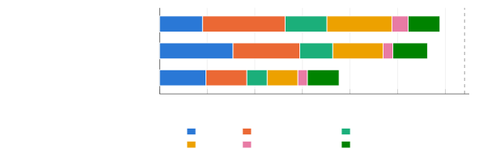

# Streaming Speech Recognition on a Microcontroller: a 65.7M-Parameter Transducer in 2 and 4 Bits on the ESP32-P4

Billal Boumedine Affiliation: Faculty of Computer Science, University of
Science and Technology Houari Boumediene (USTHB) Affiliation: Algiers,
Algeria Email: [billal.boumedine@etu.usthb.dz](mailto:)

October 2026

###### Abstract

We run Kroko, a 65.7M-parameter streaming Zipformer2 transducer for
English, on the ESP32-P4, a microcontroller with two 400 MHz RISC-V
cores, a 128-bit SIMD extension (PIE) and 32 MB of PSRAM, but no neural
accelerator. Without any training, the encoder’s 290 matrices are stored
with 2 or 4 bits per weight in Hadamard-rotated groups: the width of
each matrix comes from its measured sensitivity, and each matrix is
first corrected toward the original model’s output, then rounded with
GPTQ and a search over the group norms. The released 71 MB of int8
weights become a 26.65 MB file. Activations are int16 between the matrix
products and int8 into them. A C engine with hand-written PIE kernels
processes each 1.28 s chunk of audio in 0.90 s on both cores, beam
search included, and its PC build computes the same bits as the chip, so
accuracy is measured on whole test sets. LibriSpeech WER is 4.34 % on
test-clean and 10.26 % on test-other, against 3.94 % and 9.17 % for the
released model; on FLEURS and Common Voice the gap grows to 2.3 and 1.1
points. A GPU simulator shows that the integer arithmetic costs nothing
and that the whole gap comes from the weights, and an ablation on all of
test-clean shows that GPTQ does most of the work. We also report the
port’s speed history, from 51.3 s to 0.62 s of encoder time per chunk,
each design step measured again in one build, an attempt to reach 16 MB
that stopped at 19.63 MB, and what did not work. We did not measure
energy. The inference engine, the firmware and the 2/4-bit weights are
available at
[https://github.com/BoumedineBillal/esp32-pie-asr](https://github.com/BoumedineBillal/esp32-pie-asr).

## 1 Introduction

Speech recognition on microcontrollers usually means recognizing a fixed
list of commands. Espressif’s ESP-SR, for instance, recognizes up to 200
commands on the ESP32-S3 \[11\]. Writing down arbitrary speech needs a
model with tens of millions of parameters, which is more than the memory
of most microcontrollers and, until recently, more than their arithmetic
could handle. Oído \[29\] has just shown a 13M-parameter Conformer-CTC
model on the ESP32-S3 that transcribes in 1.97 times the audio duration
on one core: close to real time, not yet in it.

This report describes how we ran a model five times larger, faster than
real time and in streaming mode, on the ESP32-P4. The chip has two
400 MHz RISC-V cores with a 128-bit SIMD extension called PIE \[12\]; it
has no neural accelerator, and the board we used adds 32 MB of PSRAM and
16 MB of flash. The model is Kroko \[4\], a streaming Zipformer2
transducer \[31, 15\] for English, trained by Banafo and released as
int8 ONNX weights for sherpa-onnx \[19\]. We did not retrain it.
Everything described here happens after training: the weights go to 2
and 4 bits, the activations to int16 and int8, and a C engine with
hand-written PIE kernels runs the result.

The system transcribes the board’s microphone live and shows the words
on the board’s screen. On LibriSpeech test-clean \[25\] it reaches
4.34 % WER and on test-other 10.26 %, with a beam of 4, against 3.94 %
and 9.17 % for the released model run with sherpa-onnx. On real speech
from FLEURS and Common Voice the gap widens to one to two points. Each
1.28 s of audio takes 0.90 s to process, and a word becomes final about
2 s after it is spoken.

The report makes four contributions.

- •
  A training-free method that stores a streaming transducer’s encoder
  with 2 or 4 bits per weight in the Cactus Quants layout \[8\]
  (Hadamard-rotated groups of 128, Lloyd-Max levels \[22, 23\], one norm
  per group): a bit width per matrix from its measured sensitivity, then
  a sequential pass that corrects each matrix toward the original model
  before rounding it with GPTQ \[14\] and choosing the group norms. It
  brings 71 MB to 26.65 MB for half a point of WER on test-clean, and an
  ablation on the whole test set shows what each part contributes
  (Section 4).
- •
  An integer design, chosen by measurement in a GPU simulator before it
  was written in C, that costs no measurable accuracy on LibriSpeech,
  FLEURS or Common Voice (Sections 5 and 9.2).
- •
  A C engine with PIE SIMD kernels that is bit-exact with its PC build,
  so that every accuracy number in this report is measured on complete
  test sets and is also the chip’s, and the cost of each design step
  measured again in a single build (Sections 6 and 7).
- •
  An account of what did not work, including an attempt to reach 16 MB
  with slimming and quantization-aware training that stopped at 19.63 MB
  (Sections 10 and 11).

The engine and the firmware are open source \[7\], and so are the
weights \[6\]. The conversion code is not part of the release; Section 4
and Algorithm 1 describe the method in enough detail to reimplement it.

## 2 Related work

#### Small speech recognizers.

Whisper tiny.en \[26\] (37.8M parameters) and Moonshine Tiny \[17\]
(27.1M) are encoder-decoder models that transcribe whole segments;
Moonshine was designed for live transcription on small devices, with
compute that scales with the input length. Streaming transducers \[15\]
emit tokens as audio arrives. The k2 project’s Zipformer
encoders \[31\], trained with the pruned transducer loss \[20\] in
icefall \[18\], are a strong family of them, and sherpa-onnx runs them
on CPUs. Kroko belongs to that family.

#### Speech on microcontrollers.

ESP-SR’s MultiNet recognizes a fixed list of commands on the
ESP32-S3 \[11\]. Oído \[29\] is the closest work to ours. It runs
NVIDIA’s 13M-parameter Conformer-CTC model with int8 weights and int8
dynamic activations on one core of the ESP32-S3 (240 MHz Xtensa LX7,
8 MB PSRAM), at 1.97 times the audio duration, and reports 3.70 % /
8.23 % on test-clean / test-other, measured with a host build of its
engine. A streaming variant with 1.28 s chunks reaches 4.86 % / 11.03 %
with a 1.3M-parameter language model (6.27 % / 13.06 % greedy). Our
setting is different: a larger chip, a model five times larger, a
transducer, and streaming as the only mode.

#### Weight quantization.

GPTQ \[14\] rounds the columns of a matrix one at a time and spreads
each rounding error over the columns not yet rounded, using the inverse
of the input’s second-moment matrix. QuIP# \[28\] and QuaRot \[3\]
rotate weights with Hadamard matrices so that outliers are spread out
and the entries become close to Gaussian; QuIP# then rounds to lattice
codebooks. Cactus Quants \[8\], from Cactus Compute, combines a Hadamard
rotation per group of 128 with Lloyd-Max levels and one float16 norm per
group. We use that storage layout as documented and contribute the way
of rounding into it. Integer-only inference follows the usual
practice \[16, 24\]; on microcontrollers, most published work is on
vision \[21\].

#### Quantized speech recognizers.

Ding et al. \[10\] and Rybakov et al. \[27\] report Conformer models
with 4-bit and 2-bit weights and no loss of accuracy on LibriSpeech;
both quantize during training. Edge-ASR \[13\] compares eight
post-training methods on Whisper and Moonshine and finds that 3-bit
weights can work on the larger models. Like Edge-ASR we do not retrain,
but most of our weights are at 2 bits, and the result runs on a
microcontroller.

#### Contextual biasing.

For biasing the search toward given words we follow the shallow,
in-search approach of Williams et al. \[30\], with a token trie in the
manner of Aho–Corasick \[1\].

## 3 Platform and model

#### The chip.

We used Espressif’s ESP32-P4X-Function-EV-Board. Its chip is revision v3
of the ESP32-P4 (sold as ESP32-P4X): two RISC-V cores at 400 MHz, 768 KB
of internal memory, of which we configure 256 KB as the L2 cache for
external memory, 32 MB of PSRAM, here clocked at 250 MHz, and 16 MB of
flash. The board has an ES8311 codec with a microphone and a
$`1024\times 600`$ MIPI-DSI screen; our chip reports revision v3.2. PIE,
the SIMD extension, has eight 128-bit vector registers and
multiply-accumulate instructions that take 16 int8 pairs at once into a
wide accumulator register (QACC); 128-bit loads must be 16-byte aligned,
and the low four address bits are silently ignored otherwise. We started
the port on revision v1.3 (PIE 2.1, 360 MHz) and moved to v3 (PIE 2.2)
on 20 October 2026. Our kernels use no instruction that is new in PIE
2.2, but the encodings changed: 689 of the 1188 instruction words of our
kernels differ, and the kernels ran bit-exact on the first try after a
rebuild.

The weights do not fit in the 16 MB flash, and lossless compression only
brought them to about 24.7 MB. They are therefore read at boot from a
microSD card into PSRAM (2.87 s at 9.3 MB/s, after 1.2 s of card
initialization).

#### The model.

Kroko is icefall’s Zipformer2 transducer in its medium configuration:
65.7M parameters, 650 BPE tokens, a stateless decoder (an embedding of
the last two tokens and a grouped convolution) and a joiner. The encoder
has a convolutional front end and six stacks, 16 layers in all, running
at frame rates that form a U (Table 1, Figure 1). Each layer has three
feed-forward modules, a non-linear attention module, two self-attention
modules sharing one attention-weight computation, two convolution
modules and two learned bypasses. In streaming mode the encoder takes
1.28 s of audio at a time (128 frames of 80 log-mel features; 141 frames
enter with the front end’s context) and produces 32 output frames at
25 Hz. Every stack attends to 5.12 s of past frames and keeps its
convolution caches between chunks. There is no lookahead, and the state
has a fixed size however long the stream is.

| Stack | Layers | Width | Rate (Hz) | Heads | Largest FF | Conv kernel | Matrix params | At 4 bits |
| ----- | ------ | ----- | --------- | ----- | ---------- | ----------- | ------------- | --------- |
| 0     | 2      | 192   | 50        | 4     | 512        | 31          | 2.02M         | 69.5 %    |
| 1     | 2      | 256   | 25        | 4     | 768        | 31          | 3.78M         | 40.8 %    |
| 2     | 3      | 384   | 12.5      | 4     | 1024       | 15          | 11.60M        | 18.4 %    |
| 3     | 4      | 512   | 6.25      | 8     | 1536       | 15          | 30.22M        | 13.8 %    |
| 4     | 3      | 384   | 12.5      | 4     | 1024       | 15          | 11.60M        | 100 %     |
| 5     | 2      | 256   | 25        | 4     | 768        | 31          | 3.78M         | 100 %     |

Table 1: Kroko’s encoder stacks. Rate: output frames per second. The
last column gives the share of each stack’s matrix parameters stored at
4 bits in our 2/4-bit file (Section 4).


Figure 1: The pipeline on the chip. The six encoder stacks run at the
frame rates shown, each with 5.12 s of left context.

#### Why Kroko.

Before settling on Kroko we compared ready-made streaming Zipformers on
four short recordings of the author’s voice (169 words, scored against
Whisper large-v3’s transcripts). An icefall Zipformer of about the same
size trained on LibriSpeech alone made 50.3 % errors on them against
8.9 % for Kroko, while it was the better of the two on a 73-clip
LibriSpeech sample (5.39 % against 9.41 %). The sample is tiny, but the
gap is too large to be noise: with the same architecture and about the
same size, the training data decided how well the model handled speech
that is not read audiobooks.

## 4 Weights in 2 and 4 bits

### 4.1 The format

Take a matrix $`W`$ with $`n`$ inputs. Each row is cut into groups of
$`G=128`$ weights ($`64`$, $`32`$ or $`16`$ for the few widths that are
not multiples of 128). A group $`w\in\mathbb{R}^{G}`$ is rotated,
$`u=H_{G}w`$, with $`H_{G}`$ the orthonormal Sylvester–Hadamard matrix,
and stored as a float16 norm $`\nu`$ and $`G`$ indices $`c_{k}`$ of
$`b\in\{2,4\}`$ bits:

```math
\hat{u}_{k}=\frac{\nu}{\sqrt{G}}\,\ell_{c_{k}},\qquad\hat{w}=H_{G}\,\hat{u}, \tag{1}
```

where $`\ell_{0}<\dots<\ell_{2^{b}-1}`$ are the Lloyd-Max levels of a
standard Gaussian with $`2^{b}`$ levels. The cost is $`b+16/G`$ bits per
weight: 2.125 or 4.125 for groups of 128. The rotation is what makes
Gaussian levels fit: after it, the entries of a group look Gaussian (we
measured a kurtosis of 2.97 over Kroko’s rotated weights; a Gaussian has
3), and $`\nu`$ starts as the group’s Euclidean norm, so that
$`u_{k}\sqrt{G}/\nu`$ has unit variance. A matrix product needs the
input rotated once per group, and that rotation serves every row:

```math
y_{o}=\sum_{g}\frac{\nu_{o,g}}{\sqrt{G}}\sum_{k}\ell_{c_{o,g,k}}\,(H_{G}\,x_{g})_{k}. \tag{2}
```

This layout is Cactus Quants \[8\]. What follows, the choice of widths
and the rounding, is ours.

### 4.2 Sensitivity and the bit plan

The encoder path has 290 matrices (63.72M parameters): the front end’s
output projection, the 18 linear maps of each of the 16 layers, and the
joiner’s encoder projection. For each matrix alone we rounded it to 2
bits, then to 4 bits, left everything else as released, and measured the
relative error of the encoder output,

```math
e=\frac{\sum\lVert\hat{y}-y\rVert^{2}}{\sum\lVert y\rVert^{2}}, \tag{3}
```

over the frames of held-out calibration clips. The plan starts with
every matrix at 2 bits and the small matrices (groups smaller than 32,
42 of them) at 4. It then moves matrices to 4 bits in decreasing order
of error saved per added byte, $`(e_{2}-e_{4})/\text{params}`$, while
the file stays within a 25 MB budget. The result keeps 193 of the 290
matrices at 4 bits, 25.35M of the 63.72M parameters.

The plan is not uniform at all (Table 1). The two stacks nearest the
output, 4 and 5, end up entirely at 4 bits. Stack 3, the slowest one,
which holds 30.22M parameters, close to half the model, has only 13.8 %
of its parameters at 4 bits. An earlier study with the same method found
the same ordering: the output stacks are the most sensitive and the
middle stack the least, while the single most sensitive matrix is the
input projection of the first layer’s self-attention.

### 4.3 Rounding

All 290 matrices are rounded one at a time, in the order the forward
pass meets them (Algorithm 1). Each matrix sees the inputs it receives
in the partly rounded model, not in the original one. For a matrix $`W`$
(rows are outputs) let $`X`$ be its inputs in the original model and
$`X_{q}`$ in the partly rounded model, over all calibration frames. With
$`S=X_{q}^{\top}X_{q}`$ and $`C=X^{\top}X_{q}`$, three steps follow.

1.  1.  _Correction toward the original model._ Upstream rounding has
        already changed this matrix’s inputs, so we first solve for the
        float matrix that best reproduces the _original_ output from the
        _new_ inputs,
        $`\min_{W^{*}}\lVert XW^{\top}-X_{q}W^{*\top}\rVert^{2}`$, with
        damping:

    ```math
    W^{*}=W+W\,(C-S)\,(S+\lambda I)^{-1},\qquad\lambda=0.01\cdot\overline{\operatorname{diag}(S)}. \tag{4}
    ```

    When nothing upstream has changed, $`C=S`$ and $`W^{*}=W`$ up to the
    damping.

2.  2.  _Norm search._ In the rotated basis, each group’s norm is chosen
        among ten values, $`\nu_{0}`$ times 0.70 to 1.15 in steps of 0.05
        (each rounded to float16), to minimize the group’s rounding error
        weighted by $`\operatorname{diag}(S)`$; $`\nu_{0}`$ is the group’s
        Euclidean norm.
3.  3.  _GPTQ._ With the norm fixed, the group’s columns are rounded one by
        one to the nearest level, and each rounding error is spread over the
        columns not yet rounded through the Cholesky factor of $`S^{-1}`$
        (with the same damping), as in GPTQ \[14\], but in the rotated
        basis: the rows of $`W^{*}`$ are rotated group by group, and $`S`$
        with them.

1: original model $`M`$; a bit width $`b`$ for each encoder-path matrix;
calibration frames

2: $`\hat{M}\leftarrow M`$

3: for all encoder-path matrices $`W`$ of $`\hat{M}`$, in the order of
the forward pass do

4:   $`X,X_{q}\leftarrow`$ the inputs of $`W`$ in $`M`$ and in
$`\hat{M}`$

5:   $`S\leftarrow X_{q}^{\top}X_{q}`$; $`C\leftarrow X^{\top}X_{q}`$;
$`\lambda\leftarrow 0.01\cdot\overline{\operatorname{diag}(S)}`$

6:   $`W\leftarrow W+W\,(C-S)\,(S+\lambda I)^{-1}`$ $`\triangleright`$
correction toward $`M`$

7:   $`V\leftarrow W\mathcal{H}`$;
$`S\leftarrow\mathcal{H}^{\top}S\,\mathcal{H}+\lambda I`$;
$`U\leftarrow`$ upper Cholesky factor of $`S^{-1}`$ $`\triangleright`$
rotated basis

8:   for all groups $`g`$ of $`G`$ columns, left to right do

9:    $`\nu\leftarrow`$ best of $`\nu_{0}\cdot\{0.70,\dots,1.15\}`$ for
rounding $`V_{:,g}`$, error weighted by $`\operatorname{diag}(S)`$
$`\triangleright`$ norms

10:    for all columns $`k`$ of $`g`$ do

11:       $`c_{k}\leftarrow`$ index of the level nearest to
$`V_{:,k}\sqrt{G}/\nu`$; $`q\leftarrow\ell_{c_{k}}\,\nu/\sqrt{G}`$

12:
      $`V_{:,j}\leftarrow V_{:,j}-\bigl((V_{:,k}-q)/U_{kk}\bigr)\,U_{kj}`$
for every column $`j>k`$ $`\triangleright`$ GPTQ

13:    end for

14:   end for

15:   store the codes $`c`$ ($`b`$ bits each) and the norms $`\nu`$
(float16); put the rounded $`W`$ into $`\hat{M}`$

16: end for

Algorithm 1 Sequential rounding into the 2/4-bit format. $`\mathcal{H}`$
is block-diagonal with one $`H_{G}`$ per group; products with a per-row
vector $`\nu`$ are taken row by row.

The correction must be done one matrix at a time. Applied to all
matrices of a layer at once, it counts the same upstream error several
times, and the encoder error went from 0.034 to 0.33 when we tried it.

#### Calibration.

The statistics come from 512 clips (87 minutes) of FLEURS \[9\] English
training audio, chosen in a random order with a fixed seed; no
transcripts are used. Clips are batched six at a time, sorted by length,
and padding frames are left out of all statistics. The 24 clips after
the first 512 are held out to measure $`e`$. Calibrating on the first
two hours of the training split instead, which have fewer speakers, made
the result worse on both small test sets we had at the time (13.0
against 10.1 % on the author’s recordings, 8.13 against 7.27 % on the
73-clip sample), so the speaker variety of the calibration audio seems
to matter. The sensitivity pass takes about 12 minutes and the rounding
about 25 minutes on a laptop GPU (RTX 4060, 8 GB).

#### What is left alone.

The decoder’s embedding and projection and the joiner’s output layer
stay int8, as released: rounding them to 4 bits alone took the author’s
recordings from 10.1 % to 16.6 %. The remaining 1.1M parameters (biases,
norms, depthwise convolutions, gates and bypass scales) are stored in
float16.

| Part                                                  | Parameters |
| ----------------------------------------------------- | ---------- |
| 4 bits: 193 encoder-path matrices                     | 25.35M     |
| 2 bits: the other 97                                  | 38.37M     |
| float16: biases, norms, depthwise convolutions, gates | 1.1M       |
| int8 (as released): decoder and joiner output         | 0.9M       |
| File on the microSD card                              | 26.65 MB   |

Table 2: What the weights file holds.

### 4.4 Ablation

Table 3 takes the method apart on all 2620 clips of LibriSpeech
test-clean (53,029 words). Every row is a file produced by the same code
with parts of the method switched off, evaluated in a GPU simulator of
the chip’s pipeline with float activations and greedy search; this
simulator gives 4.53 % for our published 2/4-bit file, and the chip,
with integer activations, 4.52 %. The error column is $`e`$ on the 24
held-out clips.

| Variant                                           | 4-bit matrices | Size (MB) | Error $`e`$ | WER     |
| ------------------------------------------------- | -------------- | --------- | ----------- | ------- |
| Released weights, unquantized, same simulator     | –              | –         | 0           | 4.02 %  |
| Round to nearest, all at 4 bits                   | 290            | 36.67     | 0.0136      | 4.58 %  |
| Round to nearest, all at 2 bits (small ones at 4) | 42             | 20.84     | 0.2194      | 21.76 % |
| Round to nearest, the 25 MB plan                  | 193            | 27.07     | 0.0445      | 8.83 %  |
|    + GPTQ, 128 clips                              | 193            | 27.07     | 0.0163      | 4.75 %  |
|    + correction toward the original               | 193            | 27.07     | 0.0128      | 4.68 %  |
|    + norm search                                  | 193            | 27.07     | 0.0124      | 4.50 %  |
|    + 512 clips: the published file                | 193            | 27.07     | 0.0090      | 4.53 %  |
| Full method, all at 2 bits (small ones at 4)      | 42             | 20.84     | 0.0557      | 13.40 % |

Table 3: Ablation of the rounding on LibriSpeech test-clean (2620 clips,
53,029 words), float activations, greedy search, Whisper’s English text
normalizer. Size: the .kq archive the chip’s file is made from (the
chip’s file is 0.42 MB smaller). Error: relative error of the encoder
output on 24 held-out FLEURS clips.

The reference row comes first. The released weights give 4.02 % in the
simulator, as in PyTorch (4.02 %) and in sherpa-onnx (4.03 %), so the
simulator adds no error of its own, and the published file costs 0.51
points: 269 more word errors out of 53,029.

Rounding to the nearest level on the 25 MB plan nearly doubles the WER,
to 8.83 %. GPTQ alone does most of the repair (4.75 %). The correction
toward the original takes it to 4.68 % and the norm search to 4.50 %,
slightly better than every matrix at 4 bits rounded to the nearest level
(4.58 %), a file 36 % larger. The last step, 512 calibration clips
instead of 128, lowers the encoder error by a quarter (from 0.0124 to
0.0090) and leaves the WER where it was: 4.53 against 4.50 %, a
difference of 16 words, well inside the run-to-run spread of about
$`\pm`$30 words that we observed between equivalent configurations. We
chose the published file by its error, before running this ablation; by
this measurement, 128 clips would have done as well.

The encoder error is therefore a good guide down to about 0.015 and a
poor one below it. From 0.22 to 0.016 it orders the variants exactly as
the WER does, while the four files with an error between 0.009 and 0.014
all land between 4.50 % and 4.68 %, differences the WER cannot resolve.
During development we had seen the same thing: below an error of about
0.01 the WER stopped moving.

With every large matrix at 2 bits, the full method cuts the WER from
21.76 % to 13.40 % at 20.84 MB. That is a large gain, but not a usable
model: the 6.2 MB that the plan spends on 4-bit matrices is what keeps
the WER within half a point of the original.

## 5 Integer arithmetic

The first C port computed the products in int8 on PIE and everything
between them in float. That glue took 450 to 500 ms of each 1.28 s
chunk, so the activations had to become integers. We designed them in a
batched GPU simulator of the chip’s computation, with 1116 points in the
network where a tensor can be left in float or rounded to int8 or int16,
and chose each format by measurement before writing it in C.

#### Products.

Equation (2) maps onto integers as follows. The int16 input group is
rotated in int32 with the unnormalized Hadamard transform, which needs
only additions and is exact. The largest magnitude of each rotated group
in each frame then gives a power-of-two shift down to int8. The PIE tile
kernel multiplies these int8 values by the int8 levels of 16 rows at a
time, accumulating in QACC. The sums are read out with the group’s shift
(PIE’s read-out takes the shift from a register, so a dynamic scale
costs nothing), multiplied by the group’s norm in int16, summed over
groups in int32, and returned to int16 with the bias. Dynamic scales
matter here: with static int8 scales on the products’ inputs, the
encoder output was at 26.1 dB of signal-to-noise ratio against the float
pipeline, and at 37.8 dB with per-frame scales.

#### Between products.

Activations are int16 with static scales calibrated on 128 FLEURS clips.
The non-linearities (SwooshL, SwooshR, sigmoid, tanh and the attention’s
exponential) are tables indexed by the int16 input. BiasNorm sums its
squares in integers, residual additions are multiply-and-shift, and the
attention’s queries, keys and values, its weights (one power-of-two
scale per row) and its caches are int8. The convolution caches stay
int16. The streaming state holds about 815,000 numbers: 0.8 MB in int8
against 3.3 MB in float32.

#### What it costs.

Table 4 sums up the measurements. Rounding every activation to int8 is
not an option: on a 73-clip sample, the WER went from 7.27 % to 12.75 %,
while int16 everywhere gave 7.36 %. On a 500-clip subset of test-clean
(10,634 words), the chosen activations give 3.33 %, as in float, and
3.39 % once the products are integer too, six words more. On the whole
of test-clean, the float pipeline gives 4.53 % and the chip 4.52 %; the
integer variants we tried along the way landed between 4.50 % and
4.59 %, a spread of $`\pm`$20 to 30 words, which is the noise level of
the comparison. The same holds on harder speech (Section 9.2): 17.78
against 17.75 % on FLEURS and 20.94 against 20.72 % on Common Voice.
Measured layer by layer on 20 clips, the signal-to-noise ratio of the
integer pipeline against the float one is 27.8 dB after the first layer,
33.9 dB at the output of stack 3, and 33.2 dB at the encoder’s output:
the error does not grow with depth.

|                         |                                          |         |
| ----------------------- | ---------------------------------------- | ------- |
| Clips                   | Activations                              | WER     |
| 73 (dev-clean)          | float                                    | 7.27 %  |
|                         | int16 everywhere, static scales          | 7.36 %  |
|                         | int8 everywhere, static scales           | 12.75 % |
| test-clean, 500         | float                                    | 3.33 %  |
|                         | the chosen activations, float products   | 3.33 %  |
|                         | the chosen activations, integer products | 3.39 %  |
| test-clean, all 2620    | float                                    | 4.53 %  |
|                         | the chip                                 | 4.52 %  |
| FLEURS test, 647        | float                                    | 17.78 % |
|                         | the chip                                 | 17.75 % |
| Common Voice test, 1000 | float                                    | 20.94 % |
|                         | the chip                                 | 20.72 % |

Table 4: The cost of integer activations. Every row uses the 2/4-bit
weights; greedy search, Whisper’s normalizer. Float: float activations
in the GPU simulator. The chip: the integer pipeline, through the PC
build. The 73-clip sample is from LibriSpeech dev-clean.

## 6 The engine

### 6.1 Kernels

The engine is C with PIE kernels in assembly (Table 5); each kernel has
a C reference next to it. Decoding the weights is the part that does not
map onto PIE directly: Lloyd-Max levels are not evenly spaced, so the
codes cannot be expanded with shifts. The decode kernels use gather
loads from a table that holds, for each code byte, the int8 levels of
its four 2-bit (or two 4-bit) codes. Decoding 2048 two-bit weights takes
851 cycles. The tile kernel then multiplies 16 decoded rows by one input
group for each frame, 168 cycles per frame and $`16\times 128`$ tile,
about 12 multiply-accumulates per cycle.

| Kernel                                        | What it does                                                                                       |
| --------------------------------------------- | -------------------------------------------------------------------------------------------------- |
| pq_decode2, pq_decode4                        | weight codes to int8 levels through a gather table                                                 |
| pq_tile16, pq_tile16_n                        | 16 rows $`\times`$ one group $`\times`$ $`T`$ frames; the second also applies the norms and shifts |
| pq_fwht                                       | the integer Hadamard transform of an input group (radix 8)                                         |
| pq_q8_shift                                   | int32 to int8 by a power-of-two shift                                                              |
| pq_out_tab16, pq_out_add16, pq_out_act8       | read-out: activation table, residual add, int8 output                                              |
| pq_sumsq16, pq_scale_bypass16                 | BiasNorm’s sum of squares; its scale fused with the bypass                                         |
| pq_dw16, pq_dwcomb16                          | the convolution modules’ depthwise convolution and its combine                                     |
| pq_mul_q8, pq_mul16, pq_lane_q8, pq_lane_or16 | gating products and per-channel scaling                                                            |

Table 5: The PIE kernels.

#### Two cores.

The products are shared between the cores: the input frames are
quantized half on each core, then the tiles are split by blocks of
output rows, and each core writes only its own outputs. Two cores make
the encoder 1.58 times faster than one (Section 7), not 2: in an earlier
measurement, decoding on each core took 60 % longer and the
multiply-accumulates 33 % longer when both cores ran, because they share
the memory.

#### Memory.

The 26.65 MB of weights are used in place in PSRAM and read once per
chunk, in order. The L2 cache is set to 256 KB with 128-byte lines, and
the L1 and L2 caches fetch the next line on a miss (autoload); without
the autoload the encoder is 45.6 ms slower. In an earlier build,
decoding fake codes instead of reading them from PSRAM saved 39 ms of
the 79 ms of decoding per chunk: that is what the PSRAM stream costs,
and the most a DMA prefetch could save. About 20 KB of hot code (the
products’ drivers, the attention and first-convolution loops, the
kernels) runs from internal RAM, which saved 40 ms per chunk when it was
introduced.

### 6.2 Bit-exact with the PC

The engine also builds for a PC, with each kernel replaced by its C
reference. Three rules make the PC build compute exactly what the chip
computes. First, every transcendental function comes from a small header
built from IEEE addition, subtraction, multiplication and division only.
The C libraries of the two sides (glibc and newlib) differ in the last
bit of exp, log, tanh and others, and those bits change the features and
the activation tables. (The chip has no double-precision unit, so
building the tables this way made initialization 0.4 s longer.) Second,
both sides compile with -ffp-contract=off, so no compiler fuses a
multiply and an add on one side only. Third, every kernel has a C
reference with the same rounding, and each two-core part writes only its
own outputs, so the order of execution cannot change a result.

We check this on the board: all 22 kernel tests against their
references; a CRC of the encoder output after every chunk, plus the
final text, on 8 LibriSpeech clips through the live path (and on 8 + 40
clips, 169 chunks, when the port moved to the P4X); the search’s tokens
on 140 clips with phrase biasing on; and, in the timing runs of
Section 7, the encoder CRCs of all eleven configurations in all of their
runs. Everything matches. We therefore report the PC build’s WERs as the
chip’s. This is what lets us evaluate on 2620 and 2939 clips: the whole
of test-clean runs in about 15 minutes on a laptop in 16 processes,
while the chip, at 0.7 times real time, would need about four hours for
test-clean alone.

## 7 Speed

### 7.1 The history

The encoder went from 51.3 s per 1.28 s chunk to about 0.6 s. Table 6
lists each step that changed the time, as it was measured on the chip
during development. The first column is the first port, which kept float
glue between the int8 products and finished at 1.28 s, still not real
time. The second is the integer port of Section 5, which reached 630 ms
in one day. The stable version we kept dropped one of those steps, the
int8 front end, after our tests showed it lost 16 dB of signal-to-noise
ratio that the WER had not revealed (Section 11); that version ran at
726 ms, and the move to the P4X brought it to 592 ms. These numbers come
from successive builds, two chip revisions and a code layout that
changed along the way, so a single step’s gain in this table is only
indicative.

| First port (float glue)              |        | Integer port                         |       |
| ------------------------------------ | ------ | ------------------------------------ | ----- |
| Step                                 | ms     | Step                                 | ms    |
| plain float C                        | 51,300 | integer products                     | 1,257 |
| 2/4-bit products on PIE              | 21,400 | PIE int8 rounding                    | 1,127 |
| int8 front end and joiner, fast math | 5,720  | int8 caches                          | 1,064 |
| two cores                            | 4,600  | softmax in int8, once                | 983   |
| key-major attention                  | 2,750  | int16 FF hidden layer on PIE         | 888   |
| L2 cache 256 KB, 128-byte lines      | 2,350  | int16 residuals, PIE norm and bypass | 859   |
| activation tables                    | 1,870  | int8 front end                       | 752   |
| attention $`\times`$ values in int8  | 1,680  | integer convolution modules          | 686   |
| depthwise kernel                     | 1,554  | non-linear attention                 | 668   |
| L1 and L2 autoload                   | 1,354  | hot code in internal RAM             | 630   |
| radix-8 Hadamard                     | 1,315  | _stable, without int8 front end_     | 726   |
| int8 queries and keys                | 1,281  | P4X, rebuild only                    | 602   |
|                                      |        | P4X, PSRAM at 250 MHz                | 592   |

Table 6: The history of the port: encoder time per 1.28 s chunk on the
chip after each step, as measured during development (ESP32-P4 v1.3 at
360 MHz, then the P4X at 400 MHz; greedy search).

### 7.2 Each design step, measured in one build

To give each step a reliable cost, we measured the main design decisions
again on the P4X, in a single firmware build of the released engine with
run-time switches (Table 7). Each configuration boots on its own, reads
the weights from the card and processes the same two LibriSpeech clips
(13 chunks) three times; the list was run three times, so each row is
the mean of 9 runs. The standard deviation over the runs is at most
0.5 ms. Every configuration’s encoder output matches, CRC for CRC, the
PC build of the same configuration, and the released design’s matches
the reference values of the released engine, so each row computes
exactly what it claims.

|     |                                                          |         |        |                      |
| --- | -------------------------------------------------------- | ------- | ------ | -------------------- |
|     | Design                                                   | Encoder | Chunk  | $`\times`$ real time |
| a   | int8 products on PIE, float in between (the first port)  | 1043.8  | 1176.9 | 0.92                 |
| b   | integer products, int8 attention caches and softmax rows | 776.5   | 909.7  | 0.71                 |
| c   |    + int16 feed-forward hidden layer                     | 721.4   | 854.2  | 0.67                 |
| d   |    + int16 residual stream                               | 700.7   | 834.4  | 0.65                 |
| e   |    + integer convolution modules                         | 645.9   | 778.8  | 0.61                 |
| f   |    + integer non-linear attention                        | 631.2   | 763.8  | 0.60                 |
| g   |    + int8 self-attention values                          | 629.1   | 762.6  | 0.60                 |
| h   |    + integer attention weights: the released design      | 620.3   | 753.5  | 0.59                 |
| i   | h on one core                                            | 979.5   | 1124.5 | 0.88                 |
| j   | h without the cache autoload                             | 665.9   | 821.9  | 0.64                 |
| k   | h with the screen refreshing (nothing drawn)             | 630.6   | 769.2  | 0.60                 |

Table 7: The design steps measured again in one build on the P4X
(400 MHz, two cores unless stated): ms per 1.28 s chunk, mean of 9 runs
(standard deviation $`\leq 0.5`$ ms). Chunk: features, encoder and beam
search (4 hypotheses, no phrases). Rows b to h add one step each; i, j
and k change one thing of h.

From the first port’s design to the released one, the encoder becomes
1.68 times faster (1043.8 to 620.3 ms) and the chunk 1.56 times (from
0.92 to 0.59 times real time). Integer products account for 63 % of that
gain (267 of 424 ms); the int16 feed-forward hidden layer and the
integer convolution modules for 13 % each; the residual stream, the
non-linear attention and the attention weights for the rest. The second
core makes the encoder 1.58 times faster, and the cache autoload saves
45.6 ms of encoder time and 68.4 ms of the chunk, since the search
benefits too. The order of the steps matters for how the gain is split:
the int16 residual stream, for one, changes the inputs of every module
after it. Two configurations could not be run at all: plain C products
and float products need separate int8 or float copies of the weights and
float caches, about 7.9 MB that do not fit next to the 26.65 MB of
weights.



Figure 2: Where a chunk’s time goes on the P4X, in ms (rows a, i and h
of Table 7; core 0’s wall time per part; the totals are in the row
labels). Feed-forward and convolution: those modules of the 16 layers.
Attention: the attention weights, the non-linear attention and the
self-attention. Search: the beam search with 4 hypotheses. The 2/4-bit
products are counted inside the parts that use them.

#### Where the time goes.

In the released design (row h, Figure 2), the front end takes 194 ms and
the 16 layers 403 ms: the feed-forward modules 172, the convolution
modules 85, the attention weights 56, the non-linear attention 47, the
self-attention 26, the norms 4, and the remaining 14 the middle bypass
and the conversion of the residual stream to int16 and back at each
layer’s ends. The 2/4-bit products, counted inside those modules, take
339 ms, 55 % of the encoder, and core 0 waits 25 ms in all for core 1 at
the end of the split products. The front end, still partly in float, is
the largest part that has not been worked on. The released engine’s
620 ms is 28 ms more than the 592 ms of the last development tree; we
did not track down the difference.

#### In the application.

The live transcriber firmware (firmwares/live_transcriber in the
repository) is slower than the engine alone: over the 8 test clips fed
through its debug link, a chunk takes 895.8 ms (features 14.0, encoder
742.2, search with phrases and transcript rules 138.1 ms), 0.70 times
real time. The screen’s refresh alone costs 10.4 ms of encoder time (row
k); the rest comes from the other tasks of the application, mainly the
user interface drawing on core 1, which uses 45 % of that core, and we
did not separate them further. A 3.1-minute live run of the microphone
kept a mean of 904 ms and a maximum of 935 ms per chunk, lost no audio
and used constant memory.

### 7.3 Habits that helped

#### Probe before the WER.

Each change was checked with a fast per-tensor signal-to-noise probe (4
minutes) before the full WER run (15 minutes). The probe caught two
losses that the WER missed: the static int8 front end (from 33.5 to
17 dB) and static int8 scales in the convolution modules ($`-4.6`$ dB,
fixed with dynamic power-of-two scales). The WER run’s own noise is
about $`\pm`$30 words on test-clean, so a single run cannot separate
small effects; when we stacked several unconfirmed steps, finding the
bad one took two hours of bisection.

#### One build for timing.

During development, code layout alone moved the total by about
$`\pm`$12 ms between builds with the same arithmetic, which is why
Table 7 switches the design at run time inside one build instead of
comparing builds.

## 8 Streaming, search and phrases

#### Search.

The search is k2’s modified beam search: at most one token per encoder
frame, hypotheses with the same tokens merged, and the best one
length-normalized at the end. With one hypothesis it gives the greedy
search’s tokens bit for bit. A beam of 4 brings test-clean from 4.52 %
to 4.34 % (about 100 fewer word errors) for 138 ms per chunk on the
chip; a beam of 8 gives 4.30 % on the PC, too small a gain for the extra
search time.

#### Commits and words.

A token is committed when every hypothesis agrees on it. A token still
open after 75 frames (3 s) is committed from the best hypothesis, and
the hypotheses that disagree are dropped; without that rule a long
ambiguous stretch could hold words back indefinitely. A word is final
when the next word starts or after 0.5 s without a token, and a pause of
1.5 s starts a new line. We measure a word’s delay in audio time, from
the end of its last token’s frame to the moment it becomes final: the
median is 1.9 to 2.3 s depending on the material, and 95 % of words are
final within 4.1 s.

#### Phrases.

A text file lists words and sentences to listen for; a word that the
model spells differently gets its spoken forms (ESP32 = ESP thirty two).
Each phrase becomes token sequences in a trie: each word split every way
the model’s pieces allow, the splits with the fewest pieces kept, and
the first word also capitalized. A hypothesis that follows a phrase gets
a bonus of 2.0 per token, added to its log-probability; it loses the
bonus if the phrase breaks off and keeps it once the phrase is complete.
The spoken forms are then rewritten to the written form in the
transcript.

We tested this with the default list (4 words and 10 sentences) on 140
text-to-speech clips, 35 sentences in 4 voices (Table 8): 10 sentences
contain words of the list, 15 contain its sentences, and 10 contain
neither but similar-sounding words. With the phrases on, 46 of the 60
listed words are written as listed instead of 0, and the WER falls from
19.5 % to 3.4 %. There are 3 false alarms (a listed phrase written that
was not said), none of them in the 10 sentences without phrases. On
LibriSpeech test-clean, with the same list on, the WER moves from 4.34 %
to 4.37 %.

|                       | Words   | Sentences | False alarms | WER    |
| --------------------- | ------- | --------- | ------------ | ------ |
| Phrases off           | 0 / 60  | 62 / 72   | 0 (0)        | 19.5 % |
| Phrases on (the chip) | 46 / 60 | 70 / 72   | 3 (0)        | 3.4 %  |

Table 8: Phrase biasing on 140 text-to-speech clips (beam 4). Words: the
list’s words written as listed. False alarms: a listed phrase written
but not said, over all clips (in the 40 clips without listed phrases).

## 9 Results

### 9.1 LibriSpeech

Table 9 gives the WERs on all of LibriSpeech test-clean (2620 clips) and
test-other (2939 clips), scored with Whisper’s English text normalizer.
The released model was run with sherpa-onnx 1.13.8 in streaming mode
with the same beam, with 2 s of silence appended to each clip so that
its last chunk is decoded; with less padding it loses the last words and
the comparison is unfair to it. Without the normalizer our test-clean
numbers are 4.78 % greedy and 4.61 % beam.

|                                |       |                 |        |          |        |                      |
| ------------------------------ | ----- | --------------- | ------ | -------- | ------ | -------------------- |
|                                |       | Ours (the chip) |        | Released |        |                      |
| Set                            | Clips | greedy          | beam 4 | greedy   | beam 4 | Gap, beam 4          |
| LibriSpeech test-clean         | 2620  | 4.52            | 4.34   | 4.03     | 3.94   | +0.40                |
| LibriSpeech test-other         | 2939  | 10.89           | 10.26  | –        | 9.17   | +1.09                |
| FLEURS English (US) test       | 647   | 17.75           | 15.95  | 14.92    | 13.68  | +2.26 \[1.63, 2.95\] |
| Common Voice 17.0 English test | 1000  | 20.72           | 19.56  | 18.85    | 18.47  | +1.09 \[0.50, 1.69\] |
| FLEURS, scaled to peak 0.5     | 647   | 11.42           | 10.97  | 10.28    | 9.99   | +0.97 \[0.68, 1.28\] |

Table 9: WER on whole test sets, Whisper’s English normalizer. Ours: the
PC build, which computes what the chip computes. Released: Kroko’s int8
model in sherpa-onnx. Gap: ours minus released at beam 4, with a 95 %
interval from a paired bootstrap over clips where computed. The last row
is a diagnostic: every FLEURS clip scaled to a peak of 0.5.

### 9.2 Real speech

LibriSpeech is read audiobooks, recorded and segmented with care. We
also measured two public sets recorded in other conditions (Table 9):
the whole English (US) test split of FLEURS \[9\], 647 clips and 1.77
hours, and 1000 clips drawn at random from the English test split of
Common Voice 17.0 \[2\], 981 speakers and 1.65 hours, resampled from
48 kHz. Both are read or prompted speech without added noise. The
calibration audio of Section 4.3 comes from FLEURS’s training split, not
its test split. As before, our numbers come from the PC build and the
released model’s from sherpa-onnx, on the same clips.

Both models make three to five times more errors here than on
LibriSpeech, and the gap between them grows: 2.26 points on FLEURS and
1.09 on Common Voice at beam 4, against 0.40 on test-clean, and the
bootstrap intervals exclude zero on both sets. The GPU simulator tells
where the gap comes from. With the released weights it reproduces
sherpa-onnx’s greedy WER (14.92 % on FLEURS, 18.90 against 18.85 % on
Common Voice); with the 2/4-bit weights and float activations it gives
17.78 % and 20.94 %, and the chip, with integer activations, 17.75 % and
20.72 %. The whole gap comes from the weights. The integer arithmetic
adds nothing here either.

Most of the FLEURS gap has a simple cause: the recordings are very
quiet. 343 of the 647 clips peak below 0.01 of full scale
($`-40`$ dBFS), and the median clip’s RMS level is $`-60`$ dBFS. On such
clips both models tend to miss the start of the sentence, ours more
often: the words lost before the first recognized word are 12.8 % of the
reference words for ours (greedy) and 9.2 % for the released model.
Scaled to a peak of 0.5, these leading deletions almost vanish (from
1042 to 51 words for ours, from 725 to 17 for the released model), both
WERs fall by 3.7 to 6.3 points, and the gap shrinks to 0.97 points at
beam 4, about 10 % relative, the same proportion as on LibriSpeech. On
the board the input level is set by the microphone gain, so this
sensitivity matters less there than on recordings, but it is real.

On Common Voice, at normal levels, our extra errors also sit mostly at
the start of the clips: our model drops more leading words than the
released one in 93 clips and fewer in 10. Adding one second of silence
before every clip changes neither WER, so the cause is not the cold
start of the stream; we have not found it. A beam of 4 recovers some of
these first words, which is why it helps our model more than the
released one (1.16 against 0.37 points on Common Voice). Names are hard
for both models (42 to 47 % of the name-like words in Common Voice are
wrong); that is Kroko’s own weakness, not the port’s.

### 9.3 Memory

Table 10 shows where the memory goes. The live transcriber’s release
build leaves 121 KB of internal RAM free, and its debug build, with a
USB link to a PC, 73 KB; the repository’s main firmware, which adds
voice-control demos to the transcriber, leaves 104 KB. Internal RAM was
tight during the port: with the 256 KB L2 cache about 70 KB were left
for everything else, and a build with 40 KB free failed at boot when
ESP-IDF reserved its internal DMA pool.

| Part                                             | Size         |
| ------------------------------------------------ | ------------ |
| weights, used in place                           | 26.65 MB     |
| engine state and workspace                       | about 4 MB   |
| screen frame buffer ($`1024\times 600`$, RGB565) | 1.2 MB       |
| free, at the lowest                              | about 0.5 MB |

Table 10: PSRAM use while listening (32 MB).

### 9.4 Comparison

Table 11 puts the numbers next to other small recognizers. The
comparison has to be read with care. Oído’s WERs, like ours, come from a
PC build of its engine, with its own text normalization; its best
streaming numbers use a 1.3M-parameter language model. Moonshine’s and
Whisper’s numbers are from the Moonshine paper, measured on a PC. The
chips differ: one 240 MHz Xtensa core for Oído, two 400 MHz RISC-V cores
for us, and Oído’s model is five times smaller and fits a chip with 8 MB
of PSRAM. With those caveats, our streaming WERs are below the offline
ones of Moonshine Tiny and Whisper tiny.en and above those of Oído’s
whole-utterance CTC model. Against Oído’s streaming variant they are 1.8
and 2.2 points lower greedy against greedy, and 0.5 and 0.8 points lower
with our beam search against its language model. Ours is the only
open-vocabulary entry in the table that is both streaming and faster
than real time on a microcontroller.

| System                         | Params | Weights           | Runs on           | Streaming | clean | other | RT   |
| ------------------------------ | ------ | ----------------- | ----------------- | --------- | ----- | ----- | ---- |
| This work, beam 4              | 65.7M  | 2/4-bit, 26.65 MB | ESP32-P4, 2 cores | yes       | 4.34  | 10.26 | 0.70 |
| This work, greedy              | 65.7M  | 2/4-bit, 26.65 MB | ESP32-P4, 2 cores | yes       | 4.52  | 10.89 |      |
| Kroko as released, beam 4      | 65.7M  | int8, 71 MB       | PC                | yes       | 3.94  | 9.17  |      |
| Oído CTC, greedy \[29\]        | 13M    | int8, 14.0 MB     | ESP32-S3, 1 core  | no        | 3.70  | 8.23  | 1.97 |
| Oído streaming, greedy \[29\]  | 13M    | int8              | ESP32-S3, 1 core  | yes       | 6.27  | 13.06 |      |
| Oído streaming, with LM \[29\] | 14.3M  | int8              | ESP32-S3, 1 core  | yes       | 4.86  | 11.03 | 1.96 |
| Moonshine Tiny \[17\]          | 27.1M  | float             | PC                | no        | 4.52  | 11.71 |      |
| Whisper tiny.en \[17, 26\]     | 37.8M  | float             | PC                | no        | 5.66  | 15.45 |      |

Table 11: Other small speech recognizers on LibriSpeech, as published by
their authors (ours: measured here). WER in %. RT: processing time over
audio duration; ours is the live firmware with its screen (0.59 for the
engine alone, Table 7); Oído’s streaming RT is for 1.28 s chunks with
its language model running. ESP-SR’s MultiNet \[11\], which recognizes a
fixed list of up to 200 commands on the ESP32-S3, does not transcribe
open speech and is left out.

## 10 Toward 16 MB

Once the model ran, we tried to make it much smaller. The goal was a
memory budget, not speed: Kroko together with a second model in the same
32 MB of PSRAM, which needed Kroko at about 16 MB with every matrix at 2
bits. Post-training rounding alone could not get there (every large
matrix at 2 bits with the full method of Section 4.3: 13.40 %, Table 3),
so this attempt used training, in two steps.

#### Slimming.

We cut stack 3’s feed-forward modules, which hold 18.9M of its 30.5M
parameters. Each hidden unit was scored by the root-mean-square of its
SwooshL activation times the norm of its output weights, on 800 clips;
the global top half was kept, with widths rounded to multiples of 128
(at least 384). This took the model from 65.75M to 56.31M parameters.
The cut units were faded out over the first 30 % of the training steps,
and stacks 3 to 5 were trained to reproduce the original encoder output
(a normalized squared error) on 12.4 hours of LibriSpeech dev-clean and
FLEURS English. The slim model scores 4.29 % on test-clean against
4.02 % for the original, both in float in the PyTorch pipeline used for
this study. Dropping a whole layer of stack 3 instead, without training,
gave 4.13 % for 58.13M parameters; we chose the narrower feed-forwards
for the larger saving.

#### Quantization-aware training.

We then made the GPU simulator of Section 5 trainable: it streams chunk
by chunk, rounds the weights to the chip’s format with a
straight-through gradient \[5\], and reproduces the chip’s integer
activations. It matched the PyTorch model at 92 to 94 dB once a bug was
fixed (it had rounded the attention’s position projections to 2 bits).
With every matrix at 2 bits, the WER on the study’s monitoring clips was
45.5 % before training and 9.6 to 13.1 % after, so we kept 113 matrices
(7.85M parameters) at 4 bits, chosen by sensitivity for an 18 MB budget.
The weights were blended from float to rounded over 30 % of 1480 steps,
then the integer activations and an int8 front end were added for 100
steps each.

#### Result.

The final model, measured, is 19.63 MB and scores 5.63 % on test-clean,
with float or integer activations alike: 1.35 points above the slim
float model, for 7 MB less than our published file. It was never run on
the chip. The 16 MB target was not met: the estimate of 16.03 MB assumed
every matrix at 2 bits and nothing else, and the 4-bit matrices, the
float16 small tensors, the int8 decoder and joiner and the smaller
groups brought the real file to 19.63 MB. A storage format with 8-bit
log norms, int8 small tensors and a 2/4-bit decoder would bring the same
model to about 17.4 to 17.6 MB, but that is a projection that needs a
new training run. We stopped there and kept the capacity for an Arabic
model, where it is needed more.

Two observations from this attempt. Short quantization-aware training on
12 hours of audio did not beat post-training rounding where both apply:
starting the training from the GPTQ-rounded model instead of the plain
one helped before training (7.23 % against 10.57 % on a small monitoring
set) and not at all after it. And the int8 front end, which lost 16 dB
untrained on the chip, was lossless after training in the simulator.

## 11 What did not work

- •
  _Plain 2 bits._ Rounding every large matrix to 2 bits to the nearest
  level gives 21.76 % on test-clean against 4.02 % for the unquantized
  model (Table 3). Errors compound: during development, the
  single-matrix errors summed to a predicted 0.126, and the measured
  error was 0.196.
- •
  _Short quantization-aware training at 2 bits._ Thirty minutes of
  self-distillation (7.4 hours of FLEURS) reached a lower error on
  FLEURS than on LibriSpeech (0.02 against 0.053) and lost to GPTQ
  without training (27.2 % against 25.4 % on the author’s recordings).
- •
  _The correction applied to a whole layer at once._ It counts upstream
  error several times: error 0.33 instead of 0.034.
- •
  _4 bits for the decoder and joiner._ From 10.1 % to 16.6 % on the
  author’s recordings; they stay int8.
- •
  _3 bits._ The best 2/3/4-bit allocation had about 8 % less error than
  the 2/4-bit one at the same size, while raising the 2/4-bit budget
  from 22 to 25 MB halved the error. Not worth a third decode kernel.
- •
  _Vector codebooks._ A 4-dimensional codebook of 256 entries reduced
  the error per weight by 17 % and the model’s by 11 %, worth about 0.5
  to 1 MB; we stopped there.
- •
  _Replacing the largest feed-forward._ Distilling stack 3’s largest
  feed-forward (1.97M parameters) into a Hadamard-structured MLP or into
  a pruned copy never came close: 2.8 to 3.7 dB for the structured MLPs
  against 4.9 dB for a plain linear map, and 12 dB at half the hidden
  width after fine-tuning.
- •
  _All-int8 activations_ (12.75 % against 7.27 %), _static int8 inputs
  to the products_ (26.1 against 37.8 dB) and _a static int8 front end_
  ($`-16`$ dB, invisible in the WER run).
- •
  _On the chip:_ an L2 cache of 512 KB (the chip does not boot), 256 KB
  with 64-byte lines (it hangs at initialization), manual L2 preloading
  (1120 to 1183 ms), and loop unrolling by the compiler.

## 12 Limitations

We did not measure energy or power; we had no instrument for it. The
system is English only. The test sets are read or prompted speech:
LibriSpeech, FLEURS, Common Voice, and text-to-speech clips for the
phrases. Noisy, far-field and conversational speech were not measured,
and on two noisy recordings of the author both the released model and
ours made 43 % errors, so noise robustness is an open question that
belongs to the model rather than to the port. The WERs come from the PC
build; we checked bit-exactness on 48 LibriSpeech clips, all kernels and
140 phrase clips, not on whole test sets on the chip. The 2/4-bit
weights cost half a point on test-clean, about one point on test-other
and Common Voice, and two on FLEURS as published; the model with these
weights is more sensitive to very quiet input and drops first words more
often than the released one, for reasons we have not established. The
firmware needs chip revision v3 (the P4X) and 32 MB of PSRAM, and the
weights need a microSD card. Finally, the method was developed on one
model; we have not shown that the same settings transfer to other
models.

## 13 Conclusion

A 65.7M-parameter streaming transducer runs on the ESP32-P4 at 0.70
times real time with a beam of 4, at 4.34 % WER on LibriSpeech
test-clean. Getting there needed no training: a sensitivity-based choice
of 2 or 4 bits per matrix, a sequential rounding that corrects each
matrix toward the original model, integer activations chosen by
measurement, and a chip that is bit-exact with its PC build so that
every number could be checked on whole test sets. The integer arithmetic
turned out to cost nothing on every set we measured; the cost is in the
weights, half a point on LibriSpeech and one to two points on harder
speech. Closing that gap, with a larger bit budget or with training on
much more audio than the 12 hours of Section 10, and moving the rest of
the front end to integers are the next improvements. Beyond them, we
plan to support the ESP32-S31, which has the same PIE 2.2 instructions,
and to build a model for Modern Standard Arabic.

#### Availability.

The engine, the firmware, the evaluation scripts and the LibriSpeech
transcripts behind the WERs are at
[https://github.com/BoumedineBillal/esp32-pie-asr](https://github.com/BoumedineBillal/esp32-pie-asr)
(Apache-2.0). The weights are at
[https://huggingface.co/BoumedineBillal/esp32-pie-asr-kroko-en](https://huggingface.co/BoumedineBillal/esp32-pie-asr-kroko-en)
under CC-BY-SA 4.0, as Kroko’s.

#### Acknowledgments.

Thanks to Banafo for Kroko, to Cactus Compute for documenting their
weight format, to the k2-fsa developers for icefall and sherpa-onnx, and
to Espressif for ESP-IDF.

## References

- \[1\] A. V. Aho and M. J. Corasick (1975) Efficient string matching:
  an aid to bibliographic search. Communications of the ACM 18 (6),
  pp. 333–340. Cited by: §2.
- \[2\] R. Ardila, M. Branson, K. Davis, M. Henretty, M. Kohler, J.
  Meyer, R. Morais, L. Saunders, F. M. Tyers, and G. Weber (2020) Common
  Voice: a massively-multilingual speech corpus. In Proceedings of the
  Language Resources and Evaluation Conference (LREC), Cited by: §9.2.
- \[3\] S. Ashkboos, A. Mohtashami, M. L. Croci, B. Li, P. Cameron, M.
  Jaggi, D. Alistarh, T. Hoefler, and J. Hensman (2024) QuaRot:
  outlier-free 4-bit inference in rotated LLMs. In Advances in Neural
  Information Processing Systems (NeurIPS), Cited by: §2.
- \[4\] Banafo (2025) Kroko ASR: streaming speech recognition models.
  Note:
  [https://huggingface.co/Banafo/Kroko-ASR](https://huggingface.co/Banafo/Kroko-ASR)Community
  models, CC-BY-SA; English model released through sherpa-onnx as
  sherpa-onnx-streaming-zipformer-en-kroko-2025-08-06 Cited by: §1.
- \[5\] Y. Bengio, N. Léonard, and A. Courville (2013) Estimating or
  propagating gradients through stochastic neurons for conditional
  computation. arXiv preprint arXiv:1308.3432. Cited by: §10.
- \[6\] B. Boumedine (2026) Esp32-pie-asr-kroko-en: Kroko English in 2
  and 4 bits. Note:
  [https://huggingface.co/BoumedineBillal/esp32-pie-asr-kroko-en](https://huggingface.co/BoumedineBillal/esp32-pie-asr-kroko-en)
  Cited by: §1.
- \[7\] B. Boumedine (2026) Esp32-pie-asr: streaming speech recognition
  on the ESP32-P4. Note:
  [https://github.com/BoumedineBillal/esp32-pie-asr](https://github.com/BoumedineBillal/esp32-pie-asr)
  Cited by: §1.
- \[8\] Cactus Compute (2026) Cactus Quants. Note:
  [https://docs.cactuscompute.com/latest/docs/cactus_quants/](https://docs.cactuscompute.com/latest/docs/cactus_quants/)
  Cited by: 1st item, §2, §4.1.
- \[9\] A. Conneau, M. Ma, S. Khanuja, Y. Zhang, V. Axelrod, S.
  Dalmia, J. Riesa, C. Rivera, and A. Bapna (2022) FLEURS: few-shot
  learning evaluation of universal representations of speech. In IEEE
  Spoken Language Technology Workshop (SLT), Cited by: §4.3, §9.2.
- \[10\] S. Ding, P. Meadowlark, Y. He, L. Lew, S. Agrawal, and O.
  Rybakov (2022) 4-bit Conformer with native quantization aware training
  for speech recognition. In Proc. Interspeech, pp. 1711–1715. Cited by:
  §2.
- \[11\] Espressif Systems (2026) ESP-SR user guide: command word
  recognition (MultiNet). Note:
  [https://docs.espressif.com/projects/esp-sr/en/latest/esp32s3/speech_command_recognition/README.html](https://docs.espressif.com/projects/esp-sr/en/latest/esp32s3/speech_command_recognition/README.html)
  Cited by: §1, §2, Table 11.
- \[12\] Espressif Systems (2026) ESP32-P4 technical reference manual.
  Note: Pre-release version 0.7. Chapter 4: Processor Instruction
  Extensions (PIE) Cited by: §1.
- \[13\] C. Feng, Y. Lin, S. Zhuo, C. Su, R. K. Ramakrishnan, Z. Yuan,
  and X. Zhang (2025) Edge-ASR: towards low-bit quantization of
  automatic speech recognition models. arXiv preprint arXiv:2507.07877.
  Cited by: §2.
- \[14\] E. Frantar, S. Ashkboos, T. Hoefler, and D. Alistarh (2023)
  GPTQ: accurate post-training quantization for generative pre-trained
  transformers. In International Conference on Learning Representations
  (ICLR), Cited by: 1st item, §2, item 3.
- \[15\] A. Graves (2012) Sequence transduction with recurrent neural
  networks. arXiv preprint arXiv:1211.3711. Cited by: §1, §2.
- \[16\] B. Jacob, S. Kligys, B. Chen, M. Zhu, M. Tang, A. Howard, H.
  Adam, and D. Kalenichenko (2018) Quantization and training of neural
  networks for efficient integer-arithmetic-only inference. In IEEE
  Conference on Computer Vision and Pattern Recognition (CVPR), Cited
  by: §2.
- \[17\] N. Jeffries, E. King, M. Kudlur, G. Nicholson, J. Wang, and P.
  Warden (2024) Moonshine: speech recognition for live transcription and
  voice commands. arXiv preprint arXiv:2410.15608. Cited by: §2, Table
  11, Table 11.
- \[18\] k2-fsa (2026) Icefall: speech recognition recipes with k2.
  Note:
  [https://github.com/k2-fsa/icefall](https://github.com/k2-fsa/icefall)
  Cited by: §2.
- \[19\] k2-fsa (2026) Sherpa-onnx: speech recognition with next-gen
  Kaldi and ONNX runtime. Note:
  [https://github.com/k2-fsa/sherpa-onnx](https://github.com/k2-fsa/sherpa-onnx)
  Cited by: §1.
- \[20\] F. Kuang, L. Guo, W. Kang, L. Lin, M. Luo, Z. Yao, and D.
  Povey (2022) Pruned RNN-T for fast, memory-efficient ASR training. In
  Proc. Interspeech, Cited by: §2.
- \[21\] J. Lin, W. Chen, Y. Lin, J. Cohn, C. Gan, and S. Han (2020)
  MCUNet: tiny deep learning on IoT devices. In Advances in Neural
  Information Processing Systems (NeurIPS), Cited by: §2.
- \[22\] S. P. Lloyd (1982) Least squares quantization in PCM. IEEE
  Transactions on Information Theory 28 (2), pp. 129–137. Cited by: 1st
  item.
- \[23\] J. Max (1960) Quantizing for minimum distortion. IRE
  Transactions on Information Theory 6 (1), pp. 7–12. Cited by: 1st
  item.
- \[24\] M. Nagel, M. Fournarakis, R. A. Amjad, Y. Bondarenko, M. van
  Baalen, and T. Blankevoort (2021) A white paper on neural network
  quantization. arXiv preprint arXiv:2106.08295. Cited by: §2.
- \[25\] V. Panayotov, G. Chen, D. Povey, and S. Khudanpur (2015)
  LibriSpeech: an ASR corpus based on public domain audio books. In IEEE
  International Conference on Acoustics, Speech and Signal Processing
  (ICASSP), Cited by: §1.
- \[26\] A. Radford, J. W. Kim, T. Xu, G. Brockman, C. McLeavey, and I.
  Sutskever (2023) Robust speech recognition via large-scale weak
  supervision. In International Conference on Machine Learning (ICML),
  Cited by: §2, Table 11.
- \[27\] O. Rybakov, P. Meadowlark, S. Ding, D. Qiu, J. Li, D. Rim,
  and Y. He (2023) 2-bit Conformer quantization for automatic speech
  recognition. In Proc. Interspeech, pp. 4908–4912. Cited by: §2.
- \[28\] A. Tseng, J. Chee, Q. Sun, V. Kuleshov, and C. De Sa (2024)
  QuIP#: even better LLM quantization with Hadamard incoherence and
  lattice codebooks. In International Conference on Machine Learning
  (ICML), Cited by: §2.
- \[29\] D. Varela Sánchez and G. Martín-Coello Juárez (2026) Oído:
  open-vocabulary speech recognition on a \$5 microcontroller without a
  neural accelerator. arXiv preprint arXiv:2610.13447. Cited by: §1, §2,
  Table 11, Table 11, Table 11.
- \[30\] I. Williams, A. Kannan, P. Aleksic, D. Rybach, and T.
  Sainath (2018) Contextual speech recognition in end-to-end neural
  network systems using beam search. In Proc. Interspeech, Cited by: §2.
- \[31\] Z. Yao, L. Guo, X. Yang, W. Kang, F. Kuang, Y. Yang, Z. Jin, L.
  Lin, and D. Povey (2024) Zipformer: a faster and better encoder for
  automatic speech recognition. In International Conference on Learning
  Representations (ICLR), Cited by: §1, §2.
