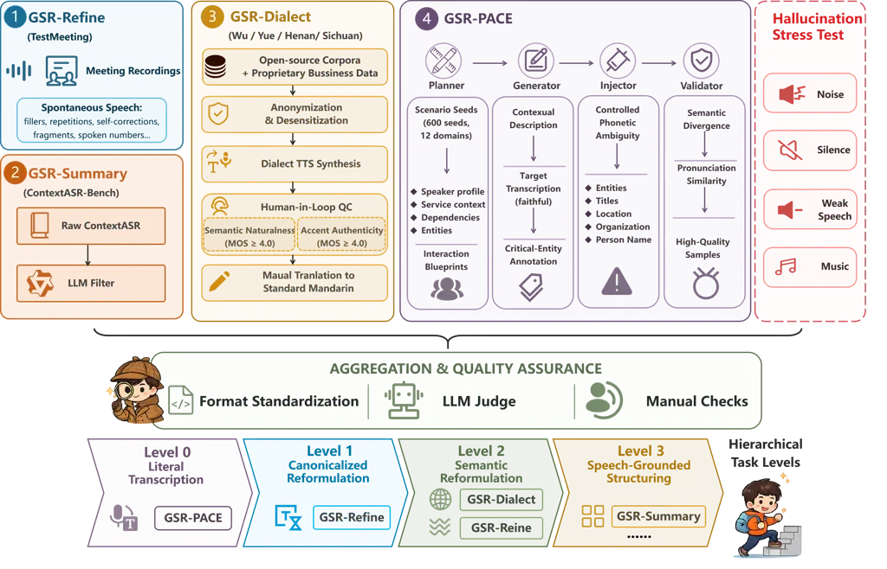
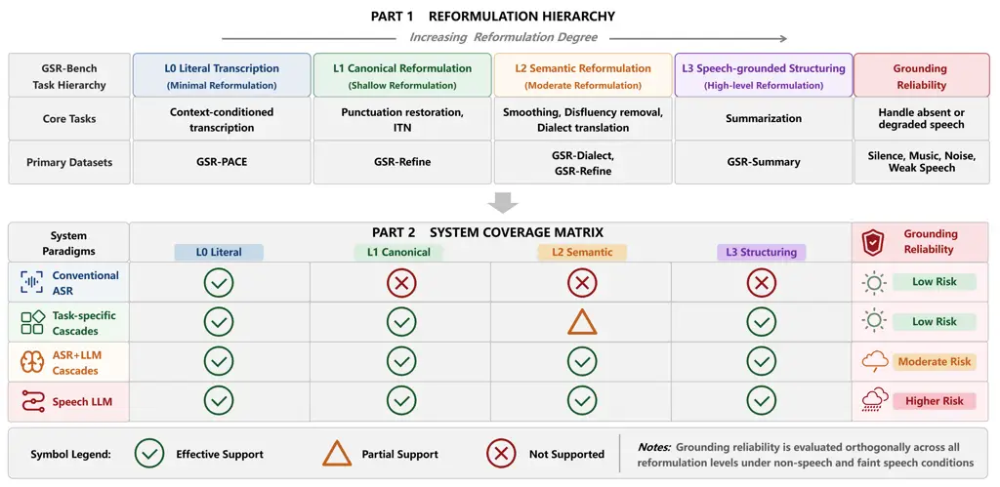

# From Transcription to Reformulation: Defining and Benchmarking Grounded Generative Speech Recognition

Qing Wang    Qihan Hu    Hang Lv    Yan Yang    Boqing Liu    Xuechao
Zhu    Zehan Li    Hongjie Chen    Jian Kang    Jie Li    Yongxiang
Li\corresponding    Lei Xie\corresponding

###### Abstract

Speech language models have expanded automatic speech recognition (ASR)
from transcription to general speech-to-text generation. Yet existing
benchmarks still assume a single ground-truth transcript per
utterance—an assumption that struggles when models produce readable,
formatted, or structured outputs. In this work, we introduce Grounded
Generative Speech Recognition (GSR), reformulating speech recognition as
generating semantically grounded text instead of a single transcript. We
define a grounded reformulation space that characterizes all valid
textual realizations supported by the input speech, and establish a
four-level hierarchy of reformulation capabilities, including literal
transcription, canonical reformulation, semantic reformulation and
speech-grounded structuring. Based on this formulation, we present
GSR-Bench, the first comprehensive benchmark designed to evaluate
generative speech recognition systems beyond exact transcript matching.
GSR-Bench covers diverse scenarios including refined meeting
transcription, cross-dialect translation, context-aware speech
understanding, and robustness under silent or noisy acoustic conditions.
To address the limitations of word-level evaluation metrics, we develop
a multi-dimensional evaluation framework combining speech grounding
assessment and LLM-based semantic judgment, whose reliability is
validated through human preference studies. Extensive experiments across
representative architectures, ranging from conventional ASR systems to
end-to-end Speech-LLMs, reveal fundamental trade-offs between
transcription fidelity and generative reformulation ability. Our
analysis further identifies critical failure modes, including acoustic
hallucination, unsupported generation, and instruction drift, providing
insights into the design and evaluation of future grounded generative
speech systems.

¹Xingchen AGI Lab, China Telecom Artificial Intelligence Technology Co.
Ltd, China

²Audio, Speech and Language Processing Group (ASLP@NPU), School of
Computer Science,

Northwestern Polytechnical University, Xi’an, China

## Introduction

Automatic speech recognition (ASR) (Graves 2012; Chan et al. 2016;
Gulati et al. 2020; Yao et al. 2023; Kim et al. 2022; Kim et al. 2023)
has traditionally been formulated as an speech-to-text transcription
problem, where the primary objective is to recover the exact linguistic
content contained in speech. Over the past decades, advances in neural
architectures, learning criteria, self-supervised speech representation
learning (Baevski et al. 2020; Baevski, Schneider, and Auli 2020; Hsu
et al. 2021; Chen et al. 2022), ultra-large-scale multi-task
pre-training, and convenient and systematic training frameworks have
substantially improved transcription accuracy, leading to near-human
performance on many benchmark datasets.

However, the emergence of Speech Language Models (SLM) (Rubenstein
et al. 2023; Zhang et al. 2023; Chu et al. 2023; Barrault et al.
2023)are fundamentally changing the role of speech recognition. Instead
of merely producing literal transcriptions, modern speech models are
increasingly capable of generating readable, formatted, and
task-oriented textual outputs, including normalized transcripts,
translated content, meeting summaries, and structured information. This
evolution suggests that speech recognition is transitioning from a
transcription problem toward a more general speech-grounded generation
paradigm.

Despite this progress, current definitions and evaluation methodologies
for speech recognition remain largely inherited from the transcription
paradigm. Conventional ASR assumes that each speech utterance
corresponds to a unique ground-truth transcript, and therefore evaluates
systems using exact matching metrics such as word error rate (WER) and
character error rate (CER).

While effective for measuring transcription accuracy, these metrics
become insufficient when models intentionally perform legitimate textual
reformulations. For example, removing disfluencies  (Kim et al. 2021),
restoring punctuation, normalizing spoken expressions  (Shi et al.
2024), or generating structured summaries  (La Quatra et al. 2025) may
produce outputs that differ from the reference transcript while
preserving the intended meaning. Therefore, exact transcript matching
can incorrectly penalize desirable generations while failing to measure
whether generated content is actually grounded in the input speech.

To address this limitation, we argue that speech recognition should be
reconsidered from the perspective of grounded reformulation. In this
work, we introduce Generative Speech Recognition (GSR), a new paradigm
that defines speech recognition as the generation of appropriate textual
realizations grounded in the input speech rather than the recovery of a
single transcript.

Unlike conventional ASR, where the output space is restricted to the
literal transcription, GSR considers a set of valid semantic-preserving
reformulations. These reformulations may vary in abstraction level and
presentation style according to different task objectives, while
maintaining faithful grounding to the original speech. Based on this
perspective, we establish a hierarchical taxonomy consisting of four
levels: literal transcription, canonicalized transcription, semantic
reformulation, and speech-grounded structuring.

Building upon this formulation, we introduce GSR-Bench, a comprehensive
benchmark for evaluating grounded generative speech systems. Unlike
existing ASR benchmarks (Chen et al. 2024b; Arora et al. 2025; Chen
et al. 2026) that primarily measure transcription accuracy, GSR-Bench
evaluates models across multiple dimensions of generative capability,
including reformulation quality, speech grounding, instruction
following, and robustness under challenging acoustic conditions.

The benchmark contains diverse evaluation suites covering refined
meeting transcription, cross-dialect translation, context-aware
generation, and boundary cases involving silence and noise. Furthermore,
we develop a semantic evaluation pipeline based on LLM-as-a-judge, which
goes beyond exact matching metrics by assessing whether generated
outputs remain faithful to the underlying speech information.

We benchmark representative systems ranging from conventional ASR
pipelines to modern Speech-LLMs and reveal several important
observations. First, transcription-oriented models achieve strong
literal accuracy but struggle with higher-level reformulation tasks.
Second, generative models demonstrate improved readability and task
adaptability but introduce new risks, including acoustic hallucination,
unsupported generation, and instruction drift. These findings highlight
the necessity of evaluating speech systems under the broader perspective
of grounded generation.

Our contributions are summarized as follows:

- •
  We introduce and formally define grounded Generative Speech
  Recognition (GSR), re-framing speech recognition from transcription to
  grounded textual reformulation.
- •
  We establish a four-level Reformulation Hierarchy that provides a
  unified view of emerging speech generation capabilities.
- •
  We propose GSR-Bench, a comprehensive benchmark and evaluation
  framework for systematically measuring generative speech recognition
  systems.
- •
  We conduct extensive analysis across representative ASR and SLM
  architectures, revealing the trade-offs between transcription
  fidelity, reformulation ability, and grounding reliability.

## Generative Speech Recognition



Figure 1: Overview of GSR-Bench: Data Construction, Quality Assurance,
and Hierarchical Task Organization.

### From Transcription to Reformulation

Conventional automatic speech recognition (ASR) systems formulate speech
recognition as a sequence transduction problem, where the primary
objective is to recover a textual sequence that maximally matches the
spoken content. Given speech signal $`\mathbf{S}`$, conventional ASR
aims to generate a transcript $`\mathbf{T}^{*}`$ by optimizing the
likelihood:

```math
\displaystyle\mathbf{T}^{*}=\arg\max_{\mathbf{Y}}P(\mathbf{Y}|\mathbf{S}), \tag{1}
```

where the generated output is expected to literally transcribe the
speech under a strict ’what-you-hear-is-what-you-get’ principle. As a
result, standard evaluation protocols (e.g., WER and CER) strictly rely
on human-annotated gold ground-truth transcripts, assuming that a single
reference text represents the sole correct output.

However, recent speech language models have demonstrated the ability to
generate text beyond literal transcription. Instead of simply recovering
spoken words, these models can perform a wide range of reformulations,
including punctuation restoration, inverse text normalization (ITN),
disfluency removal, paraphrasing, translation, and structured
information extraction (Du et al. 2023; Teleki et al. 2025). Such
outputs may differ significantly from the literal speech transcription,
while remaining faithful to the information conveyed by the speaker.

We argue that this capability represents a fundamental paradigm shift
from transcription to grounded reformulation. Therefore, we define GSR
as a speech-to-text paradigm that models recognition as the generation
of task-specific textual representations grounded by the acoustic input,
rather than the recovery of a single literal transcription.

Unlike conventional ASR, where any non-literal output is considered an
error, GSR allows flexible text formulations that capture the intended
meaning. The key point is speech grounding: every generated output must
remain supported by the input speech and any explicitly provided
contextual information.

### Grounded Reformulation Space

To formally characterize the output flexibility of the GSR, we first
define the grounded reformulation space. Given a speech signal
$`\mathbf{S}`$, we define the grounded reformulation space as

```math
\displaystyle\mathcal{R}(\mathbf{S})=\left\{\mathbf{Y}\mid G(\mathbf{Y},\mathbf{S})\geq\gamma\right\}, \tag{2}
```

where $`\mathbf{Y}`$ denotes a generated textual representation,
$`G(\cdot,\cdot)`$ represents a grounding function measuring whether the
generated output is based on the source input speech and $`\gamma`$
denotes the minimum grounding threshold.

Therefore, when the grounding constraint is violated, represented by
$`G(\mathbf{Y},\mathbf{S})<\gamma`$, the GSR system tends to yield
unverified outputs driven by its linguistic priors, which naturally
describes the phenomenon of hallucination.

In practical scenarios, GSR systems are often controlled by task
instructions or contextual information. Let $`\mathbf{P}`$ denote a
generation instruction and $`\mathbf{C}`$ denote the auxiliary context.
To capture the multi-modal and situational nature of speech
applications, we formulate $`\mathbf{C}`$ as a structured set of
contextual priors:

```math
\displaystyle\mathbf{C}=\{\mathbf{C}_{\mathrm{conversational}},\mathbf{C}_{\mathrm{environmental}},\mathbf{C}_{\mathrm{meta}}\} \tag{3}
```

where $`\mathbf{C}_{\mathrm{conversational}}`$ captures prior dialogue
history or preceding text, $`\mathbf{C}_{\mathrm{environmental}}`$
represents acoustic background profiles or prior audio, and
$`\mathbf{C}_{\mathrm{meta}}`$ represents metadata such as speaker
profiles, scenario types, or entity hotwords. These conditions define a
task-specific subspace:

```math
\displaystyle\mathcal{R}(\mathbf{S},\mathbf{P},\mathbf{C})\subseteq\mathcal{R}(\mathbf{S}), \tag{4}
```

where $`\mathbf{P}`$ determines the desired reformulation objective and
$`\mathbf{C}`$ provides additional evidence for generation.

Importantly, contextual information does not itself increase the
reformulation level. Context only changes the available evidence for
generation, while the degree of permissible reformulation is determined
by the task objective.

### Reformulation Hierarchy

Although GSR outputs must strictly satisfy the grounding constraint,
different downstream tasks permit varying degrees of reformulation from
the spoken surface form. To formalize this progression, we extend the
Grounded Reformulation Space by introducing a hierarchical organization
based on Human Comprehensibility ($`H`$), structured according to the
degree of semantic and structural transformation.

Specifically, we evaluate Human Comprehensibility $`H(\mathbf{Y})`$
through a multi-dimensional composite metric that integrates five core
aspects: Faithfulness ($`F`$), Coverage ($`C`$), Key Information
Preservation ($`K`$), Conciseness ($`N`$), and Readability ($`R`$).
Formally, $`H(\mathbf{Y})`$ is defined as:
$`H(\mathbf{Y})=\sum_{i=1}^{5}w_{i}M_{i}(\mathbf{Y})`$ where
$`\mathbf{M}=[F,C,K,N,R]^{T}`$, and $`w_{i}\geq 0`$ are the
corresponding weights satisfying $`\sum_{i=1}^{5}w_{i}=1`$. Notably,
this five-dimensional framework is extensible, with plans to expand its
metrics in future iterations.

From the evaluation perspective, based on above metrics, the
Reformulation Hierarchy is defined by parameterizing the target
comprehensibility threshold $`h_{l}`$ for each level
$`l\in\{0,1,2,3\}`$. Given an input speech $`\mathbf{S}`$, the
admissible output space at level $`l`$, denoted as
$`\mathcal{R}_{l}(\mathbf{S})`$, is formulated as:

```math
\mathcal{R}_{l}(\mathbf{S})=\left\{\mathbf{Y}\;\Big|{}\;G(\mathbf{Y},\mathbf{S})\geq\gamma\land H(\mathbf{Y})\geq h_{l}\right\} \tag{5}
```

where $`h_{l}`$ represents the minimum comprehensibility requirement for
level $`l`$. Mathematically, we define the hierarchy of these spaces as
a monotonic expansion of generative degrees of freedom:

```math
\displaystyle\mathcal{R}_{3}(\mathbf{S})\subset\mathcal{R}_{2}(\mathbf{S})\subset\mathcal{R}_{1}(\mathbf{S})\subset\mathcal{R}_{0}(\mathbf{S})\subseteq\mathcal{R}(\mathbf{S}), \tag{6}
```

where higher levels permit increasingly flexible reformulations and more
fruitful information for understanding. Note that this hierarchy
represents output flexibility rather than task difficulty.

Corresponding the evaluation perspective, this following section
provides a detailed breakdown of each level within the Reformulation
Hierarchy from the standpoint of practical implementation.

##### Level 0: Literal Transcription.

Level 0 corresponds to the conventional ASR setting, where no
reformulation is allowed. The objective is to recover the spoken content
with maximum lexical fidelity, preserving the original vocabulary, word
order, repetitions, hesitations, and spontaneous speech phenomena
whenever they are acoustically observable. Formally, the output space is
restricted to:

```math
\displaystyle\mathcal{R}_{0}(\mathbf{S})=\{\mathbf{Y}|\mathbf{Y}\approx\mathbf{T}\}, \tag{7}
```

where $`\mathbf{T}`$ denotes the literal transcript of the speech. This
level serves as the recognition baseline for both ASR-specialized
systems and GSR models.

##### Level 1: Canonical Reformulation.

Level 1 permits surface-form reformulations while preserving the
complete semantic content of the utterance. The model may modify writing
conventions, including punctuation restoration, sentence segmentation,
capitalization, and inverse text normalization (ITN). The reformulation
can be represented as:

```math
\displaystyle\mathcal{R}_{1}(\mathbf{S})=\{f(\mathbf{T})|f\in\mathcal{F}_{surface}\}, \tag{8}
```

where $`\mathcal{F}_{surface}`$ denotes a set of surface-level rewriting
operations. At this level, entities, numerical values, temporal
expressions, negations, and logical relations must remain unchanged. The
difference from conventional ASR post-processing lies in
controllability: GSR performs canonical reformulation as a generation
objective rather than applying fixed normalization rules after
recognition.

##### Level 2: Semantic Reformulation.

Level 2 further extends the reformulation capability from surface
modification to meaning-preserving reformulation. The generated output
may differ from the original transcript in wording, sentence structure,
or language, provided that the semantic content remains unchanged. The
admissible space is defined as:

```math
\displaystyle\mathcal{R}_{2}(\mathbf{S})=\{f(\mathbf{T})|f\in\mathcal{F}_{sem},\operatorname{Sem}(f(\mathbf{T}))=\operatorname{Sem}(\mathbf{T})\} \tag{9}
```

where $`\mathcal{F}_{sem}`$ includes operations such as disfluency
removal, paraphrasing, dialect normalization, and speech translation.
Compared with Level 1, this level shifts the preservation target from
lexical form to semantic content. The model is encouraged to produce
clearer and more task-appropriate language while preserving all
information explicitly conveyed by the speaker.

##### Level 3: Speech-grounded Structuring.

Level 3 represents the highest degree of reformulation, where speech is
transformed into structured semantic representations rather than
transcript-like text. The output space is defined as:

```math
\displaystyle\mathcal{R}_{3}(\mathbf{S})=\{f(\mathbf{T})|f\in\mathcal{F}_{structure}\}, \tag{10}
```

where $`\mathcal{F}_{structure}`$ contains representation-level
reformulations, including information extraction, intent representation,
meeting summarization, speaker-attributed transcripts, and structured
JSON generation. Unlike lower levels, Level 3 does not require
sentence-level correspondence with the original speech. However, every
generated fact, attribute, and relation must remain directly supported
by the speech or explicitly authorized context. Open-ended dialogue
generation and responses requiring external world knowledge are outside
the scope of GSR.

### Probabilistic Formulation of GSR

Based on the grounded reformulation space and reformulation hierarchy
above, we formally define Generative Speech Recognition as follows:
Given an speech input $`\mathbf{S}`$, an instruction prompt
$`\mathbf{P}`$, and contextual information $`\mathbf{C}`$, a GSR system
generates a textual representation:

```math
\displaystyle\mathbf{Y}^{*}=\arg\max_{\mathbf{Y}\in\mathcal{R}(\mathbf{S},\mathbf{P},\mathbf{C})}P(\mathbf{Y}|\mathbf{S},\mathbf{P},\mathbf{C}). \tag{11}
```

For autoregressive generation, the probability can be factorized as:

```math
\displaystyle P(\mathbf{Y}|\mathbf{S},\mathbf{P},\mathbf{C})=\prod_{u=1}^{U}P(y_{u}|y_{<u},\mathbf{S},\mathbf{P},\mathbf{C}), \tag{12}
```

where $`y_{u}`$ denotes the $`u`$-th generated token and $`y_{<u}`$
represents previously generated tokens.

The fundamental difference between GSR and conventional ASR lies in the
optimization target. ASR seeks a literal transcription that minimizes
lexical discrepancy, whereas GSR seeks an instruction-controlled
reformulation within a grounded output space. Therefore, GSR can
simultaneously optimize readability, structure, and task adaptability
while preserving acoustic faithfulness.

Consequently, GSR evaluation should independently measure reformulation
capability and grounding reliability, which motivates the design of
GSR-Bench.

## GSR-Bench: A Benchmark for Grounded Generative Speech Recognition

### Benchmark Overview



Figure 2: GSR-Bench Evaluation Framework: Reformulation Hierarchy,
System Coverage, and Grounding Reliability.

Existing ASR benchmarks rely on WER or CER under the assumption of a
single literal reference, whereas GSR admits multiple valid
speech-grounded reformulations and therefore requires joint evaluation
of transcription fidelity, controlled reformulation, and grounding
reliability.

To this end, we introduce GSR-Bench, a comprehensive benchmark designed
to evaluate generative speech recognition systems from two orthogonal
perspectives:

1.  1.  Reformulation Capability: measuring how effectively a model
        transforms speech into increasingly flexible textual representations
        according to the proposed hierarchy, from literal transcription to
        structured semantic representations.
2.  2.  Grounding Reliability: measuring whether generated outputs remain
        supported by acoustic evidence under challenging conditions,
        including non-speech audio, silence, and severely degraded speech.

The following sections introduce the datasets and evaluation tasks used
to instantiate the four reformulation levels, followed by a separate
grounding-reliability stress test. Detailed dataset construction
procedures and evaluation protocols are provided in the Appendix

#### GSR-PACE:

To instantiate Level 0 of the proposed reformulation hierarchy, we
introduce GSR-PACE (Phonetic Ambiguity with Contextual Evidence), a
literal transcription dataset that tests whether models leverage
auxiliary context to resolve phonetically confusable expressions. It
explicitly constructs homophones, near-homophones, pinyin-similar
variants, and commonly confused named entities around critical semantic
anchors, while requiring the model to preserve the source speech’s
literal lexical content. As formalized in Section 3, context context may
aid disambiguation but does not authorize rewriting, omission, or
semantic expansion.

Each sample pairs an ambiguous utterance with context that resolves the
intended entity over phonetically similar alternatives. Focusing on
entity-rich domains (names, organizations, locations, titles, terms),
the dataset evaluates contextual disambiguation while still penalizing
models that override reliable acoustics with misleading context. We
formulate the construction of GSR-PACE as a four-stage pipeline
consisting of Planner, Generator, Injector, and Validator.

Planner: The planner converts manually designed scenario seeds into
realistic interaction blueprints. Each blueprint contains scenario
descriptions, user profiles, contextual dependencies, and candidate
entities. Unlike isolated keyword injection, this process ensures that
every target entity appears naturally within a coherent real-world
context.

Generator: Given each blueprint, the generator produces contextual
descriptions, target utterances, and entity annotations. The generated
utterance follows the literal transcription objective: all entities must
correspond to the intended spoken content, while contextual information
provides additional evidence for resolving ambiguities.

Injector: To simulate realistic recognition challenges, the injector
introduces controlled acoustic ambiguities around semantic anchors. The
injected confusions include homophones, near-homophones, pinyin-similar
expressions, and commonly confused named entities. The resulting samples
evaluate whether models can appropriately leverage context rather than
relying solely on acoustic similarity.

Validator: The validator filters generated samples according to four
criteria: sufficient phonetic similarity between the target and
confusing candidates; meaningful semantic difference; contextual
resolvability; structural consistency. Only samples satisfying all
constraints are retained.

#### GSR-Refine:

To instantiate Levels 1 and 2 of the proposed reformulation hierarchy,
we introduce GSR-Refine, a multi-level benchmark constructed from the
TestMeeting subset of WenetSpeech (Zhang et al. 2022). GSR-Refine
evaluates the same spontaneous meeting recordings under two task
instructions: Level 1 assesses canonical reformulation, whereas Level 2
further evaluates meaning-preserving semantic reformulation. By holding
the acoustic input fixed, this design isolates the effect of increasing
reformulation freedom from variations in speech content and recording
conditions.

Compared with read or scripted speech, spontaneous meeting speech
contains frequent fillers, repetitions, false starts, self-corrections,
fragmented expressions, and spoken-form numerical expressions. These
characteristics make TestMeeting suitable for evaluating whether models
can transform natural speech into standardized and readable written text
while faithfully preserving the information conveyed by the speaker.

At Level 1, models perform canonical reformulation, including
punctuation restoration, sentence segmentation, and inverse text
normalization. Although the output may differ from the literal
transcript in written form, named entities, numerical values, temporal
expressions, negations, and logical relations must remain unchanged. At
Level 2, models are further allowed to remove semantically empty
fillers, merge unintended repetitions, resolve explicit
self-corrections, and reorganize fragmented expressions into fluent
written text. The same acoustic inputs are used for both levels with
different task instructions, enabling controlled evaluation of
increasingly flexible reformulation capability.

#### GSR-Dialect:

We further expand Level 2 with GSR-Dialect, a benchmark for transforming
regional Chinese dialects into standard written Mandarin. This task
introduces a broader form of semantic reformulation: models must
normalize dialect-specific pronunciations, lexical choices, and
syntactic patterns while preserving the full meaning of the source
utterance. The output may diverge substantially from the spoken surface,
but entities, events, numerical values, temporal relations, negations,
and other critical information must remain grounded in the source
speech.

GSR-Dialect covers four representative dialect groups: Cantonese (Yue);
Shanghainese (Wu); Sichuanese (Southwestern Mandarin); Henan dialect
(Central Plains Mandarin). The dataset combines publicly available
dialect resources (Dai et al. 2026; Li et al. 2026) and proprietary
business-oriented evaluation scenarios. For proprietary content,
personally identifiable information—names, locations, and sensitive
business entities—is anonymized or replaced with synthetic alternatives
before scripts are rendered into speech via dialect-aware TTS. Native
speakers then assess each synthesized sample on a five-point scale along
two dimensions: semantic naturalness, which measures whether the
utterance follows natural dialectal expressions and rhythm, and accent
authenticity, which evaluates whether regional pronunciation
characteristics are faithfully reproduced. Only samples receiving scores
above 4.0 on both dimensions are retained. Since many dialects lack
standardized written forms, native bilingual annotators provide standard
Mandarin translations as reference outputs.

#### GSR-Summary:

Level 3 encompasses a broad range of speech-grounded structuring tasks,
such as summarization, intent extraction, and structured information
generation. Since structured Level-3 capabilities are not consistently
supported across existing LLM-based ASR systems, We instantiate this
level with GSR-Summary, a focused benchmark for speech-grounded
summarization, leaving broader structured-generation tasks for future
extensions of GSR-Bench.

GSR-Summary is derived from ContextASR-Bench (Wang et al. 2025), whose
long-form, multi-domain speech samples contain dense distributions of
named entities and technical terms. These characteristics make its
longer samples naturally suitable for evaluating whether a model can
identify salient information from entity-intensive speech rather than
merely reproduce the complete transcript.

However, raw benchmark is unsuitable for direct summarization evaluation
due to inconsistent narratives, implausible entities, and unsupported
facts. We apply a quality filter (logical consistency, factual
plausibility, coherence, and suitability), retaining  700 cases. The
benchmark then tests whether models generate concise summaries that
preserve key semantic units—entities, events, times, values, causality,
negations, uncertainty—without introducing unsupported content.

### Grounding Reliability Evaluation

Greater reformulation flexibility improves usability but also raises the
risk of generation driven by linguistic priors rather than acoustic
evidence. We therefore construct a dedicated stress test suite to
evaluate grounding reliability independently from reformulation
capability—measuring whether models correctly handle absent or degraded
speech evidence.

#### Acoustic Hallucination Stress Test

The suite covers four scenarios. The environmental noise subset contains
real-world backgrounds (customer-service and monitoring scenarios),
testing robustness under partial signal corruption. The silence subset
contains no valid speech; the expected output is empty, and any lexical
output counts as hallucination. The music subset provides structured
non-speech (background music), testing whether models misinterpret
non-linguistic signals as speech. The weak-speech subset, derived from
AISHELL-1 by attenuating amplitude to 3% and adding mild noise, is
deliberately constructed such that the content is practically
unintelligible to both humans and ASR systems; any generated lexical
content is therefore treated as acoustic hallucination, unlike
conventional robustness benchmarks that focus on recognition accuracy
under degradation.

## Results and Analysis

We organize the experiments according to the five evaluation tracks of
GSR-Bench: (1) GSR-PACE (Level 0), (2) GSR-Refine (Levels 1–2), (3)
GSR-Dialect (Leve 2), (4) GSR-Summary (Level 3), and (5) grounding
reliability under acoustic stress.

We compare representative systems with different modeling paradigms,
including conventional ASR, LLM-ASR models, ASR+LLM cascades, and
general audio foundation models. To demonstrate the feasibility of
unified grounded generation, we further develop UniGSR, an
instruction-following Speech LLM based on a TeleASR speech encoder (Chen
et al. 2024a) and Qwen3-4B (Yang et al. 2025). Through instruction
conditioning, UniGSR performs different speech understanding tasks
within a single end-to-end architecture, including faithful
transcription, refinement, dialect translation, and speech
summarization.

Conventional ASR and LLM-ASR models mainly focus on Level 0
transcription and lack native reformulation ability. ASR+LLM cascades
extend these systems with text-based generation, but suffer from
information bottlenecks because the LLM cannot directly access acoustic
information. General audio foundation models provide broader speech
understanding capabilities and naturally support higher-level
structuring tasks, but are not specifically optimized for grounded
speech recognition. In contrast, UniGSR is designed for grounded
reformulation, enabling diverse textual representations while
maintaining direct interaction with the original speech signal.

| System                                | GPT-4o   |         |             | DeepSeek-v4 |         |             | LLM-Score $`\uparrow`$ | CER $`\downarrow`$ |
| ------------------------------------- | -------- | ------- | ----------- | ----------- | ------- | ----------- | ---------------------- | ------------------ |
|                                       | Fidelity | Fluency | Readability | Fidelity    | Fluency | Readability |                        |                    |
| TeleASR (Chen et al. 2024a)           | 4.86     | 4.07    | 4.02        | 4.77        | 3.58    | 3.66        | 4.16                   | 3.46               |
| UniGSR-ASR                            | 4.84     | 4.11    | 4.05        | 4.78        | 3.67    | 3.74        | 4.20                   | 3.96               |
| FireRed-LLM (Xu et al. 2025)          | 4.76     | 3.87    | 3.80        | 4.50        | 4.06    | 3.94        | 4.16                   | 4.45               |
| FireRed-AED (Xu et al. 2025)          | 4.73     | 3.86    | 3.78        | 4.47        | 4.05    | 3.91        | 4.13                   | 6.06               |
| FunASR-Nano (An et al. 2025)          | 4.65     | 3.85    | 3.74        | 4.62        | 3.71    | 3.69        | 4.04                   | 6.10               |
| Qwen-ASR-1.7B (Shi et al. 2026)       | 4.74     | 4.04    | 3.95        | 4.62        | 3.49    | 3.54        | 4.06                   | 5.87               |
| Qwen-ASR-0.6B (Shi et al. 2026)       | 4.60     | 3.98    | 3.83        | 4.23        | 4.10    | 3.81        | 4.09                   | 6.79               |
| StepAudio-R1 (Tian et al. 2025)       | 3.68     | 4.45    | 3.67        | 3.65        | 4.62    | 3.70        | 3.96                   | 50.76              |
| Gemini3.1 Pro ( )                     | 4.14     | 4.54    | 4.09        | 3.86        | 4.70    | 3.90        | 4.21                   | 29.92              |
| UniGSR-Post                           | 4.45     | 4.95    | 4.45        | 4.29        | 4.74    | 4.23        | 4.52                   | 54.44              |
| TeleASR $`\rightarrow`$ LLM (Cascade) | 4.80     | 4.84    | 4.71        | 4.65        | 4.13    | 4.08        | 4.54                   | 16.28              |

Table 1: Multi-dimensional LLM-as-Judge evaluation on GSR-Refine.
LLM-Scores range from 1 to 5; higher is better.

### L0: GSR-PACE

Table 2 reports the performance of three representative systems under
six context configurations. Since the target task remains faithful
transcription, all improvements should arise solely from better
utilization of contextual information rather than semantic
reformulation. Therefore, a reduction in CER directly reflects
successful context grounding.

| Context      | FunASR | Qwen3-ASR-1.7B | UniGSR |
| ------------ | ------ | -------------- | ------ |
| No Context   | 6.35   | 8.73           | 8.52   |
| Hotwords     | 4.30   | 7.97           | 4.79   |
| Domain       | 6.20   | 8.86           | 9.65   |
| Long Context | 5.87   | 6.26           | 5.73   |
| Dialogue     | 3.76   | 6.31           | 6.01   |
| User Profile | 6.18   | 8.85           | 17.00  |

Table 2: Context-conditioned transcription results (CER %, lower is
better) under different context configurations. Bold marks the best
result per system. Values below the No-Ctx baseline indicate successful
context utilization; values above indicate degradation.

As shown in Table 2, all three systems benefit from appropriate
contextual information, demonstrating that external context can
effectively resolve acoustically ambiguous expressions. Among different
context types, hotwords, long context, and dialogue history provide the
most consistent improvements, as they directly constrain entity
recognition and discourse-level understanding.

UniGSR achieves the largest improvement under hotword and long-context
conditions, indicating that instruction-conditioned speech generation
can effectively incorporate external knowledge for context-aware
recognition. However, inappropriate or overly specific context (e.g.,
user profile) may introduce conflicts with acoustic evidence and degrade
performance, highlighting the importance of maintaining acoustic
grounding when leveraging contextual information.

### L1&2: GSR-Refine

Table 1 jointly reports conventional CER and multi-dimensional
LLM-as-a-Judge scores on the refined meeting transcription benchmark.
While CER evaluates literal lexical fidelity, the LLM judges assess
semantic preservation, expression fluency, and overall readability after
reformulation. The discrepancy between the two metrics clearly
illustrates the Metric Paradox: systems with nearly identical or even
worse CER may produce substantially more readable transcripts.

As shown in Table 1, conventional CER and LLM-based evaluation exhibit
substantially different trends. While CER measures literal lexical
consistency with the reference, refined transcription explicitly aims to
improve readability by inserting punctuation, performing inverse text
normalization (ITN), and removing disfluencies. These operations
inevitably modify the surface form of the transcript, leading to higher
CER despite producing text that is more natural and easier to read.

The LLM-as-a-Judge evaluation addresses this limitation by assessing
semantic fidelity, expression fluency, and readability from a generation
perspective. For example, both UniGSR-Post and the
TeleASR$`\rightarrow`$LLM cascade achieve the highest LLM scores despite
exhibiting much higher CER than conventional ASR systems, demonstrating
that lexical overlap alone is insufficient for evaluating grounded
reformulation. To further validate the reliability of the LLM-based
evaluation, we additionally conduct a human preference study, whose
detailed results are provided in the supplementary material.

### L2: Cross-Dialect Semantic Reformulation

Table 3 reports the performance of the cascade pipeline and UniGSR on
cross-dialect semantic reformulation across four representative Chinese
dialects. We evaluate both conventional machine translation metrics
(BLEU, COMET, BERTScore, and Sentence-BERT) and semantic evaluation
using two independent LLM judges (GPT-4o and DeepSeek-v4-flash).

| System                                | Dialect     | BLEU  | COMET | BERTScore | Sent-BERT | LLM (4o) | LLM (v4) |
| ------------------------------------- | ----------- | ----- | ----- | --------- | --------- | -------- | -------- |
| TeleASR $`\rightarrow`$ LLM (Cascade) | Yue         | 0.330 | 0.873 | 0.884     | 0.892     | 3.32     | 3.19     |
|                                       | Wu          | 0.532 | 0.914 | 0.934     | 0.932     | 3.89     | 3.62     |
|                                       | SW Mandarin | 0.526 | 0.833 | 0.901     | 0.882     | 3.2      | 3.25     |
|                                       | Henan       | 0.307 | 0.809 | 0.860     | 0.859     | 2.98     | 3.08     |
| UniGSR                                | Yue         | 0.297 | 0.849 | 0.847     | 0.872     | 3.61     | 3.36     |
|                                       | Wu          | 0.366 | 0.895 | 0.905     | 0.911     | 4.25     | 4.03     |
|                                       | SW Mandarin | 0.619 | 0.872 | 0.928     | 0.926     | 3.78     | 3.42     |
|                                       | Henan       | 0.304 | 0.814 | 0.866     | 0.878     | 3.69     | 3.39     |

Table 3: Evaluation of Level-2 cross-dialect semantic reformulation.
BLEU, COMET, BERTScore, and Sentence-BERT measure lexical or embedding
similarity against a single reference, whereas GPT-4o and DeepSeek-v4
evaluate semantic quality and translation naturalness (1–5, higher is
better).

Table 3 shows that UniGSR achieves competitive performance against the
cascade ASR+LLM system on cross-dialect semantic reformulation. While
the cascade pipeline obtains slightly better scores on some
reference-based metrics, these metrics rely on a single translation
reference and may not fully reflect semantic equivalence. The LLM-based
evaluation consistently favors UniGSR, especially on Wu and Henan
dialects, indicating better semantic preservation and more natural
reformulation.

This result demonstrates the advantage of end-to-end grounded generation
for dialect scenarios. Unlike cascade systems that first compress
dialect speech into an intermediate transcript and then perform
text-only translation, UniGSR directly conditions generation on acoustic
representations, allowing the model to better exploit dialect-specific
pronunciation patterns and speech information.

### L3: Speech-grounded Structuring

Table 4 reports the LLM-as-Judge evaluation results for Level 3
speech-grounded summarization. Unlike lower reformulation levels,
Level 3 requires semantic abstraction and information compression while
maintaining grounding with the original speech.

| Metric          | Gemini 3.1 Pro | StepAudio-R1 | UniGSR |
| --------------- | -------------- | ------------ | ------ |
| Faithfulness    | 4.41           | 3.79         | 3.14   |
| Coverage        | 4.85           | 4.58         | 4.21   |
| Key Information | 4.66           | 4.18         | 3.53   |
| Conciseness     | 4.95           | 4.84         | 4.74   |
| Fluency         | 4.97           | 4.87         | 4.60   |

Table 4: LLM-as-Judge evaluation for Level-3 speech-grounded
summarization. Five quality dimensions are scored from 1 to 5, where
higher scores indicate better summary quality.

General-purpose audio-language models, including Gemini 3.1 Pro and
StepAudio-R1, achieve stronger performance, demonstrating their
advantage in long-context speech understanding and high-level reasoning.
However, their goal differs from GSR: general audio models aim to answer
diverse questions about speech, whereas GSR aims to represent speech in
useful textual forms without introducing information beyond the acoustic
evidence.

UniGSR demonstrates the feasibility of extending a unified speech
generation model toward Level 3 capability through instruction
conditioning. Although further improvement is needed for complex
summarization, these results show that a single GSR model can support
tasks ranging from transcription to higher-level speech structuring.
General audio-language models aim to answer anything about speech,
whereas GSR models aim to represent speech in every useful textual form
without saying anything beyond it.

### Grounding Reliability and Hallucination Analysis

Table 5 reports grounding reliability under four acoustically
challenging conditions, including environmental noise, silence, light
music, and severely degraded speech. Following Section 4, the metric
records the total number of generated characters under each condition.
For the first three subsets, the expected output is empty, and any
generated text is regarded as acoustic hallucination. For the
weak-speech subset, the metric reflects the model’s ability to preserve
valid speech content without over-generating unsupported text.

| System        | HTR (%)$`\downarrow`$ | AHL$`\downarrow`$ | Total Chars$`\downarrow`$ |
| ------------- | --------------------- | ----------------- | ------------------------- |
| UniGSR        | 15.0                  | 17.28             | 1348                      |
| FunASR-Nano   | 6.9                   | 54.08             | 1947                      |
| Qwen-ASR-0.6B | 14.4                  | 11.33             | 850                       |
| Qwen-ASR-1.7B | 9.8                   | 10.31             | 526                       |
| FireRed       | 16.0                  | 14.16             | 1175                      |
| Gemini3.1 Pro | 10.8                  | 12.57             | 704                       |
| StepAudio-R1  | 5.4                   | 8.79              | 246                       |

Table 5: Grounding reliability under acoustic stress. The evaluation
suite contains 520 audio segments spanning environmental noise, silence,
music, and unintelligible weak speech. Any non-empty output is counted
as an acoustic hallucination. Lower is better.

As shown in Table 5, hallucination behaviors vary substantially across
different speech generation paradigms. StepAudio-R1 achieves the lowest
hallucination rate and shortest hallucinated outputs, followed by
Qwen-ASR-1.7B, indicating strong suppression of unsupported generation
under acoustic stress. In contrast, models with stronger generative
capabilities may produce more hallucinated content when the acoustic
evidence is insufficient.

UniGSR shows a moderate hallucination level while supporting broader
reformulation capabilities beyond conventional ASR, including semantic
rewriting and speech structuring. This result suggests that maintaining
acoustic grounding is challenging when extending speech models from
recognition toward open-ended generation. Therefore, GSR requires not
only generating useful textual representations from speech, but also
explicitly constraining generation to avoid introducing information
unsupported by the acoustic input.

## Conclusion

In this paper, we introduced _Generative Speech Recognition (GSR)_, a
new speech recognition paradigm that extends conventional transcription
to grounded reformulation. We formalized GSR through the concepts of the
Grounded Reformulation Space and a four-level Reformulation Hierarchy,
providing a unified framework that encompasses faithful transcription,
canonical normalization, semantic reformulation, and speech-grounded
structuring.

To support systematic evaluation, we presented _GSR-Bench_, the first
benchmark designed to assess grounded generative speech recognition
across multiple reformulation levels and grounding robustness.
Experimental results on representative ASR systems, cascade ASR+LLM
pipelines, Speech LLMs, and general audio foundation models demonstrate
that existing systems exhibit substantially different capability
boundaries under the proposed framework, highlighting the need for
evaluation beyond conventional transcription metrics. We hope that GSR
and GSR-Bench will provide a common foundation for future research on
instruction-following and grounded speech generation.

## References

- An et al. (2025) An, K.; Chen, Y.; Chen, Z.; Deng, C.; Du, Z.; Gao,
  C.; Gao, Z.; Gong, B.; Li, X.; Li, Y.; Liu, Y.; Lv, X.; Ji, Y.; Jiang,
  Y.; Ma, B.; Luo, H.; Ni, C.; Pan, Z.; Peng, Y.; Peng, Z.; Wang, P.;
  Wang, H.; Wang, H.; Wang, W.; Wang, W.; Wu, Y.; Tian, B.; Tan, Z.;
  Yang, N.; Yuan, B.; Ye, J.; Yu, J.; Zhang, Q.; Zou, K.; Zhao, H.;
  Zhao, S.; Zhou, J.; and Zhu, Y. 2025. Fun-ASR Technical Report.
  arXiv:2509.12508.
- Arora et al. (2025) Arora, S.; Lu, Z.; Chiu, C.-C.; Pang, R.; and
  Watanabe, S. 2025. Talking turns: Benchmarking audio foundation models
  on turn-taking dynamics. _arXiv preprint arXiv:2503.01174_.
- Baevski, Schneider, and Auli (2020) Baevski, A.; Schneider, S.; and
  Auli, M. 2020. vq-wav2vec: Self-Supervised Learning of Discrete Speech
  Representations. In _International Conference on Learning
  Representations_.
- Baevski et al. (2020) Baevski, A.; Zhou, Y.; Mohamed, A.; and
  Auli, M. 2020. wav2vec 2.0: A Framework for Self-Supervised Learning
  of Speech Representations. In _Advances in Neural Information
  Processing Systems_, volume 33, 12449–12460.
- Barrault et al. (2023) Barrault, L.; Chung, Y.-A.; Meguro, M. C.;
  Idiart, X.; Hsu, W.-N.; Taylor, P.; et al. 2023. SeamlessM4T:
  Massively multilingual & multimodal machine translation. _arXiv
  preprint arXiv:2308.11596_.
- Chan et al. (2016) Chan, W.; Jaitly, N.; Le, Q.; and Vinyals, O. 2016.
  Listen, attend and spell: A neural network for large vocabulary
  conversational speech recognition. In _2016 IEEE International
  Conference on Acoustics, Speech and Signal Processing (ICASSP)_. IEEE.
- Chen et al. (2024a) Chen, H.; Li, Z.; Xia, G.; Liu, B.; Yang, Y.;
  Kang, J.; and Li, J. 2024a. Telespeechpt: Large-scale chinese
  multi-dialect and multi-accent speech pre-training. In _National
  Conference on Man-Machine Speech Communication_, 183–190. Springer.
- Chen et al. (2022) Chen, S.; Wang, C.; Chen, Z.; Wu, Y.; Liu, S.;
  Chen, Z.; Li, J.; Kanda, N.; Yoshioka, T.; Xiao, X.; et al. 2022.
  WavLM: Large-Scale Self-Supervised Pre-Training for Full Stack Speech
  Processing. _IEEE Journal of Selected Topics in Signal Processing_,
  16(6): 1505–1518.
- Chen et al. (2026) Chen, Y.; Yue, X.; Zhang, C.; Gao, X.; Tan, R. T.;
  and Li, H. 2026. Voicebench: Benchmarking llm-based voice assistants.
  _Transactions of the Association for Computational Linguistics_, 14:
  378–398.
- Chen et al. (2024b) Chen, Z.; Wang, Y.; Wang, D.; et al. 2024b.
  AIR-Bench: Benchmarking Large Audio-Language Models via Generative
  Comprehension. _arXiv preprint arXiv:2402.07729_.
- Chu et al. (2023) Chu, Y.; Xu, J.; Zhou, X.; Yang, Q.; Zhang, S.; Yan,
  Z.; Zhou, C.; and Zou, J. 2023. Qwen-Audio: Advancing universal audio
  understanding via unified large-scale audio-language models. _arXiv
  preprint arXiv:2311.07919_.
- Dai et al. (2026) Dai, Y.; Zhang, Z.; Wang, S.; Li, L.; Guo, Z.; Zuo,
  T.; Wang, S.; Xue, H.; Wang, C.; Wang, Q.; et al. 2026.
  Wenetspeech-chuan: A large-scale sichuanese corpus with rich
  annotation for dialectal speech processing. In _ICASSP 2026-2026 IEEE
  International Conference on Acoustics, Speech and Signal Processing
  (ICASSP)_, 19507–19511. IEEE.
- Du et al. (2023) Du, Z.; Wang, J.; Chen, Q.; et al. 2023. LauraGPT:
  Listen, Attend, Understand, and Regenerate Audio with GPT. _arXiv_.
- Graves (2012) Graves, A. 2012. Sequence Transduction with Recurrent
  Neural Networks. _arXiv_.
- Gulati et al. (2020) Gulati, A.; Qin, J.; Chiu, C.-C.; Parmar, N.;
  Zhang, Y.; Yu, J.; Han, W.; Wang, S.; Zhang, Z.; Wu, Y.; et al. 2020.
  Conformer: Convolution-augmented transformer for speech recognition.
  _arXiv preprint arXiv:2005.08100_.
- Hsu et al. (2021) Hsu, W.-N.; Bolte, B.; Tsai, Y.-H. H.; Lakhotia, K.;
  Salakhutdinov, R.; and Mohamed, A. 2021. HuBERT: Self-Supervised
  Speech Representation Learning by Masked Prediction of Hidden Units.
  _IEEE/ACM Transactions on Audio, Speech, and Language Processing_, 29:
  3451–3460.
- Kim et al. (2023) Kim, K.; Wu, F.; Peng, Y.; Pan, J.; Sridhar, P.;
  Han, K. J.; and Watanabe, S. 2023. E-branchformer: Branchformer with
  enhanced merging for speech recognition. In _2022 IEEE Spoken Language
  Technology Workshop (SLT)_, 84–91. IEEE.
- Kim et al. (2021) Kim, S.; Arora, A.; Le, D.; Yeh, C.-F.; Fuegen, C.;
  Kalinli, O.; and Seltzer, M. L. 2021. Semantic Distance: A New Metric
  for ASR Performance Analysis Towards Spoken Language Understanding.
  _Interspeech 2021_.
- Kim et al. (2022) Kim, S.; Gholami, A.; Shaw, A.; Lee, N.; Mangalam,
  K.; Malik, J.; Mahoney, M. W.; and Keutzer, K. 2022. Squeezeformer: An
  efficient transformer for automatic speech recognition. _Advances in
  Neural Information Processing Systems_, 35: 9361–9373.
- La Quatra et al. (2025) La Quatra, M.; Koudounas, A.; Salerno, V. M.;
  and Siniscalchi, S. M. 2025. Exploring Generative Error Correction for
  Dysarthric Speech Recognition. _arXiv_.
- Li et al. (2026) Li, L.; Guo, Z.; Chen, H.; Dai, Y.; Zhang, Z.; Xue,
  H.; Zuo, T.; Wang, C.; Wang, S.; Xu, X.; et al. 2026. Wenetspeech-yue:
  A large-scale cantonese speech corpus with multi-dimensional
  annotation. In _Proceedings of the AAAI Conference on Artificial
  Intelligence_, volume 40, 31627–31635.
- Rubenstein et al. (2023) Rubenstein, P. K.; Asawaroengchai, C.; Bapna,
  A.; Berry, E.; Borskí, S.; Clark, D.; d’Andrès, d. l. F.; et al. 2023.
  Audiopalm: A large language model that can speak and listen. _arXiv
  preprint arXiv:2306.12925_.
- Shi et al. (2024) Shi, J.; Shim, H.-j.; Tian, J.; Arora, S.; Wu, H.;
  Petermann, D.; Yip, J. Q.; Zhang, Y.; Tang, Y.; Zhang, W.; Alharthi,
  D. S.; Huang, Y.; Saito, K.; Han, J.; Zhao, Y.; Donahue, C.; and
  Watanabe, S. 2024. VERSA: A Versatile Evaluation Toolkit for Speech,
  Audio, and Music. _arXiv_.
- Shi et al. (2026) Shi, X.; Wang, X.; Guo, Z.; Wang, Y.; Zhang, P.;
  Zhang, X.; Guo, Z.; Hao, H.; Xi, Y.; Yang, B.; et al. 2026. Qwen3-asr
  technical report. _arXiv preprint arXiv:2601.21337_.
- Teleki et al. (2025) Teleki, M.; Janjur, S.; Liu, H.; et al. 2025.
  DRES: Benchmarking LLMs for Disfluency Removal. _arXiv_.
- Tian et al. (2025) Tian, F.; Zhang, X. T.; Zhang, Y.; Zhang, H.; Li,
  Y.; Liu, D.; Deng, Y.; Wu, D.; Chen, J.; Zhao, L.; et al. 2025.
  Step-Audio-R1 Technical Report. _arXiv preprint arXiv:2511.15848_.
- Wang et al. (2025) Wang, H.; Ma, L.; Guo, D.; Wang, X.; Xie, L.; Xu,
  J.; and Lin, J. 2025. Contextasr-bench: A massive contextual speech
  recognition benchmark. _arXiv preprint arXiv:2507.05727_.
- Xu et al. (2025) Xu, K.-T.; Xie, F.-L.; Tang, X.; and Hu, Y. 2025.
  Fireredasr: Open-source industrial-grade mandarin speech recognition
  models from encoder-decoder to llm integration. _arXiv preprint
  arXiv:2501.14350_.
- Yang et al. (2025) Yang, A.; Li, A.; Yang, B.; et al. 2025. Qwen3
  Technical Report. _arXiv preprint arXiv:2505.09388_.
- Yao et al. (2023) Yao, Z.; Guo, L.; Yang, X.; Kang, W.; Kuang, F.;
  Yang, Y.; Jin, Z.; Lin, L.; and Povey, D. 2023. Zipformer: A faster
  and better encoder for automatic speech recognition. _arXiv preprint
  arXiv:2310.11230_.
- Zhang et al. (2022) Zhang, B.; Lv, H.; Guo, P.; Shao, Q.; Yang, C.;
  Xie, L.; Xu, X.; Bu, H.; Chen, X.; Zeng, C.; et al. 2022. Wenetspeech:
  A 10000+ hours multi-domain mandarin corpus for speech recognition. In
  _ICASSP 2022-2022 IEEE International Conference on Acoustics, Speech
  and Signal Processing (ICASSP)_, 6182–6186. IEEE.
- Zhang et al. (2023) Zhang, D.; Li, S.; Zhang, X.; Zhan, J.; Wang, P.;
  Zhou, Y.; and Qiu, X. 2023. SpeechGPT: Empowering large language
  models with intrinsic cross-modal conversational abilities. _arXiv
  preprint arXiv:2305.11000_.
