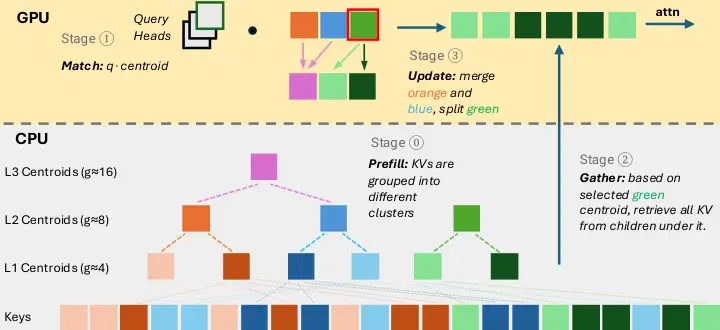
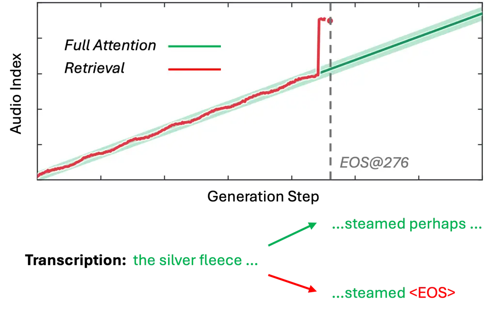
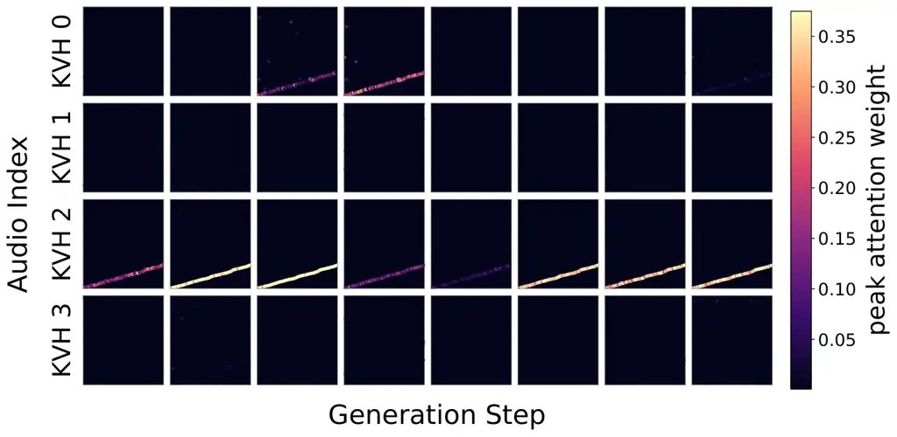
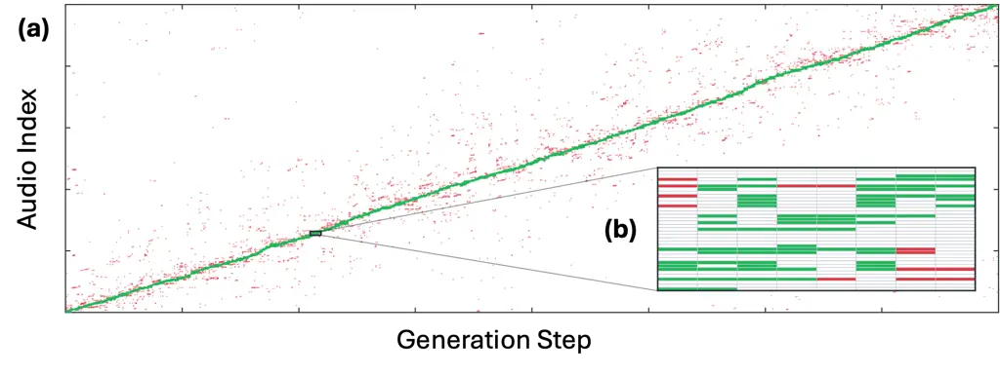

# C³: Speech-Guided KV Retrieval for Efficient Long-Context SpeechLLM Inference

Dancheng Liu ^(†)^(†)thanks: Work done during an internship at Amazon.
Correspondence to: Srikanth Ronanki \<ronanks@amazon.com\> and Aram
Galstyan \<argalsty@amazon.com\>. Affiliation: University at Buffalo,
USA    Markus Müller Affiliation: Amazon AGI, USA    Rupak Vignesh
Swaminathan Affiliation: Amazon AGI, USA    Jing Liu Affiliation: Amazon
AGI, USA    Srikanth Ronanki Affiliation: Amazon AGI, USA    Aram
Galstyan Affiliation: Amazon AGI, USA

###### Abstract

Speech large language models encode audio at a much higher rate than
text, causing the KV cache to become a major bottleneck in long-context
inference. While KV retrieval reduces decoding cost by attending to only
a query-dependent subset of the cache, existing methods are designed
primarily for text. We show that retrieval errors can compound into
generation drift, and identify three properties of audio attention that
guide more reliable retrieval: unequal concentration across query heads,
non-contiguous audio support, and temporal continuity. Based on these
observations, we propose C³ (_Cluster–Compete–Compete_), which combines
hierarchical key-space clustering, shared retrieval competition within
KV groups, and adaptive cluster resolution. Across long-form
recognition, translation, and summarization on four SpeechLLMs, C³
achieves the strongest overall accuracy under matched retrieval budgets,
maintains substantially higher accuracy at tight budgets than prior
methods, and improves accelerator-memory scaling and decoding
efficiency.

## 1 Introduction

Speech large language models (SpeechLLMs) integrate audio and text
within a unified framework, enabling general-purpose speech
understanding and generation directly from raw audio (Tang et al.,
2024a; Xu et al., 2025b). Compared with text, audio is encoded at a much
higher temporal resolution, causing the key-value (KV) cache to grow
rapidly with input duration and imposing substantial memory and decoding
costs for long-form inference (Lu et al., 2026; Yang et al., 2026).

KV retrieval addresses this bottleneck by retaining the full cache while
attending to only a small, query-dependent subset at each decoding step
(Tang et al., 2024b; Lee et al., 2024). However, existing methods are
designed primarily for text and may not match the structure of audio
attention. We find that retrieval errors can compound autoregressively
into generation drift, and that audio attention exhibits three
properties important for retrieval under tight budgets: query heads
sharing a KV head differ substantially in attention concentration,
relevant audio support is often non-contiguous, and high-attention
regions evolve gradually across decoding steps.

Guided by these observations, we introduce C³
(_Cluster–Compete–Compete_), a per-KV-head retrieval method for
SpeechLLMs. C³ organizes audio KVs into hierarchical key-space clusters,
lets query heads sharing a KV head compete for a common retrieval
budget, and dynamically reallocates cluster resolution through paired
split–merge updates. This concentrates fine retrieval resolution around
currently relevant regions while representing the remainder of the audio
more coarsely. Across long-form recognition, translation, and
summarization on four SpeechLLMs, C³ achieves the strongest overall
retrieval accuracy under matched budgets, with its largest gains under
tight retrieval constraints. On Qwen3-Omni, C³ reduces LS-Long WER at a
128-KV budget from 180.94% with ClusterKV (Liu et al., 2025b) to 7.07%,
and improves speech translation at a 256-KV budget from 25.91 to 55.79
chrF. It also improves long-context memory scaling and decoding
efficiency. Our contributions are:

- •
  We identify retrieval-induced generation drift and three properties of
  audio attention that motivate speech-specific KV retrieval design.
- •
  We propose C³, combining hierarchical key-space clustering, shared
  query-head competition, and query-adaptive resolution under a fixed
  retrieval budget.
- •
  We demonstrate strong retrieval accuracy across four SpeechLLMs and
  multiple long-form speech tasks, together with improved memory scaling
  and decoding efficiency.

## 2 C³: Cluster–Compete–Compete

Motivated by the audio-attention properties analyzed in Appendix D, we
introduce C³ (_Cluster–Compete–Compete_), a per-KV-head retrieval method
for SpeechLLMs. For each layer and KV head, C³ constructs a hierarchical
key-space index over the audio KVs during prefill. During decoding,
query heads sharing a KV head compete for a common retrieval budget,
while the hierarchy dynamically reallocates resolution toward regions
relevant to recent queries. Figure 1 summarizes the procedure. System
implementation and kernel optimizations are described in Appendix E.



Figure 1: Overview of C³. Audio KVs are organized into a hierarchical
key-space index. Query heads sharing a KV head compete over an active
frontier for a common retrieval budget, while paired split–merge
operations dynamically reallocate frontier resolution.

#### Stage 0: Hierarchical prefilling.

For each KV head, C³ recursively bisects the audio keys using k-means to
form a binary hierarchy. Each node represents the keys beneath it using
its centroid. At the beginning of decoding, $`A`$ nodes from an
intermediate level form an _active frontier_, a partition of the audio
keys in which every token belongs to exactly one active node. The
frontier size remains fixed, but its nodes may occupy different
hierarchy depths, allowing relevant regions to be represented more
finely than inactive regions.

#### Stage 1: Compete for the retrieval budget.

Under grouped-query attention, let $`G`$ query heads share one KV head.
At decoding step $`t`$, each active node $`n`$ is scored by its
strongest cosine-similarity match with any associated query head:

```math
\sigma_{t,n}=\max_{g\in[G]}\widehat{\mathbf{q}}_{t}^{(g)\top}\widehat{\mathbf{c}}_{n}, \tag{1}
```

where $`\widehat{\mathbf{q}}_{t}^{(g)}`$ and
$`\widehat{\mathbf{c}}_{n}`$ are $`\ell_{2}`$-normalized queries and
centroids. Taking the maximum allows any strongly matching query head to
promote a cluster without averaging away concentrated attention. The
$`G`$ query heads therefore produce a single cluster ranking and compete
for one common KV budget rather than retrieving independent subsets.

#### Stage 2: Gather the winning KVs.

Active nodes are consumed in descending order of $`\sigma_{t,n}`$ until
the per-KV-head retrieval budget $`B`$ is filled. The corresponding
audio keys and values are gathered into a bounded retrieval cache, and
all $`G`$ query heads compute exact attention over the same subset of at
most $`B`$ audio KVs.

#### Stage 3: Compete for resolution.

To adapt retrieval granularity over generation, C³ maintains an
exponential moving average of each active node’s relevance:

```math
e_{t,n}=\lambda e_{t-1,n}+(1-\lambda)\sigma_{t,n}. \tag{2}
```

Nodes that remain strongly matched to recent queries receive higher
refinement priority. At each step, C³ replaces a high-priority active
node with its two children, exposing finer retrieval units in that
region. To keep the frontier size fixed, a low-priority active sibling
pair is simultaneously replaced by its parent. These paired split–merge
operations therefore move retrieval resolution toward currently relevant
regions without increasing the number of active representatives. Newly
activated nodes inherit the recent relevance state of the nodes they
replace.

#### Computation.

Let $`N`$ denote the number of audio KVs, $`A`$ the active-frontier
size, and $`B`$ the retrieval budget. Full attention scores all $`N`$
audio KVs, whereas C³ scores only $`A`$ centroids and computes exact
attention over at most $`B`$ retrieved KVs. With initial cluster
granularity $`g`$, $`A\approx N/g`$, while final-KV retrieval and
exact-attention computation remain bounded by $`B`$.

## 3 Experiments and Results

#### Experimental setup.

We evaluate C³ on four SpeechLLMs: Qwen3-Omni-30B-A3B (Xu et al.,
2025b), Qwen2.5-Omni-3B (Xu et al., 2025a), Gemma-4-E4B (Team et al.,
2026), and Voxtral-Mini-3B (Liu et al., 2025a), using a single NVIDIA
H200 GPU. Efficiency evaluations also use an Ada 6000 environment,
matching the setup from Liu et al. (2025b). Our main evaluation covers
long-form ASR on LibriSpeech-Long (LS-Long) (Park et al., 2024) and a
multilingual benchmark constructed from Multilingual LibriSpeech (MLS)
(Pratap et al., 2020), speech translation and summarization on
LongSpeech (Yang et al., 2026). We report WER percentage
($`\downarrow`$) for ASR, chrF ($`\uparrow`$) for translation, and
ROUGE-L ($`\uparrow`$) for summarization. We denote content-based
clustering as C1, shared query-head competition as C2, and adaptive
resolution as C3; the complete C1+C2+C3 configuration is C³. We compare
against full attention, Quest (Tang et al., 2024b), UNIQUE (Deng et al.,
2026), and ClusterKV (Liu et al., 2025b) under matched final audio-KV
retrieval budgets. Dataset construction, inference settings, budget
matching, and method hyperparameters are detailed in Appendix F.

|                    |                         |        |                     |        |                  |       |                    |       |
| ------------------ | ----------------------- | ------ | ------------------- | ------ | ---------------- | ----- | ------------------ | ----- |
|                    | LS-Long($`\downarrow`$) |        | MLS($`\downarrow`$) |        | ST($`\uparrow`$) |       | Summ($`\uparrow`$) |       |
| KV Budget          | 128                     | 512    | 256                 | 1024   | 256              | 1024  | 256                | 1024  |
| Qwen3 Omni 30B A3B |                         |        |                     |        |                  |       |                    |       |
| Full               | 2.02                    |        | 4.83                |        | 74.75            |       | 25.52              |       |
| Quest              | –                       | 193.28 | 131.87              | 119.96 | 5.48             | 11.52 | 18.80              | 22.01 |
| UNIQUE             | 70.30                   | 2.53   | 45.20               | 5.39   | 21.15            | 63.68 | 22.31              | 24.22 |
| C1 (ClusterKV)     | 180.94                  | 2.81   | 75.00               | 5.62   | 25.91            | 70.15 | 24.06              | 24.91 |
|    +C2+C3          | 7.07                    | 1.98   | 10.05               | 5.18   | 55.79            | 71.96 | 24.71              | 25.29 |
| Qwen2.5 Omni 3B    |                         |        |                     |        |                  |       |                    |       |
| Full               | 2.40                    |        | 14.52               |        | 42.13            |       | 24.01              |       |
| Quest              | 142.84                  | 126.52 | 155.94              | 116.72 | 7.47             | 16.53 | 18.64              | 21.72 |
| UNIQUE             | 51.49                   | 4.55   | 43.83               | 15.98  | 15.49            | 34.20 | 21.24              | 23.36 |
| C1 (ClusterKV)     | 133.13                  | 3.91   | 65.32               | 15.61  | 19.32            | 35.01 | 22.68              | 23.97 |
|    +C2+C3          | 40.48                   | 2.78   | 31.98               | 14.31  | 23.76            | 39.35 | 22.71              | 24.11 |
| Gemma-4-E4B        |                         |        |                     |        |                  |       |                    |       |
| Full               | 4.24                    |        | 10.26               |        | 58.97            |       | 21.64              |       |
| Quest              | –                       | 122.78 | 110.26              | 90.70  | 2.35             | 6.73  | 17.55              | 19.89 |
| UNIQUE             | 42.77                   | 6.76   | 34.09               | 12.72  | 26.03            | 47.19 | 18.91              | 19.59 |
| C1 (ClusterKV)     | 95.72                   | 16.73  | 64.05               | 19.26  | 21.28            | 42.17 | 20.19              | 20.72 |
|    +C2+C3          | 14.63                   | 5.43   | 18.44               | 10.98  | 42.29            | 54.93 | 19.83              | 20.97 |
| Voxtral Mini 3B    |                         |        |                     |        |                  |       |                    |       |
| Full               | 3.39                    |        | 7.29                |        | 68.43            |       | 26.94              |       |
| Quest              | –                       | 164.59 | 190.96              | 136.27 | 12.21            | 10.14 | 16.91              | 20.12 |
| UNIQUE             | 104.74                  | 10.66  | 58.48               | 8.58   | 5.00             | 29.17 | 19.35              | 22.40 |
| C1 (ClusterKV)     | 212.96                  | 33.64  | 107.58              | 8.21   | 12.42            | 43.74 | 23.29              | 25.74 |
|    +C2+C3          | 41.86                   | 4.61   | 14.65               | 7.61   | 23.02            | 48.84 | 24.35              | 25.84 |

Table 1: Long-form speech performance under tight and large audio KV
retrieval budgets. Best retrieval results within each model and budget
are shown in bold. Results at intermediate budgets and additional
ablations are provided in Appendix G.1.

#### Long-form speech accuracy.

Table 1 shows that C³ achieves the strongest overall retrieval
performance across models, tasks, and budgets, with its largest gains
under tight retrieval constraints. The complete configuration is the
best retrieval method in 31 of the 32 settings shown. At larger budgets,
the gap to full attention narrows substantially in most settings, while
C³ remains markedly more robust than prior retrieval methods at tight
budgets. Complete budget sweeps, component and hyperparameter ablations,
and additional audio-understanding results are provided in
Appendix G.1–G.3.

#### Needle-in-a-haystack retrieval.

We further test whether retrieval preserves isolated evidence using 120
approximately 13–16 minute recordings containing three spoken
seven-digit passcodes inserted at separate locations. On Qwen3-Omni,
Figure 2(a) shows that C³ reaches 95% exact-match accuracy with only 32
retrieved KVs and lossless recovery with 64 KVs, whereas ClusterKV and
temporal baselines require several hundred KVs to approach the same
accuracy. Full benchmark construction, per-digit accuracy, and results
on the other models are provided in Appendix G.4.

#### Memory and decoding efficiency.

Figure 2(b) reports end-to-end latency on Qwen3-Omni-30B-A3B for audio
contexts up to 32K tokens using a 512-KV retrieval budget. Retrieval
introduces additional scoring, selection, and gathering overhead at
short contexts, but both C1+C2 and the complete C³ become faster than
full attention at approximately 8K audio tokens. Adaptive resolution
adds only modest overhead while retaining the tight-budget accuracy
gains in Table 1. For longer contexts, the full audio KV bank and
inactive hierarchy nodes can additionally be offloaded to host memory,
reducing accelerator-resident audio state from $`O(N)`$ to $`O(A+B)`$.

(a) Needle-in-a-haystack retrieval

(b) End-to-end inference latency

Figure 2: (a) C³ achieves lossless passcode recovery at substantially
smaller retrieval budgets than the baselines. (b) End-to-end latency for
audio contexts up to 32K tokens with a 512-KV retrieval budget;
retrieval becomes more efficient than full attention as the audio
context grows.

## 4 Conclusion

In this work, we study audio KV retrieval for long-form SpeechLLMs and
show how retrieval errors can compound autoregressively into generation
drift. Motivated by unequal query-head concentration, non-contiguous
audio support, and temporal continuity, we introduced C³, which combines
hierarchical key-space clustering, shared competition within KV groups,
and adaptive split–merge refinement. Across four SpeechLLMs and multiple
long-form speech tasks, C³ achieves the strongest overall retrieval
accuracy under tight budgets while improving long-context memory scaling
and decoding efficiency.

## References

- Ainslie et al. (2023) J. Ainslie, J. Lee-Thorp, M. De Jong, Y.
  Zemlyanskiy, F. Lebrón, and S. Sanghai GQA: Training generalized
  multi-query transformer models from multi-head checkpoints. In
  Proceedings of the 2023 Conference on Empirical Methods in Natural
  Language Processing, pp. 4895–4901. Cited by: Appendix C.
- Busso et al. (2025) C. Busso, R. Lotfian, K. Sridhar, A. N. Salman, W.
  Lin, L. Goncalves, S. Parthasarathy, A. R. Naini, S. Leem, L.
  Martinez-Lucas, H. Chou, and P. Mote The MSP-Podcast Corpus. External
  Links: 2509.09791, [Link](https://arxiv.org/abs/2509.09791) Cited by:
  §F.1.
- Cai et al. (2025) Z. Cai, Y. Zhang, B. Gao, Y. Liu, Y. Li, T. Liu, K.
  Lu, W. Xiong, Y. Dong, J. Hu, and W. Xiao PyramidKV: Dynamic KV Cache
  Compression based on Pyramidal Information Funneling. In Second
  Conference on Language Modeling, External Links:
  [Link](https://openreview.net/forum?id=ayi7qezU87) Cited by: Appendix
  C.
- Chen et al. (2025) Z. Chen, R. Sadhukhan, Z. Ye, Y. Zhou, J. Zhang, N.
  Nolte, Y. Tian, M. Douze, L. Bottou, Z. Jia, et al. MagicPIG: LSH
  Sampling for Efficient LLM Generation. In International Conference on
  Learning Representations, Vol. 2025, pp. 44169–44190. Cited by:
  Appendix C.
- DeepSeek-AI et al. (2025) DeepSeek-AI, A. Liu, B. Feng, B. Xue, B.
  Wang, B. Wu, C. Lu, C. Zhao, C. Deng, C. Zhang, C. Ruan, D. Dai, D.
  Guo, D. Yang, D. Chen, D. Ji, E. Li, F. Lin, F. Dai, F. Luo, G.
  Hao, G. Chen, G. Li, H. Zhang, H. Bao, H. Xu, H. Wang, H. Zhang, H.
  Ding, H. Xin, H. Gao, H. Li, H. Qu, J. L. Cai, J. Liang, J. Guo, J.
  Ni, J. Li, J. Wang, J. Chen, J. Chen, J. Yuan, J. Qiu, J. Li, J.
  Song, K. Dong, K. Hu, K. Gao, K. Guan, K. Huang, K. Yu, L. Wang, L.
  Zhang, L. Xu, L. Xia, L. Zhao, L. Wang, L. Zhang, M. Li, M. Wang, M.
  Zhang, M. Zhang, M. Tang, M. Li, N. Tian, P. Huang, P. Wang, P.
  Zhang, Q. Wang, Q. Zhu, Q. Chen, Q. Du, R. J. Chen, R. L. Jin, R.
  Ge, R. Zhang, R. Pan, R. Wang, R. Xu, R. Zhang, R. Chen, S. S. Li, S.
  Lu, S. Zhou, S. Chen, S. Wu, S. Ye, S. Ye, S. Ma, S. Wang, S. Zhou, S.
  Yu, S. Zhou, S. Pan, T. Wang, T. Yun, T. Pei, T. Sun, W. L. Xiao, W.
  Zeng, W. Zhao, W. An, W. Liu, W. Liang, W. Gao, W. Yu, W. Zhang, X. Q.
  Li, X. Jin, X. Wang, X. Bi, X. Liu, X. Wang, X. Shen, X. Chen, X.
  Zhang, X. Chen, X. Nie, X. Sun, X. Wang, X. Cheng, X. Liu, X. Xie, X.
  Liu, X. Yu, X. Song, X. Shan, X. Zhou, X. Yang, X. Li, X. Su, X.
  Lin, Y. K. Li, Y. Q. Wang, Y. X. Wei, Y. X. Zhu, Y. Zhang, Y. Xu, Y.
  Xu, Y. Huang, Y. Li, Y. Zhao, Y. Sun, Y. Li, Y. Wang, Y. Yu, Y.
  Zheng, Y. Zhang, Y. Shi, Y. Xiong, Y. He, Y. Tang, Y. Piao, Y.
  Wang, Y. Tan, Y. Ma, Y. Liu, Y. Guo, Y. Wu, Y. Ou, Y. Zhu, Y. Wang, Y.
  Gong, Y. Zou, Y. He, Y. Zha, Y. Xiong, Y. Ma, Y. Yan, Y. Luo, Y.
  You, Y. Liu, Y. Zhou, Z. F. Wu, Z. Z. Ren, Z. Ren, Z. Sha, Z. Fu, Z.
  Xu, Z. Huang, Z. Zhang, Z. Xie, Z. Zhang, Z. Hao, Z. Gou, Z. Ma, Z.
  Yan, Z. Shao, Z. Xu, Z. Wu, Z. Zhang, Z. Li, Z. Gu, Z. Zhu, Z. Liu, Z.
  Li, Z. Xie, Z. Song, Z. Gao, and Z. Pan DeepSeek-V3 Technical Report.
  External Links: 2412.19437, [Link](https://arxiv.org/abs/2412.19437)
  Cited by: Appendix C.
- Deng et al. (2026) K. Deng, S. Ling, R. Fan, and J. Li UNIQUE:
  Universal Top-k Sparse Attention for Training-free Inference and
  Sparsity-aware Training. arXiv preprint arXiv:2605.27740. Cited by:
  Appendix C, Appendix C, §3.
- Feng et al. (2026) Y. Feng, J. Lv, Y. Cao, X. Xie, and S. K. Zhou
  Ada-KV: Optimizing KV Cache Eviction by Adaptive Budget Allocation for
  Efficient LLM Inference. Advances in Neural Information Processing
  Systems 38, pp. 113152–113188. Cited by: Appendix C.
- Ge et al. (2023) S. Ge, Y. Zhang, L. Liu, M. Zhang, J. Han, and J. Gao
  Model tells you what to discard: Adaptive kv cache compression for
  llms. arXiv preprint arXiv:2310.01801. Cited by: Appendix C.
- Gu and Dao (2024) A. Gu and T. Dao Mamba: Linear-time sequence
  modeling with selective state spaces. In First conference on language
  modeling, Cited by: Appendix C.
- He et al. (2025) P. He, Z. Wen, Y. Wang, Y. Wang, X. Liu, J. Huang, Z.
  Lei, Z. Gu, X. Jin, J. Yang, K. Li, Z. Liu, W. Li, C. Wang, C. He,
  and L. Zhang AudioMarathon: A Comprehensive Benchmark for Long-Context
  Audio Understanding and Efficiency in Audio LLMs. External Links:
  2510.07293, [Link](https://arxiv.org/abs/2510.07293) Cited by: §F.1.
- Hexgrad (2025) Hexgrad Kokoro-82M (Revision d8b4fc7). Hugging Face.
  External Links: [Link](https://huggingface.co/hexgrad/Kokoro-82M),
  [Document](https://dx.doi.org/10.57967/hf/4329) Cited by: §F.1.
- Hooper et al. (2024) C. Hooper, S. Kim, H. Mohammadzadeh, M. W.
  Mahoney, Y. S. Shao, K. Keutzer, and A. Gholami KVQuant: Towards 10
  Million Context Length LLM Inference with KV Cache Quantization.
  Advances in Neural Information Processing Systems 37, pp. 1270–1303.
  Cited by: Appendix C.
- Hooper et al. (2025) C. R. C. Hooper, S. Kim, H. Mohammadzadeh, M.
  Maheswaran, S. Zhao, J. Paik, M. W. Mahoney, K. Keutzer, and A.
  Gholami Squeezed Attention: Accelerating Long Context Length LLM
  Inference. In Proceedings of the 63rd Annual Meeting of the
  Association for Computational Linguistics (Volume 1: Long Papers),
  pp. 32631–32652. Cited by: Appendix C.
- Hooper et al. (2026) C. Hooper, S. Zhao, L. Manolache, S. Kim, M.
  Mahoney, S. Shao, K. Keutzer, and A. Gholami Multipole attention for
  efficient long context reasoning. Advances in Neural Information
  Processing Systems 38, pp. 37382–37405. Cited by: Appendix C.
- Kumar et al. (2026) S. Kumar, Š. Sedláček, V. Lokegaonkar, F.
  López, W. Yu, N. Anand, H. Ryu, L. Chen, M. Plička, M. Hlaváček, W. F.
  Ellingwood, S. Udupa, S. Hou, A. Ferner, S. Barahona, C. Bolaños, S.
  Rahi, L. Herrera-Alarcón, S. Dixit, S. Patil, S. Deshmukh, L.
  Koroshinadze, Y. Liu, L. P. G. Perera, E. Zanou, T. Stafylakis, J. S.
  Chung, D. Harwath, C. Zhang, D. Manocha, A. Lozano-Diez, S.
  Kesiraju, S. Ghosh, and R. Duraiswami MMAU-Pro: A Challenging and
  Comprehensive Benchmark for Holistic Evaluation of Audio General
  Intelligence. In Proceedings of the AAAI Conference on Artificial
  Intelligence, Vol. 40, pp. 22688–22697. Cited by: §F.1.
- Lee et al. (2026) W. Lee, K. Kamahori, and B. Kasikci MURMUR: An
  Efficient Inference System for Long-Form ASR. arXiv preprint
  arXiv:2606.01483. Cited by: Appendix C.
- Lee et al. (2024) W. Lee, J. Lee, J. Seo, and J. Sim InfiniGen:
  Efficient generative inference of large language models with dynamic
  KV cache management. In 18th USENIX Symposium on Operating Systems
  Design and Implementation (OSDI 24), pp. 155–172. Cited by: §1.
- Li et al. (2026) D. Li, Z. Liu, G. Lin, B. Hu, and M. Zhang
  LycheeCluster: Efficient Long-Context Inference with Structure-Aware
  Chunking and Hierarchical KV Indexing. arXiv preprint
  arXiv:2603.08453. Cited by: Appendix C.
- Li et al. (2024) Y. Li, Y. Huang, B. Yang, B. Venkitesh, A.
  Locatelli, H. Ye, T. Cai, P. Lewis, and D. Chen Snapkv: Llm knows what
  you are looking for before generation. Advances in Neural Information
  Processing Systems 37, pp. 22947–22970. Cited by: Appendix C.
- Lin et al. (2025) X. Lin, J. Wang, O. Kondrateva, Y. Shi, B. Li,
  and G. L. Zhang CompressKV: Semantic Retrieval Heads Know What Tokens
  are Not Important Before Generation. arXiv preprint arXiv:2508.02401.
  Cited by: Appendix C.
- Liu et al. (2025a) A. H. Liu, A. Ehrenberg, A. Lo, C. Denoix, C.
  Barreau, G. Lample, J. Delignon, K. R. Chandu, P. von Platen, P. R.
  Muddireddy, S. Gandhi, S. Ghosh, S. Mishra, T. Foubert, A. Rastogi, A.
  Yang, A. Q. Jiang, A. Sablayrolles, A. Héliou, A. Martin, A.
  Agarwal, A. Roux, A. Darcet, A. Mensch, B. Bout, B. Rozière, B. D.
  Monicault, C. Bamford, C. Wallenwein, C. Renaudin, C. Lanfranchi, D.
  Dabert, D. S. Chaplot, D. Mizelle, D. de las Casas, E. Chane-Sane, E.
  Fugier, E. B. Hanna, G. Berrada, G. Delerce, G. Guinet, G. Novikov, G.
  Martin, H. Jaju, J. Ludziejewski, J. Rute, J. Chabran, J.
  Chudnovsky, J. Studnia, J. Barmentlo, J. Amar, J. S. Roberts, J.
  Denize, K. Saxena, K. Yadav, K. Khandelwal, K. Jain, L. R. Lavaud, L.
  Blier, L. Zhao, L. Martin, L. Saulnier, L. Gao, M. Pellat, M.
  Guillaumin, M. Felardos, M. Dinot, M. Darrin, M. Augustin, M.
  Seznec, N. Gupta, N. Raghuraman, O. Duchenne, P. Wang, P. Saffer, P.
  Jacob, P. Wambergue, P. Kurylowicz, P. Chagniot, P. Stock, P.
  Agrawal, R. Delacourt, R. Sauvestre, R. Soletskyi, S. Vaze, S.
  Subramanian, S. Garg, S. Dalal, S. Gandhi, S. Aithal, S.
  Antoniak, T. L. Scao, T. Schueller, T. Lavril, T. Robert, T. Wang, T.
  Lacroix, T. Bewley, V. Nemychnikova, V. Paltz, V. Richard, W. Li, W.
  Marshall, X. Zhang, Y. Wan, and Y. Tang Voxtral. arXiv preprint
  arXiv:2507.13264. Cited by: §F.1, §3.
- Liu et al. (2026) D. Liu, M. Chen, B. Lu, H. Jiang, Z. Han, Q.
  Zhang, Q. Chen, C. Zhang, B. Ding, K. Zhang, C. Chen, F. Yang, Y.
  Yang, and L. Qiu Retrievalattention: Accelerating long-context llm
  inference via vector retrieval. Advances in Neural Information
  Processing Systems 38, pp. 54358–54385. Cited by: Appendix C.
- Liu et al. (2025b) G. Liu, C. Li, J. Zhao, C. Zhang, and M. Guo
  ClusterKV: Manipulating LLM KV cache in semantic space for recallable
  compression. In 2025 62nd ACM/IEEE Design Automation Conference (DAC),
  pp. 1–7. Cited by: Appendix C, §1, §3.
- Liu et al. (2024) Z. Liu, J. Yuan, H. Jin, S. Zhong, Z. Xu, V.
  Braverman, B. Chen, and X. Hu Kivi: A tuning-free asymmetric 2bit
  quantization for kv cache. arXiv preprint arXiv:2402.02750. Cited by:
  Appendix C.
- Lu et al. (2026) K. Lu, K. Deng, R. Fan, R. Zhao, and J. Li Compress
  the cache, not the speech embedding: kv compression for efficient
  speech llms. arXiv preprint arXiv:2607.06827. Cited by: Appendix C,
  §1.
- Oren et al. (2024) M. Oren, M. Hassid, N. Yarden, Y. Adi, and R.
  Schwartz Transformers are multi-state rnns. In Proceedings of the 2024
  Conference on Empirical Methods in Natural Language Processing,
  pp. 18724–18741. Cited by: Appendix C.
- Park et al. (2024) S. J. Park, J. Salazar, A. Jansen, K.
  Kinoshita, Y. M. Ro, and R. J. Skerry-Ryan Long-Form Speech Generation
  with Spoken Language Models. CoRR abs/2412.18603. Cited by: §F.1, §3.
- Pratap et al. (2020) V. Pratap, Q. Xu, A. Sriram, G. Synnaeve, and R.
  Collobert MLS: A Large-Scale Multilingual Dataset for Speech Research.
  arXiv preprint arXiv:2012.03411. Cited by: §F.1, §3.
- Sun et al. (2024) H. Sun, L. Chang, W. Bao, S. Zheng, N. Zheng, X.
  Liu, H. Dong, Y. Chi, and B. Chen ShadowKV: KV Cache in Shadows for
  High-Throughput Long-Context LLM Inference. arXiv preprint
  arXiv:2410.21465. Cited by: Appendix C.
- Tang et al. (2024a) C. Tang, W. Yu, G. Sun, X. Chen, T. Tan, W. Li, L.
  Lu, Z. Ma, and C. Zhang Salmonn: Towards generic hearing abilities for
  large language models. In International Conference on Learning
  Representations, Vol. 2024, pp. 16607–16629. Cited by: §1.
- Tang et al. (2024b) J. Tang, Y. Zhao, K. Zhu, G. Xiao, B. Kasikci,
  and S. Han Quest: Query-aware sparsity for efficient long-context llm
  inference. arXiv preprint arXiv:2406.10774. Cited by: Appendix C,
  Appendix C, §1, §3.
- Tang et al. (2026) Y. Tang, S. Puri, S. Watanabe, and S. Mukherjee
  TRADE: Transducer-Augmented Decoder for Speech LLM. arXiv preprint
  arXiv:2606.08486. Cited by: Appendix C.
- Team et al. (2026) G. Team, S. E. Abd, V. Aggarwal, R. Algayres, A.
  Andreev, O. Bachem, I. Ballantyne, C. Brick, V. Cărbune, M. Casbon, M.
  Chaturvedi, A. Chawla, V. Cotruta, A. Coucke, P. Culliton, R.
  Dadashi, L. Dixon, M. Elhawaty, U. Evci, C. Farabet, J. Ferret, F.
  Galgani, S. Girgin, J. Grill, M. Grootendorst, J. Guo, C. Hardin, Y.
  He, S. M. Hernandez, O. Homburger, L. Hussenot, J. Ji, A. Joulin, A.
  Kamath, P. Kassraie, O. Lacombe, P. Lahoti, G. Liu, G. Martins, L.
  Martins, T. Matejovicova, R. Merhej, N. Momchev, S. Mondal, R.
  Mullins, S. R. Panyam, S. Pathak, S. Perrin, A. S. Pinto, E. Pot, A.
  Pouget, A. Ramé, S. Ramos, D. Reid, D. Rim, M. Rivière, K. Roth, L.
  Rouillard, O. Sanseviero, P. G. Sessa, S. Settle, D. Sinopalnikov, S.
  Smoot, P. Stanczyk, A. Steiner, L. Stewart, I. Tolstikhin, M.
  Tschannen, A. Tsitsulin, N. Vieillard, R. Wu, P. Xu, H. Yang, E.
  Yvinec, B. Zhang, L. Zhang, J. Zou, N. Aagnes, A. Abdelhamed, J.
  Adamek, S. Agrawal, S. Agrawal, I. Alabdulmohsin, J. B. Alayrac, U.
  Alon, C. Amarnath, A. Anand, C. Anastasiou, S. Ariafar, F. Aubet, K.
  Axiotis, F. Barbero, J. Barral, A. Bendebury, U. Bergmann, S.
  Bileschi, K. Black, M. Blondel, S. Borgeaud, A. Bražinskas, R.
  Burnell, R. Busa-Fekete, M. Cai, D. Calandriello, G. Cameron, C.
  Caucheteux, R. Chaabouni, G. Chadha, J. Chan, B. J. Chen, J. Chen, L.
  Chen, X. Chen, D. Cheng, T. Chien, N. Chinaev, Y. Chou, Z. Chu, B.
  Coleman, P. Consul, S. Conway-Rahman, S. Crowell, D. Cutler, V.
  Dani, S. Daruki, A. Das, D. Deutsch, N. Dikkala, L. Ding, Q. Ding, S.
  Dodhia, K. Donhauser, T. Doshi, A. Dragan, A. Druinsky, S. Dua, Z.
  Egyed, D. Eisenbud, D. Eppens, C. Fan, B. Fatemi, Y. Fathullah, V.
  Feinberg, M. Ferev, S. Flennerhag, T. Fujimoto, J. G. Oliveira, I.
  Galatzer-Levy, J. Gante, S. Geisler, S. Ghosal, A. M. Girgis, T. von
  Glehn, A. Go, A. Gokhale, A. Grills, Y. Gu, M. Gupta, P. Gupta, G.
  Guruganesh, R. Hadsell, H. Harkous, J. Harlalka, D. Hassabis, A.
  Hauth, J. Heyward, A. Hosseini, C. Hsia, I. Hsu, X. Huang, Y.
  Huang, K. Hui, A. Hutter, T. I, F. Iliopoulos, A. Jain, G. Jawahar, Z.
  Ji, Q. Jin, M. Johnson, K. Joshi, A. Kandoor, W. Kang, K.
  Kavukcuoglu, M. Kazemi, K. Kenealy, A. Khalifa, P. Kirk, I.
  Korotkov, S. Kothawade, V. Kovalev, N. Kovelamudi, A. Kraft, R.
  Kumar, V. Kumar, H. Kuppam, J. Lannin, C. Lee, S. Lee, D. Lepikhin, A.
  Levkovitch, D. Li, Q. Li, V. Liévin, E. Lin, Z. Lin, C. Liu, T.
  Liu, T. Liu, X. Liu, I. Lobov, M. Lunayach, M. Ma, G. Madan, A.
  Maksai, E. Malmi, M. Matuszak, D. McDuff, G. Menghani, M. Mikuła, D.
  Mirylenka, K. Misiunas, V. Misra, A. Mitran, K. Mohamed, M. Mukha, E.
  Noland, J. O’Donnell, B. O’Donoghue, K. Olszewska, B. Orlando, W.
  Pan, R. Panigrahy, U. Parekh, N. Perez-Nieves, C. Park, E. Paskie, L.
  Peng, B. Petrini, S. Petrov, J. Pfeiffer, B. Piot, M. Plomecka, S.
  Poder, O. Ponce, A. Pramanik, D. Racz, A. Rajan, M. Ramanovich, A.
  Rao, M. Ritter, V. Rodrigues, E. Rosen, M. Rybiński, N.
  Sachdeva, M. E. Sander, R. Sathyanarayana, S. Savla, S. Schmidgall, T.
  Schuster, G. Scrivener, B. Seguin, A. Sellergren, A. Severyn, I.
  Shafran, D. Shah, B. Shahriari, Y. Shangguan, A. Shenoy, P. Shenoy, R.
  Shivanna, P. Sho, L. Spangher, W. Stokowiec, T. Strother, Y. Su, Y.
  Sun, M. Sundararajan, A. Tacchetti, M. H. Taege, P. Tafti, J.
  Tarbouriech, C. Tekur, S. Thakoor, R. Thapa, M. Traverse, L.
  Treven, T. Tu, C. T. Tung, Ç. Ünlü, P. Veličković, M. P. Venkat, S. G.
  Venkatesh, V. Venkiteswaran, F. Visin, A. Vitvitskyi, K.
  Vodrahalli, W. Wang, X. Wang, T. Warkentin, J. Wassenberg, J.
  Wieting, C. Wu, L. Xiao, H. Xu, Y. Xu, F. Xue, A. Yadav, J. Yan, A.
  Yang, L. Yang, M. Yang, Z. Ying, J. H. Yoo, M. Zadimoghaddam, S.
  Zafar, F. Zhang, J. Zhang, J. Zhang, X. Zhang, C. Zhao, D. Zhou,
  and C. Zou Gemma 4 Technical Report. External Links: 2607.02770,
  [Link](https://arxiv.org/abs/2607.02770) Cited by: §F.1, §3.
- Wang et al. (2026) Y. Wang, P. He, X. Gui, X. Liu, J. He, X. Liu, Z.
  Wen, X. Hu, and L. Zhang AudioKV: KV Cache Eviction in Efficient Large
  Audio Language Models. arXiv preprint arXiv:2604.06694. Cited by:
  Appendix C, §D.2, §D.3.
- Xiao et al. (2024) G. Xiao, Y. Tian, B. Chen, S. Han, and M. Lewis
  Efficient streaming language models with attention sinks. In
  International Conference on Learning Representations, Vol. 2024,
  pp. 21875–21895. Cited by: Appendix C.
- Xu et al. (2025a) J. Xu, Z. Guo, J. He, H. Hu, T. He, S. Bai, K.
  Chen, J. Wang, Y. Fan, K. Dang, B. Zhang, X. Wang, Y. Chu, and J. Lin
  Qwen2.5-Omni Technical Report. External Links: 2503.20215,
  [Link](https://arxiv.org/abs/2503.20215) Cited by: §F.1, §3.
- Xu et al. (2025b) J. Xu, Z. Guo, H. Hu, Y. Chu, X. Wang, J. He, Y.
  Wang, X. Shi, T. He, X. Zhu, Y. Lv, Y. Wang, D. Guo, H. Wang, L.
  Ma, P. Zhang, X. Zhang, H. Hao, Z. Guo, B. Yang, B. Zhang, Z. Ma, X.
  Wei, S. Bai, K. Chen, X. Liu, P. Wang, M. Yang, D. Liu, X. Ren, B.
  Zheng, R. Men, F. Zhou, B. Yu, J. Yang, L. Yu, J. Zhou, and J. Lin
  Qwen3-Omni Technical Report. External Links: 2509.17765,
  [Link](https://arxiv.org/abs/2509.17765) Cited by: §F.1, §1, §3.
- Yang et al. (2026) F. Yang, X. Ni, R. Yang, J. Geng, Q. Li, C. Lyu, Y.
  Du, L. Wang, W. Luo, and K. Zhang LongSpeech: A Scalable Benchmark for
  Transcription, Translation and Understanding in Long Speech. arXiv
  preprint arXiv:2601.13539. Cited by: §F.1, §1, §3.
- Zhang et al. (2025) H. Zhang, X. Ji, Y. Chen, F. Fu, X. Miao, X.
  Nie, W. Chen, and B. Cui PQCache: Product Quantization-based KVCache
  for Long Context LLM Inference. Proceedings of the ACM on Management
  of Data 3 (3), pp. 1–30. Cited by: Appendix C.
- Zhang et al. (2024) T. Zhang, J. W. Yi, Z. Xu, and A. Shrivastava KV
  Cache is 1 Bit Per Channel: Efficient Large Language Model Inference
  with Coupled Quantization. In The Thirty-eighth Annual Conference on
  Neural Information Processing Systems, Cited by: Appendix C.
- Zhang et al. (2023) Z. Zhang, Y. Sheng, T. Zhou, T. Chen, L. Zheng, R.
  Cai, Z. Song, Y. Tian, C. Re, C. Barrett, Z. Wang, and B. Chen H2O:
  Heavy-Hitter Oracle for Efficient Generative Inference of Large
  Language Models. In Thirty-seventh Conference on Neural Information
  Processing Systems, External Links:
  [Link](https://openreview.net/forum?id=RkRrPp7GKO) Cited by: Appendix
  C, Appendix C.

## Appendix A Limitations

Our evaluation covers four SpeechLLMs and multiple long-form speech
tasks, but the observed accuracy and efficiency trade-offs may vary with
other model architectures, audio encoders, and generation settings. In
particular, the benefits of KV retrieval depend on how much of a model
uses token-level full attention. For example, hybrid architectures with
fewer full-attention layers naturally expose less KV-cache state to
optimize.

System performance also depends on hardware and implementation. Our
measurements use a single NVIDIA H200, together with Ada 6000 GPUs when
evaluating efficiency. The context length at which retrieval becomes
faster than full attention may therefore shift on other accelerators or
with more specialized kernels. Similarly, under fixed cluster
granularity, the number of active representatives grows with audio
length, so extremely long contexts may require coarser granularity or an
additional hierarchical search stage.

Finally, end-to-end model evaluations are limited to the context lengths
supported by the SpeechLLMs studied here. System results beyond 32K
audio tokens are analytical projections and demonstrate expected memory
and throughput scaling rather than generation quality at those lengths.
Evaluating retrieval on future SpeechLLMs with substantially longer
native audio contexts is therefore an important direction for future
work.

## Appendix B Broader Impacts

Improving KV-cache efficiency can make long-form SpeechLLMs more
practical on memory- and latency-constrained hardware, potentially
reducing deployment cost and energy use. More efficient long-context
speech processing may also broaden access to applications such as
transcription, translation, and audio understanding. At the same time,
greater efficiency can lower the cost of deploying SpeechLLMs in
settings involving sensitive audio, where privacy, surveillance, and
misuse risks depend primarily on the underlying model and application.
These risks should therefore be considered when deploying systems that
incorporate the proposed retrieval method.

## Appendix C Related Work

KV-cache methods reduce inference cost through selection (Tang et al.,
2024b; Zhang et al., 2023), quantization (Liu et al., 2024; Hooper et
al., 2024; Zhang et al., 2024), or architectural changes such as
grouped-query attention, multi-head latent attention, and state-space
layers (Ainslie et al., 2023; DeepSeek-AI et al., 2025; Gu and Dao,
2024). These directions are complementary. We focus on selection, where
eviction permanently discards cached entries, whereas retrieval
preserves the backing cache and dynamically restricts the entries
accessed by each query.

#### Eviction.

Eviction retains entries according to signals such as recency and
attention sinks (Xiao et al., 2024), accumulated attention (Zhang et
al., 2023; Oren et al., 2024; Lin et al., 2025), or prompt-based
importance (Li et al., 2024). Adaptive methods further vary budgets or
policies across heads and layers (Ge et al., 2023; Cai et al., 2025;
Feng et al., 2026). Because discarded entries cannot be recovered,
eviction can be problematic for speech generation, where an audio frame
that appears unimportant early may become necessary when its
corresponding content is generated. AudioKV mitigates this issue by
allocating larger budgets to audio-critical heads and smoothing
importance estimates across neighboring frames, but still requires
approximately 40% KV retention for near-lossless performance (Wang et
al., 2026).

#### Retrieval.

Retrieval preserves the full cache while selecting a query-dependent
subset at each decoding step (Tang et al., 2024b; Sun et al., 2024).
Existing methods retrieve fixed positional pages or chunks (Tang et al.,
2024b; Sun et al., 2024; Deng et al., 2026), similarity-based key-space
clusters (Liu et al., 2025b), or candidates obtained through
coarse-to-fine search (Hooper et al., 2025; Hooper et al., 2026; Li et
al., 2026). Related approaches accelerate candidate identification using
attention-aware approximate nearest-neighbor indexes, product
quantization, or locality-sensitive hashing (Liu et al., 2026; Zhang et
al., 2025; Chen et al., 2025). Most of these methods were developed for
text and use fixed retrieval units or independently recompute their
selection at each step. C³ instead combines non-contiguous key-space
units, shared competition among query heads associated with the same KV
head, and persistent split–merge updates that adapt retrieval resolution
as audio relevance evolves.

#### Speech-specific methods.

Recent work exploits modality-specific structure in SpeechLLM caches.
SpeechKV learns to pool acoustically redundant speech KVs (Lu et al.,
2026); Murmur combines chunked ASR inference with sliding-window
eviction (Lee et al., 2026); and TRADE bounds cache growth using
localized decoder audio attention (Tang et al., 2026). Together with
AudioKV, these methods reduce the retained or accessible context through
eviction, aggregation, or architecturally constrained attention. They
therefore address a different operating point from query-dependent
retrieval.

Concurrent work UNIQUE applies training-free page-based sparse attention
to text and speech models (Deng et al., 2026). It scores fixed
contiguous pages using mean keys and a dispersion correction, with page
selection shared by query heads associated with the same KV head. This
structure is closest to our Quest/mean+C2 ablation, which does not
include the dispersion correction. In contrast, C³ constructs
non-contiguous units in key space and persistently reallocates their
resolution through paired split–merge updates, allowing the retrieval
structure to follow changes in audio attention throughout generation.

## Appendix D Speech-Guided KV Retrieval Analysis

This section of the appendix analyzes retrieval-induced generation drift
and three properties of audio attention that motivate C³: unequal
concentration across query heads, non-contiguous audio support, and
temporal continuity across decoding steps.

### D.1 Failure Mode: Retrieval-Induced Generation Drift

KV retrieval can progressively misalign the decoder state from the input
audio. In the ASR example in Figure 3, the retrieved region initially
advances with the transcript but jumps to a later audio segment at
decoding step 276. The generated transcript subsequently loses alignment
with the speech and emits an end-of-sequence token prematurely.



Figure 3: Retrieval-induced generation drift. The retrieval trajectory
initially follows the relevant audio region but later jumps forward,
causing the transcript to lose alignment and terminate prematurely.
Curves are smoothed and outliers removed for visualization.

Let $`\mathcal{R}_{t}`$ contain the non-audio context (which is always
retained) and retrieved audio positions at decoding step $`t`$. Their
retained mass under full attention is

```math
\rho_{t}=\sum_{i\in\mathcal{R}_{t}}\alpha_{t,i}, \tag{3}
```

where $`\alpha_{t,i}`$ is the full-attention weight of position $`i`$.
As derived in Appendix D.5, retrieved and full attention for the same
query differ by

```math
\widetilde{\mathbf{o}}_{t}-\mathbf{o}_{t}=(1-\rho_{t})\mathbf{d}_{t}, \tag{4}
```

where $`\mathbf{d}_{t}`$ is the discrepancy between the
attention-weighted value representations of the retained and omitted
positions. The resulting value-agnostic bound is

```math
\left|\widetilde{\mathbf{o}}_{t}-\mathbf{o}_{t}\right|_{2}\leq(1-\rho_{t})D_{t}, \tag{5}
```

where $`D_{t}`$ is the diameter of the value vectors. Thus, the
perturbation depends on both the omitted attention mass $`1-\rho_{t}`$
and the difference between the retained and omitted values.

Although one perturbation need not change the generated token, its
effect can compound autoregressively. The altered attention output
changes the hidden state and next query, potentially changing the next
retrieval decision and further separating generation from the
full-attention trajectory. Repetition of this feedback loop can
eventually produce the drift observed in Figure 3.

Under a budget of $`K`$ audio positions, exact full-attention top-$`K`$
selection maximizes $`\rho_{t}`$ and minimizes the bound in Equation 5.
This oracle requires full attention, however. Practical methods must
approximate it using compact group-level representatives, which may
retrieve low-relevance members alongside relevant ones or omit relevant
positions assigned to other groups. Reliable approximation therefore
depends on how retrieval is coordinated across query heads, how audio
KVs are grouped, and at what resolution the groups are represented.

### D.2 Shared Retrieval Across Query Heads

Audio relevance differs across KV heads, where some follow the advancing
speech frontier, whereas others repeatedly attend to persistent acoustic
anchors (Wang et al., 2026). Retrieval decisions should therefore remain
distinct across KV heads. Within each KV group, however, its associated
query heads need not receive independent budgets. Figure 4 shows that
concentrated query heads typically focus on a few overlapping audio
regions, whereas other heads distribute their attention more diffusely.
At the displayed layer, the concentrated group contains roughly one
third of the query heads and has mean normalized attention entropy of
approximately $`0.40`$, compared with $`0.79`$ for the diffuse group.
Concentrated heads place an average of 85% of their attention mass on
audio, while diffuse heads place only about 12%. Within a KV group,
concentrated heads also tend to select overlapping top positions,
whereas diffuse heads contribute relatively little additional consensus.



Figure 4: Attention specialization across KV and query heads. Query
heads tracking task-relevant acoustic information concentrate on similar
regions within each KV group, whereas heads with different preferences
exhibit more diffuse attention.

Under a limited budget, omitting one highly weighted position can remove
substantial mass from a concentrated head, while omitting one position
has a smaller effect on a diffuse head. Independent, comparable budgets
for every query head may therefore spend excessive capacity on diffuse
patterns instead of prioritizing dominant positions. Sharing a budget
among query heads associated with the same KV head allows the strongest
concentrated matches to drive retrieval. This motivates the max-based
competition in Equation 1, while preserving separate decisions across KV
heads.

### D.3 Non-Contiguity of Audio Relevance

Audio attention is temporally structured but not confined to one
continuous interval. Figure 5(a) shows a dominant attention frontier
advancing through the audio during ASR decoding, consistent with the
alignment between generated text and its corresponding audio region
observed by Wang et al. (2026). Nevertheless, the fraction of top-$`64`$
attention mass outside the dominant band averages 34% for recognition,
29% for translation, and 78% for summarization. Restricting retrieval to
the dominant temporal region would therefore omit substantial highly
weighted support.

The local region is also fragmented: Figure 5(b) shows attention
concentrated on several separated positions rather than every frame in a
continuous interval. Temporally adjacent KVs consequently do not always
form a natural retrieval unit.



Figure 5: Full audio attention during long-form decoding. (a) The
dominant attention band advances with generation; red points mark
top-$`64`$ positions outside the band. (b) Attention near the frontier
is itself non-contiguous.

Fixed temporal chunks are therefore inefficient under a limited budget.
A chunk covering the dominant frontier may omit separated relevant
positions, while retrieving additional chunks includes the low-relevance
KVs between them. Key-space clustering better reflects the attention
mechanism: keys with similar representations tend to receive similar
scores for a query even when temporally distant, allowing positions with
similar query responses to share a retrieval unit. This motivates the
non-contiguous key-space clustering in C³.

### D.4 Temporal Continuity of Audio Relevance

Group-level retrieval trades retrieval precision against the number of
representatives scored. Smaller groups avoid retrieving low-relevance
KVs with relevant ones but require more representatives. Maintaining
fine resolution throughout the cache is therefore unnecessary if the
regions requiring such resolution can be anticipated from recent
decoding steps.

Audio attention provides this signal because high-attention regions
typically evolve gradually. In ASR, the dominant frontier progresses
approximately monotonically with the transcript; more generally, a
region that becomes relevant often remains relevant for several
subsequent steps. For decoding-step offsets $`\Delta\in{1,2,4,8}`$, the
mean Jaccard overlaps between top-$`64`$ attention sets are respectively
$`0.58,0.46,0.34,0.24`$ for recognition; $`0.56,0.44,0.33,0.22`$ for
translation; and $`0.45,0.34,0.24,0.16`$ for summarization. On the ASR
traces, the peak position of audio-relevant heads moves by a median of
approximately four audio frames, or $`0.3`$s, per decoding step.

Fine retrieval resolution is thus temporally localized rather than
changing independently at every token. C³ exploits this continuity by
concentrating fine groups around currently relevant regions and
representing inactive regions more coarsely. Fine groups improve
retrieval precision where needed, while coarse groups reduce the number
of representatives maintained and scored elsewhere. The allocation can
then follow the gradually evolving attention pattern throughout
generation.

### D.5 Derivation of Retrieval-Induced Attention Drift

We provide the full derivation of Equation 4 and the corresponding bound
in Equation 5.

Let $`\mathcal{A}`$ denote the set of audio-token positions and let
$`\mathcal{C}_{t}`$ denote the non-audio context positions available at
decoding step $`t`$, including prompt and previously generated tokens.
The full context is $`\mathcal{U}_{t}=\mathcal{A}\cup\mathcal{C}_{t}`$.
For each position $`i\in\mathcal{U}_{t}`$, let $`\mathbf{k}_{i}`$ and
$`\mathbf{v}_{i}`$ denote its key and value. Full attention computes

```math
\alpha_{t,i}=\frac{e^{\mathbf{q}_{t}^{\top}\mathbf{k}_{i}/\sqrt{d}}}{\sum_{j\in\mathcal{U}_{t}}e^{\mathbf{q}_{t}^{\top}\mathbf{k}_{j}/\sqrt{d}}}, \tag{6}
```

and

```math
\mathbf{o}_{t}=\sum_{i\in\mathcal{U}_{t}}\alpha_{t,i}\mathbf{v}_{i}. \tag{7}
```

Suppose retrieval selects an audio subset
$`\mathcal{S}_{t}\subseteq\mathcal{A}`$. Because non-audio positions
remain on the full-attention path, the complete retained set is

```math
\mathcal{R}_{t}=\mathcal{C}_{t}\cup\mathcal{S}_{t}. \tag{8}
```

Its attention mass under full attention is

```math
\rho_{t}=\sum_{i\in\mathcal{R}_{t}}\alpha_{t,i}=1-\sum_{i\in\mathcal{A}\setminus\mathcal{S}_{t}}\alpha_{t,i}. \tag{9}
```

We compare full and retrieved attention using the same query
$`\mathbf{q}_{t}`$. This isolates the instantaneous perturbation caused
by subset retrieval; its autoregressive propagation is discussed in
Section D.1. Because retrieval leaves the query and retained keys
unchanged, it changes only the softmax normalization. For
$`i\in\mathcal{R}_{t}`$, the retrieved attention weight is

```math
\widetilde{\alpha}_{t,i}=\frac{\alpha_{t,i}}{\rho_{t}}. \tag{10}
```

Hence,

```math
\widetilde{\mathbf{o}}_{t}=\frac{1}{\rho_{t}}\sum_{i\in\mathcal{R}_{t}}\alpha_{t,i}\mathbf{v}_{i}. \tag{11}
```

For $`0<\rho_{t}<1`$, the full-attention output can be written as

```math
\mathbf{o}_{t}=\sum_{i\in\mathcal{R}_{t}}\alpha_{t,i}\mathbf{v}_{i}+\sum_{i\notin\mathcal{R}_{t}}\alpha_{t,i}\mathbf{v}_{i}. \tag{12}
```

Subtracting this expression from Equation 11 gives

```math
\displaystyle\widetilde{\mathbf{o}}_{t}-\mathbf{o}_{t} \displaystyle=\frac{1-\rho_{t}}{\rho_{t}}\sum_{i\in\mathcal{R}_{t}}\alpha_{t,i}\mathbf{v}_{i}-\sum_{i\notin\mathcal{R}_{t}}\alpha_{t,i}\mathbf{v}_{i}
```

```math
\displaystyle=(1-\rho_{t})\left(\frac{1}{\rho_{t}}\sum_{i\in\mathcal{R}_{t}}\alpha_{t,i}\mathbf{v}_{i}-\frac{1}{1-\rho_{t}}\sum_{i\notin\mathcal{R}_{t}}\alpha_{t,i}\mathbf{v}_{i}\right). \tag{13}
```

Defining

```math
\mathbf{d}_{t}=\frac{1}{\rho_{t}}\sum_{i\in\mathcal{R}_{t}}\alpha_{t,i}\mathbf{v}_{i}-\frac{1}{1-\rho_{t}}\sum_{i\notin\mathcal{R}_{t}}\alpha_{t,i}\mathbf{v}_{i}, \tag{14}
```

we obtain

```math
\widetilde{\mathbf{o}}_{t}-\mathbf{o}_{t}=(1-\rho_{t})\mathbf{d}_{t}, \tag{15}
```

which is Equation 4.

The factor $`1-\rho_{t}`$ is the full-attention mass omitted by audio KV
retrieval. The vector $`\mathbf{d}_{t}`$ measures the discrepancy
between the attention-weighted value representations of the retained and
omitted positions. Consequently, omitting the same attention mass can
have different effects depending on the values associated with that
mass.

Although $`\mathbf{d}_{t}`$ cannot be controlled directly using compact
retrieval summaries, the dependence on $`\rho_{t}`$ yields a
value-agnostic worst-case bound. Let

```math
D_{t}=\max_{i,j\in\mathcal{U}_{t}}\left\|\mathbf{v}_{i}-\mathbf{v}_{j}\right\|_{2} \tag{16}
```

denote the diameter of the value vectors. The retained and omitted terms
in $`\mathbf{d}_{t}`$ are convex combinations because

```math
\sum_{i\in\mathcal{R}_{t}}\frac{\alpha_{t,i}}{\rho_{t}}=1,\qquad\sum_{i\notin\mathcal{R}_{t}}\frac{\alpha_{t,i}}{1-\rho_{t}}=1. \tag{17}
```

Their distance is therefore at most $`D_{t}`$, giving

```math
\left\|\widetilde{\mathbf{o}}_{t}-\mathbf{o}_{t}\right\|_{2}\leq(1-\rho_{t})D_{t}, \tag{18}
```

which is Equation 5.

Under a budget of $`K`$ retrieved audio positions, the non-audio
contribution to $`\rho_{t}`$ is fixed. Selecting the $`K`$ audio
positions with the largest full-attention weights therefore maximizes
$`\rho_{t}`$ and minimizes the bound in Equation 18. This full-attention
top-$`K`$ selection provides an oracle retrieval target. Practical
methods cannot compute it without evaluating attention over all audio
positions and must instead approximate audio-token relevance through
compact group-level representations.

## Appendix E Implementation Details

For each KV head, C³ maintains $`A`$ active clusters, retrieves at most
$`B`$ audio KV entries, and performs $`R`$ split–merge exchanges per
decoding step. Although the selected clusters change during generation,
these capacities remain fixed. We therefore use preallocated buffers and
fixed kernel shapes throughout decoding.

#### Paged decoding.

The decoding cache uses one-token pages and is stored at each layer as a
contiguous buffer of shape $`[P,2,1,H_{\mathrm{kv}},d]`$, where $`P`$ is
the page capacity, the second dimension contains keys and values,
$`H_{\mathrm{kv}}`$ is the number of KV heads, and $`d`$ is the head
dimension. One-token pages allow each retrieval slot to contain a
different source position for each KV head.

The logical cache layout is

```math
[\underbrace{\text{retrieved audio}}_{B\text{ slots}}\mid\text{non-audio prompt}\mid\text{generation}].
```

Thus, the attention operator always receives $`B`$ audio slots
regardless of their source positions. We compute exact attention over
this cache using FlashInfer’s BatchDecodeWithPagedKVCache kernel in the
NHD layout. The fixed buffer capacities and launch dimensions also allow
the per-token decoding path to be captured and replayed using CUDA
Graphs.

#### Selection and KV gathering.

For each KV head, Stage 1 computes query–centroid scores using
Equation 1 and reduces them across the $`G`$ associated query heads.
Each audio token inherits the score of its active ancestor, after which
at most $`B`$ entries are selected. Because selection is shared within
each KV group, at most $`H_{\mathrm{kv}}B`$ KV entries are gathered per
layer and decoding step. A Triton kernel gathers the selected keys and
values directly into their audio slots in the paged cache. This avoids
constructing an intermediate gathered tensor before attention.

#### Frontier update.

We fuse the $`R`$ split–merge exchanges into a Triton kernel with one
program instance per KV head. Each exchange replaces one active node
with its two children and one active sibling pair with their parent,
thereby preserving the frontier size $`A`$. Split and merge candidates
are identified through masked maximum and minimum reductions without
sorting. Newly activated children inherit their parent’s smoothed
similarity estimate, while a newly activated parent receives the maximum
estimate of its children. The updated frontier and its metadata are
written back to fixed-shape buffers.

#### Model integration.

C³ changes only the selection of audio KVs. Non-audio prompt and
generated-token KVs remain on the model’s original cache path, and the
retrieved audio KVs use exact attention. Retrieval is bypassed when the
audio sequence contains no more than $`B`$ tokens. The method therefore
requires neither retraining nor modification of the underlying SpeechLLM
architecture.

## Appendix F Additional Experimental Details

### F.1 Models and Benchmarks

We evaluate Qwen3-Omni-30B-A3B (Xu et al., 2025b), Qwen2.5-Omni-3B (Xu
et al., 2025a), Gemma-4-E4B (Team et al., 2026), and Voxtral-Mini-3B
(Liu et al., 2025a). Within each comparison, all retrieval methods use
the same model, benchmark examples, prompts, and decoding settings.

For English ASR, we use the 270 recordings in LibriSpeech-Long (LS-Long)
(Park et al., 2024). We construct a multilingual ASR benchmark from
Multilingual LibriSpeech (Pratap et al., 2020) by concatenating segments
from the same chapter into approximately four-minute recordings in
Dutch, German, French, and Spanish, yielding 658 examples. We report
corpus word error rate (WER) for both benchmarks. For speech
translation, we sample 100 Marco-LongSpeech examples (Yang et al., 2026)
from each of six languages (Spanish, German, French, Dutch, Italian, and
Indonesian) and report corpus chrF. For speech summarization, we use the
545 examples in the first Marco-LongSpeech release partition and report
ROUGE-L.

We further evaluate audio understanding on AudioMarathon (He et al.,
2025), MMAU-Pro (Kumar et al., 2026), and MSP-Podcast (Busso et al.,
2025). The selected AudioMarathon subsets cover linguistic content,
sound events, music, and speaker attributes. MMAU-Pro evaluates general
audio understanding, while MSP-Podcast evaluates emotion recognition. To
place the short MSP-Podcast utterances in a long-context setting, we pad
each utterance with two minutes of silence on each side.

For needle-in-a-haystack evaluation, we construct 120 audio examples of
approximately 13–16 minutes. Each contains LibriSpeech-derived
background speech and three independently generated seven-digit
passcodes, synthesized using Kokoro TTS (Hexgrad, 2025) and inserted at
independently sampled locations. The benchmark is constructed once, and
all methods receive identical audio, passcodes, and insertion positions.

### F.2 Retrieval-Budget Matching

The target budget $`B`$ is the number of unique audio KV entries
accessed per KV head, layer, and decoding step. Some baselines select
separate subsets for the query heads associated with the same KV head,
so their nominal per-query-head budgets do not directly correspond to
their final KV access.

For method $`m`$, let $`\mathcal{S}^{(m)}_{t,\ell,h,g}`$ be the audio
positions selected by query head $`g`$ in KV group $`h`$ at layer
$`\ell`$ and decoding step $`t`$. We favorably assume that overlapping
selections are deduplicated before KV access and define

```math
\mathcal{U}^{(m)}_{t,\ell,h}=\bigcup_{g=1}^{G}\mathcal{S}^{(m)}_{t,\ell,h,g},\qquad\bar{B}^{(m)}=\mathbb{E}_{x,t,\ell,h}\left[\left|\mathcal{U}^{(m)}_{t,\ell,h}\right|\right]. \tag{19}
```

For independently selecting baselines, we calibrate the nominal
per-query-head budget on LibriSpeech-Long so that $`\bar{B}^{(m)}`$ is
closest to each target $`B\in{128,256,512,1024}`$, and reuse the
resulting setting across tasks. Methods that perform one shared
selection per KV group, including UNIQUE and the C2/C3 variants of C³,
directly target $`B`$ and require no calibration. Realized movement for
ClusterKV and Quest/mean remains within approximately $`\pm 10\%`$ of
the target on the recognition benchmarks, with somewhat larger
deviations on translation and summarization. Because of its 16-token
page granularity, Quest cannot reach the 128-KV target except on
Qwen2.5-Omni-3B.

### F.3 Inference and Retrieval Settings

All models are evaluated in BF16 with batch size 1 using greedy decoding
and temperature 0. We use fixed benchmark examples, clustering
initialization, and random seeds. The prompt for each task is held
constant across retrieval methods. Retrieval is applied only to audio
KVs; prompt and generated-token KVs remain on the model’s original
full-attention path.

Unless otherwise specified, all methods use an average retrieval-unit
granularity of $`g=16`$. Quest, Quest/mean, and UNIQUE use 16-token
temporal pages, while ClusterKV constructs approximately $`N/16`$
clusters in key space. C³ initializes approximately $`N/16`$ active
nodes, with average node sizes of 32, 16, 8, and 4 audio tokens across
its available resolutions.

Clusters are constructed independently for each layer and KV head using
recursive binary $`k`$-means with eight iterations per split and random
seed 0. Queries and centroids are $`\ell_{2}`$-normalized before
cosine-similarity scoring. Unless otherwise specified, C³ uses EMA
strength $`\lambda=0.5`$ and performs two paired split–merge updates per
decoding step. The relevance state is initialized to zero. After a
split, both children inherit the parent’s state; after a merge, the
parent receives the maximum state of its children.

## Appendix G Additional Experiments

### G.1 Complete Long-Form Speech Results

|                    |         |        |        |        |        |        |       |       |       |       |       |       |
| ------------------ | ------- | ------ | ------ | ------ | ------ | ------ | ----- | ----- | ----- | ----- | ----- | ----- |
|                    | LS-Long |        |        | MLS    |        |        | ST    |       |       | Summ  |       |       |
| KV Budget          | 128     | 256    | 512    | 256    | 512    | 1024   | 256   | 512   | 1024  | 256   | 512   | 1024  |
| Qwen3 Omni 30B A3B |         |        |        |        |        |        |       |       |       |       |       |       |
| Full               | 2.02    |        |        | 4.83   |        |        | 74.75 |       |       | 25.52 |       |       |
| Quest              | -       | 172.78 | 193.28 | 131.87 | 146.12 | 119.96 | 5.48  | 8.22  | 11.52 | 18.8  | 20.2  | 22.01 |
| Quest/mean         | 178.89  | 85.1   | 28.95  | 100.17 | 60.03  | 19.26  | 9.33  | 20.61 | 45.94 | 20.43 | 21.65 | 22.96 |
| +C2                | 70.33   | 20.19  | 3.12   | 46.06  | 12.91  | 5.54   | 20.68 | 46.93 | 62.9  | 21.94 | 23.18 | 24.14 |
| +bias (UNIQUE)     | 70.30   | 18.78  | 2.53   | 45.20  | 12.01  | 5.39   | 21.15 | 46.30 | 63.68 | 22.31 | 23.07 | 24.22 |
| +C2+C3             | 35.12   | 8.35   | 2.45   | 28.46  | 9.09   | 5.22   | 35.30 | 53.61 | 64.30 | 22.80 | 23.53 | 24.11 |
| C1 (ClusterKV)     | 180.94  | 37.44  | 2.81   | 75     | 10.83  | 5.62   | 25.91 | 59.78 | 70.15 | 24.06 | 24.44 | 24.91 |
| +C2                | 24.12   | 2.48   | 1.97   | 12.9   | 5.32   | 5.33   | 51.44 | 66.28 | 71.55 | 24.29 | 24.81 | 24.79 |
| +C2+C3             | 7.07    | 1.98   | 1.98   | 10.05  | 5.39   | 5.18   | 55.79 | 67.05 | 71.96 | 24.71 | 24.76 | 25.29 |
| Qwen2.5 Omni 3B    |         |        |        |        |        |        |       |       |       |       |       |       |
| Full               | 2.4     |        |        | 14.52  |        |        | 42.13 |       |       | 24.01 |       |       |
| Quest              | 142.84  | 153.92 | 126.52 | 155.94 | 168.37 | 116.72 | 7.47  | 11.01 | 16.53 | 18.64 | 20.45 | 21.72 |
| Quest/mean         | 107.71  | 46.97  | 9.68   | 70.21  | 26.7   | 17.01  | 14.56 | 23.12 | 31.33 | 20.22 | 21.05 | 22.13 |
| +C2                | 55.03   | 24.11  | 3.83   | 43.84  | 16.57  | 14.52  | 17.92 | 28.42 | 36.93 | 20.88 | 22.16 | 23.11 |
| +bias (UNIQUE)     | 51.49   | 19.05  | 4.55   | 43.83  | 21.75  | 15.98  | 15.49 | 24.92 | 34.20 | 21.24 | 22.49 | 23.36 |
| +C2+C3             | 63.63   | 31.58  | 6.30   | 58.77  | 28.12  | 16.49  | 19.12 | 26.77 | 35.09 | 21.15 | 22.31 | 23.29 |
| C1 (ClusterKV)     | 133.13  | 33.11  | 3.91   | 65.32  | 22.01  | 15.61  | 19.32 | 28.7  | 35.01 | 22.68 | 23.07 | 23.97 |
| +C2                | 64.73   | 15.42  | 2.93   | 38.41  | 15.91  | 13.97  | 19.59 | 31.42 | 38.77 | 22.43 | 23.47 | 24    |
| +C2+C3             | 40.48   | 11.08  | 2.78   | 31.98  | 15.72  | 14.31  | 23.76 | 33.78 | 39.35 | 22.71 | 23.61 | 24.11 |
| Gemma-4-E4B        |         |        |        |        |        |        |       |       |       |       |       |       |
| Full               | 4.24    |        |        | 10.26  |        |        | 58.97 |       |       | 21.64 |       |       |
| Quest              | -       | 131.23 | 122.78 | 110.26 | 112.1  | 90.70  | 2.35  | 3.39  | 6.73  | 17.55 | 18.08 | 19.89 |
| Quest/mean         | 84.02   | 55.09  | 27.41  | 70.27  | 45.51  | 22.07  | 13.57 | 22.86 | 34.85 | 19.06 | 19.46 | 19.63 |
| +C2                | 39.83   | 17.22  | 7.2    | 32.44  | 17.22  | 11.91  | 26.93 | 37.93 | 48.87 | 18.7  | 19.06 | 19.98 |
| +bias (UNIQUE)     | 42.77   | 18.40  | 6.76   | 34.09  | 18.73  | 12.72  | 26.03 | 36.94 | 47.19 | 18.91 | 19.31 | 19.59 |
| +C2+C3             | 24.10   | 11.56  | 5.86   | 24.82  | 16.49  | 12.24  | 32.36 | 41.21 | 49.63 | 18.50 | 19.10 | 19.92 |
| C1 (ClusterKV)     | 95.72   | 45.95  | 16.73  | 64.05  | 35.15  | 19.26  | 21.28 | 28.74 | 42.17 | 20.19 | 20.42 | 20.72 |
| +C2                | 22.53   | 7.71   | 4.91   | 20.2   | 13.44  | 11.19  | 40.12 | 47.91 | 53.72 | 19.71 | 20.49 | 20.76 |
| +C2+C3             | 14.63   | 6.91   | 5.43   | 18.44  | 12.90  | 10.98  | 42.29 | 49.06 | 54.93 | 19.83 | 20.34 | 20.97 |
| Voxtral Mini 3B    |         |        |        |        |        |        |       |       |       |       |       |       |
| Full               | 3.39    |        |        | 7.29   |        |        | 68.43 |       |       | 26.94 |       |       |
| Quest              | -       | 199.02 | 164.59 | 190.96 | 177.61 | 136.27 | 12.21 | 11.56 | 10.14 | 16.91 | 18.34 | 20.12 |
| Quest/mean         | 259.15  | 81.91  | 24.8   | 97.6   | 32.28  | 12.21  | 5.39  | 9.45  | 20.85 | 18.22 | 19.72 | 21.3  |
| +C2                | 99.01   | 49.27  | 11.52  | 56.51  | 16.75  | 9.14   | 5.34  | 14.01 | 29.7  | 18.59 | 20.1  | 22.05 |
| +bias (UNIQUE)     | 104.74  | 53.41  | 10.66  | 58.48  | 14.82  | 8.58   | 5.00  | 13.24 | 29.17 | 19.35 | 20.82 | 22.40 |
| +C2+C3             | 43.54   | 19.79  | 8.78   | 24.94  | 13.22  | 8.88   | 10.72 | 19.18 | 30.33 | 19.38 | 20.77 | 22.31 |
| C1 (ClusterKV)     | 212.96  | 126.8  | 33.64  | 107.58 | 23.77  | 8.21   | 12.42 | 24.73 | 43.74 | 23.29 | 24.6  | 25.74 |
| +C2                | 146.63  | 58.54  | 16.66  | 49.73  | 10.71  | 7.55   | 13.65 | 28.98 | 44.6  | 23.86 | 25.1  | 25.92 |
| +C2+C3             | 41.86   | 16.12  | 4.61   | 14.65  | 8.17   | 7.61   | 23.02 | 36.16 | 48.84 | 24.35 | 25.30 | 25.84 |

Table 2: Long-form speech performance under different audio KV retrieval
budgets. We report WER ($`\downarrow`$) for LibriSpeech-Long (LS-Long)
and multilingual long-form ASR (MLS), chrF ($`\uparrow`$) for speech
translation (ST), and ROUGE-L ($`\uparrow`$) for summarization (Summ).
Best results within each model and budget are shown in bold. Dash (–)
for Quest indicates that Quest does not support the target budget.

Table 2 expands Table 1 with intermediate retrieval budgets and
additional temporal-grouping ablations. Quest/mean retains Quest’s fixed
temporal partition but replaces its original page summary with the mean
key, separating the effect of temporal grouping from that of the page
representation. We additionally apply shared query-head competition (C2)
and adaptive resolution (C3) to this substrate to test whether their
benefits depend on content-based key-space clustering.

All methods use the default retrieval-unit granularity and are evaluated
under the budget-matching protocol in Appendix F.2. Three trends hold
across the complete budget range. First, content-based clustering (C1)
generally outperforms fixed temporal grouping at matched budgets,
although both substrates can fail under the tightest constraints.
Second, shared query-head competition (C2) provides the largest and most
consistent gain, improving both temporal and key-space grouping. Third,
query-adaptive resolution (C3) provides additional gains primarily at
tight budgets, where allocating finer retrieval units around relevant
regions is most valuable. At larger budgets, its marginal effect narrows
and is occasionally slightly negative relative to C2 alone. Overall, the
complete C1 + C2 + C3 configuration is the best or tied-best retrieval
result in 39 of the 48 model–task–budget settings.

### G.2 Design and Hyperparameter Ablations

|                 |                    |       |       |       |       |                 |       |       |       |       |
| --------------- | ------------------ | ----- | ----- | ----- | ----- | --------------- | ----- | ----- | ----- | ----- |
|                 | Qwen3-Omni 30B A3B |       |       |       |       | Qwen2.5-Omni 3B |       |       |       |       |
| EMA $`\lambda`$ | 0.0                | 0.2   | 0.5   | 0.8   | 1.0   | 0.0             | 0.2   | 0.5   | 0.8   | 1.0   |
| LS-Long         |                    |       |       |       |       |                 |       |       |       |       |
| $`R{=}1`$       | 2.31               | 2.27  | 2.31  | 2.22  | 2.46  | 15.79           | 14.88 | 17.10 | 18.81 | 14.31 |
| $`R{=}2`$       | 2.04               | 2.21  | 1.98  | 2.12  | 2.55  | 12.24           | 11.09 | 11.08 | 10.31 | 16.89 |
| $`R{=}4`$       | 2.07               | 2.07  | 2.12  | 2.07  | 2.55  | 9.76            | 8.75  | 8.88  | 9.54  | 16.89 |
| MLS             |                    |       |       |       |       |                 |       |       |       |       |
| $`R{=}1`$       | 9.96               | 9.89  | 10.37 | 10.89 | 13.85 | 37.26           | 34.35 | 37.11 | 38.49 | 37.38 |
| $`R{=}2`$       | 9.84               | 9.85  | 10.05 | 10.76 | 13.25 | 26.55           | 27.33 | 31.98 | 32.48 | 37.32 |
| $`R{=}4`$       | 9.62               | 10.05 | 10.29 | 10.20 | 13.23 | 27.46           | 28.61 | 30.08 | 33.04 | 37.31 |

Table 3: EMA strength $`\lambda`$ (Eq. 2) and adaptation rate $`R`$
(paired split–merge exchanges per decoding step). WER ($`\downarrow`$)
at a 256-KV budget with $`g{=}16`$. The shared default configuration
($`\lambda{=}0.5`$, $`R{=}2`$) is shaded; the best value per model and
task block is in bold.

|                    |               |      |          |      |         |      |        |      |
| ------------------ | ------------- | ---- | -------- | ---- | ------- | ---- | ------ | ---- |
|                    | AudioMarathon |      | MMAU-Pro |      | MSP/acc |      | MSP/F1 |      |
| KV                 | 128           | 256  | 128      | 256  | 128     | 256  | 128    | 256  |
| Qwen3 Omni 30B A3B |               |      |          |      |         |      |        |      |
| Full               | 83.3          |      | 61.8     |      | 57.9    |      | 37.2   |      |
| Quest              | –             | 79.2 | –        | 57.9 | –       | 54.8 | –      | 33.1 |
| Quest/mean         | 78.1          | 80.0 | 57.0     | 59.3 | 53.9    | 56.4 | 30.4   | 34.7 |
|   + C2             | 79.9          | 81.3 | 58.9     | 59.9 | 57.3    | 57.8 | 36.1   | 37.0 |
|   + C2C3           | 80.5          | 81.7 | 59.5     | 60.2 | 57.4    | 57.9 | 36.1   | 37.0 |
| C1 (ClusterKV)     | 80.2          | 81.8 | 60.3     | 61.4 | 54.3    | 56.7 | 31.3   | 35.6 |
|   + C2             | 80.9          | 82.1 | 60.7     | 61.2 | 58.0    | 58.0 | 37.3   | 37.3 |
|   + C2C3           | 81.4          | 82.3 | 60.9     | 61.3 | 58.1    | 58.0 | 37.1   | 37.3 |
| Qwen2.5 Omni 3B    |               |      |          |      |         |      |        |      |
| Full               | 82.6          |      | 54.5     |      | 50.4    |      | 32.2   |      |
| Quest              | 73.5          | 77.9 | 48.7     | 51.2 | 47.7    | 48.4 | 25.2   | 28.7 |
| Quest/mean         | 74.0          | 76.4 | 51.3     | 53.1 | 47.7    | 48.2 | 28.4   | 30.4 |
|   + C2             | 78.8          | 80.0 | 53.5     | 54.3 | 49.0    | 50.0 | 31.1   | 32.0 |
|   + C2C3           | 80.6          | 81.3 | 53.6     | 54.5 | 49.4    | 50.0 | 31.2   | 31.9 |
| C1 (ClusterKV)     | 81.3          | 82.2 | 54.1     | 55.6 | 47.0    | 47.5 | 29.1   | 30.9 |
|   + C2             | 82.1          | 82.3 | 55.8     | 56.1 | 49.4    | 50.0 | 32.2   | 32.0 |
|   + C2C3           | 82.1          | 82.4 | 55.0     | 55.9 | 49.4    | 50.1 | 31.8   | 32.1 |
| Gemma-4-E4B        |               |      |          |      |         |      |        |      |
| Full               | 78.0          |      | 46.9     |      | 50.8    |      | 28.0   |      |
| Quest              | –             | 73.0 | –        | 42.8 | –       | 50.1 | –      | 25.8 |
| Quest/mean         | 72.7          | 73.3 | 45.3     | 46.3 | 50.2    | 50.7 | 26.1   | 27.2 |
|   + C2             | 74.2          | 75.3 | 46.3     | 47.1 | 50.7    | 50.8 | 27.4   | 27.7 |
|   + C2C3           | 74.9          | 75.9 | 46.4     | 46.9 | 50.7    | 50.8 | 27.2   | 27.8 |
| C1 (ClusterKV)     | 74.7          | 76.7 | 45.8     | 46.1 | 50.6    | 50.8 | 26.8   | 27.6 |
|   + C2             | 76.4          | 76.7 | 47.0     | 46.9 | 50.7    | 50.8 | 27.7   | 27.9 |
|   + C2C3           | 76.2          | 76.7 | 47.3     | 46.7 | 50.7    | 50.8 | 27.7   | 27.9 |
| Voxtral Mini 3B    |               |      |          |      |         |      |        |      |
| Full               | 78.8          |      | 42.0     |      | 45.9    |      | 22.6   |      |
| Quest              | –             | 44.9 | –        | 35.0 | –       | 43.6 | –      | 10.8 |
| Quest/mean         | 38.5          | 38.8 | 35.6     | 38.0 | 43.8    | 45.4 | 12.9   | 19.0 |
|   + C2             | 34.3          | 53.5 | 37.4     | 38.8 | 45.5    | 46.1 | 18.2   | 21.5 |
|   + C2C3           | 47.9          | 60.0 | 37.4     | 38.8 | 45.6    | 45.9 | 18.7   | 21.1 |
| C1 (ClusterKV)     | 70.4          | 74.9 | 37.0     | 39.3 | 45.8    | 46.6 | 17.9   | 22.4 |
|   + C2             | 72.6          | 74.9 | 39.4     | 40.5 | 46.5    | 46.5 | 21.0   | 22.9 |
|   + C2C3           | 74.2          | 75.6 | 39.1     | 40.8 | 46.2    | 46.4 | 19.6   | 21.9 |

Table 4: Understanding/QA performance under audio KV retrieval budgets,
on AudioMarathon (6-subset average accuracy, %), MMAU-Pro (accuracy, %),
and MSP-Podcast emotion (MSP/acc: accuracy, %; MSP/F1: macro-F1, %).
Higher is better. Best retrieval result within each model and column is
in bold.

#### EMA strength and adaptation rate.

We evaluate the interaction between the EMA coefficient
$`\lambda\in\{0,0.2,0.5,0.8,1.0\}`$ and the number of paired split–merge
exchanges $`R\in\{1,2,4\}`$ per decoding step. Experiments use
Qwen3-Omni and Qwen2.5-Omni-3B at a retrieval budget of 256 KVs and
$`g=16`$. We sweep the full $`\lambda\times R`$ grid on LS-Long and MLS
datasets. All other settings remain fixed.

Table 3 shows that $`\lambda=1.0`$ is generally the worst setting. In
this case, Equation 2 never incorporates the current similarity score,
so the refinement state remains fixed and the frontier cannot follow
newly relevant regions.

Away from this degenerate setting, sensitivity is model-dependent.
Qwen3-Omni is relatively insensitive. LS-Long remains within a
$`0.6`$-WER range ($`1.98`$–$`2.55`$), and the default $`\lambda=0.5`$,
$`R=2`$ is the best configuration. Qwen2.5-Omni-3B is more sensitive and
benefits from weaker smoothing and faster adaptation, where LS-Long
improves from $`11.08`$ at the default to $`8.75`$ at $`\lambda=0.2`$,
$`R=4`$, while MLS improves from $`31.93`$ to $`26.55`$ at
$`\lambda=0.0`$.

(a) Qwen2.5-Omni-3B

(b) Gemma-4

(c) Voxtral-Mini-3B

Figure 6: Needle-in-a-haystack performance on Qwen2.5-Omni-3B, Gemma-4,
and Voxtral-Mini-3B. Each row reports exact-match and per-digit accuracy
as a function of the audio KV retrieval budget.

### G.3 Additional Audio-Understanding Results

Table 4 reports additional retrieval results on AudioMarathon, MMAU-Pro,
and MSP-Podcast. Across these benchmarks, retrieval remains within a few
points of full attention at both 128 and 256 KVs in most settings. The
component ordering broadly matches the long-form generation tasks, where
shared query-head competition (C2) provides most of the improvement over
temporal grouping and content-based clustering alone, while C1 + C2 + C3
is the best or tied-best retrieval configuration in the majority of
columns.

The clearest gap appears on Voxtral and the AudioMarathon dataset, where
the temporal baselines fall to approximately $`35`$–$`45\%`$, while
content-based clustering with shared competition recovers most of the
full-attention accuracy ($`74`$–$`76\%`$ versus $`78.8\%`$). Adaptive
resolution provides smaller gains on these tasks than on long-form
generation, consistent with their short answer sequences and the
correspondingly smaller opportunity for retrieval errors to compound
autoregressively.

### G.4 Additional Needle-in-a-Haystack Results

Figure 6 extends the needle-in-a-haystack evaluation to Qwen2.5-Omni-3B,
Gemma-4, and Voxtral. Across models, C³ preserves isolated passcode
evidence at substantially smaller retrieval budgets than the temporal
and static-clustering baselines.

The budget required to approach each model’s full-attention ceiling
varies across architectures. Qwen2.5-Omni-3B reaches approximately
$`99`$–$`100\%`$ exact match by roughly $`96`$–$`104`$ retrieved KVs,
similar to Qwen3-Omni. Voxtral reaches its approximately $`98\%`$
full-attention ceiling at a larger budget of roughly 350 KVs. Gemma-4
saturates near $`85\%`$ exact match by approximately 88 KVs, compared
with an $`88\%`$ full-attention ceiling, leaving a small residual gap.
Across all three models, C³ approaches the corresponding ceiling at
substantially smaller budgets than the temporal and static-clustering
baselines, which generally require several hundred KVs.
