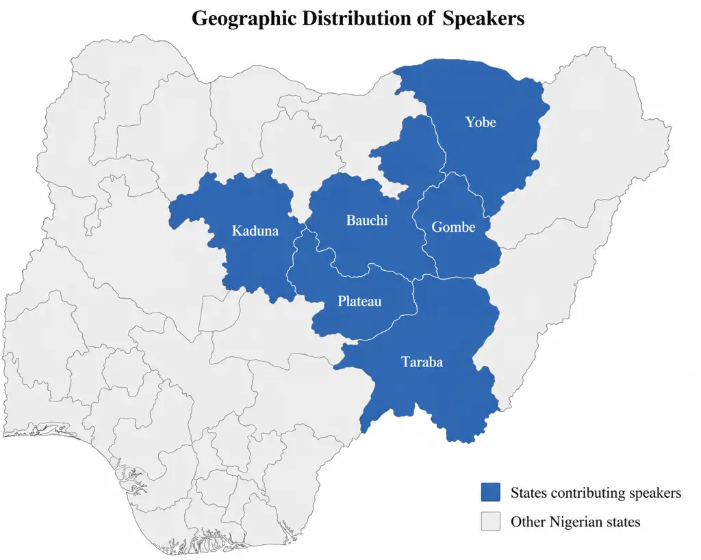
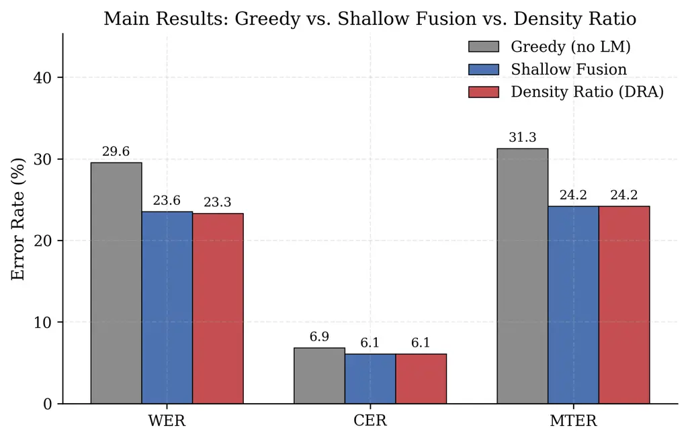
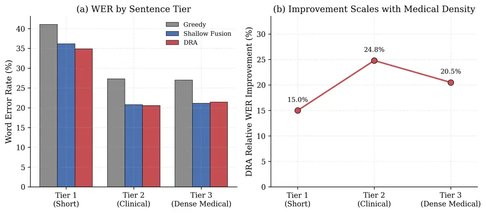
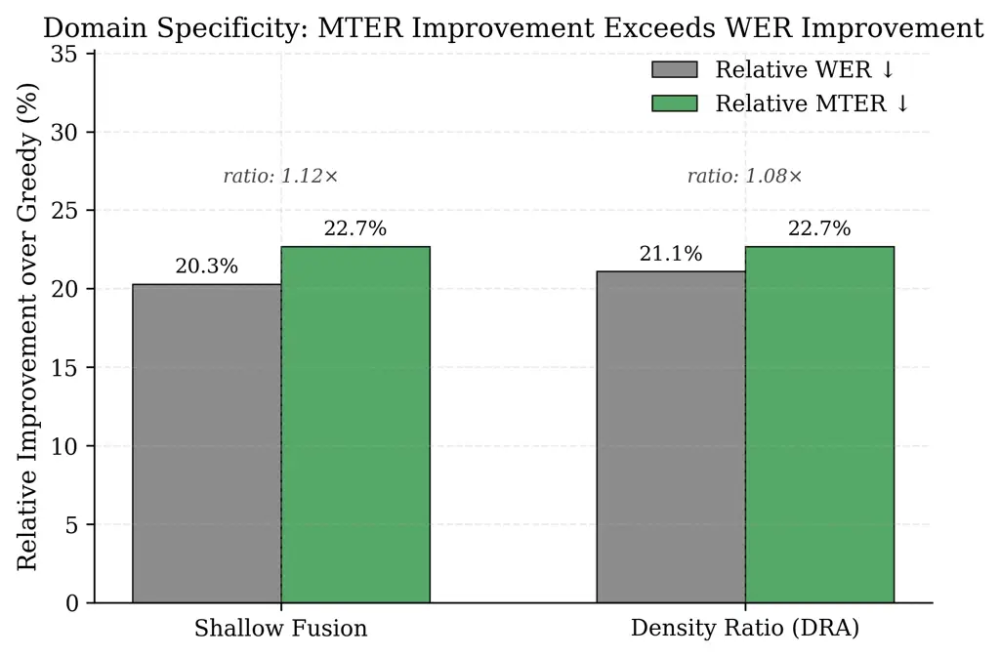
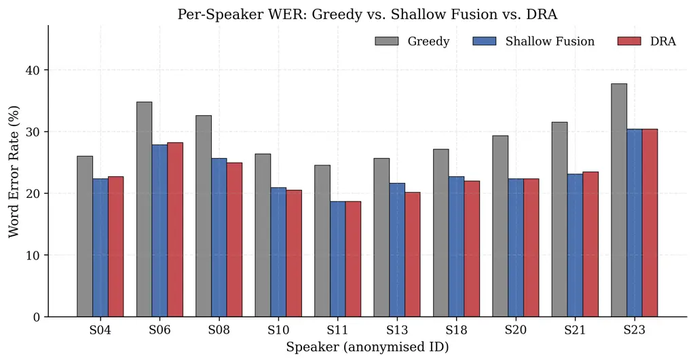

# Text-Only Domain Adaptation for Low-Resource Medical ASR: Shallow Fusion and Density Ratio Rescoring for Hausa

Oche David Ankeli    Hassan Adelani Luqman Affiliation: RUZIVO Research
Lab, African Leadership University, Kigali, Rwanda    Theodora Ngozi
Egbunike Affiliation: RUZIVO Research Lab, African Leadership
University, Kigali, Rwanda    Joshua Gottschalk Affiliation: Stanford
University, Stanford, CA, USA    Bonaventure F. P. Dossou
Affiliation: Mila – Quebec AI Institute and McGill University, Montreal,
Canada

###### Abstract

Automatic speech recognition (ASR) systems often struggle with
specialised medical vocabulary, especially in low-resource languages
where domain-specific speech data are scarce. We investigate text-only
domain adaptation for Hausa medical ASR using the fixed MMS-1B-FL102
acoustic model and two decoding-time language-model fusion methods:
Shallow Fusion (SF) and the Density Ratio Approach (DRA). A 4-gram KenLM
trained on 19,421 Hausa health sentences serves as the medical target
model, while a 75,372-sentence general-domain model provides the source
prior for DRA. Evaluation uses 250 recordings of 25 physician-reviewed
prompts from 10 speakers across six northern Nigerian states. Under
prompt-disjoint five-fold cross-validation, SF and DRA reduce WER from
29.56% to 23.55% and 23.33%, respectively. Both significantly outperform
greedy decoding ($`p<0.001`$), while their difference is not significant
($`p=0.423`$). However, general-LM-only SF achieves 23.96% WER,
indicating that the medical LM’s additional improvement over a general
LM is modest. Medical Term Error Rate also improves under fusion, but
does not establish a distinct medical-domain advantage. These findings
demonstrate that lightweight, text-only language-model fusion can
improve Hausa medical ASR without additional domain-specific speech
collection.

^(†)^(†)footnotetext: ^(∗)Corresponding author:
[ocheankeli99@gmail.com](mailto:ocheankeli99@gmail.com)  
Code:
[https://github.com/Tripp808/hausa-medical-asr](https://github.com/Tripp808/hausa-medical-asr)  
Trained models:
[https://huggingface.co/OcheAnkeli/hausa-medical-asr](https://huggingface.co/OcheAnkeli/hausa-medical-asr)

Index Terms— low-resource ASR, Hausa, medical domain adaptation, shallow
fusion, density ratio, African languages, MMS

## 1 Introduction

Healthcare delivery across northern Nigeria – home to a large
Hausa-speaking population – frequently relies on verbal communication
for patient consultations, medication instructions, and clinical
documentation. Automatic speech recognition capable of accurately
transcribing medical Hausa speech would have direct and meaningful
impact: supporting clinical documentation, telehealth, and patient
education in resource-constrained healthcare settings where literacy in
written Hausa is not universal.

Hausa is one of Africa’s most widely spoken languages, with an estimated
94 million first- and second-language speakers across Nigeria, Niger,
Ghana, Sudan, and other parts of West Africa \[1\]. Despite growing
interest in Hausa natural language processing, reflected in the growing
availability of Hausa language resources and benchmarks, including
HausaNLP \[2\], Mozilla Common Voice \[3\], and FLEURS \[4\], we are not
aware of prior published work specifically addressing medical-domain ASR
for Hausa.

The central bottleneck is audio data scarcity. Collecting paired
audio-transcript data in specialised medical domains is expensive,
logistically complex, and frequently infeasible. Fine-tuning acoustic
models on domain-specific audio – the standard approach for
high-resource languages – is not a viable option when such recordings do
not exist at scale. This motivates a practical question: can domain
adaptation for medical ASR be achieved using only text?

We answer affirmatively. We propose a text-only domain adaptation
framework combining two language-model fusion strategies – Shallow
Fusion (SF) and the Density Ratio Approach (DRA) \[5\] – with the
MMS-1B-FL102 multilingual acoustic model \[6\]. We position our approach
in contrast to the emerging use of large language models (LLMs) for ASR
post-processing \[7\]. While LLM-based correction can improve
transcription quality by exploiting broader linguistic context,
text-only post-processing operates after acoustic decoding and therefore
cannot directly recover information absent from the ASR output.
Moreover, reliance on large generative models introduces substantially
greater computational and deployment requirements than our lightweight
decoding-time approach: our KenLM-based fusion relies on a compact
16.76 MB model.

We evaluate with sentence-prompt-level 5-fold cross-validation:
language-model and decoding hyperparameters are selected only on each
fold’s tuning prompts and frozen before decoding that fold’s held-out
prompts, and the five held-out sets are pooled into 250 out-of-fold
(OOF) predictions, so no evaluation prompt is used for tuning in the
fold in which it is evaluated.

The contributions of this work are:

- •
  A text-only domain adaptation framework for Hausa medical ASR using SF
  and DRA, achieving 20.3% and 21.1% relative WER reductions,
  respectively, over an unadapted multilingual baseline, under
  sentence-level 5-fold cross-validation.
- •
  A medical-domain Hausa language model, consisting of a 4-gram KenLM
  trained on 19,421 sentences from the BBC Hausa and Deutsche Welle
  Hausa health sections, and a general-domain 75,372-sentence source
  language model enabling density-ratio correction of the acoustic
  model’s language prior.
- •
  A purpose-built Hausa medical speech evaluation dataset of 250
  utterances: 25 prompts independently reviewed by two medical doctors,
  each recorded by 10 speakers across six northern Nigerian states.
- •
  Medical Term Error Rate (MTER), a domain-specific metric for
  evaluating recognition of medical vocabulary, over a 66-term lexicon
  spanning six clinical categories, reported together with its
  construction caveats.
- •
  A domain contrast analysis and a cross-validated significance testing
  protocol (cluster bootstrap over sentence prompts) that together
  support the reported gains within the stated limits.

All trained language models and code are released publicly to support
reproducibility and future benchmarking.

## 2 Related Work

### 2.1 Domain Adaptation for ASR

Domain adaptation in ASR broadly includes acoustic model adaptation,
which typically relies on speech data, and language model adaptation,
which can leverage text-only domain resources \[8\] and is particularly
suited to low-resource settings where domain-specific audio is
unavailable.

For end-to-end ASR, Shallow Fusion combines external LM
log-probabilities with ASR scores during beam-search decoding \[9, 10\]
and has been shown to improve recognition of domain-specific vocabulary
\[11\]. A known limitation is that the external LM may duplicate
information already encoded by the acoustic model \[5\] – particularly
relevant for large multilingual models such as MMS, trained across more
than 1,000 languages \[6\].

The Density Ratio Approach (DRA) \[5\] addresses this using a Bayesian
formulation: rather than simply adding a target-domain LM, DRA
incorporates a source-domain LM to approximate the prior already encoded
by the acoustic model, reducing double-counting. To our knowledge, no
prior work has applied DRA to Nigerian-language ASR or medical ASR in an
African language.

### 2.2 LLM Post-Processing vs. Decoding-Time Fusion

A growing body of work explores LLMs as ASR post-processors, correcting
transcription errors by exploiting broader linguistic context \[7\].
This operates after acoustic decoding and cannot recover information
absent from the ASR hypothesis – particularly limiting in low-resource
medical ASR, where terminology may be poorly represented in both the
acoustic model and the decoded hypothesis. Deploying large generative
models also introduces substantially greater computational and latency
requirements than lightweight n-gram fusion. Our approach instead
integrates the LM during beam-search decoding, using a compact 16.76 MB
KenLM, substantially more suitable for resource-constrained deployment.

### 2.3 ASR for African and Low-Resource Languages

Multilingual self-supervised speech models such as XLS-R \[12\] and MMS
\[6\] have substantially expanded ASR coverage for low-resource
languages, including Hausa. Community efforts such as Masakhane \[13\]
and HausaNLP \[2\] have further advanced datasets, benchmarks, and
language technologies for African languages, and recent work has
explored multilingual ASR for Kinyarwanda, Swahili, and Luganda \[14\].
AfriSpeech-200 \[15\] introduced Pan-African accented English speech
spanning clinical and general domains, but focuses on English rather
than African languages. For Hausa specifically, existing speech
resources primarily target general-domain speech; to our knowledge, no
prior published study has addressed medical-domain ASR for Hausa.

### 2.4 Medical ASR and Terminology-Aware Evaluation

Medical ASR has been extensively studied in high-resource settings,
where specialised terminology poses challenges for general-domain ASR
and motivates domain-specific LM adaptation \[16\]. These studies, along
with analyses of dictated clinical documents \[17\], highlight the
limitations of aggregate WER for clinically important terminology,
motivating complementary domain-specific evaluation. We adapt this
principle to Hausa with MTER (Section 5.1).

## 3 Methodology

### 3.1 Acoustic Model

We evaluated several multilingual ASR models on Hausa speech, including
Whisper variants and Wav2Vec2-based models. MMS-1B-FL102 \[6\] was
selected as our acoustic backbone for its consistently strong baseline
(greedy WER 29.56%). MMS provides a dedicated Hausa CTC adapter
(language code hau), enabling direct inference without fine-tuning;
because CTC-based models lack an autoregressive language decoder,
external LM integration during beam search is a natural fusion
mechanism. MMS integrates directly with pyctcdecode \[18\] for SF and
DRA decoding; audio is resampled to 16 kHz mono via ffmpeg. The acoustic
model is never fine-tuned, selected, or retuned on any fold: it is held
fixed throughout, so reported gains are attributable to language-model
adaptation alone.

### 3.2 Medical Language Model (Target LM)

We constructed a Hausa medical text corpus by scraping health-section
articles from BBC Hausa (766 articles, 532,775 words) and Deutsche Welle
Hausa (11 articles, 3,946 words), then applied Unicode normalisation,
lowercasing, punctuation removal (preserving diacriticals), whitespace
normalisation, deduplication, and length filtering (minimum 3 words),
yielding 19,421 sentences ($`\sim`$558,700 words).

A 4-gram KenLM was trained via lmplz \[19\] with modified Kneser–Ney
smoothing \[20\], completing in 2.5s on CPU and producing a 16.76 MB
binary. Held-out perplexity (1,943 sentences) was 101.86.

### 3.3 General Language Model (Source LM)

DRA requires a source LM approximating the acoustic model’s implicit
general-domain language prior \[5\]. We built a 75,372-sentence corpus
from four public Hausa sources spanning formal and informal registers:
Common Voice Hausa \[3\]; HausaVisualGenome \[21\] (32,923 post-edited
image descriptions); NaijaSenti-Twitter Hausa \[22\] ($`\sim`$14,000
annotated tweets); and the ijdutse corpus \[23\] (general Hausa text,
language-filtered). Held-out perplexity was 47.70.

### 3.4 Domain Contrast Validation

We assessed domain contrast by scoring every sentence in the evaluation
set’s 25 unique reference prompts against both the medical and general
language models, and comparing these scores against 25 held-out
general-domain sentences not used to train either LM. For each sentence,
we computed the difference between the medical and general LM scores,
$`\log P_{\text{MED}}-\log P_{\text{GEN}}`$. The medical references
yielded a mean ratio of $`+3.27`$, while the held-out general sentences
yielded a mean ratio of $`-18.04`$; a Mann–Whitney $`U`$ test confirmed
this difference was statistically significant ($`p<0.001`$). This
directional contrast supports the domain-specific probability ratio used
by DRA. Illustrative examples are given in Appendix E.

### 3.5 Decoding Strategies

Three decoding configurations are evaluated. Greedy: argmax CTC decoding
with no language model, representing out-of-the-box MMS performance on
Hausa medical speech. Shallow Fusion (SF): beam search (width 100)
combining CTC and medical KenLM log-probabilities,

```math
\displaystyle\log P_{\text{SF}}(W|X)={} \displaystyle\log P_{\text{CTC}}(W|X) \tag{1}
```

```math
\displaystyle+\lambda\log P_{\text{MED}}(W)+\beta|W|.
```

Density Ratio (DRA): $`n`$-best rescoring ($`n=50`$) over the SF beam
using

```math
\displaystyle\log P_{\text{DRA}}(W|X)={} \displaystyle\log P_{\text{CTC}}(W|X)+\lambda_{\tau}\log P_{\text{MED}}(W) \tag{2}
```

```math
\displaystyle-\lambda_{\psi}\log P_{\text{GEN}}(W)+\beta|W|.
```

For each fold, SF hyperparameters are selected by grid search over
$`\lambda\in\{0.2,0.35,0.5,0.65,0.8,1.0\}`$ and
$`\beta\in\{-1.0,-0.5,0.0,0.5,1.0,1.5\}`$ on that fold’s tuning prompts;
DRA hyperparameters are selected over
$`\lambda_{\tau}\in\{0.3,0.5,0.8,1.0,1.2,1.5\}`$,
$`\lambda_{\psi}\in\{0.1,0.3,0.5,0.8,1.0\}`$ subject to
$`\lambda_{\psi}<\lambda_{\tau}`$, and $`\beta\in\{0.5,1.0,1.5\}`$. Full
per-fold selected values are given in Appendix D. Across folds, the
selected SF weight is stable at $`\lambda=0.8`$, and DRA rescoring
changes the SF hypothesis for 28 of the 250 (11.2%) pooled out-of-fold
utterances, consistent with DRA operating as a second-stage rescoring
procedure over hypotheses already generated by SF.

### 3.6 Cross-Validation Protocol

We partition the 25 sentence prompts into five deterministic,
sentence-disjoint folds. Each fold holds out 5 prompts (50 utterances,
all 10 speakers) for evaluation and uses the remaining 20 prompts (200
utterances) for hyperparameter tuning. Language-model and decoding
hyperparameters – for SF, general-LM-only SF, and DRA alike – are
selected independently within each fold using only that fold’s tuning
prompts, then frozen before decoding that fold’s held-out prompts. The
five held-out sets are pooled to produce 250 out-of-fold (OOF)
predictions, which are used for all reported metrics. No evaluation
prompt is used for tuning in the fold in which it is evaluated. Because
all ten speakers appear in both the tuning and held-out portions of
every fold, this is prompt-level held-out evaluation, not a
speaker-independent test.

Statistical uncertainty is estimated with a sentence-cluster bootstrap:
10,000 resamples are drawn at the level of sentence prompts (not
individual utterances), with each resampled cluster retaining all ten
speaker recordings for that prompt. This respects the nested structure
of the data (25 sentences $`\times`$ 10 speakers) and yields more
conservative confidence intervals than a flat utterance-level bootstrap
(with only 25 prompt clusters, they remain indicative rather than
high-power).

## 4 Evaluation Dataset

### 4.1 Sentence Design

We designed 25 evaluation sentences across three tiers of increasing
medical vocabulary density: Tier 1 – 8 short everyday health phrases
(5–8 words); Tier 2 – 12 medium clinical sentences (10–15 words); and
Tier 3 – 5 long, medically dense sentences (15–20 words). Initial
sentence drafts were generated using an LLM (Claude Sonnet 5) and
subsequently independently reviewed and corrected by two medical doctors
for medical accuracy and Hausa naturalness. Full sentence lists are
provided in Appendix B.

### 4.2 Medical Expert Validation

Two medical doctors – Dr. Mohammed Mubarak Bello and Dr. Abdulmajid
Imrana, both affiliated with Federal Neuro-Psychiatric Hospital, Kaduna,
Nigeria – independently reviewed all 25 sentences for medical accuracy
and Hausa naturalness. Of the 25 sentences, 16 were approved verbatim
and 9 received linguistic corrections concerning phrasing or register
rather than medical accuracy. The corrected versions were used as the
final recording references.

### 4.3 Evaluation–Corpus Overlap

To assess potential phrase-level overlap between the evaluation set and
the medical LM training corpus, we measured 4-gram overlap across the 25
evaluation sentences. Nine sentences (36.0%) contained at least one
overlapping 4-gram, while 18 of 198 evaluation 4-grams (9.1%) occurred
in the training corpus. Thus, 90.9% of evaluation 4-grams were not
observed in the medical LM training corpus, limiting concerns that
evaluation performance was driven primarily by direct phrase overlap.

### 4.4 Speaker Recruitment and Recording

Ten volunteer speakers were recruited through community networks with
emphasis on dialect diversity across northern Nigeria, representing six
states: Plateau, Gombe, Taraba, Yobe, Kaduna, and Bauchi (Figure 1). The
cohort comprises 5 male and 5 female speakers, primarily aged 20–35,
including students, NGO workers, and healthcare professionals.
Approximately 8 of 10 are native Hausa speakers; 2 are fluent
second-language speakers. Speaker demographics are given in Appendix A.
Each speaker recorded all 25 sentences as separate audio files using
personal mobile phones in quiet indoor environments. Files were
converted to 16 kHz mono WAV using ffmpeg. The final dataset comprises
250 utterances.



Figure 1: Geographic distribution of speakers. States shaded contributed
speakers to the evaluation corpus.

## 5 Experiments and Results

### 5.1 Evaluation Metrics

We report: (1) Word Error Rate (WER); (2) Character Error Rate (CER);
and (3) Medical Term Error Rate (MTER), a domain-specific metric
measuring the proportion of medical vocabulary instances in the
reference that are not correctly recognised in the hypothesis. MTER
builds on prior domain-specific medical ASR metrics, including Medical
Concept WER \[16\], which restrict error measurement to clinically
relevant medical concepts or entities. Unlike these approaches, which
rely on clinical NLP tools primarily available for English, MTER derives
its medical lexicon from language-model statistics and expert
validation, providing an approach applicable to low-resource languages
without established clinical NLP tooling.

The lexicon was fixed before the cross-validated evaluation and lists 66
term strings (60 distinct after the diacritic folding ƙ/k, ɗ/d, ɓ/b used
for matching) in six clinical categories (Symptoms & Conditions,
Medications & Treatments, Clinical Procedures, Medical Personnel &
Settings, Anatomy, Clinical Descriptors). Of these, 48 are
corpus-derived (medical-to-general LM unigram log-probability ratio
$`>0.5`$), 58 are expert-validated, and 40 are both (Appendix C).
Because the corpus-derived criterion uses the same language models whose
effect we measure, MTER is not fully independent of the medical LM; the
8 corpus-only terms account for 120 of the 790 reference instances
(15.2%).

Matching is occurrence-based and position-independent, after diacritic
folding; morphological variants are distinct terms (no lemmatisation).
MTER is computed as

```math
MTER{}=\Big(1-\frac{1}{N}\sum_{i=1}^{N}\mathbb{1}[t_{i}\in H]\Big)\times 100, \tag{3}
```

where $`t_{i}`$ is a medical-term instance in the reference, $`N`$ is
the total number of such instances (790, in 230 of the 250 utterances;
prompts 006 and 020 contain no lexicon term), and $`H`$ is the set of
(diacritic-folded) word forms in the hypothesis. MTER is recall-oriented
and does not penalise inserted medical terms; it should be interpreted
alongside WER and CER, never as a standalone measure of transcription
quality.

### 5.2 Main Results

System WER (%) 95% CI CER (%) Rel. WER $`\downarrow`$ Greedy (no LM)
29.56 \[24.81, 35.24\] 6.86 – Shallow Fusion 23.55 \[19.26, 28.70\] 6.07
20.3% Density Ratio (DRA) 23.33 \[19.14, 28.32\] 6.08 21.1%

Table 1: Pooled out-of-fold performance over 250 utterances, 5-fold
sentence-level cross-validation. 95% confidence intervals for each
system’s WER are from the sentence-cluster bootstrap (10,000 resamples).



Figure 2: Word Error Rate, Character Error Rate, and Medical Term Error
Rate across Greedy, Shallow Fusion, and Density Ratio decoding, pooled
out-of-fold.

Table 1 reports pooled out-of-fold WER, CER, and relative improvement
across the three decoding configurations (250 utterances). Both fusion
methods significantly outperform greedy decoding: SF reduces WER by 6.01
points (20.3% relative), with 95% CI for the paired difference
$`[+4.04,+8.07]`$ and $`p<0.001`$; DRA reduces WER by 6.23 points (21.1%
relative), CI $`[+4.27,+8.31]`$, $`p<0.001`$. DRA achieves the lowest
point estimate, but its 0.22-point advantage over SF is not
statistically significant (CI $`[-0.25,+0.81]`$, $`p=0.423`$). Thus, the
evidence supports both fusion approaches substantially outperforming
greedy decoding, not a statistically significant superiority of DRA over
SF. Figure 2 visualises WER, CER, and MTER across all three
configurations.

### 5.3 Language-Model Ablation

To assess whether the gains are specific to the medical domain, we also
evaluated SF with the general-domain LM alone and with a combined
general+medical LM, each with hyperparameters independently fold-tuned
under the same protocol (Table 2). General-LM-only SF reaches 23.96% WER
– only 0.41 points behind the medical-only LM (23.55%) – and the
combined LM gives 23.85%, no improvement over medical-only SF. On MTER
the ordering reverses: general-only (23.80%) and combined (23.67%) are
slightly lower than medical-only (24.18%). Thus most of the improvement
over greedy decoding comes from adding an external LM at all; the
medical LM’s additional benefit is small and shows up in WER rather than
MTER.

Configuration WER (%) MTER (%) Greedy (no LM) 29.56 31.27 SF, general LM
only 23.96 23.80 SF, medical LM only 23.55 24.18 SF, combined general +
medical LM 23.85 23.67

Table 2: Shallow Fusion language-model ablation, fold-tuned under 5-fold
CV (pooled out-of-fold).

### 5.4 Results by Sentence Tier

Table 3 and Figure 3 report micro-averaged WER by sentence tier. All
fusion methods outperform greedy decoding across all tiers. DRA’s
relative improvement over greedy is smallest for Tier 1 (short, low
medical density; $`+15.0\%`$) and largest for Tier 2 (medium clinical
density; $`+24.8\%`$), with Tier 3 (long, dense medical sentences) in
between ($`+20.5\%`$). These differences may partly reflect
sentence-length effects in addition to vocabulary density, so we do not
attribute the tier gradient solely to medical vocabulary content.

Tier N Greedy SF DRA Tier 1 (Short) 80 41.06% 36.17% 34.89% Tier 2
(Clinical) 120 27.31% 20.77% 20.54% Tier 3 (Dense Medical) 50 26.98%
21.15% 21.46%

Table 3: Micro-averaged WER by sentence tier, pooled out-of-fold.



Figure 3: (a) WER by sentence tier. (b) DRA’s relative WER improvement
over greedy, by tier.

### 5.5 MTER by Clinical Category

Category N Greedy SF DRA Symptoms & Conditions 260 19.62% 14.62% 14.23%
Medications & Treatments 150 48.00% 30.67% 30.67% Clinical Procedures 70
24.29% 14.29% 14.29% Med. Personnel & Settings 60 6.67% 1.67% 1.67%
Anatomy 120 56.67% 57.50% 59.17% Clinical Descriptors 140 25.71% 20.00%
19.29%

Table 4: MTER by clinical category, pooled out-of-fold (790 term
instances; category counts not mutually exclusive, sum to 800).



Figure 4: Relative improvement in MTER consistently exceeds relative
improvement in WER for both fusion methods.

Table 4 reports MTER across the six clinically motivated categories (790
medical-term instances in 230 of the 250 utterances; category-level
counts sum to 800 because one term, _tsanani_, belongs to two
categories). DRA and SF reduce MTER most substantially in Medical
Personnel & Settings (from 6.67% to 1.67%) and Medications & Treatments
(from 48.00% to 30.67%), while Anatomy is the only category that does
_not_ improve, and in fact worsens slightly under both fusion methods
(56.67% $`\rightarrow`$ 57.50% SF, 59.17% DRA), indicating that
anatomy-related terminology remains challenging in the current
adaptation setup, plausibly due to limited corpus representation and
phonological overlap with everyday Hausa vocabulary. As Figure 4 shows,
the relative MTER reduction (22.7% for both methods) exceeds the
relative WER reduction (20.3% SF, 21.1% DRA; ratios 1.12$`\times`$ and
1.08$`\times`$), but general-LM-only SF shows the same pattern (23.9%
vs. 18.9% relative), so this gap does not by itself isolate a
medical-domain effect (Section 6).

### 5.6 Speaker-Level and Sex Analysis



Figure 5: Per-speaker Word Error Rate across all three decoding
strategies, showing consistent improvement across the cohort.

Figure 5 shows per-speaker WER across all three decoding strategies
(full values in Appendix E, Table 9). All 10 speakers improve under at
least one fusion method; three speakers (S04, S06, S21) show marginal
DRA degradation relative to SF (at most 0.4 points). Dialect was not
formally annotated in this study, so we do not attribute this to a
specific phonological cause. Performance is similar across speaker sex:
pooled WER is 28.86%/23.08%/23.00% (Greedy/SF/DRA) for male speakers and
30.26%/24.03%/23.66% for female speakers – a difference of at most 1.40
points at any stage, and 0.66 points for DRA specifically. We do not
perform a formal significance test on this comparison given the small
number of speakers per group.

## 6 Discussion

### 6.1 On Text-Only Adaptation Effectiveness

The primary finding is that text-only domain adaptation is effective and
accessible for Hausa medical ASR, and that this holds under a properly
cross-validated protocol. The pipeline – from corpus collection to a
deployment-ready LM binary – requires no GPU, no proprietary data, and
trains in seconds, offering a reproducible path to domain-adapted ASR
for other low-resource languages with available domain text.

### 6.2 MTER and the Role of the General LM

MTER falls more than WER (Section 5.2), but this does not by itself
indicate domain-specific adaptation: general-LM-only SF attains a
comparable, nominally lower MTER (23.80% vs. 24.18% for the medical LM),
and the corpus-derived part of the lexicon is itself selected with the
medical/general LM ratio. The defensible reading is that external-LM
fusion improves terminology recall generally, with the medical LM’s own
contribution – 0.41 WER points – small and not isolated by MTER; an
independently constructed or precision-aware lexicon would test this
more directly.

### 6.3 DRA vs. Shallow Fusion

We treat the SF–DRA comparison as secondary: DRA has the lowest point
WER, but its advantage is not significant under the cluster bootstrap,
and DRA only rescores SF’s own beam (changing 28 of 250, 11.2%, of
hypotheses). The 5-fold, prompt-disjoint protocol (Section 3.6) makes
every reported prediction out-of-fold with respect to prompt-level
tuning and estimates uncertainty at the sentence-prompt level; with only
25 prompt clusters and 10 speakers, however, the intervals should be
read as indicative. At 23.33% WER, the system suits human-reviewed
documentation workflows, not unsupervised clinical use.

## 7 Limitations

We discuss limitations across several dimensions. Evaluation scale and
speech style: 250 utterances from 10 speakers is small, and the prompts
are purpose-built sentences read aloud rather than spontaneous clinical
conversation; results characterise this constructed benchmark, and
broader generalisation requires larger, more diverse, naturalistic data.
Geographic coverage: speakers are drawn from six northern Nigerian
states; North-West varieties (Kano, Sokoto, Zamfara) and Niger Republic
Hausa are underrepresented. Speaker demographics: speakers are
predominantly young adults (20s–30s); performance on elderly speakers,
children, and varying Hausa education levels is unknown. Fold
independence: only sentences, not speakers, are held out within each
fold – all ten speakers appear in both tuning and held-out portions of
every fold; a speaker-disjoint CV would be a complementary, stronger
generalisation test. N-gram LM limitations: 4-gram KenLMs capture local
statistics but not long-range coherence; neural LMs would likely help
further, particularly for Tier 3. Source LM approximation: our
75,372-sentence source LM is far smaller than the acoustic model’s own
pretraining corpus, likely capping how well it approximates MMS’s true
prior and how large a DRA advantage over SF is achievable. MTER scope:
MTER uses diacritic-folded, position-independent term matching over a
lexicon partly derived from the LM probability ratio, does not model
morphological equivalence, and does not penalise inserted terms; it
complements, rather than replaces, a full clinical-correctness measure.
Data ethics: BBC/DW Hausa text was scraped for non-commercial research;
only the trained LM binary, not raw text, will be released. Similarly,
due to speaker privacy, the evaluation audio recordings are not publicly
released.

## 8 Ethical Statement

The study adopted a division of labour in which model development and
evaluation were author-led, while medical validation of the evaluation
sentences was conducted independently by two Hausa-speaking medical
doctors. The clinicians reviewed the sentences for medical accuracy,
Hausa naturalness, and recording clarity, with their corrections
incorporated before recording. This process provided domain and
linguistic validation for a study whose modelling was conducted by
researchers who are not first-language Hausa speakers. All volunteer
speakers provided informed consent and were informed of the research
purpose and intended dataset release. Speakers are identified by
anonymised IDs in all published materials. Only the the trained language
models and the code are made available. To protect speaker privacy, the
raw audio recordings and evaluation dataset are not publicly released.
The resulting models and resources are released openly to support
further research and downstream applications; they should be regarded as
research resources rather than clinically validated systems, and
deployment in healthcare settings would require additional clinical,
demographic, and regulatory validation. The system makes no claim of
clinical validation and is not suitable for unsupervised clinical
decision-making, including unreviewed medication or dosage
transcription.

## Acknowledgments

The authors thank Dr. Mohammed Mubarak Bello and Dr. Abdulmajid Imrana
(Federal Neuro-Psychiatric Hospital, Kaduna, Kaduna State, Nigeria) for
independent medical expert validation, and the ten volunteer speakers
for their recordings and patience. We further thank the following
contributors for data collection, annotation, and project coordination:
Ismail Kewa, Chukwuma Onuoha, Yakubu Emmanuel Yakubu, Ahmad Daib, Ishaq
Adamu, Patience Habila Mugana, Esther Isah Bila, Hafsat Abubakar Ahmad,
Fatima Mudi Abdullahi, and Fatima Ahmed. This research was conducted
within the RUZIVO Research Lab at African Leadership University. The
authors declare no competing interests and received no dedicated
external funding for this work.

## 9 Conclusion

We have presented a text-only domain adaptation framework for Hausa
medical ASR, achieving 20.3% (SF) and 21.1% (DRA) relative WER
reductions over an unadapted MMS baseline under sentence-prompt-level
5-fold cross-validation, with no evaluation prompt used for tuning in
its own fold. Most of the gain comes from adding an external LM:
general-LM-only SF already reaches 23.96% WER, the medical LM adds a
smaller 0.41-point benefit, and DRA’s advantage over SF is not
statistically significant. MTER falls 22.7% under both methods, but
general-LM-only fusion gives a comparable MTER, so we treat it as
complementary evidence. The pipeline produces a compact 16.76 MB model,
practical for resource-constrained deployment. We contribute a Hausa
medical speech evaluation corpus built from 25 physician-reviewed
prompts and introduce MTER. We release all trained models and code to
support future Hausa and African-language medical ASR work.

## References

- \[1\] D. M. Eberhard, G. F. Simons, and C. D. Fennig (Eds.) (2025)
  Ethnologue: languages of the world. 28th edition, SIL International,
  Dallas, TX. Cited by: §1.
- \[2\] S. H. Muhammad et al. (2025) HausaNLP: current status,
  challenges and future directions for hausa natural language
  processing. In Proc. Sixth Workshop on African Natural Language
  Processing (AfricaNLP 2025), Vienna, Austria, pp. 176–191. Cited by:
  §1, §2.3.
- \[3\] R. Ardila et al. (2020) Common voice: a massively-multilingual
  speech corpus. In Proc. 12th Language Resources and Evaluation
  Conference (LREC), Marseille, France, pp. 4218–4222. Cited by: §1,
  §3.3.
- \[4\] A. Conneau et al. (2023) FLEURS: few-shot learning evaluation of
  universal representations of speech. In Proc. IEEE Spoken Language
  Technology Workshop (SLT 2022), Doha, Qatar, pp. 798–805. External
  Links: [Document](https://dx.doi.org/10.1109/SLT54892.2023.10023141)
  Cited by: §1.
- \[5\] E. McDermott, H. Sak, and E. Variani (2019) A density ratio
  approach to language model fusion in end-to-end automatic speech
  recognition. In Proc. IEEE Automatic Speech Recognition and
  Understanding Workshop (ASRU), Singapore, pp. 434–441. External Links:
  [Document](https://dx.doi.org/10.1109/ASRU46091.2019.9003790) Cited
  by: §1, §2.1, §2.1, §3.3.
- \[6\] V. Pratap et al. (2024) Scaling speech technology to 1,000+
  languages. Journal of Machine Learning Research 25 (97), pp. 1–52.
  Cited by: §1, §2.1, §2.3, §3.1.
- \[7\] R. Ma, M. Qian, P. Manakul, M. Gales, and K. Knill (2023) Can
  generative large language models perform ASR error correction?. arXiv
  preprint arXiv:2307.04172. External Links:
  [Document](https://dx.doi.org/10.48550/arXiv.2307.04172) Cited by: §1,
  §2.2.
- \[8\] H. Yadav and S. Sitaram (2022) A survey of multilingual models
  for automatic speech recognition. In Proc. 13th Language Resources and
  Evaluation Conference (LREC), Marseille, France, pp. 5071–5079.
  External Links:
  [Document](https://dx.doi.org/10.48550/arXiv.2202.12576) Cited by:
  §2.1.
- \[9\] J. Chorowski and N. Jaitly (2017) Towards better decoding and
  language model integration in sequence to sequence models. In Proc.
  Interspeech 2017, Stockholm, Sweden, pp. 523–527. External Links:
  [Document](https://dx.doi.org/10.21437/Interspeech.2017-343) Cited by:
  §2.1.
- \[10\] C. Gulcehre et al. (2017) On integrating a language model into
  neural machine translation. Computer Speech & Language 45,
  pp. 137–148. External Links:
  [Document](https://dx.doi.org/10.1016/j.csl.2017.01.014) Cited by:
  §2.1.
- \[11\] A. Kannan, Y. Wu, P. Nguyen, T. N. Sainath, Z. Chen, and R.
  Prabhavalkar (2018) An analysis of incorporating an external language
  model into a sequence-to-sequence model. In Proc. IEEE Int. Conf.
  Acoustics, Speech and Signal Processing (ICASSP), Calgary, Canada.
  External Links:
  [Document](https://dx.doi.org/10.1109/ICASSP.2018.8462682) Cited by:
  §2.1.
- \[12\] A. Babu et al. (2022) XLS-R: self-supervised cross-lingual
  speech representation learning at scale. In Proc. Interspeech 2022,
  Incheon, South Korea, pp. 2278–2282. External Links:
  [Document](https://dx.doi.org/10.21437/Interspeech.2022-143) Cited by:
  §2.3.
- \[13\] W. Nekoto et al. (2020) Participatory research for
  low-resourced machine translation: a case study in african languages.
  In Findings of the Association for Computational Linguistics: EMNLP
  2020, Online, pp. 2144–2160. External Links:
  [Document](https://dx.doi.org/10.18653/v1/2020.findings-emnlp.195)
  Cited by: §2.3.
- \[14\] M. Elamin, Y. Chanie, P. Ewuzie, and S. Rutunda (2023)
  Multilingual automatic speech recognition for Kinyarwanda, Swahili,
  and Luganda: advancing ASR in select East African languages. In Proc.
  4th Workshop on African Natural Language Processing (AfricaNLP),
  co-located with ICLR 2023, Kigali, Rwanda. Note: Available:
  [https://openreview.net/forum?id=tuUHjowTKpC](https://openreview.net/forum?id=tuUHjowTKpC)
  Cited by: §2.3.
- \[15\] T. Olatunji, T. Afonja, A. Yadavalli, C. C. Emezue, S.
  Singh, B. F. P. Dossou, J. Osuchukwu, S. Osei, A. L. Tonja, N. Etori,
  and C. Mbataku (2023) AfriSpeech-200: pan-african accented speech
  dataset for clinical and general domain ASR. Transactions of the
  Association for Computational Linguistics 11, pp. 1669–1685. External
  Links: [Document](https://dx.doi.org/10.1162/tacl%5Fa%5F00627) Cited
  by: §2.3.
- \[16\] T. Afonja, T. Olatunji, S. Ogun, N. A. Etori, A. Owodunni,
  and M. Yekini (2024) Performant ASR models for medical entities in
  accented speech. In Proc. Interspeech 2024, Kos, Greece,
  pp. 2315–2319. External Links:
  [Document](https://dx.doi.org/10.21437/Interspeech.2024-2261) Cited
  by: §2.4, §5.1.
- \[17\] L. Zhou et al. (2018) Analysis of errors in dictated clinical
  documents assisted by speech recognition software and professional
  transcriptionists. JAMA Network Open 1 (3), pp. e180530. External
  Links:
  [Document](https://dx.doi.org/10.1001/jamanetworkopen.2018.0530) Cited
  by: §2.4.
- \[18\] Kensho Technologies (2022) Pyctcdecode. Note: GitHub
  repositoryAvailable:
  [https://github.com/kensho-technologies/pyctcdecode](https://github.com/kensho-technologies/pyctcdecode).
  Accessed: Jul. 2026 Cited by: §3.1.
- \[19\] K. Heafield, I. Pouzyrevsky, J. H. Clark, and P. Koehn (2013)
  Scalable modified Kneser-Ney language model estimation. In Proc. 51st
  Annual Meeting of the Association for Computational Linguistics (ACL),
  Sofia, Bulgaria, pp. 690–696. Cited by: §3.2.
- \[20\] S. F. Chen and J. Goodman (1999) An empirical study of
  smoothing techniques for language modeling. Computer Speech & Language
  13 (4), pp. 359–394. Cited by: §3.2.
- \[21\] I. Abdulmumin et al. (2022) Hausa visual genome: a dataset for
  multi-modal english to hausa machine translation. In Proc. Thirteenth
  Language Resources and Evaluation Conference (LREC), Marseille,
  France, pp. 6471–6479. Cited by: §3.3.
- \[22\] S. H. Muhammad et al. (2022) NaijaSenti: a nigerian twitter
  sentiment corpus for multilingual sentiment analysis. In Proc.
  Thirteenth Language Resources and Evaluation Conference (LREC),
  Marseille, France, pp. 590–602. Cited by: §3.3.
- \[23\] I. Inuwa-Dutse (2021) The first large scale collection of
  diverse hausa language datasets. arXiv preprint arXiv:2102.06991.
  Cited by: §3.3.

## Appendix A Speaker Demographics

Table 5 presents the anonymised demographic summary of the 10 volunteer
speakers. Speaker IDs are used throughout all published materials and
released datasets. No personally identifying information is associated
with speaker IDs in any public release.

| Speaker ID | State   | Region        | Sex | Hausa Proficiency | Occupation        |
| ---------- | ------- | ------------- | --- | ----------------- | ----------------- |
| S04        | Plateau | North-Central | M   | Native            | NGO / Community   |
| S06        | Gombe   | North-East    | M   | Fluent (L2)       | Student           |
| S08        | Taraba  | North-East    | M   | Native            | Student           |
| S10        | Yobe    | North-East    | M   | Native            | NGO / Community   |
| S11        | Kaduna  | North-West    | M   | Native            | Student           |
| S13        | Gombe   | North-East    | F   | Native            | Student           |
| S18        | Gombe   | North-East    | F   | Native            | Healthcare Worker |
| S20        | Bauchi  | North-East    | F   | Native            | Student           |
| S21        | Bauchi  | North-East    | F   | Native            | NGO / Community   |
| S23        | Gombe   | North-East    | F   | Fluent (L2)       | Healthcare Worker |

Table 5: Anonymised speaker demographics. 8 of 10 speakers are native
Hausa speakers; 2 are fluent second-language speakers.

## Appendix B Evaluation Sentences

All 25 evaluation sentences are listed below, grouped by tier. Sentences
marked $`\ast`$ received linguistic corrections from medical expert
annotators; all others were approved verbatim. All sentences are
presented in their final validated form as used for recordings.

| ID  | Tier | Hausa Sentence (Validated)                                                                                        | English Translation                                                                                       | $`\ast`$ |
| --- | ---- | ----------------------------------------------------------------------------------------------------------------- | --------------------------------------------------------------------------------------------------------- | -------- |
| 001 | 1    | Ka sha ruwa mai yawa kowace rana.                                                                                 | Drink plenty of water every day.                                                                          |          |
| 002 | 1    | Ina jin zafi a kirjina.                                                                                           | I feel pain in my chest.                                                                                  |          |
| 003 | 1    | Jikinna ya kama zafi yau sosai.                                                                                   | My body is very hot today.                                                                                | $`\ast`$ |
| 004 | 1    | Ina buƙatar magani don ciwon kai.                                                                                 | I need medicine for a headache.                                                                           |          |
| 005 | 1    | Ka huta sosai don ka warke da wuri.                                                                               | Rest well for a quick recovery.                                                                           | $`\ast`$ |
| 006 | 1    | Ina jin kishin ruwa sosai.                                                                                        | I am feeling very thirsty.                                                                                | $`\ast`$ |
| 007 | 1    | Hannuwana na karkarwa.                                                                                            | My hands are shaking.                                                                                     | $`\ast`$ |
| 008 | 1    | Ina tai amai sau da yawa yau.                                                                                     | I have been vomiting many times today.                                                                    | $`\ast`$ |
| 009 | 2    | Likita ya ce ina da zazzabin cizon sauro kuma ya rubuta magani.                                                   | The doctor said I have malaria and prescribed medicine.                                                   |          |
| 010 | 2    | Ka sha ƙwayar maganin sau uku a kowace rana bayan abinci.                                                         | Take the tablet three times daily after meals.                                                            |          |
| 011 | 2    | An diba jinina a asibiti domin gwaji.                                                                             | Blood was taken from me at the hospital for testing.                                                      | $`\ast`$ |
| 012 | 2    | Ciwon sukari yana buƙatar kulawa ta musamman da abinci mai kyau.                                                  | Diabetes requires special care and a good diet.                                                           |          |
| 013 | 2    | Ina da tari mai tsanani tun sati ɗaya da ya wuce.                                                                 | I have had a severe cough for the past one week.                                                          |          |
| 014 | 2    | Likita ya umurce ni da in dawo bayan kwana bakwai don duba.                                                       | The doctor told me to return after seven days for a checkup.                                              |          |
| 015 | 2    | Yaron yana da gudawa kuma jikansa ya yi rauni sosai.                                                              | The child has diarrhea and his body has become very weak.                                                 |          |
| 016 | 2    | An gaya mini cewa matsin jinina ya yi yawa fiye da yadda ya kamata.                                               | I was told that my blood pressure is higher than it should be.                                            |          |
| 017 | 2    | Ina bukatar allurar rigakafi kafin in tafi in nayi tafiya kasar waje.                                             | I need a vaccination before traveling abroad.                                                             | $`\ast`$ |
| 018 | 2    | Tana jin zafi a ƙashin baya kuma ba ta iya tsayawa tsawon lokaci.                                                 | She feels pain in her lower back and cannot stand for long.                                               |          |
| 019 | 2    | Likita ya rubuta mun magunguna guda uku daban-daban.                                                              | The doctor gave three different written prescriptions.                                                    | $`\ast`$ |
| 020 | 2    | Muna roƙonka ka wanke hannuwanka kafin ka taɓa yaro.                                                              | We ask you to wash your hands before touching the child.                                                  |          |
| 021 | 3    | Bayan gwajin jini, an gano cewa matakan sukari a jikina sun fi iyaka kuma ana buƙatar magani na musamman.         | After the blood test, sugar levels were found to exceed the limit and special medication is needed.       |          |
| 022 | 3    | Alamun cutar zazzabin cizon sauro sun haɗa da zazzabi mai ƙarfi, ciwon kai, rawar jiki, da rashin ƙarfi gabaɗaya. | Symptoms of malaria include high fever, headache, body shaking, and general weakness.                     |          |
| 023 | 3    | An shawarce ni da in guji abinci mai yawan kise da gishiri saboda matsalar zuciyata.                              | I was advised to avoid foods high in fat and salt because of my heart condition.                          | $`\ast`$ |
| 024 | 3    | Dole ne a kai yaron asibiti da sauri saboda yana da alamu na rashin ruwa a jiki wanda ke da haɗari.               | The child must be taken to the hospital quickly because he shows signs of dehydration which is dangerous. |          |
| 025 | 3    | Likita ya bayyana cewa zan buƙaci yin tiyata idan magunguna na yau da kullum ba su yi aiki ba cikin makonni biyu. | The doctor explained that surgery will be needed if regular medications do not work within two weeks.     |          |

Table 6: All 25 evaluation sentences in final validated form. $`\ast`$ =
linguistically corrected by medical annotators.

## Appendix C Medical Term Lexicon

The fixed lexicon used for MTER lists 66 term strings (60 distinct after
diacritic folding), grouped by clinical category. Corpus-derived terms
($`\dagger`$; 48) were identified by medical-to-general LM unigram
log-probability ratio $`>0.5`$; because this criterion is computed from
the two LMs being compared, these terms are not an independent signal of
medical-LM quality (Section 5.1). Expert-validated terms ($`\ddagger`$; 58) were confirmed by medical annotators as clinically significant
regardless of corpus frequency ratio; 40 terms are both. The 8
corpus-only terms are _bukaci, bukatar, buƙaci, buƙatar, kise, likita,
rauni, zuciyata_. Spelling variants with and without hooked letters are
listed separately but match identically after folding.

| Category (terms)                 | Terms ($`\dagger`$=corpus-derived, $`\ddagger`$=expert-validated)                                                                                                                                                                                             |
| -------------------------------- | ------------------------------------------------------------------------------------------------------------------------------------------------------------------------------------------------------------------------------------------------------------- |
| Symptoms & Conditions (22)       | amai^(†‡) ciwo^(†‡) ciwon^(†‡) cizon^(†‡) cutar^(†‡) gudawa^(†‡) hadari^(†‡) haɗari^(†‡) karkarwa^(†‡) rashin^(†‡) rawar^(†‡) sauro^(†‡) sukari^(†‡) tari^(†‡) tsanani^(†‡) zazzabi^(†‡) zazzabin^(†‡) rauni^(†) hawan^(‡) kishirwa^(‡) zafi^(‡) ƙishirwa^(‡) |
| Medications & Treatments (12)    | allurar^(†‡) kulawa^(†‡) kwayar^(†‡) magani^(†‡) maganin^(†‡) magunguna^(†‡) rigakafi^(†‡) tiyata^(†‡) ƙwayar^(†‡) kise^(†) sha^(‡) warke^(‡)                                                                                                                 |
| Clinical Procedures (6)          | gwaji^(†‡) gwajin^(†‡) dawo^(‡) diba^(‡) duba^(‡) rubuta^(‡)                                                                                                                                                                                                  |
| Medical Personnel & Settings (2) | asibiti^(†‡) likita^(†)                                                                                                                                                                                                                                       |
| Anatomy (12)                     | jikinna^(†‡) jini^(†‡) jinina^(†‡) kashin^(†‡) ƙashin^(†‡) baya^(‡) hannuwana^(‡) jikansa^(‡) jiki^(‡) jikina^(‡) kirji^(‡) kirjina^(‡)                                                                                                                       |
| Clinical Descriptors (12)        | alamu^(†‡) iyaka^(†‡) makonni^(†‡) matakan^(†‡) matsin^(†‡) musamman^(†‡) tsanani^(†‡) bukaci^(†) bukatar^(†) buƙaci^(†) buƙatar^(†) zuciyata^(†)                                                                                                             |
| Not assigned to a category (1)   | lafiya^(‡)                                                                                                                                                                                                                                                    |

Table 7: Medical term lexicon: 66 term strings across six clinical
categories. _tsanani_ appears in two categories (Symptoms & Conditions
and Clinical Descriptors), so category slots total 66 while only 65
terms are categorised; _lafiya_ is expert-validated but not assigned to
a category (and does not occur in the 25 reference sentences).

## Appendix D Hyperparameter Selection

### D.1 Grid Search Ranges

SF hyperparameters were selected per fold by grid search over
$`\lambda\in\{0.2,0.35,0.5,0.65,0.8,1.0\}`$ and
$`\beta\in\{-1.0,-0.5,0.0,0.5,1.0,1.5\}`$. The general-LM-only SF
ablation used the same grid over the general-domain LM. DRA
hyperparameters were selected per fold over
$`\lambda_{\tau}\in\{0.3,0.5,0.8,1.0,1.2,1.5\}`$,
$`\lambda_{\psi}\in\{0.1,0.3,0.5,0.8,1.0\}`$ subject to
$`\lambda_{\psi}<\lambda_{\tau}`$, and $`\beta\in\{0.5,1.0,1.5\}`$,
evaluated via $`n`$-best rescoring with $`n=50`$ over the fold-specific
SF beam.

### D.2 Per-Fold Selected Values

Table 8 gives the selected hyperparameters for each of the five
cross-validation folds, each tuned only on that fold’s 20 tuning prompts
(200 utterances) and frozen before decoding that fold’s 5 held-out
prompts (50 utterances).

| Fold | Held-out prompts        | SF $`\lambda`$ | SF $`\beta`$ | Gen. $`\lambda`$ | Gen. $`\beta`$ | DRA $`\lambda_{\tau}`$ | DRA $`\lambda_{\psi}`$ / $`\beta`$ |
| ---- | ----------------------- | -------------- | ------------ | ---------------- | -------------- | ---------------------- | ---------------------------------- |
| 1    | 010, 016, 017, 020, 021 | 0.8            | 1.5          | 0.8              | 1.5            | 1.0                    | 0.1 / 0.5                          |
| 2    | 007, 008, 011, 018, 025 | 0.8            | 0.0          | 0.8              | 1.5            | 1.2                    | 0.1 / 0.5                          |
| 3    | 001, 004, 013, 019, 022 | 0.8            | 1.5          | 0.8              | 1.5            | 1.2                    | 0.1 / 0.5                          |
| 4    | 003, 006, 012, 015, 024 | 0.8            | 1.5          | 0.8              | 1.5            | 1.2                    | 0.1 / 0.5                          |
| 5    | 002, 005, 009, 014, 023 | 0.8            | 1.5          | 0.8              | 1.5            | 1.2                    | 0.1 / 0.5                          |

Table 8: Per-fold selected hyperparameters. SF $`\lambda`$/$`\beta`$:
medical-LM Shallow Fusion weight/word score. Gen. $`\lambda`$/$`\beta`$:
general-LM-only SF ablation. DRA
$`\lambda_{\tau}`$/$`\lambda_{\psi}`$/$`\beta`$: Density Ratio weights.
DRA $`n`$-best = 50 throughout.

The SF weight $`\lambda=0.8`$ is selected consistently across all five
folds, and DRA’s $`\lambda_{\psi}=0.1`$ and $`\beta=0.5`$ are likewise
stable, indicating that the optimal fusion strength is not an artefact
of a particular tuning split. DRA’s $`\lambda_{\tau}`$ varies slightly
(1.0 in Fold 1, 1.2 elsewhere).

## Appendix E Additional Results

The domain-contrast analysis (Section 3.4) is reported as aggregate
statistics: mean $`\log P_{\text{MED}}-\log P_{\text{GEN}}`$ of
$`+3.27`$ for the 25 medical prompts and $`-18.04`$ for 25 held-out
general sentences (Mann–Whitney $`U`$, $`p=4.1\times 10^{-9}`$).

Table 9 gives the full per-speaker WER values underlying Figure 5.

| Speaker | Greedy | SF     | DRA    |
| ------- | ------ | ------ | ------ |
| S04     | 26.01% | 22.34% | 22.71% |
| S06     | 34.80% | 27.84% | 28.21% |
| S08     | 32.60% | 25.64% | 24.91% |
| S10     | 26.37% | 20.88% | 20.51% |
| S11     | 24.54% | 18.68% | 18.68% |
| S13     | 25.64% | 21.61% | 20.15% |
| S18     | 27.11% | 22.71% | 21.98% |
| S20     | 29.30% | 22.34% | 22.34% |
| S21     | 31.50% | 23.08% | 23.44% |
| S23     | 37.73% | 30.40% | 30.40% |

Table 9: Per-speaker pooled out-of-fold WER across all three decoding
strategies.
