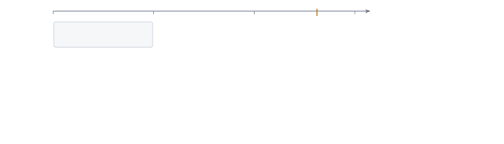
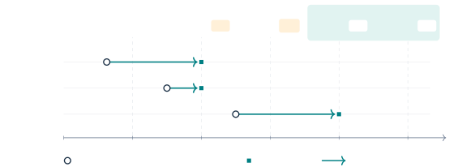

# Confucius4-R2T2: A Stable-Prefix Streaming ASR Model for Real Real-Time Transcription

Daniel Huang ^(†)^(†)thanks: NetEase Youdao, Beijing, China.
Corresponding author: huangd@rd.netease.com.    Qi He²²footnotemark: 2
   Shaoxiong Duan ^(†)^(†)thanks: UC San Diego. s4duan@ucsd.edu.   
Yingjie Li²²footnotemark: 2    Qiao Cheng²²footnotemark: 2    Yitao
Duan²²footnotemark: 2

###### Abstract

Streaming speech recognition is increasingly consumed by machines, such
as translators and voice agents, that act on each token as it appears. A
token that is later revised costs wasted work or a wrong action. In this
work, we present Confucius4-R2T2 (short for Real Real-Time
Transcription), a stable-prefix streaming ASR model that never modifies
its earlier output while maintaining high accuracy and low latency. R2T2
is obtained by post-training Qwen3-ASR-1.7B on 1,500 hours of Chinese
and English audio while freezing its pre-trained audio encoder and
projector. The adaptation is based on the concept of _Longest Stable
Prefix_ (LSP), a new notion that we introduce in this work. We prove
that LSP is monotone under the prefix order, consistent with the
full-audio output, and maximal among labels that equal a whole earlier
output. Learning from LSP labels converts a full-context model into a
stable-prefix streaming one _without_ any architectural change.
Extensive evaluations show that R2T2 brings streaming recognition close
to the base model’s full-context quality while delivering stable text
with low emission lag. Its gains extend beyond the post-training
languages, demonstrating a practical path from full-context ASR to
stable streaming. We open-source the model weights and code at
[https://huggingface.co/netease-youdao/Confucius4-R2T2](https://huggingface.co/netease-youdao/Confucius4-R2T2)
and
[https://github.com/netease-youdao/Confucius4-R2T2](https://github.com/netease-youdao/Confucius4-R2T2).

## 1 Introduction

Streaming automatic speech recognition (ASR) must produce useful
transcriptions while audio is still arriving. The rapid advance of large
language models (LLMs) with strong reasoning and tool-use capabilities
increases the demand for partial transcripts to be consumed immediately
by something else: a live caption on a screen, a downstream machine
translation system, or a voice AI agent that must decide when to respond
and which tool to call. In all of these settings, an emitted token is an
_action_, in the sense that downstream components start working on it. A
well-documented failure mode is that tokens emitted early are later
revised as more audio arrives, a phenomenon variously called _flicker_
(Shangguan et al., 2020), _revision_ (Niehues et al., 2018), or
_hypothesis instability_ (Bruguier et al., 2023). When the recognizer
revises a token, the consumer must discard or redo the work built on it,
and a human reader sees the text change. A revision is therefore not a
cosmetic defect. It is wasted computation and, in an agent, a possibly
wrong side effect. This irreversibility is why _output stability_,
meaning that earlier output is never modified by later output, matters
as much as accuracy and latency.

Stability has been recognized as a practical concern for some time, and
prior work addresses it from different perspectives and under different
terms. Some methods rely on inference-time commitment rules. Liu et al.
(2020) introduce _local agreement_, which commits only the longest
common prefix of two consecutive partial hypotheses. Polák et al. (2022)
extend this to the beam level, call the committed output a _stable
prefix_, and compare several commitment strategies (Hold-$`n`$,
LA-$`n`$, SP-$`n`$). Arivazhagan et al. (2020) propose _target-suffix
deletion_ (mask-$`k`$), which discards the last $`k`$ tokens of each
partial hypothesis. A complementary line trains for stability
indirectly. _Prefix training_ (Niehues et al., 2016; Niehues et al., 2018) exposes the model to randomly truncated training pairs, and
self-training (Sen et al., 2023) further improves the flicker–latency
trade-off. Both lower the revision rate, but neither guarantees that
earlier tokens are never revised. In simultaneous machine translation,
Hoang et al. (2026) train on stable-prefix targets and obtain stability
by construction through prefix decoding.

In this work, we present Confucius4-R2T2, a streaming ASR model that
treats output stability as a first-class requirement. Before proceeding,
we state precisely what we require of such a model, because the word
“stable” has been used for different objects such as a statistic of a
system’s output over time (McGraw and Gruenstein, 2012), an
inference-time commit rule applied to an unchanged model (Liu et al.,
2020), or a training target (Hoang et al., 2026).

###### Definition 1 (Stable-prefix streaming ASR model).

Let $`x_{\leq t}`$ be the audio received up to time $`t`$. A streaming
ASR model $`\mathcal{M}`$ is a recognizer together with its decoding
strategy. Let $`y_{t}=\mathcal{M}(x_{\leq t})`$ be its released text at
time $`t`$. $`\mathcal{M}`$ is a _stable-prefix_ streaming ASR model if,
for every audio signal $`x`$ and all $`t\leq t^{\prime}`$,
$`y_{t}\preceq y_{t^{\prime}}`$, where $`\preceq`$ denotes the prefix
order.

We highlight two key properties. First, it is purely _behavioral_. It
constrains only the ordering of outputs, not mechanisms such as causal
encoders or chunked attention, nor training recipes. Such mechanisms are
neither sufficient (a causal encoder can feed a decoder that still
revises) nor necessary (a bidirectional encoder behind a non-retracting
commit rule is stable). Second, stability is _orthogonal_ to accuracy
and latency. A system that emits nothing until the end of the utterance
is stable but slow, and one that emits a fixed token sequence is stable
but inaccurate. Accuracy and latency already have well-calibrated
metrics, so we treat stability as a _constraint_ to be satisfied while
optimizing them. These considerations motivate our definition of the
longest stable prefix in Section 4.3, leading to some subtle but
important differences from related concepts, and enabling an effective
non-streaming-to-streaming adaptation method.

Confucius4-R2T2, short for Real Real-Time Transcription, is a
stable-prefix streaming ASR model built by post-training Qwen3-ASR-1.7B
on $`1{,}500`$ hours of additional Chinese and English audio. It retains
the pre-trained audio encoder and its bidirectional processing within
the available audio window, so the encoder is neither causalized nor
masked. Confucius4-R2T2 supports configurable chunk sizes from $`80`$ ms
to $`2`$ s. Our main contributions are as follows:

1.  1.  We introduce a new concept of Longest Stable Prefix (LSP) and prove
        a number of its properties. We show that our definition provides the
        label that can be extracted from a non-stable model to train a
        stable one. We prove that our label is monotone under the prefix
        order, consistent with the full-audio output, and maximal among
        labels that equal a whole earlier output.
2.  2.  We present LSP learning, a two-stage training recipe that converts a
        full-context model into a stable-prefix streaming model with LSP
        labels, without causalizing the encoder or using attention masks.
3.  3.  We open-source Confucius4-R2T2 and conduct extensive evaluations on
        a range of benchmarks. Our experiments show that Confucius4-R2T2
        achieves state-of-the-art performance in terms of recognition
        accuracy (approaching full-context recognizers) and latency, even
        compared against proprietary models, while maintaining a
        stable-prefix guarantee.

## 2 Related Work

Streaming ASR trades off accuracy, emission latency, and output
stability. We organize prior work by which of these it controls.
Stability, meaning that emitted text is never revised, is a property of
the whole model, including its decoding and commit rule, not of the
encoder alone.

#### Architectures.

Streaming architectures bound the acoustic context seen by the encoder,
through monotonic attention (Chiu and Raffel, 2018), or through chunked,
cascaded, or dual-mode models that serve both streaming and full-context
operation (Yu et al., 2021; Zhang et al., 2021; Wu et al., 2021;
Narayanan et al., 2021). Released systems include the streaming
Zipformer transducer X-ASR (Guo, 2026) and the cache-aware
FastConformer–RNNT model Nemotron 3.5 (NVIDIA, 2026). Pre-trained
full-context models have also been converted for streaming, by adding a
CTC branch with streaming attention masks (Zhou et al., 2025) or by
causalizing the encoder (Krichli et al., 2026). These designs decide how
context is processed. They do not by themselves guarantee that emitted
text is final.

#### Output stability.

Work on stability falls into three groups. _Measurement:_ McGraw and
Gruenstein (2012) call a prefix stable if all later incremental results
share it, and estimate, per word, the probability of this event so that
a client can display the longest prefix above a threshold; Shangguan et
al. (2020) analyze instability of partial hypotheses. _Inference-time
repair:_ reranking favors consistency with earlier output (Bruguier et
al., 2023), while Local Agreement and hold-$`n`$ commit a common prefix
of successive hypotheses or withhold their last $`n`$ tokens (Liu et
al., 2020). The same idea is used with frozen Whisper models (Macháček
et al., 2023; Wang et al., 2024), and the Qwen3-ASR-1.7B configuration
in our comparisons re-decodes accumulated audio and revises an
unconfirmed suffix (Shi et al., 2026). These are per-step rules. Paired
with a buffer that never retracts, they yield non-retracting output, but
the underlying recognizer keeps revising and agreement is not learned.
_Training:_ in simultaneous translation, Hoang et al. (2026) train on
targets anchored to the translation of the complete source, keeping the
committed length nondecreasing, and obtain flicker-free output by
decoding with the committed prefix forced. Our target follows the same
final-anchored principle.³³ 3 We became aware of Hoang et al. (2026),
which was released very recently, after our method was developed; the
two lines of work were pursued independently. It differs in crediting a
raw output only when the whole output is a prefix of the full-audio
output, and it is used in speech recognition.

#### Emission timing in speech language models.

Speech ReaLLM defers generation with a BLANK token and alignment-based
training (Seide et al., 2024), SpeechLLM-XL uses chunk-aligned targets
from CTC alignment (Jia et al., 2025), and Voxtral Realtime learns
delayed emission from timestamp-based targets with non-emitting padding
(Mistral AI, 2026b). Other work learns segmentation policies or derives
read/write decisions at inference from output confidence (Wan et al.,
2026; Guo et al., 2025). These methods time emission against the
acoustics. We instead time it against what the full-context model will
output.

## 3 Preliminaries

### 3.1 Notation

Let $`x=(x_{1},\dots,x_{T})`$ be an utterance of $`T`$ audio frames of
$`\delta=80`$ ms, and $`x_{\leq t}`$ its first $`t`$ frames. The
recognizer $`\mathcal{M}`$ maps any audio prefix to a token sequence.
Write

```math
\displaystyle\bar{y} \displaystyle=\mathcal{M}(x), \tag{1}
```

```math
\displaystyle y_{t} \displaystyle=\mathcal{M}(x_{\leq t}),\qquad n_{t}=|y_{t}|, \tag{2}
```

```math
\displaystyle\ell_{t} \displaystyle=\bigl|\mathrm{lcp}(y_{t},\bar{y})\bigr|, \tag{3}
```

where $`\operatorname{lcp}(\cdot)`$ denotes the longest common prefix
shared by all input sequences and $`\bar{y}`$ is the _full-context
output_, not a human reference: it is what the same model produces when
it sees the whole utterance (so $`y_{T}=\bar{y}`$). We write
$`u\preceq v`$ if $`u`$ is a prefix of $`v`$. In streaming operation the
model is queried every $`\Delta`$, a chunk length that is a multiple of
$`\delta`$. At each query the encoder is applied to the audio received
so far, so the representations of $`x_{\leq t}`$ may differ from those
of the first $`t`$ frames of the full utterance.

### 3.2 Goals

Besides the stable-prefix property (Definition 1), we aim for:

- •
  High accuracy: WER comparable to full-context ASR models of similar
  size.
- •
  Low latency: below 500 ms at the smallest chunk sizes.
- •
  Configurability: the chunk length $`\Delta`$ is configurable to
  prioritize either quality or speed, without retraining.
- •
  Unified dual-mode model: the same model runs in streaming and
  full-context modes, and recovers most of the full-context quality in
  the latter.

### 3.3 Challenges

The key issue in streamizing a model is _context bounding_: how much
context is appropriate (sufficient but not excessive) to decode the
right content? This needs a target for what the model should emit at
time $`t`$, and a practical way to label that target at scale.

Targets. A forced aligner such as Qwen3-ForcedAligner (Shi et al., 2026)
gives word timestamps, which could serve as context boundaries. However,
a token’s own acoustic features are often insufficient to determine it,
and later audio disambiguates; requiring emission at the timestamp would
force the model to guess.

Residual interference. More context is not always better. Revision of
earlier words as audio arrives is a known effect (McGraw and Gruenstein,
2012; Shangguan et al., 2020). In our setting, when we feed audio
progressively to a full-context model, the number of correct tokens does
not grow monotonically, because the newly appended tail disturbs earlier
tokens, a phenomenon we call residual interference. A streaming model
must be trained to be resilient against such interference.

Prior work bounds context by construction, through chunk-wise
incremental decoding (Shi et al., 2026) or limited look-ahead (Wang et
al., 2020; Moritz et al., 2020), rather than learning when the available
context suffices.

## 4 Approach

### 4.1 Design Considerations

Accuracy and latency conflict, and the stable-prefix property is trivial
to obtain if either is ignored. The open problem is stability _together
with_ full-context accuracy and low latency.

We therefore adapt a full-context model with a _frozen encoder_: no
causalization or attention masks. A pre-trained model brings strong
representations, data efficiency and a within-model reference for
measuring streaming loss (Kumar et al., 2025). Its main liability is the
train–test mismatch: the encoder was trained on complete utterances, so
its representations of truncated audio differ from those of the full
utterance. XLSR-Transducer (Kumar et al., 2025), Two-Pass Whisper (Zhou
et al., 2025) and Chunked AED (Zeineldeen et al., 2024) address the
mismatch by training the encoder with chunking or masking. Since our
encoder is frozen, we address it in the decoder, through
longest-stable-prefix learning: the decoder learns to emit Wait when the
audio received so far does not determine the next token. The mismatch is
thus handled by deciding when to commit, not by changing the
representations.

Freezing the encoder keeps the bidirectional representations that give
the pre-trained model its accuracy, and leaves full-context decoding to
depend only on the decoder. Causalization is costly: Krichli et al.
(2026) report that causalizing Whisper’s encoder by LoRA fine-tuning is
worse than leaving it intact at chunk sizes above roughly 300 ms. A
primary motivation for causal encoders is computational efficiency,
since a bidirectional encoder must be re-run on the growing audio at
each query. We show that this cost can be reduced with inference
optimizations such as cache reuse and Wait-terminated decoding
(Section 7).

The Wait token separates the timing decision (when to emit) from the
content decision (what to emit) in the supervision, rather than building
timing into the encoder. DSM and F-DSM (Takagi et al., 2026) also
separate the two decisions in LLM-based streaming ASR. Unlike F-DSM’s
factorized head, our Wait is a token in the same vocabulary as the text
tokens without any architectural change. This remains a recognition
task, and streaming behavior emerges when the model learns to emit the
right content against residual interference, making near-lossless
streaming conversion a natural consequence of the design rather than an
empirical coincidence.

### 4.2 Architecture

R2T2 is post-trained from Qwen3-ASR-1.7B, which consists of the
Qwen3-1.7B LM, a projector, and an AuT encoder with 300M parameters and
a hidden size of 1,024. AuT is an attention-encoder-decoder (AED) based
ASR model that downsamples Fbank features by a factor of eight, yielding
a 12.5 Hz token rate. It also uses a dynamic flash attention window size
ranging from 1 s to 8 s, which we utilize to implement encoder caching
(Section 7). Other than that, there is no architectural change. In
particular, no additional layers or heads are added.

### 4.3 Longest Stable Prefix Learning

We address the challenges mentioned in Section 3.3 with Longest Stable
Prefix (LSP) learning. The term was first introduced by McGraw and
Gruenstein (2012) to describe an ideal path that an incremental speech
recognizer’s results could follow. Another related but different object
was introduced for training in simultaneous translation by Hoang et al.
(2026). In this section, we first present our definition and highlight
their differences and the consequences. We give the topic a detailed and
rigorous treatment in Appendix A.

###### Definition 2 (Model-admissible final-anchored prefix).

The _longest stable prefix_ at time $`t`$ is
$`L_{t}=\mathrm{LSP}(\mathcal{M},x,t)=\bar{y}_{1..m_{t}}`$, where

```math
m_{t}\;=\;\max_{j\leq t}\;n_{j}\cdot\mathbf{1}\!\left[\,y_{j}\preceq\bar{y}\,\right], \tag{4}
```

and $`m_{t}=0`$ (so $`L_{t}=\emptyset`$) if no output so far is a prefix
of $`\bar{y}`$.

We call a label _model-admissible_ at $`t`$ if it _equals_ an output the
model produced from audio available at $`t`$, that is, $`y_{j}`$ for
some $`j\leq t`$; a truncation of one output, or a string assembled from
several, is not model-admissible. In words, $`L_{t}`$ is the longest
earlier output that is _entirely_ a prefix of $`\bar{y}`$. It is
therefore model-admissible, it never shrinks, and $`L_{T}=\bar{y}`$.

#### Comparison.

None of the three definitions says anything about accuracy, since
$`\bar{y}`$ is itself a model output. They differ along two axes
(Table 1): what the prefix is anchored to, and whether the label is
model-admissible.

The two anchors are close but different. Because
$`y_{T}=\mathcal{M}(x)=\bar{y}`$, the full-context output _is_ the last
output of the run, so the all-future criterion also requires agreement
with $`\bar{y}`$; no definition is $`\bar{y}`$-blind. What the
all-future criterion adds is agreement with every _intermediate_ output,
and that is what can shorten it: a prefix shared by $`y_{t}`$ and
$`y_{T}`$ may be broken by some $`y_{t^{\prime}}`$ with
$`t<t^{\prime}<T`$ and restored later. The other two test the endpoint
only.

###### Example 1 (Appendix A, Example 3).

Let $`\bar{y}=`$“a b c d e” and let the run produce $`y_{1}=`$“a b c x”,
$`y_{2}=`$“a b”, $`y_{3}=`$“a b c d e”. At $`t=2`$ the all-future label
and ours are both “a b”; the final-anchored label is “a b c”, through
the agreeing head of $`y_{1}`$, whose tail diverges. No output of the
run equals “a b c”. At $`t=3`$ all three name the whole utterance.

###### Example 2 (The all-future label (Definition 3) is the strictest mid-run).

Let $`\bar{y}=`$“a b d” and let the run produce $`y_{t}=`$“a b”,
$`y_{t+1}=`$“a c”, $`y_{t+2}=`$“a b d”. At $`t`$ the all-future label is
“a”, since its second token does not survive $`y_{t+1}`$, while ours and
the final-anchored label are “a b”.

The final-anchored label contains the other two and is therefore the
longest of the three, but it is not model-admissible: Example 1
separates it from ours, Example 2 separates the all-future label from
both, and all three coincide once the raw outputs already form an
append-only chain (Propositions 1–4).

| Formulation             | Anchored to                             | Equals a whole earlier output | Credit                              |
| ----------------------- | --------------------------------------- | ----------------------------- | ----------------------------------- |
| All-future (Def. 3)     | all later outputs, $`\bar{y}`$ included | not in general                | partial                             |
| Final-anchored (Def. 4) | $`\bar{y}`$                             | not in general                | partial, $`\max_{j\leq t}\ell_{j}`$ |
| Ours (Def. 2)           | $`\bar{y}`$                             | yes, by construction          | all-or-nothing                      |

Table 1: Three hindsight prefix definitions, with
$`\ell_{j}=|\mathrm{lcp}(y_{j},\bar{y})|`$. All-future is due to McGraw
and Gruenstein (2012), final-anchored to Hoang et al. (2026). The third
column is model admissibility in the strict sense; under the weak
reading (prefix of an earlier output), all three would qualify and the
column would not discriminate.

#### As a learning target.

The final-anchored label is a partial-credit maximum, so it can name a
string no output equals: the agreeing head of an output whose tail the
model itself revised. Supervising on it credits a state in which the
model had not settled, and the amount credited is decided by comparing
every past output with the complete $`\bar{y}`$, hence by audio that has
not arrived. Ours credits an output only if all of it agrees with
$`\bar{y}`$; the label is then always an output the model actually
produced (Proposition 7) and is the longest such prefix of $`\bar{y}`$
(Theorem 1). The all-future label is a truncation of $`y_{t}`$ and, as
Example 2 shows, can be shortened by an intermediate output that departs
and returns; in general it equals no earlier output.

The price is conservativeness. One diverging token zeroes the credit for
that step, so our label is never longer than the final-anchored one and
biases the model toward later emission. We accept this to keep
admissibility, and measure its effect in Section 5.1.

## 5 Training Data Construction

The training data for streamization comprise approximately $`1{,}500`$
hours of proprietary Chinese and English audio. ASR models can
hallucinate on non-speech audio, degrade under noise and reverberation,
or translate instead of transcribing when language cues conflict.
Therefore we augment training examples to target these failure modes.
Noise augmentation includes pure-noise replacement and mixed-noise
injection, with additive-noise signal-to-noise ratios (SNRs) sampled
from 10–35 dB. We also apply reverberation using real or simulated room
impulse responses. Additionally, we flip the language tag for a subset
of Chinese and English samples while keeping the transcription target
unchanged.

### 5.1 Streamability: Selecting the Right LSP Supervision

LSP is model-specific and its quality is actually measurable. Indeed, to
select a good teacher or backbone model, it is necessary to quantify the
model’s potential for streamization. For this purpose we introduce the
notion of streamability. The length
$`l_{x,t}=|\mathrm{LSP}(\mathcal{M},\,x,\,t)|`$ reflects the number of
tokens $`\mathcal{M}`$ produces when seeing $`x_{\leq t}`$ that are in
agreement with the output when it sees the full input sequence. From a
streaming perspective, greater $`l`$ means shorter latency. If we
marginalize over data, we can have for any time $`t`$

```math
l(\mathcal{M},t)=\frac{1}{|\mathcal{N}(t)|}\sum_{x\in\mathcal{N}(t)}|\mathrm{LSP}(\mathcal{M},\,x,\,t)| \tag{5}
```

where $`\mathcal{N}(t)=\{x:|x|\geq t\}`$ is the set of data samples
whose lengths are at least $`t`$, so it is meaningful to count their
LSPs.

We can plot the curve of $`l(\mathcal{M},t)`$ against $`t`$. The two
variables can also be normalized to make the patterns more prominent:
each data point $`(t,l_{x,t})`$ is transformed into
$`(\tau_{x,t},\bar{l}_{x,t})`$ where $`\tau_{x,t}=t/|x|`$, and
$`\bar{l}_{x,t}=|\mathrm{LSP}(\mathcal{M},x,t)|/|\mathcal{M}(x)|`$ with
$`\mathcal{M}(x)`$ being the full-utterance transcript.
$`(\tau_{x,t},\bar{l}_{x,t})`$ is then aggregated across $`x`$:

```math
\bar{l}(\mathcal{M},\tau)=\frac{1}{|\mathcal{N}(0)|}\sum_{x}\bar{l}_{x,t=\tau|x|} \tag{6}
```

We can also further aggregate across time and obtain $`s(\mathcal{M})`$
= AUC (area under the curve), which we define as $`\mathcal{M}`$’s
streamability. It is a single measurement for a model’s responsiveness
when fed with an incremental audio sequence. We use it to evaluate both
a base model’s streamization potential and a teacher model’s annotation
quality.

Figure 1 shows both the unnormalized (Equation 5, left) and normalized
(Equation 6, right) streamability plots for a number of models on 1,860
English utterances from the selected Buckeye Speech Corpus (Pitt et al., 2007) subset, which contains manually verified word-level timestamps
providing a timing reference. For each model and utterance, we construct
LSP targets from cumulative audio prefixes at 80 ms intervals.


Figure 1: Streamability plots on 1,860 Buckeye utterances. The curves
compare Qwen3-ASR-1.7B, Qwen3-ASR-0.6B, Whisper large-v2, and WhisperRT,
with manually timestamped ground truth as a timing reference. Left:
unnormalized (Equation 5). Right: normalized (Equation 6). Insets report
AUC over the displayed domains.

Qwen3-ASR-1.7B achieves the highest normalized streamability of 0.493,
indicating the greatest potential for streaming adaptation among the
evaluated models. WhisperRT, which is a streaming variant of Whisper
large-v2 constructed by fine-tuning its encoder with a causal attention
mask and adapting the encoder-decoder alignment, performs the worst
among the models. Interestingly, its streamability is worse than its
full-context base model’s (red line). This is caused by the instability
of its output, resulting in much shorter LSPs.

Several curves exceed the timestamp-based reference (black line) during
the final part of normalized time. This indicates greater relative
progress toward their respective final transcripts. Because the model
and ground-truth transcripts can differ in content and length, this
observation alone does not establish that corresponding words were
correctly predicted before their acoustic ends. Such an interpretation
would require an additional word-aligned analysis.

We find in practice that $`s(\mathcal{M})`$ is a good indicator of a
full-context model’s responsiveness. We use it to assess the model’s
potential for streamization. However, whether it can serve as a solid
gauge for general streamization (e.g., simultaneous translation) remains
open. In addition, R2T2 uses a self-distillation approach, avoiding
cross-model teacher–student distribution mismatch. Whether a stronger
teacher model could produce more capable streaming models is also open.
We believe both issues are interesting directions for future
exploration.

### 5.2 LSP Annotation

Given a model $`\mathcal{M}`$, the audio sequence
$`x=(x_{1},\ldots,x_{T})`$ is fed into $`\mathcal{M}`$ progressively
frame-by-frame at an interval $`\delta=80\,\mathrm{ms}`$ to produce
$`\mathrm{LSP}(\mathcal{M},\,x,\,t)`$. During the same process, we also
record the intervals where the model’s output agrees with its LSP. These
are the “stable” regions of the model. We merge consecutive stable
regions into intervals and label them by their starting and ending
timestamps $`I_{i}=[s_{i},e_{i}]`$. Each interval is a maximal run of
consecutive audio-prefix endpoints at which the teacher hypothesis
equals the LSP and that prefix remains unchanged. The start $`s_{i}`$ is
the first endpoint in the run, and the end $`e_{i}`$ is the last; an
uncertain continuation or a change of prefix ends the run. We store each
interval with its corresponding stable prefix.

Outside the stable intervals, the model’s outputs are unstable.
Therefore, the model should learn when to defer uncertain continuations
with a special Wait token.

During training, we cut each sample at a random position $`t`$ and
discard the subsequence $`x_{>t}`$, simulating the situation where the
model sees only $`x_{\leq t}`$. The corresponding label is

```math
y_{t}^{*}=\begin{cases}\mathrm{LSP}(\mathcal{M},x,t),&\exists i:\ s_{i}\leq t\leq e_{i},\\[2.0pt]
\mathrm{LSP}(\mathcal{M},x,t)\oplus\textnormal{{Wait}}{},&\text{otherwise}.\end{cases} \tag{7}
```

Figure 2 illustrates the construction: blue marks agreement with a
stable prefix, and orange marks uncertain continuations for successive
hypotheses.



Figure 2: Stable-prefix interval extraction. A teacher ASR model decodes
progressively longer audio prefixes every 80 ms. Each row shows the
complete recognition hypothesis. Blue indicates predictions matching the
stable reference prefix, whereas orange indicates uncertain
continuations requiring waiting. Intervals $`I_{i}=[s_{i},e_{i}]`$
describe the persistence of each stable prefix. Checkpoints with
unstable continuations fall outside these intervals.

The extracted stable-prefix intervals and waiting annotations provide
temporal supervision for streaming commitment. Cuts within stable
intervals supervise the stable transcription, while cuts in the gaps add
an explicit waiting signal. Only the prefix content is inherited from
the preceding annotation endpoint; the waiting decision uses $`t`$
directly. Before the first endpoint, the target consists only of Wait.
At $`t=T`$, we use the complete reference transcription, preserving the
original offline recognition objective.

This formulation jointly supervises lexical recognition and emission
timing. By separating stable content from uncertain continuations, the
model learns to preserve previously recognized text while deferring
predictions that require additional acoustic context, supporting the
output monotonicity constraint.

## 6 Training

Confucius4-R2T2 is trained in two stages: supervised fine-tuning (SFT)
and reinforcement learning (RL). SFT familiarizes the model with LSP
output and the Wait token and improves its resilience to residual tail
interference common in streaming but not experienced during its
pre-training. RL further enforces the model’s ability to trade off
quality and speed while suppressing undesired behaviors such as
unsupported continuations, repetitions, language inconsistency, and
hallucinated speech on no-speech inputs. The audio encoder and projector
are frozen during both stages. This preserves the pre-trained acoustic
representations and their projection into the language decoder’s input
space. Freezing these components also reduces the number of trainable
parameters and avoids storing their gradients and optimizer states.

### 6.1 Supervised Fine-Tuning

SFT uses a cross-entropy loss to adapt the model to LSP targets and the
Wait action. Training runs for one epoch using fused AdamW, an initial
learning rate of $`10^{-5}`$, $`2\%`$ warmup followed by linear decay,
and an effective global batch size of 64. During SFT, only the
language-decoder parameters are tuned. This focuses adaptation on the
LSP response format and emission timing in the decoder.

#### Acoustic Context and Prefix Sampling.

The encoder attention window is also sampled between $`1`$ and $`8`$
seconds to train commitment behavior under varying amounts of acoustic
context, while preserving bidirectional attention within each window.

Each example uses the complete utterance and its full transcription with
probability $`10\%`$; otherwise, we sample a prefix cut ($`90\%`$).
Conditional on choosing a prefix cut, the supervision timestamp is
sampled within an LSP stable interval with probability $`50\%`$ and in a
gap between these intervals otherwise. Cuts may fall between annotation
endpoints. The recognizer receives audio from the start of the utterance
to the sampled timestamp. Complete-utterance examples supervise offline
recognition; interval cuts supervise stable-prefix transcription, and
gap cuts additionally supervise waiting through Equation 7.

### 6.2 Reinforcement Learning

Starting from the SFT model, we apply Group Relative Policy Optimization
(GRPO) (Shao et al., 2024) to refine recognition quality and waiting
behavior. For each prompt, the model samples multiple streaming
trajectories and uses their relative rewards to guide policy
optimization. Rollouts span one, two, or four streaming turns, allowing
continuations to be assessed as additional audio arrives.

#### Reward Design.

To refine the model’s recognition accuracy and emission behavior, we
employ a multi-dimensional reward function during GRPO training.
Character Error Rate (CER) provides the primary recognition signal,
while complementary rewards penalize redundant predictions, repetitions,
language inconsistencies, and premature continuation at uncertain
acoustic boundaries.

The reward consists of eight components, summarized in Table 7. The Tail
and Cut Marker components are designed to discourage unsupported
continuation and supervise the placement of the Wait token. The
remaining components score recognition fidelity and penalize selected
hallucination patterns. Component-specific effects require controlled
ablations.

For a generated response $`y_{t}`$ and its supervision target
$`y_{t}^{\ast}`$, the raw reward combines the individual components
using predefined weights, with special-case rules for empty,
exact-match, and other degenerate predictions. The final reward is
obtained through a smooth nonlinear transformation:

```math
R(y_{t},y_{t}^{\ast})=\tanh\!\left(3R_{\mathrm{raw}}(y_{t},y_{t}^{\ast})\right), \tag{8}
```

where $`R_{\mathrm{raw}}`$ denotes the weighted reward after applying
the special-case rules.

Details for both stages are provided in Appendix B.

## 7 Streaming Inference

The encoder produces one audio token every $`\delta=80`$ ms but the
model is configurable to decode at a coarse granularity, i.e.,
performing chunk-wise decoding with chunk size $`\Delta=k\delta`$  to
trade quality for speed. At the $`\Delta=160`$ ms chunk used in our main
results, R2T2 performs 6.25 updates per second for each stream. A
less-than-1 RTF (Real Time Factor) requires that every update finishes
before the next chunk arrives. This section describes how we keep the
cost of an update low enough to meet that assumption.

For models whose decoder input places audio before the transcript,
repeated-prefix decoding reprocesses accumulated audio and text, as in
Qwen3-ASR-1.7B streaming (Shi et al., 2026). In the 2 s, $`U=5`$
reference in Table 3, each update re-encodes all audio received so far
and pre-fills the decoder with the audio representations and the
previous transcript, excluding its last five tokens, which are
regenerated. The first two chunks are decoded without a transcript
prefix, and no cache is retained across updates (Qwen Team, 2026).

To reduce cost without modifying the model or the output monotonicity
constraint, we introduce four techniques: cache reuse (Section 7.1),
Wait-terminated decoding (Section 7.2), bounded context (Section 7.3),
and pre-fill verification of the revisable suffix (Section 7.4). Through
LSP training (Section 6), the model emits only the stable prefix
supported by the received audio and defers the uncertain tail with Wait.
Its output therefore never needs to be rolled back, and an update that
predicts Wait ends right after the pre-fill. Recomputation of old audio
is removed by caching, which the 8-s attention windows of the
Qwen3-ASR-1.7B encoder make possible, and the context is bounded so that
the cost per update does not grow over long streams. None of these
optimizations changes the trained model.

At inference, a provisional-token budget $`U`$ can be used to delay the
commitment of a suffix of predicted text so that subsequent updates can
reconsider it. This withholding principle is related to the hold-$`n`$
policy of Liu et al. (2020). For $`U>0`$, the decoder may use the
provisional suffix, but only released text enters the committed history.

Table 2 compares the resulting work per update with that of
Qwen3-ASR-1.7B and of a causal interleaved design (Seide et al., 2024),
which we include as a theoretical reference and did not implement. In
that design, the encoder is fully causal, and the decoder input
alternates between audio chunks and the text committed after each of
them. Since no earlier state ever changes, each update processes only
the new chunk. We did not adopt this design for two reasons. First, it
requires training a causal encoder and retraining the decoder on
interleaved sequences, whereas R2T2 keeps the pre-trained Qwen3-ASR-1.7B
encoder frozen. Second, it cannot revise its output, because generated
text is never re-read under later audio; this rules out the
quality-priority mode ($`U=1`$). The price of keeping the Qwen3-ASR-1.7B
architecture is that R2T2 re-encodes the active window and re-pre-fills
the retained text at every update. Both are bounded, and the pre-fill
processes them in parallel rather than serially.

| Design | Encoder       | Decoder pre-fill     | Serial steps | Revisable  | Trained          |
| ------ | ------------- | -------------------- | ------------ | ---------- | ---------------- |
| QS^(†) | all audio     | all audio + text     | $`5\,+`$ new | last 5     | —                |
| R2T2   | active window | active window + text | new          | last $`U`$ | language decoder |
| CI^(‡) | new chunk     | new chunk            | new          | none       | enc. + dec.      |

Table 2: Work per update for three streaming designs. All audio grows
with the stream at 12.5 positions per second, the active window holds at
most 8 s (100 positions), and text is the retained transcript, which is
bounded only in R2T2 (Section 7.3). New is the number of newly generated
tokens, which is zero when R2T2 predicts Wait. Revisable gives the
trailing tokens that the next update may change: Qwen3-ASR-1.7B
regenerates them, whereas R2T2 verifies them in the pre-fill. Trained
lists the components trained on top of Qwen3-ASR-1.7B. For R2T2, only
the language decoder is trained; the audio encoder and projector remain
frozen. ^(†) Qwen3-ASR-1.7B Streaming. ^(‡) Causal interleaved
(theoretical; not implemented).

### 7.1 Cache Reuse

Figure 3 shows the decoder input at update $`k`$: the prompt head, the
encoder outputs of the retained audio, the prompt tail, the committed
transcript $`c_{k-1}`$, and, if $`U>0`$, the revisable suffix
$`r_{k-1}`$ of at most $`U`$ tokens.



Figure 3: Decoder input at update $`k`$ with $`W=1`$ retained window.
The encoder outputs and KV cache of completed windows are reused,
whereas the active window, the prompt tail, and all retained text are
pre-filled again at every update because new audio precedes the text.

Encoder-Side Caching. The Qwen3-ASR-1.7B encoder attends within
non-overlapping windows, whose size we fix to 8 s at inference. Once a
window is complete, its outputs no longer depend on later audio and can
be cached. Only the active window is re-encoded at each update; it grows
from 2 to 100 positions over its 50 updates.

Decoder-Side Caching. The prompt head and the completed windows form a
prefix of the decoder input that is identical across updates, so their
KV cache is reused. Everything after this prefix is pre-filled again at
each update: the active window, the prompt tail, and the retained text.
This includes the committed text: its tokens are fixed, but the audio
preceding it has changed, and so have its KV entries.

### 7.2 Wait-Terminated Decoding

The prediction at the last pre-fill position is the first action of each
update. If it is Wait, the update ends without any serial decoding step;
otherwise, the model decodes greedily until it predicts Wait or EOS. The
number of serial steps therefore follows the amount of newly generated
text, and updates that fall in silence or where the continuation is not
yet stable cost a single pre-fill. Qwen3-ASR-1.7B, in contrast,
regenerates five tokens at every update whether or not new speech has
arrived, which at 160 ms amounts to 31.25 serial steps per second.

### 7.3 Bounded Context

Caching removes completed audio from the recomputation but not from the
context: the cached windows and the re-pre-filled transcript still grow
with the stream. We therefore retain only the $`W`$ most recent
completed windows in addition to the active one, and evict each older
window together with the text committed before that window ends. Because
text is always committed after the audio it transcribes, eviction never
removes the transcript of retained audio, which would otherwise be
transcribed a second time. The context is thus limited to $`8(W{+}1)`$ s
of audio and its transcript. We use $`W=1`$, in line with prior findings
that LLM-based streaming ASR needs only limited left context (Jia et
al., 2025). Since eviction changes the left context of the retained
window, its KV cache is rebuilt once per eviction, i.e., once every 8 s.

### 7.4 Pre-fill Verification

With $`U>0`$, the last $`U`$ generated tokens remain revisable. Instead
of regenerating them as Qwen3-ASR-1.7B does, we verify them in the
pre-fill. Since the previous suffix $`r_{k-1}`$ is part of the decoder
input, the pre-fill already yields the model’s greedy prediction at each
of its positions under the new audio. We keep the longest prefix of
$`r_{k-1}`$ that agrees with these predictions, truncate the KV cache at
the first disagreement, take the replacement token from the pre-fill
logits, and resume decoding. This is the verification step of
speculative decoding (Leviathan et al., 2023; Chen et al., 2023), with
the previous suffix as the draft. Under greedy decoding, it produces the
same output as regeneration up to numerical precision, and a suffix that
is still correct costs no decoding step. Qwen3-ASR-causal (Fuxa, 2026)
applies a similar check to the whole hypothesis; we restrict it to the
$`U`$-token suffix so that committed text is never revised. The accuracy
and latency effects of $`U`$ are analyzed in the next section.

## 8 Evaluations

### 8.1 Experimental Setup

We evaluate R2T2 on English and Chinese benchmarks and assess transfer
to ten additional languages; dataset and baseline details are provided
in Appendix C.1. The main comparison evaluates R2T2 with 160 ms chunks
under different provisional-token budgets $`U`$. Committed text remains
unchanged under the policy in Section 7.2. The chunk-size sweep in
Figure 6 uses the same R2T2 checkpoint and the same English and Chinese
cohorts. All R2T2 streaming evaluations use $`W=1`$, retaining one
completed audio window in addition to the active window (Section 7.3).
We group configurations by their output policy: stable-prefix models
preserve released text, whereas non-stable prefix models expose
revisable hypotheses. In the 2 s Qwen3-ASR-1.7B reference in Table 3,
all five rollback tokens ($`U=5`$) remain visible and can be revised as
more audio arrives. Figures 5 and 6 also include a base run at 2 s with
$`U=5`$ that withholds the provisional suffix and returns only committed
text, like R2T2.

Recognition Accuracy. We report English WER and Chinese CER after
standard text normalization. Macro averages give equal weight to each
dataset; the total macro average combines error percentages across all
13 main test sets, rather than pooling word and character edit counts.

Streaming Latency. For R2T2, we score normalized committed updates; the
final streaming transcript may differ from a full-context decode. Only
identical units (English words or Chinese characters) matched by
Levenshtein alignment contribute to retrospective emission lag, so it
should be interpreted alongside WER/CER. For each pair, the lag is the
audio time when its output prefix first becomes permanently stable minus
its Qwen force-aligned reference end time (Figure 4). We exclude
utterances with high recognition error from lag scoring.



Figure 4: Retrospective lag from Qwen-aligned reference word ends
(circles) to the end times when the corresponding transcript prefixes
become permanently stable (squares).

The lag is measured on the audio timeline and excludes execution,
queueing, transport, and rendering. It characterizes transcript
responsiveness when inference keeps pace with incoming audio, a
condition not verified by runtime measurements here. For APIs, we
estimate each update’s audio time from the amount of audio supplied;
these estimates are approximate because server-side buffering is
undisclosed.

### 8.2 Recognition Quality and Model Comparison

Table 3 reports the main recognition comparison, lists chunk sizes, and
marks revisable intermediate hypotheses with an asterisk (\*). Both R2T2
columns use 160 ms chunks: $`U=1`$ prioritizes recognition quality,
whereas $`U=0`$ prioritizes lower emission latency. The base model’s
full-context decode, obtained by decoding the complete utterance,
provides an offline WER/CER reference. The 2 s, $`U=5`$ base
configuration provides a strong accuracy reference, but with higher
emission lag (Figure 5).

|                     |             |         |         |         |         |        |             |              |                  |              |           |           |
| ------------------- | ----------- | ------- | ------- | ------- | ------- | ------ | ----------- | ------------ | ---------------- | ------------ | --------- | --------- |
| Dataset             | Open-source |         |         |         |         |        |             |              |                  | Proprietary  |           |           |
|                     | Base        | Base\*  | Base    | R2T2    |         | X-ASR  | WhisperRT\* | Nemotron 3.5 | Voxtral Realtime | AssemblyAI\* | Comm. A\* | Comm. B\* |
|                     | Offline     | 2 s     | 160 ms  | 160 ms  | 160 ms  | 160 ms | 200 ms      | 160 ms       | 160 ms           | min_latency  |           |           |
|                     |             | $`U=5`$ | $`U=1`$ | $`U=1`$ | $`U=0`$ |        |             |              |                  |              |           |           |
| English (WER, %)    |             |         |         |         |         |        |             |              |                  |              |           |           |
| AMI                 | 9.18        | 9.25    | 24.79   | 10.07   | 10.40   | 14.41  | 24.19       | 18.11        | 17.58            | 12.00        | 13.27     | 8.44      |
| Giga-clean          | 8.60        | 8.61    | 24.37   | 8.81    | 9.04    | 10.26  | 13.81       | 12.67        | 12.16            | 9.21         | 8.84      | 9.46      |
| LS-clean            | 1.62        | 1.67    | 18.37   | 1.91    | 2.12    | 3.86   | 4.70        | 3.71         | 3.05             | 1.89         | 1.73      | 1.25      |
| LS-other            | 3.39        | 3.54    | 25.74   | 4.12    | 4.55    | 9.64   | 9.86        | 8.27         | 8.70             | 3.37         | 3.57      | 2.48      |
| VoxPopuli           | 3.12        | 3.02    | 20.71   | 2.29    | 3.54    | 5.68   | 8.28        | 5.69         | 8.00             | 4.75         | 3.17      | 3.14      |
| Earnings22          | 6.26        | 6.68    | 29.72   | 7.61    | 9.06    | 15.95  | 35.08       | 17.22        | 12.12            | 7.47         | 10.32     | 8.96      |
| TED-LIUM            | 2.26        | 2.33    | 19.18   | 2.46    | 2.77    | 3.75   | 6.67        | 5.11         | 5.89             | 3.23         | 3.08      | 3.30      |
| EN-RealSI           | 6.84        | 6.54    | 13.76   | 7.33    | 8.84    | 8.97   | 35.36       | 10.69        | 18.08            | 9.73         | 8.73      | 17.05     |
| Chinese (CER, %)    |             |         |         |         |         |        |             |              |                  |              |           |           |
| Wenet-net           | 4.87        | 4.94    | 19.79   | 5.75    | 6.17    | 8.81   | N/A         | 24.70        | 27.36            | 12.91        | 5.13      | 4.79      |
| Wenet-meeting       | 5.85        | 5.97    | 20.38   | 6.74    | 7.34    | 11.33  | N/A         | 20.18        | 66.50            | 11.84        | 7.07      | 3.75      |
| SPEECHIO-06         | 5.90        | 6.10    | 24.47   | 7.19    | 7.43    | 7.86   | N/A         | 22.52        | 35.33            | 15.08        | 5.67      | 5.34      |
| SPEECHIO-07         | 6.15        | 6.19    | 21.16   | 7.29    | 7.94    | 11.22  | N/A         | 24.28        | 26.84            | 10.84        | 6.45      | 6.46      |
| CN-RealSI           | 2.91        | 3.34    | 10.72   | 3.27    | 3.98    | 4.92   | N/A         | 11.52        | 9.92             | 5.15         | 3.99      | 3.64      |
| Total macro average | 5.15        | 5.25    | 21.01   | 5.76    | 6.40    | 8.97   | N/A         | 14.21        | 19.35            | 8.27         | 6.23      | 6.01      |

Table 3: English WER and Chinese CER (%). Base denotes Qwen3-ASR-1.7B;
Offline uses full-context decoding. The total macro average combines
English and Chinese error rates with equal weight for each of the
datasets. Within each row, bold marks the lowest error; underlining
marks the lowest error within each open-source or proprietary group.
Base Offline and Base 2 s ($`U=5`$) are reference-only and excluded from
both highlighting comparisons. \* denotes revisable partial hypotheses;
N/A denotes unavailable results.

#### Adaptation and Recognition Quality.

The matched comparison in Table 3 shows that R2T2 develops strong
recognition with small audio chunks. At 160 ms and $`U=1`$, it improves
on the base model on every listed English and Chinese test set, reducing
the total macro recognition error by nearly three quarters. For
unadapted Qwen3-ASR-1.7B at 160 ms, initial $`U=0`$ runs showed severe
hallucination and unreliable termination, preventing usable
recognition-error evaluation. The main table therefore reports only
$`U=1`$ for this baseline at 160 ms. R2T2 also operates with $`U=0`$ at
this chunk duration. These findings suggest that R2T2 has learned to
transcribe partial audio and wait for additional context when needed,
consistent with the LSP supervision described in Section 5.2.

R2T2’s streaming recognition closes most of the gap to the base model’s
full-context performance, leaving a modest difference of about 0.6
percentage points. Some gap is expected, as resolving certain
ambiguities requires future context unavailable when streaming output is
committed. On VoxPopuli, it even outperforms the full-context reference.
R2T2 therefore delivers accurate recognition from small audio chunks
with stable-prefix output: once text is committed, it remains unchanged.
Figure 5 further relates this recognition quality to low emission lag.


Figure 5: English WER, Chinese CER, and retrospective emission lag for
the main streaming configurations and the two 2 s, $`U=5`$ base variants
with different output policies. Within each dataset, Average is the mean
lag; First and Last average the lags of the first and last matched
units.

#### Overall Comparison and Practical Applicability.

Among the configurations ranked in Table 3, R2T2 with $`U=1`$ has the
lowest total average error of 5.76, surpassing even all three evaluated
proprietary APIs. It also leads the eligible open-source configurations
on all test sets at the evaluated 160 ms settings. These rankings
exclude the full-context and 2 s base references. R2T2’s overall lead is
reinforced by its streaming responsiveness: it achieves lower mean
emission lag than all three proprietary APIs in both languages,
alongside lower English macro error (Figure 5). The Chinese accuracy
advantage of Commercial A and Commercial B is accompanied by later
transcript stabilization, highlighting the importance of assessing
accuracy and responsiveness together.

Chinese-language support alone does not ensure competitive recognition:
Nemotron 3.5 and Voxtral Realtime support Chinese but perform
substantially worse on this cohort, with Voxtral Realtime’s
Wenet-meeting result also showing sensitivity to the speech domain.
WhisperRT does not support Chinese, so its Chinese entries are
unavailable. R2T2’s lead among the ranked configurations on both RealSI
language cohorts is particularly relevant to practical streaming use.
RealSI contains long-form speech from real-world simultaneous
interpretation, bringing the evaluation closer to sustained speech use
cases than isolated utterance tests. Strong recognition on this
benchmark, combined with committed output, highlights R2T2’s
applicability to streaming tasks that consume text incrementally without
repeatedly replacing earlier content.

Cross-Language Transfer. Although R2T2 is post-trained only on Chinese
and English, its streaming gains extend to 10 additional languages: at
160 ms and $`U=1`$, recognition error is lower than the base model’s at
the same setting on all 18 test sets (Table 8 in Appendix C.2).

### 8.3 Emission Lag and Inference Trade-offs

Stability and Recognition–Latency Trade-off. Figure 5 illustrates a
recognition–lag trade-off: among the short-chunk baselines,
stable-prefix models tend to offer lower emission lag at higher
recognition error. Non-stable prefix models, including the evaluated
proprietary APIs, can use later context to correct earlier hypotheses,
often achieving better final WER/CER but stabilizing later, as seen in
the Chinese results of Commercial A and Commercial B. Changes to
displayed text cause transcript flicker and may require downstream
reprocessing (McGraw and Gruenstein, 2012; Bruguier et al., 2023). The
two Qwen3-ASR-1.7B variants at 2 s and $`U=5`$ illustrate the cost of
requiring stable output: both achieve similarly strong final
recognition, but withholding provisional text produces substantially
higher mean and initial lag than displaying revisable hypotheses.

R2T2 narrows this gap by combining strong recognition quality with
emission lag comparable to the short-chunk stable-prefix baseline. Its
explicit commitment boundary supports immutable incremental output,
whereas applications receiving revisable text need an additional
stability or finalization policy (Macháček et al., 2023). Retrospective
lag reflects revisions that change earlier text through later prefix
fixation, while unchanged provisional text receives credit from its
first appearance. Permitting revisions therefore does not invariably
increase this metric, and flicker frequency itself is not measured here.
R2T2 uses Wait to end decoding for the current audio update; detecting
the end of speech and flushing the final output remain separate runtime
operations.


Figure 6: Recognition error and retrospective emission lag across chunk
sizes, decoding delays, and API settings. Triangles denote non-stable
prefix models.

Chunk-Size and Provisional-Suffix Sensitivity. Figure 6 compares
recognition error and mean retrospective emission lag across chunk sizes
and provisional-token budgets. Curves connect measured settings; dashed
lines indicate the base model’s full-context recognition error. R2T2’s
budget $`U`$ controls the recognition–lag trade-off at inference without
changing the checkpoint or requiring further training. Both modes
release only committed text, keeping the provisional suffix internal. At
160 ms, withholding one token reduces total macro recognition error by
about one tenth while adding a few tenths of a second to mean lag. Even
with $`U=0`$, R2T2 maintains lower macro error in both languages than
the other open-source baselines evaluated at 160 ms, although some
achieve lower lag with substantially higher error. Withholding a token
also reduces sensitivity to chunk duration: doubling it from 160 ms to
320 ms brings little additional recognition benefit with $`U=1`$,
whereas $`U=0`$ is more sensitive. This is consistent with the
provisional suffix allowing additional context to arrive before
commitment. At 2 s, the larger chunks already provide more context, so
withholding one token brings only small changes in recognition quality
and lag. Compared with 160 ms, however, the modest recognition
improvement comes with substantially higher emission lag.

Chunk duration alone therefore does not determine responsiveness.
Smaller chunks do not always produce lower lag because the timing and
distribution of speech, including word boundaries and pauses, affect
when enough context becomes available for commitment. Waiting for that
context can delay output even when the real-time factor (RTF) is below
one. Nevertheless, 80 ms chunks with $`U=0`$ provide a latency-priority
setting, keeping mean retrospective lag below half a second in both
languages at some cost to recognition quality. These values describe
emission timing on the audio timeline rather than measured serving
latency (Section 8.1). The baseline configurations illustrate a similar
trade-off: providing more audio context can improve recognition while
delaying stable output. Non-stable prefix models, represented by
triangles in Figure 6, can also achieve strong final recognition, but
revisions to earlier text delay prefix fixation, making their
retrospective lag less competitive than R2T2’s short-chunk modes.

Tokenization Considerations. A fixed provisional-token budget does not
correspond to a fixed delay in milliseconds: the duration of the speech
represented by those tokens varies with speaking rate, language, and
tokenization. With Qwen3-ASR-1.7B’s byte-pair encoding (BPE) tokenizer,
the text represented by one token can be a prefix of the text
represented by another. Consequently, agreement between text prefixes
does not necessarily imply agreement between decoder token sequences.
This distinction requires care when constructing streaming supervision
and implementing inference.

## 9 Conclusion

Confucius4-R2T2 shows that a strong full-context ASR model can be
adapted to accurate streaming recognition while retaining its
pre-trained audio encoder and projector and preserving released text.
LSP supervision and explicit waiting targets train the model to
recognize partial audio and defer uncertain continuations. Across the
evaluated English and Chinese benchmarks, R2T2 closes most of the
recognition gap to the base model’s full-context inference while
providing low retrospective emission lag and leading the ranked
configurations in combined macro error. Its transfer gains extend beyond
the two post-training languages. Configurable chunk duration and
provisional-token budget expose different recognition–lag trade-offs
without retraining, while cache reuse, bounded context, and suffix
verification limit repeated inference work. These findings support R2T2
as a practical foundation for applications that consume stable text
incrementally, with deployment performance and broader generalization
remaining priorities for further evaluation.

## References

- Ardila et al. (2020) R. Ardila, M. Branson, K. Davis, M. Kohler, J.
  Meyer, M. Henretty, R. Morais, L. Saunders, F. Tyers, and G. Weber
  Common Voice: a massively-multilingual speech corpus. In Proceedings
  of the Twelfth Language Resources and Evaluation Conference,
  pp. 4218–4222. External Links:
  [Link](https://aclanthology.org/2020.lrec-1.520/) Cited by: §C.1.
- Arivazhagan et al. (2020) N. Arivazhagan, C. Cherry, I. Te, W.
  Macherey, P. Baljekar, and G. Foster Re-translation strategies for
  long form, simultaneous, spoken language translation. In 2020 IEEE
  International Conference on Acoustics, Speech and Signal Processing,
  pp. 7919–7923. External Links:
  [Document](https://dx.doi.org/10.1109/ICASSP40776.2020.9054585),
  [Link](https://doi.org/10.1109/ICASSP40776.2020.9054585) Cited by: §1.
- Bruguier et al. (2023) A. Bruguier, D. Qiu, T. Strohman, and Y. He
  Flickering reduction with partial hypothesis reranking for streaming
  ASR. In 2022 IEEE Spoken Language Technology Workshop, pp. 38–45.
  External Links:
  [Document](https://dx.doi.org/10.1109/SLT54892.2023.10023016),
  [Link](https://doi.org/10.1109/SLT54892.2023.10023016) Cited by: §1,
  §2, §8.3.
- Carletta et al. (2006) J. Carletta, S. Ashby, S. Bourban, M. Flynn, M.
  Guillemot, T. Hain, J. Kadlec, V. Karaiskos, W. Kraaij, M.
  Kronenthal, G. Lathoud, M. Lincoln, A. Lisowska, I. McCowan, W.
  Post, D. Reidsma, and P. Wellner The AMI meeting corpus: a
  pre-announcement. In Machine Learning for Multimodal Interaction,
  Lecture Notes in Computer Science, Vol. 3869, pp. 28–39. External
  Links: [Document](https://dx.doi.org/10.1007/11677482%5F3),
  [Link](https://doi.org/10.1007/11677482_3) Cited by: §C.1.
- Chen et al. (2023) C. Chen, S. Borgeaud, G. Irving, J. Lespiau, L.
  Sifre, and J. Jumper Accelerating large language model decoding with
  speculative sampling. arXiv preprint arXiv:2302.01318. External Links:
  [Document](https://dx.doi.org/10.48550/arXiv.2302.01318),
  [Link](https://arxiv.org/abs/2302.01318) Cited by: §7.4.
- Chen et al. (2021) G. Chen, S. Chai, G. Wang, J. Du, W. Zhang, C.
  Weng, D. Su, D. Povey, J. Trmal, J. Zhang, M. Jin, S. Khudanpur, S.
  Watanabe, S. Zhao, W. Zou, X. Li, X. Yao, Y. Wang, Z. You, and Z. Yan
  GigaSpeech: an evolving, multi-domain ASR corpus with 10,000 hours of
  transcribed audio. In Interspeech 2021, pp. 3670–3674. External Links:
  [Document](https://dx.doi.org/10.21437/Interspeech.2021-1965),
  [Link](https://doi.org/10.21437/Interspeech.2021-1965) Cited by: §C.1.
- Cheng et al. (2024) S. Cheng, Z. Huang, T. Ko, H. Li, N. Peng, L. Xu,
  and Q. Zhang Towards achieving human parity on end-to-end simultaneous
  speech translation via LLM agent. arXiv preprint arXiv:2407.21646.
  Note: RealSI benchmark:
  [https://github.com/byteresearchcla/RealSI](https://github.com/byteresearchcla/RealSI)
  External Links: 2407.21646, [Link](https://arxiv.org/abs/2407.21646)
  Cited by: §C.1.
- Chiu and Raffel (2018) C. Chiu and C. Raffel Monotonic chunkwise
  attention. In International Conference on Learning Representations,
  External Links: 1712.05382, [Link](https://arxiv.org/abs/1712.05382)
  Cited by: §2.
- Conneau et al. (2023) A. Conneau, M. Ma, S. Khanuja, Y. Zhang, V.
  Axelrod, S. Dalmia, J. Riesa, C. Rivera, and A. Bapna FLEURS: few-shot
  learning evaluation of universal representations of speech. In 2022
  IEEE Spoken Language Technology Workshop (SLT), pp. 798–805. External
  Links: [Document](https://dx.doi.org/10.1109/SLT54892.2023.10023141),
  [Link](https://doi.org/10.1109/SLT54892.2023.10023141) Cited by: §C.1.
- Del Rio et al. (2022) M. Del Rio, P. Ha, Q. McNamara, C. Miller,
  and S. Chandra Earnings-22: a practical benchmark for accents in the
  wild. arXiv preprint arXiv:2203.15591. External Links: 2203.15591,
  [Link](https://arxiv.org/abs/2203.15591) Cited by: §C.1.
- Fuxa (2026) Q. Fuxa Qwen3-ASR-causal. Note: GitHub repositoryRolling
  full-hypothesis decoding; accessed 13 September 2026 External Links:
  [Link](https://github.com/QuentinFuxa/Qwen3-ASR-causal) Cited by:
  §7.4.
- Guo (2026) J. Guo X-ASR. Note: GitHub repositoryAccessed 2026-10-30
  External Links: [Link](https://github.com/Gilgamesh-J/X-ASR) Cited by:
  §C.1, §2.
- Guo et al. (2025) S. Guo, S. Zhang, Z. Ma, and Y. Feng Large language
  models are read/write policy-makers for simultaneous generation. In
  Proceedings of the AAAI Conference on Artificial Intelligence,
  External Links: 2501.00868, [Link](https://arxiv.org/abs/2501.00868)
  Cited by: §2.
- Hernandez et al. (2018) F. Hernandez, V. Nguyen, S. Ghannay, N.
  Tomashenko, and Y. Estève TED-lium 3: twice as much data and corpus
  repartition for experiments on speaker adaptation. In Speech and
  Computer, pp. 198–208. External Links:
  [Document](https://dx.doi.org/10.1007/978-3-319-99579-3%5F21),
  [Link](https://doi.org/10.1007/978-3-319-99579-3_21) Cited by: §C.1.
- Hoang et al. (2026) H. Hoang, A. Axelrod, and M. Post Dynamic lagging
  using stable-prefix training for simultaneous translation. arXiv
  preprint arXiv:2609.05799. External Links: 2609.05799,
  [Link](https://arxiv.org/abs/2609.05799) Cited by: §A.1, §1, §1, §2,
  §4.3, Table 1, Definition 4, footnote 3.
- Jia et al. (2025) J. Jia, G. Keren, W. Zhou, E. Lakomkin, X. Zhang, C.
  Wu, F. Seide, J. Mahadeokar, and O. Kalinli Efficient streaming LLM
  for speech recognition. In ICASSP 2025 – 2025 IEEE International
  Conference on Acoustics, Speech and Signal Processing, pp. 1–5.
  External Links:
  [Document](https://dx.doi.org/10.1109/ICASSP49660.2025.10890853),
  2410.03752, [Link](https://doi.org/10.1109/ICASSP49660.2025.10890853)
  Cited by: §2, §7.3.
- Krichli et al. (2026) T. Krichli, B. Raj, and J. Keshet WhisperRT:
  turning Whisper into a causal streaming model. IEEE Transactions on
  Audio, Speech and Language Processing, pp. 1–13. Note: Accepted for
  publication External Links:
  [Document](https://dx.doi.org/10.1109/TASLPRO.2026.3739135),
  [Link](https://doi.org/10.1109/TASLPRO.2026.3739135) Cited by: §C.1,
  §2, §4.1.
- Kumar et al. (2025) S. Kumar, S. Madikeri, J. Zuluaga-Gomez, E.
  Villatoro-Tello, I. Thorbecke, P. Motlicek, M. K. E, and A.
  Ganapathiraju XLSR-Transducer: streaming ASR for self-supervised
  pretrained models. In 2025 IEEE International Conference on Acoustics,
  Speech and Signal Processing (ICASSP), pp. 1–5. External Links:
  [Document](https://dx.doi.org/10.1109/ICASSP49660.2025.10888110),
  [Link](https://doi.org/10.1109/ICASSP49660.2025.10888110) Cited by:
  §4.1.
- Leviathan et al. (2023) Y. Leviathan, M. Kalman, and Y. Matias Fast
  inference from transformers via speculative decoding. In Proceedings
  of the 40th International Conference on Machine Learning, Proceedings
  of Machine Learning Research, Vol. 202, pp. 19274–19286. External
  Links: [Link](https://proceedings.mlr.press/v202/leviathan23a.html),
  2211.17192 Cited by: §7.4.
- Liu et al. (2020) D. Liu, G. Spanakis, and J. Niehues Low-latency
  sequence-to-sequence speech recognition and translation by partial
  hypothesis selection. In Proceedings of Interspeech 2020,
  pp. 3620–3624. External Links:
  [Document](https://dx.doi.org/10.21437/Interspeech.2020-2897),
  [Link](https://www.isca-archive.org/interspeech_2020/liu20s_interspeech.html)
  Cited by: §1, §1, §2, §7.
- Macháček et al. (2023) D. Macháček, R. Dabre, and O. Bojar Turning
  Whisper into real-time transcription system. In Proceedings of the
  13th International Joint Conference on Natural Language Processing and
  the 3rd Conference of the Asia-Pacific Chapter of the Association for
  Computational Linguistics: System Demonstrations, pp. 17–24. External
  Links: [Document](https://dx.doi.org/10.18653/v1/2023.ijcnlp-demo.3),
  [Link](https://aclanthology.org/2023.ijcnlp-demo.3/) Cited by: §2,
  §8.3.
- McGraw and Gruenstein (2012) I. McGraw and A. Gruenstein Estimating
  word-stability during incremental speech recognition. In Proceedings
  of Interspeech 2012, pp. 1019–1022. External Links:
  [Document](https://dx.doi.org/10.21437/Interspeech.2012-301),
  [Link](https://doi.org/10.21437/Interspeech.2012-301) Cited by:
  item 2, item 1, item 2, §1, §2, §3.3, §4.3, Table 1, §8.3, Definition 3.
- Mistral AI (2026a) Mistral AI Voxtral Mini 4B Realtime 2602 model
  card. Note: Hugging Face model cardAccessed 2026-10-23 External Links:
  [Link](https://huggingface.co/mistralai/Voxtral-Mini-4B-Realtime-2602)
  Cited by: §C.1.
- Mistral AI (2026b) Mistral AI Voxtral Realtime. arXiv preprint
  arXiv:2602.11298. External Links: 2602.11298,
  [Link](https://arxiv.org/abs/2602.11298) Cited by: §2.
- Moritz et al. (2020) N. Moritz, T. Hori, and J. Le Roux Streaming
  automatic speech recognition with the Transformer model. In ICASSP
  2020 – IEEE International Conference on Acoustics, Speech and Signal
  Processing, pp. 6074–6078. External Links:
  [Document](https://dx.doi.org/10.1109/icassp40776.2020.9054476),
  [Link](https://doi.org/10.1109/ICASSP40776.2020.9054476) Cited by:
  §3.3.
- Narayanan et al. (2021) A. Narayanan, T. N. Sainath, R. Pang, J.
  Yu, C. Chiu, R. Prabhavalkar, E. Variani, and T. Strohman Cascaded
  encoders for unifying streaming and non-streaming ASR. In ICASSP 2021
  – 2021 IEEE International Conference on Acoustics, Speech and Signal
  Processing, pp. 5629–5633. External Links:
  [Document](https://dx.doi.org/10.1109/ICASSP39728.2021.9414607),
  2010.14606, [Link](https://doi.org/10.1109/ICASSP39728.2021.9414607)
  Cited by: §2.
- Niehues et al. (2016) J. Niehues, E. Cho, T. Ha, and A. Waibel
  Pre-translation for neural machine translation. In Proceedings of
  COLING 2016, the 26th International Conference on Computational
  Linguistics: Technical Papers, pp. 1828–1836. External Links:
  1610.05243, [Link](https://aclanthology.org/C16-1172/) Cited by: §1.
- Niehues et al. (2018) J. Niehues, N. Pham, T. Ha, M. Sperber, and A.
  Waibel Low-latency neural speech translation. In Interspeech 2018,
  pp. 1293–1297. External Links:
  [Document](https://dx.doi.org/10.21437/interspeech.2018-1055),
  [Link](https://www.isca-archive.org/interspeech_2018/niehues18_interspeech.html)
  Cited by: §1, §1.
- NVIDIA (2026) NVIDIA Nemotron 3.5 ASR Streaming 0.6B model card. Note:
  Hugging Face model cardAccessed 2026-10-19 External Links:
  [Link](https://huggingface.co/nvidia/nemotron-3.5-asr-streaming-0.6b)
  Cited by: §C.1, §2.
- Panayotov et al. (2015) V. Panayotov, G. Chen, D. Povey, and S.
  Khudanpur LibriSpeech: an ASR corpus based on public domain audio
  books. In 2015 IEEE International Conference on Acoustics, Speech and
  Signal Processing, pp. 5206–5210. External Links:
  [Document](https://dx.doi.org/10.1109/ICASSP.2015.7178964),
  [Link](https://doi.org/10.1109/ICASSP.2015.7178964) Cited by: §C.1.
- Pitt et al. (2007) M. A. Pitt, L. Dilley, K. Johnson, S. Kiesling, W.
  Raymond, E. Hume, and E. Fosler-Lussier Buckeye Corpus of
  Conversational Speech (2nd release). Note: Department of Psychology,
  Ohio State University, Columbus, OH External Links:
  [Link](https://buckeyecorpus.osu.edu/) Cited by: §5.1.
- Polák et al. (2022) P. Polák, N. Pham, T. N. Nguyen, D. Liu, C.
  Mullov, J. Niehues, O. Bojar, and A. Waibel CUNI-KIT system for
  simultaneous speech translation task at IWSLT 2022. In Proceedings of
  the 19th International Conference on Spoken Language Translation
  (IWSLT 2022), pp. 277–285. External Links:
  [Document](https://dx.doi.org/10.18653/v1/2022.iwslt-1.24),
  [Link](https://aclanthology.org/2022.iwslt-1.24/) Cited by: §1.
- Pratap et al. (2020) V. Pratap, Q. Xu, A. Sriram, G. Synnaeve, and R.
  Collobert MLS: a large-scale multilingual dataset for speech research.
  In Interspeech 2020, pp. 2757–2761. External Links:
  [Document](https://dx.doi.org/10.21437/Interspeech.2020-2826),
  [Link](https://www.isca-archive.org/interspeech_2020/pratap20_interspeech.html)
  Cited by: §C.1.
- Qwen Team (2026) Qwen Team Qwen3-ASR: official inference
  implementation. Note: GitHub repositoryAccessed 2026-10-31 External
  Links:
  [Link](https://github.com/QwenLM/Qwen3-ASR/blob/main/qwen_asr/inference/qwen3_asr.py)
  Cited by: §7.
- Seide et al. (2024) F. Seide, M. Doulaty, Y. Shi, Y. Gaur, J. Jia,
  and C. Wu Speech ReaLLM: real-time streaming speech recognition with
  multimodal LLMs by teaching the flow of time. arXiv preprint
  arXiv:2406.09569. External Links: 2406.09569,
  [Link](https://arxiv.org/abs/2406.09569) Cited by: §2, §7.
- Sen et al. (2023) S. Sen, R. Sennrich, B. Zhang, and B. Haddow
  Self-training reduces flicker in retranslation-based simultaneous
  translation. In Proceedings of the 17th Conference of the European
  Chapter of the Association for Computational Linguistics,
  pp. 3734–3744. External Links:
  [Document](https://dx.doi.org/10.18653/v1/2023.eacl-main.270),
  [Link](https://aclanthology.org/2023.eacl-main.270/) Cited by: §1.
- Shangguan et al. (2020) Y. Shangguan, K. Knister, Y. He, I. McGraw,
  and F. Beaufays Analyzing the quality and stability of a streaming
  end-to-end on-device speech recognizer. In Proceedings of Interspeech
  2020, pp. 591–595. External Links:
  [Document](https://dx.doi.org/10.21437/Interspeech.2020-1194),
  [Link](https://doi.org/10.21437/Interspeech.2020-1194) Cited by: §1,
  §2, §3.3.
- Shao et al. (2024) Z. Shao, P. Wang, Q. Zhu, R. Xu, J. Song, X. Bi, H.
  Zhang, M. Zhang, Y. K. Li, Y. Wu, and D. Guo DeepSeekMath: pushing the
  limits of mathematical reasoning in open language models. arXiv
  preprint arXiv:2402.03300. External Links: 2402.03300,
  [Link](https://arxiv.org/abs/2402.03300) Cited by: §6.2.
- Shi et al. (2026) X. Shi, X. Wang, Z. Guo, Y. Wang, P. Zhang, X.
  Zhang, Z. Guo, H. Hao, Y. Xi, B. Yang, J. Xu, J. Zhou, and J. Lin
  Qwen3-ASR technical report. arXiv preprint arXiv:2601.21337. External
  Links: 2601.21337, [Link](https://arxiv.org/abs/2601.21337) Cited by:
  §C.1, §2, §3.3, §3.3, §7.
- SpeechIO (n.d.) SpeechIO SpeechIO ASR Benchmark. Note: GitHub
  repositoryOfficial benchmark repository, including test sets ZH00006
  and ZH00007; accessed 2026-10-30 External Links:
  [Link](https://github.com/SpeechColab/Leaderboard) Cited by: §C.1.
- Takagi et al. (2026) T. Takagi, K. Washizaki, A. Kojima, L. Liu, K.
  Nikaido, and Y. Sudo Factorized delayed streams modeling for LLM-based
  streaming ASR. arXiv preprint arXiv:2610.04333. External Links:
  2610.04333, [Link](https://arxiv.org/abs/2610.04333) Cited by: §4.1.
- Wan et al. (2026) G. Wan, W. Zhang, J. Zhang, S. Xiong, J. Gao, and Z.
  Ye Streaming speech recognition with decoder-only large language
  models and latency optimization. arXiv preprint arXiv:2601.22779.
  External Links: 2601.22779, [Link](https://arxiv.org/abs/2601.22779)
  Cited by: §2.
- Wang et al. (2021) C. Wang, M. Rivière, A. Lee, A. Wu, C. Talnikar, D.
  Haziza, M. Williamson, J. Pino, and E. Dupoux VoxPopuli: a large-scale
  multilingual speech corpus for representation learning,
  semi-supervised learning and interpretation. In Proceedings of the
  59th Annual Meeting of the Association for Computational Linguistics,
  pp. 993–1003. External Links:
  [Document](https://dx.doi.org/10.18653/v1/2021.acl-long.80),
  [Link](https://aclanthology.org/2021.acl-long.80/) Cited by: §C.1.
- Wang et al. (2024) H. Wang, G. Hu, G. Lin, W. Zhang, and J. Li
  Simul-Whisper: attention-guided streaming Whisper with truncation
  detection. In Proceedings of Interspeech 2024, pp. 4483–4487. External
  Links: [Document](https://dx.doi.org/10.21437/Interspeech.2024-1814),
  2406.10052, [Link](https://doi.org/10.21437/Interspeech.2024-1814)
  Cited by: §2.
- Wang et al. (2020) Y. Wang, A. Mohamed, D. Le, C. Liu, A. Xiao, J.
  Mahadeokar, H. Huang, A. Tjandra, X. Zhang, F. Zhang, C. Fuegen, G.
  Zweig, and M. L. Seltzer Transformer-based acoustic modeling for
  hybrid speech recognition. In ICASSP 2020 – IEEE International
  Conference on Acoustics, Speech and Signal Processing, pp. 6874–6878.
  External Links:
  [Document](https://dx.doi.org/10.1109/icassp40776.2020.9054345),
  [Link](https://doi.org/10.1109/ICASSP40776.2020.9054345) Cited by:
  §3.3.
- Wu et al. (2021) D. Wu, B. Zhang, C. Yang, Z. Peng, W. Xia, X. Chen,
  and X. Lei U2++: unified two-pass bidirectional end-to-end model for
  speech recognition. arXiv preprint arXiv:2106.05642. External Links:
  2106.05642, [Link](https://arxiv.org/abs/2106.05642) Cited by: §2.
- Yang et al. (2025) Y. Yang, Z. Song, J. Zhuo, M. Cui, J. Li, B.
  Yang, Y. Du, Z. Ma, X. Liu, Z. Wang, K. Li, S. Fan, K. Yu, W.
  Zhang, G. Chen, and X. Chen GigaSpeech 2: an evolving, large-scale and
  multi-domain ASR corpus for low-resource languages with automated
  crawling, transcription and refinement. In Proceedings of the 63rd
  Annual Meeting of the Association for Computational Linguistics
  (Volume 1: Long Papers), pp. 2673–2686. External Links:
  [Document](https://dx.doi.org/10.18653/v1/2025.acl-long.135),
  [Link](https://aclanthology.org/2025.acl-long.135/) Cited by: §C.1.
- Yu et al. (2021) J. Yu, W. Han, A. Gulati, C. Chiu, B. Li, T. N.
  Sainath, Y. Wu, and R. Pang Dual-mode ASR: unify and improve streaming
  ASR with full-context modeling. In International Conference on
  Learning Representations, External Links: 2010.06030,
  [Link](https://arxiv.org/abs/2010.06030) Cited by: §2.
- Zeineldeen et al. (2024) M. Zeineldeen, A. Zeyer, R. Schlüter, and H.
  Ney Chunked attention-based encoder-decoder model for streaming speech
  recognition. arXiv preprint arXiv:2309.08436. Note: Revised January
  2024 External Links: 2309.08436,
  [Link](https://arxiv.org/abs/2309.08436) Cited by: §4.1.
- Zhang et al. (2022) B. Zhang, H. Lv, P. Guo, Q. Shao, C. Yang, L.
  Xie, X. Xu, H. Bu, X. Chen, C. Zeng, D. Wu, and Z. Peng WENETSPEECH: a
  10000+ hours multi-domain mandarin corpus for speech recognition. In
  2022 IEEE International Conference on Acoustics, Speech and Signal
  Processing, pp. 6182–6186. External Links:
  [Document](https://dx.doi.org/10.1109/ICASSP43922.2022.9746682),
  [Link](https://doi.org/10.1109/ICASSP43922.2022.9746682) Cited by:
  §C.1.
- Zhang et al. (2021) B. Zhang, D. Wu, Z. Yao, X. Wang, F. Yu, C.
  Yang, L. Guo, Y. Hu, L. Xie, and X. Lei Unified streaming and
  non-streaming two-pass end-to-end model for speech recognition. arXiv
  preprint arXiv:2012.05481. External Links: 2012.05481,
  [Link](https://arxiv.org/abs/2012.05481) Cited by: §2.
- Zhou et al. (2025) H. Zhou, X. Song, B. Fahy, Q. Song, B. Zhang, Z.
  Peng, A. Wadhawan, D. Jiang, A. Verma, V. Ramesh, S. Prasad, and M. M.
  Franceschini Adapting Whisper for streaming speech recognition via
  two-pass decoding. In Proceedings of Interspeech 2025, pp. 4428–4432.
  External Links: 2506.12154,
  [Link](https://www.isca-archive.org/interspeech_2025/zhou25_interspeech.html),
  [Document](https://dx.doi.org/10.21437/Interspeech.2025-511) Cited by:
  §2, §4.1.

## Appendix A The Longest Stable Prefix as a Learning Target

To the best of our knowledge, there are already two definitions in the
literature under the name “stable prefix”. The two, together with ours,
are not the same object; there is no total order among them (the
final-anchored formulation contains the other two, while the other two
straddle each other), and they coincide only on trajectories that are
already append-only. The differences between them are exactly the
differences that matter when the stable prefix is used as supervision
rather than as a diagnostic. We state all three, establish their exact
relations (Section A.2), and then identify what our formulation is
maximal for (Section A.4).

We use the notation introduced in Section 3.1. We first highlight the
following:

1.  1.  _Two different “futures”._ The material available for judging a
        prefix at time $`t`$ is either the _trajectory_
        $`\{y_{t^{\prime}}\}_{t^{\prime}\geq t}`$ that the same decoding run
        goes on to produce, or the model’s own _full-context output_
        $`\bar{y}`$. The first is a fact about the path this run took, the
        second a fact about what the same model would produce with the whole
        utterance in view. Definition 3 anchors to the first, Definitions 4
        and 2 to the second.
2.  2.  _All three are hindsight quantities._ Each needs material that does
        not exist at $`t`$, so none of them is observable online. This is
        not a defect of one formulation: it is what makes all three usable
        as _offline labels_, and it is why the applied literature estimates
        rather than measures stability online \[McGraw and Gruenstein,
        2012\]. The difference between the three is therefore _what_ a label
        certifies, not _when_ it can be computed.
3.  3.  _Accuracy is not part of the definitions._ All three are anchored,
        directly or indirectly, to the model’s own full-context output
        rather than a ground truth transcription. They constrain _when_ the
        model may commit, not _what_ it should say. This is deliberate.
        Accuracy already has calibrated instruments — WER, CER, and their
        domain-specific variants — but streaming stability does not. Keeping
        the target self-referential makes it a statement about commit timing
        alone, so that a streaming model can be compared with its own
        non-streaming self on a single scale: the definition says nothing
        about the gap between that self and the truth, and WER measures
        exactly that gap.

### A.1 Three Formulations

We present them as three different _maximizations_ over the same
material, not as a ladder of increasing strength; Section A.2 shows that
no such ladder exists.

###### Definition 3 (All-future criterion; McGraw and Gruenstein, 2012).

Let $`y_{1},\dots,y_{T}`$ be the incremental results actually produced
as the utterance is decoded, and let
$`\mathcal{F}_{t}=\{y_{t^{\prime}}:t^{\prime}\geq t\}`$ be the later
results of that same run, $`y_{t}`$ included. A prefix of $`y_{t}`$ is
_stable_ at $`t`$ if every member of $`\mathcal{F}_{t}`$ shares it. Its
length is

```math
k^{\star}(t)\;=\;\max\Bigl\{\,k\leq n_{t}\;:\;\forall\,y^{\prime}\in\mathcal{F}_{t},\;y^{\prime}_{1..k}=y_{t,1..k}\,\Bigr\}, \tag{9}
```

and the _stable prefix_ is $`y_{t,1..k^{\star}(t)}`$. The set is
non-empty since $`k=0`$ always qualifies, and the maximum is attained
because agreement on $`1..k`$ implies agreement on $`1..k-1`$.

Three points about Definition 3 are easy to get wrong, and each matters
later.

1.  1.  $`\mathcal{F}_{t}`$ is a _realized_ sequence, not a set of
        alternatives. It contains the outputs the run does produce at later
        frames, and the criterion is agreement among them: a prefix is
        stable “only if all future incremental results have the same prefix”
        \[McGraw and Gruenstein, 2012\]. It is not a set of hypotheses
        reachable from $`x_{\leq t}`$, and $`k^{\star}(t)`$ is therefore not
        a function of $`x_{\leq t}`$ alone.
2.  2.  It is an _oracle_, computable only after decoding. The paper is
        explicit that the ideal prefixes are not available online and must
        be estimated by a predictor \[McGraw and Gruenstein, 2012\].
3.  3.  Its agreement with $`\bar{y}`$ is _implied_ rather than checked
        separately. Since $`x_{\leq T}=x`$, we have
        $`y_{T}=\mathcal{M}(x_{\leq T})=\mathcal{M}(x)=\bar{y}`$, so the
        endpoint of the run _is_ the full-context output and any prefix
        stable in the all-future sense is automatically a prefix of
        $`\bar{y}`$ as well: the criterion is not $`\bar{y}`$-blind. What it
        _adds_ is agreement with the _intermediate_ outputs: a prefix shared
        by $`y_{t}`$ and $`\bar{y}`$ still fails if some $`y_{t^{\prime}}`$,
        $`t<t^{\prime}<T`$, departs from it even though a later output
        returns. In that sense it certifies durability along the run’s own
        path, which no endpoint-only criterion tests.

###### Definition 4 (Final-anchored longest common prefix; Hoang et al., 2026).

The stable prefix at step $`t`$ is

```math
m_{t}^{\mathrm{FA}}\;=\;\max_{j\leq t}\ell_{j},\qquad L_{t}^{\mathrm{FA}}\;=\;\bar{y}_{1..m_{t}^{\mathrm{FA}}}, \tag{10}
```

with $`\ell_{j}`$ as in (3).

The running maximum makes the target monotone under the prefix order by
construction: content that has agreed with the full transcript and been
committed cannot be retracted by a noisier later partial result \[Hoang
et al., 2026\]. This is a partial-credit criterion: an output that
agrees with $`\bar{y}`$ on a head and diverges on the tail contributes
its agreeing head. It is consistent with $`\bar{y}`$ by construction,
and, being a maximum over $`\ell_{j}`$, it can name a prefix that no
single output of the model ever realized.

###### Definition 5 (Model-admissible final-anchored prefix; _ours_).

This formulation was introduced in Definition 2 (Section 4.3). Write
$`L_{t}=\mathrm{LSP}(\mathcal{M},\,x,\,t)`$ for conciseness.

$`L_{t}`$ is _the longest prefix of its own full-context output that the
model has already produced from audio available at time $`t`$_.
Definition 2 therefore keeps two commitments at once. It is anchored to
the _final_ full-context output, which excludes targets that this output
contradicts; and it is an object the model has _actually generated_,
which excludes targets that exceed what the model can decode from
$`x_{\leq t}`$.

We call a label _model-admissible_ at $`t`$ when it _equals_ an output
the model produced from audio available at $`t`$, i.e. $`y_{j}`$ for
some $`j\leq t`$; a truncation of one output, or a string assembled from
several, is not model-admissible. This is the strict reading used in the
rest of this appendix. Under the weak reading, in which the label need
only be a _prefix_ of an earlier output, all three formulations would
qualify and the corresponding column of Table 1 would not discriminate.

###### Example 3 (The three differ off the ideal trajectory).

Let $`\bar{y}=`$ “a b c d e” and let the run produce $`y_{1}=`$ “a b c
x”, $`y_{2}=`$ “a b”, $`y_{3}=`$ “a b c d e”. At $`t=2`$ the futures are
$`y_{2}`$ and $`y_{3}`$, which share “a b”, so Definition 3 gives
$`k^{\star}(2)=2`$, truncated by the short current output. Definition 4
gives $`m_{2}^{\mathrm{FA}}=\max(3,2)=3`$, through $`y_{1}`$: an
agreeing head on a diverging tail, giving a string that no output of the
run equals. Definition 2 gives $`m_{2}=2`$, since
$`y_{2}\preceq\bar{y}`$ while $`y_{1}`$ does not. At $`t=3`$, where
$`y_{3}=\bar{y}`$ and the outputs already form a chain, all three give
five.

The three coincide on the trajectory one would like a recognizer to
have, which is why a single name has survived; they diverge exactly
where a training signal is needed. We make this precise as
Proposition 4.

### A.2 Relations among the Three

###### Proposition 1 (Ours is contained in the final-anchored prefix).

$`m_{t}\leq m_{t}^{\mathrm{FA}}`$ for all $`t`$, i.e.
$`L_{t}\preceq L_{t}^{\mathrm{FA}}`$.

###### Proof.

Every admissible term in (4) is $`\ell_{j}`$ for some $`j\leq t`$, since
$`y_{j}\preceq\bar{y}`$ gives $`\ell_{j}=n_{j}`$; a maximum over a
subset cannot exceed the maximum over $`\{\ell_{j}\}_{j\leq t}`$. ∎

###### Proposition 2 (The all-future prefix is contained in the final-anchored prefix).

For every $`t`$, $`k^{\star}(t)\leq\ell_{t}\leq m_{t}^{\mathrm{FA}}`$.

###### Proof.

Since $`x_{\leq T}=x`$, $`y_{T}=\mathcal{M}(x)=\bar{y}`$, so
$`y_{T}\in\mathcal{F}_{t}`$ without further hypothesis. The stable
prefix is shared with $`y_{T}`$, hence
$`y_{t,1..k^{\star}(t)}=y_{T,1..k^{\star}(t)}=\bar{y}_{1..k^{\star}(t)}`$
and $`k^{\star}(t)\leq\ell_{t}`$; and
$`\ell_{t}\leq m_{t}^{\mathrm{FA}}`$ by (10). ∎

The containment is strict in general: the all-future label can be
shorter than $`\ell_{t}`$, because agreement with an intermediate output
is not implied by agreement with the endpoint (Proposition 3). What it
buys in exchange is that its tokens have survived every output the run
produced, not merely the last one.

###### Proposition 3 (The all-future prefix and ours are incomparable).

Neither $`k^{\star}(t)\leq m_{t}`$ nor $`m_{t}\leq k^{\star}(t)`$ holds
in general.

###### Proof.

Two witnesses.

_All-future exceeds ours._ Let $`\bar{y}=`$ “a b c d” and let the run
produce $`y_{1}=`$ “a b c x”, $`y_{2}=`$ “a b c y”, $`y_{3}=`$ “a b c
d”. At $`t=2`$ the futures $`y_{2}`$ and $`y_{3}`$ share “a b c”, so
$`k^{\star}(2)=3`$, while $`m_{2}=0`$ in (4), since neither $`y_{1}`$
nor $`y_{2}`$ is a prefix of $`\bar{y}`$. Note also that “a b c” equals
no output of the run: a prefix stable in the all-future sense is a
truncation of $`y_{t}`$, not necessarily a string the model ever
produced.

_Ours exceeds all-future._ Let $`\bar{y}=`$ “a b c d” and let the run
produce $`y_{1}=`$ “a b c d”, $`y_{2}=`$ “a b”, $`y_{3}=`$ “a b c d”.
Then $`k^{\star}(2)=2`$, the length of the shortest output the futures
share, whereas $`m_{2}=4`$: the maximum in (4) ranges over _past_
outputs and can therefore exceed the length of the current one, while
$`k^{\star}(t)`$ is capped by $`n_{t}`$ in (9). ∎

###### Proposition 4 (Coincidence on an append-only trajectory).

Suppose $`y_{t}\preceq y_{t^{\prime}}`$ for all $`t\leq t^{\prime}`$.
Then for every $`t`$,

```math
k^{\star}(t)\;=\;n_{t}\;=\;\ell_{t},\qquad m_{t}\;=\;m_{t}^{\mathrm{FA}}\;=\;n_{t},
```

so all three formulations name the whole current output.

###### Proof.

Every member of $`\mathcal{F}_{t}`$ extends $`y_{t}`$, so
$`k^{\star}(t)\geq n_{t}`$, and $`k^{\star}(t)\leq n_{t}`$ by (9). Since
$`y_{t}\preceq y_{T}=\bar{y}`$, $`\ell_{t}=n_{t}`$ and each term of (10)
is at most $`\ell_{t}=n_{t}`$ while the term $`j=t`$ attains it. For
(4), every term is at most $`n_{t}`$ and the term $`j=t`$ equals
$`n_{t}`$. ∎

###### Proposition 5 (The converse fails for the final-anchored formulation).

$`m_{t}=n_{t}`$ for all $`t`$ does _not_ imply that the outputs form a
prefix chain; $`k^{\star}(t)=n_{t}`$ for all $`t`$ does.

###### Proof.

For the first claim, take $`y_{1}=`$ “a b c”, $`y_{2}=`$ “a b x”,
$`y_{3}=`$ “a b c d” with $`\bar{y}=`$ “a b c d”: $`m_{t}=n_{t}=3`$ at
$`t=1,2`$ (through $`y_{1}`$) and $`m_{3}=n_{3}=4`$, yet $`y_{1}`$ is
not a prefix of $`y_{2}`$. For the second, $`k^{\star}(t)=n_{t}`$ says
every $`y_{t^{\prime}}`$ with $`t^{\prime}\geq t`$ agrees with $`y_{t}`$
on all of its $`n_{t}`$ positions, i.e. $`y_{t}\preceq y_{t^{\prime}}`$.
∎

Propositions 1–5 settle the relations. There is no total order:
Definition 4 contains the other two (Propositions 1 and 2), while
Definitions 3 and 2 straddle each other in both directions
(Proposition 3). They coincide precisely on trajectories that are
already append-only, so “the stable prefix” is unambiguous only where
nothing has to be learned.

### A.3 Properties of Definition 2

###### Proposition 6 (Monotonicity).

For all $`t\leq t^{\prime}`$, $`L_{t}\preceq L_{t^{\prime}}`$; no
committed stable prefix is ever retracted.

###### Proof.

Each term of the maximum in (4) is non-negative and the index set
$`\{j:j\leq t\}`$ grows with $`t`$, so $`m_{t}`$ is nondecreasing. As
$`L_{t}`$ and $`L_{t^{\prime}}`$ are both prefixes of $`\bar{y}`$,
$`m_{t}\leq m_{t^{\prime}}`$ implies $`L_{t}\preceq L_{t^{\prime}}`$. ∎

Monotonicity here is a property of the _label_, and it is worth
separating from the monotonicity of the other two: Definition 3’s oracle
is monotone under the prefix order because the family
$`\mathcal{F}_{t}`$ shrinks with $`t`$ (agreement with a smaller set is
easier), and Definition 4’s is monotone under the prefix order by the
same running maximum as ours. Monotonicity therefore does _not_
distinguish the three, and we do not use it as a point of comparison.

###### Proposition 7 (Model admissibility).

If $`m_{t}>0`$, then $`L_{t}=y_{j}`$ for some $`j\leq t`$: the label is
a transcript the model itself produced from audio available at $`t`$.

###### Proof.

If $`m_{t}>0`$, the maximum in (4) is attained at some $`j\leq t`$ with
$`y_{j}\preceq\bar{y}`$ and $`n_{j}=m_{t}`$, whence
$`y_{j}=\bar{y}_{1..m_{t}}=L_{t}`$. ∎

At $`t=T`$ the term $`j=T`$ contributes $`n_{T}=|\bar{y}|`$, so
$`m_{T}=|\bar{y}|`$ and $`L_{T}=\bar{y}`$: the label chain ends at the
full-context output, as stated in the main text.

###### Theorem 1 (Maximality).

Let $`p`$ be a candidate target at time $`t`$ that is (i)
_self-consistent_, $`p\preceq\bar{y}`$, and (ii) _model-admissible_,
$`p=y_{j}`$ for some $`j\leq t`$. Then $`|p|\leq m_{t}`$, with equality
for $`p=L_{t}`$. Hence $`L_{t}`$ is the longest target satisfying both
conditions, and it is the unique string of that length.

###### Proof.

By (ii) $`p=y_{j}`$, and by (i) $`y_{j}\preceq\bar{y}`$, so the
indicator in (4) is one for this $`j`$ and its term equals
$`n_{j}=|p|`$; therefore $`m_{t}\geq|p|`$. $`L_{t}`$ satisfies (i) as a
prefix of $`\bar{y}`$ and (ii) by Proposition 7. Uniqueness follows
because $`L_{t}`$ is the only prefix of $`\bar{y}`$ of length $`m_{t}`$.
∎

Theorem 1 is the precise formal content of our preference for
Definition 2. It is a claim about _maximality among labels that equal a
whole earlier output_, not about optimality (partial credit can be
longer; see Table 1) and not about consistency: consistency alone is
shared with Definition 4, and being an output of the model is shared, in
a weaker sense, with Definition 3.

### A.4 Why This Formulation

#### Two dichotomies, and one cell that satisfies both.

The axes of Table 1 are independent, and each has a distinct failure
mode attached to it.

_Anchor_ (the run’s trajectory vs. its endpoint). Anchoring to the
trajectory, as Definition 3 does, certifies that the tokens survived
every output the run produced. That is the strictest requirement on
settledness among the three, and it costs label length whenever an
intermediate output departs from a prefix and a later one returns to it.
Anchoring to $`\bar{y}`$ certifies only that the tokens survive the
_last_ output, which is the endpoint of that same trajectory. Since
$`y_{T}=\bar{y}`$, the two tests are not independent: they agree at
$`T`$ and differ only in what they require of the intermediate steps.
Anchoring to $`\bar{y}`$ makes every label token one that reappears in
the model’s own full-context commitment. Whether that commitment is
right is a separate question, which this definition deliberately leaves
to WER rather than folding into the target.

_Model admissibility_ (the label equals an entire earlier output vs. it
is a computation over outputs). The final-anchored label is a maximum of
partial agreements $`\ell_{j}`$. Since $`\ell_{j}\leq n_{j}`$, it never
exceeds the length of a single output, but it need not equal any output:
it credits the agreeing head of an output whose tail the model itself
revised, and how much it credits is decided by comparing that output
with the _complete_ $`\bar{y}`$, hence by evidence carried by
$`x_{>t}`$. Supervising $`x_{\leq t}\mapsto L_{t}^{\mathrm{FA}}`$
therefore asks the model to commit content whose evidence has not
arrived, and to treat a state in which it had not settled as if it had —
the failure mode we call label leakage, the supervision-side counterpart
of the right-context lag discussed in Section 3.3.

Definition 2 is the intersection: anchored to the model’s own
full-context output because it is a prefix of $`\bar{y}`$, and
realizable because it is one of the model’s own streaming outputs.
Theorem 1 shows that the intersection is not merely inhabited but has a
longest element, so the construction costs nothing in label length among
targets with both properties.

#### Self-distillation without a teacher.

Because the label $`L_{t}`$ is the output generated by the same backbone
from the same audio, conversion requires no external aligner, no
stronger teacher model and no distributional gap between the label and
what the model can reach. The labeling procedure is a filter over the
model’s own outputs, which is also why it transfers to any checkpoint
without retraining the labeller.

#### Relation to a model’s stable-prefix property.

Definition 1 and the all-future criterion (Definition 3) describe the
same property from two sides: by Proposition 5, a system is a
stable-prefix model exactly when its all-future stable prefix covers its
whole emission at every step. The longest stable prefix is therefore
uninformative on a stable-prefix model’s own output, where it is simply
the output, and informative only on a system that revises. The
full-context model $`\mathcal{M}`$ run on truncated audio is such a
system: $`y_{t}=\mathcal{M}(x_{\leq t})`$ ends in a tail guessed from
incomplete audio, which later outputs may change. The longest stable
prefix is thus the part of a non-stable model’s output that can be kept,
and it is the label we extract from $`\mathcal{M}`$ in order to train a
stable-prefix model.

### A.5 LSP learning as the paradigm for stable-prefix streaming recognition

We now connect the target to the behaviour it is meant to induce. Recall
$`y_{t}=\mathcal{M}(x_{\leq t})`$, the model’s output on the clip heard
so far.

#### The ideal streaming recognizer is a prefix predictor, not a transcriber.

Theorem 1 says that at time $`t`$ the longest target that is safe to
commit and that the model has itself realized is $`L_{t}`$, the longest
earlier output of the model that is wholly a prefix of $`\bar{y}`$. The
objective is therefore $`x_{\leq t}\mapsto L_{t}`$, a prediction of
_what the final transcript will begin with_, not
$`x_{\leq t}\mapsto y_{t}`$, a transcription of the clip. The two differ
in both directions. $`y_{t}`$ normally carries a tail beyond $`L_{t}`$,
a completion guessed from a clip that ends mid-phrase, which later audio
is free to revise and which an append-only system must therefore not
emit; and when the current clip output is shorter than an earlier fully
agreeing one, $`y_{t}`$ is shorter than $`L_{t}`$ instead
(Proposition 3, second witness). The relation between the two is a
comparison, not a decomposition. Training on $`y_{t}`$, or on the words
of $`\bar{y}`$ whose audio has already ended (typically longer than
$`L_{t}`$ by the right-context lag, though not guaranteed to be, since
$`L_{t}`$ may contain a word whose audio has not yet ended), teaches the
model to emit content that the commit rule would make permanent,
whatever later audio shows.

## Appendix B Training Configuration

The tables below summarize the training corpus, augmentation, SFT and
GRPO settings.

| Setting                    | Value                                                                                                                                |
| -------------------------- | ------------------------------------------------------------------------------------------------------------------------------------ |
| Base model                 | Qwen3-ASR-1.7B                                                                                                                       |
| Post-training data source  | Proprietary; no public datasets used for SFT or GRPO                                                                                 |
| Training utterances        | $`600{,}000`$: $`300{,}000`$ Chinese and $`300{,}000`$ English                                                                       |
| Training audio             | $`1{,}500`$ hours                                                                                                                    |
| Fbank feature hop          | 10 ms; 128 log-Mel coefficients                                                                                                      |
| Encoder-frame spacing      | $`\delta=80\,\mathrm{ms}`$ (12.5 Hz), after $`8\times`$ CNN subsampling                                                              |
| Teacher annotation spacing | $`\delta=80\,\mathrm{ms}`$                                                                                                           |
| Annotation update          | Forward LSP update with nondecreasing stored-prefix length (7)                                                                       |
| SFT audio attention        | Dynamic windows from 1 to 8 s                                                                                                        |
| SFT example sampling       | 10% complete utterances; 90% prefix cuts                                                                                             |
| SFT prefix-cut selection   | Conditional on a prefix cut: 50% within LSP agreement intervals, 50% in their gaps; timestamps may fall between annotation endpoints |
| SFT additive-noise SNR     | 10–35 dB                                                                                                                             |
| SFT pure / mixed noise     | 10% pure-noise replacement; 30% conditional mixed-noise probability                                                                  |
| SFT reverberation          | 40%; 90% real and 10% simulated impulse responses                                                                                    |
| SFT language-tag flip      | 10%                                                                                                                                  |

Table 4: Training corpus and data augmentation configuration.

Table 5 records the supervised fine-tuning settings. The corpus,
augmentation, and endpoint sampling settings are listed in Table 4. GRPO
is initialized from the SFT model. Table 6 records the optimization and
rollout settings. The global batch and policy minibatch count prompt
groups; the GPU microbatch counts individual trajectories.

| Setting                      | SFT run                                             |
| ---------------------------- | --------------------------------------------------- |
| Initialization               | Qwen3-ASR-1.7B                                      |
| Objective                    | Cross-entropy on LSP transcription and Wait targets |
| Optimizer                    | Fused AdamW                                         |
| Learning rate                | $`10^{-5}`$                                         |
| LR schedule                  | Linear decay after 2% warmup                        |
| Epochs                       | 1                                                   |
| Per-GPU batch / accumulation | 4 examples / 16 steps                               |
| Effective global batch       | 64 examples                                         |
| Audio encoder and projector  | Frozen; rationale in Section 6                      |
| Trainable modules            | Language-decoder parameters only                    |
| LoRA                         | Disabled                                            |
| Dynamic audio attention      | Enabled; 1–8 s windows                              |

Table 5: SFT settings.

| Setting                     | GRPO run                                     |
| --------------------------- | -------------------------------------------- |
| Backbone                    | Qwen3-ASR-1.7B                               |
| Initialization              | Model produced by the SFT stage              |
| Audio encoder and projector | Frozen                                       |
| Trainable modules           | Language-decoder parameters only             |
| Policy optimization         | GRPO; 1 optimization epoch per rollout batch |
| Optimizer                   | AdamW; weight decay 0.01                     |
| Learning rate               | $`5\times 10^{-6}`$; constant, no warmup     |
| Global batch                | 64 prompt groups                             |
| Samples per prompt          | 8; 512 trajectories per batch                |
| Policy (PPO) minibatch      | 64 prompt groups                             |
| Per-GPU microbatch          | 1 trajectory                                 |
| Policy clipping             | 0.2                                          |
| KL regularization           | Coefficient 0.1; low_var_kl estimator        |
| Gradient clipping           | Maximum norm 1.0                             |
| Rollout sampling            | Temperature 0.8; top-$`p`$ 0.95              |
| Prompt token limit          | 4,096                                        |
| Generation limit            | 32 tokens per turn                           |
| Cut-marker reward token     | Wait                                         |

Table 6: GRPO optimization and rollout settings. A trajectory may span
multiple streaming turns; the generation limit applies to each turn.

The GRPO reward combines the eight components in Table 7. Details are as
follows.

| Component            | Weight | Role                                                |
| -------------------- | ------ | --------------------------------------------------- |
| CER                  | 0.300  | Normalized character-level recognition accuracy     |
| Precision            | 0.150  | Edit-distance precision surrogate                   |
| Length               | 0.150  | Excess output length                                |
| Repetition           | 0.125  | Repeated runs and character patterns                |
| Language Consistency | 0.150  | Chinese/Latin character composition                 |
| Tail                 | 0.050  | Excess trailing text inside LSP agreement intervals |
| Word Accuracy        | 0.050  | Local recognition inside LSP agreement intervals    |
| Cut Marker           | 0.025  | Required Wait presence and placement                |

Table 7: The eight reward components and their weights. The weighted sum
is used only after the special-case rules.

At a sampled supervision time $`t`$, let $`y_{t}`$ be the generated
decoder response and $`y_{t}^{*}`$ its training target.

#### Global Recognition Scores.

Let
$`p(y_{t},y_{t}^{*})=\max(0,\max(|y_{t}|,|y_{t}^{*}|)-d(y_{t},y_{t}^{*}))/|y_{t}|`$
for $`|y_{t}|>0`$, where $`|\cdot|`$ counts characters and
$`d(\cdot,\cdot)`$ is the character-level Levenshtein distance. The CER
and edit-distance precision rewards are

```math
\displaystyle r_{\mathrm{cer}} \displaystyle=\begin{cases}1,&y_{t}=y_{t}^{*}=\varepsilon,\\
-1,&\text{exactly one of }y_{t},y_{t}^{*}\text{ is empty},\\
1-2\min\!\left(\dfrac{d(y_{t},y_{t}^{*})}{\max(|y_{t}^{*}|,1)},1\right),&\text{otherwise},\end{cases}
```

```math
\displaystyle r_{\mathrm{prec}} \displaystyle=\begin{cases}1,&y_{t}=y_{t}^{*}=\varepsilon,\\
0,&y_{t}=\varepsilon,\ y_{t}^{*}\neq\varepsilon,\\
-1,&y_{t}\neq\varepsilon,\ y_{t}^{*}=\varepsilon,\\
2p(y_{t},y_{t}^{*})-1,&\text{otherwise}\end{cases},
```

where $`\varepsilon`$ is empty text.

#### Length and Repetition.

For $`y_{t}^{*}\neq\varepsilon`$, let $`\rho=|y_{t}|/|y_{t}^{*}|`$. Then

```math
r_{\mathrm{len}}=\begin{cases}-\min(|y_{t}|/10,1),&y_{t}^{*}=\varepsilon,\\
0,&y_{t}^{*}\neq\varepsilon,\ \rho\leq 1.5,\\
-0.3(\rho-1.5)/1.5,&y_{t}^{*}\neq\varepsilon,\ 1.5<\rho\leq 3,\\
-0.5,&y_{t}^{*}\neq\varepsilon,\ \rho>3.\end{cases}
```

Let $`c`$ be the length of the longest run of an identical character in
$`y_{t}`$ (zero for empty text), and let $`P(y_{t})`$ indicate that some
character $`k`$-gram, $`2\leq k\leq 10`$, occurs at least four times
consecutively. Repetition is

```math
\displaystyle\phi(c) \displaystyle=\begin{cases}-0.5,&c>10,\\
-0.3,&5<c\leq 10,\\
0,&c\leq 5,\end{cases}
```

```math
\displaystyle r_{\mathrm{rep}} \displaystyle=\max\!\left(-1,\phi(c)-0.4\,\mathbf{1}[P(y_{t})]\right).
```

#### Language Consistency.

Let $`\pi_{\mathrm{cjk}}(y_{t})`$ be the fraction of CJK characters
among CJK and Latin letters, set to zero if no such letters occur. With
$`\eta=|\pi_{\mathrm{cjk}}(y_{t})-\pi_{\mathrm{cjk}}(y_{t}^{*})|`$,

```math
r_{\mathrm{lang}}=\begin{cases}0,&\eta=0\text{ or either text has no such letters},\\
-\min(\eta/0.5,1),&\text{otherwise}.\end{cases}
```

#### Tail and Local Word Accuracy.

Writing $`\Delta_{\mathrm{len}}=|y_{t}|-|y_{t}^{*}|`$, the Tail reward
is

```math
r_{\mathrm{tail}}=-0.3\,q(t)\,\mathbf{1}[\Delta_{\mathrm{len}}>3]\,\min\!\left(\frac{\Delta_{\mathrm{len}}}{10},1\right),
```

where $`q(t)=\mathbf{1}\!\left[\exists i:\ t\in I_{i}\right]`$. For Word
Accuracy, tokenize $`y_{t},y_{t}^{*}`$ into $`W,W^{\ast}`$, grouping
consecutive ASCII alphanumeric characters and treating Chinese
characters separately. Let $`\kappa=|\operatorname{lcp}(W,W^{\ast})|`$.
If both sequences continue past $`\kappa`$, let $`w,w^{\ast}`$ be their
first divergent tokens. Word Accuracy scores this local agreement rather
than the accuracy of the entire transcript:

```math
r_{\mathrm{wacc}}=q(t)\begin{cases}0,&\kappa=0,\\
1,&\kappa>0,\ \text{both sequences end at }\kappa,\\
-1,&\kappa>0,\ W^{\ast}\text{ ends but }W\text{ continues},\\
-0.5,&\kappa>0,\ W\text{ ends but }W^{\ast}\text{ continues},\\
1-2\min\!\left(\dfrac{d(w,w^{\ast})}{\max(|w|,|w^{\ast}|)},1\right),&\text{otherwise}.\end{cases}
```

#### Cut Marker.

Let
$`b_{\mathrm{end}}(y_{t})=\mathbf{1}[y_{t}\text{ ends with }\textnormal{{Wait}}{}]`$
and
$`b_{\mathrm{mid}}(y_{t})=\mathbf{1}[\textnormal{{Wait}}{}\text{ occurs in a nonterminal position of }y_{t}]`$.
The marker score and penalty are

```math
\displaystyle s_{\mathrm{cut}} \displaystyle=\begin{cases}1,&b_{\mathrm{end}}(y_{t})=b_{\mathrm{end}}(y_{t}^{\ast})=1,\\
0,&b_{\mathrm{end}}(y_{t}^{\ast})=0\text{ and }\textnormal{{Wait}}{}\notin y_{t},\\
-0.5,&\text{otherwise},\end{cases}
```

```math
\displaystyle r_{\mathrm{cut}} \displaystyle=\max(-1,s_{\mathrm{cut}}-0.3\,b_{\mathrm{mid}}(y_{t})).
```

#### Combination and Ordered Overrides.

With weights $`w_{k}`$ from Table 7,

```math
R_{\mathrm{weighted}}=\sum_{k=1}^{8}w_{k}r_{k}.
```

The raw reward uses the following branches in the order shown:

```math
R_{\mathrm{raw}}=\begin{cases}1,&y_{t}=y_{t}^{\ast}=\varepsilon,\\
-0.5-0.5\min(|y_{t}|/50,1),&y_{t}^{\ast}=\varepsilon,\ y_{t}\neq\varepsilon,\\
1,&y_{t}=y_{t}^{*},\ b_{\mathrm{end}}(y_{t})=b_{\mathrm{end}}(y_{t}^{\ast}),\\
-0.7,&y_{t}^{\ast}\neq\varepsilon,\ y_{t}=\varepsilon,\\
R_{\mathrm{weighted}},&\text{otherwise}.\end{cases}
```

## Appendix C Evaluation Details

### C.1 Datasets and Baselines

The main evaluation comprises eight English test sets: AMI \[Carletta et
al., 2006\], Giga-clean \[Chen et al., 2021\], LibriSpeech \[clean,
other\] \[Panayotov et al., 2015\], VoxPopuli \[Wang et al., 2021\],
Earnings22 \[Del Rio et al., 2022\], TED-LIUM \[Hernandez et al.,
2018\], and RealSI. The five Chinese test sets are WenetSpeech \[net,
meeting\] \[Zhang et al., 2022\], SPEECHIO \[06, 07\] \[SpeechIO,
n.d.\], and RealSI. RealSI contains long-form audio from real-world
simultaneous interpretation across ten topics \[Cheng et al., 2024\]. We
transcribe its English and Chinese source recordings. These cohorts are
used throughout the main tables and figures. Transfer is evaluated
separately on 18 test sets in 10 additional languages from FLEURS
\[Conneau et al., 2023\], Multilingual LibriSpeech (MLS) \[Pratap et
al., 2020\], Common Voice \[Ardila et al., 2020\], and GigaSpeech2
\[Yang et al., 2025\], and these scores do not enter the English or
Chinese macro averages. R2T2 uses only proprietary data for SFT and
GRPO, with none of the evaluation datasets included. However, the base
model may have encountered some of these datasets during pre-training.
We compare R2T2 with Commercial A, Commercial B, and AssemblyAI, as well
as the open-source models Qwen3-ASR-1.7B, X-ASR, Nemotron 3.5, Voxtral
Realtime, and WhisperRT \[Shi et al., 2026, Guo, 2026, NVIDIA, 2026,
Mistral AI, 2026a, Krichli et al., 2026\]. We distinguish incremental
audio processing from the policy for revising or committing output.

### C.2 Cross-Language Recognition Results

Table 8 reports recognition error for the 18 test sets in 10 languages
absent from R2T2 post-training. Japanese, Korean, and Thai use CER, and
the other languages use WER. All R2T2 settings use the same checkpoint.
Full context denotes decoding each complete utterance once. Streaming
columns specify the chunk duration and provisional-token budget $`U`$.
Scores are reported for each test set without hallucination filtering.
The Average row gives equal weight to each of the 18 test sets,
combining their WER or CER percentages rather than pooling edit counts.

| Test set                 | Qwen3-ASR-1.7B |         |         | R2T2    |         |
| ------------------------ | -------------- | ------- | ------- | ------- | ------- |
|                          | Full context   | 2 s     | 160 ms  | 160 ms  | 160 ms  |
|                          |                | $`U=5`$ | $`U=1`$ | $`U=0`$ | $`U=1`$ |
| Arabic: FLEURS           | 9.53           | 11.32   | 56.63   | 14.86   | 13.52   |
| German: FLEURS           | 3.95           | 10.77   | 36.49   | 12.35   | 8.05    |
| German: MLS              | 6.99           | 7.55    | 26.83   | 12.09   | 9.52    |
| Spanish: FLEURS          | 2.63           | 3.55    | 31.00   | 5.22    | 3.97    |
| Spanish: MLS             | 3.81           | 3.80    | 18.36   | 5.45    | 4.47    |
| French: FLEURS           | 4.30           | 5.67    | 39.61   | 7.65    | 6.35    |
| French: MLS              | 5.09           | 5.43    | 22.12   | 6.90    | 6.14    |
| Japanese: FLEURS         | 5.42           | 7.23    | 36.07   | 10.15   | 8.66    |
| Korean: FLEURS           | 4.22           | 6.20    | 40.66   | 6.77    | 7.52    |
| Portuguese: FLEURS       | 4.47           | 5.02    | 23.94   | 8.02    | 6.76    |
| Portuguese: MLS          | 6.43           | 6.65    | 20.94   | 8.64    | 7.41    |
| Russian: FLEURS          | 4.94           | 6.95    | 53.92   | 11.26   | 8.26    |
| Thai: Common Voice       | 3.50           | 3.62    | 24.12   | 5.58    | 5.18    |
| Thai: FLEURS             | 6.81           | 8.40    | 21.25   | 10.14   | 9.83    |
| Thai: GigaSpeech2        | 12.39          | 12.97   | 18.43   | 15.39   | 14.93   |
| Vietnamese: Common Voice | 8.48           | 8.51    | 38.92   | 11.87   | 11.25   |
| Vietnamese: FLEURS       | 6.99           | 8.66    | 28.11   | 11.88   | 10.89   |
| Vietnamese: GigaSpeech2  | 7.85           | 7.83    | 16.04   | 8.65    | 8.42    |
| Average                  | 5.99           | 7.23    | 30.75   | 9.60    | 8.40    |

Table 8: Cross-language recognition error (%) for Qwen3-ASR-1.7B and
R2T2. Japanese, Korean, and Thai use CER; all other languages use WER.
