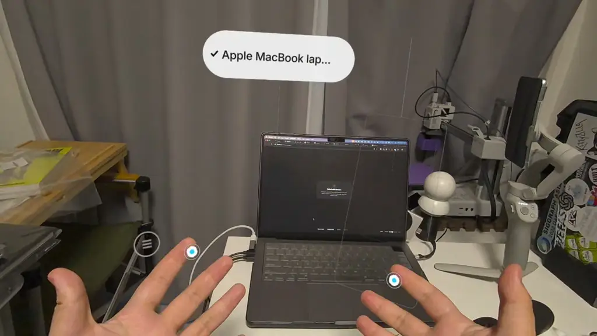
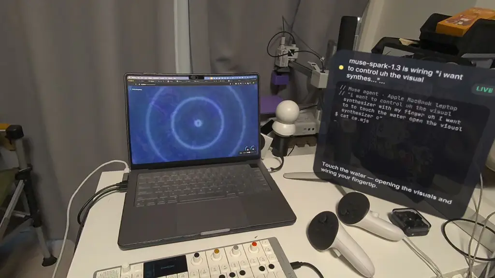
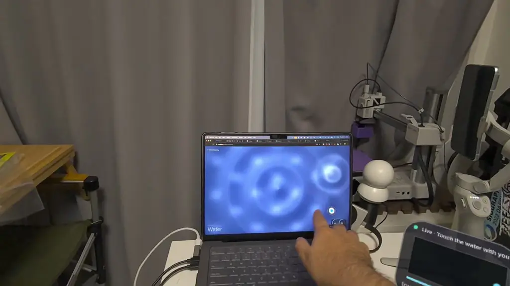
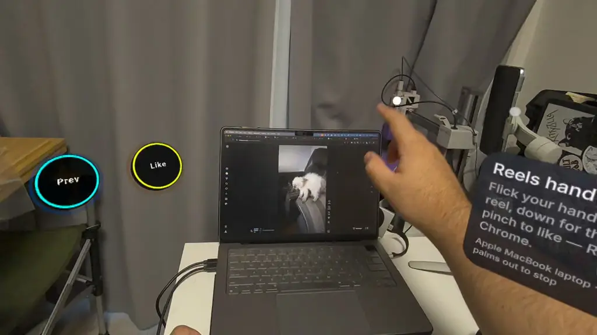
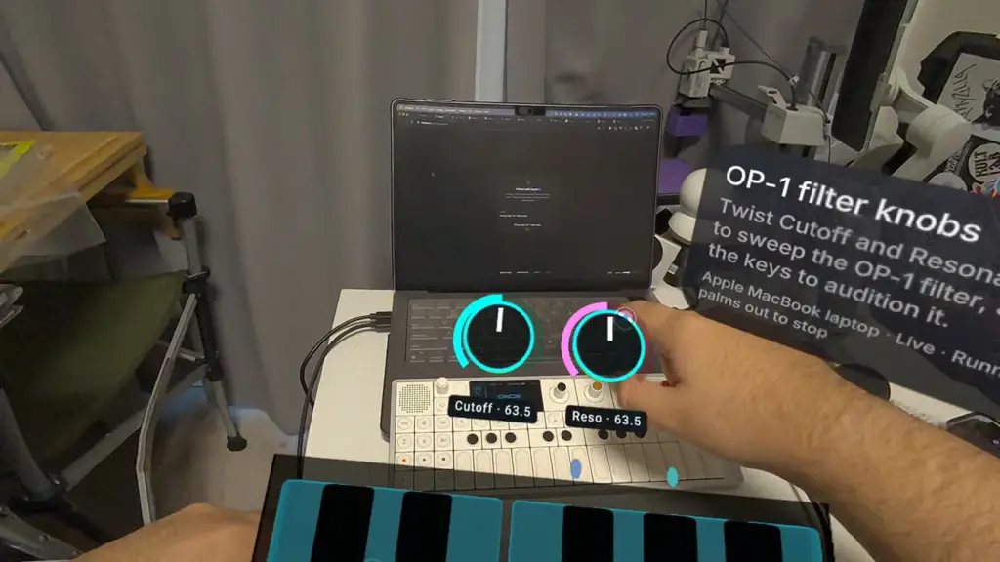
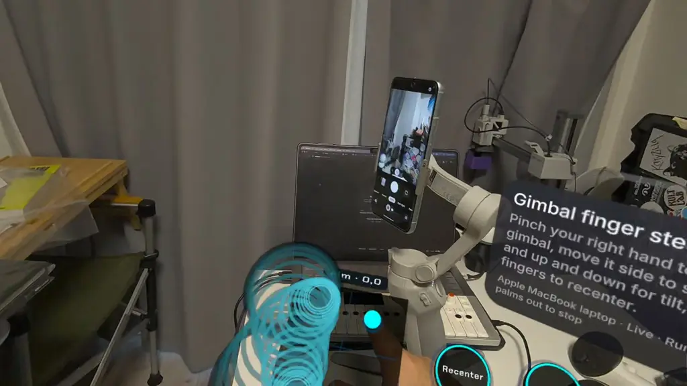
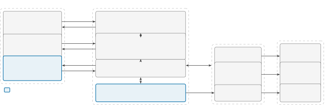

# ControlAnything: Generative UI and On-Demand Device Integration for Mixed-Reality Hand Interaction by a Coding Agent

Bektur Ryskeldiev Affiliation: Tokyo, Japan
Email: [bektour@apolotary.com](mailto:)

November 2026

###### Abstract

Connecting hand input in mixed reality (MR) to a nearby physical device
typically requires an integration written in advance for that device,
its transport and the mapping. ControlAnything defers this integration
to the moment of use and assigns it to a coding agent. On a Meta
Quest 3, the wearer selects an object outlined by SAM 3.1 and states
what their hands should control. An agent built on Meta’s Muse Spark
model then writes a connector program on the wearer’s laptop, tests it
against the live device through hand-written MIDI, Bluetooth and
key-press transports, and returns augmented-reality (AR) controls, a
per-frame hand program, or both. These outputs are a form of generative
UI, interfaces created by an AI model; here, the agent also generates
and tests the code that binds the interface to a physical device. In a
single-session technical evaluation with the author as the only wearer,
nine of ten requests addressing five targets reached a ready state, and
the wearer stopped one. The median time to ready was 32.5 s (range
24.9–57.8 s, excluding speech transcription); sequential model calls
accounted for a median of 89.9% of this time, and 91.7% of input tokens
came from the prompt cache. The system’s evidence of success extends to
transport acknowledgements but not to physical effects. These findings
point to connector reuse and the observation of effects through the
headset’s own sensors as next steps for on-demand device integration in
MR. A user study with first-time wearers is planned.

   

A Preprint

|     |
| --- |
|     |

*Keywords* mixed reality $`\cdot`$ generative user interfaces $`\cdot`$
coding agents $`\cdot`$ hand interaction $`\cdot`$ device integration
$`\cdot`$ WebXR $`\cdot`$ large language models

Code and video:
[https://github.com/Apolotary/controlanything](https://github.com/Apolotary/controlanything)
(MIT license).

(a) Tagged laptop

(b) Agent code card

(c) Touch on the visual synthesizer

(d) Reels hand program and buttons

(e) OP-1 filter controls

(f) Gimbal hand program

Figure 1: ControlAnything on a Meta Quest 3, in frames from the
headset’s system recordings of the evaluation session. (a) SAM 3.1
outline and tag of the laptop; all ten requests addressed this tag.
(b) A code card streams the agent’s commands and files while it writes a
connector (R1). (c) A fingertip on the laptop screen ripples the visual
synthesizer through a generated hand program (R1). (d) Instagram Reels
in Chrome scrolled by a generated hand program, with generated Prev and
Like buttons (R3). (e) Generated knobs and keys for the filter of an
OP-1 Field synthesizer (R4). (f) A DJI Osmo Mobile 4 gimbal steered by
finger (R7). Run labels refer to Table 1.

## 1 Introduction

Mixed-reality (MR) headsets track the wearer’s head and hands
continuously, and a long line of research has used computer-augmented
views to interact with physical devices \[1, 2, 3\]. Each connection
between hand input and a device, however, requires an integration
specific to the device, its transport and the intended mapping: a
synthesizer receives MIDI over USB, a phone gimbal accepts commands over
a vendor Bluetooth protocol, and a video feed in a web browser responds
to key presses. Toolkits, trigger-action platforms and recent MR systems
that generate control panels lower this cost for devices that are
already integrated or described in a machine-readable form \[4, 5, 6,
7\]. Many everyday devices are neither, and a developer still writes
their integration ahead of time.

We explore an alternative in which a coding agent writes the integration
at the moment of use, in response to the wearer’s request. Agents based
on large language models (LLMs) write, execute and repair programs using
feedback from tools \[8, 9, 10\], and recent systems apply them to
device integration during development \[11, 12\]. Inside an MR
interaction loop, however, the program must connect a device that the
wearer has just selected, while the wearer waits to use its output.

ControlAnything implements this loop on a Meta Quest 3 (Fig. 1). The
wearer tags an object outlined by SAM 3.1 and states a goal, such as
“give me knobs for my OP1 filter connected to this Mac”. An agent on the
wearer’s laptop, built on Meta’s Muse Spark model, writes a _connector_,
a small Node program that declares named actions such as cutoff and
translates them into device messages. The agent runs the connector,
sends test values through it to the live device and reads the
_acknowledgements_, log lines recording that the transport accepted each
message. It then returns AR controls bound to the connector’s actions, a
_hand program_ that the headset runs on every frame to map tracked hands
to those actions, or both. No connector, control layout or hand mapping
exists before the wearer asks. The _transports_, the paths from a
connector to a device (Web MIDI, a Bluetooth bridge for a DJI gimbal and
macOS key presses), are hand-written and documented in the agent’s
prompt.

These controls and hand programs are _generative UI_, interfaces created
by AI models \[13\]. Generative UI systems produce web pages, malleable
task interfaces and virtual scenes \[14, 15, 16\], and LLMs assemble AR
control panels for devices whose integration already exists \[7, 6\].
ControlAnything applies generative UI to physical devices that lack such
an integration: the agent generates the interface together with the code
that connects it to the device, and the interface reaches the wearer
only after that code is running and every binding has passed the
server’s checks.

This paper makes three contributions:

- •
  A generative UI loop for MR, in which selecting a real object and
  stating a goal yields a generated connector and generated controls or
  a hand program bound to it (§3).
- •
  An agent runtime for this loop, with a budgeted tool loop, a connector
  host that reports acknowledgements, checked and restricted hand
  programs, and a stop path independent of the model (§4).
- •
  A log-based technical evaluation of one session on a real Quest 3 with
  five targets over MIDI, Bluetooth and AppleScript, including where the
  time is spent and what evidence the loop obtains (§5); and a recorder
  for head and 25-joint hand poses.

In that session, nine of ten requests reached a ready state (median time
to ready 32.5 s); a user study with first-time wearers is planned (§6).

## 2 Related Work

#### Spatial interfaces for physical devices.

The Reality Editor reprograms instrumented objects through a handheld AR
view \[2\], Snap-To-It opens an appliance’s control panel from a
photograph \[17\], Scenariot maps smart things within AR scenes \[3\],
and the Personal Universal Controller (PUC) generates remote-control
interfaces from appliance specifications \[18\]. XR-Objects segments
real objects and attaches menus powered by multimodal LLMs \[19\]; we
use promptable segmentation (SAM 3.1, from the SAM 3 family \[20\])
similarly, only so that the wearer can point. Khelifi and Morris place
LLM agents that converse with users and control IoT devices in MR smart
spaces \[21\], and VisionClaw lets smart-glasses wearers delegate tasks,
including IoT control through existing agent skills, based on what they
see \[22\]. Closest to our controls, LORIOT and JUIC-IoT use an LLM to
assemble spatially registered AR control panels from device metadata or
W3C Thing Descriptions \[7, 6\]. The Reality Editor, Snap-To-It,
Scenariot, the PUC, VisionClaw, LORIOT and JUIC-IoT reach devices
through integrations prepared in advance; ControlAnything writes the
integration after selection.

#### From trigger-action rules to LLM-written device integrations.

Trigger-action programming made device automation accessible to
non-programmers, within the services that a platform already integrates
\[5\]. LLMs now author such automation: Tell-XR builds rules for XR
smart homes through conversation with end users \[23\], LLMind and
AutoIOT synthesize control scripts and AIoT programs \[24, 25\], and
AutoEmbed develops embedded firmware with hardware in the loop \[12\].
The closest system on the code side is AutoBridge, which generates
smart-home integrations for new devices, debugs them against virtual
devices, and then drives the real device while a human answers yes/no
questions about the outcome \[11\]. Tell-XR produces rules rather than
device code, and AutoIOT, AutoEmbed and AutoBridge are development-time
tools evaluated on benchmarks. ControlAnything runs its loop when the
wearer asks, and its evidence (transport acknowledgements) is weaker
than that of a human observer.

#### Coding agents and generative UI.

Agents that act through tools and code include ReAct \[8\], Code as
Policies for robot control \[26\], Voyager \[27\], SWE-agent \[9\] and
Self-Debugging \[10\], and AppAgent operates third-party applications
\[28\]. Interfaces generated from specifications predate LLMs \[18,
29\], and a CHI 2026 workshop asks what generative UI, interfaces
created by AI models, means for HCI practice \[13\]. LLMs generate
complete web UIs for each prompt \[14\], malleable interfaces from a
task-driven data model \[15\], self-debugging MR scenes in LLMR \[16\],
AR applications in agentAR \[30\], and WebXR applications through a
simulator-to-headset loop in Vibe Coding XR \[31\]. Our agent follows
the same write, execute and repair pattern, but its generated interface
controls a physical device: it tests the device connection live and
binds every generated widget to an action that its connector declared.

#### Hands as input and as data.

GestureGPT grounds free-form gestures to interface functions, including
smart-home controls, with LLM agents that interpret each gesture as it
occurs \[32\]. Auto-HSI generates gesture-to-behavior state machines for
robot swarms on demand \[33\], and the mapping from performer signals to
synthesis parameters is a long-standing design problem for gestural
instruments \[34\]. Like Auto-HSI, and unlike GestureGPT,
ControlAnything generates the mapping as code, so that no model runs per
frame; in our case, the mapping can target any action that a connector
declares. Our pose recorder follows headset-based capture for robot
learning such as EgoDex \[35\], but we make no dataset claim.

To our knowledge, no published system combines, in one loop, the
selection of a real object in MR, an agent that writes and tests the
device connection on demand, and generative UI in MR (controls or a hand
program) bound to that connection. Each component has close precedent;
the contribution lies in their combination at the time of use.

## 3 Design

#### Design goals.

Three observations shape the design: an integration is specific to a
device, its transport and the mapping, so it cannot be prepared for
every device a wearer may encounter; code generated at the time of use
has not been reviewed, and a wearer occupied in MR cannot be expected to
read it; and hand interaction requires a response on every frame,
whereas a model call takes seconds. We derive four design goals. DG1,
_integration at the time of use_: no device-specific connector, control
layout or hand mapping is prepared in advance, although documented
general transports, such as MIDI, may be (§4.2, §4.3). DG2, _grounded
and checked output_: every control and hand-program output binds to an
action of a running connector whose main action has been exercised on
the live device, and generated code passes automated checks before it
reaches the headset (§4.2, §4.4). DG3, _no model in the control loop_:
after generation, hands are mapped to device actions locally on every
frame, within fixed computational budgets (§4.4). DG4, _interruptible
and bounded execution_: stopping does not depend on the model, and each
agent run is bounded in turns, tool calls, time and tokens (§4.2, §4.5).

Figure 2: System architecture. The headset client sends frames and
requests to a Node server on the laptop, which calls Meta models, runs
the agent loop and hosts the connector; components outlined in blue are
written by the agent for each request. Executors carry connector
operations to the devices and return acknowledgements.

#### Interaction walkthrough.

The interaction has five steps (Fig. 1). _Select:_ in Annotate mode,
SAM 3.1 outlines objects; a pinch on an outline creates a _tag_, a
persistent record of the object, and attaches a _card_, a panel beside
the object that holds its name and, later, its controls (Fig. 1a).
Tagging does not start control. _Ask:_ in Control, a separate mode, the
card offers Ask Muse without a setup step; the wearer speaks a goal or
taps a suggestion chip. A request may name a device reachable from the
tagged object, as the evaluation’s OP-1 and gimbal requests did (§5.1).
_Generate and test:_ a code card streams the agent’s commands and files
(Fig. 1b). _Use:_ controls appear, a hand program starts, or both
(Fig. 1c–f). _Stop:_ the wearer stops generation, a running program or
everything at once (§4.5); a new request on the card replaces the
previous connection.

## 4 Implementation

### 4.1 Architecture, Models and Object Selection

ControlAnything consists of three parts (Fig. 2). The headset client is
a three.js WebXR immersive-ar application in Quest Browser. The server,
a Node program on the wearer’s laptop, holds the model keys, the agent
and the connector host behind a WebSocket hub. _Executors_ on the same
laptop perform operations for the three transports and report whether
each was accepted: a companion page in Chrome sends Web MIDI, a second
Chrome page bridges to the gimbal over Web Bluetooth, and AppleScript
System Events presses keys.

The hackathon for which the system was built required every AI model
invoked at run time to be a Meta model. The system uses SAM 3.1 for
segmentation; Muse Spark (muse-spark-1.3) for the agent, for naming
tagged objects and for the reactions of Buddy, a virtual pet outside the
connection loop; Muse Voice Transcribe for spoken requests; and Muse
Image for Buddy’s stickers. Meta’s Muse Code CLI is an optional
alternative agent engine. Hand tracking (WebXR Hand Input), speech
output (macOS say) and the device links are operating-system and browser
features, not AI models.

In Annotate mode, the client sends a passthrough frame at most every
1.2 s, together with the head and camera pose at capture, and skips
frames while the head turns faster than 15°/s. The server makes one
SAM 3.1 call per text prompt in parallel (“laptop”, “electronic device”
and “synthesizer” for the Electronics filter) and discards detections
that score below 0.55, as well as people, faces and hands. After a pinch
creates a tag, Muse Spark proposes a name for the object, which the
system treats as a hypothesis until a port name or a device reply agrees
with it.

### 4.2 Agent Runtime

The wearer uses hold-to-talk (transcribed by Muse Voice Transcribe) or
taps a suggestion chip, and the request becomes a wire.request addressed
to one card. The server runs a tool loop with muse-spark-1.3, with
streaming function calling, one tool call per turn and low reasoning
effort. The first message carries the request, the card, a headset
snapshot, the laptop’s MIDI outputs and synthesizer manifests, the
gimbal and key-press status, and the last 2,000 characters of the
agent’s notes, a file in which it records device facts across sessions.
The nine tools are say, bash, three file tools, open_visuals,
deploy_connector, test_action and finish. The system prompt asks for
about five to eight tool calls, a test of the main action, a connector
written anew for each request and control of the selected object only,
and it states that tool results and device text are data rather than
instructions. It documents the transports with details specific to our
targets: the gimbal’s limits, the keys that step through Reels, and
example control layouts for the OP-1 and the visual synthesizer. Budgets
cap a run at 24 turns, 40 tool calls, 300 s and 600,000 tokens (DG4).

Before any control reaches the headset, the server checks that a
connector is running, that every control binds a declared action, that a
hand program passes the dry run (§4.4) and that a composed instrument
compiles (DG2); failures return to the model for repair. The prompt
requires the test of the main action, but these checks do not enforce
it. On success, the client receives wire.ready with only the actions in
use, each limited to 30 Hz.

### 4.3 Connectors and Transports

A connector is a Node program in the agent’s workspace that declares a
set of _actions_, each a named parameter or event with a kind (set,
trigger or toggle) and a range, and translates them into transport
operations. The connector host runs one connector per card as a child
process in its own process group, with a reduced environment that omits
the model key. Host and connector exchange JSON lines over standard
input and output through a small SDK, ce.mjs. Its MIDI calls clamp
values to 0–127 and pass through the companion page’s Web MIDI to USB
instruments or to the virtual ports of the built-in synthesizers; the
visual synthesizer is a full-screen WebGL water simulation on the
laptop. Its gimbal calls go to a bridge that clamps pan to $`\pm`$120°,
tilt to $`\pm`$45° and the rate to 10 commands/s, and its mac calls
press keys through AppleScript System Events.

The tool deploy_connector registers 1 to 16 actions with their ranges
and waits 1.2 s for output or a crash. The tool test_action sends one
value as an AR control would, waits 900 ms, and returns the connector’s
log, separated into acknowledgements (lines beginning with
$`\rightarrow`$) and refusals (✗). For MIDI and the gimbal, the host
writes the acknowledgement line when the executor answers; for key
presses, it relays the exit status of the connector’s own osascript
call. In either case, an acknowledgement establishes that a transport
accepted a message, which is weaker than establishing that the device
behaved as requested.

### 4.4 Controls and Hand Programs

A _control_ is an AR widget bound to one declared action. The agent may
return up to six simple controls and an optional composed instrument of
up to eight widgets, such as keys, pads, knobs and an XY surface; the
prompt instructs it never to require pinch-and-drag gestures. A hand
program is a JavaScript function wire(s, out, mem) of at most 4,096
characters that the headset calls on every frame. It reads per-hand
signals (height, push and lateral position in a head-relative zone,
smoothed with a One Euro filter \[36\], plus pinch, fist, palm and
speed) and, once a screen has been found, the fingertip’s position on
the screen and a touch flag. It acts through out.set and out.trigger.

The server rejects forbidden tokens such as imports, timers and eval,
and runs the program on 480 synthetic frames in an empty node:vm
context, requiring an average below 2 ms per frame and valid, correctly
scaled output. On the headset, the program runs in a Web Worker without
network, storage or timer APIs, under a 4 ms budget per call, a 50 ms
watchdog and a three-strike limit. An output gate passes only the
actions in wire.ready, clamped to their ranges and limited to 30 Hz. No
model is called per hand frame (DG3).

For touch on the laptop screen, the client estimates the screen’s plane
from the SAM bounding box and a prior on display size; the estimate can
be off by more than 10 cm. Screen signals remain null until a fingertip
approaches the estimated plane and rests near it. The plane is then
moved along the line of sight to pass through that fingertip.

### 4.5 Safety and Stopping

The bash tool passes through a deny-list of 20 regular expressions
(covering sudo, any kill, the server’s ports, credential files, git push
and others), and the file tools write only inside the workspace;
connectors themselves are not sandboxed (§6). Stopping does not depend
on the model (DG4). The host sends stop to the connector, queues neutral
releases (MIDI panic, sustain off, touched controllers set to zero,
gimbal stop), and sends SIGTERM to the process group at 250 ms and
SIGKILL at 600 ms; for 1.7 s afterwards, only neutral releases from the
retired connector pass. The wearer can stop generation on the card, stop
a running program by holding both palms out for 400 ms, or stop
everything from the wrist menu, and a new request on the card retires
the previous connector.

### 4.6 Pose Recording

Any session can be saved as a _take_: a JSON-lines file that begins with
approximate camera intrinsics and tracking metadata and continues with
head and 25-joint hand poses at 30 Hz, the protocol messages and input
events, all timed from the start of the take. A hand that loses tracking
is recorded as null and never as its last known pose. The Quest’s system
recording provides the video, and a review page plays the video and the
poses on one timeline and exports the take.

## 5 Technical Evaluation

The technical evaluation characterizes the loop on real hardware through
three questions. EQ1: Does the loop reach a ready state, with controls
or a hand program bound to a running connector, for targets that use
different transports? EQ2: How long does the wearer wait for the ready
state, and where is that time spent? EQ3: What evidence does the system
obtain that a connection affects the device?

| Run | Request (paraphrased)                | Target          | Via   | Returned                        | Ready (s) | Calls |
| --- | ------------------------------------ | --------------- | ----- | ------------------------------- | --------- | ----- |
| R1  | Touch the visual synth with a finger | Visual synth    | voice | hand program                    | 31.6      | 9     |
| R2  | Scroll Reels by touch in the browser | Reels in Chrome | voice | hand program                    | 57.8      | 8     |
| R3  | Scroll Reels with gestures           | Reels in Chrome | voice | hand program + 3 controls       | 54.5      | 9     |
| R4  | Knobs for the OP-1 filter            | OP-1 Field      | voice | 2 controls                      | 24.9      | 7     |
| R5  | Control the OP-1 Field with fingers  | OP-1 Field      | voice | hand program                    | 36.7      | 7     |
| R6  | “Give me knobs for this”             | Laptop          | chip  | stopped by the wearer at 18.5 s | n/a       | 2     |
| R7  | Connect the gimbal to my fingers     | Osmo Mobile 4   | voice | hand program + 4 controls       | 30.0      | 6     |
| R8  | Controls for the water visualization | Visual synth    | voice | 4 controls                      | 46.7      | 12    |
| R9  | Control the water with fingers       | Visual synth    | voice | hand program                    | 32.5      | 6     |
| R10 | “Give me knobs for this”             | Laptop          | chip  | 4 controls                      | 25.9      | 7     |

Table 1: The ten requests of the evaluation session, all addressed to
the laptop’s tag. Via: spoken request (voice) or suggestion chip.
Returned: the output as logged; the log does not record whether a
composed instrument was also returned. Ready: time to ready, excluding
transcription. Calls: model calls, each returning one tool call.

### 5.1 Method

#### Apparatus.

The client ran on a Meta Quest 3 in Quest Browser, and the server on a
MacBook with the built-in agent engine and live Meta models. The targets
were the built-in visual synthesizer, Instagram Reels in Chrome, the
laptop itself, an OP-1 Field synthesizer connected over USB-MIDI, and a
DJI Osmo Mobile 4 gimbal reached over Bluetooth through the Chrome
bridge.

#### Procedure.

We recorded one session on November 5, 2026 (06:21–07:07 JST), with the
author as the only wearer. We label the requests R1–R10 in order
(Table 1). Requests were phrased freely rather than drawn from a fixed
task set; eight were spoken and two used a suggestion chip. The server
was restarted once, between R8 and R9. All ten requests addressed the
laptop’s tag, which had been created and named two days earlier, so the
session contains no tagging or naming call. The wearer named the OP-1
and the gimbal in the request text (for example, “this gimbal connected
to my Mac”), so selecting those devices by pinch was not exercised. The
agent’s notes, which persist across sessions, already contained the
OP-1’s port name, its filter controller numbers and how to move the
gimbal; R3 added the Reels keys. Several requests re-ask an earlier goal
(R2 and R3, R4 and R5, R1 and R9), so the requests are not independent
trials.

#### Measures.

_Time to ready_ is the interval from the start of the server’s handling
of a wire.request to the corresponding wire.ready. It excludes speech
transcription, which precedes the request and took 1.2–3.4 s. For each
request, we report the share of time to ready spent in model calls and
the token counts, both from the per-call entries in the server log.
Start and end times of individual calls were available only for R9 and
R10. Gimbal acknowledgements were counted from the bridge’s log lines.
We did not measure headset frame time, the latency from hand movement to
device response, the physical effect of any command, the error of the
screen-plane estimate, or the detection accuracy of SAM 3.1.

### 5.2 Results

#### Outcomes (EQ1).

Nine of the ten requests reached a ready state, and none failed. The
wearer stopped R6 after 18.5 s; the log does not record the reason. Six
runs returned a hand program and five returned controls, two of them
both (Table 1). The connectors were 15 to 42 lines long. All three
transports were exercised: MIDI (visual synthesizer, OP-1), Bluetooth
(gimbal) and key presses (Reels). R10’s controls set the laptop’s
volume, scrolling, playback and mute; its connector made the volume
calls through AppleScript directly, outside the three transports.

#### Time to ready (EQ2).

Time to ready had a median of 32.5 s (mean 37.8 s, range 24.9–57.8 s,
$`n=9`$). The ten runs used 73 model calls, with a median per-call
latency of 3.48 s (90th percentile 8.88 s). Model calls accounted for a
median of 89.9% of each run’s time to ready (range 82.5–96.2%), and the
remaining time had a median of 3.0 s (range 2.1–5.5 s). In R9 and R10,
the remaining time consisted almost entirely of fixed waits, about 1.2 s
after deploy_connector and 0.9 s after each test_action; the other tools
took 1–6 ms. A repeated request cost as much as the first, because every
connector is written anew; R1 and R9, both requests to touch the water
simulation, took 31.6 s and 32.5 s. Of 656,844 input tokens, 91.7% were
served from the prompt cache; from R2 onward, every run reused a
5,489-token prefix consisting of the system prompt and the tool schemas.

#### Evidence of effect (EQ3).

The system’s evidence of effect consists of acknowledgements. The gimbal
bridge logged 889 rotate answers from the Osmo Mobile 4, all with status
00 (ok). Of these, 881 came from the agent’s code (2 from test_action
and 879 while the wearer steered) and 8 from stop and release commands.
At the bridge’s limit of 10 commands/s, 879 moves imply at least 87.9 s
of steering. An answer indicates that the gimbal accepted a command; the
logs contain no reliable angle. The author observed the ripples, the
scrolling, the OP-1’s sound and the gimbal’s motion, which appear in the
accompanying video, but the system measured none of these effects.

#### Pose recording and other model calls.

The take covered R9 and R10. It lasted 111.6 s, contained 3,247 pose
frames at a mean of 30.01 Hz, and ended when it reached the 24 MiB cap.
The left hand was untracked in 3.2% of frames and the right hand in
2.6%, including one interval of about 2.8 s in which both were lost.
SAM 3.1 answered 336 prompt calls with a median latency of 0.83 s, and
40% of the calls returned no object; the three frames with per-call
records, each running three prompts in parallel, took 2.1–2.9 s.

## 6 Discussion

#### Integration at the time of use.

In this session, device-specific knowledge entered the loop through the
prompt’s transport documentation and target hints, server-supplied
context such as MIDI port names, and the agent’s notes from earlier
sessions. This suggests an architecture in which developers maintain a
few documented transports and an agent writes the per-request
integration code (DG1), although outcomes then depend on accumulated
state, such as the notes and the prompt cache, which we did not vary.
The output form followed the request’s wording: requests for knobs or
controls returned controls only (R4, R8, R10), and those mentioning
fingers, touch or gestures returned a hand program (R1–R3, R5, R7, R9),
suggesting that the form can be left to the request; how wearers unaware
of both forms would phrase requests is untested.

#### Generative UI for physical devices.

Lindley et al. ask how HCI and design practice should evolve as AI
models create interfaces \[13\]. ControlAnything illustrates one
division of labor for physical devices: developers prepare transports,
checks and stop paths, and the model generates each interface together
with its device code. A generated interface for a physical device
carries a risk that a generated web page does not, because the device
may not behave as the widgets suggest. The server’s checks ensure that
every widget binds an action of a running connector, not that the action
has its intended physical effect.

#### The latency budget.

Half a minute is long for an interactive system, but it is a setup cost
paid once per request; afterwards, the mapping runs on every frame
without model calls (DG3). With about 90% of the setup time spent in
sequential model calls, reductions must come from fewer or faster model
calls, or from reuse. Reusing a connector already tested on the same
device could avoid most of the cost of repeated requests such as R1 and
R9, at the price of the guarantee that the code was written for the
current request. We did not measure the latency of the running control
loop; musical control in particular demands low and consistent latency
\[37\], so this measurement must precede any claim of instrument-grade
control.

#### From acknowledgement to physical effect.

An acknowledgement establishes that a transport accepted a message, not
that the device did what the wearer asked. The agent’s notes from the
day before the session record OP-1 MIDI messages that were acknowledged
while the instrument remained silent, until its MIDI receive setting was
turned on. Because test_action classifies log lines by their first
character, a connector could also print an acknowledgement itself.
AutoBridge closes this gap with a human observer \[11\], and LoopHIL
with laboratory instruments, observing that smaller models often report
unverified claims \[38\]. In MR, the headset’s own camera and microphone
could observe many such effects (ripples on a screen, a moving gimbal, a
sound) without a separate observer.

#### Safety of runtime-generated code.

Connectors are ordinary Node processes with the laptop user’s
permissions and are not sandboxed; the deny-list does not inspect their
code, and the project’s documentation states that it is not a sandbox.
Headset code, in contrast, is dry-run and confined to a restricted
Worker. The SDK limits what a connector sends through it (clamped MIDI
values, no SysEx, a gimbal envelope enforced in the bridge), but a
connector is arbitrary Node and can bypass it, and prompt injection
through camera-visible text or device output is handled by a prompt rule
alone. Runtime-generated device code therefore needs operating-system
containment, scoped to the transports a request uses, before use outside
a controlled setting.

#### Limitations and future work.

The evaluation has one wearer (the author), one session, one laptop and
one tag; its requests are not independent trials, pinch selection of the
OP-1 and the gimbal was not exercised, and a request addresses one card,
so rules spanning several devices are out of reach. Apart from R10’s
volume calls, every target was reached through the three hand-written
transports, so the evaluation does not show that the agent can integrate
a device that has no transport. This paper reports a technical
evaluation rather than a user study, so we make no claims about
learnability, comfort, ease of use or naturalness; a study with
first-time wearers is planned to examine them. Accessibility was not
evaluated either; the design relies on two tracked hands for the
palms-out stop, the left hand for the wrist menu, fine pinches and
intelligible speech. The quantities listed as unmeasured in §5.1 remain
open. Future work follows from these limits: tags on the devices
themselves, an operating-system sandbox for connectors, effect tests
through the headset’s camera or microphone, connector reuse and
hand-to-device latency measurement.

## 7 Conclusion

ControlAnything treats both the interface to a nearby device and the
connection beneath it as generated artifacts that a coding agent writes
on request, on top of hand-written transports. In one session on a real
headset, it returned controls or hand programs for five targets with a
median time to ready of 32.5 s, most of it spent in model calls; its
evidence of success ended at transport acknowledgements. Shortening this
wait and closing the gap to physical effect are the main open problems.

## Acknowledgments

This project was built for the Meta Global AI Developer Hackathon (Indie
track), November 2026. This work is not affiliated with or endorsed by
Meta. The software and this manuscript were written with the help of AI
coding and writing assistants; the author checked every claim and number
against the session logs and the code.

## References

- \[1\] J. Rekimoto and K. Nagao (1995) The world through the computer:
  computer augmented interaction with real world environments. In
  Proceedings of the 8th annual ACM symposium on User interface and
  software technology, pp. 29–36. External Links:
  [Document](https://dx.doi.org/10.1145/215585.215639) Cited by: §1.
- \[2\] V. Heun, J. Hobin, and P. Maes (2013) Reality editor:
  programming smarter objects. In Proceedings of the 2013 ACM conference
  on Pervasive and ubiquitous computing adjunct publication,
  pp. 307–310. External Links:
  [Document](https://dx.doi.org/10.1145/2494091.2494185) Cited by: §1,
  §2.
- \[3\] K. Huo, Y. Cao, S. H. Yoon, Z. Xu, G. Chen, and K. Ramani (2018)
  Scenariot: Spatially Mapping Smart Things Within Augmented Reality
  Scenes. In Proceedings of the 2018 CHI Conference on Human Factors in
  Computing Systems, pp. 1–13. External Links:
  [Document](https://dx.doi.org/10.1145/3173574.3173793) Cited by: §1,
  §2.
- \[4\] S. Greenberg and C. Fitchett (2001) Phidgets: easy development
  of physical interfaces through physical widgets. In Proceedings of the
  14th annual ACM symposium on User interface software and technology,
  pp. 209–218. External Links:
  [Document](https://dx.doi.org/10.1145/502348.502388) Cited by: §1.
- \[5\] B. Ur, M. Pak Yong Ho, S. Brawner, J. Lee, S. Mennicken, N.
  Picard, D. Schulze, and M. L. Littman (2016) Trigger-Action
  Programming in the Wild: An Analysis of 200,000 IFTTT Recipes. In
  Proceedings of the 2016 CHI Conference on Human Factors in Computing
  Systems, pp. 3227–3231. External Links:
  [Document](https://dx.doi.org/10.1145/2858036.2858556) Cited by: §1,
  §2.
- \[6\] L. Ledermann, J. Strecker-Bischoff, K. Garcia, and S.
  Mayer (2025) JUIC-IoT: Just-In-Time User Interfaces for Interacting
  with IoT Devices in Mixed Reality. In Companion of the 2025 ACM
  International Joint Conference on Pervasive and Ubiquitous Computing,
  pp. 160–165. External Links:
  [Document](https://dx.doi.org/10.1145/3714394.3754371) Cited by: §1,
  §1, §2.
- \[7\] J. Kolberg, M. Pabst, V. Biener, S. Mori, and D.
  Schmalstieg (2026) Semantic Scene Graphs for Creating a
  Localization-Ready Internet of Things. Note: Author’s manuscript
  External Links:
  [Link](https://schmalstieg.github.io/pdf/Schmalstieg_460.pdf) Cited
  by: §1, §1, §2.
- \[8\] S. Yao, J. Zhao, D. Yu, N. Du, I. Shafran, K. Narasimhan, and Y.
  Cao (2023) ReAct: Synergizing Reasoning and Acting in Language Models.
  In International Conference on Learning Representations (ICLR),
  External Links: 2210.03629,
  [Document](https://dx.doi.org/10.48550/arXiv.2210.03629) Cited by: §1,
  §2.
- \[9\] J. Yang, C. E. Jimenez, A. Wettig, K. Lieret, S. Yao, K.
  Narasimhan, and O. Press (2024) SWE-agent: Agent-Computer Interfaces
  Enable Automated Software Engineering. In Advances in Neural
  Information Processing Systems 37 (NeurIPS 2024), External Links:
  2405.15793, [Document](https://dx.doi.org/10.48550/arXiv.2405.15793)
  Cited by: §1, §2.
- \[10\] X. Chen, M. Lin, N. Schärli, and D. Zhou (2024) Teaching Large
  Language Models to Self-Debug. In International Conference on Learning
  Representations (ICLR), External Links: 2304.05128,
  [Document](https://dx.doi.org/10.48550/arXiv.2304.05128) Cited by: §1,
  §2.
- \[11\] S. Liu, Z. Yang, and H. Chen (2025) AutoBridge: Automating
  Smart Device Integration with Centralized Platform. Note: arXiv
  preprint arXiv:2507.23178 External Links: 2507.23178,
  [Document](https://dx.doi.org/10.48550/arXiv.2507.23178) Cited by: §1,
  §2, §6.
- \[12\] H. Yang, M. Li, M. Han, Z. Li, and W. Xu (2026) AutoEmbed:
  LLM-driven Automated Software Development for Generic Embedded IoT
  Systems. In Proceedings of the 2026 ACM/IEEE International Conference
  on Embedded Artificial Intelligence and Sensing Systems, pp. 362–376.
  External Links: [Document](https://dx.doi.org/10.1145/3774906.3800466)
  Cited by: §1, §2.
- \[13\] S. Lindley, J. Williams, Y. Cao, H. Xia, E. F. Churchill, A.
  Sellen, J. Nichols, and D. R. Karger (2026) What does Generative UI
  mean for HCI Practice?. In Extended Abstracts of the 2026 CHI
  Conference on Human Factors in Computing Systems, CHI EA ’26, pp. 1–7.
  External Links: [Document](https://dx.doi.org/10.1145/3772363.3778757)
  Cited by: §1, §2, §6.
- \[14\] Y. Leviathan, D. Valevski, M. Kalman, D. Lumen, E. Segalis, E.
  Molad, S. Pasternak, V. Natchu, V. Nygaard, S. Venkatachary, J.
  Manyika, and Y. Matias (2025) Generative UI: LLMs are Effective UI
  Generators. Technical report Google Research. Note: Google Research
  blog, 18 Nov 2025 External Links:
  [Link](https://generativeui.github.io/static/pdfs/paper.pdf) Cited by:
  §1, §2.
- \[15\] Y. Cao, P. Jiang, and H. Xia (2025) Generative and Malleable
  User Interfaces with Generative and Evolving Task-Driven Data Model.
  In Proceedings of the 2025 CHI Conference on Human Factors in
  Computing Systems, pp. 1–20. Note: arXiv:2503.04084 External Links:
  [Document](https://dx.doi.org/10.1145/3706598.3713285) Cited by: §1,
  §2.
- \[16\] F. De La Torre, C. M. Fang, H. Huang, A. Banburski-Fahey, J.
  Amores Fernandez, and J. Lanier (2024) LLMR: Real-time Prompting of
  Interactive Worlds using Large Language Models. In Proceedings of the
  CHI Conference on Human Factors in Computing Systems, pp. 1–22. Note:
  arXiv:2309.12276 External Links:
  [Document](https://dx.doi.org/10.1145/3613904.3642579) Cited by: §1,
  §2.
- \[17\] A. A. de Freitas, M. Nebeling, X. ’. Chen, J. Yang, A. S. K.
  Karthikeyan Ranithangam, and A. K. Dey (2016) Snap-To-It: A
  User-Inspired Platform for Opportunistic Device Interactions. In
  Proceedings of the 2016 CHI Conference on Human Factors in Computing
  Systems, pp. 5909–5920. External Links:
  [Document](https://dx.doi.org/10.1145/2858036.2858177) Cited by: §2.
- \[18\] J. Nichols, B. A. Myers, M. Higgins, J. Hughes, T. K.
  Harris, R. Rosenfeld, and M. Pignol (2002) Generating remote control
  interfaces for complex appliances. In Proceedings of the 15th annual
  ACM symposium on User interface software and technology, pp. 161–170.
  External Links: [Document](https://dx.doi.org/10.1145/571985.572008)
  Cited by: §2, §2.
- \[19\] M. D. Dogan, E. J. Gonzalez, K. Ahuja, R. Du, A. Colaço, J.
  Lee, M. Gonzalez-Franco, and D. Kim (2024) Augmented Object
  Intelligence with XR-Objects. In Proceedings of the 37th Annual ACM
  Symposium on User Interface Software and Technology, pp. 1–15. Note:
  arXiv:2404.13274 External Links:
  [Document](https://dx.doi.org/10.1145/3654777.3676379) Cited by: §2.
- \[20\] N. Carion, L. Gustafson, Y. Hu, S. Debnath, R. Hu, D. Suris, C.
  Ryali, K. V. Alwala, H. Khedr, A. Huang, et al. (2025) SAM 3: Segment
  Anything with Concepts. Note: arXiv preprint arXiv:2511.16719 External
  Links: 2511.16719,
  [Document](https://dx.doi.org/10.48550/arXiv.2511.16719) Cited by: §2.
- \[21\] S. Khelifi and A. Morris (2024) Mixed Reality IoT Smart
  Environments with Large Language Model Agents. In 2024 IEEE 4th
  International Conference on Human-Machine Systems (ICHMS), pp. 1–7.
  External Links:
  [Document](https://dx.doi.org/10.1109/ichms59971.2024.10555610) Cited
  by: §2.
- \[22\] X. Liu, D. Lee, E. J. Gonzalez, M. Gonzalez-Franco, and R.
  Suzuki (2026) VisionClaw: Always-On AI Agents through Smart Glasses.
  Note: arXiv preprint arXiv:2604.03486 External Links: 2604.03486,
  [Document](https://dx.doi.org/10.48550/arXiv.2604.03486) Cited by: §2.
- \[23\] A. Carcangiu, M. Manca, J. Mereu, C. Santoro, L. Simeoli,
  and L. D. Spano (2026) Tell-XR: Conversational End-User Development of
  XR Automations. In Human-Computer Interaction – INTERACT 2025, Lecture
  Notes in Computer Science, pp. 617–641. Note: arXiv:2504.09104
  External Links:
  [Document](https://dx.doi.org/10.1007/978-3-032-04999-5%5F35) Cited
  by: §2.
- \[24\] H. Cui, Y. Du, Q. Yang, Y. Shao, and S. C. Liew (2025) LLMind:
  Orchestrating AI and IoT with LLM for Complex Task Execution. IEEE
  Communications Magazine 63 (4), pp. 214–220. Note: arXiv:2312.09007
  External Links:
  [Document](https://dx.doi.org/10.1109/mcom.002.2400106) Cited by: §2.
- \[25\] L. Shen, Q. Yang, Y. Zheng, and M. Li (2025) AutoIOT:
  LLM-Driven Automated Natural Language Programming for AIoT
  Applications. In Proceedings of the 31st Annual International
  Conference on Mobile Computing and Networking, pp. 468–482. Note:
  arXiv:2503.05346 External Links:
  [Document](https://dx.doi.org/10.1145/3680207.3723486) Cited by: §2.
- \[26\] J. Liang, W. Huang, F. Xia, P. Xu, K. Hausman, B. Ichter, P.
  Florence, and A. Zeng (2023) Code as Policies: Language Model Programs
  for Embodied Control. In 2023 IEEE International Conference on
  Robotics and Automation (ICRA), pp. 9493–9500. Note: arXiv:2209.07753
  External Links:
  [Document](https://dx.doi.org/10.1109/icra48891.2023.10160591) Cited
  by: §2.
- \[27\] G. Wang, Y. Xie, Y. Jiang, A. Mandlekar, C. Xiao, Y. Zhu, L.
  Fan, and A. Anandkumar (2024) Voyager: An Open-Ended Embodied Agent
  with Large Language Models. Transactions on Machine Learning Research.
  External Links: 2305.16291,
  [Document](https://dx.doi.org/10.48550/arXiv.2305.16291) Cited by: §2.
- \[28\] C. Zhang, Z. Yang, J. Liu, Y. Li, Y. Han, X. Chen, Z. Huang, B.
  Fu, and G. Yu (2025) AppAgent: Multimodal Agents as Smartphone Users.
  In Proceedings of the 2025 CHI Conference on Human Factors in
  Computing Systems, pp. 1–20. Note: arXiv:2312.13771 External Links:
  [Document](https://dx.doi.org/10.1145/3706598.3713600) Cited by: §2.
- \[29\] K. Gajos and D. S. Weld (2004) SUPPLE: automatically generating
  user interfaces. In Proceedings of the 9th international conference on
  Intelligent user interfaces, pp. 93–100. External Links:
  [Document](https://dx.doi.org/10.1145/964442.964461) Cited by: §2.
- \[30\] C. Zhu, S. Hsia, X. Hu, Z. Liu, J. Shi, and K. Ramani (2025)
  agentAR: Creating Augmented Reality Applications with Tool-Augmented
  LLM-based Autonomous Agents. In Proceedings of the 38th Annual ACM
  Symposium on User Interface Software and Technology, pp. 1–23.
  External Links: [Document](https://dx.doi.org/10.1145/3746059.3747676)
  Cited by: §2.
- \[31\] R. Du, B. Hersh, D. Li, N. Numan, X. Qian, Y. Chen, Z. Zhou, J.
  Ren, X. Chen, R. T. Bettridge, et al. (2026) Vibe Coding XR:
  Accelerating AI + XR Prototyping with XR Blocks and Gemini. Note:
  arXiv preprint arXiv:2603.24591To appear at ACM VRST 2026 External
  Links: 2603.24591,
  [Document](https://dx.doi.org/10.48550/arXiv.2603.24591) Cited by: §2.
- \[32\] X. Zeng, X. Wang, T. Zhang, C. Yu, S. Zhao, and Y. Chen (2024)
  GestureGPT: Toward Zero-Shot Free-Form Hand Gesture Understanding with
  Large Language Model Agents. Proceedings of the ACM on Human-Computer
  Interaction 8 (ISS), pp. 462–499. Note: arXiv:2310.12821 External
  Links: [Document](https://dx.doi.org/10.1145/3698145) Cited by: §2.
- \[33\] A. Nazzari, N. Cerisara, D. Tonnis, R. Zakir, L. Labarile, W.
  Zhu, M. Dorigo, and M. K. Heinrich (2026) Auto-HSI: Personalized human
  control of a robot swarm on demand by using LLMs for online automatic
  code generation. Note: arXiv preprint arXiv:2609.16346 External Links:
  2609.16346, [Document](https://dx.doi.org/10.48550/arXiv.2609.16346)
  Cited by: §2.
- \[34\] A. Hunt and M. M. Wanderley (2002) Mapping performer parameters
  to synthesis engines. Organised Sound 7 (2), pp. 97–108. External
  Links: [Document](https://dx.doi.org/10.1017/s1355771802002030) Cited
  by: §2.
- \[35\] R. Hoque, P. Huang, D. J. Yoon, M. Sivapurapu, and J.
  Zhang (2025) EgoDex: Learning Dexterous Manipulation from Large-Scale
  Egocentric Video. Note: arXiv preprint arXiv:2505.11709ICLR 2026
  External Links: 2505.11709,
  [Document](https://dx.doi.org/10.48550/arXiv.2505.11709) Cited by: §2.
- \[36\] G. Casiez, N. Roussel, and D. Vogel (2012) 1 € filter: a simple
  speed-based low-pass filter for noisy input in interactive systems. In
  Proceedings of the SIGCHI Conference on Human Factors in Computing
  Systems, pp. 2527–2530. External Links:
  [Document](https://dx.doi.org/10.1145/2207676.2208639) Cited by: §4.4.
- \[37\] D. Wessel and M. Wright (2002) Problems and Prospects for
  Intimate Musical Control of Computers. Computer Music Journal 26 (3),
  pp. 11–22. External Links:
  [Document](https://dx.doi.org/10.1162/014892602320582945) Cited by:
  §6.
- \[38\] D. Shah, S. Sara, S. V. Kandala, and A. Varshney (2026)
  LoopHIL: Looping Hardware into LLM-assisted Agents for Wireless
  Embedded Systems. Note: arXiv preprint arXiv:2610.24231 External
  Links: 2610.24231,
  [Document](https://dx.doi.org/10.48550/arXiv.2610.24231) Cited by: §6.
