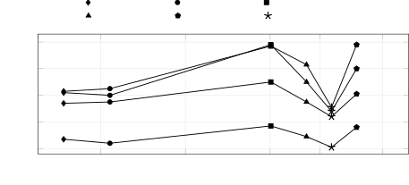

# Pandemonium: Longform Target-Speaker Speech Recognition with Cross-Speaker Interactions

Alexander Polok¹, Dominik Klement¹, Ivan Medennikov², Antoine Laurent³,
Petr Pálka¹, Samuele Cornell⁴, Shinji Watanabe⁴, Sanjeev Khudanpur⁵,
Jagadeesh Balam², Jan Černocký¹, Lukáš Burget¹, Matthew Wiesner⁵
^(†)^(†)thanks: This work was supported by JSALT 2026 at Johns Hopkins
University with funds from NSF CCRI Grant No. 2120435, Google DeepMind,
JHU HLTCOE, JHU AI2AI, and ACL. Additional support was provided by the
Ministry of Education, Youth and Sports of the Czech Republic (MoE)
through the OP JAK project “Linguistics, Artificial Intelligence and
Language and Speech Technologies: from Research to Applications” (ID:
CZ.02.01.01/00/23_020/0008518) and the Brno Ph.D. Talent Scholarship
Programme. Computational resources were provided by the e-INFRA CZ
project (ID: 90254) and IDRIS under GENCI allocations AD011012527,
A0201012177, and AD011016176. Generative AI tools were used to help
revise and refine the manuscript.

###### Abstract

Diarization-conditioned target-speaker ASR (TS-ASR), in particular
Diarization-conditioned Whisper (DiCoW), is an accurate and
data-efficient approach to multi-talker transcription. It has, however,
three structural limitations: the model transcribes each speaker
_independently_, operates on short (30 s) windows, and optimizes its
diarization and TS-ASR components separately. We address the first two.
We integrate the diarization conditioning into a longform Parakeet
backbone (DiCoP) and add _cross-speaker attention_, which lets the model
attend across the speaker dimension so that speakers are no longer
decoded in isolation, and an _STNO mask refiner_ that re-estimates the
diarization-derived conditioning. As conversational data with genuine
multi-speaker interaction is scarce, we scale training with a
pseudo-labeling pipeline that mines 5.4k hours of in-the-wild
multi-speaker audio from YODAS2. Combining these with synthetic and real
data yields state-of-the-art results across several meeting benchmarks.
We open-source the resulting models—DiCoP and _Pandemonium_—and the
pseudo-labeled data.

###### Index Terms: 

target-speaker ASR, multi-talker ASR, speaker diarization, longform ASR,
cross-speaker modeling

^(†)^(†)address: ¹Brno University of Technology, Czech Republic
 ²NVIDIA, USA  ³pyannoteAI, France  
⁴Carnegie Mellon University, USA  ⁵Johns Hopkins University, USA

Figure 1: Overview of _Pandemonium_. A diarizer yields per-speaker masks
that condition (FDDT) a longform Parakeet encoder processing the $`S`$
speakers as a batch. Cross-speaker attention attends across speakers and
a mask refiner sharpens the ambiguous STNO conditioning (blue boxes); a
shared CTC head decodes each.

## 1 Introduction

Transcribing natural conversations remains challenging because of
speaker overlap, diverse acoustic conditions, colloquial language, an
unknown and varying number of participants, and recordings that span
minutes rather than seconds. Multi-talker ASR (MT-ASR) transcribes all
speakers with a single model. One line of work, serialized output
training (SOT), serializes all speakers into a single output stream; it
was introduced with attention-based encoder-decoders \[13\] and has
recently been adopted by LLM-based systems \[34, 26\]. Others emit
several streams under a permutation-invariant objective \[44\] or build
on source separation \[23\]. In contrast, target-speaker ASR (TS-ASR)
conditions a single-speaker recognizer on one speaker at a time and
emits only that speaker’s transcript. It is run once per detected
speaker to reconstruct the full speaker-attributed transcript \[14, 7\].
Across backbones and data budgets, TS-ASR has proven accurate and
data-efficient \[25\]. Our prior work, Diarization-conditioned Whisper
(DiCoW) \[29\], is representative of TS-ASR: it conditions the model on
per-speaker, per-frame activities derived from a diarizer. It has
transferred to E-Branchformer \[15\], Whisper \[31, 29\], and a spoken
LLM \[27\], so it is largely backbone-agnostic.

Despite these strengths, DiCoW has three structural limitations. (i) It
models each speaker _independently_: although the other speakers are
present in the input audio, the model has no access to how they were
encoded or what was decoded for them, discarding the cross-speaker cues
that help resolve overlaps, turn-taking, and back-channels. (ii) It is
trained and decoded on short, fixed _30 s windows_ inherited from the
Whisper backbone, which caps the context available at both training and
inference time. (iii) It runs a _multi-stage pipeline_ in which
diarization and recognition are trained separately. In this work we
address the first two limitations.

Recent longform ASR backbones \[35\]—in particular the Parakeet family
of FastConformer models \[33, 32\]—combine aggressive convolutional
subsampling with local window attention and global tokens, processing
whole meetings \[40, 20, 45, 8\] on a single GPU without chunking.
Meanwhile, systems that decode all speakers jointly (SOT \[13\] and its
LLM-based successors \[34, 26\]) show that joint access to all speakers
improves transcripts, yet they generalize poorly to unseen speaker
counts and heavy overlap.

We integrate the diarization conditioning of DiCoW into Parakeet
(DiCoP), using its local attention and a CTC loss to train faster and
decode whole conversations in one pass at a very low real-time factor
(Sections 2.2 and 2.3), and design a new interaction module for TS-ASR:
_cross-speaker attention_ (CSA), which lets the model attend across the
speaker dimension, complemented by a mask refiner that sharpens the
diarization-derived conditioning (Section 2.4). Since such interaction
is scarce in curated corpora, we mine multi-speaker recordings from
YODAS2 \[17\] and pseudo-label them with DiCoW, obtaining 5.4k hours of
conversational data (Section 3.1.1). Training on synthetic,
pseudo-labeled, and real data gives our final system, _Pandemonium_
(Fig. 1).¹¹ 1 Pandemonium: the collective noun for a flock of parakeets,
or chaos.

Contributions. We release:²² 2
[https://hf.co/BUT-FIT](https://hf.co/BUT-FIT) (i) DiCoP, a longform
diarization-conditioned Parakeet TS-ASR in TDT and faster CTC variants;
(ii) 5.4k h of pseudo-labeled multi-speaker YODAS2 conversations
(Section 3.1.1); (iii) _Pandemonium_, DiCoP with CSA and an STNO mask
refiner, with state-of-the-art results (Table 1).

|                                                            |               |               |               |               |      |               |      |
| ---------------------------------------------------------- | ------------- | ------------- | ------------- | ------------- | ---- | ------------- | ---- |
|                                                            | In-domain     |               | Out-of-domain |               |      |               |      |
| System                                                     | NSF           | AMI           | ICSI          | Mx6           | SBC  | DiPCo         | Avg  |
| _Oracle diarization_                                       |               |               |               |               |      |               |      |
| DiCoW v3.3 \[28\]                                          | 15.5          | 14.5          | 14.1          | 11.4          | 15.0 | 27.1          | 16.3 |
| SE-DiCoW \[28\]                                            | 15.3          | 14.4          | 14.3          | 11.7          | 15.2 | 26.2          | 16.2 |
| DiCoP (no CSA)                                             | 17.3          | 14.5          | 14.4          | 11.9          | 16.0 | 26.1          | 16.7 |
| Pandemonium                                                | 14.1          | 13.4          | 13.3          | 11.1          | 13.8 | 22.4          | 14.7 |
| + MOVER                                                    | 10.8          | 12.6          | 11.9          | 9.7           | 13.8 | 19.4          | 13.0 |
| _Predicted diarization (pyannoteAI Precision-3) \[16, 3\]_ |               |               |               |               |      |               |      |
| DiCoW v3.3 \[28\]                                          | 23.0          | 17.3          | 18.6          | 11.5          | 19.3 | 30.0          | 20.0 |
| SE-DiCoW \[28\]                                            | 22.8          | 17.3          | 18.2          | 11.8          | 19.6 | 29.3          | 19.8 |
| DiCoP (no CSA)                                             | 23.2          | 16.9          | 18.0          | 12.1          | 19.4 | 28.9          | 19.8 |
| Pandemonium                                                | 22.4          | 16.8          | 18.1          | 11.7          | 18.6 | 27.4          | 19.2 |
| + MOVER                                                    | 19.0          | 14.5          | 15.7          | 10.2          | 18.6 | 24.8          | 17.1 |
| SOTA                                                       | 22.8^(\[23\]) | 17.6^(\[28\]) | 20.9^(\[38\]) | 14.5^(\[36\]) | –    | 34.0^(\[36\]) | –    |

Table 1: Main results, cpWER \[%\] $`\downarrow`$. DiCoP: longform
Parakeet backbone (loc/TDT of Fig. 2); _Pandemonium_ adds CSA and the
STNO refiner, trained synthetic $`\to`$ pseudo $`\to`$ real. + MOVER:
all distant microphones decoded separately, merged with MOVER \[12\]
(SBC: stereo, unchanged). SOTA: best published single-microphone result
(Sep 2026). Best single-microphone result per block in bold;
abbreviations in Section 3.1.

## 2 Method

### 2.1 Diarization-conditioned target-speaker ASR

We build on diarization-conditioned TS-ASR \[29\], using by default the
DiCoW v3.3 baseline of Self-Enrolled DiCoW (SE-DiCoW) \[28\], to which
we refer the reader for details. The diarizer provides the probability
$`d(s,t)\in[0,1]`$ that speaker $`s\in\{1,\dots,S\}`$ is active in frame
$`t`$. For a target speaker $`s_{k}`$, these activities define the
probabilities of four mutually exclusive frame-level events—silence
$`\mathcal{S}`$ (nobody speaks), target $`\mathcal{T}`$ (only
$`s_{k}`$), non-target $`\mathcal{N}`$ (others, but not $`s_{k}`$), and
overlap $`\mathcal{O}`$ ($`s_{k}`$ together with others):

```math
\displaystyle p_{\mathcal{S}}^{t} \displaystyle=\textstyle\prod_{s}(1-d(s,t)),\qquad \displaystyle p_{\mathcal{N}}^{t} \displaystyle=1-p_{\mathcal{S}}^{t}-d(s_{k},t),
```

```math
\displaystyle p_{\mathcal{T}}^{t} \displaystyle=d(s_{k},t)\textstyle\prod_{s\neq s_{k}}(1-d(s,t)),\qquad \displaystyle p_{\mathcal{O}}^{t} \displaystyle=d(s_{k},t)-p_{\mathcal{T}}^{t}.
```

Stacked into
$`\mathbf{M}^{t}=\boldsymbol{\phi}_{s_{k}}(\mathbf{d}_{t})=[\,p_{\mathcal{S}}^{t}\ p_{\mathcal{T}}^{t}\ p_{\mathcal{N}}^{t}\ p_{\mathcal{O}}^{t}\,]^{\top}`$,
with $`\mathbf{d}_{t}=[d(s,t)]_{s=1}^{S}`$, they form the STNO
(silence/target/non-target/overlap) mask, whose size is independent of
the number of speakers; the mapping $`\boldsymbol{\phi}_{s_{k}}`$ is
reused in Section 2.4. This mask modulates the encoder through a
frame-level diarization-dependent transformation (FDDT): each frame
representation $`\mathbf{z}^{l}_{t}`$ at encoder layer $`l`$ is mapped
by a convex combination of four class-specific affine transforms,

```math
\hat{\mathbf{z}}^{l}_{t}=\sum_{c\in\{\mathcal{S},\mathcal{T},\mathcal{N},\mathcal{O}\}}\left(\mathbf{W}_{c}^{l}\mathbf{z}^{l}_{t}+\mathbf{b}_{c}^{l}\right)p^{t}_{c}, \tag{1}
```

so that a single recognizer, run once per hypothesized speaker,
transcribes only speaker $`s_{k}`$ while remaining acoustically aware of
the others. The transforms $`\mathbf{W}_{c}^{l}`$ and
$`\mathbf{b}_{c}^{l}`$ are trained with the backbone, and in our prior
work \[29, 28\] this lightweight modulation proved more data-efficient
and robust than enrollment- or embedding-based conditioning \[14, 7\].
By default, each speaker is decoded in a _separate_ forward pass, so the
passes never exchange information, and the 30 s windows discard
long-range context.

### 2.2 Longform diarization-conditioned Parakeet (DiCoP)

In this work, we integrate the conditioning into the Parakeet
FastConformer backbone \[33, 32\], which natively decodes long audio in
a single pass, and call the result DiCoP (Fig. 1 without the blue
boxes). The integration keeps the diarization conditioning of
Section 2.1 intact: exactly the same FDDT mechanism (Eq. 1) modulates
the encoder, and the only adaptation is subsampling of the STNO mask
$`\mathbf{M}^{t}`$ to match Parakeet’s coarser frame rate. Two obstacles
arise when the training/decoding chunk grows from 30 s to several
minutes. First, global self-attention is quadratic in length and
exhausts GPU memory. We use the local (windowed) attention Parakeet
supports, bounding memory at the cost of a limited attention span.
Second, multilingual Parakeet v3 is trained with the token-and-duration
transducer (TDT) loss \[43\], a transducer variant whose head predicts,
along with each token, how many frames to skip; this head remains the
more accurate choice at 30 s, but computing the transducer _loss_ is too
expensive for long chunks (Section 2.3).

### 2.3 From TDT to CTC training

The TDT loss scores the full $`T\times U`$ lattice of encoder frames and
target tokens, so memory grows quadratically with chunk duration.
Moreover, the CUDA kernels used to train Parakeet³³ 3 NeMo v2.7.3,
nemo/collections/asr/parts/numba/rnnt*loss/utils/cuda_utils/gpu_rnnt_kernel.py
run one thread per target position, so the threads-per-block limit
hard-caps the target length at 1024 tokens. Since each thread also holds
many registers, the per-block register budget is exhausted well below
this cap, and the kernel launch fails with a CUDA error already for
shorter targets. A multi-minute chunk exceeds these limits. CTC \[9\]
has neither issue. Parakeet is also released in RNN-T and CTC variants,
but these are English-only and less accurate than the TDT models, so we
start from the multilingual TDT checkpoint, keep its head *frozen*, and
train with a CTC loss instead. The TDT joiner combines an encoder frame
$`\mathbf{f}*{t}`$ with a predictor state $`\mathbf{g}\_{u}`$ as

```math
{[\mathbf{z}^{\mathrm{tok}}_{t,u};\,\mathbf{z}^{\mathrm{dur}}_{t,u}]=\mathbf{W}_{o}\,\sigma\!\big(\mathbf{W}_{e}\mathbf{f}_{t}+\mathbf{W}_{p}\mathbf{g}_{u}+\mathbf{b}\big),} \tag{2}
```

where $`\mathbf{z}^{\mathrm{tok}}_{t,u}`$ are the $`V{+}1`$
token-and-blank logits and $`\mathbf{z}^{\mathrm{dur}}_{t,u}`$ the
duration logits. Zeroing the predictor contribution,
$`\mathbf{W}_{p}\mathbf{g}_{u}\equiv\mathbf{0}`$, makes the joiner
frame-synchronous,

```math
{P(k\mid t)=\mathrm{softmax}\big(\mathbf{W}^{\mathrm{tok}}_{o}\,\sigma(\mathbf{W}_{e}\mathbf{f}_{t}+\mathbf{b})\big)_{k},} \tag{3}
```

where $`k`$ indexes the $`V`$ tokens and the blank, which is exactly the
per-frame posterior CTC needs, while the duration logits are ignored. No
parameters are added and TDT decoding remains possible; after CTC
finetuning, the posteriors become spiky and blank-dominated, so greedy
CTC decoding is much faster and slightly less accurate. The price is a
small accuracy degradation relative to TDT training on short chunks,
outweighed by the gains from the interaction modules, which need
longform training (Section 4). All subsequent models build on this CTC
variant, whereas the DiCoP baseline we compare against remains the
stronger TDT-trained model.

### 2.4 Cross-speaker attention (CSA)

Lifting the per-speaker independence assumption is the main target of
this work. Since conditioning already runs one pass per speaker, the
$`S`$ streams of a conversation form a natural batch that we let
interact inside the encoder (blue boxes in Fig. 1). DiCoW \[29\] did so
through a multichannel-style *co-attention* \[10\] over time and
channels, which in later shortform experiments did not improve over
DiCoW v3.3 alone while incurring a substantial GPU-memory overhead.
Since our streams share one encoder and one time axis, we attend only
across the speaker axis at each frame instead.

Cross-speaker attention. Let $`\mathbf{z}^{l}_{s,t}\in\mathbb{R}^{D}`$
denote the FDDT-modulated state (Eq. 1) of speaker $`s`$ at layer $`l`$
and frame $`t`$, and let
$`\mathbf{Z}^{l}_{t}=[\mathbf{z}^{l}_{1,t},\dots,\mathbf{z}^{l}_{S,t}]^{\top}\in\mathbb{R}^{S\times D}`$
stack the conversation’s $`S`$ speakers at that frame. At selected
layers we run multi-head attention along the _speaker_ axis,

```math
\mathbf{U}^{l}_{t}=\mathrm{MHA}\!\big(\mathrm{LN}(\mathbf{Z}^{l}_{t})\big), \tag{4}
```

where query, key, and value are all $`\mathrm{LN}(\mathbf{Z}^{l}_{t})`$,
and add the result back through a plain residual,

```math
{\mathbf{z}^{l}_{s,t}\;\leftarrow\;\mathbf{z}^{l}_{s,t}+\mathbf{u}^{l}_{s,t}.} \tag{5}
```

The output projection of the attention is initialized close to zero (std
$`10^{-4}`$), so CSA is initially a near-identity and a warm-started
DiCoP encoder is left almost unchanged. As $`S`$ acts as the sequence
length without positional encoding, the number of speakers is not fixed.

STNO mask refiner. A limitation of the STNO conditioning is that
speakers overlapping in a frame receive the _same_ mask—an overlap frame
is labeled identically for all of them—so the conditioning alone cannot
tell them apart. Longform decoding should already help here: similarly
to SE-DiCoW \[28\], per-speaker evidence can be aggregated across the
whole recording into the global tokens. We additionally let the model
re-estimate a soft per-speaker activity from the cross-speaker-informed
states,

```math
\hat{d}^{l}(s,t)=\sigma\!\big({\mathbf{w}_{l}^{\top}}\mathrm{LN}(\mathbf{z}^{l}_{s,t})+{b_{l}}\big)\in[0,1], \tag{6}
```

stacks the $`S`$ re-estimated activities into
$`\hat{\mathbf{d}}^{l}_{t}=[\hat{d}^{l}(s,t)]_{s=1}^{S}`$, rebuilds a
fresh STNO mask
$`\hat{\mathbf{M}}^{l,t}=\boldsymbol{\phi}_{s_{k}}(\hat{\mathbf{d}}^{l}_{t})`$
with the mapping of Section 2.1, and blends it back through a sigmoid
gate,

```math
\mathbf{M}^{t}\;\leftarrow\;(1-\beta_{l})\,\mathbf{M}^{t}+\beta_{l}\,\hat{\mathbf{M}}^{l,t},\qquad\beta_{l}=\sigma({g_{l}}). \tag{7}
```

Each refiner has its own parameters $`\mathbf{w}_{l}`$, $`b_{l}`$, and
$`g_{l}`$. The logits $`g_{l}`$ start negative, so the input mask is
unchanged at initialization.



Figure 2: Accuracy/speed trade-off per evaluation set (oracle
diarization) against real-time-factor speedup (RTFx, greedy decoding).
Line color: evaluation set; marker: model, connected in order of speed;
all decode full conversations. All systems but _Pandemonium_ train on
the _DiCoW-orig._ data (Section 3.1); DiCoP variants differ in attention
(_loc_/_glob_: local/global) and training loss, without CSA.

## 3 Experimental Setup

Throughout this paper, we report the concatenated minimum-permutation
word error rate (cpWER) \[42\], computed with MeetEval \[41\], with
oracle diarization unless stated otherwise. Predicted diarization comes
from pyannoteAI Precision-3 \[16, 3\].⁴⁴ 4
[https://www.pyannote.ai/blog/precision-3](https://www.pyannote.ai/blog/precision-3)
For consistency, all models use greedy decoding.

### 3.1 Datasets

We use four sources of training data. _Real_ data is the genuine-meeting
subset (115 h): the single-distant-microphone training sets of
NOTSOFAR-1 \[1\] (35.6 h) and AMI \[20\] (79.4 h) only. _DiCoW-orig._
data (1.2k h) is the original SE-DiCoW training recipe \[28\]—AMI,
NOTSOFAR-1, LibriMix \[6\], and LibriSpeechMix-like mixtures—and drives
the controlled ablation (Fig. 2). _Synthetic_ data (4k h in total) serve
as initialization: 2k h of FastMSS \[30\] mixtures of up to eight
speakers from LibriSpeech \[24\], and 2k h built from Fisher \[5\] with
Sidon \[22\] and forced alignment \[19\]. _Pseudo-labels_ are the
filtered YODAS2 self-labels described below (5.4k h mined, of which
4.6k h train the Parakeet-based models). We evaluate on NOTSOFAR-1
(NSF), AMI, ICSI \[11\], AISHELL-4 (A4) \[8\], AliMeeting (Ali) \[45\],
the Santa Barbara Corpus (SBC) \[18\], Mixer6 (Mx6) \[2\], and
DiPCo \[39\]. For SBC we use the conversation and task subsets,
restricted to recordings with two to eight speakers. Tables and figures
use these abbreviations.

#### 3.1.1 Pseudo-labeling YODAS2

Since genuine multi-speaker interaction is scarce in curated data and
unrealistic in synthetic data, we pseudo-label the YODAS2 corpus \[17\].
We diarize it with pyannoteAI Precision-2 \[16, 3\] and, among the
10 min chunks that lie within the Whisper languages and contain at most
eight speakers, select 5.4k h with the highest speaker overlap. Final
pseudo-labels are produced by re-diarizing the selected data with an
in-house eight-speaker streaming Sortformer \[21\] and transcribing with
DiCoW v3.3 \[28\] conditioned on that diarization. We then clean the
labels with three filters: a language-ID check with Kimi K3 \[37\]
against the conditioning language, a regex detector of $`n`$-gram
repetitions (hallucinations), and a leakage filter that discards
segments where two speakers share five or more consecutive words
simultaneously. Of the 5.4k h mined, DiCoP and _Pandemonium_ train on
the 4.6k h that remain after dropping 0.8k h in languages Parakeet does
not support (e.g., Mandarin). The DiCoW pseudo-label study of Table 2
instead uses the 3.4k h left after segmenting into 30 s windows and
dropping single-speaker ones.

|                                              |      |      |      |      |      |      |      |      |
| -------------------------------------------- | ---- | ---- | ---- | ---- | ---- | ---- | ---- | ---- |
| System / selection                           | Hrs  | NSF  | AMI  | A4   | Ali  | Mx6  | SBC  | Avg  |
| DiCoW v3.3 (orig.) \[28\]                    | 1.2k | 15.5 | 14.5 | 33.7 | 39.3 | 11.4 | 15.0 | 21.6 |
| SE-DiCoW (orig.) \[28\]                      | 1.2k | 15.3 | 14.4 | 40.2 | 43.4 | 11.7 | 15.2 | 23.4 |
| DiCoW (synthetic) \[30\]                     | 4.0k | 23.8 | 24.7 | 26.8 | 35.9 | 16.8 | 22.1 | 25.0 |
| _DiCoW — pseudo-labels only (no real data):_ |      |      |      |      |      |      |      |      |
| All pseudo-labels                            | 3.4k | 17.2 | 19.1 | 24.3 | 31.3 | 11.7 | 15.7 | 19.9 |
| LID check (only)                             | 3.1k | 17.3 | 19.4 | 24.5 | 31.4 | 11.8 | 16.3 | 20.1 |
| hallucination (only)                         | 3.2k | 17.1 | 18.0 | 24.4 | 31.4 | 11.2 | 15.5 | 19.6 |
| leakage filter (only)                        | 3.3k | 17.0 | 18.9 | 24.6 | 31.6 | 14.2 | 16.0 | 20.4 |
| all filters combined                         | 2.9k | 17.0 | 18.3 | 24.0 | 30.9 | 10.9 | 15.7 | 19.5 |
| _DiCoW — pseudo-labels + finetune on real:_  |      |      |      |      |      |      |      |      |
| FT: DiCoW-orig.                              | 4.1k | 15.5 | 14.4 | 28.1 | 37.1 | 11.4 | 15.1 | 20.3 |
| FT: NSF+AMI+A4+Ali                           | 3.2k | 15.8 | 15.0 | 15.6 | 19.3 | 11.7 | 15.3 | 15.5 |

Table 2: Influence of pseudo-label quality on meeting benchmarks. Rows:
DiCoW with each cleaning filter applied to the full pool; orig.: trained
on the _DiCoW-orig._ data. cpWER \[%\] $`\downarrow`$. Best per column
in bold. Underlined: in-domain, i.e., the matched training set was used.

### 3.2 Model and training details

DiCoP warm-starts from Parakeet-TDT-0.6b-v3 \[33\] with local attention
(context $`[256,256]`$), decoded by the TDT head or the CTC head of
Section 2.3. _Pandemonium_ inserts cross-speaker attention after encoder
layers $`\{8,12,16,20\}`$ and the STNO mask refiner after
$`\{12,16,20\}`$; training conversations are capped at $`S=8`$ speakers.
The diarization mask is randomly corrupted in training so the refiner
has errors to correct and gets a $`10\times`$ learning rate.
Configurations are released with the models; DiCoW baselines follow
SE-DiCoW \[28\].

|                                                |           |      |               |      |      |
| ---------------------------------------------- | --------- | ---- | ------------- | ---- | ---- |
|                                                | In-domain |      | Out-of-domain |      |      |
| System                                         | NSF       | AMI  | Mx6           | SBC  | Avg  |
| Pandemonium (full)                             | 14.1      | 13.4 | 11.1          | 13.8 | 13.1 |
| _Training-data source:_                        |           |      |               |      |      |
| w/o real (synth+pseudo)                        | 14.4      | 18.1 | 17.7          | 14.0 | 16.1 |
| pseudo-labels only                             | 20.2      | 26.6 | 16.8          | 16.9 | 20.1 |
| synthetic only                                 | 16.7      | 17.6 | 10.9          | 15.0 | 15.0 |
| _Architecture_ (synthetic-only pretraining)_:_ |           |      |               |      |      |
| $`-`$ refiner                                  | 18.8      | 19.6 | 11.7          | 17.0 | 16.8 |
| $`-`$ refiner $`-`$ CSA (DiCoP)                | 19.5      | 20.0 | 11.8          | 17.1 | 17.1 |
| full, 30 s windows                             | 19.3      | 20.0 | 11.9          | 17.1 | 17.1 |

Table 3: Ablation of _Pandemonium_. _Top:_ training data. _Bottom:_
architecture, removing the STNO refiner, then also CSA (plain DiCoP),
and the full model trained on 30 s windows. cpWER \[%\] $`\downarrow`$.

## 4 Results and Discussion

Table 1 presents our main results. _Pandemonium_ outperforms the
DiCoW v3.3 baseline \[28\] and the longform DiCoP backbone on every
benchmark with oracle diarization, and on all but two with predicted
diarization. With predicted diarization, it also surpasses the published
single-microphone state-of-the-art. Without multichannel processing,
decoding every distant microphone and merging the hypotheses with
MOVER \[12\] (*Pandemonium* + MOVER) lowers cpWER by a further 0.8–3.4
absolute. Note that the DiCoP row is the stronger TDT-trained model,
favoring the baseline.

A fast but weaker baseline. Figure 2 establishes the longform TS-ASR
baseline: integrating the conditioning into Parakeet yields a model that
decodes 4–8$`\times`$ faster than DiCoW but is up to 3.8 cpWER worse.
Local attention decodes full conversations faster and better than global
attention on every set, so we adopt it for longform. Switching to CTC
training costs 0.6–1.5 cpWER but raises the RTFx by $`1.5\times`$ (269
to 405). Longer training chunks (60 s, 10 min; not shown) do not close
the gap, moving cpWER by at most 0.6 in either direction. _Pandemonium_
keeps most of this speed (RTFx 330 vs. 405) and is the most accurate on
every set.

Pseudo-labels as a source of interaction. Curated meeting corpora
contain genuine multi-speaker interaction but are far too small to learn
it from, so we mine more from YODAS2 (Section 3.1.1) and first check the
quality of the resulting pseudo-labels by training DiCoW on them alone
(Table 2). Even unfiltered, a DiCoW trained on this data is competitive
with both the synthetic and the DiCoW v3.3 (orig.) reference, and
reaches a better average cpWER (19.9 vs. 21.6). Thanks to the diverse
YODAS2 languages, the pseudo-label-trained model is more generic than
the English-skewed v3.3. SE-DiCoW, in turn, matches v3.3 in-domain but
is 4–7 cpWER worse on the Mandarin sets, so self-enrollment does not
transfer across languages. Among the individual filters, only
hallucination removal gives a clear improvement. We attribute the
robustness to the remaining label noise to the diversity of the data,
which, together with batch size $`96`$ and gradient clipping, averages
the noise out and skips the worst examples, as also observed in
OWLS \[4\]. Finally, finetuning the pseudo-label-pretrained checkpoint
on the _DiCoW-orig._ data improves NSF and AMI but degrades AISHELL-4
and AliMeeting. Finetuning on the real meeting sets alone, with the
Mandarin AISHELL-4 and AliMeeting training sets added, instead brings
both to 15.6 and 19.3 cpWER, far below any English-only model, and gives
the best average, 15.5.

Interactions turn the baseline around. Table 3 isolates each
contribution of _Pandemonium_. The interaction modules of Section 2.4
help: over plain DiCoP ($`17.1`$ cpWER), CSA (Eq. 4) gains $`0.3`$ and
the STNO mask refiner (Eq. 7) a further $`1.8`$ ($`15.0`$). They need
longform context, though: the same architecture trained on 30 s windows
falls back to $`17.1`$, forfeiting the entire gain. On the _data_ side,
the picture is clear: the three-stage schedule
synthetic $`\to`$ pseudo $`\to`$ real is best, with synthetic mixtures
serving as a useful initialization and real data as a final refinement.
Pseudo-labels alone trail synthetic-only ($`20.1`$ vs. $`15.0`$). We
attribute this to the English-skewed evaluation, which hides the
cross-lingual gains of the pseudo-labels, as Parakeet does not support
Mandarin. Together, they take DiCoP from 16.7 to 14.7 average cpWER in
Table 1.

## 5 Conclusion

We addressed two limitations of diarization-conditioned TS-ASR:
independent per-speaker decoding and the fixed 30 s window. Integrating
the conditioning into a longform Parakeet backbone gives a fast but
weaker baseline; cross-speaker attention and an STNO mask refiner,
trained on 4.6k hours of pseudo-labeled YODAS2 conversations, make it
state-of-the-art. Future work will fuse DiCoP with a
conversation-pretrained language model, recover TDT training via a
pruned transducer loss, and train diarization and recognition jointly.

## References

- \[1\] I. Abramovski, A. Vinnikov, S. Shaer, N. Kanda, X. Wang, A.
  Ivry, and E. Krupka (2025) Summary of the NOTSOFAR-1 challenge:
  highlights and learnings. Computer Speech & Language 93, pp. 101796.
  Cited by: §3.1.
- \[2\] L. Brandschain, D. Graff, C. Cieri, K. Walker, C. Caruso, and A.
  Neely (19-21) Mixer 6. In Proceedings of the Seventh International
  Conference on Language Resources and Evaluation (LREC’10), Valletta,
  Malta (english). External Links: ISBN 2-9517408-6-7 Cited by: §3.1.
- \[3\] H. Bredin (2023) Pyannote.audio 2.1 speaker diarization
  pipeline: principle, benchmark, and recipe. In Interspeech 2023,
  pp. 1983–1987. External Links:
  [Document](https://dx.doi.org/10.21437/Interspeech.2023-105), ISSN
  2958-1796 Cited by: Table 1, §3.1.1, §3.
- \[4\] W. Chen, J. Tian, Y. Peng, B. Yan, C. H. Yang, and S.
  Watanabe (2025) OWLS: scaling laws for multilingual speech recognition
  and translation models. In Forty-second International Conference on
  Machine Learning, External Links:
  [Link](https://openreview.net/forum?id=xnPW7yYomF) Cited by: §4.
- \[5\] C. Cieri, D. Miller, and K. Walker (2004) The Fisher corpus: a
  resource for the next generations of speech-to-text. In Proceedings of
  the Fourth International Conference on Language Resources and
  Evaluation (LREC’04), M. T. Lino, M. F. Xavier, F. Ferreira, R. Costa,
  and R. Silva (Eds.), Lisbon, Portugal. External Links:
  [Link](https://aclanthology.org/L04-1500/) Cited by: §3.1.
- \[6\] J. Cosentino, M. Pariente, S. Cornell, A. Deleforge, and E.
  Vincent (2020) LibriMix: an open-source dataset for generalizable
  speech separation. External Links: 2005.11262,
  [Link](https://arxiv.org/abs/2005.11262) Cited by: §3.1.
- \[7\] M. Delcroix, K. Zmolikova, K. Kinoshita, A. Ogawa, and T.
  Nakatani (2018) Single channel target speaker extraction and
  recognition with SpeakerBeam. In ICASSP 2018 - IEEE International
  Conference on Acoustics, Speech and Signal Processing (ICASSP),
  pp. 5554–5558. External Links:
  [Document](https://dx.doi.org/10.1109/ICASSP.2018.8462661) Cited by:
  §1, §2.1.
- \[8\] Y. Fu, L. Cheng, S. Lv, Y. Jv, Y. Kong, Z. Chen, Y. Hu, L.
  Xie, J. Wu, H. Bu, X. Xu, J. Du, and J. Chen (2021) AISHELL-4: an open
  source dataset for speech enhancement, separation, recognition and
  speaker diarization in conference scenario. In Interspeech 2021,
  pp. 3665–3669. External Links:
  [Document](https://dx.doi.org/10.21437/Interspeech.2021-1397), ISSN
  2958-1796 Cited by: §1, §3.1.
- \[9\] A. Graves, S. Fernández, F. Gomez, and J. Schmidhuber (2006)
  Connectionist temporal classification: labelling unsegmented sequence
  data with recurrent neural networks. In Proceedings of the 23rd
  International Conference on Machine Learning, ICML ’06, New York, NY,
  USA, pp. 369–376. External Links: ISBN 1595933832,
  [Link](https://doi.org/10.1145/1143844.1143891),
  [Document](https://dx.doi.org/10.1145/1143844.1143891) Cited by: §2.3.
- \[10\] S. Horiguchi, Y. Takashima, P. García, S. Watanabe, and Y.
  Kawaguchi (2022) Multi-channel end-to-end neural diarization with
  distributed microphones. In ICASSP 2022 - IEEE International
  Conference on Acoustics, Speech and Signal Processing (ICASSP),
  pp. 7332–7336. External Links:
  [Document](https://dx.doi.org/10.1109/ICASSP43922.2022.9746749) Cited
  by: §2.4.
- \[11\] A. Janin, D. Baron, J. Edwards, D. Ellis, D. Gelbart, N.
  Morgan, B. Peskin, T. Pfau, E. Shriberg, A. Stolcke, and C.
  Wooters (2003) The ICSI meeting corpus. In ICASSP 2003 - IEEE
  International Conference on Acoustics, Speech and Signal Processing
  (ICASSP), Vol. 1. External Links:
  [Document](https://dx.doi.org/10.1109/ICASSP.2003.1198793) Cited by:
  §3.1.
- \[12\] N. Kamo, T. Ochiai, M. Delcroix, and T. Nakatani (2025) MOVER:
  combining multiple meeting recognition systems. In Interspeech 2025,
  pp. 3424–3428. External Links:
  [Document](https://dx.doi.org/10.21437/Interspeech.2025-1614), ISSN
  2958-1796 Cited by: Table 1, §4.
- \[13\] N. Kanda, Y. Gaur, X. Wang, Z. Meng, and T. Yoshioka (2020)
  Serialized output training for end-to-end overlapped speech
  recognition. In Interspeech 2020, pp. 2797–2801. External Links:
  [Document](https://dx.doi.org/10.21437/Interspeech.2020-999), ISSN
  2958-1796 Cited by: §1, §1.
- \[14\] N. Kanda, S. Horiguchi, Y. Fujita, Y. Xue, K. Nagamatsu, and S.
  Watanabe (2019) Simultaneous speech recognition and speaker
  diarization for monaural dialogue recordings with target-speaker
  acoustic models. In 2019 IEEE Automatic Speech Recognition and
  Understanding Workshop (ASRU), pp. 31–38. External Links:
  [Document](https://dx.doi.org/10.1109/ASRU46091.2019.9004009) Cited
  by: §1, §2.1.
- \[15\] K. Kim, F. Wu, Y. Peng, J. Pan, P. Sridhar, K. J. Han, and S.
  Watanabe (2023) E-Branchformer: Branchformer with enhanced merging for
  speech recognition. In 2022 IEEE Spoken Language Technology Workshop
  (SLT), pp. 84–91. External Links:
  [Document](https://dx.doi.org/10.1109/SLT54892.2023.10022656) Cited
  by: §1.
- \[16\] A. Laurent, J. Kalda, and H. Bredin (2026) Scaling
  self-supervised pretraining for speaker diarization. In Proc. Odyssey,
  pp. 69–74. External Links:
  [Document](https://dx.doi.org/10.21437/Odyssey.2026-11) Cited by:
  Table 1, §3.1.1, §3.
- \[17\] X. Li, S. Takamichi, T. Saeki, W. Chen, S. Shiota, and S.
  Watanabe (2023) YODAS: Youtube-Oriented dataset for audio and speech.
  In 2023 IEEE Automatic Speech Recognition and Understanding Workshop
  (ASRU), External Links:
  [Document](https://dx.doi.org/10.1109/ASRU57964.2023.10389689) Cited
  by: §1, §3.1.1.
- \[18\] M. Maciejewski, D. Klement, R. Huang, M. Wiesner, and S.
  Khudanpur (2024) Evaluating the Santa Barbara Corpus: challenges of
  the breadth of conversational spoken language. In Interspeech 2024,
  pp. 2155–2159. External Links:
  [Document](https://dx.doi.org/10.21437/Interspeech.2024-2119), ISSN
  2958-1796 Cited by: §3.1.
- \[19\] M. McAuliffe, M. Socolof, S. Mihuc, M. Wagner, and M.
  Sonderegger (2017) Montreal Forced Aligner: trainable text-speech
  alignment using Kaldi. In Interspeech 2017, pp. 498–502. External
  Links: [Document](https://dx.doi.org/10.21437/Interspeech.2017-1386),
  ISSN 2958-1796 Cited by: §3.1.
- \[20\] I. McCowan, J. Carletta, W. Kraaij, S. Ashby, S. Bourban, M.
  Flynn, M. Guillemot, T. Hain, J. Kadlec, V. Karaiskos, M.
  Kronenthal, G. Lathoud, M. Lincoln, A. Lisowska Masson, W. Post, D.
  Reidsma, and P. Wellner (2005) The AMI meeting corpus. Int’l. Conf. on
  Methods and Techniques in Behavioral Research. Cited by: §1, §3.1.
- \[21\] I. Medennikov, T. Park, W. Wang, H. Huang, K. Dhawan, J.
  Wang, J. Balam, and B. Ginsburg (2025) Streaming Sortformer: speaker
  cache-based online speaker diarization with arrival-time ordering. In
  Interspeech 2025, pp. 5238–5242. External Links:
  [Document](https://dx.doi.org/10.21437/Interspeech.2025-2244), ISSN
  2958-1796 Cited by: §3.1.1.
- \[22\] W. Nakata, Y. Saito, Y. Ueda, and H. Saruwatari (2026) Sidon:
  fast and robust open-source multilingual speech restoration for
  large-scale dataset cleansing. In ICASSP 2026 - 2026 IEEE
  International Conference on Acoustics, Speech and Signal Processing
  (ICASSP), Vol. , pp. 17617–17621. External Links:
  [Document](https://dx.doi.org/10.1109/ICASSP55912.2026.11460553) Cited
  by: §3.1.
- \[23\] S. Niu, R. Wang, J. Du, G. Yang, Y. Tu, S. Wu, S. Qian, H.
  Wu, H. Xu, X. Zhang, G. Zhong, X. Yu, J. Chen, M. Wang, D. Cai, T.
  Gao, G. Wan, F. Ma, J. Pan, and J. Gao (2024) The USTC-NERCSLIP
  systems for the CHiME-8 NOTSOFAR-1 challenge. In 8th International
  Workshop on Speech Processing in Everyday Environments (CHiME 2024),
  pp. 31–36. External Links:
  [Document](https://dx.doi.org/10.21437/CHiME.2024-7) Cited by: Table
  1, §1.
- \[24\] V. Panayotov, G. Chen, D. Povey, and S. Khudanpur (2015)
  LibriSpeech: an ASR corpus based on public domain audio books. In
  ICASSP 2015 - IEEE International Conference on Acoustics, Speech and
  Signal Processing (ICASSP), pp. 5206–5210. External Links:
  [Document](https://dx.doi.org/10.1109/ICASSP.2015.7178964) Cited by:
  §3.1.
- \[25\] T. Park, I. Medennikov, K. Dhawan, W. Wang, J. Balam, and B.
  Ginsburg (2026) Pushing the boundaries of streaming multi-speaker ASR:
  a systematic study of architectural trade-offs. Note: accepted to
  Interspeech 2026 External Links: 2609.10265,
  [Link](https://arxiv.org/abs/2609.10265) Cited by: §1.
- \[26\] Z. Peng, J. Yu, Y. Chang, Z. Wang, L. Dong, Y. Hao, Y. Tu, C.
  Yang, W. Wang, S. Xu, Y. Sun, H. Bao, W. Xu, Y. Zhu, Z. Wang, T.
  Song, Y. Xia, Z. Chi, S. Huang, L. Wang, C. Ding, S. Wang, X. Chen,
  and F. Wei (2026) VibeVoice-ASR technical report. External Links:
  2601.18184, [Link](https://arxiv.org/abs/2601.18184) Cited by: §1, §1.
- \[27\] A. Polok, S. Cornell, S. Udupa, S. Watanabe, J. Černocký,
  and L. Burget (2026) Grounding spoken LLMs in multi-speaker audio via
  diarization conditioning. Note: accepted to Interspeech 2026 Cited by:
  §1.
- \[28\] A. Polok, D. Klement, S. Cornell, M. Wiesner, J. Černocký, S.
  Khudanpur, and L. Burget (2026) SE-DiCoW: self-enrolled
  diarization-conditioned Whisper. In ICASSP 2026 - IEEE International
  Conference on Acoustics, Speech and Signal Processing (ICASSP), Vol. ,
  pp. 16712–16716. External Links:
  [Document](https://dx.doi.org/10.1109/ICASSP55912.2026.11461785) Cited
  by: Table 1, Table 1, Table 1, Table 1, Table 1, §2.1, §2.1, §2.4,
  §3.1.1, §3.1, §3.2, Table 2, Table 2, §4.
- \[29\] A. Polok, D. Klement, M. Kocour, J. Han, F. Landini, B.
  Yusuf, M. Wiesner, S. Khudanpur, J. Černocký, and L. Burget (2026)
  DiCoW: diarization-conditioned Whisper for target speaker automatic
  speech recognition. Computer Speech & Language 95. External Links:
  [Document](https://dx.doi.org/10.1016/j.csl.2025.101841), ISSN
  0885-2308,
  [Link](https://www.sciencedirect.com/science/article/pii/S088523082500066X)
  Cited by: §1, §2.1, §2.1, §2.4.
- \[30\] A. Polok, I. Medennikov, J. Černocký, S. Watanabe, L. Burget,
  and S. Cornell (2026) Mind the gap: impact of synthetic conversational
  data on multi-talker ASR and speaker diarization. Note: accepted to
  Interspeech 2026 External Links: 2605.15442,
  [Link](https://arxiv.org/abs/2605.15442) Cited by: §3.1, Table 2.
- \[31\] A. Radford, J. W. Kim, T. Xu, G. Brockman, C. McLeavey, and I.
  Sutskever (2023) Robust speech recognition via large-scale weak
  supervision. In International Conference on Machine Learning,
  pp. 28492–28518. Cited by: §1.
- \[32\] D. Rekesh, N. R. Koluguri, S. Kriman, S. Majumdar, V.
  Noroozi, H. Huang, O. Hrinchuk, K. Puvvada, A. Kumar, J. Balam, and B.
  Ginsburg (2023) Fast Conformer with linearly scalable attention for
  efficient speech recognition. In 2023 IEEE Automatic Speech
  Recognition and Understanding Workshop (ASRU), pp. 1–8. External
  Links: [Document](https://dx.doi.org/10.1109/ASRU57964.2023.10389701)
  Cited by: §1, §2.2.
- \[33\] M. Sekoyan, N. R. Koluguri, N. Tadevosyan, P. Zelasko, T.
  Bartley, N. Karpov, J. Balam, and B. Ginsburg (2025) Canary-1B-v2 &
  Parakeet-TDT-0.6B-v3: efficient and high-performance models for
  multilingual ASR and AST. External Links: 2509.14128,
  [Link](https://arxiv.org/abs/2509.14128) Cited by: §1, §2.2, §3.2.
- \[34\] H. Shi, Y. Fujita, T. Mizumoto, L. Liu, A. Kojima, and Y.
  Sudo (2025) Serialized output prompting for large language model-based
  multi-talker speech recognition. In 2025 IEEE Automatic Speech
  Recognition and Understanding Workshop (ASRU), pp. 1–8. External
  Links: [Document](https://dx.doi.org/10.1109/ASRU65441.2025.11434801)
  Cited by: §1, §1.
- \[35\] X. Shi, X. Wang, Z. Guo, Y. Wang, P. Zhang, X. Zhang, Z.
  Guo, H. Hao, Y. Xi, B. Yang, J. Xu, J. Zhou, and J. Lin (2026)
  Qwen3-ASR technical report. External Links: 2601.21337,
  [Link](https://arxiv.org/abs/2601.21337) Cited by: §1.
- \[36\] N. Tawara, S. Cornell, A. Polok, M. Delcroix, L. Burget, and S.
  Watanabe (2026) Who spoke what when? evaluating spoken language models
  for conversational ASR with semantic and overlap-aware metrics. Note:
  accepted to Interspeech 2026 External Links: 2603.22709,
  [Link](https://arxiv.org/abs/2603.22709) Cited by: Table 1, Table 1.
- \[37\] K. Team, T. Bai, Y. Bai, Y. Bao, M. C., J. Cai, X. Cai, P.
  Cao, Y. Cao, Z. Chai, Y. Charles, H. S. Che, G. Chen, G. Chen, G.
  Chen, H. Chen, J. Chen, J. Chen, J. Chen, K. Chen, P. Chen, R.
  Chen, W. Chen, X. Chen, Y. Chen, Y. Chen, Y. Chen, Y. Chen, Y.
  Chen, Y. Chen, Y. Chen, Z. Chen, D. Cheng, Y. Cheng, J. Cui, J.
  Cui, A. Dai, J. Deng, H. Ding, R. Ding, S. Ding, M. Dong, M. Dong, Y.
  Dong, Y. Dong, A. Du, C. Du, D. Du, J. Du, Y. Du, Y. Fan, J. Feng, Q.
  Feng, Y. Feng, K. Fu, Q. Fu, F. Gao, H. Gao, J. Gao, T. Gao, W.
  Gao, S. Geng, J. Gong, L. Gong, S. Gong, X. Gong, Q. Gu, Y. Gu, S.
  Guan, H. Guo, S. Guo, X. Guo, Z. Guo, B. Hao, W. Hao, X. Hao, D.
  He, H. He, L. He, Q. He, W. He, X. He, X. He, Y. He, Y. He, C.
  Hong, T. Hong, H. Hu, J. Hu, R. Hu, W. Hu, Y. Hu, Z. Hu, L. Hua, J.
  Huang, K. Huang, R. Huang, S. Huang, W. Huang, Y. Huang, Z. Huang, Z.
  Huang, Y. Hui, C. Jia, Y. Jiang, Z. Jiang, Z. Jiang, W. Jin, X.
  Jin, Y. Jing, H. Kong, G. Lai, A. Li, C. Li, C. Li, C. Li, F. Li, G.
  Li, H. Li, J. Li, J. Li, L. Li, L. Li, L. Li, W. Li, W. Li, X. Li, Y.
  Li, Y. Li, Y. Li, Y. Li, Z. Li, Z. Li, Z. Li, Z. Li, Z. Li, J. Lin, X.
  Lin, Y. Lin, Z. Lin, Z. Lin, B. Liu, B. Liu, C. Liu, L. Liu, S.
  Liu, S. Liu, S. Liu, T. Liu, W. Liu, Y. Liu, Y. Liu, Y. Liu, Y.
  Liu, Z. Liu, Z. Liu, E. Lu, H. Lu, L. Lu, T. Lu, Z. Lu, A. Luo, G.
  Luo, J. Luo, Y. Luo, B. Lyu, W. Lyu, S. Mao, Y. Mei, X. Men, M. Ni, Y.
  Niu, S. Pan, S. Peng, Z. Qi, R. Qin, Z. Qin, Z. Qin, H. Qiu, J.
  Qiu, J. Qiu, B. Qu, Y. Qu, Z. Shang, Y. Shao, H. Shen, J. Shi, J.
  Shi, L. Shi, S. Shi, W. Siu, P. Song, X. Song, J. Su, Y. Su, Z. Su, L.
  Sui, J. Sun, J. Sun, S. Sun, S. Sun, T. Sun, Y. Sun, Y. Tai, C.
  Tang, H. Tang, S. Tang, Z. Tang, C. Tian, R. Tian, Y. Tian, W. Tu, C.
  Wang, C. Wang, C. Wang, D. Wang, F. Wang, H. Wang, H. Wang, H.
  Wang, H. Wang, H. Wang, H. Wang, J. Wang, J. Wang, J. Wang, J.
  Wang, L. Wang, S. Wang, S. Wang, S. Wang, S. Wang, S. Wang, T.
  Wang, W. Wang, X. Wang, X. Wang, X. Wang, X. Wang, Y. Wang, Y.
  Wang, Y. Wang, Y. Wang, Y. Wang, Y. Wang, Y. Wang, Y. Wang, Z.
  Wang, Z. Wang, Z. Wang, Z. Wang, Z. Wang, Z. Wang, C. Wei, M. Wei, S.
  Wei, Z. Wen, F. Wu, H. Wu, R. Wu, W. Wu, X. Wu, Y. Wu, Y. Wu, Y.
  Wu, Z. Wu, X. Xian, C. Xiang, Y. Xiang, B. Xiao, C. Xiao, X. Xiao, J.
  Xie, X. Xie, Y. Xie, Z. Xie, B. Xing, Y. Xiong, B. Xu, B. Xu, J.
  Xu, J. Xu, J. Xu, J. Xu, L. H. Xu, Q. Xu, S. Xu, S. Xu, T. Xu, T.
  Xu, W. Xu, X. Xu, Y. Xu, Y. Xu, Y. Xu, Z. Xu, H. Xue, J. Yan, Y.
  Yan, F. Yang, G. Yang, H. Yang, J. Yang, R. Yang, W. Yang, X. Yang, X.
  Yang, Y. Yang, Y. Yang, Y. Yang, Y. Yang, Z. Yang, Z. Yang, Z.
  Yang, Z. Yang, H. Yao, D. Ye, H. Ye, W. Ye, Z. Ye, B. Yin, H. Yin, X.
  Yin, C. Yu, H. Yu, L. Yu, S. Yu, S. Yu, T. Yu, E. Yuan, M. Yuan, T.
  Yue, W. Yue, Y. Yue, D. Zha, H. Zhan, B. H. Zhang, D. Zhang, F.
  Zhang, H. Zhang, H. Zhang, H. Zhang, J. Zhang, J. Zhang, J. Zhang, K.
  Zhang, M. Zhang, P. Zhang, Q. Zhang, R. Zhang, R. Zhang, S. Zhang, S.
  Zhang, X. Zhang, X. Zhang, Y. Zhang, Y. Zhang, Y. Zhang, Y. Zhang, Y.
  Zhang, Y. Zhang, Y. Zhang, Y. Zhang, Y. Zhang, Y. Zhang, Z. Zhang, Z.
  Zhang, B. Zhao, C. Zhao, F. Zhao, J. Zhao, J. Zhao, S. Zhao, W.
  Zhao, X. Zhao, X. Zhao, Y. Zhao, Z. Zhao, H. Zheng, H. Zheng, R.
  Zheng, S. Zheng, T. Zheng, H. Zhong, L. Zhong, L. Zhong, M. Zhou, Q.
  Zhou, R. Zhou, R. Zhou, X. Zhou, Y. Zhou, Z. Zhou, J. Zhu, L. Zhu, X.
  Zhu, Y. Zhu, Y. Zhu, Z. Zhu, C. Zhuang, W. Zhuang, and X. Zu (2026)
  Kimi K3: open frontier intelligence. External Links: 2607.24653,
  [Link](https://arxiv.org/abs/2607.24653) Cited by: §3.1.1.
- \[38\] Trelis (2026) Tiron: open-weights multi-speaker meeting
  transcription model. Note:
  [https://huggingface.co/Trelis/tiron](https://huggingface.co/Trelis/tiron)
  External Links: [Link](https://huggingface.co/Trelis/tiron) Cited by:
  Table 1.
- \[39\] M. Van Segbroeck, A. Zaid, K. Kutsenko, C. Huerta, T.
  Nguyen, X. Luo, B. Hoffmeister, J. Trmal, M. Omologo, and R.
  Maas (2020) DiPCo — Dinner Party Corpus. In Interspeech 2020,
  pp. 434–436. External Links:
  [Document](https://dx.doi.org/10.21437/Interspeech.2020-2800), ISSN
  2958-1796 Cited by: §3.1.
- \[40\] A. Vinnikov, A. Ivry, A. Hurvitz, I. Abramovski, S. Koubi, I.
  Gurvich, S. Peer, X. Xiao, B. M. Elizalde, N. Kanda, X. Wang, S.
  Shaer, S. Yagev, Y. Asher, S. Sivasankaran, Y. Gong, M. Tang, H. Wang,
  and E. Krupka (2024) NOTSOFAR-1 challenge: new datasets, baseline, and
  tasks for distant meeting transcription. In Interspeech 2024,
  pp. 5003–5007. External Links:
  [Document](https://dx.doi.org/10.21437/Interspeech.2024-1788), ISSN
  2958-1796 Cited by: §1.
- \[41\] T. von Neumann, C. Boeddeker, M. Delcroix, and R.
  Haeb-Umbach (2023) MeetEval: a toolkit for computation of word error
  rates for meeting transcription systems. In 7th International Workshop
  on Speech Processing in Everyday Environments (CHiME 2023), pp. 27–32.
  External Links: [Document](https://dx.doi.org/10.21437/CHiME.2023-6)
  Cited by: §3.
- \[42\] S. Watanabe, M. Mandel, J. Barker, E. Vincent, A. Arora, X.
  Chang, S. Khudanpur, V. Manohar, D. Povey, D. Raj, D. Snyder, A. S.
  Subramanian, J. Trmal, B. B. Yair, C. Boeddeker, Z. Ni, Y. Fujita, S.
  Horiguchi, N. Kanda, T. Yoshioka, and N. Ryant (2020) CHiME-6
  challenge: tackling multispeaker speech recognition for unsegmented
  recordings. In 6th International Workshop on Speech Processing in
  Everyday Environments (CHiME 2020), External Links:
  [Document](https://dx.doi.org/10.21437/CHiME.2020-1) Cited by: §3.
- \[43\] H. Xu, F. Jia, S. Majumdar, H. Huang, S. Watanabe, and B.
  Ginsburg (2023) Efficient sequence transduction by jointly predicting
  tokens and durations. In Proceedings of the 40th International
  Conference on Machine Learning, ICML’23. Cited by: §2.2.
- \[44\] D. Yu, X. Chang, and Y. Qian (2017) Recognizing multi-talker
  speech with permutation invariant training. In Interspeech 2017,
  pp. 2456–2460. External Links:
  [Document](https://dx.doi.org/10.21437/Interspeech.2017-305), ISSN
  2958-1796 Cited by: §1.
- \[45\] F. Yu, S. Zhang, Y. Fu, L. Xie, S. Zheng, Z. Du, W. Huang, P.
  Guo, Z. Yan, B. Ma, X. Xu, and H. Bu (2022) M2MeT: the ICASSP 2022
  multi-channel multi-party meeting transcription challenge. In ICASSP
  2022 - IEEE International Conference on Acoustics, Speech and Signal
  Processing (ICASSP), pp. 6167–6171. External Links:
  [Document](https://dx.doi.org/10.1109/ICASSP43922.2022.9746465) Cited
  by: §1, §3.1.
