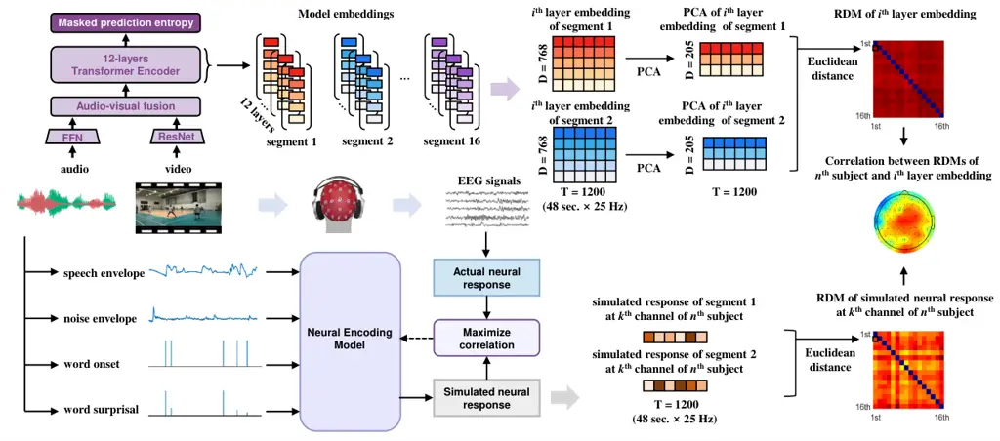
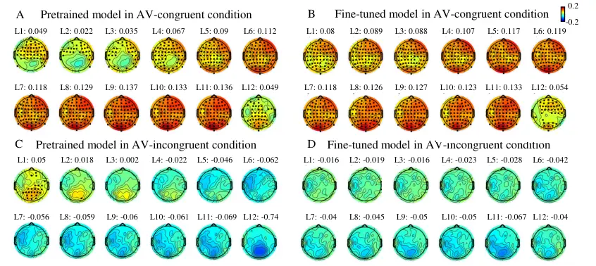
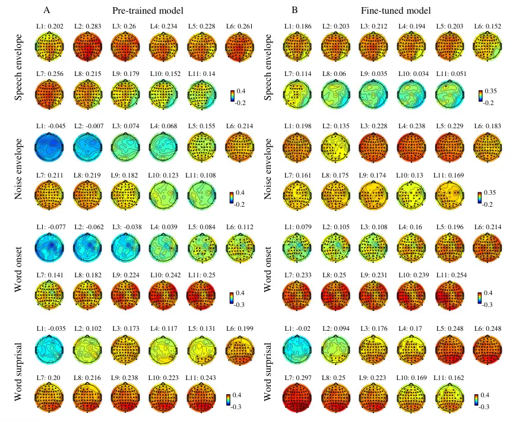
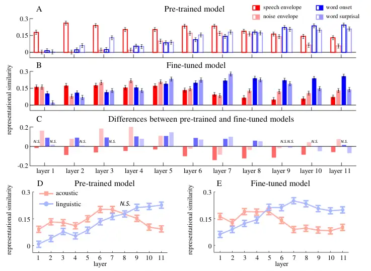
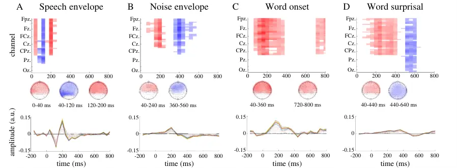

# Representational Alignment between Deep Neural Networks and Human Brain in Speech Processing under Audiovisual Noise

Luo Cheng    Zhu Jian    Sun Zhoujian    Qi Yunyi    Qi Yu    Sun Wenhui
   Yu Wenyuan ^(†)^(†)thanks: Corresponding author.
Email: [luo_cheng@zisu.edu.cn](mailto:)    wenyuan_yu@outlook.com

###### Abstract

Speech comprehension in the human brain is an incremental process that
begins with acoustic processing and advances to linguistic processing.
While recent studies have revealed that the hierarchy of deep neural
networks (DNNs) correlates with the ascending auditory pathway, the
exact nature of this DNN-brain alignment remains underexplored. In this
study, we investigate how DNN representations align with the brain’s
acoustic-to-linguistic processing. Specifically, we employed neural
encoding models to simulate neural responses to acoustic (i.e., speech
and noise envelope) and linguistic features (i.e., word onset and
surprisal). By applying representational similarity analysis (RSA), we
quantified the similarity between these neural responses and the DNN
embeddings generated by a pre-trained automatic speech recognition (ASR)
model, both before and after fine-tuning on audiovisual noisy data. Our
results demonstrate significant DNN-brain alignment: embeddings from
shallow layers exhibit higher similarity to neural responses associated
with acoustic features, while those from deeper layers align more
closely with neural responses related to linguistic features.
Importantly, the fine-tuning process enhances this alignment by
improving noise processing in shallower layers and refining linguistic
representations in deeper layers. These results suggest that fine-tuned
DNN models can naturally develop human-like processing patterns in noisy
environments, highlighting a functional alignment between the human
brain and DNNs in speech representation.

## 1 Introduction

Speech comprehension involves multiple levels of analyses, including the
encoding of basic sensory features and the extraction of more abstract
linguistic information \[11\]. Recently, transformer-based deep neural
network (DNN) models have shown human-level performance in automatic
speech recognition (ASR) tasks \[2, 12, 22\]. However, it remains
unclear whether this comparable performance reflects similar internal
information representations. According to a recent review, the
similarity between the human brain and DNN models can be evaluated
through: (1) the responses of human and DNN models to the same stimuli,
(2) the stimulus features evoking the similar responses of human and DNN
models, and (3) the computations involved in processing the same
stimulus to yield similar response \[24\]. To explore this
representational similarity, we correlate the representations in DNN
hidden layers with the neural responses to acoustic and linguistic
features in the human brain, aiming to explore the similarity between
DNN models and the human brain in terms of computational equivalence.

Accumulating studies provide evidence for the representational alignment
between DNN models and the human brain in speech recognition. Recent
studies found that the embeddings from the middle layers in DNN models
best predict neural activity in the primary cortex, while those from
deep layers best predict activity in the non-primary cortex \[13, 17,
20, 27, 28\]. Furthermore, the embeddings of the shallower layers are
primarily predicted by acoustic features, whereas embeddings of deeper
layers onward are better predicted by phonetic features \[17\]. Given
that the ascending auditory pathway correlates with
acoustic-to-linguistic processing in speech comprehension \[11, 10\],
the correlation between the DNN hierarchy and ascending auditory pathway
suggests a representational alignment between DNN hierarchy and
acoustic-to-linguistic processing in the human brain. However, previous
research has primarily focused on the relationship between DNNs and the
auditory pathway without distinguishing between acoustic and linguistic
processing in either the brain or DNNs, leaving direct evidence for this
representational alignment still lacking. Moreover, most existing
research has examined DNN-brain alignment exclusively in fine-tuned
models optimized for specific tasks, which leaves the impact of the
fine-tuning process on DNN-brain alignment unclear.

Additionally, speech is often accompanied with audiovisual noise in the
real-world scenes. For instance, when speaking on the phone on a busy
street, we not only hear speech from the phone but also background noise
from the surroundings, with visual information often unrelated to the
speech. Previous studies have typically investigated the
representational similarity between the human brain and DNN models using
audio-only speech recognition tasks. Little is explored about the
DNN-brain representational similarity in audiovisual scenes. A recent
study has proposed a transformer-based audiovisual automatic speech
recognition (AV-ASR) framework, called AV-HuBERT \[25\]. The framework
offers a stable training procedure to fuse audio and visual
representations, and achieves promising performances on audiovisual
scenes, where the visual information is related to the target speaker
(e.g., lip movements) \[26\] or the background noise (e.g., interfering
objects) \[18\]. It provides a useful tool for exploring the
representational similarity between the human brain and DNN models in
speech recognition under a more natural condition.

This study aims to investigate the alignment between representations the
human brain and DNN models in speech recognition tasks under audiovisual
noise. Specifically, we applied a comparative analysis of neural
responses and DDN embeddings for English speech with audiovisual noise
in natural settings. For DNN models, we extracted the embedding vectors
from hidden layers for both pre-trained and fine-tuned models in
response to the audiovisual inputs. For neural responses, we recorded
electroencephalography (EEG) signals while participants performed a
speech comprehension task under audiovisual noise. To evaluate the
representational similarity between model embeddings of hidden layers
and the neural representations of multi-level speech processing, we
quantified the neural responses to acoustic (i.e., speech envelope and
noise envelope) and linguistic (i.e., word onset and word surprisal)
features using neural encoding models. We then separately simulated the
neural responses to these features and computed the representational
similarity between the simulated neural responses and DNN embeddings
(Fig.1). The main contributions of this work include:

- •
  This work introduces a novel method that combines neural encoding
  model and representational similarity analysis to evaluate the
  representational similarity between DNN and neural representations in
  speech recognition at specific processing levels (e.g., acoustic and
  linguistic levels).
- •
  This work reveals representational alignments between the
  transformer-based DNN and human brain in speech recognition under
  audiovisual noise: DNN representations in the shallower hidden layers
  are more similar to neural representations of acoustic features,
  whereas those in deeper layers are more similar to neural
  representations of linguistic features.
- •
  This work demonstrates that the fine-tuning process enhances the
  DNN-brain alignments for acoustic-to-linguistic processing in noisy
  environments. Specifically, the fine-tuning process modulates the
  trends of representational similarity for acoustic and linguistic
  features across layers, increasing the representation of noise
  processing in shallower layers while refining linguistic
  representations in deeper layers.

Figure 1: Schematic of analysis framework for computing representational
similarity between DNNs embeddings and neural responses. For
transformer-based DNNs (top panel), the model is fine-tuned on speech
data with congruent audiovisual noise, starting from a pre-trained
initialization. Then, embedding vectors of stimulus input are extracted
from 12 transformer hidden layers, and utilized to calculate
representational dissimilarity matrixs (RDMs). For neural encoding model
(bottom panel), the EEG data in each EEG channel is predicted based on a
linear combination of time-shifted stimulus features (speech envelope,
noise envelope, word onset, and word surprisal). The encoder weights
(temporal response functions) are estimated by maximizing the
correlation between the actual neural responses and simulated neural
responses. The simulated neural responses to stimulus features are
utilized to calculate RDMs. Representational similarity is index through
Spearman correlation between the RDMs of model embeddings and simulated
neural responses.

## 2 Approach

### 2.1 Speech Stimuli

Stimuli consisted of 16 English speech audios selected from LRS3
corpus \[1\]. Each speech audio was approximately one minute long (58.57
± 2.44 seconds). Audiovisual noise stimuli were chosen from AVNS
corpus \[18\]. Eight audiovisual noise clips were selected from
$`\textstyle Road`$ class (recorded in the road side), and another eight
were selected from $`\textstyle Playground`$ class (recorded in
badminton courts, basketball courts, and athletics fields). All
audiovisual noise clips were recorded at a fixed point. The video
depicted natural auditory scenes, and the audio contained sounds from
objects in the scenes (such as car driving and telephone ringing) and
human vocalizations (such as yelling and cheering) but no speech. The
noise-free speech audio recordings were overlapped with the noise audio
recordings at a 0 dB signal-to-noise ratio (SNR). The noise speech audio
was paired with videos either congruent or incongruent with the noise
audio, resulting in congruent and incongruent audiovisual conditions.
The audio recordings were sampled at 44.1 kHz, and the video recordings
had a frame rate of 25 Hz. Each noise video was paired with congruent
and incongruent noise audio once, resulting 32 speech-in-noise stimuli
in the current study.

### 2.2 EEG Experiment

#### 2.2.1 Participants

Twenty English native speakers (eight males; age: 22.4 ± 3.87 years old)
were recruited for the EEG experiment. All the participants had
self-reported normal hearing and vision, with no mental or neurological
disorders. Written informed consent was obtained from all participants.
The study was approved by the anonymous Institutional Review Board
(Approval Number: $`\textstyle anonymous\,number`$).

#### 2.2.2 Procedure and task

Participants listened to speech clips with real-world noise while
simultaneously viewing the noise-related background videos. Stimulus
presentation was controlled using Psychtoolbox in Matlab software
(version R2021a) \[4\]. The audio stimuli were presented binaurally via
inserted earphones at a comfortable volume. The video stimuli were
displayed on a monitor with a resolution of 1920×1080. After each
stimulus, they answered a single-choice question with two options about
the speech content by pressing buttons. Following the single-choice
question, an additional oral report task was assigned for four randomly
selected stimuli. This task required participants to orally describe the
background videos, which ensured their attention to the visual stimulus.
Participants took a 30-second break between stimuli, each of which was
presented once in a random order. As a result, the accuracy rate for the
single-choice task was 89.85 ± 7.74%.

#### 2.2.3 EEG acquisition and preprocessing

EEG signals were recorded using a 64-channel BioSemi ActiveTwo EEG
system at a sample rate of 2048 Hz. Scalp electrodes were placed
according to the 10-10 system, with two external electrodes placed on
bilateral mastoids for re-referencing. Four external electrodes were
placed on the bilateral outer corners, and above and below the right eye
to record the electrooculogram (EOG).

Bad EEG channels were identified through visual inspection during online
recordings and confirmed in the offline analysis (1.86 ± 1.15 per
participant). These channels were then interpolated using the EEGLAB
toolbox \[6\]. Both EEG and EOG recordings were resampled to 128 Hz and
bandpass filtered between 0.5 and 30 Hz using a linear-phase finite
impulse response (FIR) filter with an order of 768. The delay caused by
the filter was compensated. Filtered EEG and EOG recordings were
referenced to the average recording of the bilateral mastoids, and EOG
signals were linearly regressed out from all channels. Independent
component analysis (ICA) was performed using EEGLAB \[6\] to further
remove artifacts. Data exceeding 6 times the median of amplitude were
clipped. Finally, the EEG recordings were bandpass filtered between 1 to
10 Hz using a zero-phase-shift filter and resampled to 25 Hz to match
the sampling rate of model embeddings.

### 2.3 DNN Architecture and Embeddings

#### 2.3.1 Model architecture

The DNN model based on the AV-HuBERT framework was constructed for
automatic speech recognition in audiovisual scenes. The AV-HuBERT was a
representation learning framework \[25, 26\], achieving state-of-the-art
performance on unimodal \[25\] and multimodal \[26\] setups. Here, we
used AV-HuBERT BASE as the model architecture for our experiment, and
the framework comprised four modules: a feed-forward network audio
feature extractor, a modified ResNet video feature extractor, a fusion
module, and a Transformer backend with 12 layers. The FFN learned audio
representation from the mel-frequency cepstral coefficients (MFCC) of
the synthetic speech audio, while the ResNet learned visual
representations from the raw image of the background video. These two
feature extractors generated frame-level representations for the
corresponding streams that were concatenated by the fusion module to
form initial audio-visual features. The concatenated audio-visual
representations were then fed into transformer-encoder blocks to
generate an output representation list $`\textstyle e_{1:T}`$. The
embedding dimension, feed forward dimension, and attention heads of each
transformer block were 768, 3072, and 12, respectively. A linear
classifier was used to predict tokens with respect to each
$`\textstyle e_{i}`$.

#### 2.3.2 Pre-trained and fine-tuned models

For the pre-trained model, we directly utilized the open-source
AV-HuBERT BASE model (via
[github](https://github.com/facebookresearch/av_hubert)) from Shi et
al. \[25, 26\] in our experiment setup. This model was pre-trained on
1326 hours of VoxCeleb2 and 433 hours of LRS3 datasets, capturing
effective audio-visual speech representation without additional noise
training. For the fine-tuned model, we adopted a noise-related
audiovisual dataset to fine-tune the model from the pre-trained
initialization \[25\]. Following the procedure of a previous
study \[18\], the audiovisual dataset was created based on AVNS, and
LRS3 datasets, which served as the source of background sound and of
target speech respectively. Specifically, the original speech audio was
extracted from LRS3 and superimposed by the background sound from the
AVNS dataset with 0 dB SNR. Then, video congruent with background sound
was attached to the synthetic speech audio. In total, a 433-hour
synthetic dataset was generated, and the training, validation, and test
sets contained 75%, 15%, and 10% sample clips, respectively. The
AV-HuBERT framework consumed frame-level synchronous audio and video
streams as input to produce contextualized audio-visual representations
for each frame.

The audio and video inputs were downsampled to feature sequences at a
frame rate of 25 Hz. The attention-based sequence-to-sequence
cross-entropy loss (S2S) was used to fine-tune the model. Specifically,
a transformer-based decoder was appended to the output of the encoder
and decoded the $`\textstyle e_{1:T}`$ to a sequence of target token
probabilities in an autoregressive manner. The model was trained by
minimizing the cross-entropy loss
$`L_{s2s}={\sum_{t}^{s}p(w_{t}|w_{1:t-1},e_{1:T})}`$, where $`w_{t}`$
was the true token. The fine-tuning process was conducted on a server
equipped with one Intel Xeon Silver 4214 CPU, two NVIDIA V100 GPUs, and
256 GB of DDR4 memory. Through the fine-tuning process, the speech
recognition accuracy under audiovisual noise increased from 0% in the
pre-trained model to 77.14% in the fine-tuned model.

#### 2.3.3 Model embeddings

The audio and video stimuli employed in the EEG experiment were
processed by the pre-trained and fine-tuned models. The embedding
vector, i.e., a 768-dimensional column vector, for each frame was
extracted from each transformer layer. Moreover, the principal component
analysis (PCA) was applied to mitigate the high dimensionality and
redundancy in embedding vectors. For each clip and transformer layer,
the embedding dimension was reduced from 768 to 205, which captured over
90% explained variance. Consequently, the embedding vectors of 16 clips
were obtained from audiovisual congruent and incongruent conditions
respectively.

### 2.4 Representational Similarity Analysis

Representational dissimilarity matrix (RDM) was constructed separately
for EEG responses and DNN embeddings. Due to the varying length of the
speech stimuli (58.57 ± 2.44 seconds), the middle 48 seconds of data was
retained by excluding initial and last $`\textstyle(duration-48)/2`$
seconds of the data segments. This procedure also helped to avoid the
onset/offset neural responses. Then, the Euclidean distance was
calculated between the DNN embeddings or neural responses of stimulus
pairs in audiovisual congruent and incongruent conditions respectively,
resulting in 16×16 RDMs for each condition. For neural responses, RDMs
were calculated for each participant and channel. For model embeddings,
RDMs were calculated for each transformer layer. The Spearman
correlation was calculated using the values in the upper triangle of the
RDMs between neural responses and model embeddings. In total, 15360
correlation values (12 layers × 20 participants × 64 channels) of each
condition were obtained to index the representational similarity between
neural responses and model embeddings (Fig.2-4).

### 2.5 Neural Encoding Model

#### 2.5.1 Feature extraction

Acoustic features consisted of speech envelope and noise envelope. The
broadband amplitude envelope of both speech and noise waveforms were
obtained through full-wave rectification. The sound envelope was then
bandpass filtered between 1 to10 Hz and resampled to 25 Hz to match the
sampling rate of model embeddings. Linguistic features consisted of word
onset and word surprisal. Word onset was extracted using the Montreal
Forced Aligner \[19\], and represented as one-dimensional sequence with
impulses aligned to the time bins of word onsets (Fig.1). Word
surprisal, calculated as the negative logarithm of the conditional
probability of the considered word given all the preceding words, was
extracted using GPT-2 \[23\]. Word surprisal was represented as a
one-dimensional sequence with impulses at time bins of word onsets,
weighted by the corresponding word surprisal values (Fig.1).

#### 2.5.2 TRF estimation

A time-delayed neural encoding model, known as multivariate temporal
response function (mTRF), was employed to construct the mappings between
speech feature sequences and EEG responses \[7, 8, 5\]. The feature
sequences and EEG responses were temporally aligned for training the
neural encoding model. For each speech stimulus, the initial and last
1-second segment of feature sequences and EEG responses was excluded to
avoid the onset/offset effects. The neural encoding model was fitted as
$`\textstyle r(t)={\sum_{k}}{\sum_{\tau}}s_{k}(t-\tau)\cdot w_{k}(\tau)+\varepsilon(t)`$
for each channel and participant, where $`\textstyle r(t)`$ was the EEG
response from the channel, $`\textstyle s_{k}(t-\tau)`$ was the speech
feature sequence $`\textstyle k`$ at time $`\textstyle t-\tau`$,
$`\textstyle w_{k}(\tau)`$ was the regression weight for feature
sequence $`\textstyle k`$ at time lag $`\textstyle\tau`$, and
$`\textstyle\varepsilon(t)`$ was the noise. The time lags ranged from
-200 ms to 800 ms. The regression weight $`\textstyle w_{k}(\tau)`$ was
computed using the least squares estimation with $`L2`$ regularization.
The regularization parameter was tuned to provide the highest simulated
accuracy, which was measured by the Pearson’s correlation between the
simulated neural responses and the actual responses. The procedure was
evaluated using 10-fold cross validation to prevent overfitting. The
optimal regularization parameter $`\lambda`$ was set to 0.01, which
yielded the highest simulated accuracy averaged over all channels, and
participants.

#### 2.5.3 Simulated responses to specific speech features

The simulated neural responses to specific speech features could be
created through the neural encoding model. Specifically, the neural
response, $`\textstyle\hat{r}(t)`$ at time $`\textstyle t`$ was computed
as the convolution of the speech feature sequence
$`\textstyle s_{k}(t)`$ with the corresponding regression weight
$`\textstyle w_{k}(\tau)`$:
$`\textstyle\hat{r}(t)={\sum_{\tau}}s_{k}(t-\tau)\cdot w_{k}(\tau)`$.
The time lags ranged from 0 ms to 800 ms. In the simulation procedure,
the feature sequences of speech envelope and noise envelope were
normalized using z-scores. Finally, the simulated responses to speech
envelope, noise envelope, word onsets, and word surprisal was obtained
respectively.

### 2.6 Statistical analysis

The significance of the neural encoding model (specifically, the mTRF
model) was assessed using a cluster-based permutation test \[9\] in
Matlab software (version R2021a). To further investigate how
representational similarity between simulated neural responses and DNN
embeddings varies across layers, we employed a linear mixed effects
(LME) model using $`\textstyle lmeTest`$ package \[15\] in R statistical
software (version 4.1.2). Additionally, simple effect analyses were
conducted to evaluate differences in representational similarity across
model types and speech features using $`\textstyle emmeans`$
package \[16\] in R statistical software (version 4.1.2). When multiple
comparisons were performed, the p-value was adjusted using the false
discovery rate (FDR) correction \[3\]. Full details are reported in the
supplementary material due to space restrictions.

## 3 Results

### 3.1 Representational Similarity

In speech processing with audiovisual-congruent noise, significant
representational similarity was observed in most of EEG channels and
across all transformer hidden layers in both pre-trained (Fig.2A) and
fine-tuned (Fig.2B) models. In contrast, with audiovisual-incongruent
noise, significant representational similarity was limited to the first
layer in pre-trained model (Fig.2C), and was absent in the fine-tuned
model (Fig.2D). Given that the DNN model was fine-tuned on speech with
audiovisual-congruent noise, these results suggest that DNNs can
naturally evolve human-like information representations through the
task-related fine-tuning process. Additionally, in speech processing
with audiovisual congruent noise, the representational similarity
increased from the first layer to the eleventh layer, but decreased in
the last layer, which was trained to match the auto-regressive decoder
for text transcriptions. Therefore, the model embeddings of the last
layer (Layer 12) were excluded in the following analysis.

Figure 2: Topographic maps of representational similarity between DNN
embeddings and actual EEG responses in speech processing with
audiovisual-congruent noise (A-B) and audiovisual-incongruent noise
(C-D). Black dots denote the significant channels.

### 3.2 Neural encoding model of speech features

On the top of representational similarity between DNN embeddings and
neural responses, we explored the representational similarity between
DNN embeddings and simulated neural responses to acoustic and linguistic
features. These simulated neural responses were generated using neural
encoding models (mTRF). The evaluation analysis revealed that all neural
encoding models for acoustic and linguistic features achieved
statistical significance (Fig.S1). For acoustic features, the neural
encoding model of speech envelope showed a significant negative cluster
at 100 ms ($`T_{sum}`$ = -290.92, $`p`$ = 0.0351) and a significant
positive cluster at 200 ms ($`T_{sum}`$ = 340.84, $`p`$ = 0.0283) in
fronto-central channels (Fig.S1A), which is analogous to classical N1-P2
complex \[21\]. The neural encoding model of noise envelope showed a
significant negative cluster at 400 ms ($`T_{sum}`$ = -1378, $`p`$
\<0.001) in frontal channels (Fig.S1B). For linguistic features, the
neural encoding model of word onset showed a significant positive
cluster at 200 ms ($`T_{sum}`$ = 929.42, $`p`$ = 0.0029) in
fronto-central channels (Fig.S1C). The neural encoding model of word
surprisal showed a significant positive cluster at 300 ms ($`T_{sum}`$ =
1284.6, $`p`$ \<0.001) and 700 ms ($`T_{sum}`$ = 325.24, $`p`$ = 0.0449)
in fronto-central channels and a significant negative cluster at 500 ms
($`T_{sum}`$ = -302.93, $`p`$ = 0.0488) in central channels (Fig.S1D),
which is analogous to N400, the classical semantic-related ERP
component \[14\]. These results proved the validity of the neural
encoding models of acoustic and linguistic features. Hence, these neural
encoding models were employed to simulate the neural responses to
acoustic and linguistic features for further representational similarity
analysis.

Figure 3: Topographic maps of representational similarity between DNN
embeddings and simulated neural responses to speech envelope, noise
envelope, word onset, and word surprisal in speech processing with
audiovisual-congruent noise. Results for pre-trained model (A), and
fine-tuned model (B). Black dots denote the significant channels.

### 3.3 Feature-based representational similarity

To evaluate the feature-based DNN-brain alignment in speech processing,
we analyzed the representational similarity between DNN embeddings and
simulated neural responses to acoustic and linguistic features
separately. Regarding acoustic features, higher representational
similarity between DNN embeddings and simulated neural responses was
observed in the shallower layers. For the speech envelope, the
pre-trained model showed prominent representational similarity in the
first eight layers, with a decrease in deeper layers (Fig.3A). The
fine-tuned model exhibited higher similarity in the first six layers,
also decreasing in deeper layers (Fig.3B). For the noise envelope, the
pre-trained model demonstrated relatively higher representational
similarity from Layers 5 to 9, with a peak at Layer 6 (Fig.3A). In
contrast, the fine-tuned model exhibited higher similarity in the first
five layers, with a peak at Layer 4 (Fig.3B). Regarding linguistic
features, higher representational similarity between DNN embeddings and
simulated neural responses was observed in the deeper layers. For word
onsets, both the pre-trained and fine-tuned models showed increasing
representational similarity from shallow to deep layers, with a peak at
Layer 11 (Fig.3A&B). Similarly, for word surprisal, representational
similarity increased from shallow to deep layers, followed by relative
stability in the deeper layers (Fig.3A&B). These results highlight a
significant DNN-brain alignment: embeddings from shallow layers exhibit
higher similarity to neural responses associated with acoustic features,
while those from deeper layers align more closely with neural responses
related to linguistic features.

### 3.4 Representational modulation of fine-tuning

The representational similarity for the pre-trained and fine-tuned
models is summarized in Fig.4A-C. The LME analysis was applied to
investigate the significant main effects of model types, layers, speech
features, and their interactions (Table S1). Additionally, simple effect
analysis was applied to compare the across-layer representational
similarity between the pre-trained and fine-tuned models (Table S2).
Regarding acoustic features, the fine-tuning process decreased the
representational similarity for speech envelope across nearly all layers
(Layers 2-11). Despite these reductions, the fine-tuning process did not
alter the overall trend of higher representational similarity in
shallower layers. Importantly, the fine-tuning process shifted the trend
of representational similarity for noise envelope across layers,
increasing it in shallower layers (Layers 1-5) while decreasing it in
deeper layers (Layers 6-9). This shift may indicate that fine-tuning
could enhance the model’s ability to disentangle noise from speech at an
earlier processing stage, potentially reducing the influence of noise on
higher-level processing. Regarding linguistic features, the fine-tuning
process increased the representational similarity for both word onsets
and word surprisal in middle layers (Layers 2-8), and preserved the
trend of higher representational similarity in deeper layers (Layers
9-11).

We further compared the across-layer distribution of representational
similarity between the pre-trained and fine-tuned models (Fig.4 D-E;
also see Table S3). Our analysis revealed that the fine-tuning process
modifies the dominance of representational similarity for acoustic and
linguistic features across layers, rebalancing the model’s focus to
improve speech processing in noisy environments. Specifically, in the
pre-trained model, representational similarity for acoustic features
dominated from Layers 1 to 7, with a transition to linguistic features
from Layers 9 to 11. In contrast, in the fine-tuned model, this
transition occurred earlier, with acoustic features dominating from
Layers 1 to 5 and linguistic features emerging from Layers 6 to 11.
These findings indicated that fine-tuned DNN models can naturally
develop the acoustic-to-linguistic processing pattern in automatic
speech recognition tasks, highlighting a functional alignment between
the human brain and DNNs in speech representation.

Figure 4: (A-C) Representational similarity of speech envelope, noise
envelope, word onset, and word surprisal for the pre-trained, fine-tuned
models, as well as their differences. The representational similarity
was averaged across channels and participants. (D-E) Representational
similarity for acoustic and linguistic features in the pre-trained, and
fine-tuned models. The representational similarity is averaged across
channels, participants and features. Error bars denote the 95%
confidence interval (CI). $`N.S.`$ denotes non-significant.

## 4 Limitations

There are two main limitations of the current work that should be noted.
First, our work primarily focuses on acoustic features (e.g., speech and
noise envelopes) and linguistic features (e.g., word onsets and
surprisal) that are considered to exhibit universal properties across
human languages. While this approach enables us to investigate
fundamental mechanisms underlying DNN-brain alignment in speech
processing, the exclusive inclusion of native English speakers limits
the linguistic diversity of our experimental setup. It still remains
crucial for future studies to incorporate a more linguistically diverse
data to confirm whether these findings can be generalized across
languages and populations. Second, our work specifically employed the
AV-HuBERT model, a transformer-based architecture with advanced
audiovisual integration capabilities. While this choice was motivated by
its relevance to our experimental goals, it raises questions regarding
the extent to which our findings depend on the specific model
architecture. Although we expect similar patterns of DNN-brain alignment
in other transformer-based models such as Wav2Vec 2.0 or HuBERT due to
their shared ability to learn hierarchical representations, variations
in pre-training objectives and architectural details could lead to
subtle differences in both performance and fine-tuning effectiveness.
Therefore, future studies should extend this line of research to include
comparisons across multiple DNN architectures to further validate the
generalizability of our findings.

## 5 Conclusion

In this study, we introduced a novel method to investigate the
representational similarity between DNN embeddings and neural responses
in speech recognition under audiovisual noise. An important advantage of
our approach lies in the use of reliable neural encoding models (TRFs)
built under controlled experimental setups. These models enable us to
generate simulated neural responses for new noise scenarios without the
need to re-collect neural activity from the human brains. Therefore, our
framework can be extended to evaluate DNN-brain alignment in more
realistic and diverse noisy environments. The results demonstrated that
both pre-trained and fine-tuned models exhibit representational
alignments with acoustic-to-linguistic processing in the human brain.
Furthermore, the fine-tuning process enhances such DNN-brain alignments
by modifying the dominance of acoustic and linguistic processing across
DNN layers, thus improving the model’s ability to convert raw acoustic
inputs into linguistic representations in noisy environments. Our
findings suggest that speech representations learned in
transformer-based DNNs naturally evolve toward the human-like processing
patterns, providing credible evidence for the interpretability of DNNs
in automatic speech recognition tasks. The insights from DNN-brain
alignment can be utilized to design more effective ASR models by
understanding how different layers of a DNN mimic the human brain’s
processing of acoustic and linguistic information. This knowledge allows
us to optimize model architectures and training strategies, enhancing
the capture of complex features in speech signals, particularly
improving accuracy and robustness in noisy environments.

## Acknowledgments and Disclosure of Funding

This work was supported by the Science and Technology Innovation
2030-Brain Science and Brain-inspired Artificial Intelligence Major
Project (STI 2030—Major Project No. 2021ZD0201500).

## References

- \[1\] T. Afouras, J. S. Chung, and A. Zisserman (2018) LRS3-ted: a
  large-scale dataset for visual speech recognition. arXiv preprint
  arXiv:1809.00496. Cited by: §2.1.
- \[2\] A. Baevski, Y. Zhou, A. Mohamed, and M. Auli (2020) Wav2vec 2.0:
  a framework for self-supervised learning of speech representations.
  Advances in neural information processing systems 33, pp. 12449–12460.
  Cited by: §1.
- \[3\] Y. Benjamini and Y. Hochberg (1995) Controlling the false
  discovery rate: a practical and powerful approach to multiple testing.
  Journal of the Royal statistical society: series B (Methodological) 57
  (1), pp. 289–300. Cited by: §2.6.
- \[4\] D. H. Brainard and S. Vision (1997) The psychophysics toolbox.
  Spatial vision 10 (4), pp. 433–436. Cited by: §2.2.2.
- \[5\] M. J. Crosse, N. J. Zuk, G. M. Di Liberto, A. R. Nidiffer, S.
  Molholm, and E. C. Lalor (2021) Linear modeling of neurophysiological
  responses to speech and other continuous stimuli: methodological
  considerations for applied research. Frontiers in neuroscience 15,
  pp. 705621. Cited by: §2.5.2.
- \[6\] A. Delorme and S. Makeig (2004) EEGLAB: an open source toolbox
  for analysis of single-trial eeg dynamics including independent
  component analysis. Journal of neuroscience methods 134 (1), pp. 9–21.
  Cited by: §2.2.3.
- \[7\] N. Ding and J. Z. Simon (2012) Emergence of neural encoding of
  auditory objects while listening to competing speakers. Proceedings of
  the National Academy of Sciences 109 (29), pp. 11854–11859. Cited by:
  §2.5.2.
- \[8\] N. Ding and J. Z. Simon (2013) Adaptive temporal encoding leads
  to a background-insensitive cortical representation of speech. Journal
  of Neuroscience 33 (13), pp. 5728–5735. Cited by: §2.5.2.
- \[9\] E. Gerber (2021) Permutest (https://www. mathworks.
  com/matlabcentral/fileexchange/71737-permutest), matlab central file
  exchange. Retrieved December 29, pp. 2021. Cited by: §A.1, §2.6.
- \[10\] A. L. Giraud and D. Poeppel (2012) Cortical oscillations and
  speech processing: emerging computational principles and operations.
  Nature neuroscience 15 (4), pp. 511–517. Cited by: §1.
- \[11\] G. Hickok and D. Poeppel (2007) The cortical organization of
  speech processing. Nature reviews neuroscience 8 (5), pp. 393–402.
  Cited by: §1, §1.
- \[12\] W. Hsu, B. Bolte, Y. H. H. Tsai, K. Lakhotia, R. Salakhutdinov,
  and A. Mohamed (2021) Hubert: self-supervised speech representation
  learning by masked prediction of hidden units. IEEE/ACM transactions
  on audio, speech, and language processing 29, pp. 3451–3460. Cited by:
  §1.
- \[13\] A. J. Kell, D. L. Yamins, E. N. Shook, S. V. Norman-Haignere,
  and J. H. McDermott (2018) A task-optimized neural network replicates
  human auditory behavior, predicts brain responses, and reveals a
  cortical processing hierarchy. Neuron 98 (3), pp. 630–644. Cited by:
  §1.
- \[14\] M. Kutas and K. D. Federmeier (2011) Thirty years and counting:
  finding meaning in the n400 component of the event-related brain
  potential (erp). Annual review of psychology 62 (1), pp. 621–647.
  Cited by: §3.2.
- \[15\] A. Kuznetsova, P. B. Brockhoff, and R. H. B. Christensen (2017)
  LmerTest package: tests in linear mixed effects models. Journal of
  statistical software 82 (13). Cited by: §A.1, §2.6.
- \[16\] R. Lenth, H. Singmann, J. Love, P. Buerkner, and M.
  Herve (2019) Emmeans: estimated marginal means, aka least-squares
  means (version 1.3. 4). Emmeans Estim Marg Means Aka Least-Sq Means.
  Cited by: §A.1, §2.6.
- \[17\] Y. Li, G. K. Anumanchipalli, A. Mohamed, P. Chen, L. H.
  Carney, J. Lu, J. Wu, and E. F. Chang (2023) Dissecting neural
  computations in the human auditory pathway using deep neural networks
  for speech. Nature Neuroscience 26 (12), pp. 2213–2225. Cited by: §1.
- \[18\] C. Luo, Y. Liu, W. Sun, and Z. Sun (2024) Multi-modality speech
  recognition driven by background visual scenes. In ICASSP 2024-2024
  IEEE International Conference on Acoustics, Speech and Signal
  Processing (ICASSP), pp. 10926–10930. Cited by: §1, §2.1, §2.3.2.
- \[19\] M. McAuliffe, M. Socolof, S. Mihuc, M. Wagner, and M.
  Sonderegger (2017) Montreal forced aligner: trainable text-speech
  alignment using kaldi.. In Interspeech, Vol. 2017, pp. 498–502. Cited
  by: §2.5.1.
- \[20\] J. Millet, C. Caucheteux, Y. Boubenec, A. Gramfort, E.
  Dunbar, C. Pallier, J. King, et al. (2022) Toward a realistic model of
  speech processing in the brain with self-supervised learning. Advances
  in Neural Information Processing Systems 35, pp. 33428–33443. Cited
  by: §1.
- \[21\] R. Näätänen and T. Picton (1987) The n1 wave of the human
  electric and magnetic response to sound: a review and an analysis of
  the component structure. Psychophysiology 24 (4), pp. 375–425. Cited
  by: §3.2.
- \[22\] A. Radford, J. W. Kim, T. Xu, G. Brockman, C. McLeavey, and I.
  Sutskever (2023) Robust speech recognition via large-scale weak
  supervision. In International conference on machine learning,
  pp. 28492–28518. Cited by: §1.
- \[23\] A. Radford, J. Wu, R. Child, D. Luan, D. Amodei, I. Sutskever,
  et al. (2019) Language models are unsupervised multitask learners.
  OpenAI blog 1 (8), pp. 9. Cited by: §2.5.1.
- \[24\] P. G. Schyns, L. Snoek, and C. Daube (2022) Degrees of
  algorithmic equivalence between the brain and its dnn models. Trends
  in Cognitive Sciences 26 (12), pp. 1090–1102. Cited by: §1.
- \[25\] B. Shi, W. Hsu, K. Lakhotia, and A. Mohamed (2022) Learning
  audio-visual speech representation by masked multimodal cluster
  prediction. arXiv preprint arXiv:2201.02184. Cited by: §1, §2.3.1,
  §2.3.2.
- \[26\] B. Shi, W. Hsu, and A. Mohamed (2022) Robust self-supervised
  audio-visual speech recognition. arXiv preprint arXiv:2201.01763.
  Cited by: §1, §2.3.1, §2.3.2.
- \[27\] G. Tuckute, J. Feather, D. Boebinger, and J. H.
  McDermott (2023) Many but not all deep neural network audio models
  capture brain responses and exhibit correspondence between model
  stages and brain regions. Plos Biology 21 (12), pp. e3002366. Cited
  by: §1.
- \[28\] A. R. Vaidya, S. Jain, and A. Huth (2022) Self-supervised
  models of audio effectively explain human cortical responses to
  speech. In International Conference on Machine Learning,
  pp. 21927–21944. Cited by: §1.

## Appendix A Technical Appendices and Supplementary Material

### A.1 Statistical analysis

To evaluate the significance of neural encoding model (mTRF model), we
computed surrogate mTRF models using the speech feature sequences
circularly shifted a random time lag ranging from 1 to 1200 samples
(1/25 to 48 seconds). This procedure was repeated for 101 times,
resulting in 101 surrogate mTRF models for the actual mTRF model. All
the mTRF models were baseline corrected by subtracting the averaged
value at time lags from -200 to 0 ms. The actual mTRF was then evaluated
by comparing it with the chance-level mTRF averaged across all the
corresponding surrogate mTRF models using a cluster-based permutation
test \[9\] in Matlab software (version R2021a). For each time-channel
sample, the actual and chance-level mTRF weights of all participants
were compared using a paired $`t`$-test. Samples with a significant
$`t`$-value ($`p`$ \< .025) were selected. Spatiotemporally neighboring
significant samples were grouped into clusters, and the cluster-level
statistic was defined as the sum of the $`t`$-values within each
cluster. The significance of a cluster was evaluated using Monte-Carlo
method: First, actual and chance-level mTRFs were collected into a
single set. Second, the single set of mTRFs was randomly divided into
two equal subsets. Third, the $`t`$-values and cluster-level statistics
were calculated based on these two subsets. Fourth, the second and third
steps were repeated for 1024 times, resulting in a distribution of the
largest cluster-level statistics under the null hypothesis. Fifth, the
actual cluster-level statistics were determined as significant if they
exceeded the 95th percentile of the null distribution. As the
significance of a cluster was judged against a null distribution, this
procedure inherently corrected for multiple comparisons.

To evaluate the significance level of the representational similarity,
surrogate correlation values were calculated by the shuffled RDMs
between neural responses and model embeddings. This procedure was
repeated 101 times for each participant and EEG channel. The
significance level was determined as ($`N`$ + 0.01) / (101 + 0.01),
where $`N`$ represents the number of times the surrogate correlation
values exceeded the actual correlation values. For the condition-level
analysis, the significance of representational similarity was assessed
using the correlation values obtained from each participant and EEG
channel. For the channel-level analysis, the significance was evaluated
using the mean correlation values averaged across all participants.

To further investigate how representational similarity between simulated
neural responses and DNN embeddings varies across layers, we utilized a
linear mixed effect (LME) model using $`\textstyle lmeTest`$
package \[15\] in R statistical software (version 4.1.2). The model
included the fixed effects of $`\textstyle model\;types`$ (pre-trained
model vs. fine-tuned model), $`\textstyle DNN\;layers`$ (eleven levels),
and $`\textstyle speech\;features`$. The speech features were
categorized into specific features (speech envelope, noise envelope,
word onset, and word surprisal) or broader types (acoustic vs.
linguistic). The random effects of $`\textstyle participants`$ and
$`\textstyle channels`$ were also included in the LME model. As a
result, the model was described as:
$`\textstyle representational\;similarity\sim model\;types*DNN\;layers*speech\;features+(1\,|\,participants)+(1\,|\,channels)`$.
Furthermore, simple effect analyses were conducted to assess the
difference in representational similarity across model types and speech
features using $`\textstyle emmeans`$ package \[16\]. In the LME
analysis, we set insignificant representational similarity values to
zero. This exclusion criterion ensured that only statistically reliable
representational similarity values were included in the LME models,
preserving the accuracy of our statistical analysis.

All test statistics are summarized in Table S1 to S3.

Table S1: Contrasts for the LME model with the interaction across model
types, DNN layers, and speech features on the representational
similarity (env.: speech envelope. n.env.: noise envelope. w.onset.:
word onset. w.surp.: word surprisal). The $`p`$-values were adjusted
using the Tukey method to control for the increased error rate
associated with multiple comparisons.

Table S2: Simple effects analysis of representational similarity:
Comparisons between pre-trained and fine-tuned models for Fig.4A-C. The
$`p`$-values were adjusted using the Bonferroni method to control for
the increased error rate asso-ciated with multiple comparisons.

Table S3: Simple effects analysis of representational similarity:
Comparisons between acoustic and linguistic features for fig.4D-E. The
$`p`$-values were adjusted using the Bonferroni method to control for
the increased error rate associated with multiple comparisons.

### A.2 Supplementary figures

Figure S1: Neural encoding model weights (mTRFs) for speech envelope
(A), noise envelope (B), word onset (C), and word surprisal (D). The top
panels show the spatiotemporal cluster of mTRFs. The horizontal x-axis
denotes time lags of mTRFs, and the vertical y-axis denotes 64 channels
from occipital (bottom) to frontal (top). Each brick in the coordinate
system represents the mTRF amplitude per time interval and channel.
Significant positive and negative amplitude are displayed in red and
blue, respectively. The topographies show the spatial distribution of
significant spatiotemporal clusters. The topographies show the spatial
distribution of significant spatiotemporal clusters. Color bar
represents t-value obtained in the cluster-based permutation test. The
bottom panels show the amplitude of mTRFs. The colorful lines represent
the amplitude of mTRF in each channel. The black lines represent the
amplitude of chance level (surrogate mTRF).

Figure S2: The full text of instructions given to participants.
