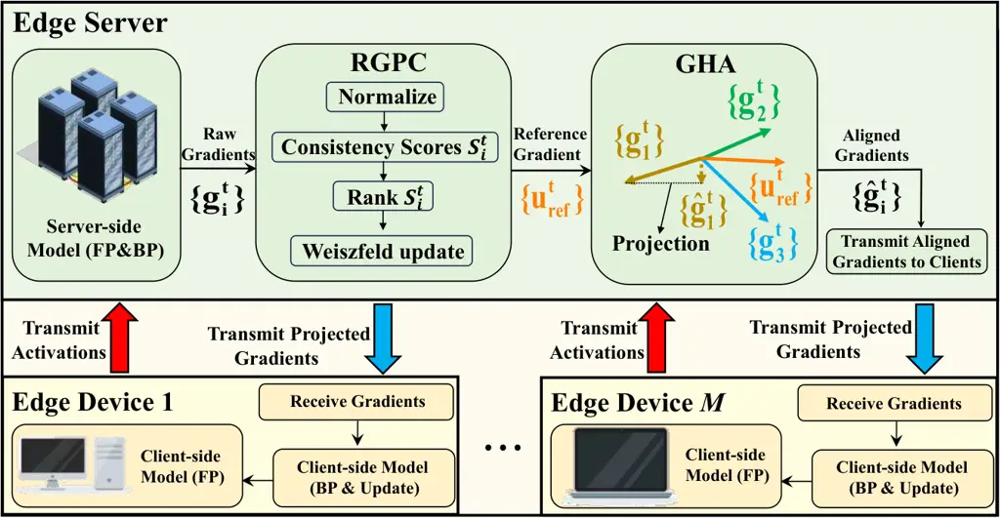
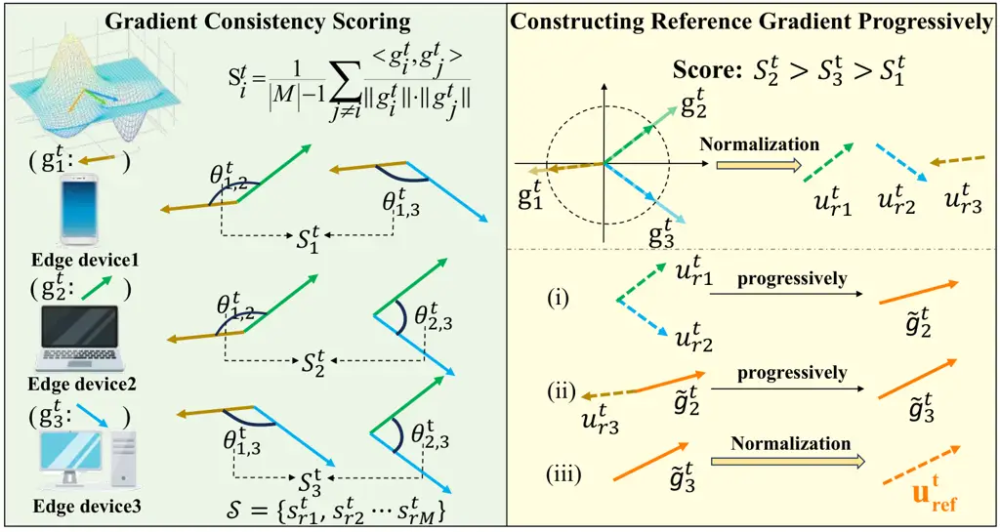

\correspondingauthor

\correspondingauthor

# PSL-RGHA: Parallel Split Learning with Reference Gradient Half-Space Alignment for Mitigating Gradient Divergence

Conference: Proceedings of the 34th ACM International Conference on
Multimedia; November 10–14, 2026; Rio de Janeiro, Brazil.Proceedings of
the 34th ACM International Conference on Multimedia (MM ’26), November
10–14, 2026, Rio de Janeiro,
BrazilISBN: 979-8-4007-2213-4/2026/11DOI: [10.1145/3767308.3835121](https://doi.org/10.1145/3767308.3835121)CCS: Computing
methodologies Machine learningCCS: Computing methodologies Distributed
computing methodologies

Han Li Note: Both authors contributed equally to this research.
^(🖂)Corresponding authors. email: <18850543060@163.com>
Affiliation: Xiamen University of Technology, Xiamen, Fujian, China ,
Zheng Lin email: <zhenglin@ieee.org> Affiliation: SnT, University of
Luxembourg, Luxembourg , Miao Yang email: <yangmiao@xmut.edu.cn>
Affiliation: Xiamen University of Technology, Xiamen, Fujian, China ,
Zehang Lin email: <18850975878@163.com> Affiliation: Xiamen University
of Technology, Xiamen, Fujian, China , Jing Yang email:
<s2147529@siswa.um.edu.my> Affiliation: Universiti Malaya, Kuala Lumpur,
Malaysia , Zihan Fang email: <zihanfang3-c@my.cityu.edu.hk>
Affiliation: City University of Hong Kong, Hong Kong, China , Qiyang
Zhang email: <qiyangzhang@pku.edu.cn> Affiliation: Peking University,
Beijing, China , Zhaolu Kang email: <kangzl9966@gmail.com>
Affiliation: Peking University, Beijing, China , Jianmin Li email:
<lijm@xmut.edu.cn> Affiliation: Xiamen University of Technology, Xiamen,
Fujian, China , Lin Li email: <linli@xmut.edu.cn> Affiliation: Xiamen
University of Technology, Xiamen, Fujian, China , Mingwei Hong email:
<mwhong12345@gmail.com> Affiliation: Xiamen University of Technology,
Xiamen, Fujian, China and Shunzhi Zhu email: <szzhu@xmut.edu.cn>
Affiliation: Xiamen University of Technology, Xiamen, Fujian, China

© cc

###### Abstract.

The escalating complexity of deep neural networks hinders the deployment
of federated learning (FL) on resource-constrained devices, especially
for multimedia applications such as on-device image classification and
speech recognition. Parallel split learning (PSL) has emerged as a
promising solution by offloading a substantial portion of the
computational workload to the server through layer-wise model
partitioning, making it particularly suitable for resource-limited
visual and speech intelligence scenarios. However, the absence of
client-side aggregation renders PSL susceptible to severe training
divergence and potential convergence failure under heterogeneous data
distributions. To address this challenge, we propose PSL-RGHA, a
gradient-aligned PSL framework that employs reference gradient
half-space alignment mechanism to mitigate training divergence among
client devices. PSL-RGHA comprises two novel components: reference
gradient progressive construction (RGPC) and gradient half-space
alignment (GHA). Specifically, RGPC evaluates the directional
consistency of client gradients and progressively synthesizes a robust
reference gradient via Weiszfeld updates, effectively approximating the
global descent direction. Then, GHA constrains client gradients within
the reference half-space defined by RGPC to mitigate gradient conflicts
and rectify local updates. Extensive experiments demonstrate that our
PSL-RGHA framework outperforms existing baselines in various settings.

###### Keywords: 

Distributed learning; split learning; gradient alignment; multimedia
intelligence

^(†)^(†)cc-license: by

## 1. Introduction

With the proliferation of the Internet of Things (IoT), billions of
interconnected smart devices continuously generate massive
privacy-sensitive data (Wu et al., 2024; Liu et al., 2025). This
unprecedented volume of data has significantly advanced the maturity of
machine learning (ML), enabling intelligent IoT applications (Lee
et al., 2023; Peng et al., 2024; Fang et al., 2025; Liu et al., 2024;
Yuan et al., 2025). In particular, the rapid growth of multimedia
intelligence, which encompasses high-fidelity image recognition and
real-time speech processing, has imposed extreme demands on the
computational and memory capabilities of edge devices (Li et al., 2023;
Wang et al., 2020b; Cao et al., 2024). Conventional ML, known as
centralized learning (CL), relies on aggregating raw data at a central
server for model training. However, with the exponential growth of
global data creation, estimated at 173.4 zettabytes in 2025 and
forecasted to triple to 527.5 zettabytes by 2029 (Taylor, 2025; Lin
et al., 2025a), CL encounters severe bottlenecks regarding communication
overhead and privacy leakage (Woisetschläger et al., 2024; Chen et al.,
2024). To address these issues, federated learning (FL) (Yang et al.,
2022b; Sun et al., 2024; Fang et al., 2026a) has emerged as a
privacy-preserving paradigm, which enables collaborative training by
exchanging model updates rather than raw data. While FL effectively
mitigates data privacy and communication concerns, it confronts severe
scalability bottlenecks as modern ML models expand exponentially in
size (Kim et al., 2024; Ye et al., 2024; Lin et al., 2026b; Fang et al.,
2026b; Lin et al., 2024a).

To overcome these bottlenecks, split learning (SL) (Vepakomma et al.,
2018; Lin et al., 2026a) has emerged to partition the model layer-wise,
offloading the compute-intensive workload to edge server. However,
vanilla SL adopts sequential training pipeline, which inherently suffers
from excessive latency and system overhead due to the idle waiting time
on clients (Fang et al., 2026c). To address this limitation, split
federated learning (SFL) (Lin et al., 2025b; Thapa et al., 2022; Lin
et al., 2025c) has been proposed by parallelizing client training, yet
it reintroduces a significant communication burden by requiring clients
to periodically synchronize their local sub-models with a parameter
server. Consequently, parallel split learning (PSL) (Joshi et al., 2021;
Kim et al., 2022) was proposed as a highly streamlined architecture. By
completely eliminating client-side parameter aggregation, PSL
successfully reduces communication overhead and system complexity,
making it the most resource-efficient paradigm for deploying large-scale
models on the edge.

However, PSL introduces severe training instability in heterogeneous
environments. In PSL, each client generates intermediate activations
based solely on its local, typically non-IID data distribution (Zhuang
and Lyu, 2024; Wei et al., 2026). In the absence of client-side
synchronization, each client’s sub-model rapidly overfits to its local
data distribution. This local divergence causes clients to upload
semantically inconsistent activations to the server (Li et al., 2024;
Deng et al., 2024). Consequently, during server-side backpropagation,
the global model receives wildly divergent and conflicting gradients.
Rather than converging, the accumulation of these conflicting updates
causes destructive interference, leading to severe client drift and
potential convergence failure. Since reintroducing client-side
aggregation would destroy PSL’s communication efficiency, the critical
challenge is how to resolve these gradient conflicts entirely on the
server.

To address the training instability inherent in PSL, we propose
PSL-RGHA, a gradient-aligned PSL framework that employs a reference
gradient half-space alignment mechanism to mitigate conflicting updates
among client devices. PSL-RGHA comprises two synergistic components
designed to enforce global consistency without client-side aggregation.
Specifically, to approximate the global descent direction, we introduce
reference gradient progressive construction (RGPC), which progressively
filters and synthesizes directionally consistent client gradients into a
robust reference vector. Building upon this trusted reference, we devise
a gradient half-space alignment (GHA) scheme that projects conflicting
client gradients onto the non-negative half-space of the reference
direction, effectively neutralizing components that impede convergence.
This collaboration ensures that local updates are continuously
harmonized with the global convergence trend without requiring
client-side aggregation. The main contributions of this paper are
summarized as follows:

- •
  We propose PSL-RGHA, a novel gradient alignment framework for PSL that
  explicitly mitigates gradient conflicts in heterogeneous data
  environments via pure server-side geometric alignment.
- •
  We develop the RGPC algorithm, which utilizes directional consistency
  metrics and Weiszfeld updates to construct a noise-resilient reference
  gradient that accurately captures the global convergence trend.
- •
  We devise the GHA mechanism, which project client gradients onto the
  reference half-space, thereby rectifying divergent updates and
  harmonizing the optimization direction across distributed clients.
- •
  We conduct extensive experiments to evaluate PSL-RGHA. Empirical
  results demonstrate that our framework significantly outperforms
  existing baselines in both convergence speed and final accuracy across
  diverse data settings.

## 2. Related Work

### 2.1. Split Learning and Variants

SL was originally introduced by Vepakomma et al. (Vepakomma et al., 2018) as a privacy-preserving alternative to FL. In vanilla SL
framework, the global model is partitioned into client-side and
server-side sub-models. Throughout training, clients interact with the
server sequentially in a round-robin fashion to compute forward and
backward passes. However, this sequential training incurs severe
training latency, hindering scaling to large numbers of devices. To
address the latency bottleneck, Thapa et al. (Thapa et al., 2022)
proposed SFL, which combines SL-style model partitioning with FL-style
parallel client training. By allowing multiple clients to perform
forward propagation in parallel and aggregating their gradients, SFL
significantly reduces the training time compared to vanilla SL. Building
upon the parallelization concepts of SFL, recent research has focused on
further streamlining the training pipeline. Joshi et al. (Joshi et al., 2021) and Kimet al. (Kim et al., 2022) introduced the PSL framework.
Unlike SFL, PSL removes the requirement for client-side model
aggregation. This architectural change simplifies the synchronization
process and accelerates model convergence. Recent work have further
improved the computational and communication efficiency of SL by
optimizing client-side gradient aggregation, designing scalable
server-side update mechanisms, and adopting adaptive model partitioning.

### 2.2. Data Heterogeneity Mitigation

Research on mitigating data heterogeneity in distributed learning has
been largely driven by FL, primarily through aggregation optimization
and personalization. Representative methods such as
SCAFFOLD (Karimireddy et al., 2020), FedDyn (Acar et al., 2021), and
FedDC (Gao et al., 2022) alleviate client drift via control variates or
regularization, while personalization approaches (e.g., FedAPA (Sun
et al., 2025), FedCPD (Jin et al., 2025)) enhance adaptability under
non-IID data through adaptive aggregation or prototype-based learning.
More recently, several studies have addressed data heterogeneity through
update consistency and conflict-aware optimization. Methods such as
FedProx (Li et al., 2020), FedNova (Wang et al., 2020a), and MOON (Li
et al., 2021) improve training stability by constraining local drift,
correcting objective inconsistency, or enhancing representation
consistency. Conflict-aware approaches, including PCGrad (Yu et al.,
2020), FedIIR (Guo et al., 2023), FedLD (Zeng et al., 2024), and
FedCALM (Zheng et al., 2025), further mitigate interference among client
updates by aligning optimization directions or suppressing conflicting
components. However, these methods are mainly designed for FL, where
full-model replication and iterative client aggregation are assumed. By
contrast, PSL adopts a partitioned architecture without client-side
aggregation, leading to distinct gradient interaction patterns.
Therefore, mitigating gradient inconsistency in PSL requires methods
tailored to its unique training dynamics.

## 3. Background and Motivation

PSL has emerged as a promising training paradigm for
resource-constrained edge intelligence. By partitioning the model
between edge devices and the server, PSL offloads the majority of
computation and memory overhead from clients. Crucially, by completely
eliminating client-side parameter aggregation, PSL simplifies the
training pipeline and minimizes communication overhead, making it highly
attractive for large-scale distributed deployment compared to
conventional SFL. However, this highly efficient, client-side parameter
aggregation-free architecture introduces an inherent optimization
vulnerability under statistical heterogeneity. In PSL, each client
executes forward and backward propagation based solely on its local,
typically non-IID data, updating its sub-model without any cross-client
synchronization. Consequently, local sub-models rapidly overfit to local
distributions. This local bias causes clients to upload semantically
disjointed intermediate activations to the server. Under non-IID
settings, this semantic mismatch translates into highly divergent
gradients during server-side backpropagation. Instead of a globally
calibrated optimization signal, the server receives conflicting updates
that accumulate over time, leading to optimization divergence and severe
client drift.

(a) PSL

(b) SFL

Figure 1. Performance of PSL and SFL on CIFAR-10 datasets under non-IID
settings with ResNet-18.

(a) Test accuracy

(b) Conflict ratio

Figure 2. Gradient conflict ratio and accuracy of PSL and SFL under
different non-IID levels on CIFAR-10 with ResNet-18.

This vulnerability is supported by our preliminary experiments. As shown
in Fig. 1, on non-IID CIFAR-10 with ResNet-18, PSL converges more slowly
and less stably than SFL, suggesting that the absence of client-side
aggregation increases its sensitivity to data heterogeneity. Fig. 2
further shows that stronger heterogeneity leads to a higher gradient
conflict ratio and lower test accuracy, with a more pronounced
degradation in PSL. These results indicate that PSL’s performance loss
is closely associated with cross-client gradient inconsistency, which
introduces noisy and unstable server-side updates. The above
observations reveal a major limitation of existing PSL frameworks:
eliminating client-side aggregation maximizes communication efficiency
but simultaneously removes the essential cross-client calibration needed
for stable convergence. Consequently, heterogeneous client updates can
interfere with each other, causing oscillation, slow convergence, or
even convergence failure. Therefore, the key challenge is how to
preserve the efficiency advantage of aggregation-free PSL while still
enforcing directional consistency among heterogeneous client gradients.
This compelling dilemma motivates the necessity of our research:
designing a robust server-side coordination mechanism capable of
inferring a reliable global descent trend from noisy client signals, and
actively suppressing conflicting update directions to guarantee stable,
aggregation-free distributed training.



Figure 3. An overview of PSL-RGHA architecture.

## 4. System Design

### 4.1. Overview

In this section, we present PSL-RGHA, a robust gradient-alignment
framework engineered to stabilize PSL under severe statistical
heterogeneity. As illustrated in Fig. 3, PSL-RGHA integrates two
synergistic modules within an aggregation-free architecture: i) RGPC
(Section 4.2), which synthesizes a global reference direction by
progressively aggregating consistent client gradients via Weiszfeld
updates; ii)GHA (Section  4.3), which leverages the reference gradient
to enforce global directional consistency.

(a) Individual performance

(b) Accuracy vs. Epochs

Figure 4. Performance of PSL using single client device gradient updates
on CIFAR-10 under non-IID settings (ResNet-18).

In PSL-RGHA, the model is split into client-side sub-models and a shared
server-side sub-model. In each training round, clients perform forward
propagation on local data and upload cut-layer activations to the
server. The server then completes forward and backward propagation to
obtain client-specific server gradients. RGPC constructs a robust
reference gradient, and GHA aligns each client gradient within the
corresponding reference half-space. The server updates the shared
sub-model using the corrected gradients and returns the cut-layer
gradients to the clients, which complete backpropagation and update
their local sub-models.

### 4.2. Reference Gradient Progressive Construction

In PSL, the absence of client-side aggregation severely exacerbates
inter-client gradient misalignment, producing conflicting updates at the
server. To empirically validate this, we evaluated the optimization
trajectories of individual clients starting from identical
initializations. As illustrated in Fig. 4(a), the resultant test
accuracies exhibit extreme spatial variance, confirming the severe
heterogeneity of local gradients. Furthermore, the client contributing
the maximum performance gain fluctuates across epochs (Fig. 4(b)),
indicating that no single client consistently aligns with the optimal
global descent direction. Consequently, under such directional conflict,
naive uniform aggregation inadvertently incorporates these misaligned
gradients as detrimental noise, thereby degrading the global update and
stalling convergence.

To this end, we propose RGPC, a robust aggregation mechanism that ranks
client gradients via a directional consistency score and progressively
synthesizes them using Weiszfeld updates (WEISZFELD, 1937) , as
illustrated in Fig. 5. This procedure yields a robust reference gradient
that effectively filters out noise and captures the underlying global
convergence trend, which is elaborated as follows.



Figure 5. An illustration of RGPC: Gradients are scored by directional
consistency (left) and aggregated via ranked Weiszfeld updates (right)
to construct the reference gradient.

#### 4.2.1. Gradient Consistency Scoring

Existing methods often estimate client contributions using gradient
magnitudes, assuming that larger updates are more informative (Yang
et al., 2024; Wang et al., 2023; Chen and Vikalo, 2024). However, under
statistical heterogeneity (non-IID data), gradients with large
magnitudes often stem from local overfitting or outliers, which are
directionally inconsistent with the global optimization landscape and
may impede convergence. Conversely, gradients with smaller magnitudes
but consistent directions often provide reliable progress. This
necessitates a metric that prioritizes directional alignment over scalar
magnitude. Accordingly, we introduce the gradient consistency score, a
metric designed to quantify the cross-client directional agreement.
Formally, for the $`t`$-th training round, the consistency score
$`S_{i}^{t}`$ of the $`i`$-th client is defined as the average cosine
similarity between its local gradient and those of all other
participating clients:

```math
S_{i}^{t}=\frac{1}{|\mathcal{M}|-1}\sum_{j\neq i}\frac{\left\langle g_{i}^{t},\,g_{j}^{t}\right\rangle}{\left\lVert g_{i}^{t}\right\rVert\cdot\left\lVert g_{j}^{t}\right\rVert}.\vskip-2.0pt \tag{1}
```

where $`\mathcal{M}=\{1,2,\ldots,M\}`$ denotes the set of participating
client devices, ⟨·, ·⟩ denotes the inner product, $`\lVert\cdot\rVert`$
is the Euclidean norm, and $`g_{k}^{t}`$ is the gradient of the $`k`$-th
client device at the $`t`$-th training round.

Equ. (1) provides a quantitative measure of directional centrality. A
higher $`S_{i}^{t}`$ indicates that the gradient of client $`i`$ aligns
closely with the prevailing descent trend of the population, suggesting
a constructive contribution to the global model. Conversely, a lower
$`S_{i}^{t}`$ signifies weak directional agreement, implying that the
update may introduce noise or conflicting signals that decelerate
convergence. As shown in Fig. 6, clients with higher consistency scores
consistently yield higher test accuracy in single-client update studies,
validating $`S_{i}^{t}`$ as an effective indicator of optimization
utility.

After computing $`\{S_{i}^{t}\}_{i\in\mathcal{M}}`$, the server ranks
clients in descending order and obtains indices
$`(r_{1},r_{2}\ldots,r_{M})`$ such that

```math
S_{r_{1}}^{t}\geq S_{r_{2}}^{t}\geq\cdots\geq S_{r_{M}}^{t}, \tag{2}
```

where $`r_{1}`$ denotes the client with the highest directional
consistency at round $`t`$. This ranking serves as the basis for RGPC,
allowing the system to prioritize directionally reliable gradients while
mitigating the impact of outliers during the subsequent reference
construction.

#### 4.2.2. Progressive Construction via Weiszfeld Updates

To synthesize a robust reference gradient from the heterogeneous client
updates, we employ a progressive Weiszfeld (Weiszfeld and Plastria, 2009) scheme that prioritizes directionally consistent gradients (i.e.,
those with higher consistency scores $`S_{i}^{t}`$). Unlike simple
averaging which is sensitive to outliers, this approach sequentially
aggregates ranked directions to approximate the geometric median, which
is robust especially in high-dimensional spaces.

Given the set of client gradients $`\{g_{i}^{t}\}_{i\in\mathcal{M}}`$ at
round $`t`$, we first decouple directional information from magnitude by
normalizing valid gradients onto the unit sphere:

```math
{u}_{i}^{t}=\frac{{g}_{i}^{t}}{\|{g}_{i}^{t}\|},\quad\forall i\in\mathcal{M},\text{ s.t. }\|{g}_{i}^{t}\|>\delta, \tag{3}
```

where $`\delta`$ is a threshold to filter numerically unstable updates.

Let $`(r_{1},r_{2}\ldots,r_{M})`$ denote the indices of clients sorted
by their consistency scores in descending order. We process clients
according to this rank, maintaining an evolving estimate
$`\boldsymbol{g}\in\mathbb{R}^{d}`$ constrained within the convex unit
ball
$`\mathcal{C}\triangleq\{\boldsymbol{x}\in\mathbb{R}^{d}:\|\boldsymbol{x}\|\leq 1\}`$.
Crucially, we perform intermediate updates within $`\mathcal{C}`$ (a
convex set) rather than the unit sphere (non-convex) to guarantee stable
convergence properties.

(a) Consistency scores

(b) Accuracy

Figure 6. The gradient consistency scores and test accuracies of client
devices on CIFAR-10 (ResNet-18).

For the cumulative subset
$`\mathcal{P}_{k}^{t}=\{u_{r_{1}}^{t},\ldots,u_{r_{k}}^{t}\}`$ of the
top-$`k`$ clients, the smoothed geometric-median objective over
$`\mathcal{C}`$ is defined as:

```math
\Phi_{k,\varepsilon}^{t}(g)=\sum_{\ell=1}^{k}\sqrt{\|g-u_{r_{\ell}}^{t}\|^{2}+\varepsilon^{2}},\quad g\in\mathcal{C}. \tag{4}
```

where $`\ell\in\{1,2,\ldots,k\}`$ is the descent index of clients.

We initialize the estimate as $`{g}\leftarrow{u}_{r_{1}}^{t}`$ and
sequentially incorporate the ranked directions. Upon adding the $`k`$-th
direction, we perform one warm-started Weiszfeld step using the current
estimate $`{g}`$ (obtained from the previous $`k-1`$ steps) to update
the centroid:

```math
\displaystyle w_{\ell}^{(k)} \displaystyle=\frac{1}{\sqrt{\|g-u_{r_{\ell}}^{t}\|^{2}+\varepsilon^{2}}},\quad \tag{5a}
```

```math
\displaystyle g \displaystyle\leftarrow\frac{\sum_{\ell=1}^{k}w_{\ell}^{(k)}\,u_{r_{\ell}}^{t}}{\sum_{\ell=1}^{k}w_{\ell}^{(k)}}, \tag{5b}
```

where $`\varepsilon>0`$ ensures numerical stability. After processing
all ranked gradients, we obtain the reference direction by normalizing
the final estimate:

```math
u_{\mathrm{ref}}^{t}=\frac{g}{\|g\|}\quad(\|g\|>0).\vskip 0.0pt \tag{6}
```

This progressive construction strategy confers robustness through a dual
mechanism: (i) the consistency-based ranking ensures that the reference
vector is anchored by the most reliable gradients during the critical
early phases, thereby mitigating initialization bias; and (ii) the
Weiszfeld reweighting naturally attenuates the influence of updates with
large angular deviations (outliers), effectively synthesizing a
noise-resilient global descent direction. Subsequently, the server
broadcasts $`{u}_{\mathrm{ref}}^{t}`$ to all participating clients to
orchestrate the gradient alignment in the forthcoming GHA phase.

### 4.3. Gradient Half-space Alignment

The reference gradient $`\boldsymbol{u}_{\mathrm{ref}}^{t}`$ constructed
by RGPC serves as a robust proxy for the global optimization trajectory.
In conventional aggregation schemes such as FedAvg, the server
indiscriminately averages client updates, neglecting their directional
disparities. As shown in Fig. 7, this simple aggregation allows
conflicting gradients to destructively interfere, leading to
optimization drift or cancellation in the global model.

To mitigate this, we propose the GHA mechanism, which enforces
directional agreement by geometrically projecting conflicting gradients
onto the reference half-space and softly aligning non-opposing updates
toward the reference direction. Therefore, GHA effectively neutralizes
divergent components while preserving the informative orthogonal
innovations.

Figure 7. The gradient alignment result of FedAvg and GHA.

Formally, given the server-side reference direction
$`\boldsymbol{u}_{\mathrm{ref}}^{t}`$ at round $`t`$, we define the
permissible reference half-space:

```math
\mathcal{H}^{t}\triangleq\{d\in\mathbb{R}^{d}:\langle d,u_{\mathrm{ref}}^{t}\rangle\geq 0\},
```

which contains all directions that form a non-obtuse angle with
$`u_{\mathrm{ref}}^{t}`$. For each client update $`g_{i}^{t}`$, GHA
applies a piecewise alignment rule:

```math
\displaystyle\hat{g}_{i}^{t}=\begin{cases}(1-\lambda_{i}^{t})\,g_{i}^{t}+\lambda_{i}^{t}\,\|g_{i}^{t}\|\,u_{\mathrm{ref}}^{t},&\langle g_{i}^{t},u_{\mathrm{ref}}^{t}\rangle\geq 0,\\[1.00006pt]
g_{i}^{t}-\langle g_{i}^{t},u_{\mathrm{ref}}^{t}\rangle\,u_{\mathrm{ref}}^{t},&\langle g_{i}^{t},u_{\mathrm{ref}}^{t}\rangle<0,\end{cases} \tag{7}
```

where softly aligns non-opposing updates toward the reference ray (while
preserving the update norm), and performs the Euclidean projection onto
$`\mathcal{H}^{t}`$ to remove only the opposing component along
$`u_{\mathrm{ref}}^{t}`$ while preserving orthogonal information.

Geometrically, Eq. (7) aligns each client update with the reference
half-space. For non-conflicting updates (Case 1), GHA softly pulls
$`g_{i}^{t}`$ toward the reference ray
$`||g_{i}^{t}||u_{\mathrm{ref}}^{t}`$, with smaller perturbations for
more consistent updates. For conflicting updates (Case 2), it removes
only the negative component along $`u_{\mathrm{ref}}^{t}`$ while
preserving the orthogonal component. Thus, every corrected update
satisfies $`\langle\hat{g}_{i}^{t},u_{\mathrm{ref}}^{t}\rangle\geq 0`$,
supporting the global descent direction without discarding
client-specific information. GHA requires only $`O(d)`$ vector
operations and introduces no additional communication. The full
procedure is given in Algorithm 1.

1:  Input: Client gradients $`\{g_{i}^{t}\}_{i\in\mathcal{M}}`$,
smoothing $`\varepsilon>0`$

2:  Output: Reference gradient $`u_{\mathrm{ref}}^{t}`$, corrected
updates $`\{\hat{g}_{i}^{t}\}_{i\in\mathcal{M}}`$

3:  Phase 1: Consistency scoring and ranking.

4:  for each $`i\in\mathcal{M}`$ do

5:
   $`S_{i}^{t}\leftarrow\frac{1}{|\mathcal{M}|-1}\sum_{j\in\mathcal{M},\,j\neq i}\frac{\langle g_{i}^{t},g_{j}^{t}\rangle}{\|g_{i}^{t}\|\cdot\|g_{j}^{t}\|}`$

6:  end for

7:  Sort to obtain $`(r_{1},\ldots,r_{M})`$ such that
$`S_{r_{1}}^{t}\geq\cdots\geq S_{r_{M}}^{t}`$

8:  Phase 2: Progressive construction via Weiszfeld updates.

9:  $`g\leftarrow u_{r_{1}}^{t}`$
{$`u_{i}^{t}\triangleq g_{i}^{t}/\|g_{i}^{t}\|`$}

10:  for $`k=2`$ to $`M`$ do

11:
   $`w_{\ell}^{(k)}\leftarrow\big(\|g-u_{r_{\ell}}^{t}\|^{2}+\varepsilon^{2}\big)^{-1/2}`$
for $`\ell=1,\ldots,k`$

12:
   $`g\leftarrow\frac{\sum_{\ell=1}^{k}w_{\ell}^{(k)}\,u_{r_{\ell}}^{t}}{\sum_{\ell=1}^{k}w_{\ell}^{(k)}}`$

13:  end for

14:  $`u_{\mathrm{ref}}^{t}\leftarrow g/\|g\|`$

15:  Phase 3: Gradient half-space alignment.

16:  for each client $`i\in\mathcal{M}`$ in parallel do

17:    $`s\leftarrow\langle g_{i}^{t},u_{\mathrm{ref}}^{t}\rangle`$

18:    if $`s\geq 0`$ then

19:
    $`\lambda\leftarrow\frac{1}{2}\left(1-\frac{s}{\|g_{i}^{t}\|}\right)`$

20:
    $`\hat{g}_{i}^{t}\leftarrow(1-\lambda)\,g_{i}^{t}+\lambda\,\|g_{i}^{t}\|\,u_{\mathrm{ref}}^{t}`$

21:    else

22:
    $`\hat{g}_{i}^{t}\leftarrow g_{i}^{t}-s\cdot u_{\mathrm{ref}}^{t}`$

23:    end if

24:  end for

25:  return
$`u_{\mathrm{ref}}^{t},\{\hat{g}_{i}^{t}\}_{i\in\mathcal{M}.}`$

Algorithm 1 PSL-RGHA

### 4.4. Theoretical Analysis

We provide theoretical insights for the two key modules of PSL-RGHA. For
RGPC, we demonstrate that progressively incorporating ranked client
directions—and performing a warm-started Weiszfeld refinement after each
step—follows a Majorization-Minimization (MM) framework over the convex
set $`\mathcal{C}`$. Consequently, the smoothed geometric-median
objective $`\Phi_{k,\varepsilon}^{t}(\cdot)`$ monotonically decreases
after each refinement. This guarantees that RGPC reliably constructs a
robust reference gradient direction $`u_{\mathrm{ref}}^{t}`$ to proxy
the global descent trend. Building on this reference direction, we
further analyze the geometric properties and stability of GHA. GHA
projects conflicting updates onto the reference half-space and softly
aligns non-conflicting ones toward $`u_{\mathrm{ref}}^{t}`$. Theorem 4.2
proves that these corrected updates strictly reside in the valid
half-space, improve global alignment, and remain non-expansive in norm,
which fundamentally ensures training stability under heterogeneous
gradient distributions.

###### Theorem 4.1 (MM descent of a progressive Weiszfeld step).

Fix a training round $`t`$ and a prefix size $`k`$. Let the feasible set
be $`\mathcal{C}\triangleq\{g\in\mathbb{R}^{d}:\|g\|\leq 1\}`$ and the
smoothing parameter be $`\varepsilon>0`$. We define the smoothed
geometric-median objective as:

```math
\Phi_{k,\varepsilon}^{t}(g)\triangleq\sum_{\ell=1}^{k}\sqrt{\|g-u_{r_{\ell}}^{t}\|^{2}+\varepsilon^{2}},\qquad g\in\mathcal{C}. \tag{8}
```

Given a current estimate $`g^{(0)}\in\mathcal{C}`$, we define the
distance and corresponding Weiszfeld weights for $`\ell=1,\ldots,k`$ as:

```math
d_{\ell}\triangleq\sqrt{\|g^{(0)}-u_{r_{\ell}}^{t}\|^{2}+\varepsilon^{2}},\quad w_{\ell}\triangleq\frac{1}{d_{\ell}}. \tag{9}
```

Applying a single Weiszfeld update step yields:

```math
g^{(1)}\triangleq\frac{\sum_{\ell=1}^{k}w_{\ell}\,u_{r_{\ell}}^{t}}{\sum_{\ell=1}^{k}w_{\ell}}. \tag{10}
```

Then, the updated estimate remains strictly within the convex set
($`g^{(1)}\in\mathcal{C}`$), and the objective function monotonically
decreases:

```math
\Phi_{k,\varepsilon}^{t}(g^{(1)})\leq\Phi_{k,\varepsilon}^{t}(g^{(0)}). \tag{11}
```

(a)

(b)

(c)

(d)

(e)

(f)

(g)

(h)

(i)

(j)

(k)

(l)

Figure 8. Performance of PSL-RGHA on FMNIST, CIFAR10, and CIFAR100
datasets under IID and non-IID settings.

(a)

(b)

(c)

(d)

Figure 9. Performance of PSL-RGHA on Speech commands and SNIPS datasets
under IID and non-IID settings.

###### Proof.

The core of this proof relies on the MM principle. We proceed in three
logical steps: constructing a surrogate majorizer function, minimizing
this surrogate, and establishing the final descent chain.

We utilize the algebraic inequality
$`\sqrt{z}\leq\frac{z}{2a}+\frac{a}{2}`$ (valid for any $`z\geq 0`$ and
$`a>0`$, with equality if and only if $`a=\sqrt{z}`$). By substituting
$`z=\|g-u_{r_{\ell}}^{t}\|^{2}+\varepsilon^{2}`$ and
$`a=d_{\ell}\geq\varepsilon>0`$, we obtain a localized upper bound for
each term in the objective:

```math
\sqrt{\|g-u_{r_{\ell}}^{t}\|^{2}+\varepsilon^{2}}\leq\frac{\|g-u_{r_{\ell}}^{t}\|^{2}+\varepsilon^{2}}{2d_{\ell}}+\frac{d_{\ell}}{2}.
```

Summing these bounds over all $`\ell=1,\ldots,k`$ yields the surrogate
majorizing function $`Q(g\mid g^{(0)})`$:

```math
Q(g\mid g^{(0)})\triangleq\sum_{\ell=1}^{k}\left(\frac{\|g-u_{r_{\ell}}^{t}\|^{2}+\varepsilon^{2}}{2d_{\ell}}+\frac{d_{\ell}}{2}\right).
```

By construction, this surrogate strictly upper-bounds our objective
function $`\Phi_{k,\varepsilon}^{t}(g)\leq Q(g\mid g^{(0)})`$ for all
$`g\in\mathcal{C}`$, and tightens exactly at the current estimate:
$`Q(g^{(0)}\mid g^{(0)})=\Phi_{k,\varepsilon}^{t}(g^{(0)})`$.

Next, we find the optimal update by minimizing $`Q(\cdot\mid g^{(0)})`$
over the feasible set $`\mathcal{C}`$. Discarding constants independent
of $`g`$, this is mathematically equivalent to minimizing the weighted
least-squares function:

```math
J(g)\triangleq\frac{1}{2}\sum_{\ell=1}^{k}w_{\ell}\|g-u_{r_{\ell}}^{t}\|^{2},\qquad g\in\mathcal{C}.
```

Let $`\alpha\triangleq\sum_{\ell=1}^{k}w_{\ell}>0`$. By completing the
square, we can rewrite $`J(g)`$ as:

```math
J(g)=\frac{\alpha}{2}\|g-\tilde{g}^{(1)}\|^{2}+\text{const},\quad\text{where}\quad\tilde{g}^{(1)}=\frac{\sum_{\ell=1}^{k}w_{\ell}u_{r_{\ell}}^{t}}{\sum_{\ell=1}^{k}w_{\ell}}.
```

Since each $`w_{\ell}>0`$ and $`\|u_{r_{\ell}}^{t}\|=1`$, the vector
$`\tilde{g}^{(1)}`$ is a convex combination of points on the unit
sphere. Consequently, $`\|\tilde{g}^{(1)}\|\leq 1`$, meaning
$`\tilde{g}^{(1)}`$ already lies perfectly within our constraint set
$`\mathcal{C}`$ (the constraint is inactive). Therefore, the minimizer
over $`\mathcal{C}`$ is exactly $`g^{(1)}=\tilde{g}^{(1)}`$. Because
$`g^{(1)}`$ minimizes the majorizer $`Q`$, we can establish the final
descent chain:

```math
\Phi_{k,\varepsilon}^{t}(g^{(1)})\leq Q(g^{(1)}\mid g^{(0)})\leq Q(g^{(0)}\mid g^{(0)})=\Phi_{k,\varepsilon}^{t}(g^{(0)}).
```

This confirms the monotonic descent property and completes the proof. ∎

Establishing Theorem 4.1 that RGPC reliably constructs a robust global
descent direction, we now demonstrate how GHA utilizes this reference to
regularize heterogeneous client updates. Theorem 4.2 proves that the GHA
projection not only guarantees strict directional alignment with the
global trend, but also inherently ensures numerical stability by
preventing gradient norm expansion:

###### Theorem 4.2 (Geometric meaning and stability of GHA).

Let $`u\in\mathbb{R}^{d}`$ be a unit vector and define the reference
half-space
$`\mathcal{H}\triangleq\{d\in\mathbb{R}^{d}:\langle d,u\rangle\geq 0\}`$.
For any $`g\in\mathbb{R}^{d}`$, let $`\hat{g}`$ be given by (7). Then:

1.  (1)
    _(Half-space feasibility and monotone reference projection)_
    $`\langle\hat{g},u\rangle\geq 0`$ and
    $`\langle\hat{g},u\rangle\geq\langle g,u\rangle`$.
2.  (2)
    _(Minimum change under conflict)_ If $`\langle g,u\rangle<0`$, then
    $`\hat{g}=\Pi_{\mathcal{H}}(g)`$ and thus
    $`\|\hat{g}-g\|=\min_{d\in\mathcal{H}}\|d-g\|`$.
3.  (3)
    _(Non-expansiveness in norm)_ $`\|\hat{g}\|\leq\|g\|`$.

###### Proof.

Let $`s\triangleq\langle g,u\rangle`$ be the projection scalar. We
analyze the alignment behavior under two mutually exclusive scenarios
based on the gradient conflict. According to the piecewise alignment
rule in (7), we have $`\hat{g}=g-su`$. Consequently, the inner product
with the reference direction becomes:

```math
\langle\hat{g},u\rangle=s-s=0.
```

This implies both $`\langle\hat{g},u\rangle\geq 0`$ and
$`\langle\hat{g},u\rangle\geq s`$, satisfying condition (1).
Furthermore, since $`\hat{g}\perp u`$ and the original update can be
decomposed as $`g=\hat{g}+su`$, applying the Pythagorean theorem yields:

```math
\|g\|^{2}=\|\hat{g}\|^{2}+s^{2}\quad\Rightarrow\quad\|\hat{g}\|\leq\|g\|.
```

Regarding the projection claim (2), the Euclidean projection onto the
half-space $`\mathcal{H}`$ satisfies $`\Pi_{\mathcal{H}}(g)=g`$ if
$`s\geq 0`$, and $`\Pi_{\mathcal{H}}(g)=g-su`$ if $`s<0`$. Thus,
$`\hat{g}=\Pi_{\mathcal{H}}(g)`$, and the minimum-distance property
naturally follows from the standard definition of Euclidean projections.

Let $`\lambda\in[0,1/2]`$ be the alignment coefficient defined in (7),
such that the softly aligned gradient is
$`\hat{g}=(1-\lambda)g+\lambda\|g\|u`$. The inner product with the
reference direction expands as:

```math
\displaystyle\langle\hat{g},u\rangle \displaystyle=(1-\lambda)s+\lambda\|g\|
```

```math
\displaystyle\geq(1-\lambda)s+\lambda s\;=\;s\;\geq\;0,
```

which proves condition (1) for this case.

To establish the non-expansiveness property (3), we introduce auxiliary
variables $`a\triangleq g`$ and $`b\triangleq\|g\|u`$. Notice that
$`\|a\|=\|b\|=\|g\|`$, and our aligned gradient can be written as the
convex combination $`\hat{g}=(1-\lambda)a+\lambda b`$. Using the
standard norm identity for affine combinations:

```math
\|(1-\lambda)a+\lambda b\|^{2}=(1-\lambda)\|a\|^{2}+\lambda\|b\|^{2}-\lambda(1-\lambda)\|a-b\|^{2},
```

we can substitute $`a`$ and $`b`$ back to obtain:

```math
\|\hat{g}\|^{2}=\|g\|^{2}-\lambda(1-\lambda)\|g-\|g\|\,u\|^{2}\leq\|g\|^{2}.
```

Since $`\lambda(1-\lambda)\geq 0`$ for $`\lambda\in[0,1/2]`$, this
immediately yields $`\|\hat{g}\|\leq\|g\|`$. Combining both cases
effectively covers the entire gradient space, completing the proof. ∎

## 5. Experimental

### 5.1. Experimental Setup

To comprehensively evaluate the performance of PSL-RGHA, we utilize five
standard benchmarks: FMNIST (Xiao et al., 2017), CIFAR-10,
CIFAR-100 (Krizhevsky, 2009), Speech commands (Warden, 2018) and
SNIPS (Coucke et al., 2018) under both IID and non-IID settings. We
employ ResNet-18 and ResNet-32 (He et al., 2016) as the backbone
architectures. To align with the split learning paradigm, each model is
partitioned at a specific cut layer, with the initial layers deployed on
the client and the remaining layers on the server. The training
environment consists of $`10`$ client devices. To simulate statistical
heterogeneity (non-IID data), we partition the training data among
clients using a Dirichlet distribution $`Dir(\alpha)`$ (Yang et al.,
2022a), where the concentration parameter $`\alpha`$ is varied across
$`\{0.1,0.3,0.5,0.7\}`$ to represent increasing degrees of data skew.
All models are trained by the SGD (LeCun et al., 1998) optimizer.

| Dataset  | Setting | Backbone  | PSL   | SFL   | EPSL  | PSL-RGHA |
| -------- | ------- | --------- | ----- | ----- | ----- | -------- |
| CIFAR10  | IID     | ResNet-18 | 78.36 | 83.71 | 84.62 | 84.98    |
|          |         | ResNet-32 | 83.71 | 86.11 | 86.41 | 87.66    |
|          | non-IID | ResNet-18 | 52.32 | 79.74 | 67.01 | 82.68    |
|          |         | ResNet-32 | 70.26 | 75.08 | 75.61 | 79.17    |
| CIFAR100 | IID     | ResNet-18 | 56.42 | 46.52 | 54.08 | 59.28    |
|          |         | ResNet-32 | 58.04 | 59.88 | 58.62 | 60.23    |
|          | non-IID | ResNet-18 | 44.87 | 39.71 | 45.71 | 47.52    |
|          |         | ResNet-32 | 46.14 | 47.61 | 46.84 | 49.58    |
| FMNIST   | IID     | ResNet-18 | 89.17 | 90.95 | 89.21 | 93.49    |
|          |         | ResNet-32 | 87.72 | 89.52 | 90.41 | 91.25    |
|          | non-IID | ResNet-18 | 78.47 | 80.42 | 81.36 | 86.83    |
|          |         | ResNet-32 | 72.89 | 82.37 | 81.55 | 83.05    |

Table 1. Test accuracy (%) of PSL-RGHA and baselines under IID and
non-IID settings.

### 5.2. Benchmarks

To comprehensively evaluate the performance of PSL-RGHA, we compare the
proposed PSL-RGHA against the following representative baselines: i)
SFL (Thapa et al., 2022) is a hybrid architecture that integrates SL
with FL. SFL enables parallel client-side training across client
devices, where each device updates its client-side model and uploads it
to the parameter server for model aggregation. ii) PSL (Joshi et al., 2021) is a streamlined variant of SFL that eliminates client-side model
aggregation. PSL trains a shared server-side model using activations
from all clients, while each client independently updates its local
sub-model without cross-device coordination. iii) EPSL (Lin et al.,
2024b) is optimized PSL variant that reduces computational and
communication burdens by aggregating only a fraction of the cut-layer
gradients on the server side, providing a middle ground between full
aggregation and total independence.

### 5.3. Performance Evaluation

#### 5.3.1. Superiority of PSL-RGHA

We first evaluate the convergence and generalization performance of
PSL-RGHA. Fig. 8 and Fig. 9 show the test accuracy curves on vision and
speech tasks, respectively, while Table 1 reports the final top-1
accuracy under different datasets and heterogeneity settings. PSL-RGHA
consistently achieves faster convergence and higher accuracy than all
baselines across vision, keyword spotting, and speech classification
tasks. This gain mainly comes from its gradient guidance and correction
mechanism. Unlike vanilla PSL, which suffers from severe client drift,
PSL-RGHA uses GHA to project conflicting gradients onto the reference
half-space, ensuring constructive updates and reducing oscillations
caused by data heterogeneity. EPSL only performs partial aggregation and
therefore cannot fully correct gradient conflicts, resulting in lower
convergence performance.

(a)

(b)

(c)

(d)

(e)

(f)

Figure 10. The impact of the number of edge devices on ResNet-18 test
accuracy under IID and non-IID settings.

(a)

(b)

(c)

(d)

(e)

(f)

Figure 11. The impact of data heterogeneity on test accuracy under
non-IID settings.

#### 5.3.2. Impact of Client Scalability

Fig. 10 illustrates the converged accuracy as the number of
participating clients varies from $`10`$ to $`40`$. PSL-RGHA shows
superior scalability, consistently outperforming baselines across all
datasets and settings. In balanced IID environments, all methods remain
relatively stable as the system scales. However, PSL-RGHA maintains a
distinct performance edge. This stems from the GHA module, which refines
the descent trajectory even when data distributions are uniform, while
the other baselines are limited by the inherent variance of averaging
stochastic gradients. Under heterogeneous settings, as the client scale
increases, baselines suffer from significant performance deterioration.
This is attributed to the accumulation of gradient noise. With naive
aggregation, adding more heterogeneous clients introduces more
conflicting update directions, which dilute the global signal.
Conversely, PSL-RGHA demonstrates remarkable robustness, confirming that
the RGPC module effectively filters out the tail noise introduced by
additional clients, ensuring that the reference direction remains robust
regardless of the system scale.

#### 5.3.3. Impact of Data Heterogeneity

Fig. 11 evaluates the model robustness against statistical
heterogeneity. As the heterogeneity increase ($`\alpha`$ decreases from
$`0.7`$ to $`0.1`$), all baseline methods suffer from performance
degradation. This confirms that standard aggregation mechanisms are
highly sensitive to the gradient bias induced by skewed data
distributions. In contrast, PSL-RGHA exhibits exceptional statistical
resilience. Even under extreme non-IID settings ($`\alpha=0.1`$), it
maintains superior accuracy with only marginal degradation compared to
the IID scenarios. This robustness validates that the proposed GHA
mechanism effectively decouples local data bias from the global
optimization direction, enabling the model to adapt to severe
distribution shifts.

#### 5.3.4. Ablation Study

We first isolate the contribution of the RGPC module by comparing it
against two variants: (i) Non-RGPC (Naive Strategy), which omits the
robust construction steps, and (ii) Rand-RGPC (Stochastic Strategy),
which constructs the reference from a random subset of client gradients.
As shown in Fig. 12, RGPC consistently outperforms both variants. The
superiority over Rand-RGPC reveals that reference quality is critical:
relying on random subsets introduces stochastic noise that destabilizes
the alignment anchor. Similarly, the gap over Non-RGPC confirms that
without the Weiszfeld-based filtering, the reference direction is easily
skewed by outliers in non-IID data. RGPC effectively provides a stable
anchor for the subsequent alignment.

(a)

(b)

(c)

(d)

(e)

(f)

Figure 12. Ablation study of RGPC on CIFAR-10, CIFAR-100, and FMNIST
under IID and non-IID settings (ResNet-18).

(a)

(b)

(c)

(d)

(e)

(f)

Figure 13. Ablation study of GHA on CIFAR-10, CIFAR-100, and FMNIST
under IID and non-IID settings (ResNet-18).

We then verify the necessity of the GHA mechanism by examining the
performance gap among full PSL-RGHA framework, baseline PSL (without
alignment) and SFL (naive aggregation), as illustrated in Fig. 13.
Experimental results demonstrate that GHA yields substantial accuracy
gains, confirming that simply aggregating gradients (SFL) or allowing
independent updates (PSL) is insufficient under heterogeneity. The
effectiveness of GHA stems from its ability to actively rectify gradient
conflicts. By projecting conflicting updates onto the reference
half-space, GHA eliminates destructive interference while preserving
constructive local features, thereby converting optimization drift into
stable convergence.

## 6. Conclusion

In this paper, we proposed PSL-RGHA to resolve the fundamental conflict
between client-side parallelism and training stability in SL. Unlike
traditional approaches that rely on naive model averaging, PSL-RGHA
introduces a geometric perspective to distributed optimization. Through
RGPC and GHA, the framework actively filters out directional noise and
rectifies divergent updates, decoupling local data bias from the global
optimization trajectory. Extensive experiments validate that PSL-RGHA
achieves superior performance, proving that explicit gradient alignment
is crucial for robust learning on non-IID data. These findings open new
avenues for designing aggregation-free distributed learning systems.
Moving forward, we aim to extend this geometric alignment principle to
asynchronous training scenarios and larger-scale foundation model
fine-tuning.

###### Acknowledgements.

This work was supported by the Fujian Provincial Science and Technology
Plan Project under Grant No. 2024H6020, and the Green and Intelligent
Ship Project in Fujian Province under Grant No. CBG4N21-4-4.

## References

- Acar et al. (2021) Durmus Alp Emre Acar, Yue Zhao, Ramon Matas
  Navarro, Matthew Mattina, Paul N. Whatmough, and Venkatesh
  Saligrama. 2021. Federated Learning Based on Dynamic Regularization.
  In _Proc. ICLR_.
- Cao et al. (2024) Miao Cao, Lishun Wang, Huan Wang, Guoqing Wang, and
  Xin Yuan. 2024. Towards Real-time Video Compressive Sensing on Mobile
  Devices. In _Proc. ACM MM_.
- Chen and Vikalo (2024) Huancheng Chen and Haris Vikalo. 2024.
  Heterogeneity-Guided Client Sampling: Towards Fast and Efficient
  Non-IID Federated Learning. In _Proc. NeurIPS_.
- Chen et al. (2024) Shengchao Chen, Guodong Long, Tao Shen, Jing Jiang,
  and Chengqi Zhang. 2024. Federated Prompt Learning for Weather
  Foundation Models on Devices. In _Proc. IJCAI_.
- Coucke et al. (2018) Alice Coucke, Alaa Saade, Adrien Ball, Théodore
  Bluche, Alexandre Caulier, David Leroy, Clément Doumouro, Thibault
  Gisselbrecht, Francesco Caltagirone, Thibaut Lavril, Maël Primet, and
  Joseph Dureau. 2018. Snips Voice Platform: an embedded Spoken Language
  Understanding system for private-by-design voice interfaces. _arXiv
  preprint arXiv: 1805.10190_ (2018).
- Deng et al. (2024) Dongshang Deng, Xuangou Wu, Tao Zhang, Xiangyun
  Tang, Hongyang Du, Jiawen Kang, Jiqiang Liu, and Dusit Niyato. 2024.
  FedASA: A Personalized Federated Learning With Adaptive Model
  Aggregation for Heterogeneous Mobile Edge Computing. _IEEE Trans. Mob.
  Comput._ 23, 12 (2024), 14787–14802.
- Fang et al. (2026a) Zihan Fang, Zheng Lin, Senkang Hu, Yanan Ma,
  Yihang Tao, Yiqin Deng, Xianhao Chen, and Yuguang Fang. 2026a.
  HFedMoE: Resource-aware Heterogeneous Federated Learning with
  Mixture-of-Experts. _arXiv preprint arXiv:2601.00583_ (2026).
- Fang et al. (2025) Zihan Fang, Zheng Lin, Senkang Hu, Yihang Tao,
  Yiqin Deng, Xianhao Chen, and Yuguang Fang. 2025. Dynamic
  uncertainty-aware multimodal fusion for outdoor health monitoring.
  _arXiv preprint arXiv:2508.09085_ (2025).
- Fang et al. (2026b) Zihan Fang, Qianru Wang, Haonan An, Zheng Lin,
  Yiqin Deng, Xianhao Chen, and Yuguang Fang. 2026b. Aggregation
  Alignment for Federated Learning with Mixture-of-Experts under Data
  Heterogeneity. _arXiv preprint arXiv:2603.21276_ (2026).
- Fang et al. (2026c) Zhen Fang, Miao Yang, Zehang Lin, Zheng Lin, Zihan
  Fang, Zongyuan Zhang, Tianyang Duan, Dong Huang, and Shunzhi Zhu.
  2026c. NSC-SL: A Bandwidth-Aware Neural Subspace Compression for
  Communication-Efficient Split Learning. In _Proc. ICASSP_. 2156–2160.
- Gao et al. (2022) Liang Gao, Huazhu Fu, Li Li, Yingwen Chen, Ming Xu,
  and Cheng-Zhong Xu. 2022. FedDC: Federated Learning with Non-IID Data
  via Local Drift Decoupling and Correction. In _Proc. CVPR_.
- Guo et al. (2023) Yaming Guo, Kai Guo, Xiaofeng Cao, Tieru Wu, and Yi
  Chang. 2023. Out-of-Distribution Generalization of Federated Learning
  via Implicit Invariant Relationships. In _Proc. ICML_.
- He et al. (2016) Kaiming He, Xiangyu Zhang, Shaoqing Ren, and Jian
  Sun. 2016. Deep Residual Learning for Image Recognition. In _Proc.
  CVPR_.
- Jin et al. (2025) Kaili Jin, Li Xu, Xiaoding Wang, Sun-Yuan Hsieh, Jie
  Wu, and Limei Lin. 2025. FedCPD: Personalized Federated Learning with
  Prototype-Enhanced Representation and Memory Distillation. In _Proc.
  IJCAI_.
- Joshi et al. (2021) Praveen Joshi, Chandra Thapa, Seyit Camtepe,
  Mohammed Hasanuzzaman, Ted Scully, and Haithem Afli. 2021. Splitfed
  Learning without Client-side Synchronization: Analyzing Client-side
  Split Network Portion Size to Overall Performance. _arXiv preprint
  arXiv:2109.09246_ (2021).
- Karimireddy et al. (2020) Sai Praneeth Karimireddy, Satyen Kale,
  Mehryar Mohri, Sashank J. Reddi, Sebastian U. Stich, and
  Ananda Theertha Suresh. 2020. SCAFFOLD: Stochastic Controlled
  Averaging for Federated Learning. In _Proc. ICML_.
- Kim et al. (2022) Minsu Kim, Alexander C. DeRieux, and Walid
  Saad. 2022. A Bargaining Game for Personalized, Energy Efficient Split
  Learning over Wireless Networks. _arXiv preprint arXiv:2212.06107_
  (2022).
- Kim et al. (2024) Minsu Kim, Walid Saad, Mérouane Debbah, and
  Choong Seon Hong. 2024. SpaFL: Communication-Efficient Federated
  Learning With Sparse Models And Low Computational Overhead. In _Proc.
  NeurIPS_.
- Krizhevsky (2009) Alex Krizhevsky. 2009. _Learning Multiple Layers of
  Features from Tiny Images_. Technical Report. University of Toronto.
- LeCun et al. (1998) Yann LeCun, Léon Bottou, Yoshua Bengio, and
  Patrick Haffner. 1998. Gradient-based learning applied to document
  recognition. _Proc. IEEE_ 86, 11 (1998), 2278–2324.
- Lee et al. (2023) Royson Lee, Minyoung Kim, Da Li, Xinchi Qiu,
  Timothy M. Hospedales, Ferenc Huszar, and Nicholas D. Lane. 2023.
  FedL2P: Federated Learning to Personalize. In _Proc. NeurIPS_.
- Li et al. (2023) Junnan Li, Dongxu Li, Silvio Savarese, and Steven
  C. H. Hoi. 2023. BLIP-2: Bootstrapping Language-Image Pre-training
  with Frozen Image Encoders and Large Language Models. In _Proc. ICML_.
- Li et al. (2021) Qinbin Li, Bingsheng He, and Dawn Song. 2021.
  Model-Contrastive Federated Learning. In _Proc. CVPR_.
- Li et al. (2020) Tian Li, Anit Kumar Sahu, Manzil Zaheer, Maziar
  Sanjabi, Ameet Talwalkar, and Virginia Smith. 2020. Federated
  Optimization in Heterogeneous Networks. In _Proc. MLSys_.
- Li et al. (2024) Zijian Li, Zehong Lin, Jiawei Shao, Yuyi Mao, and Jun
  Zhang. 2024. FedCiR: Client-Invariant Representation Learning for
  Federated Non-IID Features. _IEEE Trans. Mob. Comput._ 23, 11 (2024),
  10509–10522.
- Lin et al. (2026a) Zheng Lin, Zhe Chen, Xianhao Chen, Wei Ni, and Yue
  Gao. 2026a. HASFL: Heterogeneity-aware Split Federated Learning over
  Edge Computing Systems. _IEEE Trans. Mobile Comput._ (2026).
- Lin et al. (2024a) Zheng Lin, Zhe Chen, Zihan Fang, Xianhao Chen,
  Xiong Wang, and Yue Gao. 2024a. FedSN: A federated learning framework
  over heterogeneous LEO satellite networks. _IEEE Transactions on
  Mobile Computing_ 24, 3 (2024), 1293–1307.
- Lin et al. (2025a) Zheng Lin, Guanqiao Qu, Qiyuan Chen, Xianhao Chen,
  Zhe Chen, and Kaibin Huang. 2025a. Pushing Large Language Models to
  the 6G Edge: Vision, Challenges, and Opportunities. _IEEE
  Communication Magazine_ (2025).
- Lin et al. (2025b) Zheng Lin, Guanqiao Qu, Wei Wei, Xianhao Chen, and
  Kin K Leung. 2025b. Adaptsfl: Adaptive Split Federated Learning in
  Resource-Constrained Edge Networks. _IEEE Trans. Netw._ (2025).
- Lin et al. (2026b) Zheng Lin, Zhanwei Wang, Yuxin Zhang, Yafei Wang,
  Ons Aouedi, Zihan Fang, Jinfeng Xu, Jing Yang, Vu Nguyen Ha, Yuanwei
  Liu, Mohamed-Slim Alouini, and Symeon Chatzinotas. 2026b. Satellite
  Intelligence: Distributed Training, Collaborative Inference, and LLM
  Adaptation in LEO Constellation. _arXiv preprint arXiv:2610.35282_
  (2026).
- Lin et al. (2025c) Zheng Lin, Yuxin Zhang, Zhe Chen, Zihan Fang,
  Xianhao Chen, Praneeth Vepakomma, Wei Ni, Jun Luo, and Yue Gao. 2025c.
  HSplitLoRA: A Heterogeneous Split Parameter-Efficient Fine-Tuning
  Framework for Large Language Models. _arXiv preprint arXiv:2505.02795_
  (2025).
- Lin et al. (2024b) Zheng Lin, Guangyu Zhu, Yiqin Deng, Xianhao Chen,
  Yue Gao, Kaibin Huang, and Yuguang Fang. 2024b. Efficient Parallel
  Split Learning Over Resource-Constrained Wireless Edge Networks. _IEEE
  Trans. Mob. Comput._ 23, 10 (2024), 9224–9239.
- Liu et al. (2025) Yi Liu, Cong Wang, and Xingliang Yuan. 2025.
  FedMobile: Enabling Knowledge Contribution-aware Multi-modal Federated
  Learning with Incomplete Modalities. In _Proc. WWW_.
- Liu et al. (2024) Zechun Liu, Changsheng Zhao, Forrest N. Iandola,
  Chen Lai, Yuandong Tian, Igor Fedorov, Yunyang Xiong, Ernie Chang,
  Yangyang Shi, Raghuraman Krishnamoorthi, Liangzhen Lai, and Vikas
  Chandra. 2024. MobileLLM: Optimizing Sub-billion Parameter Language
  Models for On-Device Use Cases. In _Proc. ICML_.
- Peng et al. (2024) Jinbo Peng, Zhe Chen, Zheng Lin, Haoxuan Yuan,
  Zihan Fang, Lingzhong Bao, Zihang Song, Ying Li, Jing Ren, and Yue
  Gao. 2024. SUMS: Sniffing Unknown Multiband Signals under Low Sampling
  Rates. _IEEE Trans. Mobile Comput._ (2024).
- Sun et al. (2024) Youbang Sun, Zitao Li, Yaliang Li, and Bolin
  Ding. 2024. Improving LoRA in Privacy-preserving Federated Learning.
  In _Proc. ICLR_.
- Sun et al. (2025) Yuxia Sun, Aoxiang Sun, Siyi Pan, Zhixiao Fu, and
  Jingcai Guo. 2025. FedAPA: Server-side Gradient-Based Adaptive
  Personalized Aggregation for Federated Learning on Heterogeneous Data.
  In _Proc. IJCAI_.
- Taylor (2025) Petroc Taylor. 2025. Data generation volume worldwide
  2010-2029.
  [https://www.statista.com/statistics/871513/worldwide-data-created/](https://www.statista.com/statistics/871513/worldwide-data-created/).
  Accessed: 2025-12-05.
- Thapa et al. (2022) Chandra Thapa, Mahawaga Arachchige Pathum
  Chamikara, Seyit Camtepe, and Lichao Sun. 2022. SplitFed: When
  Federated Learning Meets Split Learning. In _Proc. AAAI_.
- Vepakomma et al. (2018) Praneeth Vepakomma, Otkrist Gupta, Tristan
  Swedish, and Ramesh Raskar. 2018. Split Learning for Health:
  Distributed Deep Learning without Sharing Raw Patient Data. _arXiv
  preprint arXiv:1812.00564_ (2018).
- Wang et al. (2023) Haozhao Wang, Wenchao Xu, Yunfeng Fan, Ruixuan Li,
  and Pan Zhou. 2023. AOCC-FL: Federated Learning with Aligned
  Overlapping via Calibrated Compensation. In _Proc. IEEE INFOCOM_.
- Wang et al. (2020a) Jianyu Wang, Qinghua Liu, Hao Liang, Gauri Joshi,
  and H. Vincent Poor. 2020a. Tackling the Objective Inconsistency
  Problem in Heterogeneous Federated Optimization. In _Proc. NeurIPS_.
- Wang et al. (2020b) Xin Wang, Wenwu Zhu, Yonghong Tian, and Wen Gao.
  2020b. Multimedia Intelligence: When Multimedia Meets Artificial
  Intelligence. In _Proc. ACM MM_.
- Warden (2018) Pete Warden. 2018. Speech Commands: A Dataset for
  Limited-Vocabulary Speech Recognition. _arXiv preprint arXiv:
  1804.03209_ (2018).
- Wei et al. (2026) Wei Wei, Zheng Lin, Tao Li, Xuanheng Li, and Xianhao
  Chen. 2026. Pipelining Split Learning in Multi-hop Edge Networks.
  _IEEE Trans. Mob. Comput._ (2026), 1–14.
- WEISZFELD (1937) E. WEISZFELD. 1937. Sur le point pour lequel la
  somme des distances de _n_ points donnés est minimum. _Tohoku
  Mathematical Journal, First Series_ 43 (1937), 355–386.
- Weiszfeld and Plastria (2009) Endre Weiszfeld and Frank
  Plastria. 2009. On the point for which the sum of the distances to _n_
  given points is minimum. _Ann. Oper. Res._ 167, 1 (2009), 7–41.
- Woisetschläger et al. (2024) Herbert Woisetschläger, Alexander Erben,
  Shiqiang Wang, Ruben Mayer, and Hans-Arno Jacobsen. 2024. A Survey on
  Efficient Federated Learning Methods for Foundation Model Training. In
  _Proc. IJCAI_.
- Wu et al. (2024) Di Wu, Jun Bai, Yiliao Song, Junjun Chen, Wei Zhou,
  Yong Xiang, and Atul Sajjanhar. 2024. FedInverse: Evaluating Privacy
  Leakage in Federated Learning. In _Proc. ICLR_.
- Xiao et al. (2017) Han Xiao, Kashif Rasul, and Roland Vollgraf. 2017.
  Fashion-MNIST: a Novel Image Dataset for Benchmarking Machine Learning
  Algorithms. _arXiv preprint arXiv:1708.07747_ (2017).
- Yang et al. (2022a) Miao Yang, Hua Qian, Ximin Wang, Yong Zhou, and
  Hongbin Zhu. 2022a. Client Selection for Federated Learning With Label
  Noise. _IEEE Transactions on Vehicular Technology_ 71, 2 (2022),
  2193–2197.
- Yang et al. (2022b) Miao Yang, Ximin Wang, Hua Qian, Yongxin Zhu,
  Hongbin Zhu, Mohsen Guizani, and Victor Chang. 2022b. An improved
  federated learning algorithm for privacy preserving in
  cybertwin-driven 6G system. _IEEE Trans. Ind. Inf._ 18, 10 (2022),
  6733–6742.
- Yang et al. (2024) Mingkun Yang, Ran Zhu, Qing Wang, and Jie
  Yang. 2024. FedTrans: Client-Transparent Utility Estimation for Robust
  Federated Learning. In _Proc. ICLR_.
- Ye et al. (2024) Rui Ye, Rui Ge, Xinyu Zhu, Jingyi Chai, Yaxin Du,
  Yang Liu, Yanfeng Wang, and Siheng Chen. 2024. FedLLM-Bench: Realistic
  Benchmarks for Federated Learning of Large Language Models. In _Proc.
  NeurIPS_.
- Yu et al. (2020) Tianhe Yu, Saurabh Kumar, Abhishek Gupta, Sergey
  Levine, Karol Hausman, and Chelsea Finn. 2020. Gradient Surgery for
  Multi-Task Learning. In _Proc. NeurIPS_.
- Yuan et al. (2025) Haoxuan Yuan, Zhe Chen, Zheng Lin, Jinbo Peng,
  Zihan Fang, Yuhang Zhong, Zihang Song, and Yue Gao. 2025. SatSense:
  Multi-Satellite Collaborative Framework for Spectrum Sensing. _IEEE
  Trans. Cogn. Commun. Netw._ (2025).
- Zeng et al. (2024) Shuang Zeng, Pengxin Guo, Shuai Wang, Jianbo Wang,
  Yuyin Zhou, and Liangqiong Qu. 2024. Tackling Data Heterogeneity in
  Federated Learning via Loss Decomposition. In _Proc. MICCAI_. 707–717.
  [doi:10.1007/978-3-031-72117-5_66](https://doi.org/10.1007/978-3-031-72117-5_66)
- Zheng et al. (2025) Hao Zheng, Zhigang Hu, Liu Yang, Meiguang Zheng,
  Aikun Xu, and Boyu Wang. 2025. FedCALM: Conflict-aware Layer-wise
  Mitigation for Selective Aggregation in Deeper Personalized Federated
  Learning. In _Proc. CVPR_.
- Zhuang and Lyu (2024) Weiming Zhuang and Lingjuan Lyu. 2024. FedWon:
  Triumphing Multi-domain Federated Learning Without Normalization. In
  _Proc. ICLR_.
