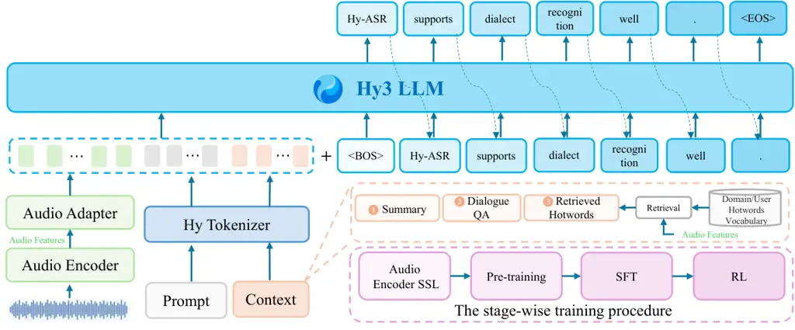

# Hy ASR 3.0 Technical Report

Hy ASR team

###### Abstract

We present Hy ASR 3.0, a large language model (LLM)-based automatic
speech recognition (ASR) system that delivers strong recognition
accuracy, supports flexible contextual conditioning, and maintains
robust recognition performance across diverse speech conditions. Hy ASR
3.0 supports Mandarin Chinese, English and 13 Chinese dialect groups,
including Cantonese. Among the evaluated systems, it achieves the lowest
aggregate error rates on public Mandarin Chinese, English, and Cantonese
benchmarks and the lowest error rates on the corresponding internal test
sets, alongside first-tier dialect recognition performance. Beyond
audio-only transcription, Hy ASR 3.0 supports multiple forms of external
context, including hotword lists, question–answer dialogues, and
summaries, enabling the use of task-relevant information during
recognition. The model also leverages intra-utterance context to
disambiguate homophonic and phonetically similar keywords using
information from other parts of the same utterance, without requiring a
separate contextual input. Evaluations demonstrate strong contextual
recognition in both external-context and intra-utterance settings, as
well as robust recognition of long-form speech, children’s and older
adults’ speech, low-volume speech, and speech in noisy environments.
This report describes the model architecture and training methodology
and presents evaluations across recognition accuracy, context
utilization, and robustness.

>

Figure 1: Overview of Hy ASR 3.0 capabilities and benchmark performance.
Comparisons are made against the strongest competitor for each metric,
with the corresponding model shown in parentheses. RERR denotes the
relative error rate reduction.

## 1 Introduction

Automatic speech recognition (ASR) has advanced considerably through
large-scale training and the integration of pretrained language models.
Whisper demonstrated the effectiveness of large-scale weak supervision
for recognition accuracy and cross-domain generalization (Radford et
al., 2023). LLM-based approaches have further enabled transcription to
incorporate pretrained linguistic knowledge and textual
context (Lakomkin et al., 2024), while recent systems such as Qwen3 ASR
have broadened recognition coverage and evaluation across diverse speech
conditions (Shi et al., 2026). Building on these developments, we focus
on three practical objectives: improving recognition accuracy across
Mandarin Chinese, English, Cantonese, and regional dialects; leveraging
heterogeneous contextual inputs effectively; and enhancing transcription
robustness across speaker age groups, speaking styles, and audio
durations.

In this report, we introduce Hy ASR 3.0, an LLM-based ASR system
developed around these objectives. We evaluate the system on public
benchmarks and internal test sets covering standard speech recognition,
dialect recognition, context-aware recognition, and robustness under
challenging speech conditions. Its principal capabilities are summarized
as follows:

The key capabilities and advances of Hy ASR 3.0 are summarized as
follows:

- •
  Leading Mandarin, English and Cantonese recognition, with competitive
  dialect performance. Hy ASR 3.0 achieves the lowest aggregate error
  rates among the evaluated systems on the public Mandarin Chinese,
  English and Cantonese benchmarks, reaching 4.64%, 5.22%, and 5.06%,
  respectively. These correspond to approximately 2.7%, 3.0%, and 11.0%
  relative error rate reductions (RERR) over the strongest non-Hy
  competitor in each setting: FunASR Flash, StepAudio 3 ASR Max (Lin et
  al., 2026), and Qwen3 ASR Flash (Alibaba, ), respectively. The
  Cantonese aggregate excludes KeSpeech, unlike the combined
  Cantonese-and-KeSpeech group in Table 1. Beyond Mandarin Chinese,
  English, and Cantonese, the system supports 12 other major Chinese
  dialect groups. Internal human evaluation covers these dialect
  categories, spanning 91 subregional varieties, demonstrating
  state-of-the-art (SOTA) performance. On KeSpeech (Tang et al., 2021),
  Hy ASR 3.0 achieves an error rate of 3.77%, compared with 4.33% for
  FunASR Flash.
- •
  Strong contextual recognition through external conditioning and
  intra-utterance disambiguation. Hy ASR 3.0 supports external hotword
  lists, question–answer dialogues, and summaries. Hotword lists provide
  explicit vocabulary, while dialogues and summaries provide broader
  semantic information. The model also uses information within an
  utterance to disambiguate homophonic and phonetically similar
  keywords, without treating this information as a separate input. It
  achieves the highest target-keyword recall among the evaluated systems
  on both the intra-utterance context and dialogue-context test sets
  (Table 3).
- •
  Robust recognition across audio durations, speaker age groups, and
  speaking styles. Hy ASR 3.0 achieves the lowest character error rate
  (CER) among the evaluated systems on internal benchmarks covering
  long-form speech, a combined test set of children’s and older adults’
  speech, and a combined test set of low-volume speech and speech in
  noisy environments. (Table 4). Relative to the strongest non-Hy
  competitor in each setting, it reduces CER by 34.4%, 2.8%, and 19.2%,
  respectively, with particularly large gains on long-form and the
  combined evaluation of low-volume speech and speech in noisy
  environments.

Together, these evaluations demonstrate Hy ASR 3.0’s strengths in
recognition accuracy, contextual adaptability, and robustness. The
remainder of this report describes the model architecture and training
methodology, followed by detailed experimental results across these
three capability areas.

## 2 Model Architecture

As illustrated in Figure 2, Hy ASR 3.0 comprises an audio encoder, an
audio adapter, and an LLM decoder, together with an audio-conditioned
hotword retrieval mechanism. The system integrates speech
representations and external textual context to generate the output
transcription.

#### Audio representations.

The audio encoder extracts a sequence of acoustic representations from
the input speech. The audio adapter maps these representations into
embeddings compatible with the LLM input space. The encoder
representations are also provided to the hotword retrieval mechanism for
selecting relevant vocabulary.

#### Contextual inputs and hotword retrieval.

Hy ASR 3.0 supports external context in the form of hotwords, summaries,
and question–answer (QA) dialogues. Given the audio representations and
a candidate hotword list, the retrieval mechanism selects relevant terms
to form the hotword context. These terms, together with any available
summary or dialogue QA context, are encoded as a textual prefix placed
before the audio embeddings.

#### Transcription generation.

The LLM decoder generates the transcription autoregressively,
conditioned on the context prefix, audio embeddings, and previously
generated tokens. This input organization allows external information to
guide recognition while preserving direct access to the speech
representations. The internal context to the utterance is captured
through the audio and transcription sequence, rather than supplied as a
separate external input.



Figure 2: Overview of the Hy ASR 3.0 model architecture and its training
procedure.

## 3 Training

We build our ASR model upon the pretrained Hy3 base model (Tencent
Hunyuan Team, 2026). The training pipeline consists of three stages:
audio encoder pre-training, large-scale ASR pre-training, and
post-training.

### 3.1 Encoder

The audio encoder is trained to extract semantic speech representations
for the downstream language model. We adopt an iterative HuBERT-style
self-supervised learning pipeline (Hsu et al., 2021). We first train a
bootstrap encoder with Best-RQ (Chiu et al., 2022) and quantize its
selected intermediate representations to construct discrete targets.
These targets are then used to train an intermediate HuBERT model, whose
representations are further quantized with residual vector quantization
to produce multi-level targets. The final audio encoder is trained to
predict these targets from masked speech inputs.

The audio encoder is trained in two phases on tens of millions of hours
of speech, primarily in Mandarin and English, with Cantonese and other
Chinese dialects also included. We first perform large-scale
pre-training on the broad speech mixture, followed by continued
pre-training on a rebalanced mixture that places greater emphasis on
Chinese dialects while down-weighting noisy recordings and short
utterances. We further strengthen the masking strategy and apply
utterance mixing (Chen et al., 2022) to improve robustness to
interfering speech.

### 3.2 Pre-training

We adopt a two-stage pre-training strategy, comprising large-scale
pre-training followed by targeted continued pre-training.

#### Stage 1: Large-scale pre-training.

In the first stage, we pre-train the model on a large-scale web-sourced
speech corpus comprising tens of millions of hours of speech data. To
construct reliable supervision at scale, we develop a multi-system ASR
data construction pipeline, in which multiple ASR systems independently
generate candidate transcription hypotheses. These hypotheses are
combined using Recognizer Output Voting Error Reduction (ROVER) (Fiscus,
1997), and the resulting pseudo-transcriptions are subsequently
subjected to multi-stage quality filtering to discard unreliable
samples. We further apply domain-aware data balancing and data
compression to improve training-data efficiency. Data balancing helps
allocate training capacity more effectively across heterogeneous
domains, while data compression removes redundant information and
prioritizes more informative samples. Together, these strategies
substantially improve data efficiency: the resulting model achieves
better performance while using only 50% of the original training data,
demonstrating that carefully curated and balanced data can be more
effective than simply scaling up the training corpus.

#### Stage 2: Targeted continued pre-training.

In the second stage, we continue pre-training on a rebalanced data
mixture with increased proportions of dialectal speech, context-biasing
data, and speech recorded under challenging acoustic conditions. This
targeted data composition improves dialect recognition, strengthens the
model’s context-biasing capability, and enhances robustness to adverse
acoustic conditions. Moreover, by aligning the pre-training distribution
more closely with the data used in subsequent supervised fine-tuning
(SFT), this stage improves the effectiveness of SFT and enables us to
reduce the SFT training data to just one-tenth of its original size
while maintaining model performance. This reduction substantially
accelerates SFT experimentation and iteration, allowing us to evaluate
training strategies and incorporate improvements more efficiently.

### 3.3 Post-training

Post-training is performed in two stages, including supervised
fine-tuning and reinforcement learning.

#### Stage 1: Supervised Fine-tuning (SFT).

During SFT, we improve recognition performance on dialectal speech,
contextual-biasing tasks, and speech under challenging acoustic
conditions, while maintaining the general-domain ASR performance
obtained during pre-training. To obtain reliable supervision, we
continuously improve the accuracy of the individual labeling components
in our automatic transcription pipeline. At each iteration, the
best-performing SFT checkpoint from the previous iteration is used as
the teacher ASR model to generate pseudo-transcriptions for the next
iteration. This iterative pseudo-labeling procedure progressively
improves the quality of the SFT data. We further supplement the training
mixture with targeted data for dialectal speech and other challenging
recognition scenarios.

#### Stage 2: Reinforcement Learning (RL).

a) Expert RL We train three independent ASR experts initialized from the
SFT checkpoint, targeting general-domain ASR, dialectal ASR, and
context-biasing ASR, respectively. Training the experts separately
reduces cross-domain interference and allows each model to specialize in
its target scenario. The reward system of each expert is designed
according to the characteristics of the corresponding domain. Besides
overall recognition accuracy, the rewards also consider keyword
recognition and the utterance-level fluency of the transcription.

b) Multi-teacher on-policy distillation. We then integrate the
capabilities of the three experts into a single model through
multi-teacher on-policy distillation (MOPD) (Agarwal et al., 2024). For
each utterance, the student first generates an on-policy recognition
hypothesis, which is then routed to the corresponding domain expert for
token-level supervision. The objective is written as

```math
\mathcal{L}_{\mathrm{MOPD}}=\mathbb{E}\left[\frac{1}{T}\sum_{t=1}^{T}D_{\mathrm{KL}}\left(\pi_{\theta}(\cdot\mid\mathbf{s}_{t})\|\pi_{\phi_{d}}(\cdot\mid\mathbf{s}_{t})\right)\right]. \tag{1}
```

Here, $`T=|\hat{\mathbf{y}}|`$ and
$`\mathbf{s}_{t}=(\mathbf{x},\hat{\mathbf{y}}_{<t})`$, where
$`\pi_{\theta}`$ is the student, $`\pi_{\phi_{d}}`$ is the expert
associated with domain $`d`$, and $`\mathbf{x}`$ denotes the acoustic
input together with optional biasing context. The expectation is taken
over domain-routed training samples and hypotheses generated by the
student. This stage transfers the domain-specific strengths of the three
experts into a unified ASR model. Joint reinforcement learning across
heterogeneous ASR objectives requires a shared policy to optimize
general recognition accuracy, dialect-specific behavior, and
context-dependent keyword recognition simultaneously. These objectives
may impose different optimization preferences, particularly when their
data distributions and reward signals differ. Our expert-based strategy
separates domain-specific optimization from capability integration:
independently trained experts can specialize in their respective
recognition scenarios, while multi-teacher on-policy distillation
transfers their behaviors into a unified student. This design provides a
structured alternative to directly mixing all RL objectives in a single
policy.

c) Model-Behavior RL. Finally, we apply Model-Behavior RL to hard cases
identified from real-world usage, with a particular focus on keywords
whose correct recognition depends on the surrounding context. By
explicitly reinforcing context-dependent keyword recognition, this stage
improves the model’s use of contextual information and produces more
coherent and fluent utterance-level transcriptions.

## 4 Evaluation

#### Compared systems and metrics.

We compare Hy ASR 3.0 with Qwen3 ASR Flash (Alibaba, ) and FunASR
Flash (Alibaba Cloud, ), Doubao ASR 2.0 (Volcengine, ), Seed 2.0
Lite (ByteDance, ), StepAudio 3 ASR Max (Lin et al., 2026; StepFun, ;
StepFun, ), and Hy ASR 3.0 Preview. These technical reports and official
service references identify the model families or services; the
numerical comparisons below are the results reported in this study, not
scores taken from those references. We report character or word error
rates (CER/WER) for objective recognition evaluation, target-keyword
recall for contextual recognition, and human-rated percentages for
dialect evaluation. Relative error rate reduction is computed as
$`(E_{\mathrm{comp}}-E_{\mathrm{Hy}})/E_{\mathrm{comp}}`$, where
$`E_{\mathrm{comp}}`$ is the error rate of the strongest non-Hy
competitor for the metric being compared. Differences between recall or
human-rated percentages are expressed in percentage points.

### 4.1 Public ASR Benchmarks

Our public evaluation includes AISHELL-1 (Bu et al., 2017),
AISHELL-2 (Du et al., 2018), AliMeeting (Yu et al., 2022),
WenetSpeech (Zhang et al., 2022), FLEURS (Conneau et al., 2023), Common
Voice (Ardila et al., 2020), SpeechIO (SpeechColab, ),
LibriSpeech (Panayotov et al., 2015), GigaSpeech (Chen et al., 2021),
TED-LIUM 3 (Hernandez et al., 2018), VoxPopuli (Wang et al., 2021),
MLS (Pratap et al., 2020), WenetSpeech-Yue (Li et al., 2026), and
KeSpeech (Tang et al., 2021). Note that we apply a strict data
decontamination procedure to ensure that no evaluation utterances, or
their audio or textual near-duplicates, are included in the training
data.

Table 1 reports the results. Hy ASR 3.0 achieves the lowest reported
aggregate error rates across all three evaluation groups: 4.64% for
Chinese, 5.22% for English, and 4.80% for dialect recognition. Relative
to the strongest external baseline in each group, these correspond to
approximately 2.7%, 3.0%, and 11.9% error rate reductions, respectively.
Compared with the Preview version, the corresponding reductions are
approximately 1.9%, 1.1%, and 8.2%, with the largest improvement
observed in dialect recognition.

#### Mandarin Chinese.

Hy ASR 3.0 achieves a reported aggregate error rate of 4.64%, compared
with 4.77% for FunASR Flash and 4.73% for Preview. It obtains the best
results on the AISHELL-2 mix subset, AliMeeting near-field subset, and
the subset labeled SpeechIO Unlocked in Table 1, with error rates of
1.98%, 5.47%, and 2.36%, respectively. It also matches the best results
on WenetSpeech test-net (3.74%) and FLEURS-zh (1.84%). These aggregate
improvements are not uniform across subsets: for example, FunASR Flash
remains stronger on AISHELL-1 and WenetSpeech test-meeting.

#### English.

Hy ASR 3.0 achieves an aggregate WER of 5.22%, improving over 5.38% for
StepAudio 3 ASR Max and 5.28% for Preview. It obtains the lowest WER on
Common Voice-en (5.48%), FLEURS-en (2.53%), TED-LIUM 3 (2.44%), and
VoxPopuli-en test (5.84%), while matching Preview on GigaSpeech (8.27%).
StepAudio 3 ASR Max remains stronger on both LibriSpeech subsets and the
accented VoxPopuli-en subset. On the latter, Hy ASR 3.0 also regresses
from 14.75% to 15.27% relative to Preview, highlighting accented speech
as an area for further improvement.

#### Cantonese and dialect recognition.

The combined group comprises four Cantonese subsets and KeSpeech, which
covers standard Mandarin and its eight subdialects (Tang et al., 2021).
Hy ASR 3.0 reduces the reported combined aggregate to 4.80%, compared
with 5.45% for Qwen3 ASR Flash and 5.23% for Preview. For Cantonese
alone, the unweighted mean over FLEURS-yue, Common Voice-yue, and the
WenetSpeech-Yue short and long subsets is 5.06%, compared with 5.68% for
Qwen3 ASR Flash, corresponding to approximately 11.0% relative error
rate reduction computed before rounding the aggregate values. This
four-subset aggregate is distinct from the combined value in the table.
On KeSpeech, the error rate decreases from Preview’s 5.17% to 3.77%, a
relative reduction of 27.1%. Hy ASR 3.0 also achieves the best results
on FLEURS-yue (2.63%) and the WenetSpeech-Yue short subset (5.00%).
Preview remains slightly better on Common Voice-yue, while Qwen3 ASR
Flash retains the lowest error rate on the WenetSpeech-Yue long subset.

|                            |                 |                |                |                |                     |                    |                |
| -------------------------- | --------------- | -------------- | -------------- | -------------- | ------------------- | ------------------ | -------------- |
| Testset                    | Qwen3 ASR Flash | FunASR Flash   | Doubao ASR 2.0 | Seed 2.0 Lite  | StepAudio 3 ASR Max | Hy ASR 3.0 Preview | Hy ASR 3.0     |
| Chinese (zh)               | 5.73            | 4.77           | 5.55           | 5.42           | 6.98                | 4.73               | 4.64           |
| AISHELL1                   | 2.12            | 1.01           | 1.90           | 2.03           | 1.40                | 1.21               | 1.37           |
| AISHELL2 android/ios/mix   | 2.70/2.59/2.55  | 2.16/1.91/2.14 | 2.67/2.55/2.69 | 2.68/2.75/2.78 | 2.30/2.20/2.35      | 2.02/2.03/2.10     | 2.05/2.02/1.98 |
| AliMeeting near/far        | 7.13/23.14      | 5.94/22.02     | 5.88/26.18     | 6.27/24.81     | 7.89/34.23          | 5.84/21.27         | 5.47/21.52     |
| WenetSpeech net/meeting    | 4.96/6.16       | 3.74/3.62      | 4.11/4.54      | 4.13/4.23      | 6.63/8.52           | 3.91/4.31          | 3.74/4.16      |
| FLEURS-zh                  | 2.95            | 2.00           | 2.40           | 2.13           | 1.85                | 1.84               | 1.84           |
| CommonVoice-zh             | 4.41            | 4.10           | 5.61           | 4.54           | 5.00                | 4.52               | 4.49           |
| SpeechIO Locked/Unlocked   | 3.62/6.47       | 5.95/2.61      | 2.52/5.52      | 5.09/2.62      | 8.50/2.94           | 5.04/2.63          | 4.63/2.36      |
| English (en)               | 6.21            | 6.02           | 7.93           | 5.56           | 5.38                | 5.28               | 5.22           |
| LibriSpeech clean/other    | 1.33/2.60       | 1.31/2.50      | 2.87/5.85      | 1.37/2.65      | 1.17/2.25           | 1.28/2.59          | 1.19/2.31      |
| CommonVoice-en             | 6.32            | 6.31           | 14.18          | 6.81           | 7.21                | 5.53               | 5.48           |
| FLEURS-en                  | 2.66            | 3.24           | 6.38           | 2.55           | 2.95                | 2.64               | 2.53           |
| GigaSpeech test            | 9.15            | 9.96           | 9.58           | 9.43           | 9.68                | 8.27               | 8.27           |
| TED-LIUM 3 test            | 3.00            | 3.39           | 3.18           | 3.04           | 2.48                | 2.50               | 2.44           |
| VoxPopuli-en test/accented | 5.99/20.97      | 6.06/16.84     | 9.52/12.57     | 7.40/13.28     | 7.08/11.75          | 5.98/14.75         | 5.84/15.27     |
| MLS test-en                | 3.87            | 4.57           | 7.27           | 3.54           | 3.85                | 3.99               | 3.69           |
| Dialect                    | 5.45            | 5.46           | 7.66           | 6.73           | 6.26                | 5.23               | 4.80           |
| FLEURS-yue                 | 2.97            | 3.24           | 6.52           | 2.64           | 3.05                | 2.76               | 2.63           |
| CommonVoice-yue            | 4.67            | 4.98           | 5.84           | 6.28           | 5.90                | 3.49               | 3.56           |
| WenetSpeech yue short/long | 6.51/ 8.58      | 5.73/9.01      | 9.48/11.33     | 8.27/10.77     | 7.09/9.86           | 5.38/9.34          | 5.00/9.05      |
| KeSpeech                   | 4.51            | 4.33           | 5.12           | 5.68           | 5.39                | 5.17               | 3.77           |

Table 1: ASR Performance (CER/WER, %) on Public Benchmarks. Bold and
underlined values mark the best and second-best results in each row,
respectively.

### 4.2 Internal ASR Benchmarks

#### Main-language recognition.

Table 2 reports objective recognition error rates on internal Mandarin
Chinese, English, Cantonese, and code-switching benchmarks constructed
from real-world business data. These benchmarks complement public
datasets by reflecting speech conditions encountered in practical
applications. Hy ASR 3.0 achieves the lowest error rates across all four
categories, reaching 3.18%, 5.50%, 4.81%, and 4.20%, respectively, and
improves consistently over Hy ASR 3.0 Preview.

| TestSet        | Qwen3 ASR Flash | FunASR Flash | Doubao ASR 2.0 | Seed 2.0 Lite | StepAudio 3 ASR Max | Hy ASR 3.0 Preview | Hy ASR 3.0 |
| -------------- | --------------- | ------------ | -------------- | ------------- | ------------------- | ------------------ | ---------- |
| Chinese        | 4.94            | 4.15         | 3.78           | 5.56          | 5.30                | 3.35               | 3.18       |
| English        | 8.76            | 7.54         | 6.42           | 8.78          | 10.68               | 5.78               | 5.50       |
| Cantonese      | 6.00            | 19.40        | 7.49           | 7.90          | 7.00                | 4.92               | 4.81       |
| Code-Switching | 8.80            | 5.30         | 6.49           | 6.37          | 6.90                | 4.35               | 4.20       |

Table 2: ASR Performance (CER/WER, %) on Internal Benchmarks. Bold and
underlined values mark the best and second-best results in each row,
respectively.

#### Context utilization.

Table 3 evaluates context utilization on two complementary test sets.
The intra-utterance context test set focuses on homophonic and
phonetically similar target words whose recognition benefits from
contextual cues within the same utterance, without externally supplied
context. The dialogue-context test set covers question–answer
interactions in real-world business scenarios and evaluates the use of
preceding conversational turns. Hy ASR 3.0 achieves the highest
target-keyword recall among the evaluated systems on both sets, reaching
61.88% and 83.94%, respectively. These results exceed the strongest
non-Hy competitor, Seed 2.0 Lite, by 7.24 and 1.74 percentage points.
They are cross-system comparisons rather than within-model ablations
with and without context.

Figure 3: Examples of intra-utterance disambiguation. Panels (a–b)
illustrate semantic disambiguation, while panels (c–d) illustrate
explicit verbal clarification. All contextual cues are contained within
the spoken utterance. Model outputs are shown as target-span excerpts.

Figure 3 presents four selected examples illustrating semantic
disambiguation and explicit verbal clarification, all evaluated without
external context. In the first two, Hy ASR 3.0 correctly recognizes an
uncommon historical office title and a game-mode name in their domain
contexts, while the compared systems produce phonetically similar
alternatives. The other examples distinguish an affirmed “white deer”
from a negated “egret” and resolve two adjacent homophonic characters in
a person’s name using character-level explanations. StepAudio 3 ASR Max
and Seed 2.0 Lite correctly transcribe the explanations in the latter
example but still repeat the same character in the name, whereas Hy ASR
3.0 preserves the intended distinction. These cases illustrate outputs
consistent with sentence-level semantic cues and explicit orthographic
clarification. They are qualitative illustrations rather than controlled
ablations of the contribution of context.

| Testset                 | Qwen3 ASR Flash | FunASR Flash | Doubao ASR 2.0 | Seed 2.0 Lite | StepAudio 3 ASR Max | Hy ASR 3.0 Preview | Hy ASR 3.0 |
| ----------------------- | --------------- | ------------ | -------------- | ------------- | ------------------- | ------------------ | ---------- |
| Intra-utterance context | 46.60           | 51.16        | 51.86          | 54.64         | 50.75               | 58.12              | 61.88      |
| Dialogue QA context     | 71.68           | 77.33        | 78.47          | 82.20         | 69.32               | 79.44              | 83.94      |

Table 3: Context Utilization Evaluation (Recall, %). Bold and underlined
values mark the best and second-best results in each row, respectively.

#### Robustness.

Table 4 evaluates recognition robustness on long-form speech, a combined
child-and-older-adult speech set, and a combined evaluation of
low-volume speech and speech in noisy environments. Hy ASR 3.0 achieves
the lowest CER across all three sets, at 2.35%, 6.25%, and 7.49%,
respectively. Relative to the strongest non-Hy competitor in each
setting, these correspond to CER reductions of 34.4%, 2.8%, and 19.2%.
The age-related benchmark combines children and older adults, so its
result does not establish separate improvements for each age group.

| Testset            | Qwen3 ASR Flash | FunASR Flash | Doubao ASR 2.0 | Seed 2.0 Lite | StepAudio 3 ASR Max | Hy ASR 3.0 Preview | Hy ASR 3.0 |
| ------------------ | --------------- | ------------ | -------------- | ------------- | ------------------- | ------------------ | ---------- |
| Long audio         | 3.86            | 3.98         | 5.60           | 4.99          | 3.58                | 2.96               | 2.35       |
| Child & Elderly    | 9.98            | 7.87         | 6.43           | 10.49         | 9.90                | 7.18               | 6.25       |
| Low-volume & Noisy | 14.72           | 9.27         | 15.75          | 17.31         | 43.02               | 8.48               | 7.49       |

Table 4: ASR Robustness Evaluation (CER, %). Bold and underlined values
mark the best and second-best results in each row, respectively.

#### Dialect recognition.

Dialect recognition presents unique challenges because many dialects
lack standardized writing systems or consistent orthographic
conventions. This complicates data collection and annotation, model
training, and evaluation, as the same spoken content may be transcribed
in multiple valid ways, making conventional WER an unreliable measure of
recognition quality. For dialects without established writing
conventions, we therefore adopt a translation-based approach to
represent the spoken content in a more consistent written form. During
model development, we use an LLM-based judge to assess dialect
transcription quality along two complementary dimensions: semantic error
rate, which measures errors in conveyed meaning, and transcription style
consistency, which evaluates the consistency of the written
representation. These metrics provide practical signals for iterative
model development, but may not fully capture dialect recognition
quality. We therefore consider human evaluation the final assessment and
conduct a comprehensive study covering 13 dialect categories and 91
subregional varieties, comparing Hy ASR 3.0 with FunASR Flash and Doubao
ASR 2.0. These two systems are selected as baselines based on their
strong performance in our objective evaluations, providing a comparison
against competitive ASR systems. The results presented below are based
on this final human evaluation.

We assess three complementary aspects of transcription quality. Strict
recognition rate measures the percentage of transcriptions judged
entirely correct in their recognized content. Lenient recognition rate
measures the percentage judged semantically correct, allowing wording
differences that do not alter the meaning of the speech. Formatting
compliance rate measures the percentage judged free of formatting
issues, including punctuation, inverse text normalization (ITN) and
fluency. These human-rated metrics separately assess content
correctness, semantic correctness, and output formatting rather than
character- or word-level error rates.

Overall, Hy ASR 3.0 achieves a strict recognition rate of 64.7%,
exceeding FunASR Flash and Doubao by 2.8 and 12.5 percentage points,
respectively. It also achieves a formatting compliance rate of 80.3%,
outperforming the two systems by 11.4 and 13.7 percentage points,
respectively. Under the lenient recognition criterion, Hy ASR 3.0
outperforms Doubao but trails FunASR Flash by 1.0 percentage point.
These results demonstrate stronger overall performance in fully correct
transcription and formatting compliance among the compared systems,
while leaving room for improvement in semantic correctness under the
lenient criterion.

Figure 4 presents the per-category results for the 13 dialect categories
shown. Hy ASR 3.0 achieves particularly strong strict recognition
results on Southern Min and Cantonese, reaching 70.3% and 83.3%,
respectively, exceeding the strongest competitor in each category by
22.7 and 14.2 percentage points. Nevertheless, performance varies across
categories: FunASR Flash remains stronger on Wu under all three metrics.
The category-level results thus complement the overall scores by
highlighting both the model’s strengths and its remaining gaps.

Overall, Hy ASR 3.0 outperforms FunASR Flash and Doubao ASR 2.0 in
dialect recognition under the strict criterion. Under the lenient
criterion, it achieves performance comparable to FunASR Flash while
maintaining an advantage over Doubao ASR 2.0. Furthermore, Hy ASR 3.0
delivers substantially higher text quality compliance, reflecting its
ability to produce accurate, fluent, and well-formatted transcriptions.

Figure 4: Human evaluation of dialect recognition.

## 5 Conclusion

We presented Hy ASR 3.0, an LLM-based ASR system combining strong
recognition accuracy, flexible use of contextual information, and
robustness across diverse speech conditions. The system integrates an
acoustic encoder, an audio adapter, and an LLM decoder, supported by
large-scale pre-training and multi-stage post-training. Evaluations on
public and internal benchmarks demonstrate leading aggregate recognition
performance for Mandarin Chinese, English, and Cantonese among the
evaluated systems. Human evaluation further highlights its strengths in
strict dialect recognition and transcription formatting, with broadly
comparable lenient recognition to FunASR Flash. Beyond standard
transcription, Hy ASR 3.0 achieves strong results on evaluations of
external dialogue context and intra-utterance disambiguation, as well as
long-form speech, a combined child-and-older-adult speech set, and a
combined evaluation of low-volume speech and speech in noisy
environments. Remaining gaps on particular dialect categories and
accented speech motivate further work on more consistent recognition
across regional and acoustic variation, together with more detailed
evaluation of contextual inputs and the contributions of individual
training stages.

## 6 Authors

### Core Contributors¹

Aoxiong Yin, Auden Li^($`\dagger`$), Chao Huang, Chuanyang Hu,
Eitan Wang^($`\dagger`$), Ethan Zou, Fangming Feng, Guangyu Chen,
Guinan Li, He Wang, Jiahong Li, Meng Yu, Mingyu Cui, Peng Wang,
Rongjie Li, Steve Yves^($`\dagger`$), Teddy Sun, Tian Zheng, Wei Liu,
Yang Zhou, Yixuan Zhang, Zhennan Lin, Zhihang Xu, Zhuohao Li,
Ziqiang Zhang.

### Contributors¹

Anji Zhang, Bang Wang, Caisheng Ouyang, Chengqi Zhu, Chong Li,
Conglian Xie, Dongdong Wang, Edward Wang, Evelynn Liu, Ferman Yang,
Feng Lu, Gang Zhang, Jathon Zhang, Jaxl Liu, Jiachen Luo, Jian Li,
Jingxi Gui, Kysun Wang, Liang Dong, Longsha Zhou, Na Hu, Qi Chen,
Rilin Chen, Rui Yuan, Shanshan Sang, Siyu Yan, Steven Hong, Taihui Wang,
Weiwei Li, Xiangyu Zhang, Xiaotong Yang, Xue Hu, Xue Jiang, Yameng Li,
Yifu Sun, Yuhuan Zhou, Zhiang Chen, Zhibin Wang.

^(\$\dagger\$)^(\$\dagger\$)footnotetext: Project Leader
(audenli@tencent.com, ethwang@tencent.com,
steveyves@global.tencent.com).¹¹footnotetext: Alphabetical order by
first name.

## References

- Agarwal et al. (2024) R. Agarwal, N. Vieillard, Y. Zhou, P.
  Stanczyk, S. R. Garea, M. Geist, and O. Bachem On-policy distillation
  of language models: learning from self-generated mistakes. In The
  Twelfth International Conference on Learning Representations, External
  Links: [Link](https://openreview.net/forum?id=3zKtaqxLhW) Cited by:
  §3.3.
- \[2\] Alibaba Cloud Non-real-time speech recognition. Note: accessed
  2026-10-21 External Links:
  [Link](https://help.aliyun.com/en/model-studio/non-realtime-speech-recognition-user-guide)
  Cited by: §4.
- \[3\] Alibaba Qwen3-ASR-Flash. Note: Qwen Cloud model
  documentationModel page and API example for the ap-southeast-1 region;
  accessed 2026-10-21 External Links:
  [Link](https://www.qwencloud.com/models/qwen3-asr-flash?region=ap-southeast-1)
  Cited by: 1st item, §4.
- Ardila et al. (2020) R. Ardila, M. Branson, K. Davis, M. Kohler, J.
  Meyer, M. Henretty, R. Morais, L. Saunders, F. Tyers, and G. Weber
  Common Voice: a massively-multilingual speech corpus. In Proceedings
  of the Twelfth Language Resources and Evaluation Conference,
  pp. 4218–4222. External Links:
  [Link](https://aclanthology.org/2020.lrec-1.520/) Cited by: §4.1.
- Bu et al. (2017) H. Bu, J. Du, X. Na, B. Wu, and H. Zheng AISHELL-1:
  an open-source Mandarin speech corpus and a speech recognition
  baseline. In 2017 20th Conference of the Oriental Chapter of the
  International Coordinating Committee on Speech Databases and Speech
  I/O Systems and Assessment (O-COCOSDA), pp. 1–5. External Links:
  [Document](https://dx.doi.org/10.1109/ICSDA.2017.8384449),
  [Link](https://doi.org/10.1109/ICSDA.2017.8384449) Cited by: §4.1.
- \[6\] ByteDance Seed2.0. Note: Official series overview, including
  Seed2.0 Lite and its audio-input update; accessed 2026-10-21 External
  Links: [Link](https://seed.bytedance.com/seed2) Cited by: §4.
- Chen et al. (2021) G. Chen, S. Chai, G. Wang, J. Du, W. Zhang, C.
  Weng, D. Su, D. Povey, J. Trmal, J. Zhang, M. Jin, S. Khudanpur, S.
  Watanabe, S. Zhao, W. Zou, X. Li, X. Yao, Y. Wang, Z. You, and Z. Yan
  GigaSpeech: an evolving, multi-domain ASR corpus with 10,000 hours of
  transcribed audio. In Interspeech 2021, pp. 3670–3674. External Links:
  [Document](https://dx.doi.org/10.21437/Interspeech.2021-1965),
  [Link](https://www.isca-archive.org/interspeech_2021/chen21o_interspeech.html)
  Cited by: §4.1.
- Chen et al. (2022) S. Chen, C. Wang, Z. Chen, Y. Wu, S. Liu, Z.
  Chen, J. Li, N. Kanda, T. Yoshioka, X. Xiao, J. Wu, L. Zhou, S.
  Ren, Y. Qian, Y. Qian, J. Wu, M. Zeng, X. Yu, and F. Wei WavLM:
  large-scale self-supervised pre-training for full stack speech
  processing. IEEE Journal of Selected Topics in Signal Processing 16
  (6), pp. 1505–1518. External Links: ISSN 1941-0484,
  [Link](http://dx.doi.org/10.1109/JSTSP.2022.3188113),
  [Document](https://dx.doi.org/10.1109/jstsp.2022.3188113) Cited by:
  §3.1.
- Chiu et al. (2022) C. Chiu, J. Qin, Y. Zhang, J. Yu, and Y. Wu
  Self-supervised learning with random-projection quantizer for speech
  recognition. In Proceedings of the 39th International Conference on
  Machine Learning, Proceedings of Machine Learning Research, Vol. 162,
  pp. 3915–3924. External Links:
  [Link](https://proceedings.mlr.press/v162/chiu22a.html) Cited by:
  §3.1.
- Conneau et al. (2023) A. Conneau, M. Ma, S. Khanuja, Y. Zhang, V.
  Axelrod, S. Dalmia, J. Riesa, C. Rivera, and A. Bapna FLEURS: FEW-shot
  learning evaluation of universal representations of speech. In 2022
  IEEE Spoken Language Technology Workshop (SLT), pp. 798–805. External
  Links: [Document](https://dx.doi.org/10.1109/SLT54892.2023.10023141),
  [Link](https://doi.org/10.1109/SLT54892.2023.10023141) Cited by: §4.1.
- Du et al. (2018) J. Du, X. Na, X. Liu, and H. Bu AISHELL-2:
  transforming Mandarin ASR research into industrial scale. External
  Links: 1808.10583,
  [Document](https://dx.doi.org/10.48550/arXiv.1808.10583),
  [Link](https://arxiv.org/abs/1808.10583) Cited by: §4.1.
- Fiscus (1997) J. G. Fiscus A post-processing system to yield reduced
  word error rates: recognizer output voting error reduction (ROVER). In
  1997 IEEE Workshop on Automatic Speech Recognition and Understanding
  Proceedings, pp. 347–354. External Links:
  [Document](https://dx.doi.org/10.1109/ASRU.1997.659110),
  [Link](https://doi.org/10.1109/ASRU.1997.659110) Cited by: §3.2.
- Hernandez et al. (2018) F. Hernandez, V. Nguyen, S. Ghannay, N.
  Tomashenko, and Y. Estève TED-LIUM 3: twice as much data and corpus
  repartition for experiments on speaker adaptation. In Speech and
  Computer, Lecture Notes in Computer Science, Vol. 11096, pp. 198–208.
  External Links:
  [Document](https://dx.doi.org/10.1007/978-3-319-99579-3%5F21),
  [Link](https://doi.org/10.1007/978-3-319-99579-3_21) Cited by: §4.1.
- Hsu et al. (2021) W. Hsu, B. Bolte, Y. H. Tsai, K. Lakhotia, R.
  Salakhutdinov, and A. Mohamed HuBERT: self-supervised speech
  representation learning by masked prediction of hidden units. IEEE/ACM
  Transactions on Audio, Speech, and Language Processing 29,
  pp. 3451–3460. External Links:
  [Document](https://dx.doi.org/10.1109/TASLP.2021.3122291),
  [Link](https://ieeexplore.ieee.org/document/9585401/) Cited by: §3.1.
- Lakomkin et al. (2024) E. Lakomkin, C. Wu, Y. Fathullah, O.
  Kalinli, M. L. Seltzer, and C. Fuegen End-to-end speech recognition
  contextualization with large language models. In ICASSP 2024 - 2024
  IEEE International Conference on Acoustics, Speech and Signal
  Processing (ICASSP), pp. 12406–12410. External Links:
  [Document](https://dx.doi.org/10.1109/ICASSP48485.2024.10446898),
  [Link](https://doi.org/10.1109/ICASSP48485.2024.10446898) Cited by:
  §1.
- Li et al. (2026) L. Li, Z. Guo, H. Chen, Y. Dai, Z. Zhang, H. Xue, T.
  Zuo, C. Wang, S. Wang, X. Xu, H. Bu, J. Li, J. Kang, B. Zhang, R.
  Yuan, Z. Zhou, W. Xue, and L. Xie WenetSpeech-Yue: a large-scale
  Cantonese speech corpus with multi-dimensional annotation. Proceedings
  of the AAAI Conference on Artificial Intelligence 40 (37),
  pp. 31627–31635. External Links:
  [Document](https://dx.doi.org/10.1609/aaai.v40i37.40429),
  [Link](https://ojs.aaai.org/index.php/AAAI/article/view/40429) Cited
  by: §4.1.
- Lin et al. (2026) B. Lin, B. Zhao, B. Zhang, B. Wu, C. Yan, C.
  Geng, C. Wu, C. Yi, C. Feng, C. Zhu, C. Feng, C. Yao, D. Liu, D.
  Wan, D. Jiang, D. Li, D. Pang, F. Tian, F. Tian, F. Li, G. Yu, G.
  Yang, H. Zhang, H. Wang, J. Peng, J. Song, J. Xue, J. Fan, J. Zhen, J.
  Gao, J. Wen, J. Liang, J. Gong, J. Chen, L. Xie, L. Zhao, L. Zhang, L.
  Ji, L. Cai, M. Xu, P. Li, P. Yang, P. Tan, Q. Lin, Q. Du, R. Xiong, R.
  Li, S. Hu, S. Qin, S. Qiu, S. Tu, S. Zhou, T. Deng, W. Lu, W. Niu, W.
  Sun, W. Qu, X. Zhang, X. Zhang, X. Su, X. Chen, X. Liu, X. Yang, Y.
  Wu, Y. Li, Y. Yang, Y. Huang, Y. Zhu, Y. Zhang, Y. Yan, Y. Chen, Y.
  Fu, Y. Luo, Y. Zhou, Y. Chen, Y. Wang, Y. Ju, Y. Yang, Y. Li, Y.
  Zhang, Z. Liu, Z. Yao, Z. Yuan, Z. Mou, Z. Zhang, Z. Wu, Z. Li, Z.
  Zhou, Z. Ren, and Z. Wang StepAudio 3 Realtime Technical Report.
  External Links: 2609.14005,
  [Document](https://dx.doi.org/10.48550/arXiv.2609.14005),
  [Link](https://arxiv.org/abs/2609.14005) Cited by: 1st item, §4.
- Panayotov et al. (2015) V. Panayotov, G. Chen, D. Povey, and S.
  Khudanpur LibriSpeech: an ASR corpus based on public domain audio
  books. In 2015 IEEE International Conference on Acoustics, Speech and
  Signal Processing (ICASSP), pp. 5206–5210. External Links:
  [Document](https://dx.doi.org/10.1109/ICASSP.2015.7178964),
  [Link](https://doi.org/10.1109/ICASSP.2015.7178964) Cited by: §4.1.
- Pratap et al. (2020) V. Pratap, Q. Xu, A. Sriram, G. Synnaeve, and R.
  Collobert MLS: a large-scale multilingual dataset for speech research.
  In Interspeech 2020, pp. 2757–2761. External Links:
  [Document](https://dx.doi.org/10.21437/Interspeech.2020-2826),
  [Link](https://www.isca-archive.org/interspeech_2020/pratap20_interspeech.html)
  Cited by: §4.1.
- Radford et al. (2023) A. Radford, J. W. Kim, T. Xu, G. Brockman, C.
  McLeavey, and I. Sutskever Robust speech recognition via large-scale
  weak supervision. In Proceedings of the 40th International Conference
  on Machine Learning, Proceedings of Machine Learning Research, Vol.
  202, pp. 28492–28518. External Links:
  [Link](https://proceedings.mlr.press/v202/radford23a.html) Cited by:
  §1.
- Shi et al. (2026) X. Shi, X. Wang, Z. Guo, Y. Wang, P. Zhang, X.
  Zhang, Z. Guo, H. Hao, Y. Xi, B. Yang, J. Xu, J. Zhou, and J. Lin
  Qwen3-ASR technical report. arXiv preprint arXiv:2601.21337. External
  Links: 2601.21337,
  [Document](https://dx.doi.org/10.48550/arXiv.2601.21337),
  [Link](https://arxiv.org/abs/2601.21337) Cited by: §1.
- \[22\] SpeechColab SpeechColab ASR Leaderboard. Note: Online benchmark
  resourceProject identity checked against indexed official repository
  content on 2026-10-21; evaluation snapshot unspecified External Links:
  [Link](https://github.com/SpeechColab/Leaderboard) Cited by: §4.1.
- \[23\] StepFun Speech Recognition (Streaming Text Output). Note: API
  documentation in Chinese; title translated; accessed 2026-10-21
  External Links:
  [Link](https://platform.stepfun.com/docs/zh/api-reference/audio/asr-sse)
  Cited by: §4.
- \[24\] StepFun StepAudio 3 ASR. Note: accessed 2026-10-21 External
  Links:
  [Link](https://platform.stepfun.com/docs/zh/guides/models/stepaudio-3-asr)
  Cited by: §4.
- Tang et al. (2021) Z. Tang, D. Wang, Y. Xu, J. Sun, X. Lei, S.
  Zhao, C. Wen, X. Tan, C. Xie, S. Zhou, R. Yan, C. Lv, Y. Han, W. Zou,
  and X. Li KeSpeech: an open source speech dataset of Mandarin and its
  eight subdialects. In Proceedings of the Neural Information Processing
  Systems Track on Datasets and Benchmarks, Vol. 1. External Links:
  [Link](https://datasets-benchmarks-proceedings.neurips.cc/paper/2021/hash/0336dcbab05b9d5ad24f4333c7658a0e-Abstract-round2.html)
  Cited by: 1st item, §4.1, §4.1.
- Tencent Hunyuan Team (2026) Tencent Hunyuan Team Hy3. Note:
  [https://hunyuan.tencent.com/research/hy3](https://hunyuan.tencent.com/research/hy3)Official
  model release Cited by: §3.
- \[27\] Volcengine Volcengine Official Website. Note: Official product
  listing for Doubao speech recognition model 2.0 (in Chinese); accessed
  2026-10-21 External Links: [Link](https://volcengine.com/) Cited by:
  §4.
- Wang et al. (2021) C. Wang, M. Rivière, A. Lee, A. Wu, C. Talnikar, D.
  Haziza, M. Williamson, J. Pino, and E. Dupoux VoxPopuli: a large-scale
  multilingual speech corpus for representation learning,
  semi-supervised learning and interpretation. In Proceedings of the
  59th Annual Meeting of the Association for Computational Linguistics
  and the 11th International Joint Conference on Natural Language
  Processing (Volume 1: Long Papers), pp. 993–1003. External Links:
  [Document](https://dx.doi.org/10.18653/v1/2021.acl-long.80),
  [Link](https://aclanthology.org/2021.acl-long.80/) Cited by: §4.1.
- Yu et al. (2022) F. Yu, S. Zhang, Y. Fu, L. Xie, S. Zheng, Z. Du, W.
  Huang, P. Guo, Z. Yan, B. Ma, X. Xu, and H. Bu M2MeT: the ICASSP 2022
  multi-channel multi-party meeting transcription challenge. In ICASSP
  2022 - 2022 IEEE International Conference on Acoustics, Speech and
  Signal Processing (ICASSP), pp. 6167–6171. External Links:
  [Document](https://dx.doi.org/10.1109/ICASSP43922.2022.9746465),
  [Link](https://doi.org/10.1109/ICASSP43922.2022.9746465) Cited by:
  §4.1.
- Zhang et al. (2022) B. Zhang, H. Lv, P. Guo, Q. Shao, C. Yang, L.
  Xie, X. Xu, H. Bu, X. Chen, C. Zeng, D. Wu, and Z. Peng WENETSPEECH: a
  10000+ hours multi-domain Mandarin corpus for speech recognition. In
  ICASSP 2022 - 2022 IEEE International Conference on Acoustics, Speech
  and Signal Processing (ICASSP), pp. 6182–6186. External Links:
  [Document](https://dx.doi.org/10.1109/ICASSP43922.2022.9746682),
  [Link](https://doi.org/10.1109/ICASSP43922.2022.9746682) Cited by:
  §4.1.
