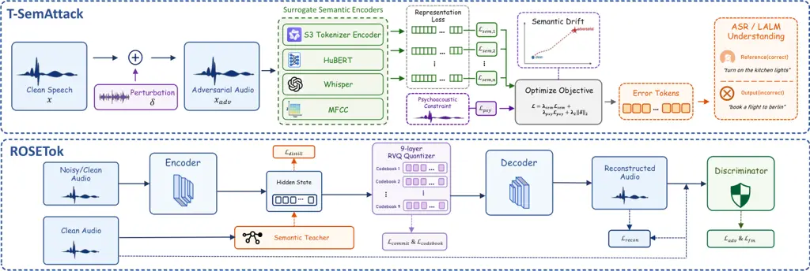
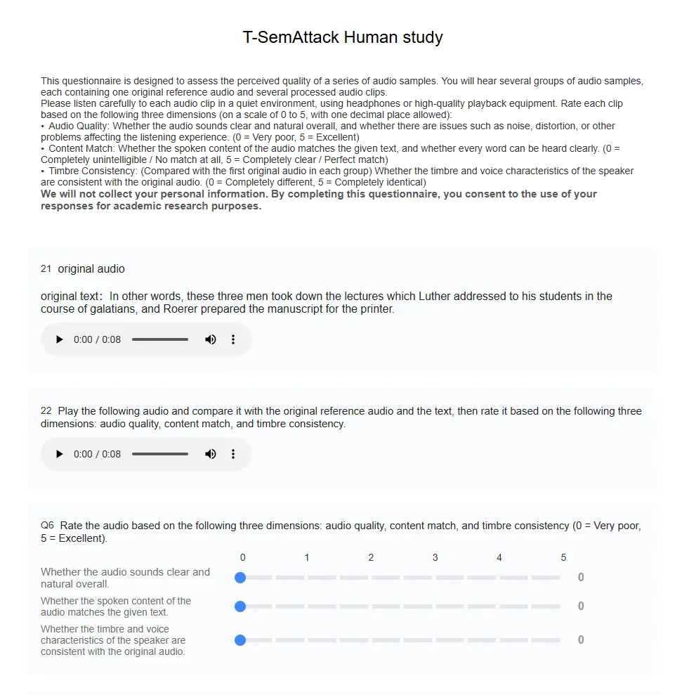
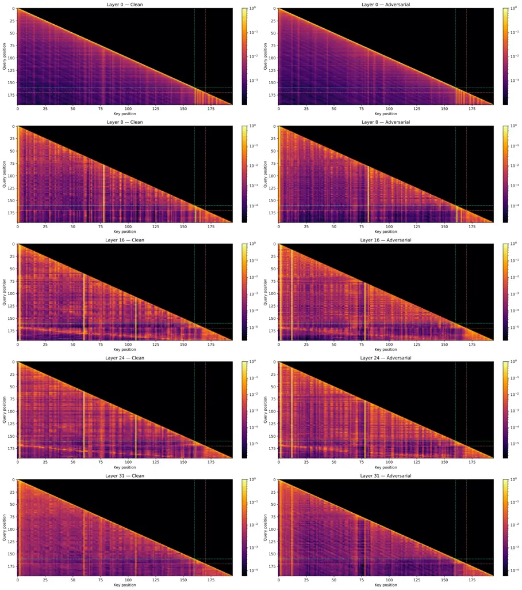
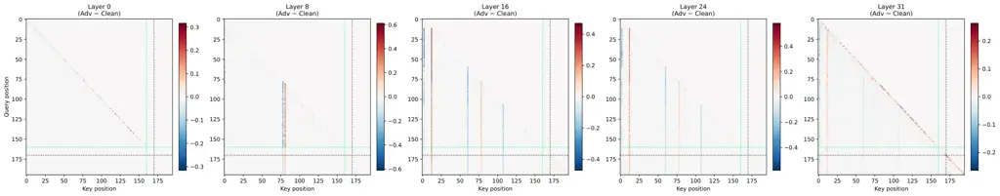

# Speech Tokenizers are Vulnerable: Transferable Semantic Attack and Robust Tokenizer

Zhisheng Zhang Email: [zhangzs25@mails.tsinghua.edu.cn](mailto:)   
Yifan Mi    Yixuan Zhou Affiliation:  Shenzhen International Graduate
School, Tsinghua University    Haiyun Li Affiliation:  Shenzhen
International Graduate School, Tsinghua University    Shengbo Cai
Affiliation:  Shenzhen International Graduate School, Tsinghua
University    Dongfu Song Affiliation:  Shenzhen International Graduate
School, Tsinghua University    Ziang Xu Affiliation:  Shenzhen
International Graduate School, Tsinghua University    Jie Hao    Zhiyong
Wu Affiliation:  Beijing University of Posts and Telecommunications

###### Abstract

Speech tokenizers serve as speech front ends, encoding input speech
signals into representations for downstream models, such as automatic
speech recognition (ASR) systems and large audio-language models
(LALMs). In this paper, we find that speech tokenizers are fragile at
the semantic level: small perturbations can disrupt their semantic
encoding process and consequently cause severe degradation in downstream
ASR and LALM performance. To study this vulnerability, we propose
T-SemAttack, a transferable semantic attack based on a semantic encoder
ensemble. By jointly drifting the representation spaces of multiple
semantic encoders, T-SemAttack effectively disrupts the semantic content
of speech while preserving perceptual quality, thereby inducing error
features. We further analyze layer-wise representation drift and
cross-model gradient alignment. Our findings show that perturbations can
induce substantial shifts in deep semantic representations and that the
input gradients of different surrogate encoders exhibit directional
alignment. These observations suggest that shared adversarially
sensitive directions in the input space may be a key factor underlying
cross-model attack transferability. Building on these, we introduce
ROSETok, a robust speech tokenizer that combines noisy training with
robust semantic distillation to improve reconstruction fidelity and
downstream SpeechLLM robustness. Extensive experiments on multiple
datasets, 9 open-source and black-box ASR systems, and 4 LALMs
demonstrate that T-SemAttack achieves strong transferable attack
performance, while the proposed Robust Speech Tokenizer exhibits
robustness under high-fidelity reconstruction and downstream tasks. Our
code and demo are available at
[https://wxzyd123.github.io/t-semattack](https://wxzyd123.github.io/t-semattack).

²²footnotetext: Equal contribution.³³footnotetext: Corresponding
authors.

## 1 Introduction

In recent years, LALMs Chu et al. (2024); Xu et al. (2025a) have
demonstrated exceptional interaction capabilities and are widely
deployed in scenarios, e.g., in-vehicle assistants and meeting
transcription. Compared to previous speech models Kim et al. (2021);
Wang et al. (2017), current large language model (LLM)-based
architectures Chu et al. (2024); Goel et al. (2025); Shi et al. (2026)
typically rely on a speech tokenizer to map continuous signals into
discrete tokens, which are subsequently fed into LLMs for modeling.
Consequently, the speech tokenizer bridges the continuous and discrete
representations, and its robustness directly dictates the reliability of
the entire semantic pipeline.

Existing studies primarily assess the vulnerability of speech tokenizers
to Gaussian noise Song et al. (2025), whereas semantic attacks can
expose more severe vulnerabilities. As shown in Figure 1, the semantic
attack (T-SemAttack) causes substantially greater degradation in
downstream FSC performance across models than Gaussian noise, yielding
scores even lower than those obtained under stronger Gaussian noise at
an SNR of 5 dB. These results indicate that tolerance to random noise
does not guarantee robustness against perturbations optimized to disrupt
semantic representations.

In this paper, we propose a Transferable Semantic Attack (T-SemAttack),
which focuses representation drifting in the speech tokenizer. By
jointly perturbing multiple surrogate semantic encoders Fang et al.
(2024), the method directly corrupts the semantic content of the input
speech. We employ the psychoacoustic model Zhang et al. (2025b) to
preserve the perturbative perceptual quality. The resulting adversarial
examples can therefore effectively interfere with the encoding process
of the speech tokenizer while maintaining high perceptual quality,
leading to severe semantic deviations in both ASR and LALM systems.

Figure 1: Gaussian Noise vs. T-SemAttack across Tokenizers. We feed the
pre-quantized representations from each tokenizer into
SmolLM2-135M Allal et al. (2025) and evaluate downstream semantic
understanding on the FSC spoken command intent recognition task (↑).

Furthermore, we analyze the effectiveness and transfer mechanisms of
T-SemAttack from three perspectives: layer-wise representation drift,
shared attack directions across models, and perturbation magnitude. We
investigate how perturbations affect deep representations, whether
shared sensitive directions underpin cross-model transferability, and
how representation shifts translate into token changes and downstream
recognition errors as perturbation magnitude increases. These analyses
inform the training of tokenizers for semantic stability.

We consider the speech tokenizer as the safety bottleneck in ASR or
LALMs. Based on our analysis of the attack, we argue that defense
mechanisms should not remain only at the level of the entire model, but
should also consider the speech tokenizer. To this end, we propose a
RObust SpEech Tokenizer (ROSETok) that achieves high-fidelity
reconstruction while preserving semantically rich representations with
downstream SpeechLLM against Gaussian noise and adversarial attacks.

To evaluate the effectiveness of the T-SemAttack, we conduct experiments
on bilingual and multi-speaker datasets, 9 ASR systems, and 4 LALM
systems, demonstrating that T-SemAttack achieves state-of-the-art (SOTA)
performance in terms of perceptual quality, attack efficiency, and
effectiveness. In addition, we verify the robustness of T-SemAttack
against adaptive defenses, including denoising and data transformations.
Finally, we experimentally assess the reconstruction and downstream
semantic capabilities of the ROSETok under different noise conditions.
Overall, the contributions of this paper can be summarized as follows:

- •
  We reveal the vulnerability of speech tokenizers and propose a
  transferable semantic attack method.
- •
  We explore the effectiveness and transferability of our attack from
  the perspectives of token vulnerability, hierarchical representation
  drift, and LALM attention interference.
- •
  Motivated by findings of the attack causes, we propose ROSETok, a
  speech tokenizer that improves noise-robust reconstruction and
  semantic preservation, enhancing the speech systems’ robustness.
- •
  We conduct extensive experiments to verify the efficiency,
  performance, and robustness of T-SemAttack. We verify the ROSETok’s
  performance in reconstruction and downstream scenarios.

## 2 Background and Related Work

Speech Tokenizer and Speech Foundation Model. A speech tokenizer
typically consists of an encoder and quantizer (decoder) Mousavi et al.
(2025). The former encodes speech signals into representations, while
the latter discretizes these representations into specific tokens, e.g.,
VQ- or FSQ-based tokens Du et al. (2024a); Du et al. (2024b). As a
speech front end, the speech tokenizer plays a crucial role in modern
speech foundation models and has been widely adopted in various tasks
and systems, including Qwen3-ASR Shi et al. (2026) for ASR, CosyVoice Du
et al. (2024a) for TTS, and Qwen2-Audio Chu et al. (2024) for LALMs.
Since the speech tokenizer bridges the continuous acoustic space and the
discrete semantic space, safety vulnerability in this component may
directly compromise the reliability and safety of the entire speech
foundation model.

Transferable ASR Attacks. Recent adversarial attacks on ASR systems have
improved transferability and input-agnostic perturbation generation Jin
et al. (2025). However, most existing methods attack the entire ASR
pipeline, often relying on surrogate decoding objectives such as CTC
loss Zhang et al. (2025b), which can incur high optimization cost and
obscure the role of front-end speech representations. Although recent
work has observed instability in speech tokenizers Song et al. (2025),
tokenizer-level transfer attacks and their propagation mechanisms remain
underexplored. In contrast, we focus on the semantic encoder within the
speech tokenizer and provide a systematic analysis of how small waveform
perturbations induce semantic representation drift, token-level
collapse, and downstream LALM attention disruption.

## 3 Transferable Semantic Attack

Most existing attacks Jin et al. (2025); Chen et al. (2026) against
speech systems rely on specific output targets of ASR or LALM models and
require access to the overall architecture, which limits efficiency and
transferability. As the front end of LLM-based speech systems, the
speech tokenizer plays a crucial role in providing modeling inputs for
LLMs, making its security particularly important. We propose
T-SemAttack, which attacks semantic representations by jointly
perturbing surrogate semantic encoders and uses psychoacoustic
constraints to enhance the perceptual quality in Figure 2.



Figure 2: The architecture and pipeline of T-SemAttack and ROSETok.

### 3.1 Threat Model

Adversary Assumption. We consider a transfer-based attack scenario in
which the adversary can access the input speech waveform and possesses a
set of differentiable surrogate semantic encoders, but cannot access the
internal gradients, parameters, or tokenizer details of the target
systems. Under the constraint that the noise remains acceptable, the
adversary aims to generate robust adversarial examples that cause speech
systems to produce incorrect transcriptions. The adversarial examples
should also be robust against adaptive defense, e.g., denoising and data
transformations. Moreover, our attack is conducted in an offline setting
with minimal real-time requirements.

Defense Assumption. We assume a strong defender who can detect the
embedded noise and can use existing relevant tools or defense strategies
to restore the original audio as much as possible.

### 3.2 Problem Definition


Both continuous and discrete speech tokenizers typically produce
continuous representations, with discrete tokenizers additionally
applying quantization. Hard quantization is locally constant within
quantization regions and non-differentiable at their boundaries. We
therefore target the continuous representations before any optional
quantization. Representation drift can alter the features supplied
through a continuous interface or change discrete token assignments when
the perturbed representations cross quantization boundaries. We evaluate
the downstream effects empirically.

Given an original audio signal $`x\in[-1,1]^{T}`$, where $`T`$ denotes
the audio length, our goal is to construct an adversarial example
$`x_{\mathrm{adv}}=x+\delta`$, where $`\delta`$ is a small adversarial
perturbation. The overall optimization objective can be written as Eq.
(1).

```math
\displaystyle\min_{\delta}\quad\mathcal{L}=\lambda_{\mathrm{sem}}\mathcal{L}_{\mathrm{sem}}(x,x_{\mathrm{adv}})+\lambda_{\mathrm{psy}}\mathcal{L}_{\mathrm{psy}}(x,\delta)+\lambda_{2}\|\delta\|_{2}, \tag{1}
```

```math
\displaystyle\text{s.t.}\quad\|\delta\|_{\infty}\leq\epsilon,\quad x_{\mathrm{adv}}=x+\delta\in[-1,1]^{T},
```

where $`\mathcal{L}_{\mathrm{sem}}`$ measures the deviation of semantic
representations, $`\mathcal{L}_{\mathrm{psy}}`$ represents
psychoacoustic masking, and $`\|\delta\|_{2}`$ controls perturbation
level. We use $`\lambda_{\mathrm{sem}}=100`$,
$`\lambda_{\mathrm{psy}}=10^{-3}`$, and $`\lambda_{2}=0.1`$.

### 3.3 Tokenizer-centric Semantic Attack

Representation Drifting. Representation drift refers to a shift in
representations of perturbed speech relative to those of clean speech.
T-SemAttack optimizes waveform perturbations to reduce the cosine
similarity between these representations in the encoding space, causing
different internal representations and thereby disrupting downstream
models’ understanding of speech content.

To improve cross-model transferability, we jointly optimize over
multiple encoders. Specifically, we construct the following four
surrogate branches: (1) S3Tokenizer Du et al. (2024a), which directly
simulates the semantic encoding process of the discrete speech
tokenizer. (2) HuBERT Hsu et al. (2021), which provides deep semantic
representations obtained through self-supervised learning. (3) Whisper
encoder Radford et al. (2023), which provides robust semantic
representations learned from strong ASR pretraining. (4) Mel-Frequency
Cepstral Coefficient (MFCC) Ge et al. (2023); Zhang et al. (2025b), is
used as an additional low-level attack target Zhang et al. (2025b); Fang
et al. (2024).

Let $`\mathcal{F}={f_{1},\dots,f_{K}}`$ denote the $`K`$ surrogate
semantic encoders. For input $`x`$, encoder $`f_{k}`$ outputs
representations $`f_{k}(x)`$. Eq. (2) defines the semantic loss from
frame-wise averaged cosine similarity.

```math
\mathcal{L}_{\mathrm{sem}}=\sum_{k=1}^{K}\operatorname{CosSim}\big(f_{k}(x),f_{k}(x_{\mathrm{adv}})\big). \tag{2}
```

By minimizing Eq. (2), the attack simultaneously drives shifts in
multiple semantic spaces, thereby improving transferability to unseen
ASR and LALM models.

Mechanistically, this attack can transfer to different ASR and LALM
models because multiple semantic encoders, although trained with
different objectives, share similar Mel-input bottlenecks and semantic
structures. Therefore, disrupting the shared semantic representations in
surrogate models often also disrupts the corresponding representations
in unseen target models.

Psychoacoustic Model. Previous transferable ASR attacks suffer from low
perceptual quality. We utilize a psychoacoustic constraint to ensure
that the adversarial perturbation remains acceptable to humans. Given
the original audio $`x`$, we first compute the corresponding masking
threshold $`\Theta(x)`$ based on its short-time spectrum and use it as
an upper-bound reference for the perturbation energy. Let
$`\operatorname{PSD}(\delta)`$ denote the power spectral density of the
perturbation in the time-frequency domain. The psychoacoustic loss can
then be written as Eq. (3).

```math
\mathcal{L}_{\mathrm{psy}}=\sum_{t,f}\max\big(0,\operatorname{PSD}_{t,f}(\delta)-\Theta_{t,f}(x)\big), \tag{3}
```

which imposes a penalty only when the perturbation energy in a specific
time-frequency unit exceeds the masking threshold. In this way, the
optimization process preferentially hides the perturbation in frequency
bands or local temporal regions where the original speech is stronger,
thereby balancing attack effectiveness and perceptual quality. We follow
prior work Chen et al. (2023).

Optimization Process. In optimization, we extract multiple
representations and update the adversarial audio based on the total loss
in Eq. (1). The optimization adopts a PGD-style Madry et al. (2017)
projected update, where the perturbation is projected back onto the
$`\ell_{\infty}`$ ball after each step in Eq. (4).

```math
\delta\leftarrow\operatorname{Proj}_{\|\delta\|_{\infty}\leq\epsilon}\left(\delta-\alpha\cdot\operatorname{sign}\left(\nabla_{\delta}\mathcal{L}\right)\right), \tag{4}
```

where $`\alpha`$ is the step size. In practice, we combine the SGD
optimizer with an adaptive plateau learning-rate scheduler Zhang et al.
(2025b), which automatically reduces the learning rate when the loss
stagnates, thereby improving optimization stability. The entire process
is run for 500 iterations.

## 4 Why does the T-SemAttack work?

In Section 7, we conduct extensive experiments demonstrating the
effectiveness of T-SemAttack. In this section, we explore why
T-SemAttack is effective and how semantic attacks affect the model.

Layer-wise Representation Similarity. We compare the layer-wise
representations of clean and attacked speech on LibriTTS. As shown in
Figure 3(a), HuBERT’s cosine similarity decreases from 0.881 at the
input embedding layer to 0.079 at the final layer. Whisper’s shallow
representations remain relatively stable, but its final-layer similarity
still drops to 0.854. These results indicate that small waveform
perturbations can induce substantial shifts in deep representations,
highlighting the need for defenses that promote semantic stability
throughout the encoding process.

Shared Attack Space. We extract a candidate shared subspace via singular
value decomposition of normalized gradients and compare different attack
directions under the same perturbation budget. Across 30 samples, using
only the rank-1 shared direction yields a WER of 155.02% on the model
HuBERT, comparable with the 191.64% achieved by the full ensemble attack
and the 26.38% achieved by the residual attack. These findings suggest
that shared directions can support strong cross-model transferability,
while the contributions of different attack components depend on the
target model.

Perturbation Magnitude. We test the attack direction and scale the
perturbation according to $`x_{\alpha}=x+\alpha\delta`$, comparing it
with energy-matched Gaussian noise and temporally shifted perturbations.
As $`\alpha`$ increases from 0.5 to 0.75, HuBERT’s WER rises from 59.05%
to 157.74%, reaching 192.84% at $`\alpha=1`$, compared with only 9.83%
and 13.92% for the two controls, respectively. Meanwhile, at
$`\alpha=1`$, the token error rate (TER) of S3Tokenizer reaches 99.88%,
exceeding the 56.12% observed for the Gaussian noise, respectively.
These results indicate that an appropriate direction can yield stronger
attacks with less perturbation energy.

(a) Layer-wise similarity.

(b) Effect of perturbation dose controlled by $`\alpha`$.

Figure 3: Layer-wise analysis of representation similarity and
effectiveness of perturbation magnitude.

## 5 Mechanism-Guided Robust Speech Tokenizer

In Section 4, we investigate why T-SemAttack can achieve effective
attacks and reveal an important insight: some existing speech tokenizers
are not semantically robust and are vulnerable to adversarial attacks.
We believe that defense solely at the LLM level is more time- and
cost-intensive. Therefore, we return to the core of the problem and aim
to improve the stability of the tokenizer against noise. In this work,
we utilize noisy training and semantic distillation to improve the
robustness.

Semantic Preservation Module. Figure 3(a) illustrates the loss of deep
semantic information. We employ a pretrained Semantic Teacher,
Whisper Radford et al. (2023), to supervise the representations of the
model encoder. Specifically, we align the representations of noisy
inputs with those of clean audio, thereby preserving semantic
information and improving robustness to noise in downstream tasks.

Two-Stage Training. We utilize a two-stage training strategy consisting
of base pretraining followed by attack-aware fine-tuning. In the first
stage, we train on English and Chinese speech from Emilia, using speech
corrupted by Gaussian noise as input and the corresponding clean audio
as the reconstruction target, together with semantic distillation. We
use a learning rate of $`1\times 10^{-4}`$ to achieve high-fidelity
reconstruction, semantic preservation, and general robustness to noise,
yielding ROSETok-Base. In the second stage, to further adapt the model
to structured semantic perturbations, we randomly select 2,000
utterances from LibriSpeech and generate perturbed inputs using
T-SemAttack. We then perform Attack-Aware Fine-Tuning (AAF) on
ROSETok-Base, using the original clean audio and its teacher
representations as supervision. We reduce the learning rate to
$`5\times 10^{-6}`$ to preserve the capabilities acquired during
pretraining while improving robustness to adversarial perturbations,
yielding ROSETok-AAF. Our model architecture is based on DAC and
consists of an encoder, a nine-layer quantizer, and a decoder.

Training Objectives. We aim for high-fidelity reconstruction and
semantic consistency. For both clean and noisy inputs, the model outputs
high-quality clean audio. Moreover, we hope the encoder can preserve
semantically rich information even for noisy audio inputs. We use a
multi-frequency discriminator with hinge loss Ye et al. (2025) for
adversarial learning. The objective is in Eq. (5).

```math
\mathcal{L}_{\mathrm{tok}}=\lambda_{\mathrm{distill}}\mathcal{L}_{\mathrm{distill}}+\lambda_{\mathrm{recon}}\mathcal{L}_{\mathrm{recon}}+\lambda_{\mathrm{cb}}\mathcal{L}_{\mathrm{cb}}+\lambda_{\mathrm{commit}}\mathcal{L}_{\mathrm{commit}}+\mathcal{L}_{\mathrm{adv}}+\mathcal{L}_{\mathrm{fm}}, \tag{5}
```

where $`\mathcal{L}_{\mathrm{distill}}`$ is the semantic distillation
loss, $`\mathcal{L}_{\mathrm{recon}}`$ is the reconstruction loss,
$`\mathcal{L}_{\mathrm{cb}}`$ is the codebook loss,
$`\mathcal{L}_{\mathrm{commit}}`$ is the commitment loss,
$`\mathcal{L}_{\mathrm{adv}}`$ is the adversarial loss, and
$`\mathcal{L}_{\mathrm{fm}}`$ is the feature matching loss. Detailed
descriptions are provided in Appendix E.3. The hyperparameters are set
as
$`\{\lambda_{\mathrm{distill}},\lambda_{\mathrm{recon}},\lambda_{\mathrm{cb}},\lambda_{\mathrm{commit}}\}=\{5.0,15,1.0,0.25\}`$.
The weights of $`\mathcal{L}_{\mathrm{adv}}`$ and
$`\mathcal{L}_{\mathrm{fm}}`$ are both 1.

## 6 Experimental Setup

### 6.1 Semantic Attack Setup

Datasets. To comprehensively evaluate the effectiveness of the semantic
attack, we use bilingual and multi-speaker speech datasets. LibriTTS Zen
et al. (2019): Following Zhang et al. (2025b), we select single-speaker
samples to evaluate the effectiveness of the attack in an English
single-speaker scenario. Seed-TTS-Eval Anastassiou et al. (2024): This
is a widely used benchmark, containing both Chinese and English
utterances from multiple speakers. We randomly sample 200 English
utterances and 200 Chinese utterances for evaluation.

ASR Systems. We evaluate the attack performance on both open-source
models (Qwen3-ASR Shi et al. (2026), VibeVoice-ASR Peng et al. (2026),
FireRed-ASR Xu et al. (2025b), and Fun-ASR An et al. (2025)) and
commercial black-box models (iFlytek, Doubao ASR, and
GPT-4o-mini-transcribe).

LALM Systems. The safety of LALMs is also a major focus of this work. We
further evaluate our attack on several representative LALMs, including
the open-source models Qwen2-Audio Chu et al. (2024), Qwen3-Omni Xu et
al. (2025a), and Audio-Flamingo 3 Goel et al. (2025), as well as the
black-box model Gemini-3-Flash.

Metrics. For efficiency, we report the Real-Time Factor (RTF) to measure
the computational cost of the attack. For perceptual quality, we use
Signal-to-Noise Ratio (SNR) and Mean Opinion Score (MOS) to evaluate the
degree of distortion introduced by the attack in terms of audio quality.
For attack effectiveness, we transcribe the adversarial audio using the
target model and compute the Word Error Rate (WER). A higher WER
indicates more severe corruption of the semantic content in the original
speech.

### 6.2 Training Details of the Robust Tokenizer

Datasets. We train the ROSETok-Base on approximately 96.7k hours of
bilingual speech data in Chinese and English. We utilize the English and
Chinese subset from the Emilia He et al. (2024) dataset.

Training Hyperparameters. We train the model on 8 NVIDIA H100 GPUs with
a global batch size of 128. We use the AdamW optimizer, with an initial
learning rate of $`1\times 10^{-4}`$ and
$`\beta_{1}=0.8,\beta_{2}=0.99`$. The model is trained for a total of
200k steps, and the learning rate is decayed by 10%.

## 7 Experiments

Organization. First, we verify the effect and transferability of attacks
on ASR systems. Second, we evaluate the impact of the attack on
cross-modal audio understanding in LALMs. Third, we test the adaptive
robustness of the attack against denoising, adversarial defense, and
audio transformation techniques. For ROSETok, we evaluate its
reconstruction stability on both clean and noisy audio. Finally, we
conduct ablation studies for validation. Case study is provided in
Appendix C.

### 7.1 Evaluation on ASR Systems

In Table 1, T-SemAttack achieves a better balance among efficiency,
perceptual quality, and attack strength. Its RTF is 21.800, lower than
E2E-VGuard’s 26.797, while maintaining an SNR of 16.319 with good
perceptual quality. Subjective perceptual experiments provided in
Appendix D show T-SemAttack achieve human acceptable perception. Details
and results of AudioShield’s efficiency comparison are provided in
Appendices A and E.5. AudioShield can produce relatively high WERs, but
it almost destroys the audio quality, making the content difficult to
hear clearly (Table 8). In contrast, with better perceptual quality,
T-SemAttack increases the WERs of multiple open-source and black-box ASR
systems from about 1%$`\sim`$4% on clean speech to
20.004%$`\sim`$63.555%, reaching 49.607% and 46.089% on iFlytek and
GPT-4o-mini-transcribe, respectively.

Table 1 verifies generalization in multi-speaker and bilingual
scenarios. On Seed-TTS (EN), T-SemAttack achieves an average WER of
81.872%, higher than E2E-VGuard’s 23.154%. On the Chinese subset, the
average WER remains 50.814%. Notably, T-SemAttack achieves a
cross-linguistic attack on the Chinese dataset because our surrogate
model, (Whisper and S3Tokenizer) are trained on large-scale multilingual
datasets. Commercial systems also show robustness differences in Chinese
scenarios. This experiment indicates that the transferability of
semantic attacks generally holds.

|                                                 |                     |                   |                 |         |                   |           |             |         |                 |        |        |        |
| ----------------------------------------------- | ------------------- | ----------------- | --------------- | ------- | ----------------- | --------- | ----------- | ------- | --------------- | ------ | ------ | ------ |
| Methods                                         | RTF($`\downarrow`$) | SNR($`\uparrow`$) | Surrogate Model |         | Open-source Model |           |             |         | Black-box Model |        |        | Avg.   |
|                                                 |                     |                   | HuBERT          | Whisper | Qwen3-ASR         | VibeVoice | FireRed-ASR | Fun-ASR | iFlytek         | Doubao | GPT-4o |        |
| LibriTTS: A single-speaker English dataset.     |                     |                   |                 |         |                   |           |             |         |                 |        |        |        |
| Clean                                           | –                   | –                 | 2.694           | 2.079   | 2.369             | 2.156     | 2.017       | 1.866   | 3.648           | 3.463  | 2.234  | 2.503  |
| Gaussian Noise                                  | 0.003               | 15.197            | 3.228           | 2.213   | 2.583             | 2.736     | 2.933       | 2.488   | 3.837           | 3.691  | 6.677  | 3.376  |
| E2E-VGuard                                      | 26.797              | 14.341            | 10.781          | 5.834   | 6.781             | 8.325     | 11.376      | 8.842   | 8.672           | 7.618  | 8.030  | 8.473  |
| AudioShield                                     | –                   | -2.440            | 16.007          | 10.363  | 15.450            | 15.241    | 13.800      | 12.171  | 16.815          | 14.273 | 11.049 | 13.908 |
| T-SemAttack                                     | 21.800              | 16.319            | 156.913         | 111.367 | 27.388            | 63.555    | 33.529      | 43.679  | 49.607          | 20.004 | 46.089 | 61.348 |
| Seed-TTS (EN): A multi-speaker English dataset. |                     |                   |                 |         |                   |           |             |         |                 |        |        |        |
| Clean                                           | –                   | –                 | 6.286           | 0.851   | 1.040             | 1.433     | 5.906       | 1.015   | 1.942           | 3.001  | 1.907  | 2.598  |
| Gaussian Noise                                  | 0.003               | 15.228            | 10.739          | 1.307   | 1.695             | 3.862     | 10.985      | 2.061   | 3.457           | 2.679  | 9.849  | 5.182  |
| E2E-VGuard                                      | 26.797              | 12.907            | 42.084          | 15.913  | 15.643            | 26.609    | 35.936      | 20.541  | 19.051          | 14.233 | 18.374 | 23.154 |
| AudioShield                                     | –                   | -2.364            | 62.779          | 42.840  | 50.674            | 51.296    | 54.301      | 56.806  | 54.181          | 61.297 | 42.172 | 52.927 |
| T-SemAttack                                     | 21.800              | 17.598            | 189.289         | 125.913 | 37.445            | 103.887   | 65.406      | 63.779  | 71.726          | 29.948 | 49.457 | 81.872 |
| Seed-TTS (ZH): A multi-speaker Chinese dataset. |                     |                   |                 |         |                   |           |             |         |                 |        |        |        |
| Clean                                           | –                   | –                 | –               | 3.086   | 0.790             | 1.521     | 1.760       | 0.614   | 1.560           | 1.109  | 2.984  | 1.678  |
| Gaussian Noise                                  | 0.003               | 15.387            | –               | 5.434   | 1.207             | 6.171     | 2.899       | 1.466   | 1.331           | 0.774  | 15.129 | 4.301  |
| E2E-VGuard                                      | 26.797              | 13.607            | –               | 18.392  | 5.322             | 27.258    | 8.896       | 6.879   | 3.119           | 1.944  | 18.279 | 11.261 |
| AudioShield                                     | –                   | -2.435            | –               | 28.113  | 19.998            | 50.729    | 16.609      | 23.267  | 14.345          | 30.221 | 37.687 | 27.621 |
| T-SemAttack                                     | 21.800              | 17.652            | –               | 109.100 | 18.833            | 144.637   | 19.293      | 29.021  | 19.214          | 6.298  | 60.116 | 50.814 |

Table 1: Comparison of attack efficiency, perceptual quality, and attack
effectiveness across ASR systems and datasets. WER (%) is reported,
where higher values indicate stronger attack effectiveness. The best
results are highlighted and second-best results are underlined.

### 7.2 Evaluation on LALMs

Figure 4: ASR performance across different datasets and LALMs, measured
by WER (%).

For evaluation on LALMs, we consider two tasks, i.e., ASR and
question-answering tasks.

ASR Evaluation. Figure 4 shows the impact of T-SemAttack on the speech
understanding ability of LALMs. Compared with ASR systems, LALMs not
only need to recognize speech content, but also align audio tokens with
the text reasoning process. Therefore, they are more sensitive to
semantic drift at the tokenizer level. T-SemAttack achieves an average
WER of 58.30% over 11 dataset-model combinations, which is much higher
than E2E-VGuard’s 16.76% and AudioShield’s 38.66%. For example, on
LibriTTS, the WER of Qwen2-Audio increases from 2.982% to 97.280%. On
the Chinese set, Qwen2-Audio and Gemini3-Flash also reach 79.259% and
81.300%, respectively. These results show that once the semantic
tokenizer produces incorrect semantic tokens, subsequent LALMs can
hardly recover the original semantics through stronger language
modeling.

This phenomenon is also consistent with the attention analysis in
Section F.2 which shows that attacked audio tokens weaken the model’s
reliance on audio context, causing cross-modal attention to shift more
toward the text itself and thereby amplifying semantic understanding
errors.

QA Evaluation. we evaluate four LALMs on the audio question-answering
(QA) task on the AIR-Bench Yang et al. (2024) with randomly selected 100
samples. We use DeepSeek-V4-Flash as the judge model to assign a
Response Quality Score (RQS), where higher scores indicate better
response quality. As shown in Table 3, all four LALMs receive lower RQS
values under T-SemAttack, with the mean across models decreasing from
7.58 on clean inputs to 5.48 on perturbed inputs. These results show
that T-SemAttack can also degrade the quality of LALMs’ audio QA
performance.

|                |          |           |                |           |                     |        |        |           |                      |        |             |
| -------------- | -------- | --------- | -------------- | --------- | ------------------- | ------ | ------ | --------- | -------------------- | ------ | ----------- |
| Method         | Denoiser |           | DeepFilterNet3 |           | Adversarial Defense |        |        | Diffusion | Audio Transformation |        |             |
|                | Whisper  | VibeVoice | Whisper        | VibeVoice | Resample            | Mel    | Q-D    | AudioPure | Speed                | PS     | Band-filter |
| Gaussian Noise | 2.964    | 1.720     | 2.468          | 1.133     | 5.256               | 6.569  | 2.984  | 8.737     | 57.517               | 3.735  | 20.334      |
| E2E-VGuard     | 10.205   | 7.276     | 10.168         | 7.148     | 13.841              | 17.650 | 9.447  | 13.898    | 67.112               | 10.282 | 28.863      |
| AudioShield    | 9.930    | 9.738     | 10.741         | 9.187     | 16.030              | 16.751 | 14.673 | 37.497    | 61.546               | 13.379 | 23.901      |
| T-SemAttack    | 96.763   | 42.901    | 113.997        | 37.805    | 55.805              | 58.997 | 73.364 | 21.571    | 89.898               | 70.635 | 71.085      |

Table 2: Robustness evaluation against advanced denoising models across
two models, adversarial audio defense, and audio transformations on the
VibeVoice-ASR with averaged WER(%) values.

|             |             |            |                  |                |                       |
| ----------- | ----------- | ---------- | ---------------- | -------------- | --------------------- |
| Input       | Qwen2-Audio | Qwen3-Omni | Audio-Flamingo 3 | Gemini 3 Flash | Avg. ($`\downarrow`$) |
| Clean       | 6.63        | 7.73       | 8.14             | 7.81           | 7.58                  |
| T-SemAttack | 4.58        | 5.23       | 6.20             | 5.89           | 5.48                  |

Table 3: Response Quality Scores of LALMs on AIR-Bench with and without
T-SemAttack. Avg. denotes the mean across the four models.

### 7.3 Adaptive Defense against Semantic Attack

We consider some strong defense settings: denoising, adversarial
defense, diffusion-based adversarial defense, and audio transformations.
This experiment is conducted on the Seed-TTS-EN dataset.

Advanced Denoising. We utilize two SOTA denoising models,
Denoiser Defossez et al. (2020) and DeepFilterNet3 Schröter et al.
(2023). The results in Table 2 show that after Denoiser processing,
T-SemAttack still achieves WERs of 96.763% and 42.901% on Whisper, and
VibeVoice-ASR, respectively. The WERs remain high after DeepFilterNet3
processing. In contrast, under the same defenses, the WERs of E2E-VGuard
and AudioShield are mostly only 7%$`\sim`$16%.

Adversarial Defense and Audio Transformations. We consider adversarial
defense based on WaveGuard, diffusion-based defense (AudioPure Wu et al.
(2023)), and audio transformation-based defense. The results are shown
in Table 2. The best defense method is AudioPure, achieving a WER score
of 21.571%, and still misleads correct transcription. The highest WER of
AudioPure-perturbed samples is 91.667%, reflecting that this method
cannot perfectly disrupt the T-SemAttack. We find that previous methods
are not robust enough against these advanced defensive methods, and
T-SemAttack achieves SOTA performance. The explanations of these
techniques are provided in the Appendix E.2.

These results suggest that T-SemAttack perturbations are not merely
removable noise by conventional speech enhancement. Although Denoiser
and DeepFilterNet3 can suppress the acoustic disturbance, they cannot
reliably recover the original token sequence or semantic representation
once the tokenizer output has been shifted. This indicates that speech
enhancement alone is insufficient, and ROSETok must explicitly model
both noise robustness and semantic consistency at the tokenizer level.

### 7.4 Robust Speech Tokenizer Analysis

|                                        |           |                     |                              |          |             |                                    |          |             |
| -------------------------------------- | --------- | ------------------- | ---------------------------- | -------- | ----------- | ---------------------------------- | -------- | ----------- |
| Model                                  | $`N_{q}`$ | RTF($`\downarrow`$) | Reconstruction($`\uparrow`$) |          |             | Downstream SpeechLLM($`\uparrow`$) |          |             |
|                                        |           |                     | Clean                        | Gaussian | T-SemAttack | Clean                              | Gaussian | T-SemAttack |
| Acoustic and Semantic Speech Tokenizer |           |                     |                              |          |             |                                    |          |             |
| SNAC                                   | 4         | 0.003               | 0.874                        | 0.817    | 0.782       | 28.3                               | 5.6      | 14.6        |
| XY-Tokenizer                           | 8         | 0.025               | 0.905                        | 0.849    | 0.762       | 92.3                               | 87.8     | 23.1        |
| X-Codec 2                              | 1         | 0.021               | 0.864                        | 0.808    | 0.771       | 20.1                               | 8.1      | 7.4         |
| DAC                                    | 9         | 0.008               | 0.943                        | 0.891    | 0.830       | 25.1                               | 9.1      | 13.9        |
| Robust Speech Tokenizer                |           |                     |                              |          |             |                                    |          |             |
| MOSS-Audio-Tokenizer                   | 9         | 0.029               | 0.935                        | 0.894    | 0.831       | 54.1                               | 27.6     | 27.4        |
| StableToken (Pre-Q)                    | 1         | 0.175               | 0.647                        | 0.647    | 0.592       | 96.7                               | 95.4     | 35.0        |
| StableToken (Post-Q)                   |           |                     |                              |          |             | 91.0                               | 89.5     | 27.9        |
| ROSETok-Base                           | 9         | 0.010               | 0.966                        | 0.950    | 0.842       | 93.0                               | 92.9     | 62.4        |
| ROSETok-AAF                            |           | –                   | 0.945                        | 0.937    | 0.903       | 92.7                               | 89.3     | 77.9        |

Note. Pre-Q and Post-Q denote representations before and after
quantization for downstream evaluation. All other models use Pre-Q
features. Bold metric values indicate the best reported result in each
column.

Table 4: Reconstruction and downstream evaluation of speech tokenizers
under different inputs.

Reconstruction Performance. We first evaluate speech tokenizers’
reconstruction performance on Seed-TTS (EN) using Short-Time Objective
Intelligibility (STOI). As shown in Table 4, ROSETok-Base achieves
reconstruction scores of 0.966, 0.950, and 0.842 on clean,
Gaussian-noise-corrupted, and T-SemAttack-perturbed inputs,
respectively, outperforming baselines. ROSETok-AAF further improves the
reconstruction score under T-SemAttack to 0.903 while maintaining high
reconstruction quality on clean and Gaussian-noise-corrupted inputs.
These results demonstrate that two-stage training can preserve
reconstruction quality while improving adversarial robustness.

Downstream Semantic Robustness. Following the XARES-LLM benchmark Dinkel
et al. (2026b), we feed each tokenizer’s pre-quantized continuous
representations into SmolLM2-135M and evaluate their impact on
downstream semantic understanding using the FSC task. We train the LLM
with clean samples and test with different inputs. Existing tokenizers
generally exhibit substantial degradation under semantic attacks. For
example, StableToken achieves scores of 96.7 and 95.4 on clean and
Gaussian-noise-corrupted inputs, respectively, but only 35.0 under
T-SemAttack, indicating that robustness to Gaussian noise is
insufficient to ensure downstream semantic understanding. In comparison,
ROSETok-Base achieves 62.4 under attack, and ROSETok-AAF further
improves this score to 77.9. These results show that the robustness of
front-end representations affects downstream performance and that AAF
can mitigate performance degradation from semantic attacks.

Various Noise-Level Reconstruction. We evaluate models’ noise robustness
under Gaussian noise with magnitudes from $`1/255`$ to $`24/255`$ as
shown in Figure 5. Most models suffer severe performance degradation
under stronger noise, e.g., DAC drops from 0.943 on clean input to 0.770
at the $`24/255`$ noise level. In contrast, ROSETok-Base remains
relatively stable and still achieves good reconstruction quality under
strong noise (24/255), with a 0.920 STOI score.

Figure 5: Noise-level evaluation.

|                                        |                    |                    |                    |                    |                            |        |
| -------------------------------------- | ------------------ | ------------------ | ------------------ | ------------------ | -------------------------- | ------ |
| Method                                 | Recon-Clean        |                    | Recon-Noisy        |                    | Semantic-FSC($`\uparrow`$) |        |
|                                        | STOI($`\uparrow`$) | PESQ($`\uparrow`$) | STOI($`\uparrow`$) | PESQ($`\uparrow`$) | Clean                      | Noisy  |
| w/o noisy                              | 0.956              | 2.892              | 0.879              | 1.578              | 69.259                     | 11.363 |
| w/o $`\mathcal{L}_{\mathrm{distill}}`$ | 0.947              | 2.652              | 0.934              | 2.322              | 7.118                      | 5.220  |
| Ours                                   | 0.945              | 2.573              | 0.931              | 2.304              | 61.139                     | 60.032 |

Table 5: Ablation results on reconstruction and semantic evaluation of
the FSC task with MLP. “w/o” represents without this loss/component.

### 7.5 Ablation Study

(a) Attack

(b) Perception

(c) $`\lambda_{\mathrm{psy}}`$ (Attack)

(d) $`\lambda_{\mathrm{psy}}`$ (Perception)

Figure 6: Ablation study for the T-SemAttack. (a)(b) Component Effect.
(c)(d) Sensitivity to $`\lambda_{\mathrm{psy}}`$.

In this section, we conduct ablation experiments. For the attack, we
randomly select 30 samples from Seed-TTS (EN). For ROSETok, we train on
the LibriSpeech Panayotov et al. (2015) for 100k steps.

Component Effect of T-SemAttack. We study the effect of each component
in Eq. (1) of T-SemAttack. Results are shown in Figures 6(a) and 6(b).
We find that, after removing the semantic attack loss
$`\mathcal{L}_{\mathrm{sem}}`$, the perceptual quality remains high, but
the attack is almost ineffective on HuBERT, Whisper, and VibeVoice-ASR,
with an attack success rate of only about 1.556%. After removing the
perceptual loss $`\mathcal{L}_{\mathrm{psy}}`$ and $`\mathcal{L}_{2}`$,
the SNR drops to 8.5, and the PESQ score falls below 2.08. Combining
both components achieves a sound balance between perceptual quality and
attack effectiveness.

Perception and Attack Balance. In Eq. (1), $`\lambda_{\mathrm{psy}}`$
balances attack effectiveness and perceptual quality. We evaluate its
sensitivity over the range from $`10^{-1}`$ to $`10^{-5}`$. Results in
Figure 6(c)6(d) show that when $`\lambda_{\mathrm{psy}}`$ is set to
$`10^{-3}`$ or smaller, the attack effectiveness on the three models
shows no significant improvement, while the SNR continues to decrease.
Therefore, we set the $`\lambda_{\mathrm{psy}}`$ to $`10^{-3}`$.

Component and Semantic Effect of ROSETok. We verify the effect of
ROSETok’s components at noise levels of $`2/255\sim 16/255`$. As shown
in Table 5, removing noisy training reduces noisy-input STOI from 0.931
to 0.879 and PESQ from 2.304 to 1.578, confirming the importance of
noisy-clean training. To evaluate semantic capability and consistency,
we adapt the ROSETok encoder to the XARES Zhang et al. (2025a)
benchmark. Higher benchmark scores are better. On Fluent Speech Commands
(FSC), a small-scale ASR task, we train on the clean training set and
evaluate on its clean and noisy test sets to assess the model’s
robustness to noise in downstream scenarios. When the noisy signal input
is removed, the FSC score drops from 60.032 to 11.363. Removing semantic
supervision leads to even more severe semantic degradation on FSC.
Overall, ROSETok achieves high-fidelity reconstruction of both clean and
noisy audio while preserving strong semantic robustness under noisy
conditions.

Effect of the Semantic Teacher. Semantic teacher encoder is used in the
training stage of ROSETok. We test the effect of the semantic teacher in
ROSETok-Base by replacing Whisper with HuBERT while keeping the
remaining training configuration unchanged. Table 6 reports
reconstruction and denoising performance, together with downstream
semantic performance on Fluent Speech Commands (FSC). The two teachers
yield comparable reconstruction and denoising scores on clean and noisy
inputs. However, the downstream FSC score with XARES Zhang et al.
(2025a) probe decreases from 73.90 with Whisper to 31.48 with HuBERT.
These results support the choice of Whisper as the semantic teacher in
our setting, despite the similar reconstruction quality obtained with
either teacher.

|         |                    |                    |                    |                    |                   |
| ------- | ------------------ | ------------------ | ------------------ | ------------------ | ----------------- |
| Teacher | Clean inputs       |                    | Noisy inputs       |                    | FSC (MLP)         |
|         | STOI($`\uparrow`$) | PESQ($`\uparrow`$) | STOI($`\uparrow`$) | PESQ($`\uparrow`$) | FSC($`\uparrow`$) |
| Whisper | 0.965              | 3.063              | 0.950              | 2.431              | 73.90             |
| HuBERT  | 0.965              | 3.088              | 0.950              | 2.453              | 31.48             |

Table 6: Effect of the semantic teacher on ROSETok-Base reconstruction
and downstream semantic performance.

## 8 Conclusion

In this work, we explore the robustness of speech tokenizers. Based on
the semantic encoder, we propose T-SemAttack, which effectively attacks
current mainstream ASR and LALM systems. We further analyze the causes
of the attack and, inspired by these findings, propose a robust speech
tokenizer that enables high-quality reconstruction from noisy speech.
These findings highlight the speech tokenizer as a critical safety
bottleneck in modern speech foundation models. We hope our analysis and
ROSETok can provide useful insights for developing future speech
tokenizers with stronger semantic consistency and robustness.

## Acknowledgments and Disclosures

We sincerely thank the reviewers for their valuable suggestions. This
work is supported by National Natural Science Foundation of China
(62076144), Shenzhen Science and Technology Program
(JCYJ20220818101014030), and Fundamental Research Funds for the Central
Universities under Grant No. 2024ZCJH05. The authors declare no
competing interests relevant to this work.

## References

- \[1\] Y. Chu, J. Xu, Q. Yang, H. Wei, X. Wei, Z. Guo, Y. Leng, Y.
  Lv, J. He, J. Lin, et al. (2024) Qwen2-audio technical report. arXiv
  preprint arXiv:2407.10759. Cited by: §E.4, §1, §2, §6.1.
- \[2\] J. Xu, Z. Guo, H. Hu, Y. Chu, X. Wang, J. He, Y. Wang, X.
  Shi, T. He, X. Zhu, et al. (2025) Qwen3-omni technical report. arXiv
  preprint arXiv:2509.17765. Cited by: §E.4, §1, §6.1.
- \[3\] J. Kim, J. Kong, and J. Son (2021) Conditional variational
  autoencoder with adversarial learning for end-to-end text-to-speech.
  In International conference on machine learning, pp. 5530–5540. Cited
  by: §1.
- \[4\] Y. Wang, R. Skerry-Ryan, D. Stanton, Y. Wu, R. J. Weiss, N.
  Jaitly, Z. Yang, Y. Xiao, Z. Chen, S. Bengio, et al. (2017) Tacotron:
  towards end-to-end speech synthesis. arXiv preprint arXiv:1703.10135.
  Cited by: §1.
- \[5\] A. Goel, S. Ghosh, J. Kim, S. Kumar, Z. Kong, S. Lee, C. H.
  Yang, R. Duraiswami, D. Manocha, R. Valle, et al. (2025) Audio
  flamingo 3: advancing audio intelligence with fully open large audio
  language models. arXiv preprint arXiv:2507.08128. Cited by: §E.4, §1,
  §6.1.
- \[6\] X. Shi, X. Wang, Z. Guo, Y. Wang, P. Zhang, X. Zhang, Z. Guo, H.
  Hao, Y. Xi, B. Yang, et al. (2026) Qwen3-asr technical report. arXiv
  preprint arXiv:2601.21337. Cited by: §E.4, §1, §2, §6.1.
- \[7\] Y. Song, L. Zhang, C. Wu, A. Liu, W. Jia, H. Wang, and X.
  Zhou (2025) StableToken: a noise-robust semantic speech tokenizer for
  resilient speechllms. arXiv preprint arXiv:2509.22220. Cited by:
  Appendix A, §E.4, §1, §2.
- \[8\] Z. Fang, T. Wang, L. Zhao, S. Zhang, B. Li, Y. Ge, Q. Li, C.
  Shen, and Q. Wang (2024) Zero-query adversarial attack on black-box
  automatic speech recognition systems. In Proceedings of the 2024 on
  ACM SIGSAC Conference on Computer and Communications Security,
  pp. 630–644. Cited by: §1, §3.3.
- \[9\] Z. Zhang, D. Wang, Y. Mi, Z. Wu, J. Gao, Y. Cao, K. Ye, M. Xue,
  and J. Hao (2025) E2E-vguard: adversarial prevention for production
  llm-based end-to-end speech synthesis. In Advances in Neural
  Information Processing Systems (NeurIPS), Cited by: Appendix C, §E.4,
  §1, §2, §3.3, §3.3, §6.1.
- \[10\] L. B. Allal, A. Lozhkov, E. Bakouch, G. M. Blázquez, G.
  Penedo, L. Tunstall, A. Marafioti, H. Kydlíček, A. P. Lajarín, V.
  Srivastav, et al. (2025) SmolLM2: when smol goes big–data-centric
  training of a small language model. arXiv preprint arXiv:2502.02737.
  Cited by: Figure 1, Figure 1.
- \[11\] P. Mousavi, G. Maimon, A. Moumen, D. Petermann, J. Shi, H.
  Wu, H. Yang, A. Kuznetsova, A. Ploujnikov, R. Marxer, et al. (2025)
  Discrete audio tokens: more than a survey!. arXiv preprint
  arXiv:2506.10274. Cited by: §2.
- \[12\] Z. Du, Q. Chen, S. Zhang, K. Hu, H. Lu, Y. Yang, H. Hu, S.
  Zheng, Y. Gu, Z. Ma, et al. (2024) Cosyvoice: a scalable multilingual
  zero-shot text-to-speech synthesizer based on supervised semantic
  tokens. arXiv preprint arXiv:2407.05407. Cited by: Table 7, Appendix
  C, §2, §3.3.
- \[13\] Z. Du, Y. Wang, Q. Chen, X. Shi, X. Lv, T. Zhao, Z. Gao, Y.
  Yang, C. Gao, H. Wang, et al. (2024) Cosyvoice 2: scalable streaming
  speech synthesis with large language models. arXiv preprint
  arXiv:2412.10117. Cited by: Table 7, Appendix C, §2.
- \[14\] W. Jin, Y. Cao, J. Su, D. Wang, Y. Zhang, M. Xue, J. Hao, J. S.
  Dong, and Y. Yang (2025) Whispering under the eaves: protecting user
  privacy against commercial and llm-powered automatic speech
  recognition systems. In Proceedings of the 34th USENIX Conference on
  Security Symposium, pp. 4643–4662. Cited by: §E.4, §2, §3.
- \[15\] G. Chen, F. Song, Z. Zhao, X. Jia, Y. Liu, Y. Qiao, W.
  Zhang, W. Tu, Y. Yang, and B. Du (2026) Audiojailbreak: jailbreak
  attacks against end-to-end large audio-language models. IEEE
  Transactions on Dependable and Secure Computing. Cited by: §3.
- \[16\] W. Hsu, B. Bolte, Y. H. Tsai, K. Lakhotia, R. Salakhutdinov,
  and A. Mohamed (2021) Hubert: self-supervised speech representation
  learning by masked prediction of hidden units. IEEE/ACM transactions
  on audio, speech, and language processing 29, pp. 3451–3460. Cited by:
  §E.4, §3.3.
- \[17\] A. Radford, J. W. Kim, T. Xu, G. Brockman, C. McLeavey, and I.
  Sutskever (2023) Robust speech recognition via large-scale weak
  supervision. In International conference on machine learning,
  pp. 28492–28518. Cited by: §E.3, §E.4, §3.3, §5.
- \[18\] Y. Ge, L. Zhao, Q. Wang, Y. Duan, and M. Du (2023) Advddos:
  zero-query adversarial attacks against commercial speech recognition
  systems. IEEE Transactions on Information Forensics and Security 18,
  pp. 3647–3661. Cited by: §3.3.
- \[19\] M. Chen, L. Lu, J. Wang, J. Yu, Y. Chen, Z. Wang, Z. Ba, F.
  Lin, and K. Ren (2023) VoiceCloak: adversarial example enabled voice
  de-identification with balanced privacy and utility. Proceedings of
  the ACM on Interactive, Mobile, Wearable and Ubiquitous Technologies 7
  (2), pp. 1–21. Cited by: §3.3.
- \[20\] A. Madry, A. Makelov, L. Schmidt, D. Tsipras, and A.
  Vladu (2017) Towards deep learning models resistant to adversarial
  attacks. arXiv preprint arXiv:1706.06083. Cited by: §3.3.
- \[21\] Z. Ye, X. Zhu, C. Chan, X. Wang, X. Tan, J. Lei, Y. Peng, H.
  Liu, Y. Jin, Z. Dai, et al. (2025) Llasa: scaling train-time and
  inference-time compute for llama-based speech synthesis. arXiv
  preprint arXiv:2502.04128. Cited by: §E.3, §E.4, §5.
- \[22\] H. Zen, V. Dang, R. Clark, Y. Zhang, R. J. Weiss, Y. Jia, Z.
  Chen, and Y. Wu (2019) Libritts: a corpus derived from librispeech for
  text-to-speech. arXiv preprint arXiv:1904.02882. Cited by: §6.1.
- \[23\] P. Anastassiou, J. Chen, J. Chen, Y. Chen, Z. Chen, Z. Chen, J.
  Cong, L. Deng, C. Ding, L. Gao, et al. (2024) Seed-tts: a family of
  high-quality versatile speech generation models. arXiv preprint
  arXiv:2406.02430. Cited by: §6.1.
- \[24\] Z. Peng, J. Yu, Y. Chang, Z. Wang, L. Dong, Y. Hao, Y. Tu, C.
  Yang, W. Wang, S. Xu, et al. (2026) VIBEVOICE-asr technical report.
  arXiv preprint arXiv:2601.18184. Cited by: §E.4, §6.1.
- \[25\] K. Xu, F. Xie, X. Tang, and Y. Hu (2025) Fireredasr:
  open-source industrial-grade mandarin speech recognition models from
  encoder-decoder to llm integration. arXiv preprint arXiv:2501.14350.
  Cited by: §E.4, §6.1.
- \[26\] K. An, Y. Chen, Z. Chen, C. Deng, Z. Du, C. Gao, Z. Gao, B.
  Gong, X. Li, Y. Li, et al. (2025) Fun-asr technical report. arXiv
  preprint arXiv:2509.12508. Cited by: §E.4, §6.1.
- \[27\] H. He, Z. Shang, C. Wang, X. Li, Y. Gu, H. Hua, L. Liu, C.
  Yang, J. Li, P. Shi, et al. (2024) Emilia: an extensive, multilingual,
  and diverse speech dataset for large-scale speech generation. In 2024
  IEEE Spoken Language Technology Workshop (SLT), pp. 885–890. Cited by:
  §6.2.
- \[28\] Q. Yang, J. Xu, W. Liu, Y. Chu, Z. Jiang, X. Zhou, Y. Leng, Y.
  Lv, Z. Zhao, C. Zhou, et al. (2024) Air-bench: benchmarking large
  audio-language models via generative comprehension. In Proceedings of
  the 62nd Annual Meeting of the Association for Computational
  Linguistics (Volume 1: Long Papers), pp. 1979–1998. Cited by: §7.2.
- \[29\] A. Defossez, G. Synnaeve, and Y. Adi (2020) Real time speech
  enhancement in the waveform domain. In Interspeech, Cited by: §7.3.
- \[30\] H. Schröter, T. Rosenkranz, A. N. Escalante-B., and A.
  Maier (2023) DeepFilterNet: perceptually motivated real-time speech
  enhancement. In INTERSPEECH, Cited by: §7.3.
- \[31\] S. Wu, J. Wang, W. Ping, W. Nie, and C. Xiao (2023) Defending
  against adversarial audio via diffusion model. In The Eleventh
  International Conference on Learning Representations, Cited by: 4th
  item, §7.3.
- \[32\] H. Dinkel, J. Zhou, G. Wang, Y. Niu, J. Zhang, Y. Hao, Y.
  Liu, K. Li, W. Wang, Z. Wu, et al. (2026) The interspeech 2026 audio
  encoder capability challenge for large audio language models. arXiv
  preprint arXiv:2603.22728. Cited by: §7.4.
- \[33\] V. Panayotov, G. Chen, D. Povey, and S. Khudanpur (2015)
  Librispeech: an asr corpus based on public domain audio books. In 2015
  IEEE international conference on acoustics, speech and signal
  processing (ICASSP), pp. 5206–5210. Cited by: §7.5.
- \[34\] J. Zhang, H. Dinkel, Y. Niu, C. Liu, S. Cheng, A. Zhao, and J.
  Luan (2025) X-ares: a comprehensive framework for assessing audio
  encoder performance. In Interspeech 2025, Cited by: §E.3, §7.5, §7.5.
- \[35\] Z. Zhang, D. Wang, Q. Yang, P. Huang, J. Pu, Y. Cao, K. Ye, J.
  Hao, and Y. Yang (2025) $`\{`$safespeech$`\}`$: Robust and universal
  voice protection against malicious speech synthesis. In 34th USENIX
  Security Symposium (USENIX Security 25), pp. 4581–4600. Cited by:
  Appendix A, Appendix D, Appendix D.
- \[36\] J. Li, Y. Qian, Y. Hu, L. Zhang, X. Wang, H. Lu, M. Thakker, J.
  Li, S. Zhao, and Z. Wu (2026) FlexiCodec: a dynamic neural audio codec
  for low frame rates. In The Fourteenth International Conference on
  Learning Representations, Cited by: Appendix A.
- \[37\] H. Dinkel, X. Sun, G. Li, J. Mei, Y. Niu, J. Liu, X. Li, Y.
  Liao, J. Zhou, J. Zhang, et al. (2026) DashengTokenizer: one layer is
  enough for unified audio understanding and generation. arXiv preprint
  arXiv:2602.23765. Cited by: Appendix A.
- \[38\] A. Huang, B. Wu, B. Wang, C. Yan, C. Hu, C. Feng, F. Tian, F.
  Shen, J. Li, M. Chen, et al. (2025) Step-audio: unified understanding
  and generation in intelligent speech interaction. arXiv preprint
  arXiv:2502.11946. Cited by: Table 7, Appendix C.
- \[39\] S. Hussain, P. Neekhara, S. Dubnov, J. McAuley, and F.
  Koushanfar (2021) $`\{`$waveguard$`\}`$: Understanding and mitigating
  audio adversarial examples. In 30th USENIX security symposium (USENIX
  Security 21), pp. 2273–2290. Cited by: 1st item, §E.2.
- \[40\] R. Kumar, P. Seetharaman, A. Luebs, I. Kumar, and K.
  Kumar (2023) High-fidelity audio compression with improved rvqgan.
  Advances in Neural Information Processing Systems 36, pp. 27980–27993.
  Cited by: §E.3, §E.4.
- \[41\] H. Siuzdak, F. Grötschla, and L. A. Lanzendörfer (2024) Snac:
  multi-scale neural audio codec. arXiv preprint arXiv:2410.14411. Cited
  by: §E.4.
- \[42\] Y. Gong, L. Jin, R. Deng, D. Zhang, X. Zhang, Q. Cheng, Z.
  Fei, S. Li, and X. Qiu (2025) Xy-tokenizer: mitigating the
  semantic-acoustic conflict in low-bitrate speech codecs. arXiv
  preprint arXiv:2506.23325. Cited by: §E.4.
- \[43\] Y. Gong, K. Chen, Z. Fei, X. Yang, K. Chen, Y. Wang, K.
  Huang, M. Chen, R. Li, Q. Cheng, et al. (2026) Moss-audio-tokenizer:
  scaling audio tokenizers for future audio foundation models. arXiv
  preprint arXiv:2602.10934. Cited by: §E.4.

## Appendix A Discussion and Limitations

In this section, we discuss some important aspects.

Q1: Can T-SemAttack’s perturbation be really imperceptible to humans?

A: In the setting considered in this paper, what we aim to emphasize is
that the noise does not compromise the normal usability of the original
audio, that is, its harmlessness, rather than true imperceptibility.
T-SemAttack adopts a linear additive strategy and incorporates the
masking effect to minimize its impact on the original audio content as
much as possible. Subjective experiments in Appendix D show that
T-SemAttack achieves better audio quality and content consistency than
baselines, achieving acceptable and normal use of the attacked audio
with a MOS-Q of 3.01. Prior research \[35\] suggests that MOS scores
above 3 indicate noise levels acceptable to human listeners.
T-SemAttack’s noise level is comparable to that of a typical cafe or
street environment where people routinely listen to speech. In addition,
T-SemAttack exhibits strong robustness, which ensures that even if the
defender perceives the embedded noise, denoising methods, adversarial
defenses, and data transformations cannot effectively remove or
neutralize it. Even when adversarial audio is detected, defenders lack
effective mitigation strategies. Moreover, because the audio must be
retained, e.g., recordings in legal contexts, defenders cannot remove
the perturbations by replacing it with a new recording. Therefore,
T-SemAttack aims to avoid disrupting the normal use of audio, rather
than to achieve true imperceptibility.

Q2: How efficient is T-SemAttack?

A: First, we focus on an offline scenario, where the real-time
requirement is relatively low. In Table 1, we evaluate the RTF of our
method and the baselines. Specifically, the RTF is calculated as the
total time required by each method to attack the same LibriTTS dataset
divided by the total duration of the audio. Details of efficiency
computation are provided in Appendix E.5.

T-SemAttack achieves an RTF of 21.8, outperforming E2E-VGuard of 26.797.
This is because our attack targets the semantic encoder rather than the
entire model, which partially improves efficiency. It is worth noting
that AudioShield is a real-time attack framework, but it requires a very
long initialization stage. Specifically, before AudioShield can be used
to attack audio, it must first be trained on LibriSpeech for an extended
period of time. Therefore, the RTF of AudioShield is 87.045 for
warmup-based training and 0.040 for each sample attack after long-time
offline training.

Therefore, although T-SemAttack currently achieves better time
efficiency than E2E-VGuard, improving its real-time performance remains
a direction for future work, e.g., multi-GPU parallelization.

Q3: Why does ROSETok preserve semantics at the encoder-level rather than
the token-level?

A: Token-level stability and encoder-level semantic preservation address
different failure modes. Token consistency encourages discrete-code
invariance, while ROSETok targets the semantic representation drift
identified by T-SemAttack. Since token changes do not always imply
semantic degradation, we align encoder representations with clean
semantic teachers rather than enforcing exact token invariance.
Specifically, we consider two reasons.

First, this approach has broader applicability. Some recent
codecs \[36\] introduce semantic distillation in the first few layers of
RVQ and use the subsequent layers to model acoustic information. Other
methods \[7\] directly constrain the stability of quantized tokens under
noisy inputs. In contrast, ROSETok directly constrains the semantic
representations output by the encoder, encouraging them to remain close
to the semantic representations of clean speech under noisy inputs. This
not only provides more robust inputs for the subsequent quantizer, but
also makes the approach applicable to recent speech tokenizers \[37\]
that are based on continuous representations rather than discrete
tokens. Accordingly, ROSETok is designed precisely to align the semantic
representations of noisy inputs with those of clean audio using a
Whisper teacher.

Second, changes in tokens do not necessarily imply changes in semantics.
Random Gaussian noise may cause a large proportion of the tokenizer’s
output tokens to change. However, if the deep semantic representations
remain stable, downstream ASR or LALM models may still recover the
correct semantics through their own modeling capabilities. By contrast,
the key mechanism of T-SemAttack is not simply to change token IDs, but
to drive semantic drift in the encoder representations, making it
difficult for downstream models to recover the original content.

Therefore, the goal of ROSETok is not to keep tokens unchanged, but to
align the semantic representations of perturbed inputs with those of
clean speech. Compared with token-level consistency, encoder-level
semantic preservation corresponds more directly to the attack mechanism
identified in this paper and, in this work, serves as a more suitable
training objective for robust speech tokenizers.

## Appendix B Ethical Considerations and Broader Impacts

Dual-Use and Disclaimer of the T-SemAttack. We recognize that
T-SemAttack is a dual-use technique. While this work exposes security
threats in existing speech tokenizers and encourages researchers to
develop more robust speech tokenizers, the same technique could be
misused to degrade automatic transcription, evade speech-based
moderation or auditing systems, interfere with voice assistants, or
reduce the reliability of speech interfaces used in accessibility,
documentation, or security-sensitive applications. We therefore treat
the proposed attack as a security research artifact rather than a
deployable tool. To mitigate unforeseen impacts, before releasing the
source code, we will publish a disclaimer stating that our tool is
intended solely for academic research and related purposes. Users must
not use this tool for unauthorized or illegal activities, and all
actions taken by users are unrelated to the creators and publishers of
the tool.

Use of Third-Party Systems. Our black-box evaluation uses commercial ASR
and LALM APIs only to assess transferability. We do not attempt to
bypass authentication, rate limits, monitoring, or any access-control
mechanism. The evaluation is conducted at a limited scale, uses only
public benchmark utterances, and does not involve private user speech.
We report aggregate performance metrics and do not use the services to
extract model parameters, training data, or proprietary information.

Subjective Experiments. We obtain informed consent from all participants
during recruitment, and all selected participants are over 18 years old.
The identities of the participants are anonymized. We do not collect any
information beyond what is necessary for the subjective experiments, and
the relevant information and responses are used only for academic
research. We will not disclose any such sensitive information. All
adversarial audio samples are discarded after the subjective experiments
are completed, so they will not cause any additional commercial or
societal impact.

Defensive Intent and Limitations. We also release and evaluate ROSETok
to encourage defensive research on robust speech tokenizers.
Nevertheless, ROSETok should not be interpreted as a complete mitigation
against all semantic attacks. Its robustness depends on the training
distribution and threat model, and deployed systems should combine
tokenizer-level robustness with additional monitoring, denoising,
adversarial evaluation, and system-level safeguards.

## Appendix C Case Study: T-SemAttack in Text-To-Speech for Protection

To evaluate the potential application of T-SemAttack in speech
protection scenarios, we conduct a case study on text-to-speech (TTS)
systems. Specifically, we consider a realistic threat in which an
attacker can obtain a user’s speech samples and utilize advanced TTS
systems for voice cloning \[9\]. If the original speech is slightly
perturbed before being released or uploaded in a form that remains
acceptable to humans, downstream speech generation systems would
struggle to accurately extract speaker characteristics or semantic
information. Motivated by this scenario, we evaluate whether T-SemAttack
can serve as a speech protection against the unauthorized use of TTS
systems.

We select three representative TTS systems for evaluation, i.e.,
CosyVoice \[12\], CosyVoice2 \[13\], and Step-Audio-TTS \[38\]. We
evaluate the generated speech from two perspectives: WER and SIM. A
higher WER indicates more severe semantic deviation in the generated
content, while a lower SIM indicates that the system has greater
difficulty preserving the voice characteristics of the original speaker.
We conduct experiments on the Seed-TTS (EN) dataset, using the
ground-truth transcription of each audio sample as the input reference
text.

|             |                   |                     |                   |                     |                       |                     |
| ----------- | ----------------- | ------------------- | ----------------- | ------------------- | --------------------- | ------------------- |
| Method      | CosyVoice \[12\]  |                     | CosyVoice2 \[13\] |                     | Step-Audio-TTS \[38\] |                     |
|             | WER($`\uparrow`$) | SIM($`\downarrow`$) | WER($`\uparrow`$) | SIM($`\downarrow`$) | WER($`\uparrow`$)     | SIM($`\downarrow`$) |
| Clean       | 4.583             | 0.599               | 4.484             | 0.836               | 3.734                 | 0.772               |
| T-SemAttack | 52.476            | 0.212               | 33.427            | 0.330               | 122.746               | 0.299               |

Table 7: Case study of T-SemAttack in the TTS protection scenario. The
higher WER(%) represents more severe semantic errors in the generated
speech. The lower the SIM, the lower the similarity between the
generated speech and the original speaker.

Table 7 presents the results of this case study. With clean input, all
three TTS systems preserve the semantic content well, achieving WERs of
only 4.583, 4.484, and 3.734, respectively. These observations suggest
that these systems can effectively use the speaker features contained in
the input speech for speech generation. In contrast, when the input
speech is processed by T-SemAttack, the generation quality of all TTS
systems degrades substantially. Step-Audio-TTS is affected most
severely, with its WER increasing sharply from 3.734 to 122.746. On
average, the WER increases from 4.267 under the clean condition to
69.550, while the speaker similarity decreases from 0.736 to 0.280.
These results show that T-SemAttack can disrupt the modeling of speech
content in TTS.

This result suggests that semantic-level perturbations can also affect
the conditional modeling process in TTS systems. When a TTS system
relies on input speech to extract semantic or speaker representations,
the semantic representation disruption and tokenizer-level
representation perturbation caused by T-SemAttack can affect the
generation stage, resulting in content errors and reduced speaker
similarity in the generated speech. Therefore, this case study provides
another perspective supporting the critical role of speech tokenizers in
modern speech systems.

## Appendix D Human Study

To evaluate the human perception of the perturbation, we conduct a
subjective human listening study to assess the perceptual quality of the
attacked audio generated by T-SemAttack and the baselines. This section
details the recruitment process, design of the questionnaire, and
results of evaluations.

Recruitment Process. This subjective survey has been approved by the
Human Ethics Research Committee at the first author’s institution. We
create the questionnaire through the Credamo platform and recruit 20
volunteers to participate in the survey, which is comparable to similar
studies, e.g., AntiFake (24 participants) and E2E-VGuard (36
participants). All volunteers are over 18 years old and are
English-educated. Their average response time is $`\sim`$330 seconds,
providing reliable results.

Questionnaire Setup. We randomly select four speakers (two male and two
female) from the Seed-TTS-EN dataset, with one utterance per speaker.
Each utterance is processed by baselines, i.e., E2E-VGuard and
AudioShield , as well as our T-SemAttack, resulting in 12 attacked audio
samples and 4 original samples. For each attacked sample, participants
are asked to compare it with the corresponding original audio and
provide ratings from three perspectives: (1) Audio Quality, which
measures the noise level and overall perceptual quality of the attacked
audio; (2) Content Consistency, which evaluates whether the linguistic
content of the attacked audio remains aligned with the original; and (3)
Timbre Similarity, which assesses whether the speaker identity in the
attacked audio is preserved relative to the original.

All three aspects are scored on a 0$`\sim`$5 point Mean Opinion Score
(MOS) scale, where higher scores indicate better perceptual quality. To
improve the confidence of the subjective evaluation and reduce bias, we
report the MOS values together with their 95% confidence
intervals \[35\].

|             |                     |                     |                     |
| ----------- | ------------------- | ------------------- | ------------------- |
| Method      | MOS-Q($`\uparrow`$) | MOS-C($`\uparrow`$) | MOS-S($`\uparrow`$) |
| E2E-VGuard  | 2.67$`\pm`$0.21     | 4.29$`\pm`$0.17     | 3.98$`\pm`$0.20     |
| AudioShield | 2.63$`\pm`$0.30     | 3.32$`\pm`$0.31     | 1.66$`\pm`$0.33     |
| T-SemAttack | 3.01$`\pm`$0.28     | 4.32$`\pm`$0.19     | 3.87$`\pm`$0.25     |

Table 8: Subjective evaluation from audio quality, content
intelligibility, and speaker similarity aspects with 95% confidence
intervals.

Results and Analysis. The detailed MOS results and analysis are provided
in Table 8. We evaluate three dimensions: overall quality (MOS-Q),
content intelligibility (MOS-C), and speaker similarity (MOS-S). Across
all three dimensions, our method, T-SemAttack, consistently achieves the
highest or comparable MOS values among all methods. In particular,
AudioShield introduces a clearly perceivable perturbation that almost
prevents listeners from recognizing the linguistic content of the
original audio, as reflected by its low MOS-Q (2.63), MOS-C (3.32), and
MOS-S (1.66). We attribute this to the fact that AudioShield is trained
on LibriSpeech and has fitted a substantial amount of female voice
characteristics, and that modifying the latent representation cannot
guarantee the fidelity of the reconstructed waveform. E2E-VGuard better
preserves content intelligibility with a MOS-C of 4.29 and a MOS-S of
3.98 for speaker similarity, but still introduces audible artifacts that
lower its overall quality with a MOS-Q of 2.67. In contrast, T-SemAttack
adopts a linear additive strategy combined with the psychoacoustic
masking effect, which minimizes its impact on the original audio
content. It achieves the highest MOS-Q (3.01), which surpasses the 3.0
threshold generally regarded as acceptable perceptual distortion \[35\],
and maintains strong MOS-C (4.32) and MOS-S (3.87). These subjective
experiments show that T-SemAttack does not compromise the linguistic
content or speaker timbre, thereby preserving the normal usability of
the audio.



Figure 7: The screenshot of the questionnaire for subjective
experiments.

The screenshot and full text of the questionnaire are shown in Figure 7.

## Appendix E Additional Details

### E.1 Attack Details

Table 9 summarizes the main hyperparameters used throughout T-SemAttack.

|                |                     |
| -------------- | ------------------- |
| Hyperparameter | Value               |
| lr             | $`1\mathrm{e}{-3}`$ |
| lr_min         | $`1\mathrm{e}{-6}`$ |
| max_steps      | 500                 |
| $`\epsilon`$   | $`8/255`$           |

Table 9: Hyperparameters of T-SemAttack.

“lr” refers to the initial learning rate of the SGD optimizer, used to
control the update step size of the adversarial noise during
backpropagation. “lr_min” refers to the minimal learning rate.
“max_steps” denotes the total optimization steps for the T-SemAttack.
$`\epsilon`$ represents the perturbation amplitude.

### E.2 Adversarial Defense Details

The following are the details of adversarial defense and audio
transformations for Table 2 we use against semantic attacks:

- •
  Resample. Following standard adversarial defense practice \[39\], we
  randomly downsample the input waveform to one of 8000, 10000, 12000 Hz
  and then upsample it back to the original 24 kHz. This destroys
  high-frequency components where adversarial perturbations are often
  concentrated.
- •
  Quantize and Dequantize (Q-D). The waveform is linearly mapped from
  the \[-1, 1\] range to a b-bit integer range and then mapped back to
  its original scale. This bit-depth reduction acts as a coarse
  projection that disrupts small adversarial perturbations in the
  waveform amplitude.
- •
  Mel-Inverse Reconstruction (Mel). The waveform is first transformed
  into a mel-spectrogram and then reconstructed back to the time domain
  using a Griffin–Lim–based inversion. This process is lossy and
  discards the original phase information, acting as a strong non-linear
  filter that removes perturbations not aligned with the mel-scale
  spectral structure. The configuration uses an FFT size of 2048, a hop
  length of 512, 128 mel bands, and a sampling rate of 24 kHz.
- •
  AudioPure \[31\]. AudioPure is a defense method against adversarial
  audio attacks. It uses a diffusion model to purify perturbed audio by
  adding noise and then denoising it through the reverse diffusion
  process, reducing adversarial perturbations and making the audio
  closer to clean speech, thereby improving the robustness of speech
  recognition or audio classification systems under attack.
- •
  Change speed (Speed). We apply time stretching with a randomly
  selected rate from the set 0.8, 0.9, 1.0, 1.1, 1.2. This temporally
  realigns acoustic events without altering pitch.
- •
  MP3 Compression (MP3). We apply MP3 compression with bitrates
  uniformly sampled between 8 and 64 kbps while preserving the original
  waveform length. The compressed signal is either truncated or
  zero-padded as needed to maintain alignment.
- •
  Pitch Shift (PS). We shift the pitch by a random number of semitones
  uniformly sampled from -4 to +4. This modifies the pitch contour while
  preserving the duration of the audio.
- •
  Band-Pass Filter (BPF). We apply a band-pass filter with a center
  frequency uniformly sampled between 100 and 6000 Hz. This restricts
  the spectral content of the input, retaining only a specific frequency
  band.

The adversarial defense methods follow WaveGuard \[39\]. Audio
transformation techniques are implemented using the audiomentations
library.

### E.3 ROSETok and Training Details

Details of the ROSETok Architecture. The ROSETok framework comprises
several core components: an encoder compresses the input audio waveform
into a 1280-dimensional latent representation, which is then aligned
with semantic embeddings from a Whisper Teacher model. A 9-codebook
Residual Vector Quantizer subsequently discretizes this latent
representation into compact codes, and a decoder reconstructs the
waveform from these codes.

The DAC encoder and decoder are constructed from symmetrically arranged
downsampling and upsampling modules. The encoder contains four
EncoderBlocks that progressively downsample the signal with striding
factors of 2, 4, 5, and 8, while expanding the channel dimension from 64
to 1024 and finally projecting to a 1280-dimensional latent space. Each
EncoderBlock sequentially connects three residual units with dilation
rates of 1, 3, and 9, followed by a Snake activation function. The
decoder mirrors this architecture exactly, starting with 1536 channels
and employing four DecoderBlocks with upsampling factors of 8, 5, 4, and
2 to restore the monaural audio waveform.

The quantizer adopts residual vector quantization with nine codebook
layers, where each layer maintains 1024 entries of 8-dimensional
vectors. The quantization dropout rate is set to zero to ensure training
stability. Through successive residual refinement across codebook
layers, a compact 8-dimensional discrete representation approximates the
original 1280-dimensional continuous latent vector, achieving a
compression ratio of approximately 17.8.

During the training stage, two additional components are introduced,
namely the semantic encoder and the discriminator. During the training
process, the semantic encoder employs a frozen Whisper large-v3 encoder,
which first extracts Mel spectrogram features via short-time Fourier
transform and then produces 1280-dimensional semantic embeddings through
its Transformer backbone. This embedding dimensionality aligns precisely
with the output dimension of the DAC encoder. Additionally, the
discriminator is introduced to enhance the perceptual quality of the
reconstructed audio by comparing it against the original audio, where
adversarial loss and feature matching loss are computed to guide the
training.

Details of Training Objectives. The details of each loss during training
are as follows:

$`\mathcal{L}_{\mathrm{distill}}`$ is the semantic distillation loss,
which forces the audio encoder to learn semantically rich
representations by maximizing the cosine similarity between the latent
representations output by the encoder and the semantic embeddings
extracted by the frozen Whisper teacher model \[17\]. The semantic
distillation loss $`\mathcal{L}_{\mathrm{distill}}`$ is computed as
$`\mathcal{L}_{\mathrm{distill}}=1-\text{CosSim}(z,z_{\mathrm{sem}})`$,
where $`z`$ denotes the encoded representation and $`z_{\mathrm{sem}}`$
is the representation from the semantic encoder.

$`\mathcal{L}_{\mathrm{recon}}`$ is the reconstruction loss, which
ensures the fidelity of the codec process by minimizing the difference
between the audio reconstructed by the decoder and the original audio.

$`\mathcal{L}_{\mathrm{cb}}`$ is the codebook loss, which optimizes the
codebook vectors of the residual vector quantizer to better fit the
feature distribution output by the encoder.

$`\mathcal{L}_{\mathrm{commit}}`$ is the commitment loss, which
constrains the encoder output to stay close to the nearest codebook
vector, preventing large fluctuations between different codebooks.

$`\mathcal{L}_{\mathrm{adv}}`$ is the adversarial loss, which improves
the perceptual quality of the generated audio by training a
discriminator to distinguish between real and reconstructed audio.

$`\mathcal{L}_{\mathrm{fm}}`$ is the feature matching loss, which
stabilizes the adversarial training process and further enhances the
quality of the reconstructed audio by minimizing the difference between
features extracted from the original and reconstructed audio at
intermediate layers of the discriminator.

We adopt $`\mathcal{L}_{\mathrm{recon}}`$,
$`\mathcal{L}_{\mathrm{cb}}`$, and $`\mathcal{L}_{\mathrm{commit}}`$
from \[40\], and $`\mathcal{L}_{\mathrm{adv}}`$ and
$`\mathcal{L}_{\mathrm{fm}}`$ from \[21\].

Details of Training Datasets. We train the ROSETok model on 96.7k hours
of open-source English and Chinese data. All open-source datasets used
in this work are listed in Table 10. LibriSpeech is used for ablation
and the stage-two fine-tuning.

|             |             |                |      |          |                        |
| ----------- | ----------- | -------------- | ---- | -------- | ---------------------- |
| Dataset     | Subset      | Duration (# h) | Task | Language | Usage                  |
| Librispeech | train & val | 960            | ASR  | English  | Ablation & ROSETok-AAF |
| Emilia      | EN          | 46,800         | ASR  | English  | ROSETok-Base           |
| Emilia      | ZH          | 49,900         | ASR  | Chinese  | ROSETok-Base           |

Table 10: Detailed information of training datasets.

Details of Hyperparameters. Table 11 summarizes the main hyperparameters
used throughout ROSETok training. “lr” refers to the initial learning
rate of the AdamW optimizer, controlling the step size of parameter
updates during training. “lr_scheduler” refers to the learning rate
scheduling strategy, where CosineLR is used to smoothly anneal the
learning rate following a cosine curve. “batch_size” refers to the
global number of audio samples per training step. “noise_level” refers
to the noise amplitude during noisy training. “warmup_steps” refers to
the initial $`1000`$ steps during which the learning rate is linearly
warmed up to stabilize early-stage training. “total_steps” refers to the
total number of optimization steps $`200{,}000`$ for training the robust
audio tokenizer.

|                |                       |
| -------------- | --------------------- |
| Hyperparameter | Value                 |
| ROSETok-Base   |                       |
| optimizer      | AdamW                 |
| lr             | $`1.0\times 10^{-4}`$ |
| lr_scheduler   | CosineLR              |
| min_lr         | $`1.0\times 10^{-5}`$ |
| batch_size     | 128                   |
| noise_level    | $`4/255\sim 24/255`$  |
| warmup_steps   | 1000                  |
| total_steps    | 200,000               |
| ROSETok-AAF    |                       |
| optimizer      | AdamW                 |
| lr             | $`5.0\times 10^{-6}`$ |
| lr_scheduler   | CosineLR              |
| min_lr         | $`5.0\times 10^{-7}`$ |
| batch_size     | 64                    |
| warmup_steps   | 100                   |
| total_steps    | 2,000                 |

Table 11: Training Hyperparameters of the ROSETok.

Details of the XARES Benchmark. XARES \[34\] evaluates audio encoders
through downstream probing tasks. We freeze the encoder, extract
frame-level speech representations, and feed them into lightweight
task-specific MLP heads for classification. Following the XARES
protocol, raw task metrics are normalized to $`[0,1]`$, where higher
scores indicate stronger semantic capability. For readability, we report
the normalized scores in percentage form.

### E.4 Baseline and Model Details

The baseline attack methods considered in our study are as follows: (1)
Gaussian Noise. As the most fundamental comparison baseline, this method
introduces perturbations by adding random Gaussian noise to the original
audio signal. To ensure that the signal-to-noise ratio of the processed
audio is comparable to that of our proposed method, facilitating a fair
comparison, we set the noise standard deviation to 0.01. (2)
E2E-VGuard \[9\] is an end-to-end adversarial defense scheme designed
for speech models. In our experiments, we strictly follow the default
parameter configurations from the original paper to ensure the
reliability of reproduction results and the objectivity of the
comparison. (3) AudioShield \[14\] attacks audio encoders by applying
perturbations in the latent feature space, where a threshold parameter
$`\tau`$ controls the trade-off between perturbation strength and
perception. We select the $`\tau`$ = 0.1 to achieve a comparable
perceptual results with T-SemAttack.

To comprehensively evaluate the effectiveness of our semantic attack, we
test the adversarial audio against a diverse set of Automatic Speech
Recognition (ASR) models spanning both open-source and closed-source
systems. The open-source models we use are as follows:

\(1\) HuBERT-Large  \[16\] is a self-supervised speech representation
model fine-tuned on 960 hours of LibriSpeech data, known for its strong
performance on English transcription tasks through masked prediction of
hidden units. (2) Whisper-Large  \[17\] is OpenAI’s multilingual,
multitask ASR model trained on 680k+ hours of weakly supervised audio
data, offering robust performance across languages and acoustic
conditions. HuBERT-Large and Whisper-Large are evaluated as ASR systems
in Table 1, while their encoders are also used as surrogate branches
during attack optimization. (3) Qwen3-ASR-0.6B  \[6\] is Alibaba’s
lightweight ASR model built upon the Qwen3 foundation, providing
efficient and accurate multilingual speech recognition with a compact
0.6B parameter footprint. (4) VibeVoice-ASR  \[24\] is a recent ASR
system designed for natural conversational speech, emphasizing
robustness to spontaneous and expressive vocal styles. (5) Fun-ASR-Nano
 \[26\] is a compact variant of the FunASR family developed by Alibaba
DAMO Academy, optimized for low-latency inference while maintaining
competitive accuracy on Mandarin and multilingual benchmarks. (6)
FireRedASR  \[25\] is an attention-based encoder-decoder ASR model from
Xiaohongshu, achieving SOTA results on Mandarin benchmarks with strong
generalization to diverse acoustic scenarios.

For closed-source ASR systems, we evaluate against three widely-used
commercial APIs: iFlytek, Doubao, and GPT-4o-mini-transcribe, which
allows us to assess the transferability of our attack to black-box
production systems. (1) iFlytek is a leading Chinese commercial ASR
service renowned for its high accuracy on Mandarin and various dialects
in industrial deployments. (2) Doubao-ASR is ByteDance’s commercial
speech recognition API, offering robust transcription capabilities
across multiple languages and noisy real-world conditions. (3)
GPT-4o-mini-transcribe is OpenAI’s lightweight transcription endpoint
derived from the GPT-4o family, providing high-quality multilingual
transcription through a unified multimodal architecture.

In addition to dedicated ASR systems, we further evaluate our attack
against LALMs, which integrate audio understanding with large language
model capabilities. (1) Qwen2-Audio  \[1\] is Alibaba’s
instruction-tuned audio-language model that supports both voice chat and
audio analysis, capable of processing diverse audio inputs including
speech, sounds, and music. (2) Qwen3-Omni  \[2\] is a flagship
omni-modal model with a Mixture-of-Experts architecture (30B total / 3B
active parameters), unifying text, image, audio, and video understanding
with strong instruction-following capabilities. (3) Audio-Flamingo-3
 \[5\] is NVIDIA’s advanced audio-language model that excels at
understanding complex audio content, including speech, music, and
ambient sounds, with strong reasoning and dialogue capabilities. The
closed-source category includes Gemini-3-Flash-Preview, Google’s latest
multimodal model from the Gemini family, offering fast inference and
strong cross-modal understanding across audio, vision, and text.

To ensure these models perform pure transcription rather than
higher-level reasoning or summarization, we adopt a unified system
prompt of “Transcribe the audio exactly as recorded. Output the
transcription only. Do not add explanations, summaries, or comments.”
This setup enables a fair comparison between LALMs and conventional ASR
models under the same transcription objective.

To evaluate the effectiveness of our noise-robust tokenizer, we compare
it against a diverse set of representative baseline tokenizers. (1) SNAC
 \[41\] is a multi-scale neural audio codec that employs hierarchical
RVQ at different temporal resolutions to efficiently compress audio
signals. (2) XY-Tokenizer  \[42\] is a speech tokenizer designed to
jointly model semantic and acoustic information, enabling unified
representation for speech understanding and generation. (3) XCodec-2
 \[21\] integrates semantic features from self-supervised models with
acoustic reconstruction objectives, producing discrete tokens that
balance linguistic content and audio fidelity. (4) DAC  \[40\] is a
high-fidelity general-purpose neural audio codec that leverages improved
RVQ techniques and adversarial training to achieve strong reconstruction
quality across diverse audio domains. (5) MOSS-Audio-Tokenizer  \[43\]
is a neural audio codec that compresses raw audio into discrete tokens,
enabling efficient audio generation and understanding within the MOSS
multimodal framework. (6) StableToken  \[7\] is a tokenizer that focuses
on producing stable and consistent discrete representations across
varying input conditions, aiming to mitigate token instability in
downstream tasks. Together, these baselines cover a broad spectrum of
design philosophies, ranging from purely acoustic codecs to
semantically-enriched and stability-oriented tokenizers, providing a
comprehensive baseline system for assessing noise robustness.

### E.5 Compute Reporting and Efficiency Details

Details of Attacks’ Efficiency Evaluation. In Table 1, the RTF is
computed as the ratio of the per-sample perturbation generation time to
the total duration of the audio in Eq. (6).

```math
\text{RTF}_{\text{Attacks}}=\frac{\sum_{i=1}^{N}T_{\text{attack}}^{(i)}}{\sum_{i=1}^{N}T_{\text{audio}}^{(i)}}, \tag{6}
```

where $`T_{\text{attack}}^{(i)}`$ is the time taken by each attack
method to process the i-th audio sample, $`T_{\text{audio}}^{(i)}`$ is
the duration of the i-th audio sample, and N is the total number of test
samples.

AudioShield constitutes a special case because it pre-trains a universal
adversarial perturbation (UAP) on a training set, then directly applies
it to all test inputs without per-audio optimization. Since the training
stage is essential for obtaining a usable perturbation, we amortize its
cost across test samples to ensure a fair comparison in Eq. (7).

```math
\text{RTF}_{\text{AudioShield}}=\frac{T_{\text{train}}+\sum_{i=1}^{N}T_{\text{apply}}^{(i)}}{\sum_{i=1}^{N}T_{\text{audio}}^{(i)}}, \tag{7}
```

where $`T_{\text{train}}`$ is the total perturbation training time,
$`T_{\text{apply}}^{(i)}`$ is the time to apply the pre-trained
perturbation to the i-th audio sample. This amortizes the training
overhead across test samples, enabling a fair comparison with other
baselines under a unified framework. When $`N`$ is sufficiently large,
the amortized $`T_{\text{train}}`$ term becomes negligible, and the RTF
of AudioShield gradually approaches its theoretical lower bound. The RTF
measurements of attacks are conducted on a device equipped with an
NVIDIA 4090 GPU and Intel(R) Xeon(R) Platinum 8488C CPU, 512GB RAM.

Details of Tokenizers’ Efficiency Evaluation. In Table 4, the Real-Time
Factor (RTF) is computed as the ratio of the total audio reconstruction
time to the total duration of the audio in Eq. (8).

```math
\text{RTF}_{\text{Tokenizers}}=\frac{\sum_{i=1}^{N}T_{\text{reconstruct}}^{(i)}}{\sum_{i=1}^{N}T_{\text{audio}}^{(i)}}, \tag{8}
```

The reconstruction time $`T_{\text{reconstruct}}^{(i)}`$ measures only
the tokenizer’s core reconstruction process, namely waveform encoding
and decoding. It excludes the time required to load audio files from
disk or save reconstructed audio back to disk. This ensures that the
reported RTF reflects the robust tokenizer’s intrinsic computational
efficiency, rather than I/O overhead unrelated to model performance. The
RTF measurements of tokenizers are conducted on a device equipped with
an NVIDIA 4090 GPU, Intel(R) Xeon(R) Platinum 8488C CPU, and 512 GB RAM.

Compute Reporting. We conduct our experiments using GPU-equipped
computing resources. Specifically, we run T-SemAttack and the evaluation
on a single NVIDIA RTX 4090 GPU. For training ROSETok, we use 8 NVIDIA
H100 GPUs for approximately 20 hours.

## Appendix F Visualization and Analyses of the T-SemAttack

### F.1 Perturbation Amplification

To analyze the mechanism of T-SemAttack in the speech tokenizer, we
compute the representation differences between clean audio $`x`$ and
adversarial audio $`x_{\mathrm{adv}}`$ at different internal stages of
the tokenizer. We use the S3 Tokenizer as an example, and its audio
processing pipeline is:
$`\text{Waveform}\rightarrow\text{Mel-spectrogram}\rightarrow\text{Encoder}\rightarrow\text{VQ Tokens}`$.

For continuous representation stages, we use relative $`L_{2}`$
distortion, referred to as Relative Distortion (RD), to measure the
perturbation magnitude:

```math
\mathrm{RD}_{s}=\frac{\left\|z_{s}(x_{\mathrm{adv}})-z_{s}(x)\right\|_{2}}{\left\|z_{s}(x)\right\|_{2}},
```

where $`z_{s}(\cdot)\in\mathbb{R}^{T_{s}\times d_{s}}`$ denotes the
representation at stage $`s`$, $`T_{s}`$ is the sequence length of the
representation at that stage, and $`d_{s}`$ is the feature dimension.
Note that $`T_{s}`$ is stage-dependent and may differ from the waveform
length $`T`$. We also use cosine distance (CD) to measure changes in the
representation direction:

```math
\mathrm{CD}_{s}=1-\frac{1}{T_{s}}\sum_{t=1}^{T_{s}}\cos\left(z_{s,t}(x),z_{s,t}(x_{\mathrm{adv}})\right).
```

The amplification factor at each stage is defined as the ratio between
the average perturbation at that stage and the average perturbation at
the waveform stage:

```math
\mathrm{Amp}_{\mathrm{RD}}(s)=\frac{\frac{1}{N}\sum_{i=1}^{N}\mathrm{RD}^{(i)}_{s}}{\frac{1}{N}\sum_{i=1}^{N}\mathrm{RD}^{(i)}_{\mathrm{wav}}}.
```

For the final discrete VQ tokens, we compute the token error rate (TER):

```math
\mathrm{TER}=1-\frac{\sum_{n=1}^{N}\mathbf{1}[c_{n}(x)=c_{n}(x_{\mathrm{adv}})]}{N},
```

where $`c_{n}(\cdot)`$ denotes the $`n`$-th discrete token and $`N`$
denotes the number of tokens.

Table 12 reports the perturbation amplification results on the S3
Tokenizer. The average RD at the waveform stage is only 0.154, but it
rapidly increases to 0.771 at the Mel-spectrogram stage, corresponding
to a $`5.01\times`$ amplification. After the encoder, the average RD
further increases to 1.520, which is $`9.87\times`$ larger than that at
the waveform stage. Meanwhile, the average CD of the encoder output
reaches 1.248, indicating a severe directional shift in the high-level
semantic representations of the adversarial samples compared with the
clean samples.

|                 |         |        |           |         |           |                |
| --------------- | ------- | ------ | --------- | ------- | --------- | -------------- |
| Stage           | RD Mean | RD Std | RD Median | CD Mean | CD Median | Amp(RD)        |
| Waveform        | 0.154   | 0.023  | 0.153     | 0.322   | 0.326     | $`1.00\times`$ |
| Mel Spectrogram | 0.771   | 0.070  | 0.772     | 0.357   | 0.347     | $`5.01\times`$ |
| Encoder Output  | 1.520   | 0.055  | 1.530     | 1.248   | 1.250     | $`9.87\times`$ |

Table 12: Perturbation amplification results in the S3 Tokenizer.

Finally, at the VQ token level, T-SemAttack achieves an average TER of
99.7%. This shows that perturbation drift in the continuous
representation space is ultimately quantized into an almost entirely
different discrete token sequence. Therefore, T-SemAttack does not
merely introduce local waveform noise. Instead, it creates a progressive
amplification chain inside the S3 Tokenizer, from the acoustic frontend
to the semantic encoder, ultimately causing tokenizer-level semantic
collapse.

### F.2 LALM Attention

To further analyze the impact of T-SemAttack on the cross-modal modeling
process of LALMs, we take Qwen2-Audio as an example and conduct a
layer-wise analysis of Transformer attention under clean and adversarial
audio inputs. The analysis consists of a single-sample attention-map
visualization, which intuitively shows changes in the attention
distribution before and after the attack.

Single-Sample Attention Visualization. To illustrate attention
disruption, we select one clean-adversarial pair and visualize the
attention maps of several representative layers. For each layer, we
average over all attention heads and then plot the resulting
two-dimensional attention matrix. In the figure, the x-axis denotes key
positions, and the y-axis denotes query positions. Since the LLM
component of Qwen2-Audio uses causal attention, the future-token region
in the upper-right corner is masked, appearing as a black triangular
area.

Figure 8 presents a comparison between clean and adversarial attention
maps. Brighter colors correspond to larger attention weights from the
query token to the key token. To display both strong and weak attention
regions, we use log-scale normalization in the visualization.



Figure 8: Single-sample attention maps of Qwen2-Audio under clean and
adversarial inputs. Each row corresponds to one Transformer layer, while
the left and right columns show clean and adversarial maps,
respectively. Green dashed lines mark the audio-token boundaries, and
red dashed lines mark the beginning of the target-text region.

To better observe the attention changes caused by the attack, we further
plot the differential attention map as
$`\Delta A_{l}=A^{\mathrm{adv}}_{l}-A^{\mathrm{clean}}_{l}.`$ Figure 9
shows the differential maps across different layers. Red indicates
increased attention under the adversarial condition, while blue
indicates decreased attention.



Figure 9: Single-sample attention difference maps between adversarial
and clean inputs. The visualized value is
$`\Delta A_{l}=A^{\mathrm{adv}}_{l}-A^{\mathrm{clean}}_{l}`$. Red
regions indicate increased attention under adversarial input, while blue
regions indicate decreased attention.

The differential maps show that attention changes are more pronounced in
the middle and upper layers, and are concentrated near the audio
boundaries, the target-text start position, and several key positions
strongly relied on by the model.

Therefore, the single-sample visualization provide complementary
visualizations. Figure 8 and Figure 9 illustrate how this change appears
in specific samples, layers, and token regions. These observations
suggest that once the semantic representations of the speech tokenizer
are disrupted by our semantic attack, the cross-modal alignment process
of the LALM is also affected, making it difficult for the model to
recover the correct semantics from the audio context and ultimately
leading to understanding degradation.

### F.3 Transcription Examples.

We provide some attack examples in Table 13.

|               |         |                                                                                                                                        |
| ------------- | ------- | -------------------------------------------------------------------------------------------------------------------------------------- |
| Method        | WER (%) | Transcriptions                                                                                                                         |
| Whisper Large |         |                                                                                                                                        |
| Original      | –       | roaming endlessly around the park she wants to go home                                                                                 |
| Clean         | 0.000   | roaming endlessly around the park she wants to go home                                                                                 |
| Gaussian      | 10.000  | blooming endlessly around the park she wants to go home                                                                                |
| E2E-VGuard    | 10.000  | roaming endlessly around the park he wants to go home                                                                                  |
| AudioShield   | 90.000  | roman did not listen to the wrong that hour she wanted to go home                                                                      |
| T-SemAttack   | 250.000 | and olympics and are on the path to a free world home have fun watching people ? have fun watching people ? have fun watching people ? |
| VibeVoice-ASR |         |                                                                                                                                        |
| Original      | 0.000   | i am never more aware of a room is acoustics than when i am trying to enjoy a snack i have no intention of sharing                     |
| Gaussian      | 12.000  | i am never more aware of a room is acoustics than when i am trying to listen back i have no intention of sharing                       |
| E2E-VGuard    | 64.000  | i am never going to really believe the postscript and i am calling you just now i have no intention to                                 |
| AudioShield   | 28.000  | i am never more aware of a woman is acoustics than when i am trying to enjoy a snack i have not looked into the tree already           |
| T-SemAttack   | 116.000 | i never know where to leave i do not think it is going to be fun it is going to be good i hope you do not think it is too late         |
| Qwen3-ASR     |         |                                                                                                                                        |
| Original      | 0.000   | i am never more aware of a room is acoustics than when i am trying to enjoy a snack i have no intention of sharing                     |
| clean         | 4.000   | i am never more aware of a room is coziest than when i am trying to enjoy a snack i have no intention of sharing                       |
| Gaussian      | 4.000   | i am never more aware of a room is coasticks than when i am trying to enjoy a snack i have no intention of sharing                     |
| E2E-VGuard    | 44.000  | i am never more aware of a wind is approach than when one gives me a snack i have made them so care                                    |
| AudioShield   | 28.000  | i am never more aware of romanticostics than when trying to eat a snack i have no intention of sharing                                 |
| T-SemAttack   | 88.000  | i remember we are going to coast beach in lantau the green map i have used on the computer                                             |

Table 13: Transcriptions on different ASR models
