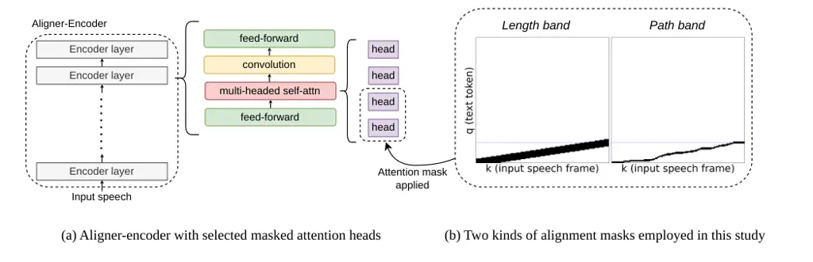
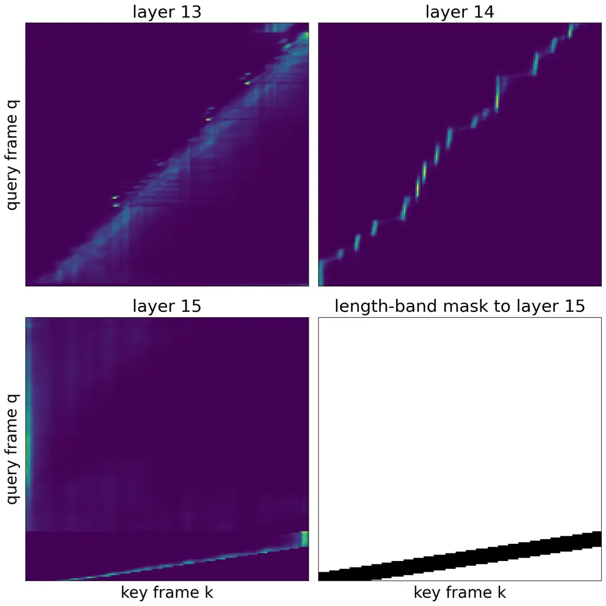
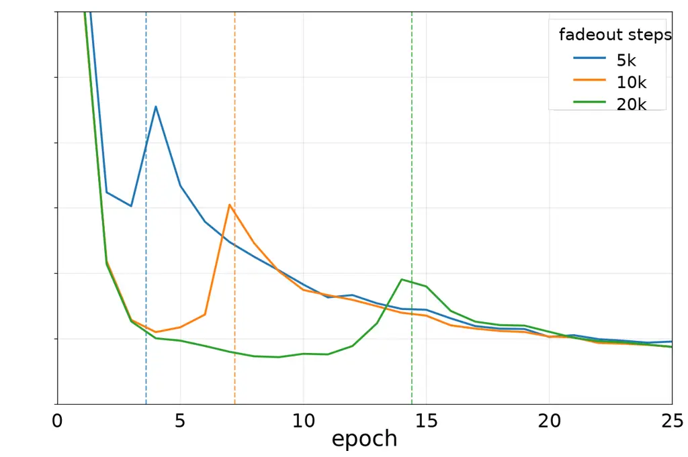

# Scaffolding Self-Transduction with Alignment Attention Mask for Aligner-Encoder ASR

Jaeyoung Lee, Masato Mimura Affiliation:   
NTT, Inc., Japan

###### Abstract

End-to-end ASR systems must jointly solve speech-text alignment and
token prediction from sequence-level supervision. We study this problem
in Aligner-Encoder ASR, where alignment is performed inside encoder
self-attention and can thus be directly intervened on with an attention
mask. We use forced alignment to build an attention mask that confines
selected encoder self-attention heads to a narrow window around the
alignment path. The mask is faded out over training, leaving a
deployable model with an unmodified inference architecture;
alternatively, kept active at training and inference, it serves as an
oracle that measures recognition performance once alignment is
externally resolved. On LibriSpeech, the faded alignment mask improves
test-clean/test-other WER from 3.9/6.4 to 3.5/5.9 over an Aligner
baseline. The oracle masks are far stronger, reaching 1.2/2.9 WER, which
can be thought of as an upper-bound accuracy in the 100M-class Conformer
regime without an external language model. This indicates that alignment
inference is a major bottleneck in Aligner-Encoder ASR, and suggests
that improved alignment mechanisms may offer substantial headroom for
end-to-end ASR.

###### Index Terms: 

automatic speech recognition, aligner-encoder, attention mask, alignment
transfer, forced alignment

## I Introduction

End-to-end ASR systems differ in how they resolve the latent alignment
between acoustic frames and output tokens. CTC \[1\] and RNN-T \[2, 6\]
marginalize monotonic paths, while attention-based encoder-decoder (AED)
models estimate label-synchronous context through decoder attention \[3,
4\]. Recent large-scale ASR models also use this AED formulation \[21,
22\]. In all cases, training requires jointly solving alignment
inference and token prediction from sequence-level supervision, mapping
an acoustic sequence of length T to a shorter token sequence of length
U.

The Aligner-Encoder \[5\] is a recently proposed model that performs
this alignment within the encoder. It dispenses with both the transducer
lattice and decoder cross-attention, relying on the encoder
self-attention to reorganize frame-level representations into
token-level ones, so that the $`u`$-th token is predicted from encoder
output position $`u`$. Since the frame-to-token transduction is carried
out within the encoder’s own self-attention, we call this
_self-transduction_. Alignment is thus performed within the encoder, and
recognition and alignment are learned jointly in a single self-attention
stack, yielding fast and lattice-free decoding. The trade-off is that
alignment is not guaranteed by the training criterion: the
self-attention itself must learn it, using sequence-level supervision
alone. Prior work reports that this alignment emerges abruptly in a few
upper encoder layers \[5\], which can make optimization fragile and can
cause accumulated deletion errors on long utterances.

In CTC and RNN-T, alignment is handled indirectly by summing over
possible monotonic paths in the training loss. In Aligner-Encoder,
frame-to-token alignment is performed by encoder self-attention itself,
making the alignment field directly maskable. We exploit this property
with an _alignment attention mask_ to scaffold self-transduction: an
external forced-alignment path is converted into an attention mask
applied to selected encoder self-attention heads. For those heads, each
token-position query is allowed to attend only near the corresponding
frame region on the path. To our knowledge, this is the first work to
transfer an external alignment path directly into the encoder
self-attention that performs the alignment, and to use oracle masks to
measure the alignment-resolved performance ceiling of that architecture.

We evaluate the alignment attention mask in two regimes: a _faded_
regime, where the mask is gradually removed during training, and an
_oracle_ regime, where the mask remains active during both training and
inference to measure recognition when alignment information is
externally supplied. In our experiments, we observe that the faded band
can improve recognition while requiring no external aligner at
inference, while oracle masks reveal much larger gains when alignment is
supplied. These results indicate that alignment remains a substantial
bottleneck in Aligner-Encoder ASR and a promising direction for
improving end-to-end ASR in general.

Figure 1: Autoregressive Aligner-Encoder architecture. The encoder
produces $`T`$ frame-indexed representations, while the reference
transcript contains $`U`$ target-token positions. The first $`U`$
encoder positions are paired one-to-one with the target tokens, and each
token $`y_{u}`$ is predicted by a joiner that combines encoder state
$`h_{u}`$ with an autoregressive predictor state computed from
$`y_{<u}`$. The remaining encoder positions $`h_{U+1:T}`$ are discarded
by the final Aligner prediction path. This one-to-one pairing requires
encoder self-attention to route each token’s acoustic evidence into its
corresponding token-indexed position.

## II Related Work

### II-A Aligner-Encoder ASR and internal self-transduction

Aligner-Encoder ASR predicts each token $`y_{u}`$ from the corresponding
encoder position $`u`$, requiring encoder self-attention to reorganize
frame-level acoustic representations into token-indexed ones \[5\]. We
refer to this encoder-internal frame-to-token reorganization as
_self-transduction_. Prior work reports that this alignment emerges
abruptly in a small number of upper encoder layers, rather than being
uniformly distributed throughout the network. Our method targets this
alignment-formation stage by constraining selected self-attention heads
with externally estimated alignment information.

This encoder-side formulation makes Aligner-Encoder a natural target for
attention-mask intervention employed in this study: if alignment is
performed by encoder self-attention, then constraining selected heads
directly constrains the mechanism that performs self-transduction.

### II-B Alignment guidance and alignment knowledge transfer

A related line of work uses alignment or timing information to make
end-to-end ASR training and decoding more structured. Monotonic
attention \[8\] and MoChA \[9\] impose monotonic constraints on
decoder-side attention for online or linear-time decoding, while
triggered attention \[10\] uses CTC-derived trigger points to activate
an attention decoder at selected frames. Supervised-attention methods
use external alignments to shape decoder attention \[11\],
alignment-knowledge distillation guides online attention emission
behavior \[12\], and self-knowledge distillation can shape CTC spike
timing \[13\]. Alignment information has also been used to restrict or
reduce transducer training, for example by limiting the RNN-T lattice
with external forced alignment or CTC guidance \[14, 15\].

These methods show that alignment information can improve end-to-end ASR
beyond conventional sequence-level supervision. However, they generally
guide decoder attention, emission timing, CTC criteria, or transducer
lattices. In contrast, we inject an externally estimated alignment path
as an attention mask into the encoder self-attention that performs
Aligner-Encoder self-transduction, as a structural constraint on
selected heads rather than as teacher posteriors, hypotheses,
decoder-side attention supervision, or a decoding constraint.



Figure 2: Alignment attention mask for Aligner-Encoder ASR. A monotonic
frame–token alignment path, estimated for the reference transcript by an
external forced aligner (a pretrained RNN-T in this study), is converted
into an attention mask that confines selected encoder self-attention
heads to a narrow window around the path (the _path band_); the coarser
_length band_ instead uses only the endpoint $`(T,U)`$ to draw a
straight band that reveals the target length $`U`$ and the global
frame-to-token compression ratio. These masks are applied to a subset of
self-attention heads in a single encoder layer.

## III The Aligner-Encoder Model

Figure 1 illustrates the autoregressive Aligner-Encoder architecture
used in this work. Let $`\mathbf{x}`$ denote the input speech, an
acoustic feature sequence of length $`T`$. The encoder $`E`$ maps it to
a sequence of encoder representations

```math
\mathbf{h}_{1:T}=E(\mathbf{x}). \tag{1}
```

For a reference transcript $`\mathbf{y}=(y_{1},\ldots,y_{U})`$,
including the end-of-sentence token, the model pairs the first $`U`$
encoder positions with the $`U`$ target-token positions, as shown in
Figure 1(a). The remaining encoder positions are not used by the final
Aligner prediction loss.

The model retains the predictor–joiner interface used in transducer
models, but removes the transducer lattice. The predictor $`P`$ is an
autoregressive text network that summarizes the previous output tokens.
In our implementation, the predictor is a single-layer LSTM operating
over token embeddings. At token position $`u`$, it produces

```math
\mathbf{g}_{u}=P(y_{<u}), \tag{2}
```

where $`y_{<u}`$ is the token history.

The joiner $`J`$ combines the encoder representation at the same
position with the predictor state. Following standard RNN-T
practice \[5\], we implement the joiner as a single-layer feed-forward
network. Specifically, the encoder and predictor representations are
first projected to a common dimension and combined via elementwise
addition:

```math
\tilde{\mathbf{h}}_{u}=\mathbf{W}_{h}\mathbf{h}_{u}+\mathbf{b}_{h},\quad\tilde{\mathbf{g}}_{u}=\mathbf{W}_{g}\mathbf{g}_{u}+\mathbf{b}_{g}, \tag{3}
```

```math
\mathbf{z}_{u}=\mathbf{W}_{o}\,\phi(\tilde{\mathbf{h}}_{u}+\tilde{\mathbf{g}}_{u})+\mathbf{b}_{o}, \tag{4}
```

where $`\mathbf{W}_{h},\mathbf{W}_{g},\mathbf{W}_{o}`$ are learned
weight matrices, $`\mathbf{b}_{h},\mathbf{b}_{g},\mathbf{b}_{o}`$ are
bias vectors, and $`\phi(\cdot)`$ is a nonlinearity (e.g., $`\tanh`$ or
ReLU). The token posterior is then

```math
p(y_{u}\mid\mathbf{x},y_{<u})=\mathrm{softmax}(\mathbf{z}_{u})_{y_{u}}. \tag{5}
```

Training uses teacher forcing for the predictor history and minimizes
the cross-entropy (CE) loss

```math
\mathcal{L}_{\mathrm{AE}}=-\sum_{u=1}^{U}\log p(y_{u}\mid\mathbf{x},y_{<u}). \tag{6}
```

This differs from RNN-T in that the joiner is not evaluated over a
two-dimensional $`(t,u)`$ lattice and no forward–backward
marginalization over alignments is performed. Instead, the model is
trained on the one-to-one pairing between encoder position $`u`$ and
output token $`y_{u}`$. Consequently, the encoder must learn to route
the acoustic evidence for each output token into the corresponding
token-indexed position before the joiner is applied. This
encoder-internal frame-to-token reorganization is the self-transduction
operation targeted by our alignment attention mask.

At inference time, given a partial hypothesis $`\hat{\mathbf{y}}_{<u}`$,
the predictor produces $`P(\hat{\mathbf{y}}_{<u})`$, and the joiner
scores the next token from encoder position $`u`$:

```math
p_{\tau}(v\mid\mathbf{x},\hat{\mathbf{y}}_{<u},u)=\mathrm{softmax}\!\left(\frac{1}{\tau}J(\mathbf{h}_{u},P(\hat{\mathbf{y}}_{<u}))\right)_{v}, \tag{7}
```

where $`v`$ ranges over the output vocabulary and $`\tau`$ is a decoding
temperature. Beam search extends each hypothesis by one token at each
encoder position until an end-of-sentence token is emitted.

We rank completed hypotheses with a length-penalized score

```math
s(\hat{\mathbf{y}})=\sum_{u=1}^{|\hat{\mathbf{y}}|}\log p_{\tau}(\hat{y}_{u}\mid\mathbf{x},\hat{\mathbf{y}}_{<u},u)-\beta\,n(\hat{\mathbf{y}}), \tag{8}
```

where $`n(\hat{\mathbf{y}})`$ is the number of emitted non-EOS tokens
and $`\beta`$ is the length penalty.

## IV Alignment Attention Mask

The Aligner-Encoder training objective pairs output token $`y_{u}`$ with
encoder position $`u`$, so speech recognition succeeds only if the
encoder has already routed the corresponding acoustic evidence into that
token-indexed position. Prior work observes \[5\] that this
frame-to-token alignment emerges abruptly in a small number of upper
encoder layers, rather than being uniformly represented throughout the
network. We hypothesize that this alignment formation can be scaffolded
by guiding the self-attention heads that participate in this routing
process. We implement this guidance with an _alignment attention mask_,
which forces selected heads to attend within a narrow band around a
frame-to-token alignment path. The band is defined formally below.

At the same time, such a mask is a strong constraint because it directly
restricts where a query position can gather acoustic evidence. If
imposed on all heads or many layers, it could prevent the encoder from
using off-band acoustic, phonetic, or contextual information. We
therefore apply the mask only to selected attention heads in a single
encoder layer. The masked heads provide an alignment-guided route for
acoustic evidence, while the remaining heads and layers remain
unconstrained and can learn complementary representations. Figure 2
provides an overview of the alignment-mask construction and where it is
applied in the Aligner-Encoder.

Let $`s`$ denote the encoder layer to which the mask is applied, and let
$`\mathcal{H}_{\mathrm{band}}`$ denote the selected band heads, with
$`K=|\mathcal{H}_{\mathrm{band}}|`$. The mask is applied only to these
heads. Unselected heads, other layers, and the remaining model
components are left unchanged.

### IV-A Alignment Bands and Masked Attention

For a center function $`c(t)`$ that maps each frame $`t`$ to a token
index and a half-width $`b`$, we define the band for token query $`u`$
as

```math
\mathcal{B}_{u}(c,b)=\{\,t\in\{1,\ldots,T\}:|u-c(t)|\leq b\,\}. \tag{9}
```

Thus, $`\mathcal{B}_{u}(c,b)`$ is the set of acoustic frames that token
query $`u`$ is allowed to attend to.

The _length-conditioned linear band_, or _length band_ in short, uses a
linear center,

```math
c^{\mathrm{len}}(t)=1+\frac{U-1}{T-1}(t-1). \tag{10}
```

The resulting band
$`\mathcal{B}^{\mathrm{len}}_{u}=\mathcal{B}_{u}(c^{\mathrm{len}},b)`$
provides the global frame-to-token compression ratio, but no local token
timing. We call this the length band because the only transcript-side
information it uses is the target length $`U`$; it does not use any
token-level timing or forced-alignment path.

The _full alignment-path band_, or _path band_ in short, uses an
externally estimated alignment path. Given the reference transcript, a
forced aligner provides a cumulative token index $`\hat{U}(t)`$ for each
frame after resampling to the valid encoder-frame sequence. We define

```math
c^{\mathrm{path}}(t)=\hat{U}(t), \tag{11}
```

and
$`\mathcal{B}^{\mathrm{path}}_{u}=\mathcal{B}_{u}(c^{\mathrm{path}},b)`$.
Unlike the length band, the path band follows the local frame-token
alignment path and therefore provides token-dependent timing
information. Constructing $`\hat{U}(t)`$ requires an accurate external
frame-to-token alignment, which we obtain from a pretrained RNN-T model
in this study. Teacher-forcing its predictor on the reference transcript
and running the standard forward–backward pass over the RNN-T alignment
lattice yields, for each encoder frame $`t`$, the posterior-expected
token index $`\hat{U}(t)`$, which we take as the path center
$`c^{\mathrm{path}}(t)`$.

### IV-B Mask Scheduling and Oracle Evaluation

The mask acts multiplicatively on the pre-softmax attention weights of
the selected heads. For a band $`\mathcal{B}^{r}_{u}`$ with
$`r\in\{\mathrm{len},\mathrm{path}\}`$, it scales the attention score of
key $`t`$ for query $`u`$ by

```math
m^{r}_{u,t}(n)=\begin{cases}1,&t\in\mathcal{B}^{r}_{u},\\
\max\!\big(\varepsilon,g(n)\big),&t\notin\mathcal{B}^{r}_{u}.\end{cases} \tag{12}
```

The scalar $`g(n)\in[0,1]`$, where $`n`$ is the training step, is an
out-of-band gate: out-of-band keys retain a fraction $`g(n)`$ of their
attention weights, while in-band keys are unbiased. For numerical
stability, the out-of-band weight is floored at $`\varepsilon=10^{-4}`$,
so a valid key never receives exactly zero softmax mass. Thus $`g=0`$
gives a strongly band-limited bias, $`0<g<1`$ gives a soft bias, and
$`g=1`$ removes the mask.

We use each band in two regimes. In the _faded_ regime, the mask is
gradually faded out during training, and is not used at inference. We
set

```math
g(n)=\begin{cases}0,&n<n_{1},\\[2.0pt]
\dfrac{n-n_{1}}{n_{2}-n_{1}},&n_{1}\leq n\leq n_{2},\\[6.0pt]
1,&n>n_{2}.\end{cases} \tag{13}
```

where $`n`$ is the optimizer step. Before $`n_{1}`$, out-of-band keys
receive only the small floor weight $`\varepsilon`$, so selected heads
are strongly biased toward the band. Between $`n_{1}`$ and $`n_{2}`$,
$`g`$ increases linearly from $`0`$ to $`1`$, gradually restoring
out-of-band attention. After $`n_{2}`$, $`g=1`$ and the mask is removed,
so the model trains and decodes as the original Aligner-Encoder. This
regime tests whether alignment side information can be internalized
while preserving the original inference-time architecture.

In the _oracle_ regime, the mask remains active through both training
and inference. We disable the fade and set $`g(n)=\varepsilon`$, giving
a strong but non-degenerate out-of-band penalty. This setting is
intentionally non-deployable because the length band uses the reference
target length $`U`$ and the path band uses a reference-derived alignment
path. It should be noted that this is not teacher-forced evaluation.
Teacher forcing would condition the predictor on the reference prefix
$`y_{<u}`$, making the token history oracle as well. In our oracle
regime, decoding remains autoregressive, and only the target length
$`U`$ or the alignment path is reference-derived. The _oracle_ settings
are diagnostic, measuring recognition performance with either the
correct global length and slope supplied by the oracle length band or
the full frame-token alignment path.

## V Experiments

### V-A Experimental Setup

We evaluate on LibriSpeech 960 h \[17\] and a five-language Common Voice
16.1 setting \[18\] covering English, German, French, Spanish, and
Italian with $`4{,}133`$ h of training audio. LibriSpeech uses speed
perturbation, both settings use SpecAugment \[20\], and performance is
reported as WER on test-clean/test-other.

All systems use the same Conformer-L encoder \[19\] with approximately
$`115`$M parameters, $`17`$ layers, and $`8`$ attention heads. The
Aligner predictor is a one-layer LSTM with $`512`$ hidden units, and the
joiner has $`640`$ hidden units. We use BPE vocabularies of size
$`1024`$ for LibriSpeech and $`2000`$ for the multilingual Common Voice
system. All Aligner models include an auxiliary InterCTC loss \[7\] of
weight $`0.1`$ at encoder layer $`12`$. Path-band alignments are
obtained from an RNN-T teacher trained on the same corpus as the
corresponding Aligner-Encoder student.

Models are trained for $`80`$ epochs on LibriSpeech and $`35`$ epochs on
Common Voice, with $`20`$k warmup steps, peak learning rate $`0.0020`$,
and an effective batch size of approximately two hours of audio. Final
models are obtained by averaging the $`10`$ best LibriSpeech checkpoints
and the $`5`$ best Common Voice checkpoints. Unless otherwise stated,
decoding uses beam width $`4`$, temperature $`\tau=1.25`$, and length
penalty $`\beta=0.5`$.

For alignment masks, the path band uses half-width $`b=1`$, while the
length band uses $`b=5`$. Faded masks use
$`[n_{1},n_{2}]=[2000,10000]`$, and oracle masks keep $`g(n)=10^{-4}`$.
The masked layer and number of band heads are found optimal at
$`(s,K)=(17,1)`$ for faded masks and $`(s,K)=(15,4)`$ for oracle masks.

### V-B Main Results

Tables I and II report the main results. On LibriSpeech, as shown in
Table I, the faded length band yields similar performance to the
baseline, with $`3.9/6.4`$ WER on test-clean/test-other, indicating that
a transient length-only scaffold is not sufficient to improve the
deployable model. In contrast, the faded path band improves WER to
$`3.5/5.9`$, showing that local alignment-path information can be
partially internalized during training. The oracle bands reveal
substantially greater potential for improvement: the oracle length band
reaches $`2.3/5.3`$, showing that the correct target length $`U`$ and
global frame-to-token slope are themselves valuable when available at
inference, and the oracle path band further improves WER to $`1.2/2.9`$.

|                        |       |       |
| ---------------------- | ----- | ----- |
| System                 | clean | other |
| RNN-T teacher          | 2.2   | 5.1   |
| Aligner baseline       | 3.9   | 6.4   |
| + length band (faded)  | 3.9   | 6.4   |
| + path band (faded)    | 3.5   | 5.9   |
| + length band (oracle) | 2.3   | 5.3   |
| + path band (oracle)   | 1.2   | 2.9   |

TABLE I: LibriSpeech results (WER, test-clean/test-other).

| System               | en   | de  | fr   | es  | it   | Average |
| -------------------- | ---- | --- | ---- | --- | ---- | ------- |
| RNN-T teacher        | 16.0 | 8.1 | 12.9 | 8.2 | 9.3  | 10.9    |
| Aligner baseline     | 17.9 | 9.5 | 14.3 | 9.3 | 10.9 | 12.4    |
| + path band (faded)  | 17.5 | 9.0 | 13.9 | 9.1 | 10.4 | 12.0    |
| + path band (oracle) | 8.5  | 4.6 | 7.2  | 3.7 | 4.3  | 5.7     |

TABLE II: Common Voice per-language WER.

|       |                        |          |        |          |         |
| ----- | ---------------------- | -------- | ------ | -------- | ------- |
| Set   | System                 | $`<11`$s | 11–17s | $`>17`$s | Overall |
| clean | RNN-T teacher          | 2.3      | 1.7    | 2.4      | 2.2     |
|       | Aligner baseline       | 2.5      | 2.1    | 11.7     | 3.9     |
|       | + length band (faded)  | 2.5      | 2.0    | 11.8     | 3.9     |
|       | + path band (faded)    | 2.6      | 1.9    | 9.3      | 3.5     |
|       | + length band (oracle) | 2.3      | 1.6    | 3.7      | 2.3     |
|       | + path band (oracle)   | 1.3      | 0.9    | 1.3      | 1.2     |
| other | RNN-T teacher          | 5.5      | 4.3    | 4.3      | 5.1     |
|       | Aligner baseline       | 5.9      | 4.6    | 12.8     | 6.4     |
|       | + length band (faded)  | 5.9      | 4.4    | 12.9     | 6.4     |
|       | + path band (faded)    | 5.7      | 4.2    | 10.8     | 5.9     |
|       | + length band (oracle) | 5.5      | 4.2    | 6.4      | 5.3     |
|       | + path band (oracle)   | 3.1      | 2.3    | 2.2      | 2.9     |

TABLE III: LibriSpeech WER by utterance-duration bucket
(test-clean/test-other).

The RNN-T teacher is stronger than the deployable Aligner systems with
faded masks, achieving $`2.2/5.1`$ WER, but this comes with
computationally heavier transducer training and decoding. The faded path
band instead transfers part of the teacher’s alignment knowledge into an
Aligner-Encoder student that retains the Aligner-Encoder’s CE-based
objective without transducer marginalization and lower-cost
token-indexed decoding: excluding the shared encoder and beam factor,
the decoding path is reduced from RNN-T’s $`O(T+U)`$ frame-label
traversal to $`O(U)`$ joiner evaluations.

As shown in Table II, The same trend holds in the five-language Common
Voice setting. The faded path band improves all five languages, reducing
average WER from $`12.4`$ to $`12.0`$, while the oracle path band gives
a much larger gain, reducing average WER to $`5.7`$. These results
suggest that when the local frame-token correspondence is supplied, the
remaining token-prediction problem becomes substantially easier across
languages. In summary, length information has large oracle value but
weak transfer as a transient scaffold, whereas path information provides
both a deployable improvement and a much stronger alignment-resolved
oracle gain.

Figure 3: Masked-layer ablation on LibriSpeech (overall dev WER). The
faded path band ($`K{=}1`$) improves as the mask moves to deeper layers,
whereas the oracle length band ($`K{=}4`$) is best near layer $`15`$.

Figure 4: Fade-schedule ablation for the faded path band on LibriSpeech.
The mask fades from $`2`$k steps to the listed end step.

### V-C Utterance-Duration Breakdown

Table III breaks down LibriSpeech WER by utterance duration. Two trends
are notable. First, the faded path band improves the baseline Aligner
model most clearly on long utterances. On test-clean, the $`>17`$s
bucket improves from $`11.7\%`$ to $`9.3\%`$, while the short-utterance
bucket changes little; on test-other, the same long-utterance bucket
improves from $`12.8\%`$ to $`10.8\%`$. This suggests that the faded
path band transfers not only local alignment hints, but also part of the
RNN-T teacher’s robustness to long-utterance alignment. Second, the
oracle path band nearly removes the duration dependence: WER becomes
similar across short, medium, and long buckets, especially on
test-clean. Once the frame-token correspondence is supplied, long
utterances are no longer disproportionately difficult.



Figure 5: Encoder self-attention (query position $`q`$ vs. key position
$`k`$) for one masked head of the oracle length-band model ($`s=15`$,
$`K=4`$). The first three panels show the head’s attention at layers
13–15; the last panel shows the length-band mask applied at layer 15
(black marks the allowed band). A near-diagonal frame-to-token alignment
emerges at layer 14.

### V-D Ablations

Figures 4 and 4 summarize the mask-placement and fade-schedule
ablations. The oracle mask performs best around layers $`14`$–$`15`$,
consistent with the original Aligner-Encoder observation \[5\] that
frame-token alignment naturally emerges in a small number of upper
encoder layers. Since the oracle mask remains active at inference, the
best placement is therefore the layer where the model already tends to
form its internal alignment.

The faded path band shows a different pattern: with one band head,
performance improves as the masked layer moves upward, with the best
result at the final encoder layer ($`s=17`$). This is plausible because
the mask is eventually removed. After release, the model must maintain
the scaffolded alignment using only the final recognition objective;
placing the mask closer to the final Aligner loss may provide a stronger
learning signal for preserving the induced alignment. Lower layers such
as $`s\in\{15,16\}`$ may be too far from the final loss for this
transient cue to be retained as effectively.

The fade-schedule ablation shows that the path band is most effective as
a brief early scaffold. The best setting fades the mask from
$`2\mathrm{k}`$ to $`10\mathrm{k}`$ optimizer steps, finishing before
the $`20\mathrm{k}`$-step learning-rate warmup is complete. Overall,
these ablations indicate that alignment masking works best as a minimal,
early intervention: it should provide enough guidance to seed
self-transduction, while leaving the model free to learn the final
unconstrained representation.



Figure 6: Validation-loss trajectories for faded path-band models with
different fadeout steps on LibriSpeech. Dashed vertical lines mark the
end of each fade window.

### V-E Emergent Alignment under the Oracle Length Band

Figure 5 visualizes attention patterns under the oracle length-band
condition. When the length band is applied at layer 15, a near-diagonal
alignment pattern emerges in the preceding layer, with boundary-like
vertical transitions roughly matching the target length $`U`$. This
pattern likely arises because the length band provides only the endpoint
$`(T,U)`$ and global frame-to-token slope, not local token timing; to
make use of the length constraint, the preceding layer must first
reorganize the representation into a more token-synchronous form.

This may help explain the strong oracle length-band result. Although the
mask does not provide a full path, fixing $`U`$ and the global slope can
encourage a more local self-transduction geometry. Because the emergent
alignment pattern stays near $`k\approx q`$, each query attends mostly
to key positions with similar encoder indices, instead of attending far
away along the global frame-to-token slope. In other words, the model
retrieves relevant acoustic evidence through more local self-attention
rather than long-range attention, which may benefit long-utterance
generalization when relative positional encodings \[16\] are in use.

### V-F Effect of Releasing the Alignment Scaffold

Figure 6 shows the validation loss during faded path-band training. A
clear spike appears when the remaining alignment bias is removed at the
end of the fade schedule, when $`g(n)`$ reaches $`1`$ in Eq. (13). Just
before this point, $`g(n)`$ is already close to $`1`$, so out-of-band
attention is largely restored and the remaining mask contribution is
numerically small. The spike therefore suggests that this weak residual
bias toward the aligned frame-token region remains functionally
important. Thus, alignment information appears to be a high-leverage
training signal: selected heads continue to use weak alignment guidance
near release, while the final WER improvement indicates that part of
this structure is internalized and remains useful after the mask is
removed.

## VI Conclusion

We presented an alignment attention mask for Aligner-Encoder ASR that
transfers external alignment information into selected encoder
self-attention heads while preserving the model’s simple cross-entropy
(CE) training and low-cost inference after fading. Faded path bands can
improve recognition in practice, while oracle masks reveal much larger
theoretical gains when the full alignment path is supplied. These
results indicate that alignment inference remains a substantial
bottleneck in Aligner-Encoder ASR, and motivate future work on
non-oracle alignment prediction, alternative alignment sources, and
streaming or long-form extensions.

## AI-Generated Content Disclosure

LLM-based AI tools were used to assist with code editing, LaTeX build
verification, table and figure layout adjustment, and manuscript
language revision. All AI-assisted content, code changes, citations,
numerical values, and rendered outputs were manually reviewed and
verified by the authors, who take full responsibility for the final
manuscript.

## References

- \[1\] A. Graves, S. Fernández, F. Gomez, and J. Schmidhuber,
  “Connectionist temporal classification: Labelling unsegmented sequence
  data with recurrent neural networks,” in _Proc. ICML_, 2006, pp.
  369–376.
- \[2\] A. Graves, “Sequence transduction with recurrent neural
  networks,” 2012, arXiv:1211.3711.
- \[3\] W. Chan, N. Jaitly, Q. V. Le, and O. Vinyals, “Listen, attend
  and spell: A neural network for large vocabulary conversational speech
  recognition,” in _Proc. ICASSP_, 2016, pp. 4960–4964.
- \[4\] S. Watanabe, T. Hori, S. Kim, J. R. Hershey, and T. Hayashi,
  “Hybrid CTC/attention architecture for end-to-end speech recognition,”
  _IEEE J. Sel. Topics Signal Process._, vol. 11, no. 8, pp.
  1240–1253, 2017.
- \[5\] A. Stooke, R. Prabhavalkar, K. C. Sim, and P. M. Mengibar,
  “Aligner-encoders: Self-attention transformers can be
  self-transducers,” in _Proc. NeurIPS_, 2024, pp. 100 318–100 340.
- \[6\] Q. Zhang, H. Lu, H. Sak, A. Tripathi, E. McDermott, S. Koo,
  and S. Kumar, “Transformer transducer: A streamable speech recognition
  model with transformer encoders and RNN-T loss,” in _Proc. ICASSP_,
  2020, pp. 7829–7833.
- \[7\] J. Lee and S. Watanabe, “Intermediate loss regularization for
  CTC-based speech recognition,” in _Proc. ICASSP_, 2021, pp. 6224–6228.
- \[8\] C. Raffel, M.-T. Luong, P. J. Liu, R. J. Weiss, and D. Eck,
  “Online and linear-time attention by enforcing monotonic alignments,”
  in _Proc. ICML_, 2017, pp. 2837–2846.
- \[9\] C.-C. Chiu and C. Raffel, “Monotonic chunkwise attention,” in
  _Proc. ICLR_, 2018.
- \[10\] N. Moritz, T. Hori, and J. L. Roux, “Triggered attention for
  end-to-end speech recognition,” in _Proc. ICASSP_, 2019, pp.
  5666–5670.
- \[11\] G.-P. Yang and H. Tang, “Supervised attention in
  sequence-to-sequence models for speech recognition,” in _Proc.
  ICASSP_, 2022, pp. 7222–7226.
- \[12\] H. Inaguma and T. Kawahara, “Alignment knowledge distillation
  for online streaming attention-based speech recognition,” _IEEE/ACM
  Trans. Audio, Speech, Language Process._, vol. 31, pp.
  1371–1385, 2023.
- \[13\] E. Kim, H. Kim, and K. Lee, “Guiding frame-level CTC
  alignments using self-knowledge distillation,” in _Proc. Interspeech_,
  2024, pp. 4588–4592.
- \[14\] J. Mahadeokar, Y. Shangguan, D. Le, G. Keren, H. Su, T. Le,
  C.-F. Yeh, C. Fuegen, and M. L. Seltzer, “Alignment restricted
  streaming recurrent neural network transducer,” in _Proc. IEEE SLT_,
  2021, pp. 52–59.
- \[15\] Y. Wang, Z. Chen, C. Zheng, Y. Zhang, W. Han, and P. Haghani,
  “Accelerating RNN-T training and inference using CTC guidance,” in
  _Proc. ICASSP_, 2023, pp. 1–5.
- \[16\] P. Shaw, J. Uszkoreit, and A. Vaswani, “Self-attention with
  relative position representations,” in _Proc. NAACL-HLT_, 2018, pp.
  464–468, doi: 10.18653/v1/N18-2074.
- \[17\] V. Panayotov, G. Chen, D. Povey, and S. Khudanpur,
  “Librispeech: An ASR corpus based on public domain audio books,” in
  _Proc. ICASSP_, 2015, pp. 5206–5210.
- \[18\] R. Ardila, M. Branson, K. Davis, M. Kohler, J. Meyer, M.
  Henretty, R. Morais, L. Saunders, F. Tyers, and G. Weber, “Common
  voice: A massively-multilingual speech corpus,” in _Proc. LREC_, 2020,
  pp. 4218–4222.
- \[19\] A. Gulati, J. Qin, C.-C. Chiu, N. Parmar, Y. Zhang, J. Yu, W.
  Han, S. Wang, Z. Zhang, Y. Wu, and R. Pang, “Conformer:
  Convolution-augmented transformer for speech recognition,” in _Proc.
  Interspeech_, 2020, pp. 5036–5040.
- \[20\] D. S. Park, W. Chan, Y. Zhang, C.-C. Chiu, B. Zoph, E. D.
  Cubuk, and Q. V. Le, “Specaugment: A simple data augmentation method
  for automatic speech recognition,” in _Proc. Interspeech_, 2019, pp.
  2613–2617.
- \[21\] A. Radford, J. W. Kim, T. Xu, G. Brockman, C. Mcleavey, and I.
  Sutskever, “Robust speech recognition via large-scale weak
  supervision,” in _Proc. ICML_, 2023, pp. 28 492–28 518.
- \[22\] Y. Peng, J. Tian, W. Chen, S. Arora, B. Yan, Y. Sudo, M.
  Shakeel, K. Choi, J. Shi, X. Chang, J.-W. Jung, and S. Watanabe, “OWSM
  v3.1: Better and faster open whisper-style speech models based on
  e-branchformer,” in _Proc. Interspeech_, 2024, pp. 352–356.
