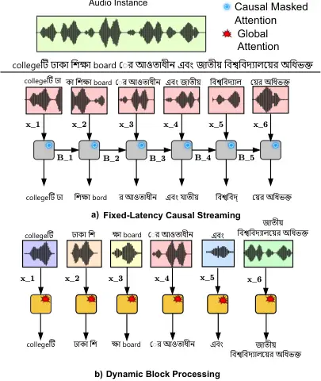
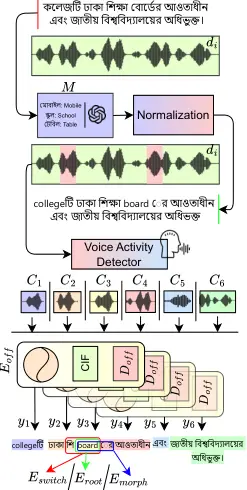
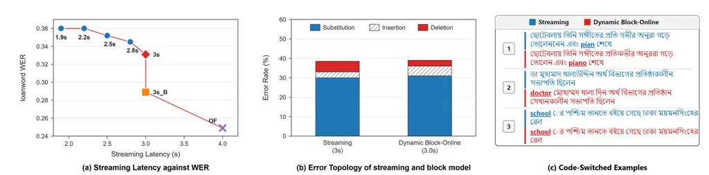

Rafat Imran Hossain Ali Rahman Momen Rahman Mohammed

# Dynamic Block-Online Streaming ASR for Low-Resource Agglutinative Code-Switching Speech with Morphology-Aware Evaluation

Kazi    Afifa    Md. Ismail    Md. Romzan    Fuad    Sifat    Shafin   
Nabeel

###### Abstract

Low-resource, agglutinative languages challenge low-latency ASR, as
fixed lookahead windows fail when grapheme order diverges, suffixes
cross code-switch boundaries, or code-switching data is imbalanced. We
present the first comprehensive study of streaming ASR for
intra-sentential Bangla–English code-switching, identifying a mismatch
between strict causal streaming and long-range morphological
dependencies. We introduce a Dynamic Block-Online framework¹¹ 1 Code,
metric and lexicon are available online: [Dynamic
ASR](https://github.com/King-Rafat/Dynamic_Streaming_ASR) with
VAD-aligned inference that balances semantics, latency, and context,
enabling global bidirectional attention to preserve morphological
integrity. To mitigate data scarcity, we propose Script-Anchored
Loanword Injection, augmenting training text with English loanwords to
model phonotactic transitions. We introduce CS-WER to diagnose switch,
root, and suffix errors, and show that flexible latency budgets enhance
recognition of agglutinative and mixed-language speech, with successful
transfer to menstrual-medical domains.

###### keywords

Multilingual Speech Recognition, Streaming ASR, Intra-sentential
Code-Switching, Low-resource Bangla, CS-WER Metric

^(†)^(†)address: ¹ Address Affiliation 1, Country Affiliation 1  
² Address Affiliation 2, Country Affiliation 2  
³ Address Affiliation 3, Country Affiliation 3 ^(†)^(†)address: ¹ Apurba
NSU R&D Lab, North South University, Dhaka, Bangladesh  
² Apurba Technologies, Dhaka, Bangladesh ^(†)^(†)email:
kazi.meem@northsouth.edu, afifa.imran@northsouth.edu,
ismail.hossain2018@northsouth.edu, romzanalinsu@gmail.com,
fuad@apurbatech.com, sifat.momen@northsouth.edu, shafin109@gmail.com,
nabeel.mohammed@northsouth.edu

## 1 Introduction

Recent ASR systems are multilingual \[1\], realtime \[2\], and
domain-adaptable. This progress is largely driven by Large Language
Models (LLMs), which necessitate low-latency ASR front-ends for
real-time interaction. Recent advancements in ASR have been driven by
scale, utilizing thousands of hours of training data and costly
compute \[3, 4\]. Streaming reaches low-resource Indic languages mainly
via monolingual transducer/CTC models; intra-sentential code-switching
in agglutinative scripts remains largely unaddressed, particularly
within the constraints of low-latency architectures \[5, 6\].

Online systems enable real-time correction and reduce SLM latency
through incremental token output. However, low-resource ASR systems are
rarely public \[7\] and hard to reproduce, due to scarce data and
recipes. Although Bengali is encoded in phonetic order, dependent vowel
signs render left of their consonant. Causal streaming must emit the
consonant first, giving unstable output, worst at switch boundaries.
Colloquial Bengali incorporates English loanwords, requiring robust
handling of intra-sentential code-switching (CS). Accurate CS
recognition is crucial for modern AI pipelines \[8\] because preserving
high-information loanwords minimizes semantic drift in downstream tasks.



Figure 1: Comparison of (a) Fixed-Latency Causal Streaming, where
memory-cached attention leads to CS morphological truncation
(mistranscribing

and board \[bord\]), and (b) our proposed Dynamic Block-Processing,
where VAD-aligned global attention resolves long-form agglutinative
dependencies.

This work presents a study of streaming ASR for agglutinative CS in a
low-resource setting. We show that standard causal models face
limitations because linguistic units such as pre-base vowels, Bangla
suffixes attached to English roots, and code switches often extend
beyond the model’s lookahead window. In such cases, strictly causal
attention fails to resolve these dependencies, as it lacks the hindsight
context necessary to re-evaluate roots in light of future suffixes.
Parallel to the architectural challenge, we address the scarcity of
training data for CS. Colloquial Bangla is heavily interspersed with
English loanwords. We introduce Script-Anchored Loanword Injection,
embedding 750 common English loanwords into training text to teach
phonotactic transitions and establish a strong “Banglish” baseline
absent from open datasets.

We address the architectural mismatch with a Dynamic Block-Online
architecture. Unlike fixed-window streaming that arbitrarily truncates
morphemic suffixes, it uses Voice Activity Detection to align inference
with natural pauses, producing dynamic latency—often faster than fixed
buffers during rapid turn-taking, but extending to a 3-second
macro-block. Within each block, an offline model trained with global
bidirectional attention resolves morphological dependencies. This shows
that for agglutinative languages, a flexible latency budget can
compensate for scarce data and compute with an optimizable inference
context, while preserving real-time capability. Figure 1 shows a model
trained with global attention inferred on pauses and macro-blocks is
able to better understand switches and suffixes as opposed to
causal-masked streaming model. We further validate our approach via
domain adaptation on a specialized menstrual and menopausal health
dataset. Our architecture preserves morphological and CS-semantic
integrity, so technical medical terms remain intact for downstream small
language models.

Our key contributions are as follows:

- •
  Dynamic Block-Online Processing: A VAD-triggered streaming strategy
  for offline global attention models, optimized for agglutinative CS
  speech.
- •
  Script-Anchored Injection: A novel synthetic augmentation technique
  using curated loanword datasets to induce intra-sentential CS in
  colloquial monolingual corpora.
- •
  CS-WER Metric: A fine-grained evaluation framework to quantify error
  rates specifically across CS-roots and agglutinative suffixes.
- •
  Domain Generalization: Validation of model robustness in the
  specialized health domain, specifically menstrual and menopausal
  health.

## 2 Streaming Agglutinative Code-Switched (CS) ASR

### 2.1 Script-Anchored Synthetic CS Induction

CS requires vast good quality data. Massively multilingual models \[1\]
perform well on inter-sentential multilingual speech but show
limitations in intra-sentential CS scenarios \[9\].

We define the monolingual Bengali corpus
$`D_{BN}=\{d_{1},\dots,d_{n}\}`$, where $`d_{i}`$ represents an
utterance consisting of a token sequence,
$`\{\bm{w_{1}},\dots,\bm{w_{k}}\}`$ from $`V_{BN}`$. We assume a
morphological decomposition for each token
$`w=\text{root}(w)\oplus\text{suff}(w)`$. The augmentation process is
defined as a mapping lexicon
$`\mathcal{M}=\{(r_{bn},r_{en})\mid r_{bn}\equiv r_{en}\}`$, consisting
of 750 high-frequency semantic equivalents. The injection process
identifies any Bengali token $`w\in d_{i}`$ if
$`\text{root}(w)\in\mathcal{M}`$, which is transformed to its cs variant
$`w_{cs}`$.

```math
w_{cs}=r_{en}\oplus\text{suff}(w) \tag{1}
```

Most synthetic methods mix semantically and acoustically mismatched
audio, hindering convergence. In contrast, this approach preserves
syntax while inserting English roots to create a code-switched corpus.



Figure 2: Proposed Methodology of: Script-Anchored Loanword Injection -
converting Bengali to CS transcript through a loanword database
$`\mathcal{M}`$. A Dynamic Block Online model that strips audio at
communicative pauses and uses an offline encoder $`E_{off}`$, CIF
predictor, and Decoder and how CS-WER is calculated showcased by what
each of $`E_{switch}/E_{root}/E_{morph}`$ looks at.

### 2.2 Dynamic Block and Streaming ASR

RNN-T streaming models \[2\] are often sample-inefficient \[10\] and
autoregressive approaches like Whisper \[1\] can produce hallucinations.
To address these issues, we adopt a Non-Autoregressive (NAR) Paraformer
\[5\] as our backbone that enables fast, low-compute NAR chunk decoding
for stable reordering-heavy settings. The encoder $`\mathcal{E}`$
transforms an acoustic sequence
$`\mathbf{X}=\{\mathbf{x}_{1},\dots,\mathbf{x}_{T}\}`$, where
$`\mathbf{x}_{t}\in\mathbb{R}^{f}`$ of utterance $`d_{i}`$, into a
hidden representation
$`\mathbf{H}=\{\mathbf{h}_{1},\dots,\mathbf{h}_{T}\}`$. $`\mathcal{E}`$
employs Self-Attention Network with Memory (SAN-M) blocks. During
offline training, the architecture learns global bidirectional attention
across an entire utterance. In streaming, the architecture is trained by
restricting the attention receptive fields. The representation for the
frame $`t`$ is constrained to the current chunk $`\mathbf{C}_{k}`$ and a
historical context memory bank $`\mathbf{B}_{k-1}`$:
$`\mathbf{h}_{t}=\text{SAN-M}(\mathbf{x}_{t},\mathbf{B}_{k-1};\mathbf{C_{k}})\quad\forall t\in\mathbf{C}_{k}`$.
This causality creates a future-blindness bottleneck, hindering the
resolution of morphological boundaries in agglutinative scripts. To
align $`\mathbf{H}`$ with target tokens $`\mathbf{Y}`$, a CIF mechanism
emits weights $`\alpha`$, where $`\alpha_{t}\in[0,1]`$. The acoustic
embedding $`\mathbf{c}_{l}`$ for token $`y_{l}`$ is integrated as:
$`\mathbf{c}_{l}=\sum_{t=t_{l-1}}^{t_{l}}\alpha_{t}\mathbf{h}_{t},\quad\text{s.t. }\sum_{i=1}^{t_{l}}\alpha_{i}\approx l`$

We evaluate two streaming policies to investigate the impact of context
restriction. (1) Causal Streaming ($`\lambda\leq 2.4s`$): Uses
chunk-causal attention: full attention within a chunk, no access to
future chunks. We posit that scaling $`\lambda`$ in this setup yields
diminishing returns, as the model cannot look back from a suffix to
correct an earlier root embedding, leading to irreversible alignment
drift. (2) Dynamic Block-Processing ($`\lambda\leq 3.0s`$): To mitigate
this, we move to a VAD-triggered block-online paradigm. We substitute
fixed causal updates with semantic macro-blocks aligned with natural
communicative pauses. Crucially, this allows us to deploy the Unmasked
Offline Encoder within the buffer. By treating the 3s buffer as a
standalone unit, we restore Global Bidirectional Attention. This
achieves hindsight resolution: the model re-evaluates early frames
(roots) in light of later frames (suffixes) within the same block. This
also helps to understand instances of code-switches. This eliminates the
’blind commitment’ inherent in causal architectures, effectively
utilizing the extra latency to enforce morphological integrity.
Consequently, the effective receptive field expands to
$`\mathcal{R}(\mathbf{h}_{t})=\{\mathbf{x}_{i}\mid\mathbf{x}_{i}\in\mathbf{C}_{block}\}`$.
covering the entire semantic unit regardless of where $`t`$ lies.

### 2.3 Fine-Grained CS-WER

Standard Word Error Rate (WER) treats all errors equally. A model might
correctly recognize the English root but fail to segment the suffix, or
miss the language switch entirely. To disentangle these errors, we
introduce Fine-Grained CS-WER, a decomposed metric that evaluates three
structural components of intra-sentential CS:

- •
  Switch-Point Error ($`E_{switch}`$): Measures the stability of the
  language transition. We evaluate the bigram formed by the last word of
  the Matrix Language (Bangla) and the first word of the Embedded
  Language (English).
- •
  Loanword Root Error ($`E_{root}`$): Isolates the lexical accuracy of
  the embedded English root, ignoring the suffix. This measures whether
  the acoustic model correctly identified the core English entity.
- •
  Morphological Boundary Error ($`E_{morph}`$): It evaluates the full
  agglutinative structure. A prediction is considered correct only if
  both the English root AND the Bangla suffix are correctly recognized
  and validly segmented.

We show this visually at the end of Fig 2. We report performance as a
tuple $`E_{switch}/E_{root}/E_{morph}`$. This formulation allows us to
specifically diagnose whether performance gains stem from sudden
linguistic switches, better acoustic recognition, or superior
morphological segmentation.

## 3 Experiments

### 3.1 Experimental Setup

Datasets: We utilized a composite Bangla corpus of approximately 500
hours, aggregating the Common Voice Bengali split \[11\]
($`\approx 75h`$), OpenSLR 53 \[12\] ($`\approx 215h`$),
IndicVoices \[13\] ($`\approx 122h`$), and KathBath \[14\]
($`\approx 84h`$). To ground the acoustic representation of English
phonemes, we incorporated a 250h subset of English Gigaspeech \[15\] for
approximately 750 hours in total. The Script-Anchored Loanword Injection
resulted in $`\approx 20\%`$ CS sentences among all instances.

[TABLE]

Table 1: Comparison of CER, WER, and Fine-Grained CS-WER
($`E_{switch}/E_{root}/E_{morph}`$) across Offline, Causal Streaming,
and Dynamic Block architectures. ’B+E’, ’C’, and ’aug’ denote
monolingual training, loanword injection, and noise augmentation,
respectively.

Test Sets: Evaluation is performed on two distinct domains: (1) a
conversational test set (Common Voice, 9,392 utterances) with common
English loanwords using Script-Anchored Injection, and (2) Medical
Domain: 20 h high-perplexity dataset focusing on Menstrual Health for
training and an additional 5 h for testing.



Figure 3: Illustration of different model outcomes by the streaming,
block online, and offline model: (a) Streaming latency against
$`E_{root}`$ of streaming models as circles and diamonds, compared to
block online (square) and offline (cross) models. (b) Error topology
showcasing the Global WER of the streaming model and the dynamic
block-online model (c) Code-Switched generations of dynamic block-online
(red) and streaming model (blue).

### 3.2 Results and Discussion

Morphological Plateau: Table 1 reveals that by aggressively extending
the Causal Streaming window to $`w=2.4`$ or $`w=3`$, we achieve a
competitive Global WER of 39.45% and 37.20%, matching the Dynamic Block
model (38.73%). However, the CS-WER reveals the structural limitation of
the streaming architecture. The Streaming model saturates at an
$`E_{root}`$ of 0.35 and $`E_{morph}`$ around $`0.42`$. The Dynamic
Block model has $`E_{root}`$ of 0.29 and $`E_{morph}`$ around $`0.35`$.
This 6 and 7 point absolute gap in morphological error demonstrates that
while large-window streaming can capture general acoustics (lowering
Global WER), it fails to resolve the specific dependencies of
agglutinative CS. The Causal mask prevents the model from effectively
understanding sudden switches to English words and also ”binding” the
suffix to the root. The Dynamic Block architecture, utilizing
bidirectional attention, breaks this plateau, matching the morphological
precision of the offline topline. At the same time, it takes many hours
of computation and data to adapt the streaming model on the pretrained
offline model. Dynamic Latency Characteristics Unlike fixed-window
streaming, the latency of our Block-Online system is data-dependent,
governed by the speaker’s inter-pausal units (IPUs). Since the VAD
triggers processing at natural semantic boundaries (pauses $`>`$ 200ms),
the effective latency aligns with the conversational turn-taking rate.
In standard conversational speech, phrases typically span 1.5s-2.0s.
Consequently, the system rarely hits the hard 3000ms cap during
dialogue. The 3-second buffer primarily serves as a fallback for rapid,
continuous speech segments with the highest morphological density.

Error Topology and Qualitative Analysis: Figure 3b shows error type
distribution. The Causal Streaming baseline is dominated by Deletions
($`\approx`$7%); the CIF predictor discards suffixes or code-switches.
The Dynamic Block-Online architecture has deletions drop to $`<`$2% as
errors shift mostly to insertions; the globally trained encoder fires at
pieces such as suffixes, occasionally over-firing. By leveraging a 3s
receptive field and global attention training, the CIF mechanism
accumulates sufficient acoustic energy to trigger token emissions for
agglutinative markers and switches. Standard WER penalizes both, the
block architecture preserves the morphological slot and overall
important code-switched semantics, maintaining the integrity required
for downstream NLU tasks. While both count equally towards Global WER,
Deletion is fatal for semantic understanding in agglutinative languages.
By shifting errors from structural deletion to insertion, the
Block-Online architecture preserves the grammatical intent, even if the
Global WER metric does not fully reflect this semantic recovery.
Figure 3c shows CS examples audios generated through the streaming model
(blue) and block online model (red). For first two examples, the
streaming model is unable to understand the start of the English
loanwords in (1) piano and (2) doctor. This is due to (1) Abrupt cutting
of audios and (2) less contextual knowledge due to masked-chunk
attention, respectively.

Impact of Script-Anchored Injection The efficacy of our data
augmentation strategy is quantified by the Fine-Grained CS-WER metric in
Table 1. Models trained on monolingual transcripts (B+E) fail to trigger
CS, resulting in near-total error rates as the model transliterates
English terms into Bengali script. The application of Script-Anchored
Loanword Injection drastically reduces $`E_{root}`$ in the best
configuration. This confirms that the injection strategy successfully
transforms the task from simple transcription to discriminative language
switching, forcing the model to respect the orthographic boundary
between the English root and the Bengali suffix. We see a huge increase
in catching loanwords in both offline (87% $`\to`$25%) and online (99%
$`\to`$ 61%)

Explicit vs. Implicit Signals Explicit LID tags (Table 1) fail to model
boundaries: discrete \<en\> / \<bn\> tokens destabilize the CIF
predictor by interrupting its continuous energy accumulation, disrupting
alignment paths. This indicates that Implicit Script Anchoring is better
suited for energy-based NAR architectures. Applying weighted loss to LID
tokens yields similar performance, suggesting the limitation is
architectural rather than optimization-related.

### 3.3 Domain Adaptation on Menstrual Health

We adapt our architecture to a high-perplexity domain: Menstrual and
Menopausal Health. This domain features critical, low-frequency English
medical entities (e.g., PCOS, Endometriosis) within Bangla syntax. Due
to data scarcity, we utilize a synthetic-to-real adaptation strategy,
generating a domain-specific corpus via TTS.

Results and Semantic Viability: The model initially struggled with
specialized vocabulary ($`E_{root}=.78`$). After fine-tuning on the
synthetic subset, the Block-Online model achieved a 27% WER and an
$`E_{root}`$ of .22 on a noisy, held-out test set—matching the baseline
performance on general data. This Lossless Domain Transfer suggests that
the model’s pre-existing morphological segmentation capabilities allow
it to integrate new English roots into Bangla syntax without relearning
segmentation mechanics.

## 4 Conclusion

We propose a Dynamic Block-Online ASR for Bangla-English CS that
overcomes the structural limitations of causal streaming through
VAD-aligned inference, global attention, and Script-Anchored Loanword
Injection. The approach improves morphological and semantic accuracy
under online latency constraints. CS-WER enables fine-grained diagnosis
of switch, root, and morphological errors. Experiments show that
conventional streaming models plateau structurally, whereas our method
surpasses this ceiling and generalizes. The limitations of this study
are that it requires a good VAD model to utilize this methodology. The
dataset does not include all possible loanwords, but rather the most
common loanwords. Future work will explore adaptive latency control and
LLM-assisted loanword injection.

## 5 Generative AI Use Disclosure

Generative AI tools were used solely for writing assistance, language
editing, and manuscript polishing. No generative AI tools were used to
produce any significant part of the scientific content, methodology,
experiments, results, analysis, or conclusions of this manuscript. All
authors reviewed the manuscript and take full responsibility for its
content.

## References

- \[1\] A. Radford, J. W. Kim, T. Xu, G. Brockman, C. McLeavey, and I.
  Sutskever (2023) Robust speech recognition via large-scale weak
  supervision. In International conference on machine learning,
  pp. 28492–28518. Cited by: §1, §2.1, §2.2, Table 1, Table 1.
- \[2\] A. Graves (2012) Sequence transduction with recurrent neural
  networks. arXiv preprint arXiv:1211.3711. Cited by: §1, §2.2.
- \[3\] A. Narayanan, A. Misra, K. C. Sim, G. Pundak, A. Tripathi, M.
  Elfeky, P. Haghani, T. Strohman, and M. Bacchiani (2018) Toward
  domain-invariant speech recognition via large scale training. In 2018
  IEEE Spoken Language Technology Workshop (SLT), pp. 441–447. Cited by:
  §1.
- \[4\] T. N. Sainath, Y. He, B. Li, A. Narayanan, R. Pang, A.
  Bruguier, S. Chang, W. Li, R. Alvarez, Z. Chen, et al. (2020) A
  streaming on-device end-to-end model surpassing server-side
  conventional model quality and latency. In ICASSP 2020-2020 IEEE
  International Conference on Acoustics, Speech and Signal Processing
  (ICASSP), pp. 6059–6063. Cited by: §1.
- \[5\] Z. Gao, S. Zhang, I. McLoughlin, and Z. Yan (2022) Paraformer:
  fast and accurate parallel transformer for non-autoregressive
  end-to-end speech recognition. arXiv preprint arXiv:2206.08317. Cited
  by: §1, §2.2.
- \[6\] B. Li, A. Gulati, J. Yu, T. N. Sainath, C. Chiu, A.
  Narayanan, S. Chang, R. Pang, Y. He, J. Qin, et al. (2021) A better
  and faster end-to-end model for streaming asr. In ICASSP 2021-2021
  IEEE International Conference on Acoustics, Speech and Signal
  Processing (ICASSP), pp. 5634–5638. Cited by: §1.
- \[7\] A. Kannan, A. Datta, T. N. Sainath, E. Weinstein, B.
  Ramabhadran, Y. Wu, A. Bapna, Z. Chen, and S. Lee (2019) Large-scale
  multilingual speech recognition with a streaming end-to-end model.
  arXiv preprint arXiv:1909.05330. Cited by: §1.
- \[8\] S. Sitaram, K. R. Chandu, S. K. Rallabandi, and A. W.
  Black (2019) A survey of code-switched speech and language processing.
  arXiv preprint arXiv:1904.00784. Cited by: §1.
- \[9\] B. Aditya, M. Rohmatillah, L. Tai, and J. Chien (2024)
  Attention-guided adaptation for code-switching speech recognition. In
  ICASSP 2024-2024 IEEE International Conference on Acoustics, Speech
  and Signal Processing (ICASSP), pp. 10256–10260. Cited by: §2.1.
- \[10\] S. Karita, N. Chen, T. Hayashi, T. Hori, H. Inaguma, Z.
  Jiang, M. Someki, N. E. Y. Soplin, R. Yamamoto, X. Wang, et al. (2019)
  A comparative study on transformer vs rnn in speech applications. In
  2019 IEEE automatic speech recognition and understanding workshop
  (ASRU), pp. 449–456. Cited by: §2.2.
- \[11\] S. Alam, A. Sushmit, Z. Abdullah, S. Nakkhatra, M.
  Ansary, S. M. Hossen, S. M. Mehnaz, T. Reasat, and A. I.
  Humayun (2022) Bengali common voice speech dataset for automatic
  speech recognition. arXiv preprint arXiv:2206.14053. Cited by: §3.1.
- \[12\] O. Kjartansson, S. Sarin, K. Pipatsrisawat, M. Jansche, and L.
  Ha (2018) Crowd-Sourced Speech Corpora for Javanese, Sundanese,
  Sinhala, Nepali, and Bangladeshi Bengali. In Proc. The 6th Intl.
  Workshop on Spoken Language Technologies for Under-Resourced Languages
  (SLTU), Gurugram, India, pp. 52–55. External Links:
  [Link](http://dx.doi.org/10.21437/SLTU.2018-11) Cited by: §3.1.
- \[13\] T. Javed, J. Nawale, E. I. George, S. Joshi, K. S. Bhogale, D.
  Mehendale, I. V. Sethi, A. Ananthanarayanan, H. Faquih, P. Palit, S.
  Ravishankar, S. Sukumaran, T. Panchagnula, S. Murali, K. S. Gandhi, A.
  R, M. K. M, C. V. Vaijayanthi, K. S. R. Karunganni, P. Kumar,
  and M. M. Khapra (2024) IndicVoices: towards building an inclusive
  multilingual speech dataset for indian languages. In ACL (Findings),
  pp. 10740–10782. Cited by: §3.1.
- \[14\] T. Javed, K. S. Bhogale, A. Raman, A. Kunchukuttan, P. Kumar,
  and M. M. Khapra (2022) IndicSUPERB: a speech processing universal
  performance benchmark for indian languages. arXiv. External Links:
  [Document](https://dx.doi.org/10.48550/ARXIV.2208.11761) Cited by:
  §3.1.
- \[15\] (2021) GigaSpeech: an evolving, multi-domain asr corpus with
  10,000 hours of transcribed audio. In Proc. Interspeech 2021, Cited
  by: §3.1.
- \[16\] R. N. Nandi, M. Menon, T. Muntasir, S. Sarker, Q. S.
  Muhtaseem, M. T. Islam, S. Chowdhury, and F. Alam (2023)
  Pseudo-labeling for domain-agnostic bangla automatic speech
  recognition. In Proceedings of the First Workshop on Bangla Language
  Processing (BLP-2023), pp. 152–162. Cited by: Table 1.
- \[17\] V. Pratap, A. Tjandra, B. Shi, P. Tomasello, A. Babu, S.
  Kundu, A. Elkahky, Z. Ni, A. Vyas, M. Fazel-Zarandi, et al. (2024)
  Scaling speech technology to 1,000+ languages. Journal of Machine
  Learning Research 25 (97), pp. 1–52. Cited by: Table 1.
