# Low Language Transfer Speech-to-Text

###### Abstract

A multilingual speech recogniser has heard much speech in its own
languages. We ask how much of that it brings to a language it was never
trained on, when it is fine-tuned on the little that language has. We
score 28 open multilingual models untouched on Low-Language-TTS, 50
low-resource languages in 11 writing systems, and fine-tune 24 of them
on at most 1,000 clips a language, 82 hours in all, with a dev set
choosing every epoch. Fine-tuning lowers every model’s macro character
error rate (CER), by 16.6 to 53.1 points, to 9.5 at best, and a word
language model takes three CTC models 1.2 to 1.4 points lower; WER is
still 34.4 at best. On the 12 languages that no model lists, every model
starts at 46 or worse and the best ends at 11.7. The same architectures
from random weights stay 60 points or more behind, so the gain is
transfer, and an encoder left untouched already gives a Whisper or Qwen
decoder most of what it needs. It is the language, not the corpus: on
FLEURS recordings that ours do not share, the median model keeps 79% of
its gain. It costs the languages the models knew, 5.7 points of CER on
English, Spanish, French and German in the median model. Low-rank
adapters on 4% of the weights come within 1.1 points of tuning
everything, and on 2 of 3 models forget less. Seq2seq and language-model
decoders are done within three to five epochs, while a new CTC head is
still improving at twenty or thirty. Data beats epochs: 25 clips a
language take Qwen3-ASR 0.6B from 60.9 to 39.3, and at equal clips
presented, ten times the data is worth 9.7 points. A model that first
learned forty of the languages learns the other ten no faster. On a
public Malay benchmark, untouched Whisper large-v3 scores 8.9 when it
detects the language and 14.9 when told the clip is Malay, because it
then translates the English that speakers mix in; trained on the Scicom
telephony dataset it scores 6.0.

## 1Introduction

Speech recognisers are trained on the languages that have data, and most
languages do not. A multilingual pretrained model has heard hundreds of
thousands of hours of speech in its own languages. This paper asks how
much of that it brings to a language it was never told about, when
someone fine-tunes it on the little that language has.

We take 29 open multilingual models and score the 28 that transcribe as
downloaded, untouched, on Low-Language-TTS (Malaysia-AI, 2026a), 50 of
the lowest-resource languages of a large public corpus. We then
fine-tune 24 of them on the same training set, at most 1,000 clips a
language, and score them again. Four controls say what the gain is made
of: the same architectures from random weights, each half of a model
frozen in turn, each language trained alone, and the 12 languages that
no model lists, where none starts ahead (Section 7.6). Three questions
from practice get their own sections: whether more epochs help
(Section 8), how few clips are enough (Section 9), and whether Common
Voice would have done (Section 10). Then we test the result on another
corpus and on the languages the models already knew (Section 11), ask
whether a model that has learned forty of the languages learns the next
one faster (Section 7.8), and compare small adapters and a word language
model with tuning everything (Section 12). A last section leaves the
long tail for Malay, where the same models train on telephone calls
alone and are scored on speech of every other kind (Section 13).

## 2Background

Transfer in speech recognition. Adapting a network trained on one
language to another is old and cheap: a small change to an English
model’s weights was enough for German (Kunze et al., 2017). Training on
many languages first helps more (Dalmia et al., 2018), and how similar
the target is to the pretraining languages matters along several
dimensions at once (Adams et al., 2019). Meta-learning the starting
point has also been tried (Hsu et al., 2019).

Multilingual models. XLS-R learned speech representations from 128
languages without labels (Babu et al., 2021). MMS scaled this to 1,107
languages, on readings of religious texts (Pratap et al., 2023), and
Omnilingual ASR to over 1,600 (Omnilingual ASR team et al., 2025).
Whisper (Radford et al., 2022) lists 99 languages. Recent models list
fewer and transcribe them better: Parakeet TDT (Xu et al., 2023; Rekesh
et al., 2023; NVIDIA, 2025b) and Canary (NVIDIA, 2025a) 25, Nemotron 3.5
40 (NVIDIA, 2026b; NVIDIA, 2026c), Qwen3-ASR 30 (Shi et al., 2026),
Voxtral 8 (Liu et al., 2025), Granite Speech 6 (Saon et al., 2025; IBM,
2026), Cohere Transcribe 14 (Mack et al., 2026). Several put a language
model behind the audio encoder (Chen et al., 2023). General assistants
now transcribe when asked: Gemma 4 takes audio in three of its sizes
(Gemma Team, 2026), and LFM3-Audio lists 18 languages for speech (Liquid
AI, 2026).

Fine-tuning on one language at a time. Most low-resource work tunes one
model on one language or a few: Whisper on Amharic (Gete et al., 2025),
Northern Kurdish (Abdullah et al., 2024) and Malasar (Pillai et al.,
2024), with data augmentation for Gronings and West Frisian (Bartelds
et al., 2023). Studies of data size find most of the gain early, on
African languages (Akera et al., 2025; Nahabwe et al., 2025), and
pretrained encoders differ in how well they hold up with little data
(Yang et al., 2023). The nearest comparison is the benchmark of Whisper,
XLS-R, MMS and w2v-BERT on 13 African languages (Nahabwe et al., 2025).

Adapters, forgetting and decoding. A network trained on something new
loses some of what it knew (Kirkpatrick et al., 2016). Low-rank adapters
train a few added weights and leave the rest as it was (Hu et al.,
2021), MMS adds each language through a small adapter of its own (Pratap
et al., 2023), and adapters have been used to keep a speech recogniser
from forgetting (Vander Eeckt and Van hamme, 2022). A CTC model’s output
can also be searched with a word language model (Heafield, 2011; Kensho
Technologies, 2021).

What this paper adds. One held-out test set of 50 languages in 11
writing systems. Every family of current decoders on the same training
data, including models whose vocabulary cannot spell the language at
all. Random-weight controls that measure the transfer itself rather than
the final error. A check of the gain on another corpus, of what it costs
the languages the models knew, and of what adapters and a word language
model change.

## 3Data

###   3.1  The test set

We score on Low-Language-TTS (Malaysia-AI, 2026a): 1,250 clips and 2.56
hours from 514 speakers, 25 clips for each of 50 of the lowest-resource
languages of a 121.8M-row corpus (Malaysia-AI, 2026b). A language counts
only if some subset of the corpus was collected for it, because the rare
end of a language detector’s histogram is noise (Kargaran et al., 2023).
Figures 1 and 2 show what that leaves: 13 language families, and 14
languages outside the Latin script. The study never chooses anything on
this set. Some of the corpus’s subsets repackage FLEURS (Conneau et al.,
2022): 151 test clips in 7 languages are FLEURS recordings, among them
every test clip of Estonian, Latvian, Occitan and Slovenian, and 18 of
them come from FLEURS’s training split, so a model trained on it has
heard them (Section 11).

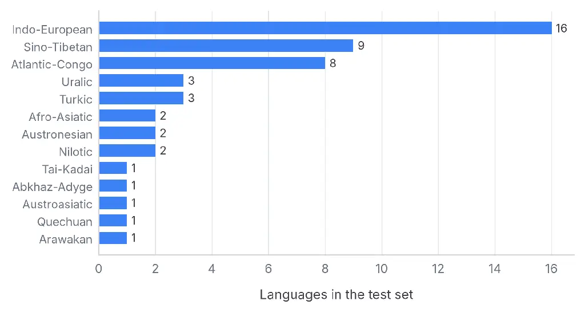

Figure 1: The test set’s languages by language family.

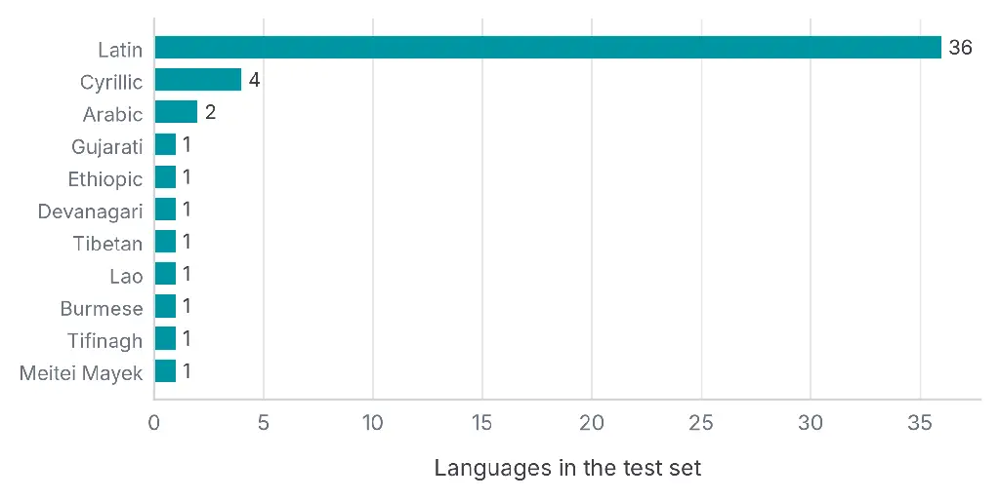

Figure 2: The test set’s languages by writing system.

###   3.2  The training set

Common Voice 22 (Ardila et al., 2019; Mozilla, 2025) was the first
candidate, and it does not cover the study: of its 137 locales only 13
are among our 50 languages, so 37 have nothing there. Training data
therefore comes from the corpus the test set was cut from, under the
rules of Figure 3; Section 10 adds Common Voice as a comparison.

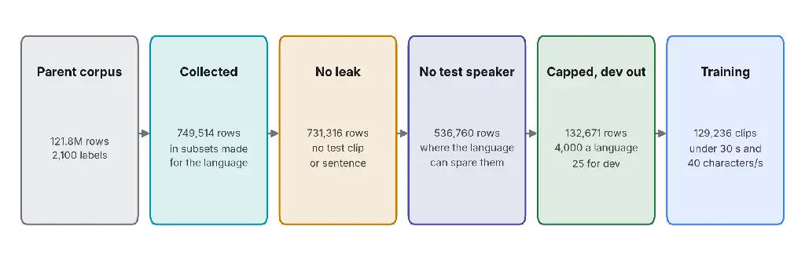

Figure 3: From the parent corpus to the training set. A test or dev
clip’s text leaves training in every subset, since Bible corpora and
augmented copies repeat their sentences. No test clip, test sentence or
identical decoded audio remains in training or dev; a script checks all
three.

That leaves 129,236 clips and 279 hours from 27,206 speakers (Figure 4).
In 45 languages no test speaker is in training. The other 5 (Crimean
Tatar, Goan Konkani, Gurani, Meitei and Wayuu) have no other speakers to
train on. Dev has 1,250 clips, 25 a language, gated on audio length as
the test set was: some corpora pair a long sentence with a second of
audio. It takes each language’s smallest speakers first, because they
cost training least, which makes it harder than test (Section 14).
Within a language, speakers take turns in the order of the clips, so a
smaller training set is always a prefix of a larger one. The main runs
use at most 1,000 clips a language: 42,816 clips and 82 hours in all.
Fetching the test clips again through the code that fetched the training
audio returns the same samples for all 1,250, and a training clip’s
audio and its speech tokens, which the parent corpus keeps in separate
archives, agree on length to within 20% on all but 1 of the 125,984
clips that have tokens.

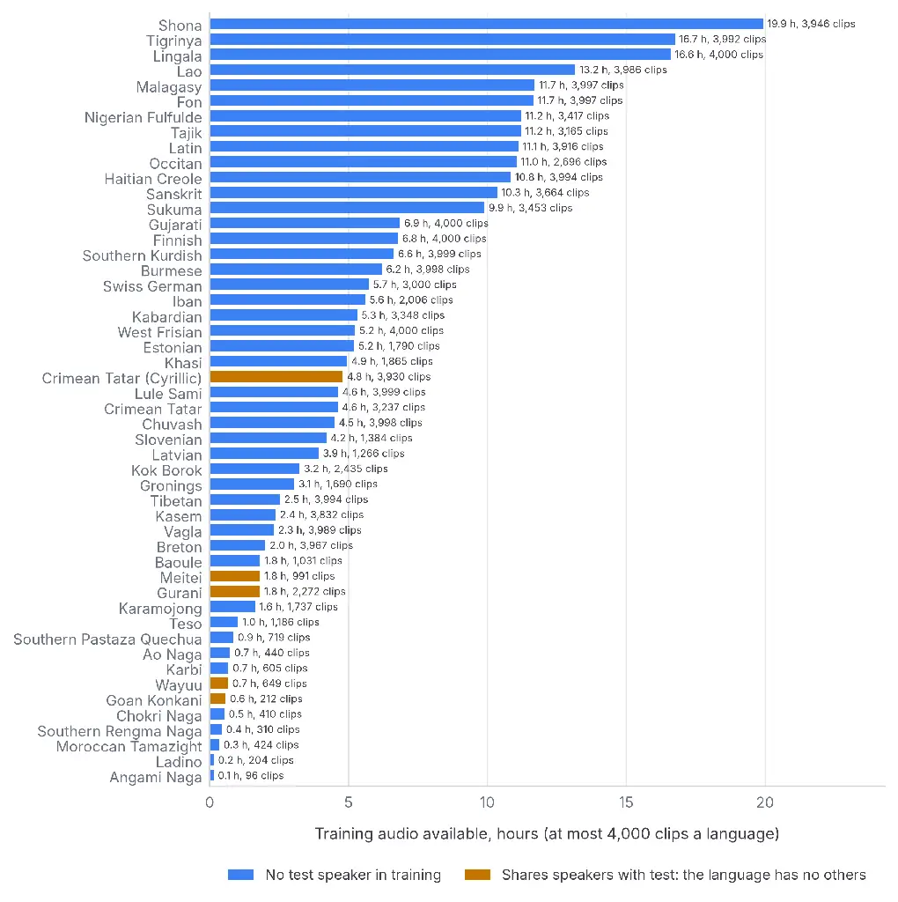

Figure 4: Training audio per language, after every rule of Figure 3.

###   3.3  The metric

The headline is the macro character error rate: the CER of each language
over its 25 clips, then the mean over languages, so that each language
counts once. Text is normalised the same way for every model (NFKC,
lower case, punctuation and symbols removed, combining marks kept).
Characters are the fair unit because 11 writing systems do not agree on
what a word is; WER is reported beside it.

We cap each clip’s errors at its own length. A decoder stuck in a loop
then counts as a complete failure of that clip, not as twenty failures.
Without the cap, a few loops moved a language by tens of points from one
epoch to the next and hid everything else (Appendix A). Intervals
resample speakers within each language, because one speaker’s clips are
not independent; they take the 50 languages as given, and Section 6.4
draws the languages again.

## 4Models

The study’s one criterion for a model is that it is multilingual by its
own card. We read the 400 most-downloaded speech recognition
repositories on Hugging Face on the day of the study, removed
conversions, quantisations, third-party fine-tunes and single-language
models, and kept what runs in current Transformers or its own open
package (Table 1). Between them they cover the families of decoder in
use today. Two general assistants are not on that list, because the Hub
files them under other tasks, and were added for comparison: Gemma 4, in
the three sizes that take audio, and LFM3-Audio.

MODEL DECODER PARAMETERS LANGUAGES LISTED FINE-TUNED HERE LICENCE
Whisper large-v3 seq2seq 1.54B 99 yes Apache-2.0 Whisper large-v3-turbo
seq2seq 0.81B 99 yes MIT Whisper large-v2 seq2seq 1.54B 99 yes
Apache-2.0 Whisper medium seq2seq 0.76B 99 yes Apache-2.0 Whisper small
seq2seq 0.24B 99 yes Apache-2.0 Whisper base seq2seq 0.07B 99 yes
Apache-2.0 Whisper tiny seq2seq 0.04B 99 yes Apache-2.0 Qwen3-ASR 1.7B
language model 2.04B 30 yes Apache-2.0 Qwen3-ASR 0.6B language model
0.78B 30 yes Apache-2.0 Nemotron 3.5 Transcribe 30B language model
32.36B 40 yes OpenMDW-1.1 Parakeet TDT 0.6B v3 transducer 0.63B 25 yes
CC-BY-4.0 Nemotron 3.5 streaming 0.6B transducer 0.64B 40 yes
OpenMDW-1.1 Canary 1B v2 seq2seq 0.96B 25 no CC-BY-4.0 w2v-BERT 2.0 CTC
0.58B 143 yes MIT MMS 1B, a head per language CTC 0.96B 1,198 yes
CC-BY-NC-4.0 omniASR CTC 300M CTC 0.33B 1,600+ yes Apache-2.0 omniASR
CTC 1B CTC 0.98B 1,600+ yes Apache-2.0 omniASR CTC 7B CTC 6.50B 1,600+
yes Apache-2.0 omniASR LLM 1B language model 2.28B 1,600+ no Apache-2.0
Voxtral Mini 3B language model 4.68B 8 yes Apache-2.0 Granite Speech 5.0
2B language model 2.31B 6 yes Apache-2.0 Granite Speech 5.0 470M CTC
0.47B 7 no Apache-2.0 Fun-ASR Nano language model 0.83B 4 no Apache-2.0
VibeVoice-ASR language model 8.33B 50+ no MIT Cohere Transcribe 2B
seq2seq 2.07B 14 yes Apache-2.0 LFM3-Audio 2B language model 1.98B 18
yes LFM Open v1.0 Gemma 4 E2B language model 5.10B 35+ yes Apache-2.0
Gemma 4 E4B language model 7.94B 35+ yes Apache-2.0 Gemma 4 12B language
model 11.96B 35+ yes Apache-2.0

Table 1: The models. Languages listed is what each card says it
transcribes; w2v-BERT 2.0 is a self-supervised encoder pretrained on
that many languages, without a transcription head. MMS as downloaded
swaps in an adapter and a head for the language it is told; fine-tuned
here, it has one head for all 50. Gemma 4’s parameters are the stored
ones; its card counts E2B and E4B as 2.3B and 4.5B effective, without
the token tables each layer looks up.

A model cannot fine-tune on a language until it can accept the language
and spell it, and each family needs something different (Figure 5).
Models with a language model or a byte-level vocabulary can write any
script already. The transducers cannot: 10 of our languages are mostly
outside Parakeet’s vocabulary and 7 outside Nemotron’s. We add a row per
missing character and keep every pretrained weight (NVIDIA, 2026a). MMS
as downloaded is different again: a small adapter in every layer and a
head for each of its languages, swapped in for the language the user
names. We load its English adapter once, replace the heads with one head
for all 50 languages and train every weight, so the fine-tuned MMS, like
the other CTC models, has one head and is never told the language.

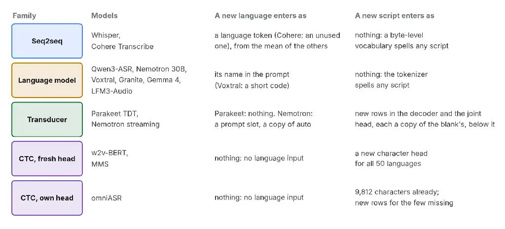

Figure 5: What each family needs before it can fine-tune on a language
it does not know. Every pretrained weight is kept in every family,
except MMS’s CTC heads, which are replaced; w2v-BERT comes without one.

A new row has to start silent, so that the untrained extension is still
the pretrained model, and that took two attempts. Zero weights and a
bias below every pretrained row is the obvious start, and it is not
silent: this head’s logits sink far below its biases, so the constant
wins most frames. Untrained, Parakeet repeated its first new character
on 221 of the 1,250 test clips and Nemotron on 1,149. A row that starts
as a copy of the blank’s, ten below it, cannot win a frame, because it
is below the blank whatever the frame holds. With that start the
untrained model’s output is the pretrained model’s on 1,208 of those
clips for Parakeet and 1,250 for Nemotron. Section 7.4 follows both
starts through training.

## 5Untouched

As downloaded, a language on a model’s own list is forced; any other is
left to the model, as a user would have to, since it cannot be told
about a language it was never trained on (Canary and Cohere Transcribe
have no detection, so they get English). Gemma 4 is the exception: its
card lists no languages for speech and the prompt it gives for
transcription takes any language’s name, so it is told every language.

Models that list up to a hundred languages sit at a macro CER of 50.3 to
84.9 (Figure 6): they write something, often in another script
(Section 7). Gemma 4’s two sizes with an audio encoder are lower, at
39.8 to 43.5, and the name is part of that: with no language in the
prompt they score 47.7 to 52.2, 7.9 to 8.7 points worse. Its 12B, which
reads the waveform with no encoder, is at 72.9, and at 75.8 with no
language in the prompt: on English, Spanish, French and German it scores
2.2, but a language it has not heard it writes as one it has, Finnish as
Arabic or Spanish, Gujarati in Hindi’s script. The two systems built for
the long tail are far ahead: omniASR at 27.8 to 31.5 on all 50, and MMS
at 14.7 on the 26 languages it has a head for. On the rest, MMS cannot
detect a language any more than Canary can, so it gets English’s adapter
and head, and over all 50 it scores 30.6. MMS was trained on readings of
religious texts (Pratap et al., 2023), and some of our languages’ clips
are the same kind of reading. Appendix A shows why the cap is there and
has every score with and without it.

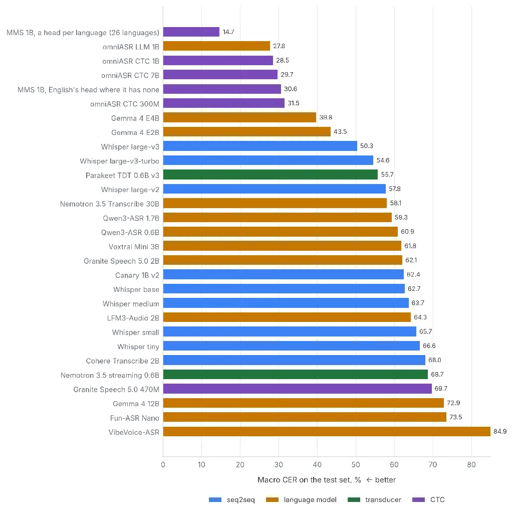

Figure 6: Every model as it was downloaded, before any fine-tuning, on
the test set. Mean over 50 languages unless stated; the fine-tuned
scores are in Section 6.2. Gemma 4 is told every language’s name, the
others only the languages they list.

## 6Fine-tuning

###   6.1  The recipe

Every model trains the same way: AdamW with weight decay 0.01, its
pretrained weights in 32-bit floats under bf16 autocast, a learning rate
chosen for it on dev (Appendix C), a warm-up of 200 steps and then a
constant rate, gradient clipping at 1, and greedy decoding. All 50
languages train together on at most 1,000 clips each, 82 hours in all,
for ten epochs, except Whisper large-v2 (5), Voxtral (4), Nemotron 30B
(4), Gemma 4 E2B (5), Gemma 4 E4B (5) and Gemma 4 12B (4). After every
epoch we score dev and test; dev alone chooses the epoch. The targets
are the corpus’s transcripts with their case and punctuation, except for
the CTC models below. Every pretrained weight a transcript runs is kept
and trains, with three exceptions: Nemotron 30B’s first run freezes most
of the model, Gemma 4’s token tables for each layer stay frozen, and
MMS’s heads are replaced. Figure 7 shows what happens to each part of
each family, and the paragraphs below go through them.

Whisper. Encoder and decoder train together, cross-attention included,
and nothing is frozen. Its byte-level vocabulary already spells every
script, so the one addition is a language token for each of the 33
languages Whisper has none for, started at the mean of its language
tokens; the other 17 keep their own. The token goes where Whisper
expects one, after the start-of-transcript token, and the loss counts
only the transcript and the end token. Whisper’s output layer is its
token table, so a new token is also a new output.

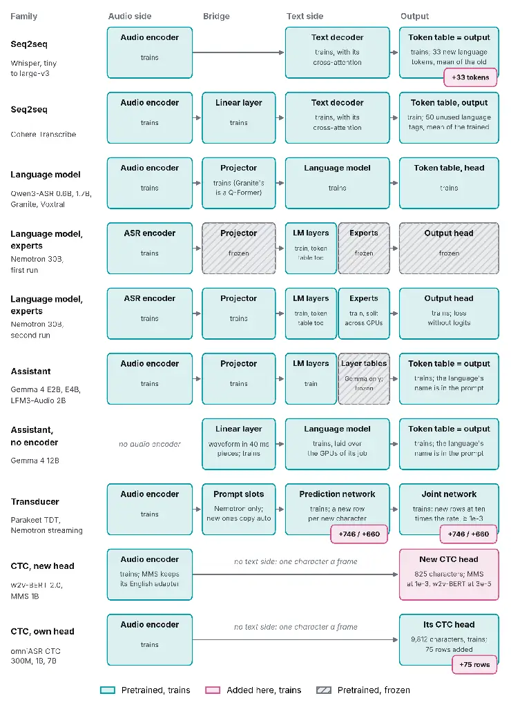

Figure 7: What the recipe does to each part of each family. Nemotron 30B
ran twice: first with its experts, projector and output head frozen,
then with every part training. A pink badge is what fine-tuning adds to
a pretrained part; on the transducers it is Parakeet’s count of new
rows, then Nemotron streaming’s.

Cohere Transcribe. The other seq2seq model is a Conformer encoder of
1.90B parameters under a small Transformer decoder, trained from scratch
on 14 languages, none of them ours (Mack et al., 2026). It trains whole,
and its SentencePiece vocabulary falls back to bytes, so it spells every
script and nothing is added. Its prompt names the language with a tag,
and its table holds tags that were never trained: 21 of our languages
take the tag of their two-letter code and the other 29 a spare token,
each started at the mean of the 14 trained tags, as a new Whisper token
is. Its output layer is not tied to the token table, so the two train
side by side.

Language-model decoders. Qwen3-ASR, Granite and Voxtral train whole: the
audio encoder, the projector that carries its output into the language
model (a Q-Former in Granite), the language model and its output head.
Their tokenizers spell every script, so nothing is added. The language
enters as text in the prompt, its name for Qwen3-ASR and Granite and a
short code for Voxtral, and the loss counts only the transcript.
Nemotron 30B is a mixture of experts, and its first run trains only part
of it: its 29.8B expert weights stay frozen in bf16, with the output
head, the parts that transcription never runs (speaker diarisation, word
timings) and the 3.4M-parameter projector. Its ASR encoder and every
language-model weight outside the experts train in fp32: 2.02B
parameters, 6% of the model (Figure 8). Our freezing rule matched names,
and it was meant to train the projector and freeze the token table; it
did the reverse for both. A second run trains every weight that
transcription uses, 32.2B: the experts split across GPUs by expert
parallelism, everything else sharded with FSDP2, and the loss computed
without the logits by a fused cross-entropy in fp32 (Scicom AI
Enterprise Organization, 2026) after Cut Cross-Entropy (Wijmans et al., 2024) (Figure 9). Dev prefers it, so it is Nemotron 30B’s main run from
here on: at epoch 2 of four it scores 15.8 on the test set, 0.2 points
below the first run at its epoch 3 (-0.2 to 0.6). Section 6.8 trains its
parts one at a time. Voxtral and Nemotron 30B’s first run train with
gradient checkpointing.

General assistants. Gemma 4 and LFM3-Audio are chat models that
transcribe when asked (Gemma Team, 2026; Liquid AI, 2026). Each gets the
prompt its card gives for speech recognition, with the language’s name
in it, and nothing is added: their tokenizers spell every script. The
loss counts the transcript and the token that ends the turn. The parts a
transcript never runs stay frozen, Gemma’s vision parts and LFM3-Audio’s
speech output. Gemma E2B and E4B also keep a token table for every
layer, 2.35B and 2.82B parameters, 46% and 35% of what is stored. They
are lookups, Google counts the models without them, and we leave them
frozen, so 2.59B and 4.95B train (Figure 8). Gemma 12B has no audio
encoder: a linear layer hands the waveform to the language model in 40
ms pieces, and all 11.91B of it train, laid layer by layer over the GPUs
of its job. It and E4B train with gradient checkpointing.

Transducers. Parakeet and Nemotron streaming train whole. Their
SentencePiece vocabularies come from their own languages, so every
character the training transcripts need and the vocabulary lacks gets a
new row in the prediction network’s embedding and in the joint network’s
output: 746 for Parakeet, 660 for Nemotron streaming. The rows start
silent (Section 4) and train without weight decay at ten times the
model’s rate and at least 1e-3, 3e-3 for Parakeet and 1e-3 for Nemotron
streaming. Parakeet has no language input. Nemotron streaming takes the
language as a one-hot prompt slot, and a language it does not list gets
an unused slot that starts as a copy of its “auto” slot. They train on
the TDT and the RNN-T loss.

CTC models. A CTC model has no decoder: its head writes a character or a
blank for every frame of the encoder’s output. w2v-BERT 2.0 comes
without a head and MMS’s heads belong to its own languages (Section 4),
so each gets a new linear head over the 825 characters of the training
transcripts. For these two the transcripts are lower-cased and stripped
of punctuation, as is usual for a CTC head with no language model to put
them back. The encoder trains with the head, every weight of it, MMS’s
English adapter included. MMS’s head trains at 1e-3. w2v-BERT’s sits
behind a LayerNorm, because the encoder’s output is so small that a
plain new head stayed on the blank, and trains at the encoder’s rate.
omniASR keeps its own head of 9,812 characters and adds a row for each
of the 75 it lacks, all at the model’s rate. Every model is scored on
the same normalised text (Section 3.3), so case and punctuation never
count.

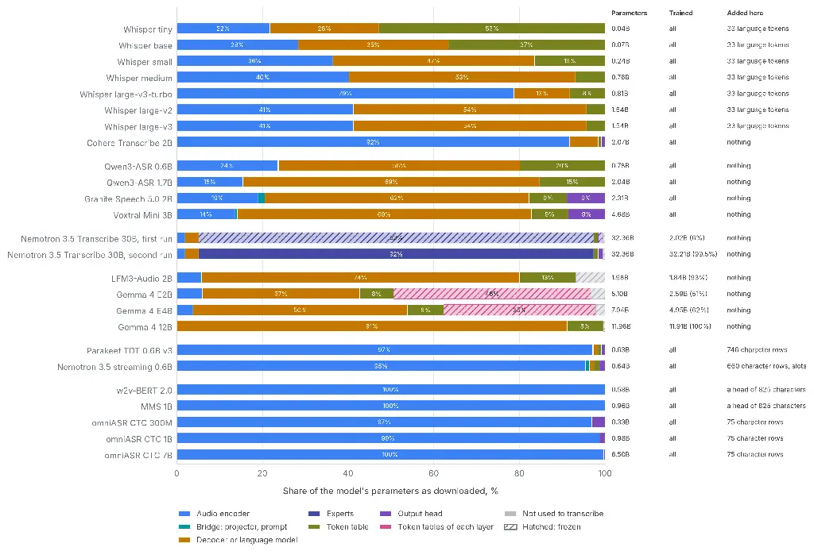

Figure 8: Every fine-tuned model’s parameters by part, as a share of the
model as downloaded; hatched parts stay frozen. Nemotron 30B’s second
run trains every part but those transcription never runs. Trained is
what fine-tuning updates; added here is what it adds.

We add no augmentation of our own. Each model keeps the dropout and
layer drop its own configuration switches on in training, and MMS’s
configuration also masks 5% of the encoder’s frames in spans of 10, a
form of SpecAugment (Table 2). A batch holds a fixed amount of padded
audio, or a fixed number of clips for Whisper and Voxtral, whose
encoders take 30-second windows.

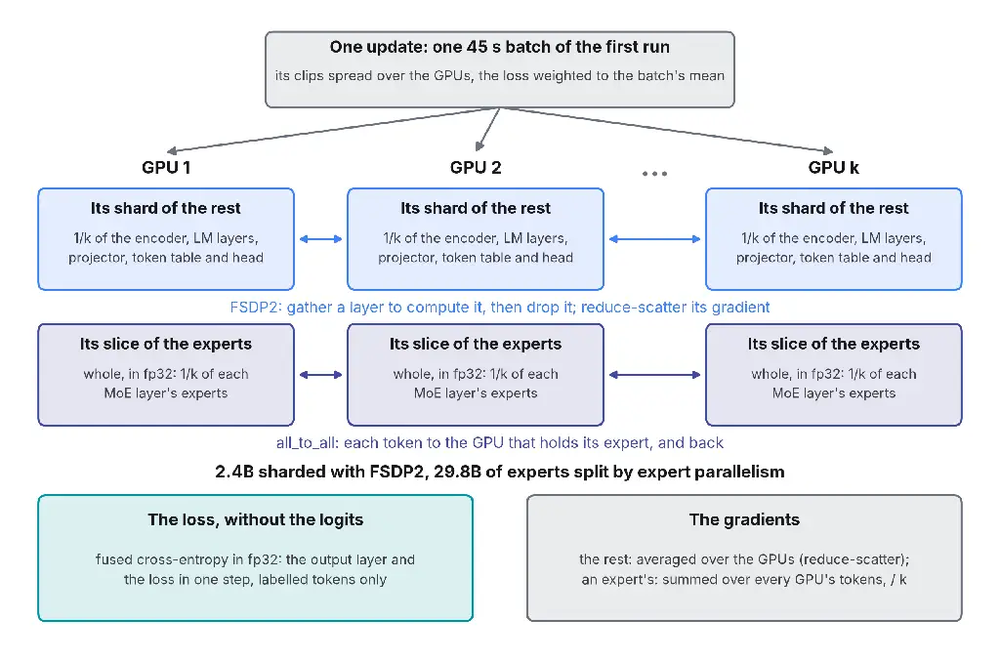

Figure 9: Nemotron 30B’s second run on the GPUs of one job: the experts
split by expert parallelism, everything else sharded by FSDP2, and the
loss computed without the logits (Scicom AI Enterprise Organization,
2026). Each update is the first run’s: the same batch, its clips spread
over the GPUs.

MODEL RATE ADDED, ITS RATE LANGUAGE INPUT BATCH ITS OWN CONFIGURATION
Whisper tiny 1e-4 33 language tokens language token 64 clips none
Whisper base 1e-4 33 language tokens language token 64 clips none
Whisper small 3e-5 33 language tokens language token 48 clips none
Whisper medium 1e-5 33 language tokens language token 32 clips none
Whisper large-v3-turbo 1e-5 33 language tokens language token 24 clips
none Whisper large-v2 1e-5 33 language tokens language token 24 clips
none Whisper large-v3 1e-5 33 language tokens language token 24 clips
none Cohere Transcribe 2B 3e-5 none (50 unused tags) language token 180
s none Qwen3-ASR 0.6B 1e-5 – name in prompt 240 s none Qwen3-ASR 1.7B
1e-5 – name in prompt 180 s none Granite Speech 5.0 2B 1e-5 – name in
prompt 90 s dropout 0.1 Voxtral Mini 3B 3e-6 – code in prompt 8 clips
none Nemotron 3.5 Transcribe 30B 1e-5 – name in instruction 45 s dropout
0.1 LFM3-Audio 2B 1e-5 – name in prompt 180 s none Gemma 4 E2B 1e-5 –
name in prompt 90 s none Gemma 4 E4B 3e-6 – name in prompt 60 s none
Gemma 4 12B 3e-6 – name in prompt 60 s none Parakeet TDT 0.6B v3 3e-4
746 character rows, 3e-3 – 240 s dropout 0.1, layer drop 0.1 Nemotron
3.5 streaming 0.6B 1e-4 660 character rows, 1e-3; slots prompt slot 240
s dropout 0.1, layer drop 0.1 w2v-BERT 2.0 3e-5 head of 825 characters +
LayerNorm, 3e-5 – 240 s dropout 0.1, layer drop 0.1 MMS 1B 1e-5 head of
825 characters, 1e-3 – 240 s dropout 0.05, layer drop 0.05, masking 5%
in spans of 10 omniASR CTC 300M 3e-5 75 character rows – 240 s dropout
0.1, layer drop 0.1 omniASR CTC 1B 3e-5 75 character rows – 240 s
dropout 0.1, layer drop 0.1 omniASR CTC 7B 1e-5 75 character rows – 20 s
$`\times`$ 6 dropout 0.1, layer drop 0.1

Table 2: What each fine-tuned model trains with. Rate is the model’s
own, chosen on dev (Appendix C). Added is what the training set needed
and the model lacked; it trains at the model’s rate unless another is
given. Batch is clips, or seconds of padded audio. The last column is
the dropout, layer drop and masking the model’s own configuration
switches on in training; we add nothing.

###   6.2  Before and after

Table 3 and Figure 10 are the paper’s main result, the 21 models
fine-tuned with the main recipe.

MODEL PARAMETERS UNTOUCHED FINE-TUNED 95% CI WER BEST EPOCH RATE HOURS /
EPOCH MMS 1B 0.97B 30.6 11.0 10.6–11.6 39.3 10 of 10 1e-5 0.52 omniASR
CTC 1B 0.98B 28.5 12.0 11.5–12.6 43.1 7 of 10 3e-5 0.51 w2v-BERT 2.0
0.58B – 12.7 12.3–13.3 44.9 9 of 10 3e-5 0.30 Whisper large-v3 1.54B
50.3 13.5 13.0–14.2 41.5 8 of 10 1e-5 1.11 Whisper large-v2 1.54B 57.8
14.2 13.7–14.9 43.2 4 of 5 1e-5 1.09 Whisper large-v3-turbo 0.81B 54.6
14.3 13.6–15.1 43.0 9 of 10 1e-5 0.82 Whisper medium 0.76B 63.7 14.8
14.2–15.5 45.0 10 of 10 1e-5 0.59 Cohere Transcribe 2B 2.07B 68.0 15.6
15.0–16.3 45.8 10 of 10 3e-5 0.34 Nemotron 3.5 Transcribe 30B 32.36B
58.1 15.8 15.2–16.5 45.3 2 of 4 1e-5 – Voxtral Mini 3B 4.68B 61.8 16.3
15.7–17.1 45.7 3 of 4 3e-6 2.93 Gemma 4 E4B 7.94B 39.8 16.6 16.0–17.3
47.1 2 of 5 3e-6 1.90 Qwen3-ASR 1.7B 2.04B 59.3 16.6 16.0–17.3 47.9 4 of
10 1e-5 0.47 Whisper small 0.24B 65.7 16.9 16.4–17.6 49.2 9 of 10 3e-5
0.20 LFM3-Audio 2B 1.98B 64.3 17.8 17.2–18.6 48.7 3 of 10 1e-5 0.44
Qwen3-ASR 0.6B 0.78B 60.9 18.2 17.5–18.9 51.9 4 of 10 1e-5 0.26 Gemma 4
E2B 5.10B 43.5 18.5 17.8–19.4 49.2 5 of 5 1e-5 0.81 Gemma 4 12B 11.96B
72.9 19.8 19.1–20.6 51.8 2 of 4 3e-6 4.03 Parakeet TDT 0.6B v3 0.63B
55.7 21.0 20.2–21.9 52.6 9 of 10 3e-4 0.80 Granite Speech 5.0 2B 2.31B
62.1 22.5 21.8–23.4 58.1 7 of 10 1e-5 0.68 Whisper tiny 0.04B 66.6 25.7
24.9–26.5 63.9 5 of 10 1e-4 0.04 Nemotron 3.5 streaming 0.6B 0.64B 68.7
35.9 35.3–36.5 78.2 10 of 10 1e-4 0.35

Table 3: The main runs, best first. CER and WER on the test set at the
epoch dev chose, capped per clip, macro over 50 languages. Hours are for
one training epoch. Dev also chose how the transducers’ new rows start
(Section 7.4): for Parakeet, a copy of the blank’s row, ten below it, at
3e-4 rather than 1e-4; for Nemotron streaming, the first start.

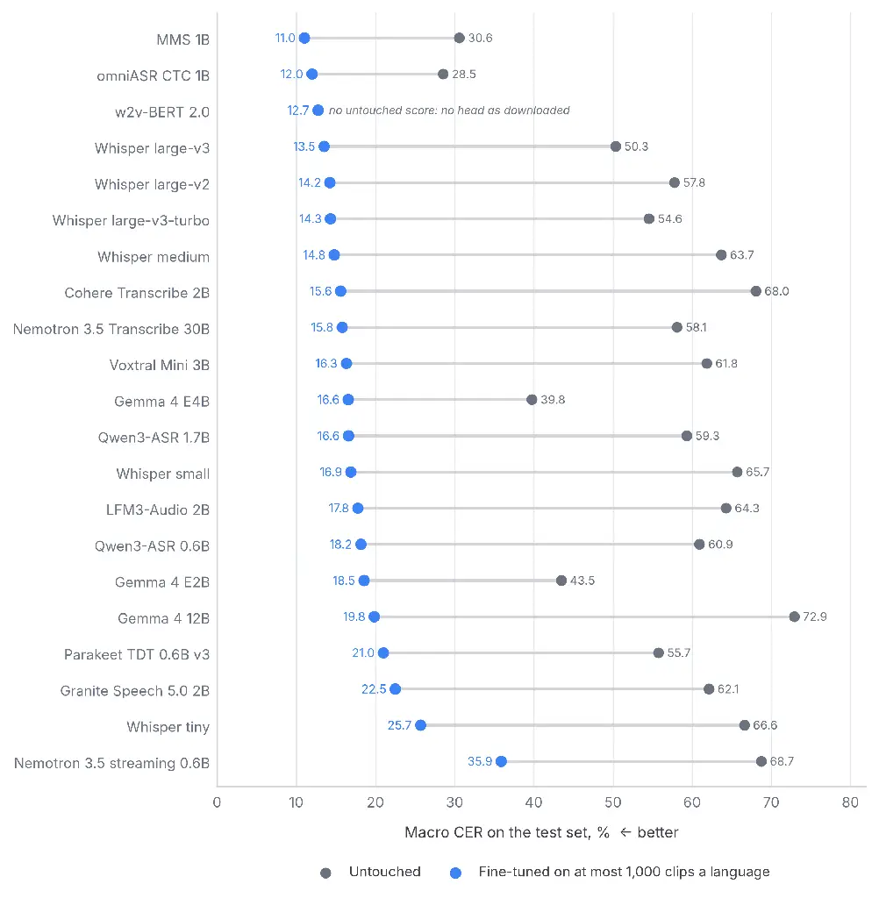

Figure 10: Every model before and after fine-tuning on at most 1,000
clips a language, 50 languages together. The epoch is the one dev chose.
MMS untouched uses its own adapter and head for each language that has
one and English’s for the rest (Section 5); w2v-BERT has no head as
downloaded, so no untouched score.

The rest of Figure 6 is 5 models we only scored as downloaded (Canary 1B
v2, omniASR LLM 1B, Granite Speech 5.0 470M, Fun-ASR Nano and
VibeVoice-ASR) and the three extra sizes trained for Section 6.7,
Whisper base and omniASR CTC 300M and 7B. Every model gains, by 16.6 to
53.1 points of macro CER, and the best reaches 11.0 (MMS 1B); omniASR
CTC 7B, trained with the same recipe for Section 6.7, goes lower still,
to 9.5. Another seed moves little: the 5 models we trained again, 10
times in all, land within 0.4 points of their scores here (some draws
are the first ten epochs of the long runs in Section 8). The first three
keep their order on every seed: over 3 seeds each, MMS scores 11.0 to
11.3, omniASR CTC 1B 11.6 to 12.0 and w2v-BERT 12.4 to 12.8. A language
has about 98 minutes of speech on average, trained alongside 49 others,
and that takes a recogniser that could not write it to one that gets 89%
of its characters right. Words are harder: the lowest WER among them is
39.3 (MMS 1B) and omniASR CTC 7B’s 35.2, so this is a draft to correct,
not a transcript. Figure 11 shows what such numbers look like on the
page: for six languages, from easy to hard, the clip at the median of
the language’s errors.

The yardstick is MMS as downloaded, with an adapter and a head for each
language it knows, built for the long tail and trained on far more of
it. On the 26 of our languages it has a head for it scores 14.7 as
downloaded. On those same languages, fine-tuned on this small set, 5
models do better: MMS 1B at 10.0, omniASR CTC 1B at 11.1, w2v-BERT 2.0
at 12.5, Whisper large-v3 at 13.8 and Whisper large-v2 at 14.5. MMS 1B
in that list is the same model with its heads replaced by one trained on
this set and never told the language, so on this test set a little
speech from the test’s own corpora does more for MMS than its own
training data, mostly readings of religious texts. Fine-tuning a general
model on a little of a language does as well as a model built for that
language. Section 7.6 takes the other side of the same question, the 12
languages that neither MMS nor any other model here lists.

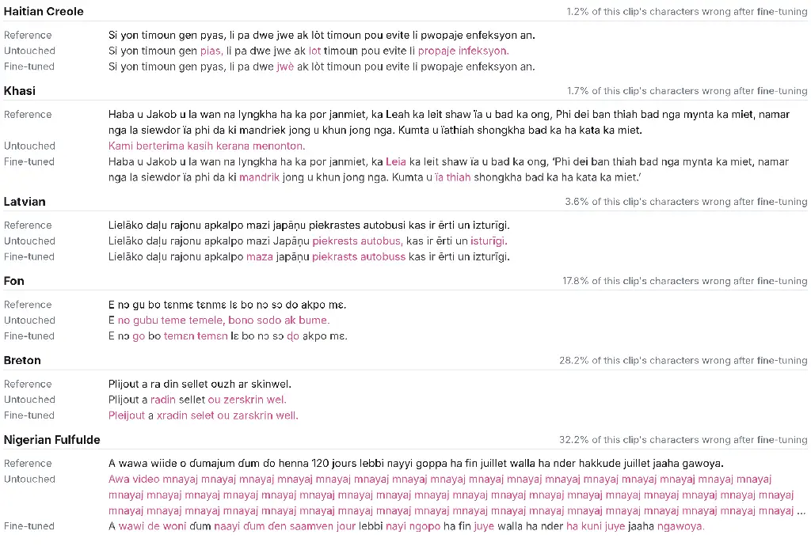

Figure 11: Whisper large-v3, untouched and fine-tuned, on one clip of
each of six Latin-script languages of the public test set: the clip at
the median of the language’s errors after fine-tuning, so nobody chose a
flattering one. Words that differ from the reference are in pink,
punctuation and case aside. Long clips are cut at three lines.

###   6.3  By decoder

Grouped by decoder, the same runs fall in a clear order (Figure 12): CTC
at a median of 12.0, seq2seq at 14.8, the language-model decoders at
17.8 and the transducers at 28.4. Every CTC model is ahead of every
other model; the closest pair, w2v-BERT 2.0 and Whisper large-v3, is 0.8
points apart (0.4 to 1.2 on resampled speakers; Section 6.4 draws the
languages again too). Size does not explain the order: it is the same
among the models of 0.58B to 0.81B parameters, where every decoder has
one. The general assistants, Gemma 4 and LFM3-Audio, were not built to
transcribe, and they end at 16.6 to 19.8, inside the 15.8 to 22.5 of the
language-model decoders made for speech.

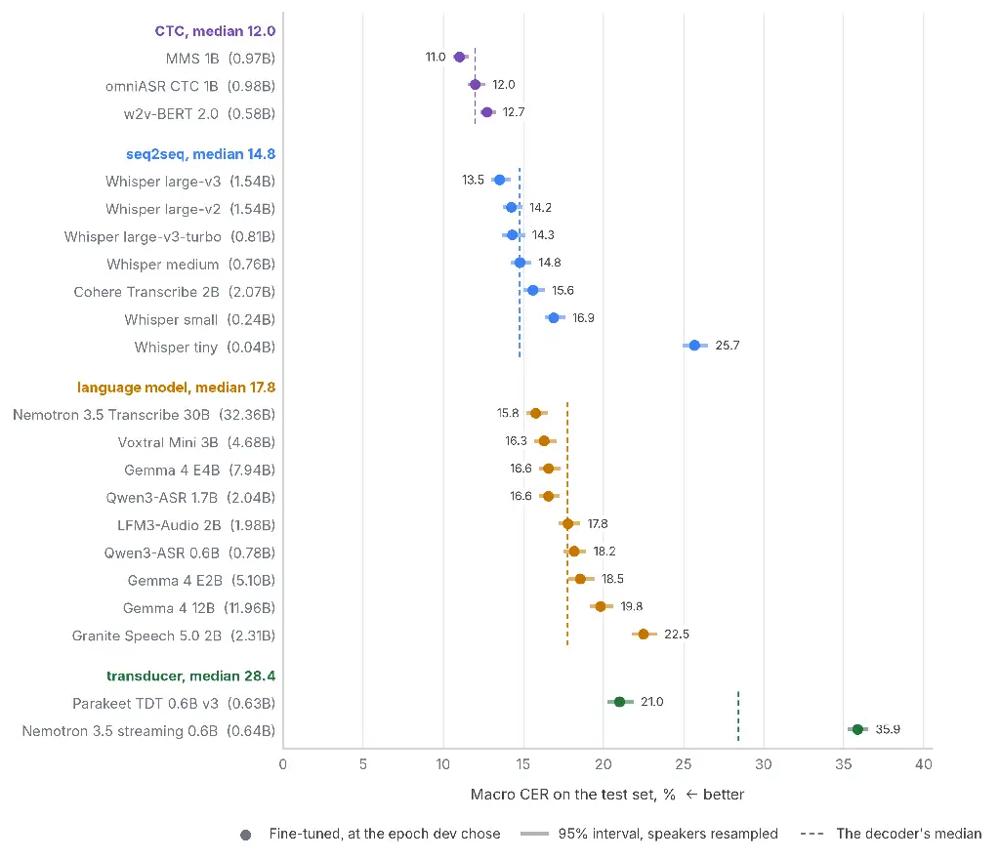

Figure 12: The main runs of Table 3 grouped by decoder, best first
within each: macro CER on the test set at the epoch dev chose, with its
95% interval. Parameters are beside each name.

The decoder is not all that differs, so this ranks the models as they
come rather than testing the decoders. The CTC models are also the three
whose cards list the most languages, 143 to 1,600+ against at most 99
for the rest, though they still lead, by less, on the 12 languages that
none of them lists (Section 7.6). The transducers trail on the Latin
script too and fall furthest behind outside it (Section 7.3), where the
rows we add have no pretrained letter behind them. The one pair built on
the same pretrained encoder with different decoders, omniASR’s CTC 1B
and LLM 1B, scores 28.5 and 27.8 untouched, which suggests the encoder
sets the order more than the decoder does; only the CTC variant was
fine-tuned here, so the same test after training is still open.

###   6.4  How firm the order is

Every interval so far draws the speakers again and keeps the 50
languages, so it says how firm a difference is on these languages.
Whether it would hold on another fifty is a second question, and
Figure 13 asks both. It draws the test set again 5,000 times, the
speakers alone and then the languages with their speakers, and counts
how often the better model of each pair stays ahead.

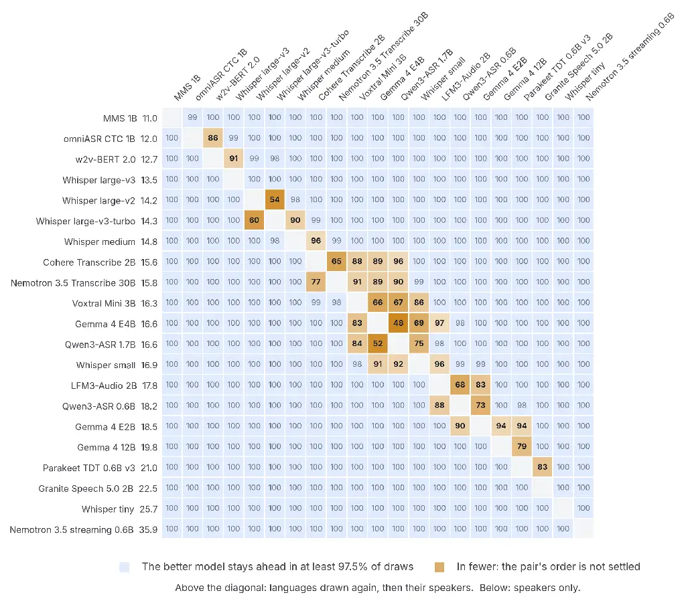

Figure 13: The main runs of Table 3, best first, with their macro CER.
Each cell is a pair of models: the percentage of 5,000 draws of the test
set in which the one ahead on the test set stays ahead. Below the
diagonal a draw resamples the speakers inside each language, as the
paper’s intervals do; above it, the 50 languages are resampled first.

With the speakers alone, 201 of the 210 pairs keep their order in at
least 97.5% of the draws; with the languages drawn too, 183. The pairs
that come loose are never more than 4 places apart, and MMS 1B is first
in 99% of the draws. One of them is the pair Section 6.3 rests on:
w2v-BERT 2.0 stays ahead of Whisper large-v3 in 91% of the draws (a
difference of -0.5 to 1.9), so on another fifty languages a Whisper may
well pass the last CTC model.

###   6.5  Told the language

Before any training a model can already be told what it is listening to,
and Table 4 shows how little that does: the middle column has no
training at all. The name of a language in Qwen3-ASR 0.6B’s prompt is
worth 9.5 points, mostly the script: told the language, it writes the
Latin-script languages in Latin on 93% of clips instead of 82%, while
the other scripts barely move. The name is worth 6.8 points to
LFM3-Audio and 7.9 to 8.7 to Gemma 4’s two sizes with an audio encoder.
A new Whisper language token, the mean of the others, has little to say
yet, and Cohere Transcribe’s untrained tag, the mean of its fourteen,
does harm: 79.1 against 68.0 for the model told English. Telling is not
teaching: the right-hand column is where the gain is.

MODEL UNTOUCHED TOLD THE LANGUAGE, UNTRAINED FINE-TUNED Whisper large-v3
50.3 45.1 13.5 Whisper large-v3-turbo 54.6 49.1 14.3 Whisper large-v2
57.8 56.4 14.2 Whisper medium 63.7 76.4 14.8 Whisper small 65.7 61.9
16.9 Whisper tiny 66.6 60.9 25.7 Qwen3-ASR 1.7B 59.3 50.9 16.6 Qwen3-ASR
0.6B 60.9 51.5 18.2 Nemotron 3.5 Transcribe 30B 58.1 54.4 15.8 Voxtral
Mini 3B 61.8 57.3 16.3 Granite Speech 5.0 2B 62.1 62.6 22.5 Cohere
Transcribe 2B 68.0 79.1 15.6 LFM3-Audio 2B 64.3 57.5 17.8 Gemma 4 E2B
52.2^(†) 43.5 18.5 Gemma 4 E4B 47.7^(†) 39.8 16.6 Gemma 4 12B 75.8^(†)
72.9 19.8

Table 4: The test set’s macro CER with nothing trained, and after. The
middle column is the first evaluation of each main run: the language’s
name in the prompt, or a new language token for Whisper and Cohere
Transcribe. ^(†)Gemma 4 is told every language as downloaded
(Section 5), so its middle column is its untouched score and its first
the model with no language in the prompt.

###   6.6  Language by language

Some languages are almost solved (Figures 14 and 15), the five lowest
across any model being Haitian Creole (1), Khasi (2), Finnish (2),
Southern Pastaza Quechua (2), Estonian (3). Others resist every model,
the five highest being Tibetan (37), Nigerian Fulfulde (30), Breton
(25), Kok Borok (22), Lule Sami (20); the numbers are each language’s
best CER across all models. When every model fails on a language in the
same way, the cause is more likely to be that language’s data than the
models.

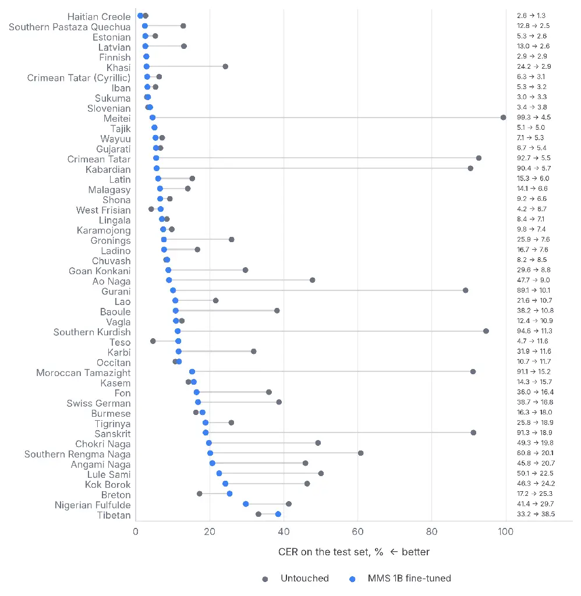

Figure 14: The strongest model of the main result, MMS 1B, language by
language, before and after.

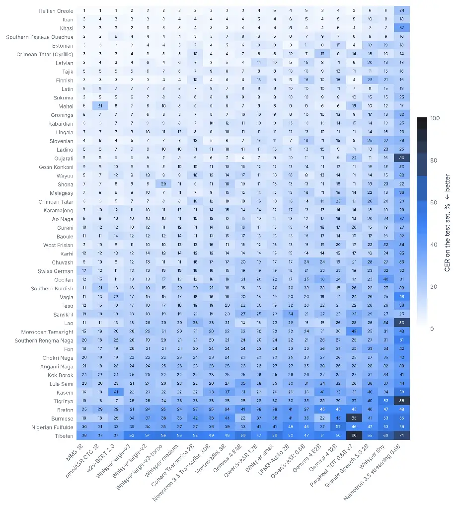

Figure 15: Every fine-tuned model on every language. A row that stays
dark is a language no model learns; a column that stays dark is a model
that cannot write that language’s script.

What goes with a hard language is how it was recorded more than how much
of it there is (Figure 16). By each language’s CER in the median model,
the half of the languages with more speakers in their training clips is
6.7 points harder than the half with fewer (1.7 to 12.1, languages
resampled), the half with shorter clips 7.4 harder than the half with
longer ones (2.4 to 12.7), and the 45 languages whose test speakers are
new 6.5 harder than the 5 whose test speakers also train (2.9 to 10.4).
A language read by a few voices in long clips is easy; one gathered from
many speakers a few seconds at a time is hard. The number of clips says
nothing (Spearman’s $`\rho`$ -0.09), and neither the script nor being on
no model’s list separates the languages by more than its interval.
Together the six properties leave 64% of the variance between languages
unexplained.

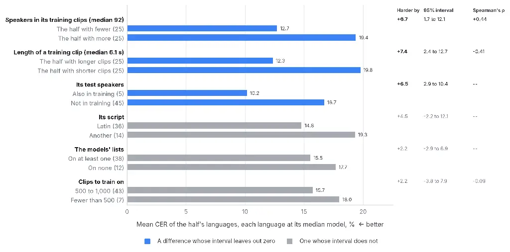

Figure 16: The 50 languages split in two by one property at a time, the
harder half second: the mean test CER of each half’s languages, each
language at its median over the main models. Harder by is the
difference, with an interval from resampling the languages; Spearman’s
$`\rho`$ is between the property, where it is a number, and the
language’s CER.

###   6.7  Model size

A larger model transfers more within a family of one design (Figure 17).
Whisper large-v3 ends 12.2 points below Whisper tiny, 8.8 of them
already at small, and Qwen3-ASR 1.7B is 1.6 below the 0.6B. omniASR CTC
1B is 1.3 below the 300M, and the 7B 2.4 below the 1B (2.2 to 2.7): at
9.5 it is the best model we trained, 1.5 points below MMS 1B (1.2 to
1.7). Size counts for more when data is short: on dev, each omniASR size
leads the one below it by 3.7 and 3.7 points on the sweep’s budget of
three epochs on 200 clips a language (Appendix C), and by 1.8 and 3.0
after the full recipe. A change of design can undo it: Gemma 4’s 12B,
which reads the waveform with no audio encoder, ends at 19.8, behind
both smaller sizes, which have one (18.5 and 16.6).

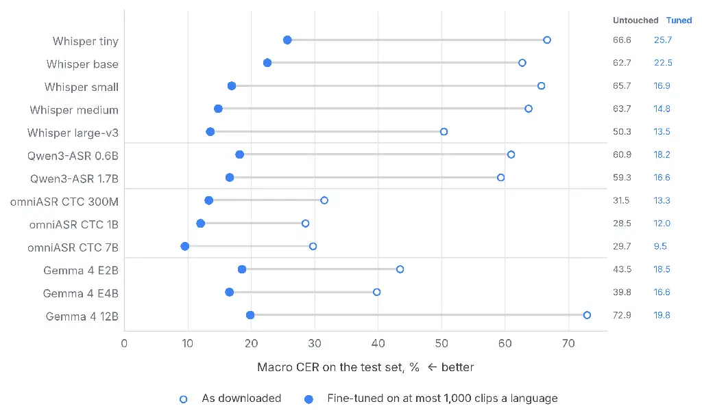

Figure 17: Four families by size, as downloaded and fine-tuned with the
same recipe. Macro CER on the test set at the epoch dev chose. Gemma 4’s
12B is its one size with no audio encoder.

###   6.8  Which weights train

Nemotron 3.5 Transcribe 30B is the one mixture of experts here, and its
routed experts are 29.4B of the 32.21B weights its second run trains. To
see which parts are worth training, we trained it 18 more ways beside
its two runs for 2 epochs, the second run’s recipe with some parts
frozen, on another seed, at another rate for all of it or for the
encoder alone, or with the rate falling to zero over the two epochs,
each scored at the epoch dev chooses (Figure 18).

The audio encoder has to train: freezing it costs 0.8 points with the
routed experts training (0.3 to 1.2) and 1.8 with them frozen (1.3 to
2.2). So does the language model, since the audio side alone ends 3.1
points behind (2.6 to 3.5). The projector does not matter: freezing it
moves a run by at most 0.2 points, while two seeds end 0.3 apart with
everything training and 0.2 with the routed experts frozen. Nor do the
routed experts much: freezing them costs 0.1 points (-0.3 to 0.5) and
leaves 2.84B weights to train, which need no expert parallelism. The
first run, which also froze the shared experts and the output head, ends
0.5 behind everything training (0.1 to 0.9), and the shared experts
account for it: freezing them with the routed ones costs 0.4 (0.0 to
0.8) and ends level with the first run (-0.4 to 0.4). A lower rate for
everything, 3e-6, ends 0.3 points below 1e-5 (-0.1 to 0.7), about as far
as two seeds end apart; with the routed experts frozen, 3e-6 ends 0.4
behind 1e-5 (0.0 to 0.7) and 3e-5 3.3 behind (2.8 to 3.7). The encoder
wants no faster a rate than the rest: at 3e-5 it ends 1.2 behind (0.9 to
1.5), at 1e-4 7.6.

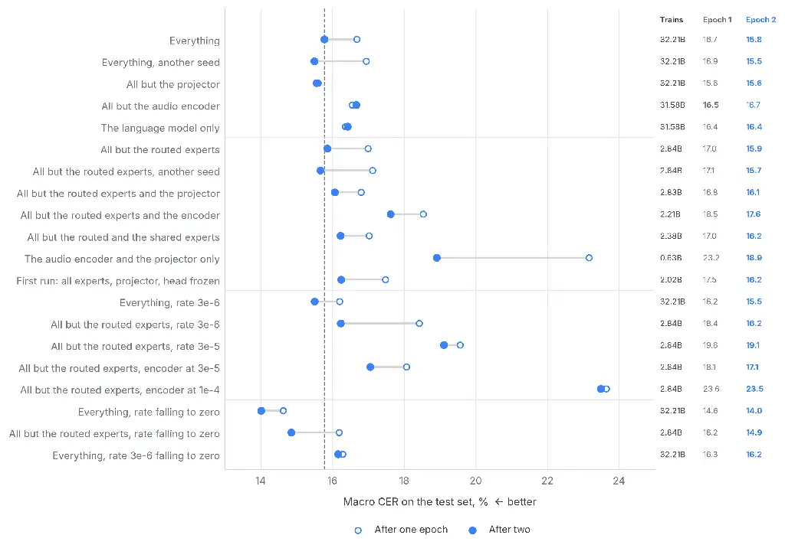

Figure 18: Nemotron 3.5 Transcribe 30B trained 2 epochs, part by part:
test macro CER after one epoch (hollow) and two (filled), the weights
each variant trains, and in bold the epoch dev chose. The rules separate
the variants that train the routed experts, those that keep them as
downloaded, those that change a rate, and those whose rate falls to zero
over the two epochs. The dashed line is everything training, after two
epochs.

The schedule gives what the parts do not: with the rate falling to zero
over the two epochs, as in Section 8, everything training ends 1.8
points lower than at a constant rate (1.4 to 2.1), at 14.0, and the run
with the routed experts frozen 1.0 lower (0.7 to 1.3), at 14.9: both
below every variant at a constant rate (the best of them 15.5). The
routed experts, worth 0.1 at a constant rate, are worth 0.8 once the
rate falls (0.5 to 1.1). The fall needs a high start: from 3e-6,
everything training ends 2.1 behind the fall from 1e-5 (1.8 to 2.5) and
0.7 behind 3e-6 held constant (0.3 to 1.0).

A longer fall does not help. Planned for four epochs instead of two,
everything training ends at 14.5 at the epoch dev chooses, its last, 0.4
behind the two-epoch run (0.2 to 0.8) and 1.3 below the main run, which
held the rate constant over its four (0.9 to 1.6). Two epochs with the
rate falling to zero are the best recipe we found for this model, at
14.0; the main result keeps the constant rate that every other model
trained at.

## 7What transfers

Studies that need many runs use a small model in place of a large one:
Whisper small, which trains an epoch in 0.20 hours against 0.82 for
large-v3-turbo, and Qwen3-ASR 0.6B rather than 1.7B. Whisper
large-v3-turbo repeats the studies of the next language (Section 7.8),
of training longer (Section 8) and of data size (Section 9) to check
that a larger model answers the same way.

###   7.1  Pretrained against random weights

The direct measure of transfer is the same architecture, on the same
data, without its pretraining (Figure 19). From random weights every
model ends 60 to 77 points behind its pretrained twin, and Parakeet
never stops looping: after 8 epochs, 1,145 of the 1,250 test clips still
loop. These runs had an untuned rate of 1e-4 and, but for Parakeet’s,
twice the main runs’ epochs, so a better recipe would close some of the
gap, though hardly much of it: 82 hours is far too little to learn
speech from nothing. Nearly everything a fine-tuned model gets right
here, it owes to pretraining on other languages.

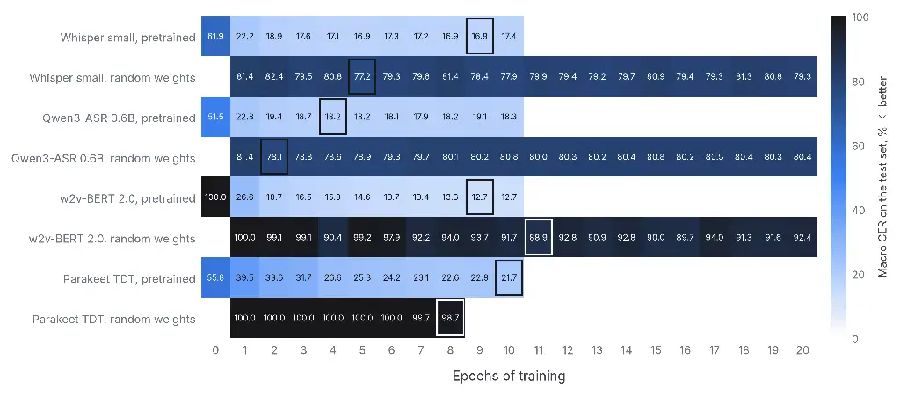

Figure 19: The same architecture and the same data, from pretrained and
from random weights, on the test set after every epoch. Epoch 0 is the
pretrained model before training, told the language where it can be
(Table 4); w2v-BERT’s head is new, so it starts at 100. A box marks the
epoch dev chose; blank cells were not run.

###   7.2  Encoder or decoder

To see which half carries the transfer, we freeze each half in turn for
six epochs, leaving only the rows a new character needs (Figure 20). On
a model whose decoder attends to all of the audio, either half alone
learns most of a new language: Qwen3-ASR 0.6B reaches 18.2 with
everything training, 21.0 with its encoder frozen and 19.6 with its
decoder frozen, and Whisper small behaves the same. So an encoder that
has never heard these languages already gives such a decoder most of
what it needs. Without such a decoder it is not enough. w2v-BERT’s new
head on its frozen encoder stays at 77.6, and Parakeet with its encoder
frozen at 53.5, hardly below the untouched model: a linear head cannot
read a new language’s letters straight out of a self-supervised
representation, and a transducer’s decoder sees the audio only one frame
at a time. In these the encoder has to learn the new language.

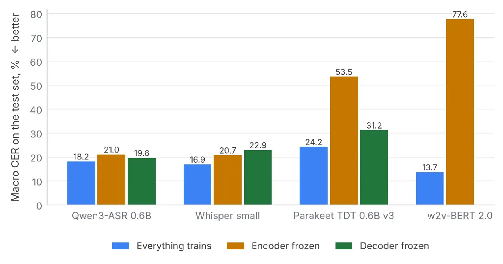

Figure 20: Which half has to learn, at the epoch dev chose among the
first six. The frozen half keeps its pretrained weights, apart from new
rows for new characters. Parakeet’s decoder is its prediction network
and joint; w2v-BERT has no decoder to freeze.

###   7.3  The script

The models that can already spell any script end close together on the
Latin script and on the others (Figure 21), while the transducers end at
38.2 outside Latin against 24.6 on it: their vocabularies were built
from their own languages, and the rows we add for a new script have no
pretrained letter behind them (Section 7.4). The script is also the
first thing that moves (Figure 22). Untouched, a model writes the
reference’s script on 0 to 78% of the clips outside Latin; after a
single epoch 13 of the models write it on every clip.

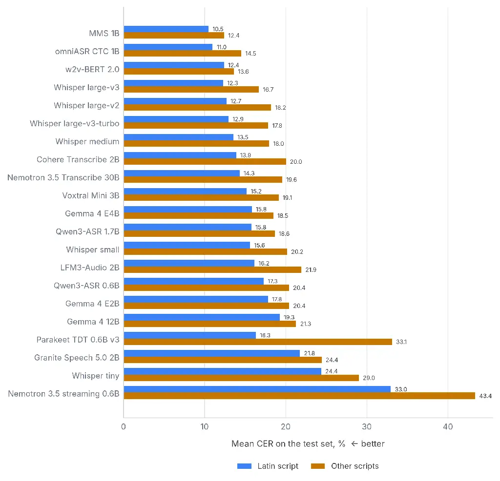

Figure 21: Fine-tuned models on the Latin-script languages and on the
rest.

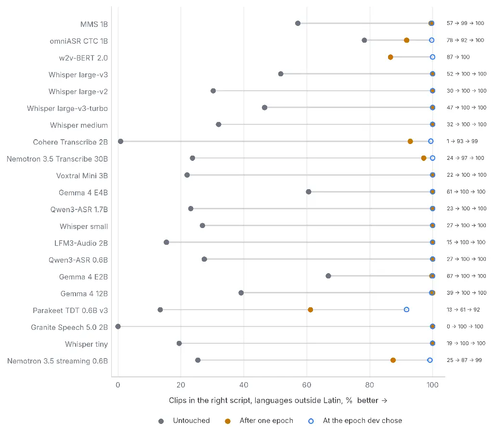

Figure 22: Whether the model writes in the language’s script, by the
Unicode script of most of a clip’s letters. Only the languages outside
Latin. w2v-BERT has no head as downloaded, so no untouched score; MMS
untouched uses its own heads where it has them and English’s elsewhere.

###   7.4  How a new row starts

Section 4 gave the transducers’ new rows a silent start in place of a
first start that was not silent. A start that changes nothing need not
learn best, so both ran the full length, and the two models disagree
(Figure 23): on Parakeet the silent start is ahead from the first epoch
on, on Nemotron it is far behind, 66.3 after one epoch against 45.7.

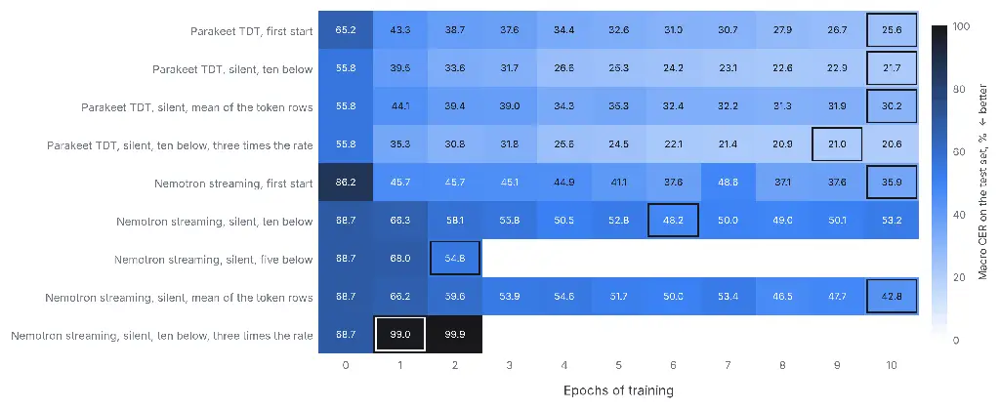

Figure 23: Ways to start the transducers’ new rows, on the test set
after every epoch. Epoch 0 is the extended model before any training: a
silent start reads the untouched score there, the first start does not.
A box marks the epoch dev chose; blank cells were not run.

The silent Nemotron writes too little, and not only where it needs new
rows: after one epoch its output on the Latin-script languages is 50% as
long as the reference, against 74% from the first start, and its new
rows have hardly left the blank, at a median cosine of 0.997 with the
blank’s row after training. A start silent for another reason, each new
row the mean of the pretrained token rows a point below it, leaves
almost no clip empty and still learns slowly, as does five below the
blank instead of ten; three times the rate makes the model fall silent,
with 1,225 of the 1,250 test clips empty after 2 epochs. On Parakeet the
mean start ends behind even the first, while the copy of the blank’s row
reaches 21.7, and at three times the rate 21.0, Parakeet’s main run
(Appendix C). Leaving the pretrained model intact at the start is not
the same as starting well, and Nemotron’s main run is the first start,
because dev chose it.

###   7.5  Languages on a model’s list

A model that already lists a language starts ahead: as downloaded,
Whisper large-v3 is at 32.4 on the 17 languages on its list and 59.6 on
the rest. Part of that is the languages, so Figure 24 fits the CER of
every fine-tuned model on every language as the model’s level plus the
language’s difficulty, less a lead where the language is on the model’s
own list. Most models do not list a given language, so its difficulty
does not rest on the ones that do, and the fit keeps to the 36
Latin-script languages, so that the script cannot decide it. A list is
the card’s for most models. For MMS and omniASR it is the model’s own
table of languages, and for w2v-BERT 2.0, which never saw a transcript,
the languages of its unlabelled audio.

As downloaded a listed language is 15 to 29 points ahead. On Whisper
that lead is gone after one epoch, and with it the 18% of Latin-script
clips it wrote in another script as downloaded; omniASR’s is gone after
three epochs. The other lists keep some of theirs to the epoch dev
chose: MMS 2.6 points (0.9 to 4.2, languages resampled), w2v-BERT 3.4
(1.5 to 5.3), and Parakeet and the two Nemotrons 5.1 (2.9 to 6.6) on the
4 they list, Estonian, Finnish, Latvian and Slovenian. Being on the list
can even cost something: Finnish, the only language Qwen3-ASR lists,
goes from 8.6 to 15.1 on the larger model when all 50 train together.
Nor does its list save Whisper outside the Latin script: on Burmese,
Tibetan and Lao, all three on its list, large-v3 ends 7.3 to 15.6 points
behind the median of MMS 1B, omniASR CTC 1B and w2v-BERT 2.0, and twice
the decoding budget wins back at most 4.0 of that (Section 14).

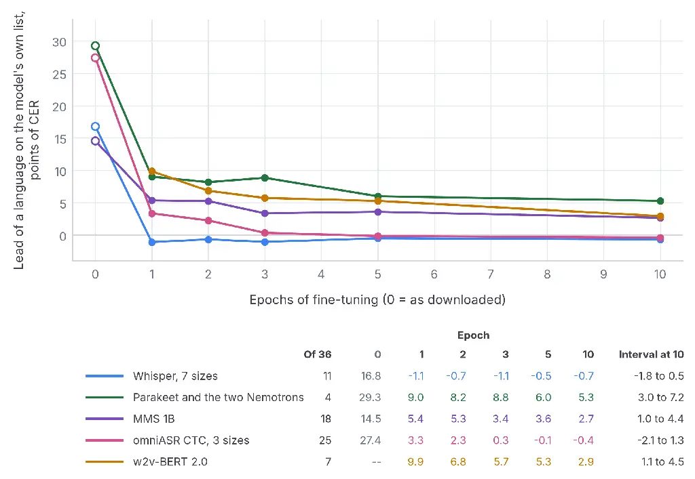

Figure 24: What a language on a model’s own list is still worth, epoch
by epoch, on the 36 Latin-script languages. The test CER of all 24
models fine-tuned with the main recipe is fitted as a model’s level plus
a language’s difficulty, less a lead where the language is on the
model’s own list; the models that share a list share a lead. Epoch 0
(hollow) is the models as downloaded, and a run that stopped before an
epoch stands at its last. Of 36: the languages on the list. The interval
resamples the languages.

To see whether a relative on the list helps, Table 5 keeps to
Latin-script languages and splits them by whether the model lists the
language, another of its family, or neither. Before training a relative
seems to help the models with short lists, Nemotron 3.5 Transcribe being
at 50.7 with one and 61.2 without, but training leaves 1.7 points of
that there and 1.4 on Qwen3-ASR 1.7B, and on Whisper the 4 languages
with no relative on its list even end ahead. Family is a weak guide to
what transfers.

MODEL ON ITS LIST A RELATIVE ON ITS LIST NO RELATIVE N UNTOUCHED TUNED N
UNTOUCHED TUNED N UNTOUCHED TUNED Whisper large-v3 11 18.1 8.5 21 56.5
14.6 4 55.2 10.2 Whisper large-v3-turbo 11 20.3 10.8 21 58.3 14.6 4 61.7
10.2 Whisper medium 11 35.0 10.5 21 66.9 15.6 4 74.0 10.9 Whisper small
11 35.0 13.4 21 70.2 17.5 4 68.5 11.4 Whisper tiny 11 41.3 22.9 21 65.8
26.5 4 68.1 17.1 Qwen3-ASR 1.7B 1 8.6 15.1 23 52.0 15.3 12 51.9 16.7
Qwen3-ASR 0.6B 1 13.0 18.4 23 51.5 16.8 12 59.2 18.2 Parakeet TDT 0.6B
v3 4 5.3 5.4 10 36.0 16.2 22 53.2 18.3 Nemotron 3.5 streaming 0.6B 4 9.7
20.8 18 65.3 35.0 14 76.2 33.8 Nemotron 3.5 Transcribe 30B 4 3.7 4.0 20
50.7 15.0 12 61.2 16.7

Table 5: Mean CER of the Latin-script languages by what the model’s card
says about them. A relative is another language of the same top-level
family.

###   7.6  Languages no model lists

For 12 of the 50, no model in the study starts with anything: Angami
Naga, Ao Naga, Chokri Naga, Gronings, Gurani, Karbi, Ladino, Lule Sami,
Moroccan Tamazight, Southern Kurdish, Southern Rengma Naga and Swiss
German are on no card and in neither MMS’s nor omniASR’s table, in any
script. Nothing a model does there is mixed with what it knew of the
language, so Figure 25 repeats the main result on them. As downloaded
every model is at 46 to 71, the two systems built for the long tail
included: omniASR CTC 1B, at 22.9 on the other 38 languages, is at 46.5
on these. Fine-tuned, the models gain 27.9 to 51.0 points and end in
nearly the order they end in on the other 38 (Spearman’s $`\rho`$ 0.97),
the best at 11.7 (omniASR CTC 7B).

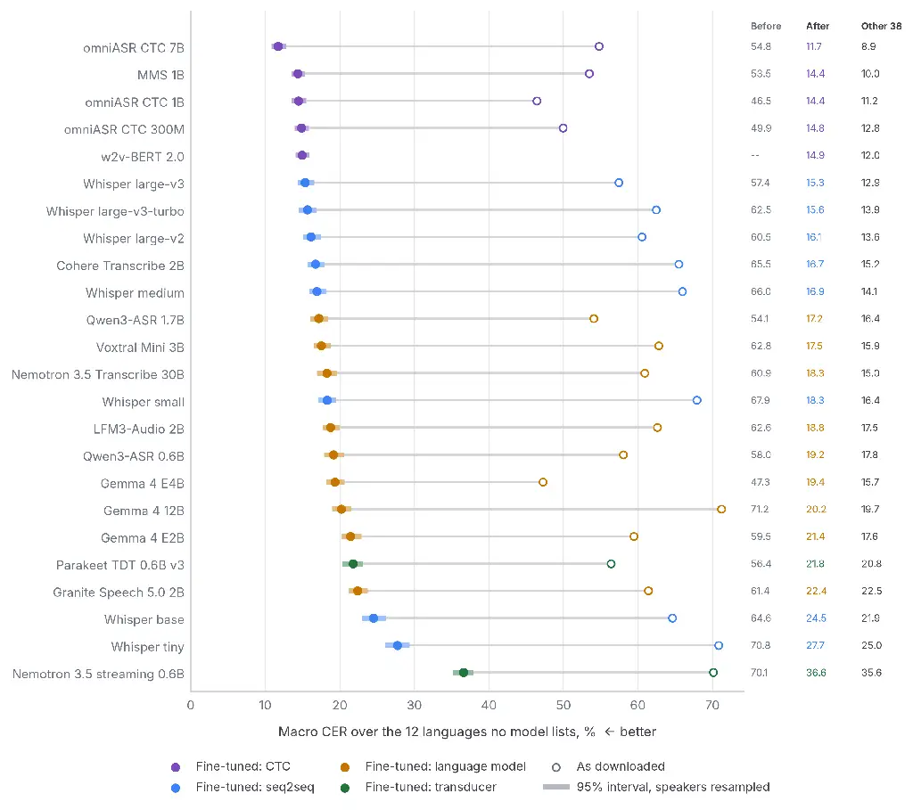

Figure 25: The 12 languages on no model’s list, in any script: all 24
models fine-tuned with the main recipe, as downloaded and at the epoch
dev chose, macro CER over the 12. Other 38: the fine-tuned model on the
rest of the test set. MMS as downloaded has no head for these and uses
English’s; w2v-BERT has none at all.

So the order of Section 6.3 is not the lists’ doing, though some of its
margins are. Every CTC model is still ahead of every other model, but
w2v-BERT 2.0 and Whisper large-v3 are 0.4 apart here (-0.3 to 1.3), and
MMS’s lead of 1.0 over omniASR CTC 1B on all 50 is 0.1 (-0.3 to 0.6).
The twelve are no easier than the rest: 23 of the 24 models score worse
on them, by a median of 2.2 points.

###   7.7  One language or fifty

Most low-resource work trains one language at a time. Figure 26 trains
Qwen3-ASR 0.6B on each language alone, with the same clips and recipe:
alone is better by 2.8 points on average over the 50 languages, and only
8 do better with the other 49. Part of that is each language choosing
its own epoch on its own 25 dev clips, but at the last epoch of both,
where nothing was chosen, alone is still ahead, 15.9 against 18.3, and
the 7 languages with fewer than 500 clips also do better alone, so the
scarce ones do not lean on the others. A model of 0.6B parameters shared
by fifty languages may have less of itself for each. Fifty models are
fifty times the storage, though, and the joint model is one.

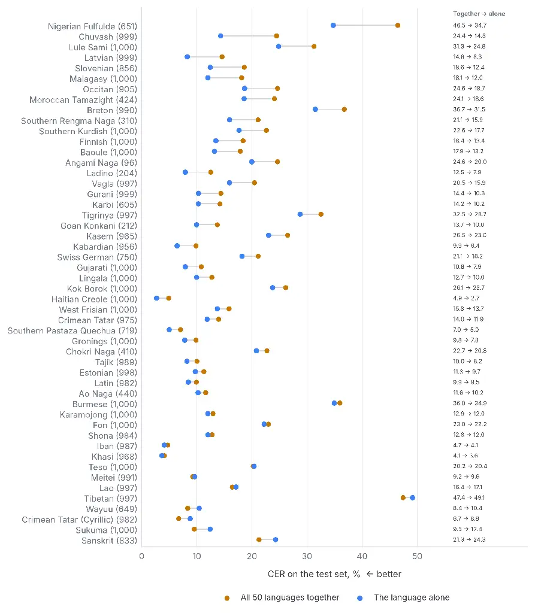

Figure 26: Each language trained alone against all 50 trained together,
Qwen3-ASR 0.6B, ten epochs, each at the epoch its own dev chose. In
brackets, the language’s training clips. Sorted by the difference: at
the bottom, the languages that did better with the other 49.

###   7.8  The next language

Does a model that has learned forty low-resource languages learn a
forty-first faster than the model it started from? We drew 10 of the 50
at random, trained Qwen3-ASR 0.6B, Whisper small, Whisper large-v3-turbo
and MMS on the other forty with the main recipe, and then trained each
on the held-out ten with 25, 100 and 1,000 clips a language, from that
first stage and from the pretrained model (Figure 27).

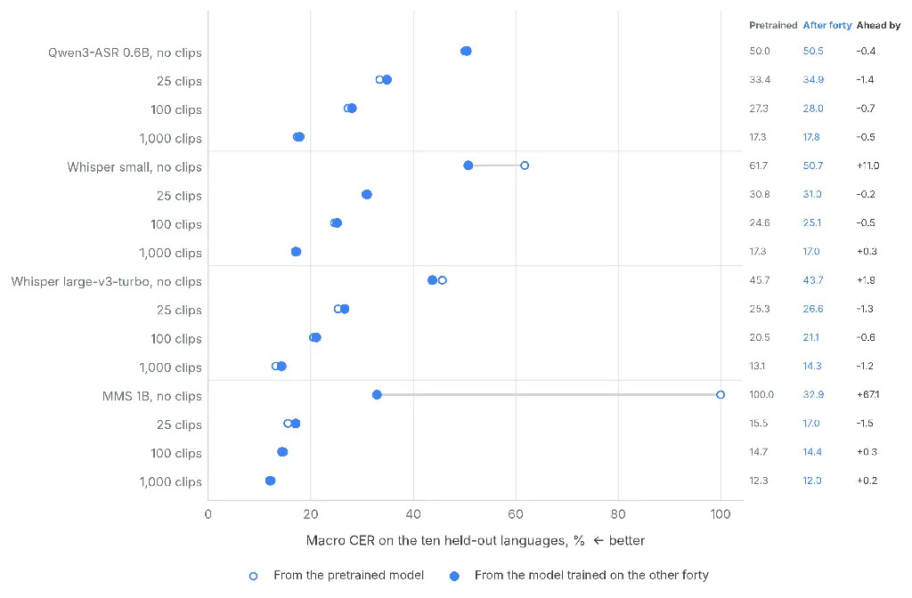

Figure 27: Ten languages held out of a first stage on the other forty:
the second stage from the pretrained model (hollow) and from the first
stage (filled), by how many clips of each held-out language it trains
on. No clips is the model before the second stage. Test macro CER on the
ten at the epoch dev chose; the last column is how far the first stage
puts the second ahead. One training seed; the text adds a second.

Once there are clips to learn from, it does not. Before the second
stage, the first puts Whisper small 11.0 points ahead on ten languages
it has never heard and large-v3-turbo 1.9, and takes MMS, whose new head
writes nothing until it is trained, from nothing to 32.9; Qwen3-ASR does
not move. With clips of the ten, the head start is gone, and with very
few it turns into a small cost. Over two training seeds on the same
clips, the first stage leaves the model behind in 7 of the 8 pairs at 25
clips, by up to 1.7 points (4 with an interval that leaves out zero),
and ahead in Whisper large-v3-turbo’s second seed, by 0.2 (-0.6 to 1.0);
at 100 and 1,000 clips the 16 differences go both ways, none larger than
1.9 points, 3 of them behind and 1 ahead with an interval that leaves
out zero. Training the ten beside the other forty does not help either:
Whisper small’s main run, on all fifty at once, scores 17.9 on the ten,
and the ten alone at 1,000 clips 17.3; large-v3-turbo’s, 15.4 and 13.1.

## 8Epochs

Whether training longer helps depends on the decoder, and for most of
them the answer comes early. Figure 28 has dev after every epoch at a
constant rate, and Table 6 has the same runs on the test set.

On seq2seq and language-model decoders, the first epoch has 90% of the
whole gain in the median model and the third 99%, and dev is within a
point of its best by epoch 3. After that the last column of Table 6 is
flat for most of them, and Whisper large-v3, Whisper large-v3-turbo,
Whisper medium, Whisper tiny and Cohere Transcribe 2B gain no more than
1.6 points. The CTC models and the transducers, which have new rows to
learn, keep going: from epoch 3 to the last, w2v-BERT improves by 3.8
points, MMS by 3.5, omniASR CTC 1B by 3.2, Parakeet by 11.2 and Nemotron
streaming by 9.2.

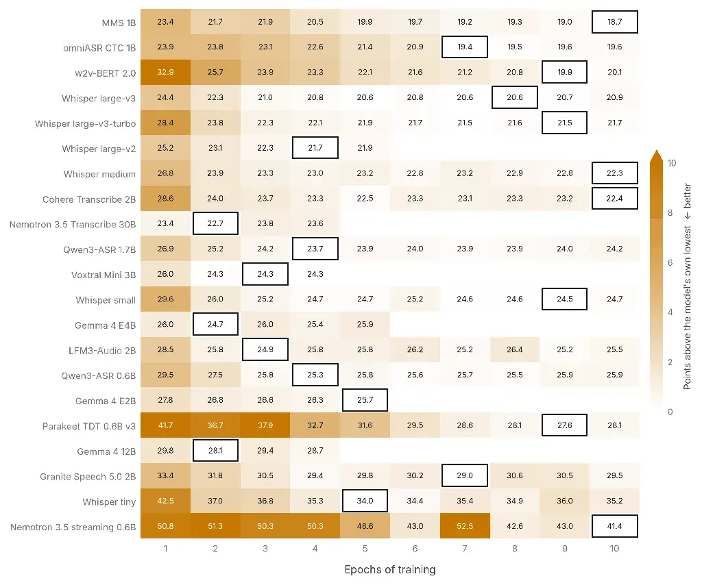

Figure 28: Dev after every epoch at a constant learning rate, one row a
model. Each cell is the dev macro CER; its colour is how far it is above
that model’s own lowest. A box marks the epoch dev chose; blank cells
were not run.

MODEL EPOCH 1 EPOCH 2 EPOCH 3 EPOCH 5 EPOCH 10 BEST (DEV) WITHIN 1 PT AT
LAST GAINS ON EPOCH 3 (95% CI) Whisper large-v3 17.1 14.8 13.8 13.6 13.4
8 3 +0.5 (+0.2 to +0.7) Whisper large-v3-turbo 21.4 16.5 15.1 14.2 14.3
9 3 +0.8 (+0.4 to +1.2) Whisper large-v2 18.5 15.4 14.7 14.3 – 4 3 +0.4
(-0.0 to +0.8) Whisper medium 19.2 16.2 15.6 15.2 14.8 10 3 +0.8 (+0.5
to +1.2) Whisper small 22.2 18.9 17.6 16.9 17.4 9 3 +0.2 (-0.3 to +0.6)
Whisper tiny 34.3 30.1 28.5 25.7 26.9 5 5 +1.6 (+0.8 to +2.3) Qwen3-ASR
1.7B 19.4 18.0 17.3 16.6 17.3 4 3 +0.1 (-0.4 to +0.6) Qwen3-ASR 0.6B
22.3 19.4 18.7 18.2 18.3 4 3 +0.4 (-0.1 to +0.9) Nemotron 3.5 Transcribe
30B 16.7 15.8 16.3 – – 2 1 +0.0 (-0.4 to +0.4) Parakeet TDT 0.6B v3 35.3
30.8 31.8 24.5 20.6 9 8 +11.2 (+10.2 to +12.3) Nemotron 3.5 streaming
0.6B 45.7 45.7 45.1 41.1 35.9 10 10 +9.2 (+8.6 to +9.9) w2v-BERT 2.0
26.6 18.7 16.5 14.6 12.7 9 8 +3.8 (+3.4 to +4.1) MMS 1B 16.4 14.4 14.5
12.3 11.0 10 6 +3.5 (+3.1 to +3.9) omniASR CTC 1B 16.6 15.6 14.9 14.2
11.7 7 7 +3.2 (+3.0 to +3.4) Voxtral Mini 3B 18.1 16.7 16.3 – – 3 2 +0.2
(-0.4 to +0.7) Granite Speech 5.0 2B 26.9 24.4 22.8 23.1 22.5 7 4 +0.3
(-0.2 to +1.0) Cohere Transcribe 2B 22.0 17.1 16.3 15.5 15.6 10 4 +0.7
(+0.3 to +1.2) LFM3-Audio 2B 21.2 18.2 17.8 18.1 18.2 3 2 -0.4 (-0.9 to
+0.1) Gemma 4 E2B 18.9 18.1 18.4 18.5 – 5 3 -0.1 (-0.8 to +0.5) Gemma 4
E4B 17.4 16.6 17.4 18.3 – 2 2 -0.9 (-1.5 to -0.3) Gemma 4 12B 22.6 19.8
21.4 – – 2 2 +0.4 (-0.4 to +1.1)

Table 6: Test macro CER after 1, 2, 3, 5 and 10 epochs of the same runs,
shown for the record: no epoch was chosen on it. Best: the epoch dev
chose. Within 1 pt: the first epoch within one point of that best on
dev. The last column is how much the run’s last saved epoch improves on
epoch 3 on the test set, with an interval from resampling the same
speakers on both sides.

To find where that stops we ran the longest curves again on another seed
(Figure 29). Thirty epochs of Whisper small, Whisper large-v3-turbo and
Qwen3-ASR 0.6B are no better than the first ten (on turbo dev chooses
epoch 9), though Whisper’s training loss falls from 0.27 at epoch 3 to
0.01 at epoch 20: it is learning its training set by heart. In the CTC
models’ longer runs, w2v-BERT, whose head is new, goes on improving to
epoch 30 of 30, 2.2 points below its epoch 10, while omniASR CTC 1B,
whose head came with the model, has flattened out, dev choosing epoch 20
by only 0.3 points over epoch 10. MMS, whose head is also new, is still
improving at epoch 20, the last it ran: dev chooses it, 0.8 points below
epoch 10. Parakeet at 1e-4, copied at epoch 7 and carried on to twenty,
ends 1.2 points below its own epoch 10.

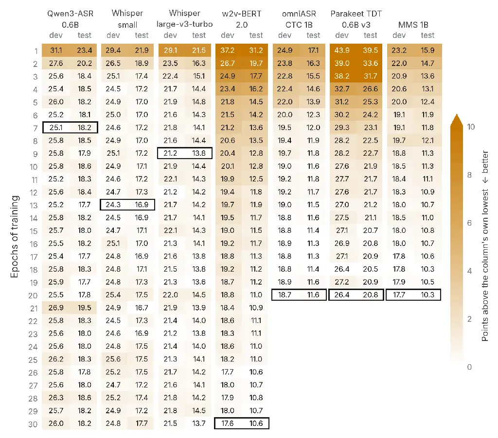

Figure 29: The longest runs at a constant rate, on another seed, except
Parakeet’s, which carries its run at 1e-4 on from epoch 7. Dev and test
macro CER after every epoch; the test columns are for the record. The
colour is how far a cell is above its column’s lowest. A box marks the
epoch dev chose; blank cells were not run.

Scarce languages might need more passes, since they see fewer clips in
each. Figure 30 says not many more: on dev the 7 languages with under
500 clips come within a point of their best at epoch 6, the other two
groups at 3 and 3.

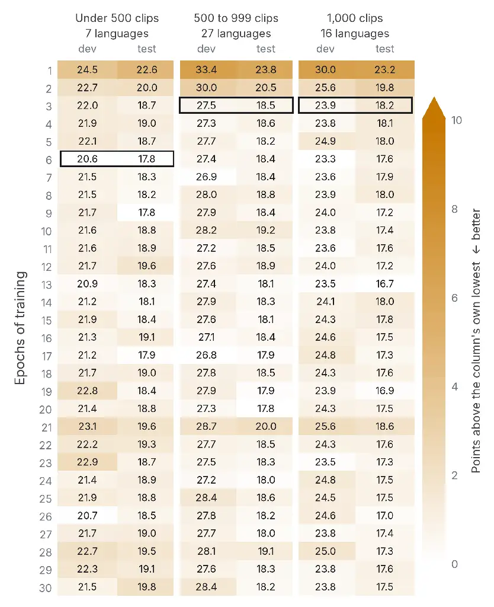

Figure 30: The long run of Qwen3-ASR 0.6B, by how many clips a language
has to train on: the mean dev and test CER of each group’s languages
after every epoch. The colour is how far a cell is above its column’s
lowest. A box marks the first epoch within a point of the group’s lowest
on dev.

A curve through one long run is not a training planned for that length,
so we also ran the usual recipe at each length, the rate falling to zero
at the last epoch (Figure 31). From three epochs on it beats the
constant rate by 0.6 to 1.1 points on Qwen3-ASR 0.6B and 0.2 to 0.9 on
Whisper small, where two seeds of the constant recipe lie up to 0.5 and
0.4 points apart, and it hardly moves the answer about epochs: Qwen
planned for three epochs scores 17.6 and planned for ten 17.5. The two
models still learning at ten epochs lose from the falling rate instead:
Parakeet at every length, by more than its seeds differ except at three,
and w2v-BERT until ten, where the cost is gone. That ten-epoch w2v-BERT
run is on seed 1, because on seed 0 its new head stalled, writing the
same output for every clip for 3 epochs until we stopped it; the same
command run again broke through within its first epoch, so the stall was
chance, not the seed.

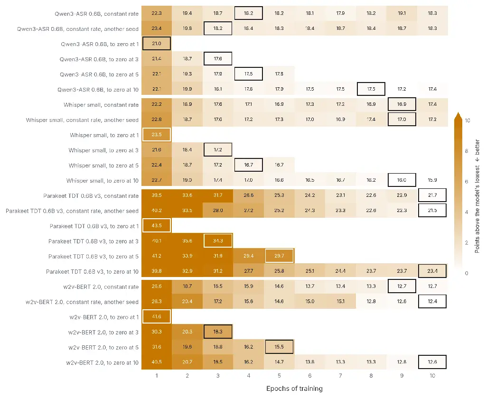

Figure 31: Each model’s main run at a constant rate, the same recipe on
another seed, and separate runs planned for 1, 3, 5 and 10 epochs whose
rate falls linearly to zero at their last. Test macro CER after every
epoch, for the record; a box marks the epoch dev chose. The colour is
how far a cell is above the lowest of that model’s rows; blank cells
were not run. w2v-BERT’s ten-epoch run is on seed 1, after a stall on
seed 0 (see text).

## 9Data size

A few clips already transfer (Table 7, Figure 32): twenty-five clips a
language, about 2 hours over all 50, take Qwen3-ASR 0.6B from 60.9 to
39.3, Whisper small from 65.7 to 38.4 and Whisper large-v3-turbo from
54.6 to 32.3, and every doubling after that buys less. Parakeet TDT 0.6B
v3 gets less from the first few clips, 45.6 after 25.

CLIPS A LANGUAGE, AT MOST CLIPS HOURS EPOCHS CLIPS PRESENTED QWEN3-ASR
0.6B WHISPER SMALL WHISPER LARGE-V3-TURBO PARAKEET TDT 0.6B V3 25 1,209
2 60 72,540 39.3 38.4 32.3 45.6 50 2,419 4 40 96,760 33.4 31.7 26.7 43.2
100 4,820 8 24 115,680 28.4 26.7 22.4 34.7 200 9,542 17 15 143,130 24.4
22.5 19.1 32.8 500 22,896 42 10 228,960 20.4 18.7 15.9 27.3 1,000 42,816
82 10 428,160 18.2 16.9 14.3 21.7 2,000 77,278 159 5 386,390 16.1 15.4
12.7 21.4 4,000 129,236 279 3 387,708 15.3 14.4 12.8 20.7

Table 7: The data-size runs. Clips presented is clips times epochs.
Macro CER on the test set at the epoch dev chose. A language with fewer
clips than a row’s size uses all it has.

Data also beats epochs at the same cost. On Qwen3-ASR 0.6B a thousand
clips a language for 3 epochs are 9.7 points better than a hundred for
24, the same number of clips presented; Whisper small gains 9.1 the same
way, large-v3-turbo 7.3, and Parakeet, which keeps improving for longer,
2.9. At the top of Table 7, four thousand clips a language for three
epochs present fewer clips than a thousand for ten and still beat them,
by 2.9, 2.5, 1.5 and 1.0 points in the same order, each interval above
zero. New clips are worth more than further passes over the old ones,
and on every model but Parakeet time past the third epoch would be
better spent collecting clips.

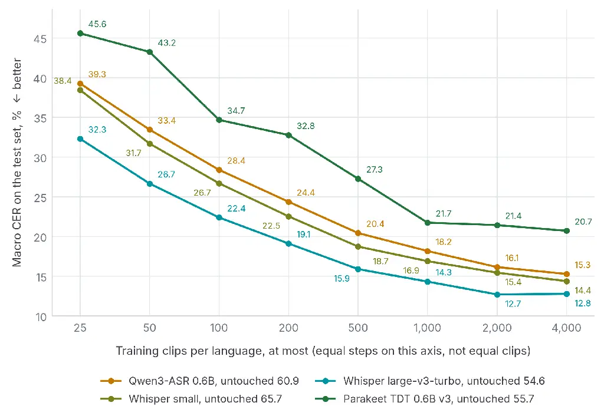

Figure 32: Macro CER against the number of clips per language, at the
epoch dev chose; the legend gives each model untouched. Smaller sets
train for more epochs, and the two largest for fewer (Table 7).

## 10Common Voice

Common Voice 22 has at least 100 clips of 11 of our languages, and
Figure 33 trains on them three ways: on this corpus, on Common Voice,
and on both.

We took at most 4,000 a language, leaving out any sentence in our dev or
test set, 30,535 clips and 41.9 hours against this corpus’s 10,157 and
23.4 of the same languages, and trained Qwen3-ASR 0.6B with the usual
recipe. On Common Voice alone, with three times the clips, it ends 3.5
points behind this corpus alone, partly a change of kind, since our test
clips come from the same corpus as our training clips: Common Voice
alone is better on 6 of the 8 languages where it has more clips than
this corpus and far worse where it has fewer. Together they beat either,
4.1 points below this corpus alone (3.2 to 4.9), and Whisper small and
Parakeet TDT 0.6B v3, trained the same three ways, agree. Where Common
Voice has a language, it belongs in the training set.

The run on this corpus alone also checks Section 7.7 at a larger scale:
trained on these 11 languages only, Qwen reaches 16.9 on them, 2.6
points better than the main run trained on all 50 (1.4 to 4.0;
Figure 33, purple), and Whisper small does 1.5 better. On Parakeet,
still learning at ten epochs (Section 8), there is no difference. Fewer
languages sharing a model again do better on each.

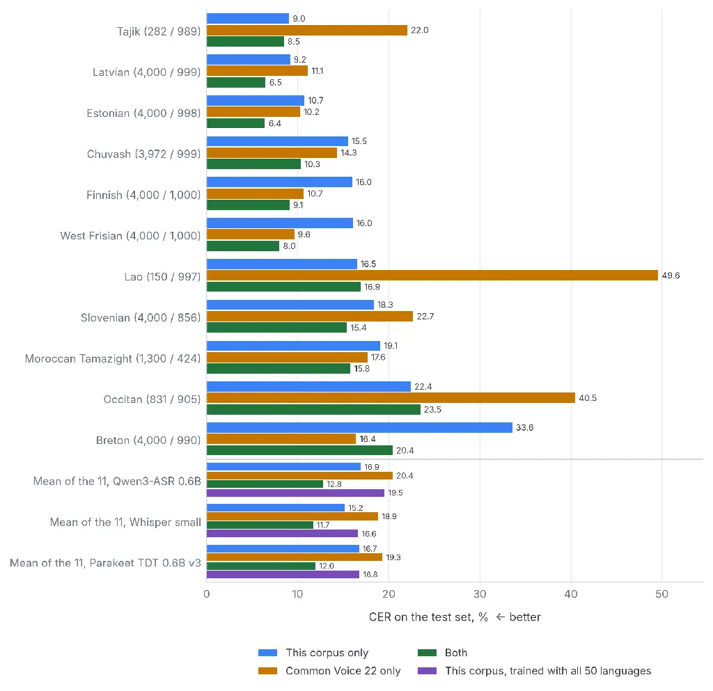

Figure 33: The languages Common Voice 22 has at least 100 clips of,
trained on this study’s corpus, on Common Voice, and on both. Test CER
at the epoch dev chose: each language on Qwen3-ASR 0.6B, then the mean
of the same three runs on each model, beside the model trained on all 50
languages with this corpus’s clips and scored on the same 11 (purple).
In brackets, the language’s clips in Common Voice (at most 4,000 taken)
and in this corpus (at most 1,000).

## 11Another corpus

Every test clip so far comes from the corpus that also gave the training
clips, so a model could learn the corpus rather than the language.
FLEURS (Conneau et al., 2022) records 11 of our languages, but for 7 of
them the corpus took clips from FLEURS itself: each of our clips that
reads a FLEURS sentence is as long as a FLEURS recording of that
sentence, to within 0.02 seconds, and 181 of 200 FLEURS test clips of
Tajik read a sentence our training clips read. That leaves Finnish,
Gujarati, Lingala and Shona, where FLEURS is another corpus: other
texts, other speakers, other microphones. We score every model there on
200 FLEURS test clips a language, as downloaded and from the epoch dev
chose in its main run, beside the same checkpoint on our own test clips
of those languages (Figure 34).

Most of the gain is the language. On FLEURS the median model keeps 79%
of what fine-tuning gained it on our clips, 33% at least (among the 16
that gained 5 points or more there), and FLEURS ranks the fine-tuned
models as our test does (Spearman’s $`\rho`$ 0.94). The four that end
worse on FLEURS than they started, MMS 1B, omniASR CTC 1B, Gemma 4 E4B
and Gemma 4 E2B, are the ones that knew these languages already, at 11.0
or better on our clips as downloaded: with little to gain there,
fine-tuning on fifty languages trades some of it away.

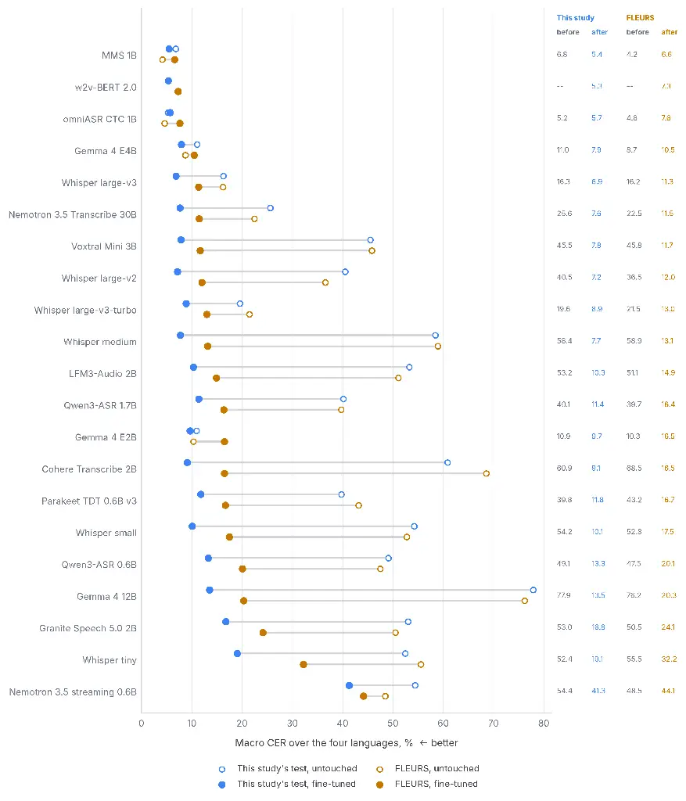

Figure 34: Finnish, Gujarati, Lingala and Shona, the languages FLEURS
shares with this study whose clips here are not FLEURS recordings: as
downloaded and fine-tuned, on this study’s test clips and on FLEURS’s.
Each fine-tuned model is one checkpoint, scored on both; w2v-BERT has no
head as downloaded.

###   11.1  The languages they knew

Learning fifty new languages costs a model some of the ones it knew
(Figure 35). On English, Spanish, French and German from FLEURS, the
median model’s CER rises by 5.7 points, and by 46.4 for Nemotron 3.5
streaming 0.6B, which goes from 5.1 to 51.4. All 20 end worse, Nemotron
3.5 Transcribe 30B the least, by 0.4 (-0.1 to 1.0); its first run, which
kept the experts as downloaded, even ended better, from 3.7 to 1.8.
Adapters, which leave the pretrained weights as they were, lose less on
2 of the 3 models we tried them on (Section 12).

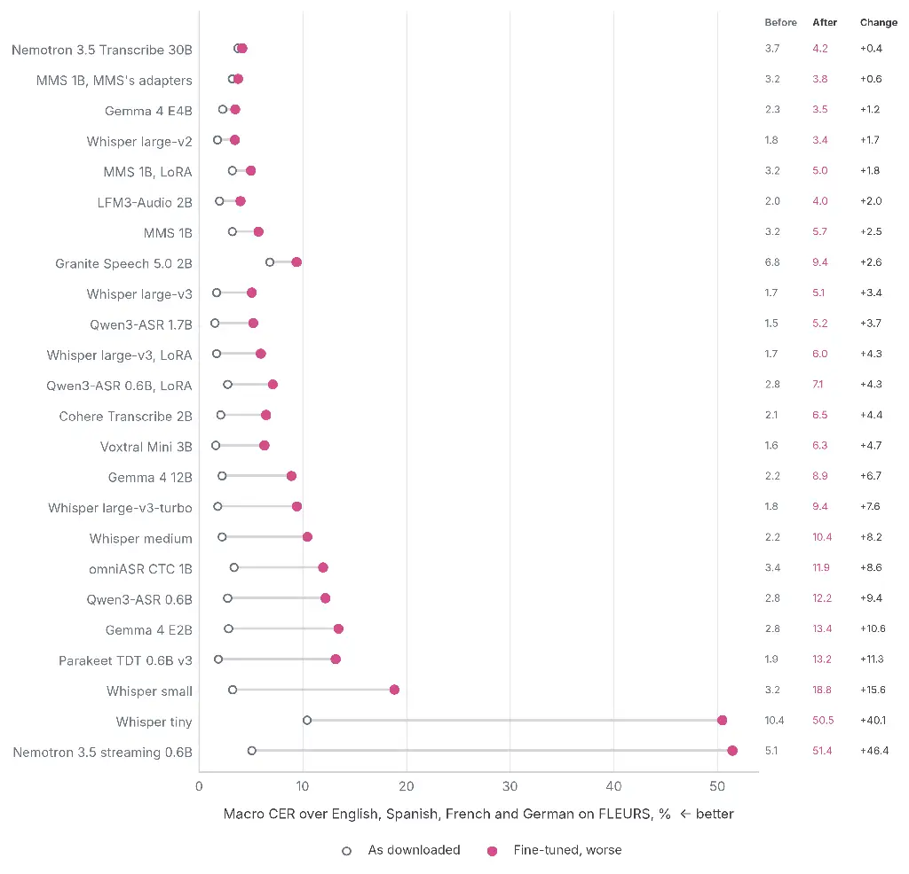

Figure 35: English, Spanish, French and German on FLEURS, as downloaded
and after fine-tuning on the fifty languages, with the adapters of
Section 12 where they ran.

###   11.2  Switching languages

Every clip so far is in one language, and speech often mixes two.
CS-FLEURS (Yan et al., 2025) rewrites FLEURS sentences with English
words and phrases mixed in and voices each language’s stretch with MMS’s
TTS; five of its pairs are languages of ours with English. We score all
21 models on 200 clips of each, told the language that is not English,
beside the same five languages spoken alone on FLEURS (Figure 36). The
voices are synthetic and the switches are joins, so this asks whether a
model follows a switch, not whether it hears one speaker make it, and
the Latvian, Tajik and Burmese sentences come from FLEURS, which our
corpus partly repackages (Section 11).

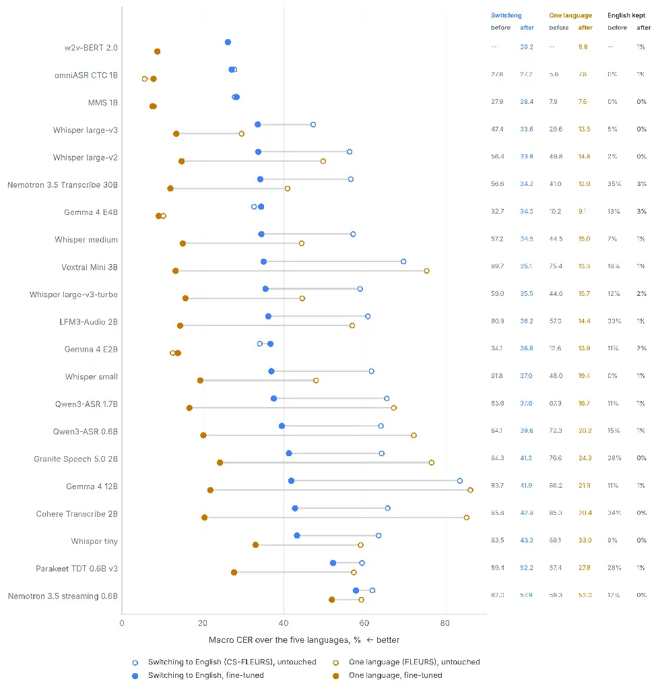

Figure 36: Five of the study’s languages with English mixed in
(CS-FLEURS) and the same languages alone (FLEURS), as downloaded and
fine-tuned: macro CER over the five. English kept: of the English words
in the Gujarati, Burmese and Tajik clips, where English has a script of
its own, the share the output writes.

Fine-tuning helps with mixed speech too: 17 of the 20 models we can
compare end lower, by a median of 22.7 points. It stays far harder than
one language, though: the median fine-tuned model is at 36.2 on the
mixed clips against 15.0 on the same languages alone. Much of the gap is
the English. In Gujarati, Burmese and Tajik, where English is 22 to 27%
of a reference’s characters, the median model writes 12% of the English
words as downloaded and 1% fine-tuned: told the other language, it
writes the English in that language’s script or drops it.

Malay with English is a switch the Malaysian arm trains on: in the
Scicom telephony dataset of Section 13, 26% of the training words are
English and 38% of the clips have two or more. On CS-FLEURS’s Malay
pair, against the same model as downloaded and told Malay, that training
helps only 11 of the 19 models, by a median of 7.4 points. The public
Malay benchmark has switching of its own: 171 of its 820 clips have two
or more English words, 45 of them among its 66 telephony clips. Within
each category those clips gain about as much from the training as the
clips with none (median difference -0.7 points), so what the training
adds there is the domain, not the switching.

## 12Adapters and a language model

Two cheap additions to the main recipe: training a small part of the
model instead of all of it, and decoding a CTC model with a word
language model.

###   12.1  Adapters

Tuning every weight means a full copy of the model for every set of new
languages. Low-rank adapters of rank 32 on every attention and
feed-forward projection (Hu et al., 2021) train instead, the rest frozen
except what the new languages add (Whisper’s new token rows, MMS’s new
CTC head), and for MMS also its own adapters, one small one in every
layer, with a head (Pratap et al., 2023). MMS keeps one such set for
each language and swaps in the set of the language a user names. We
train it both ways: one set for all 50 languages, as in every other arm,
and one set for each language, trained on that language alone and
swapped in for it at test, which needs the language named. Each arm has
its own rate sweep and then trains ten epochs on the main data
(Table 8). The sets for one language train longer, since a language
alone gets a fiftieth of the updates: each sees 20,000 clips, so a
language with fewer than 1,000 trains for more epochs, up to 210 for the
scarcest.

MODEL TRAINED PARAMETERS TRAINED RATE TEST CER 95% CI Whisper large-v3
everything 1,543.5M (100.0%) 1e-5 13.5 13.0–14.2 Whisper large-v3 LoRA,
rank 32 57.7M (3.6%) 3e-4 14.6 14.0–15.4 Qwen3-ASR 0.6B everything
782.4M (100.0%) 1e-5 18.2 17.5–18.9 Qwen3-ASR 0.6B LoRA, rank 32 29.5M
(3.6%) 1e-4 18.4 17.8–19.2 MMS 1B everything 965.7M (100.0%) 1e-5 11.0
10.6–11.6 MMS 1B LoRA, rank 32 36.4M (3.6%) 1e-4 11.7 11.3–12.4 MMS 1B
MMS’s adapters, one set for all 50 3.2M (0.3%) 3e-4 14.0 13.6–14.6 MMS
1B MMS’s adapters, one set a language 2.2M (0.2%) 3e-4 16.8 16.4–17.3

Table 8: Tuning every weight against adapters on a frozen model, ten
epochs on the same data: the parameters trained, the rate the model’s
own sweep chose, and test macro CER at the epoch dev chose, with a 95%
interval from resampling speakers. MMS’s adapters one set a language:
one language’s set, trained on 20,000 clips of that language and named
at test.

LoRA comes close to tuning everything. On MMS, training 3.6% of the
weights costs 0.7 points of CER (0.5 to 0.9), and MMS’s adapters, one
set for all 50 languages and 0.3% of the weights, cost 3.0. MMS’s own
way, one set for each language, does worse still, 2.8 points behind one
set for all (2.4 to 3.1) although each is told its language, and 19.3
after the same ten epochs as the shared set. On the 26 languages MMS
already had, the sets trained here reach 16.5, against 14.7 for its own;
what MMS gains from a set of its own per language is the languages it
knew, which keep theirs untouched. On Qwen3-ASR 0.6B LoRA is level with
tuning everything, 0.2 points behind (-0.3 to 0.7), and on Whisper
large-v3 it costs 1.1 (0.7 to 1.5). On two of the three, what they buy
is the languages the model knew. On English, Spanish, French and German,
Qwen3-ASR tuned in full loses 9.4 points of CER and with LoRA 4.3; MMS
loses 2.5 tuned in full, 1.8 with LoRA and 0.6 with one set of its
adapters for all 50. Whisper large-v3 loses more with LoRA, 4.3 against
3.4 tuned in full (Figure 35).

###   12.2  A language model

A CTC model writes each frame without knowing which words exist. We
searched the three CTC models’ output with a word 4-gram model of each
language (Heafield, 2011), built from the transcripts of the whole
training pool, up to 4,000 clips a language where the models heard at
most 1,000, less every sentence that dev or test also has (median 3,213
sentences and 30,102 words a language, the fewest 96). The beam is 64
wide (Kensho Technologies, 2021), and one weight for the language model
and one bonus per word serve every language, chosen on dev (Table 9).

MODEL CER, GREEDY CER, LM WER, GREEDY WER, LM WER GAIN, 95% CI WEIGHT,
BONUS MMS 1B 11.1 9.8 40.1 34.4 5.7 (4.8 to 6.4) 0.25, 2 w2v-BERT 2.0
12.7 11.3 44.8 38.8 6.0 (5.0 to 6.7) 0.25, 2 omniASR CTC 1B 12.0 10.8
43.1 38.3 4.8 (4.1 to 5.4) 0.25, 1

Table 9: The CTC models decoded greedily and with a word 4-gram, from
the same saved output of the epoch dev chose. The interval of the WER
gain resamples the same speakers on both sides; the weight and bonus
were chosen on dev.

It helps all three by about the same: 1.2 to 1.4 points of CER and 4.8
to 6.0 of WER, every interval clear of zero, and dev chose the same
weight for each. With it MMS 1B reaches 9.8, the lowest macro CER on our
test set, yet its WER is still 34.4: in the median language 20.7% of the
test words never occur in the text the language model was built from,
and up to 68.8% in one.

## 13Malaysian

Malay is not a language with little to train on, but the question of
what a model brings to it is the same, and one thing is different: the
training data and the test data do not come from the same kind of
speech. We train on the Scicom telephony dataset, 31,622 private clips
and 60 hours of human-transcribed call-centre speech in Malay and
English with some Mandarin, cut at the speakers’ pauses, and test on the
public split of the Revolab ASR Benchmark (Revolab Research, 2026): 820
clips and 2.1 hours of Malaysian Malay and English in 12 categories,
from telephone calls to singing, each counting once as each language
did. Dev is 454 held-out clips of the telephony dataset and alone
chooses the epoch; each model trains at its main run’s rate, w2v-BERT
excepted (below). As the benchmark’s card asks, listed word variants
count as correct, and a number may be spelled out or written in digits.

A model with Malay on its list can be run told the language or left to
detect it; the two differ enough that Figure 37 and Table 10 have both,
and a gain is counted from the better. Trained on telephone calls alone,
Whisper large-v3 goes from 8.9 to 6.0, a gain of 2.9 points (1.6 to 4.4)
and the lowest score of any model. Of the 24 models, 18 gain half a
point or more and Gemma 4 E2B and Qwen3-ASR 0.6B end worse by as much; a
model that starts well has little left for these calls to give.
w2v-BERT’s new CTC head stalls at its main rate, writing the same thing
for every clip for 7 and 6 epochs on two seeds, while at a third of the
rate it is out by epoch 3 and ends ninth best, at 9.3. MMS’s new head
beats the Malay head it came with, 12.2 against 15.3.

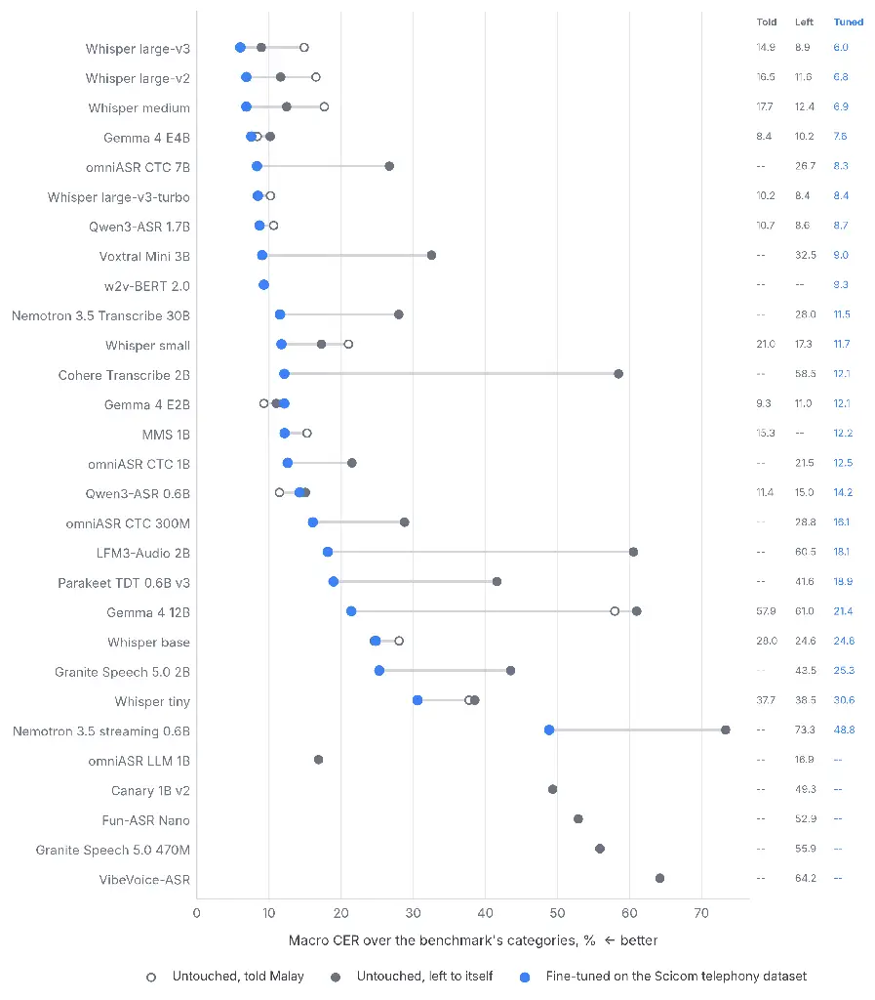

Figure 37: Every model on the public Malay benchmark: as downloaded,
told Malay where its list has it and left to itself, and after training
on the Scicom telephony dataset. Macro over the benchmark’s categories.
Dashes were not run.

Most of the gap between the two untouched columns is translation
(Figure 38): told that a clip is Malay, an untouched Whisper translates
the English in it. Of the 91 clips whose reference is mostly English by
a count of common words, large-v3 told Malay answers 57 in Malay, and
they hold 46% of its errors; left to detect the language it does so on
9, and fine-tuned, still told Malay, on none. Counted from the model
told Malay, its gain would read 8.9 points instead of 2.9. Detection is
not free either: Qwen3-ASR 0.6B is better told, 11.4 against 15.0.

MODEL TOLD MALAY LEFT TO ITSELF FINE-TUNED 95% CI WER BEST EPOCH
TELEPHONY Whisper large-v3 14.9 8.9 6.0 5.0–7.2 14.9 to 13.3 2 17.8 to
11.7 Whisper large-v2 16.5 11.6 6.8 6.2–7.6 18.7 to 16.2 4 26.6 to 12.8
Whisper medium 17.7 12.4 6.9 6.0–8.0 22.0 to 16.1 2 30.4 to 12.1 Gemma 4
E4B 8.4 10.2 7.6 6.8–8.4 17.1 to 16.2 2 20.9 to 13.8 omniASR CTC 7B –
26.7 8.3 7.6–9.1 43.1 to 24.8 3 48.5 to 15.5 Whisper large-v3-turbo 10.2
8.4 8.4 7.5–9.4 14.9 to 19.4 3 17.3 to 14.1 Qwen3-ASR 1.7B 10.7 8.6 8.7
7.9–9.5 17.6 to 20.7 1 7.3 to 11.5 Voxtral Mini 3B – 32.5 9.0 8.0–10.3
44.4 to 19.6 2 25.0 to 11.2 w2v-BERT 2.0 – – 9.3 8.4–10.3 27.9 12 –
Nemotron 3.5 Transcribe 30B – 28.0 11.5 10.6–12.5 48.7 to 26.7 2 17.1 to
12.8 Whisper small 21.0 17.3 11.7 10.6–13.1 30.8 to 27.1 3 28.0 to 15.4
Cohere Transcribe 2B – 58.5 12.1 11.1–13.1 82.2 to 29.6 3 23.1 to 12.7
Gemma 4 E2B 9.3 11.0 12.1 11.1–13.3 20.0 to 24.3 2 21.4 to 16.5 MMS 1B
15.3 – 12.2 11.3–13.1 40.2 to 32.3 10 36.7 to 20.1 omniASR CTC 1B – 21.5
12.5 11.5–13.6 39.9 to 34.2 8 36.5 to 19.9 Qwen3-ASR 0.6B 11.4 15.0 14.2
13.2–15.4 25.2 to 31.4 4 13.1 to 17.0 omniASR CTC 300M – 28.8 16.1
15.0–17.2 53.5 to 43.6 10 46.6 to 24.2 LFM3-Audio 2B – 60.5 18.1
16.9–19.4 82.0 to 37.9 3 24.6 to 16.6 Parakeet TDT 0.6B v3 – 41.6 18.9
17.9–20.1 77.8 to 41.2 6 15.1 to 16.3 Gemma 4 12B 57.9 61.0 21.4
19.9–23.0 73.6 to 39.5 2 40.1 to 19.3 Whisper base 28.0 24.6 24.8
23.5–26.1 47.8 to 48.7 4 33.4 to 23.5 Granite Speech 5.0 2B – 43.5 25.3
24.0–26.7 79.6 to 49.2 4 21.5 to 15.4 Whisper tiny 37.7 38.5 30.6
29.2–32.0 65.8 to 56.8 4 69.5 to 26.1 Nemotron 3.5 streaming 0.6B – 73.3
48.8 47.5–50.1 88.4 to 77.3 10 33.5 to 42.9 omniASR LLM 1B – 16.9 – – –
– – Canary 1B v2 – 49.3 – – – – – Fun-ASR Nano – 52.9 – – – – – Granite
Speech 5.0 470M – 55.9 – – – – – VibeVoice-ASR – 64.2 – – – – –

Table 10: The Malaysian arm, best first. The test set is the Revolab
benchmark, macro over its categories, capped per clip. MMS untouched is
told Malay through its Malay adapter and head. The last columns, WER and
the benchmark’s telephony category, go from the better untouched score
to the fine-tuned one.

Beyond translation, the calls help large-v3 most on short inputs,
parliament, telephony and street interviews, and cost it a little on
singing, news and FLEURS (Figure 38; every model is in Figure 39). They
do not even win the benchmark’s own calls: the best fine-tuned telephony
score is 11.2 (Voxtral Mini 3B), and Qwen3-ASR 1.7B scores 7.3 there
untouched. These are not the same calls, and a model tuned on one call
centre writes what that call centre’s transcribers write.

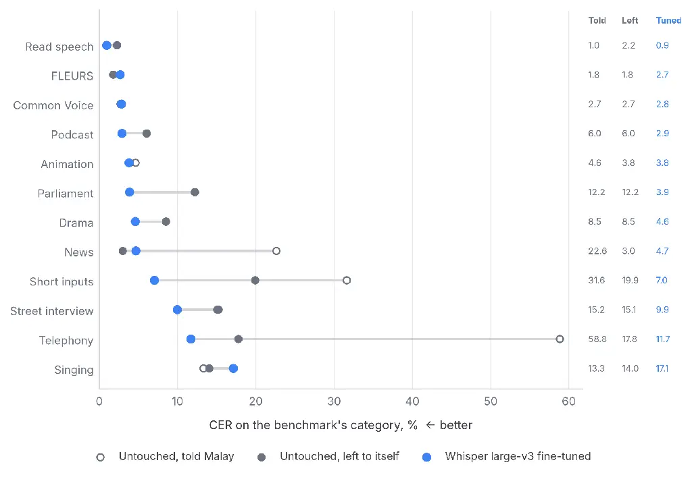

Figure 38: The best fine-tuned model on each of the benchmark’s
categories: as downloaded both ways, and after training on telephone
speech alone.

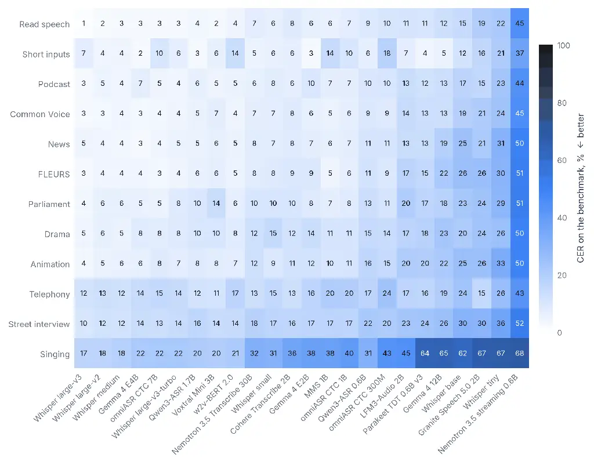

Figure 39: Every fine-tuned model on every category of the benchmark.

More epochs can hurt here, and dev does not warn of it (Figure 40): 16
of the 24 models reach their lowest benchmark score within three epochs,
and Whisper tiny climbs from 28.4 at epoch 2 to 36.6 by epoch 10 while
its telephony dev improves from 39.7 to 30.9. It is becoming a better
recogniser of these calls and a worse one of everything else.

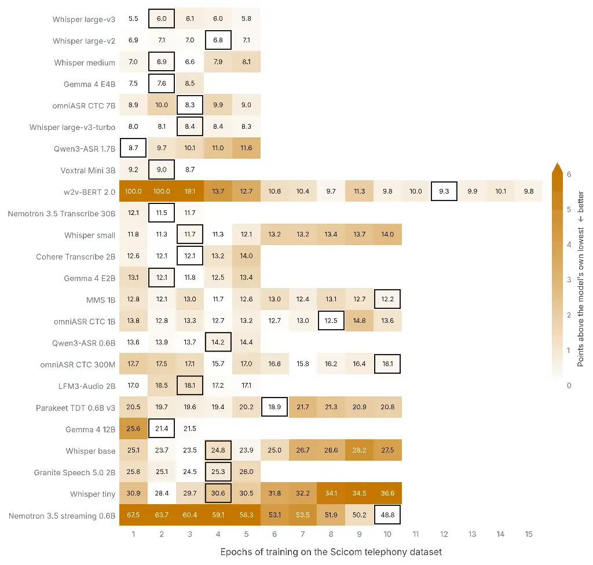

Figure 40: The benchmark after every epoch of training on the Scicom
telephony dataset, one row a model. The colour is how far a cell is
above that model’s own lowest. A box marks the epoch telephony dev
chose. Blank cells were not run.

Nor does more telephony help the benchmark (Figure 41): Whisper small
ends at 11.0 after a thousand clips, 2.0 hours, and at 11.7 after all
60.1, while telephony dev improves the whole way. Whatever the benchmark
gains from telephone calls, a small sample of them already has it.

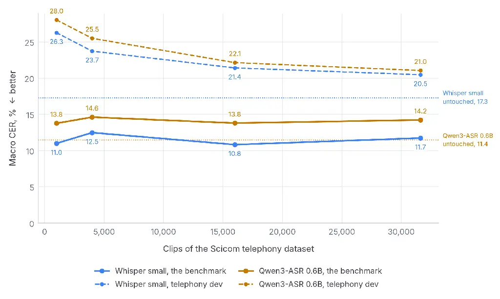

Figure 41: More of the Scicom telephony dataset, at the epoch telephony
dev chose. Solid: the public benchmark. Dashed: telephony dev. Dotted:
the benchmark, the model’s better untouched score.

## 14Limitations

The test set is 25 clips a language: a language’s own CER is a rough
number, and the macro mean is what we trust. Its intervals resample
speakers and take the 50 languages as given; with the languages drawn
again, 27 of the main result’s 210 pairs of models could change places
(Section 6.4). What a model had heard before is known only from its card
or its table, and a language on no list may still have been in a model’s
training audio. Its labels come from a language detector applied to
transcripts, verified by confidence, so a language here means what
GlotLID says (Kargaran et al., 2023); our Teso and Karamojong share a
corpus labelled Turkana. For 41 languages every test clip comes from one
corpus, and in all 50 a test corpus also supplies training clips, from
other speakers where it can: the score says how well a model learns a
language as that corpus records it, not how it will do on other speech
in that language. For 7 languages that corpus is partly or wholly
FLEURS, and FLEURS can test other speech in only 4 of the languages it
shares with us (Section 11). Crimean Tatar, Goan Konkani, Gurani, Meitei
and Wayuu have no other speakers, so their test clips share speakers
with training, and every model scores them at 54 to 85% of its CER on
the rest (Figure 42). Of the test clips, 2 pair a long text with very
short audio. Some corpora are readings of the Bible, as Goan Konkani’s,
Malagasy’s and Wayuu’s are, and such readings repeat their vocabulary.

The test set’s rows were verified one by one, by language and by length;
training and dev rows carry the parent corpus’s labels, gated on length
alone. Dev is harder than test for every model, by 5.5 to 8.3 points
(Figure 43). Of dev’s clips, 72% come from speakers with at most five
clips in the corpus, against 11% of test’s, and in the median model 5.0%
fail outright, with three quarters of their characters wrong or worse,
against 1.0% of test’s. So a dev score and a test score here are not
comparable, and the test score flatters how these models would do on a
language’s rarer speakers.

Decoding stops at 40 tokens plus 30 for each second of audio, and
Whisper’s byte-level vocabulary needs more than that on 17 of the 25
Tibetan test clips and 12 of the Lao ones (Figure 44); decoding the
chosen epoch again at 60 moves the macro CER by at most 0.3 points on
the 7 models we tried it on.

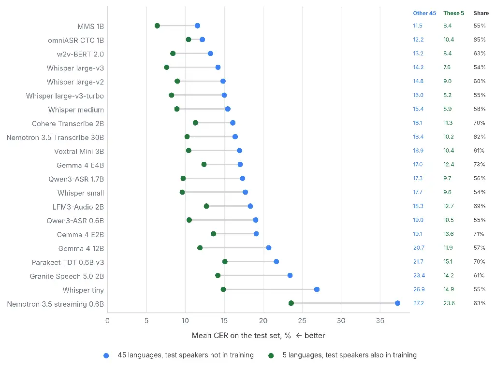

Figure 42: Test CER on the 5 languages whose test speakers also appear
in training, since they have no others, against the rest, each model at
the epoch dev chose. Share: the first as a percentage of the second.

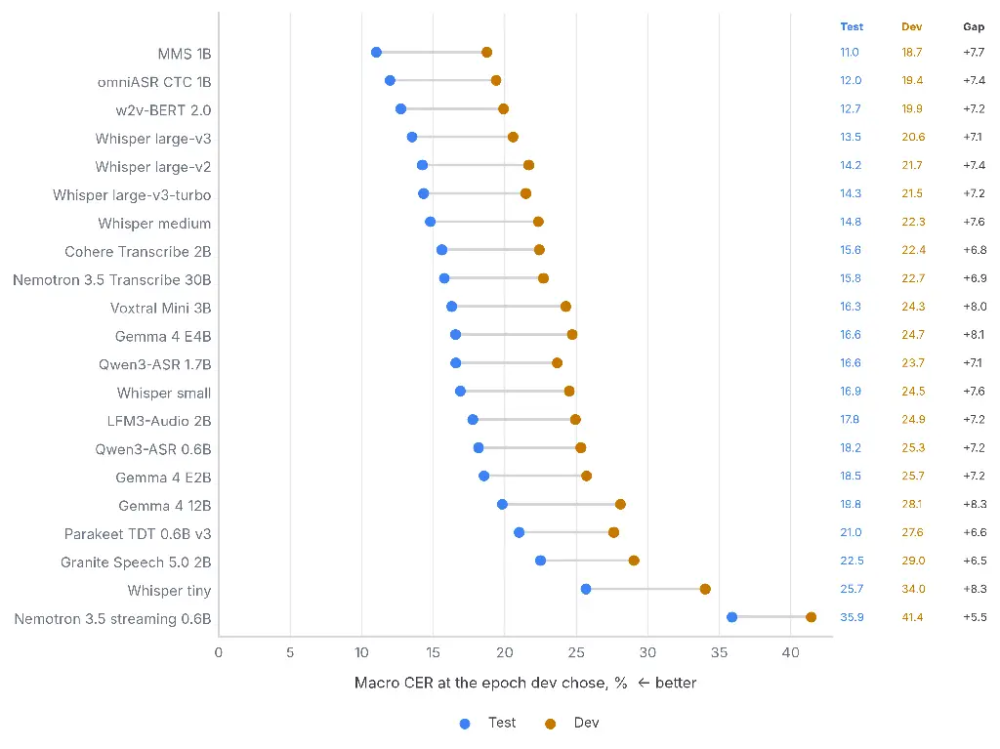

Figure 43: Dev and test macro CER of each model at the epoch dev chose.

We tuned the learning rate per model but no other setting, so a model
with a better recipe may rank higher. Granite Speech, MMS and Voxtral
were swept late, and the sweep found the rate MMS and Voxtral first
trained at too fast (Appendix C). Run again at 1e-5, MMS went from 16.2
to 11.0, the lowest of any model, and Voxtral at 3e-6 from 17.2 to 16.3.
Outside Section 12 every score is greedy decoding with no language
model. In the Malaysian arm w2v-BERT’s new head stalls at its main rate,
and we did not find out why; its row there is at a third of that rate,
the only row of that arm not at the model’s main rate.

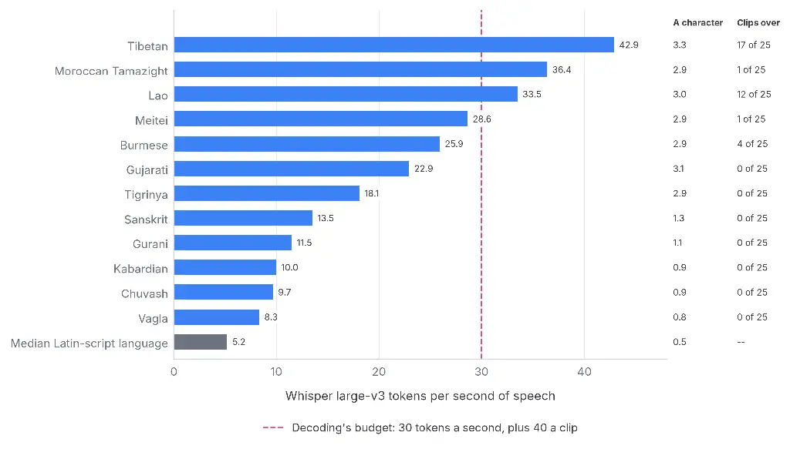

Figure 44: Tokens Whisper large-v3 needs per second of speech for each
language’s test transcripts, as it trains on them, for the twelve
languages that need the most and the median Latin-script language. The
columns give tokens per character and the test clips whose transcript
needs more tokens than decoding allows.

## 15Conclusion

A multilingual recogniser fine-tuned on an average of 98 minutes of a
language it has never heard learns to write it. On 50 low-resource
languages every model gained, by 16.6 to 53.1 points of macro CER, and
the same architectures from random weights barely got started. On the 12
that no model lists, every model starts at 46 or worse and the best ends
at 11.7. What transfers is hearing speech in general: an encoder that
never heard these languages already gives a Whisper or Qwen decoder most
of what it needs, though not a transducer’s, and the script, the thing
an untouched model most often gets wrong, is the first thing training
puts right. Most of it is the language, not the corpus: on FLEURS, in
the languages it shares with ours without sharing recordings, the median
model keeps 79% of its gain.

With a little of a new language, start from a model with a strong
encoder and an output that can spell anything, as large as you can
train; a CTC model or a Whisper did best here, and omniASR CTC 7B best
of all, at 9.5. On a seq2seq or language-model decoder, stop after three
to five epochs; CTC models and transducers want ten or more. New clips
are worth more than further epochs at the same number presented, so
spend the time collecting them; where Common Voice has the language,
adding it took 4.1 points off. If one model for each language is no
burden, train the language alone. On a transducer, check what the new
rows write before trusting the loss. On a mixture of experts, train the
audio encoder with the rest; the routed experts, most of the weights,
were worth under a point, less than letting the rate fall to zero
(Section 6.8). Before crediting the training, score the untouched model
both told the language and left to detect it: told that a clip was
Malay, an untouched Whisper translated the English that the speakers
mixed in, and lost more to that than training gained. A CTC model should
be decoded with a word language model; a few thousand sentences a
language took 4.8 to 6.0 points off its WER. Expect to lose some of the
languages the model knew, 5.7 points of CER in the median model, and
check them before shipping it. Expect a switch into English to go badly:
trained on one language a clip, the median model wrote 1% of the English
words in speech that mixed them into a language with a script of its
own. Do not expect a model that has learned forty other low-resource
languages to learn the next one faster. Where a full copy of the model
for every set of languages is a burden, LoRA on a few percent of the
weights does nearly as well, and on 2 of our 3 models it also keeps more
of the languages the model knew. Read the output as a draft: even with a
language model, the lowest WER here is 34.4.

We tried one recipe per model, a language model and adapters on three
models each, and one seed for most runs, and FLEURS could check our
corpus in only 4 languages. The languages we could test are the ones a
public corpus happened to record, as it recorded them. What the paper
does show is that the first hour or two of a new language is worth far
more on top of a multilingual model than on its own, and that it is
enough to start.

## 16Acknowledgement

This work was carried out at Scicom (MSC) Berhad. The author thanks
Scicom for the compute.

## References

- Abdullah et al. \[2024\] Abdulhady Abas Abdullah, Shima Tabibian, Hadi
  Veisi, Aso Mahmudi, and Tarik Rashid. End-to-End Transformer-based
  Automatic Speech Recognition for Northern Kurdish: A Pioneering
  Approach. arXiv:2410.16330, 2024. URL
  [https://arxiv.org/abs/2410.16330](https://arxiv.org/abs/2410.16330).
- Adams et al. \[2019\] Oliver Adams, Matthew Wiesner, Shinji Watanabe,
  and David Yarowsky. Massively Multilingual Adversarial Speech
  Recognition. arXiv:1904.02210, 2019. URL
  [https://arxiv.org/abs/1904.02210](https://arxiv.org/abs/1904.02210).
- Akera et al. \[2025\] Benjamin Akera, Evelyn Nafula, Patrick
  Walukagga, Gilbert Yiga, John Quinn, and Ernest Mwebaze. How much
  speech data is necessary for ASR in African languages? An evaluation
  of data scaling in Kinyarwanda and Kikuyu. arXiv:2510.07221, 2025. URL
  [https://arxiv.org/abs/2510.07221](https://arxiv.org/abs/2510.07221).
- Ardila et al. \[2019\] Rosana Ardila, Megan Branson, Kelly Davis,
  Michael Henretty, Michael Kohler, Josh Meyer, Reuben Morais, Lindsay
  Saunders, et al. Common Voice: A Massively-Multilingual Speech Corpus.
  arXiv:1912.06670, 2019. URL
  [https://arxiv.org/abs/1912.06670](https://arxiv.org/abs/1912.06670).
- Babu et al. \[2021\] Arun Babu, Changhan Wang, Andros Tjandra, Kushal
  Lakhotia, Qiantong Xu, Naman Goyal, Kritika Singh, Patrick von Platen,
  et al. XLS-R: Self-supervised Cross-lingual Speech Representation
  Learning at Scale. arXiv:2111.09296, 2021. URL
  [https://arxiv.org/abs/2111.09296](https://arxiv.org/abs/2111.09296).
- Bartelds et al. \[2023\] Martijn Bartelds, Nay San, Bradley McDonnell,
  Dan Jurafsky, and Martijn Wieling. Making More of Little Data:
  Improving Low-Resource Automatic Speech Recognition Using Data
  Augmentation. arXiv:2305.10951, 2023. URL
  [https://arxiv.org/abs/2305.10951](https://arxiv.org/abs/2305.10951).
- Chen et al. \[2023\] Zhehuai Chen, He Huang, Andrei Andrusenko,
  Oleksii Hrinchuk, Krishna C. Puvvada, Jason Li, Subhankar Ghosh,
  Jagadeesh Balam, et al. SALM: Speech-augmented Language Model with
  In-context Learning for Speech Recognition and Translation.
  arXiv:2310.09424, 2023. URL
  [https://arxiv.org/abs/2310.09424](https://arxiv.org/abs/2310.09424).
- Conneau et al. \[2022\] Alexis Conneau, Min Ma, Simran Khanuja,
  Yu Zhang, Vera Axelrod, Siddharth Dalmia, Jason Riesa, Clara Rivera,
  et al. FLEURS: Few-shot Learning Evaluation of Universal
  Representations of Speech. arXiv:2205.12446, 2022. URL
  [https://arxiv.org/abs/2205.12446](https://arxiv.org/abs/2205.12446).
- Dalmia et al. \[2018\] Siddharth Dalmia, Ramon Sanabria, Florian
  Metze, and Alan W. Black. Sequence-based Multi-lingual Low Resource
  Speech Recognition. arXiv:1802.07420, 2018. URL
  [https://arxiv.org/abs/1802.07420](https://arxiv.org/abs/1802.07420).
- Gemma Team \[2026\] Gemma Team. Gemma 4 Technical Report.
  arXiv:2607.02770, as cited on the model card, 2026. URL
  [https://huggingface.co/google/gemma-4-E4B-it](https://huggingface.co/google/gemma-4-E4B-it).
- Gete et al. \[2025\] Dawit Ketema Gete, Bedru Yimam Ahmed,
  Tadesse Destaw Belay, Yohannes Ayana Ejigu, Sukairaj Hafiz Imam,
  Alemu Belay Tessema, Mohammed Oumer Adem, Tadesse Amare Belay, et al.
  Whispering in Amharic: Fine-tuning Whisper for Low-resource Language.
  arXiv:2503.18485, 2025. URL
  [https://arxiv.org/abs/2503.18485](https://arxiv.org/abs/2503.18485).
- Heafield \[2011\] Kenneth Heafield. KenLM: Faster and Smaller Language
  Model Queries. Proceedings of the Sixth Workshop on Statistical
  Machine Translation, 2011. URL
  [https://aclanthology.org/W11-2123/](https://aclanthology.org/W11-2123/).
- Hsu et al. \[2019\] Jui-Yang Hsu, Yuan-Jui Chen, and Hung yi Lee. Meta
  Learning for End-to-End Low-Resource Speech Recognition.
  arXiv:1910.12094, 2019. URL
  [https://arxiv.org/abs/1910.12094](https://arxiv.org/abs/1910.12094).
- Hu et al. \[2021\] Edward J. Hu, Yelong Shen, Phillip Wallis, Zeyuan
  Allen-Zhu, Yuanzhi Li, Shean Wang, Lu Wang, and Weizhu Chen. LoRA:
  Low-Rank Adaptation of Large Language Models. arXiv:2106.09685, 2021.
  URL
  [https://arxiv.org/abs/2106.09685](https://arxiv.org/abs/2106.09685).
- IBM \[2026\] IBM. Granite Speech 5.0. Hugging Face model card, 2026.
  URL
  [https://huggingface.co/ibm-granite/granite-speech-5.0-2b](https://huggingface.co/ibm-granite/granite-speech-5.0-2b).
- Kargaran et al. \[2023\] Amir Hossein Kargaran, Ayyoob Imani, François
  Yvon, and Hinrich Schütze. GlotLID: Language Identification for
  Low-Resource Languages. arXiv:2310.16248, 2023. URL
  [https://arxiv.org/abs/2310.16248](https://arxiv.org/abs/2310.16248).
- Kensho Technologies \[2021\] Kensho Technologies. pyctcdecode. GitHub
  repository, 2021. URL
  [https://github.com/kensho-technologies/pyctcdecode](https://github.com/kensho-technologies/pyctcdecode).
- Kirkpatrick et al. \[2016\] James Kirkpatrick, Razvan Pascanu, Neil
  Rabinowitz, Joel Veness, Guillaume Desjardins, Andrei A. Rusu, Kieran
  Milan, John Quan, et al. Overcoming catastrophic forgetting in neural
  networks. arXiv:1612.00796, 2016. URL
  [https://arxiv.org/abs/1612.00796](https://arxiv.org/abs/1612.00796).
- Kunze et al. \[2017\] Julius Kunze, Louis Kirsch, Ilia Kurenkov,
  Andreas Krug, Jens Johannsmeier, and Sebastian Stober. Transfer
  Learning for Speech Recognition on a Budget. arXiv:1706.00290, 2017.
  URL
  [https://arxiv.org/abs/1706.00290](https://arxiv.org/abs/1706.00290).
- Liquid AI \[2026\] Liquid AI. Introducing LFM3: Every Modality for
  Specialized Intelligence. Liquid AI Blog, as cited on the model card
  of LFM3-Audio-2B, 2026. URL
  [https://huggingface.co/LiquidAI/LFM3-Audio-2B](https://huggingface.co/LiquidAI/LFM3-Audio-2B).
- Liu et al. \[2025\] Alexander H. Liu, Andy Ehrenberg, Andy Lo, Clément
  Denoix, Corentin Barreau, Guillaume Lample, Jean-Malo Delignon,
  Khyathi Raghavi Chandu, et al. Voxtral. arXiv:2507.13264, 2025. URL
  [https://arxiv.org/abs/2507.13264](https://arxiv.org/abs/2507.13264).
- Mack et al. \[2026\] Julian Mack, Ekagra Ranjan, Walter
  Beller-Morales, Bharat Venkitesh, and Pierre Richemond. Cohere
  Transcribe (cohere-transcribe-03-2026). Hugging Face model card,
  doi:10.57967/hf/8653, 2026. URL
  [https://huggingface.co/CohereLabs/cohere-transcribe-03-2026](https://huggingface.co/CohereLabs/cohere-transcribe-03-2026).
- Malaysia-AI \[2026a\] Malaysia-AI. Low-Language-TTS. Hugging Face
  dataset card, 2026a. URL
  [https://huggingface.co/datasets/malaysia-ai/Low-Language-TTS](https://huggingface.co/datasets/malaysia-ai/Low-Language-TTS).
- Malaysia-AI \[2026b\] Malaysia-AI. Multilingual-TTS. Hugging Face
  dataset card, 2026b. URL
  [https://huggingface.co/datasets/malaysia-ai/Multilingual-TTS](https://huggingface.co/datasets/malaysia-ai/Multilingual-TTS).
- Mozilla \[2025\] Mozilla. Common Voice 22.0, as mirrored in
  fsicoli/common_voice_22_0. Hugging Face dataset, 2025. URL
  [https://huggingface.co/datasets/fsicoli/common_voice_22_0](https://huggingface.co/datasets/fsicoli/common_voice_22_0).
- Nahabwe et al. \[2025\] Alvin Nahabwe, Sulaiman Kagumire, Denis
  Musinguzi, Bruno Beijuka, Jonah Mubuuke Kyagaba, Peter Nabende, Andrew
  Katumba, and Joyce Nakatumba-Nabende. Benchmarking Automatic Speech
  Recognition Models for African Languages. arXiv:2512.10968, 2025. URL
  [https://arxiv.org/abs/2512.10968](https://arxiv.org/abs/2512.10968).
- NVIDIA \[2025a\] NVIDIA. Canary 1B v2. Hugging Face model card, 2025a.
  URL
  [https://huggingface.co/nvidia/canary-1b-v2](https://huggingface.co/nvidia/canary-1b-v2).
- NVIDIA \[2025b\] NVIDIA. Parakeet TDT 0.6B v3. Hugging Face model
  card, 2025b. URL
  [https://huggingface.co/nvidia/parakeet-tdt-0.6b-v3](https://huggingface.co/nvidia/parakeet-tdt-0.6b-v3).
- NVIDIA \[2026a\] NVIDIA. Fine-tuning Nemotron 3.5 ASR. Hugging Face
  blog, 2026a. URL
  [https://huggingface.co/blog/nvidia/fine-tuning-nemotron-35-asr](https://huggingface.co/blog/nvidia/fine-tuning-nemotron-35-asr).
- NVIDIA \[2026b\] NVIDIA. Nemotron 3.5 ASR Streaming 0.6B. Hugging Face
  model card, 2026b. URL
  [https://huggingface.co/nvidia/nemotron-3.5-asr-streaming-0.6b](https://huggingface.co/nvidia/nemotron-3.5-asr-streaming-0.6b).
- NVIDIA \[2026c\] NVIDIA. Nemotron 3.5 Transcribe 30B A4B. Hugging Face
  model card, 2026c. URL
  [https://huggingface.co/nvidia/NVIDIA-Nemotron-3.5-Transcribe-30B-A4B](https://huggingface.co/nvidia/NVIDIA-Nemotron-3.5-Transcribe-30B-A4B).
- Omnilingual ASR team et al. \[2025\] Omnilingual ASR team, Gil Keren,
  Artyom Kozhevnikov, Yen Meng, Christophe Ropers, Matthew Setzler,
  Skyler Wang, Ife Adebara, et al. Omnilingual ASR: Open-Source
  Multilingual Speech Recognition for 1600+ Languages.
  arXiv:2511.09690, 2025. URL
  [https://arxiv.org/abs/2511.09690](https://arxiv.org/abs/2511.09690).
- Pillai et al. \[2024\] Leena G Pillai, Kavya Manohar, Basil K Raju,
  and Elizabeth Sherly. Multistage Fine-tuning Strategies for Automatic
  Speech Recognition in Low-resource Languages. arXiv:2411.04573, 2024.
  URL
  [https://arxiv.org/abs/2411.04573](https://arxiv.org/abs/2411.04573).
- Pratap et al. \[2023\] Vineel Pratap, Andros Tjandra, Bowen Shi, Paden
  Tomasello, Arun Babu, Sayani Kundu, Ali Elkahky, Zhaoheng Ni, et al.
  Scaling Speech Technology to 1,000+ Languages. arXiv:2305.13516, 2023.
  URL
  [https://arxiv.org/abs/2305.13516](https://arxiv.org/abs/2305.13516).
- Radford et al. \[2022\] Alec Radford, Jong Wook Kim, Tao Xu, Greg
  Brockman, Christine McLeavey, and Ilya Sutskever. Robust Speech
  Recognition via Large-Scale Weak Supervision. arXiv:2212.04356, 2022.
  URL
  [https://arxiv.org/abs/2212.04356](https://arxiv.org/abs/2212.04356).
- Rekesh et al. \[2023\] Dima Rekesh, Nithin Rao Koluguri, Samuel
  Kriman, Somshubra Majumdar, Vahid Noroozi, He Huang, Oleksii Hrinchuk,
  Krishna Puvvada, et al. Fast Conformer with Linearly Scalable
  Attention for Efficient Speech Recognition. arXiv:2305.05084, 2023.
  URL
  [https://arxiv.org/abs/2305.05084](https://arxiv.org/abs/2305.05084).
- Revolab Research \[2026\] Revolab Research. Revolab ASR Benchmark.
  Hugging Face dataset card, 2026. URL
  [https://huggingface.co/datasets/Revolab/ASR-Benchmark-Public](https://huggingface.co/datasets/Revolab/ASR-Benchmark-Public).
- Saon et al. \[2025\] George Saon, Avihu Dekel, Alexander Brooks, Tohru
  Nagano, Abraham Daniels, Aharon Satt, Ashish Mittal, Brian Kingsbury,
  et al. Granite-speech: open-source speech-aware LLMs with strong
  English ASR capabilities. arXiv:2505.08699, 2025. URL
  [https://arxiv.org/abs/2505.08699](https://arxiv.org/abs/2505.08699).
- Scicom AI Enterprise Organization \[2026\] Scicom AI Enterprise
  Organization. Fused linear cross-entropy in fp32 (small-ablation,
  cross-entropy). GitHub repository, 2026. URL
  [https://github.com/Scicom-AI-Enterprise-Organization/small-ablation/tree/main/cross-entropy](https://github.com/Scicom-AI-Enterprise-Organization/small-ablation/tree/main/cross-entropy).
- Shi et al. \[2026\] Xian Shi, Xiong Wang, Zhifang Guo, Yongqi Wang,
  Pei Zhang, Xinyu Zhang, Zishan Guo, Hongkun Hao, et al. Qwen3-ASR
  Technical Report. arXiv:2601.21337, 2026. URL
  [https://arxiv.org/abs/2601.21337](https://arxiv.org/abs/2601.21337).
- Vander Eeckt and Van hamme \[2022\] Steven Vander Eeckt and Hugo
  Van hamme. Using Adapters to Overcome Catastrophic Forgetting in
  End-to-End Automatic Speech Recognition. arXiv:2203.16082, 2022. URL
  [https://arxiv.org/abs/2203.16082](https://arxiv.org/abs/2203.16082).
- Wijmans et al. \[2024\] Erik Wijmans, Brody Huval, Alexander
  Hertzberg, Vladlen Koltun, and Philipp Krähenbühl. Cut Your Losses in
  Large-Vocabulary Language Models. arXiv:2411.09009, 2024. URL
  [https://arxiv.org/abs/2411.09009](https://arxiv.org/abs/2411.09009).
- Xu et al. \[2023\] Hainan Xu, Fei Jia, Somshubra Majumdar, He Huang,
  Shinji Watanabe, and Boris Ginsburg. Efficient Sequence Transduction
  by Jointly Predicting Tokens and Durations. arXiv:2304.06795, 2023.
  URL
  [https://arxiv.org/abs/2304.06795](https://arxiv.org/abs/2304.06795).
- Yan et al. \[2025\] Brian Yan, Injy Hamed, Shuichiro Shimizu, Vasista
  Lodagala, William Chen, Olga Iakovenko, Bashar Talafha, Amir Hussein,
  et al. CS-FLEURS: A Massively Multilingual and Code-Switched Speech
  Dataset. arXiv:2509.14161, 2025. URL
  [https://arxiv.org/abs/2509.14161](https://arxiv.org/abs/2509.14161).
- Yang et al. \[2023\] Hao Yang, Jinming Zhao, Gholamreza Haffari, and
  Ehsan Shareghi. Investigating Pre-trained Audio Encoders in the
  Low-Resource Condition. arXiv:2305.17733, 2023. URL
  [https://arxiv.org/abs/2305.17733](https://arxiv.org/abs/2305.17733).

## Appendix A Untouched scores

Table 11 has every model as it was downloaded, and Figure 45 what the
cap takes away: the part of each model’s error that comes from clips
writing more than their own length, mostly decoders stuck in a loop.

MODEL DECODER LANGUAGES CER 95% CI CER, UNCAPPED WER LOOPS MMS 1B, a
head per language CTC 26 14.7 14.0–15.7 14.9 42.7 0 omniASR LLM 1B
language model 50 27.8 26.9–28.8 28.3 56.4 2 omniASR CTC 1B CTC 50 28.5
27.8–29.6 28.8 63.1 0 omniASR CTC 7B CTC 50 29.7 28.9–30.7 29.9 59.2 0
MMS 1B, English’s head where it has none CTC 50 30.6 30.1–31.2 31.1 62.9
2 omniASR CTC 300M CTC 50 31.5 30.8–32.4 31.7 69.5 1 Gemma 4 E4B
language model 50 39.8 39.1–40.7 41.7 77.0 5 Gemma 4 E2B language model
50 43.5 42.7–44.4 43.7 80.2 1 Whisper large-v3 seq2seq 50 50.3 49.5–51.4
59.5 83.7 101 Whisper large-v3-turbo seq2seq 50 54.6 53.6–55.8 89.7 84.8
154 Parakeet TDT 0.6B v3 transducer 50 55.7 55.0–56.7 56.4 88.0 0
Whisper large-v2 seq2seq 50 57.8 56.7–58.9 72.3 86.8 94 Nemotron 3.5
Transcribe 30B language model 50 58.1 57.2–59.3 59.4 86.3 3 Qwen3-ASR
1.7B language model 50 59.3 58.5–60.2 59.8 92.9 0 Qwen3-ASR 0.6B
language model 50 60.9 60.1–61.9 61.5 94.2 1 Voxtral Mini 3B language
model 50 61.8 60.8–62.9 67.2 91.2 16 Granite Speech 5.0 2B language
model 50 62.1 61.4–63.0 68.3 95.9 7 Canary 1B v2 seq2seq 50 62.4
61.5–63.4 84.3 90.4 52 Whisper base seq2seq 50 62.7 61.8–63.8 94.3 94.5
89 Whisper medium seq2seq 50 63.7 62.7–64.8 80.0 89.3 170 LFM3-Audio 2B
language model 50 64.3 63.5–65.2 78.1 89.5 15 Whisper small seq2seq 50
65.7 64.7–66.7 82.7 91.5 303 Whisper tiny seq2seq 50 66.6 65.6–67.6
102.0 96.1 130 Cohere Transcribe 2B seq2seq 50 68.0 67.0–69.1 93.0 95.8
40 Nemotron 3.5 streaming 0.6B transducer 50 68.7 68.0–69.5 69.7 92.2 8
Granite Speech 5.0 470M CTC 50 69.7 68.8–70.5 69.8 95.8 0 Gemma 4 12B
language model 50 72.9 71.9–73.9 97.7 96.4 67 Fun-ASR Nano language
model 50 73.5 72.7–74.6 81.4 97.7 26 VibeVoice-ASR language model 50
84.9 84.1–85.9 135.2 98.3 146

Table 11: Every model as downloaded, on the test set. CER is capped per
clip; the uncapped column counts every character of a looping decoder.
Loops: clips that end by repeating a piece of themselves four times or
more.

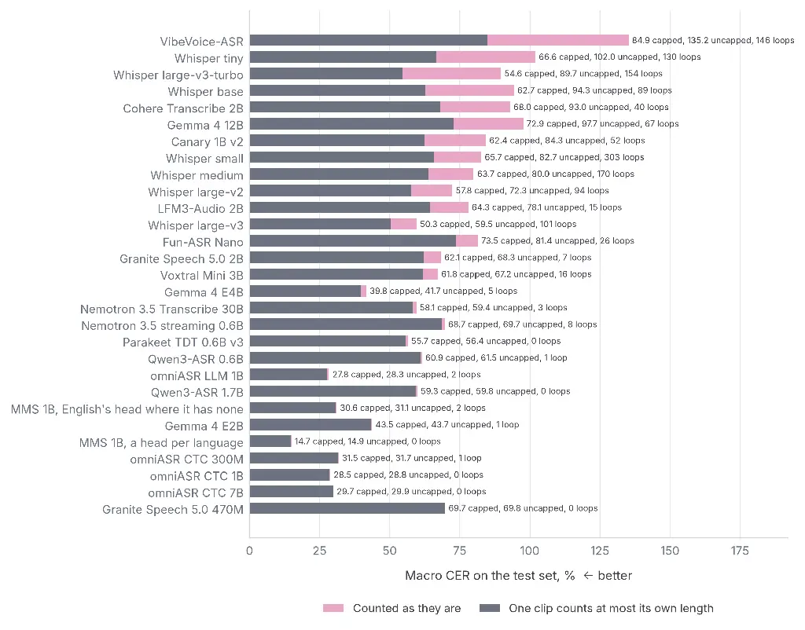

Figure 45: Every model as downloaded, with and without the cap on a
clip’s errors. The pink part is what clips add beyond their own length,
which is mostly decoders stuck in a loop.

## Appendix B The 50 languages

Table 12 lists the study’s languages, ordered by how little the parent
corpus holds.

CODE LANGUAGE FAMILY CORPUS ROWS TRAIN CLIPS TRAIN H TRAIN SPEAKERS TEST
SPEAKERS DISJOINT gom_Latn Goan Konkani Indo-European 262 212 0.6 1 1 no
njm_Latn Angami Naga Sino-Tibetan 443 96 0.1 30 12 yes guc_Latn Wayuu
Arawakan 736 649 0.7 48 10 no nre_Latn Southern Rengma Naga Sino-Tibetan
992 310 0.4 70 13 yes mni_Mtei Meitei Sino-Tibetan 1,098 991 1.8 4 4 no
nri_Latn Chokri Naga Sino-Tibetan 1,246 410 0.5 79 16 yes njo_Latn Ao
Naga Sino-Tibetan 1,282 440 0.7 80 12 yes zgh_Tfng Moroccan Tamazight
Afro-Asiatic 1,283 424 0.3 95 13 yes bci_Latn Baoule Atlantic-Congo
1,317 1,031 1.8 53 11 yes qup_Latn Southern Pastaza Quechua Quechuan
1,529 719 0.9 118 19 yes lad_Latn Ladino Indo-European 1,635 204 0.2 73
10 yes mjw_Latn Karbi Sino-Tibetan 1,644 605 0.7 208 15 yes gos_Latn
Gronings Indo-European 1,895 1,690 3.1 1,646 19 yes iba_Latn Iban
Austronesian 2,942 2,006 5.6 36 8 yes teo_Latn Teso Nilotic 3,195 1,186
1.0 90 9 yes ekk_Latn Estonian Uralic 3,774 1,790 5.2 4 3 yes lvs_Latn
Latvian Indo-European 3,847 1,266 3.9 5 4 yes tgk_Cyrl Tajik
Indo-European 4,349 3,165 11.2 94 10 yes hac_Arab Gurani Indo-European
4,448 2,272 1.8 1 2 no oci_Latn Occitan Indo-European 4,800 2,696 11.0
15 7 yes kdj_Latn Karamojong Nilotic 5,230 1,737 1.6 94 15 yes trp_Latn
Kok Borok Sino-Tibetan 5,384 2,435 3.2 701 19 yes bre_Latn Breton
Indo-European 5,790 3,967 2.0 2,822 20 yes crh_Latn Crimean Tatar Turkic
6,784 3,237 4.6 311 15 yes slv_Latn Slovenian Indo-European 9,769 1,384
4.2 6 7 yes fon_Latn Fon Atlantic-Congo 11,201 3,997 11.7 923 7 yes
san_Deva Sanskrit Indo-European 12,197 3,664 10.3 80 10 yes suk_Latn
Sukuma Atlantic-Congo 12,330 3,453 9.9 36 9 yes hat_Latn Haitian Creole
Indo-European 12,988 3,994 10.8 3,994 25 yes lin_Latn Lingala
Atlantic-Congo 13,887 4,000 16.6 8 11 yes crh_Cyrl Crimean Tatar Turkic
14,219 3,930 4.8 1 1 no kha_Latn Khasi Austroasiatic 14,234 1,865 4.9 21
8 yes smj_Latn Lule Sami Uralic 14,715 3,999 4.6 503 11 yes sna_Latn
Shona Atlantic-Congo 15,476 3,946 19.9 27 15 yes kbd_Cyrl Kabardian
Abkhaz-Adyge 17,393 3,348 5.3 124 10 yes sdh_Arab Southern Kurdish
Indo-European 17,998 3,999 6.6 71 9 yes fin_Latn Finnish Uralic 20,414
4,000 6.8 45 1 yes plt_Latn Malagasy Austronesian 21,705 3,997 11.7 97
12 yes lat_Latn Latin Indo-European 22,862 3,916 11.1 190 1 yes mya_Mymr
Burmese Sino-Tibetan 24,226 3,998 6.2 275 10 yes chv_Cyrl Chuvash Turkic
29,796 3,998 4.5 508 14 yes guj_Gujr Gujarati Indo-European 32,373 4,000
6.9 220 11 yes fry_Latn West Frisian Indo-European 35,956 4,000 5.2
2,526 8 yes lao_Laoo Lao Tai-Kadai 38,586 3,986 13.2 124 9 yes fuv_Latn
Nigerian Fulfulde Atlantic-Congo 39,284 3,417 11.2 823 12 yes vag_Latn
Vagla Atlantic-Congo 39,303 3,989 2.3 2,521 12 yes bod_Tibt Tibetan
Sino-Tibetan 48,956 3,994 2.5 3,994 12 yes gsw_Latn Swiss German
Indo-European 51,710 3,000 5.7 3 1 yes tir_Ethi Tigrinya Afro-Asiatic
53,835 3,992 16.7 583 12 yes xsm_Latn Kasem Atlantic-Congo 58,196 3,832
2.4 2,883 13 yes

Table 12: The study’s languages. Corpus rows are from the
Low-Language-TTS card. Training clips are those left after every rule of
Section 3, at most 4,000 a language. Disjoint: no test speaker in
training.

## Appendix C Learning rates

Table 13 has the sweep that chose each model’s rate.

The rows a transducer adds have a rate of their own, since they start
with nothing to keep. Table 14 shows it hardly matters: dev moves by a
median of 0.9 points across three rates for the rows at a given rate for
the rest of the model, against more than ten points between the rest of
the model’s rates in Table 13. The main runs give the rows ten times the
rate of the rest of the model, and at least 1e-3.

MODEL 1E-6 3E-6 1E-5 3E-5 1E-4 3E-4 1E-3 Cohere Transcribe 2B – 49.9
42.0 37.0 38.3 – – Gemma 4 12B 36.3 35.2 41.4 100.0 – – – Gemma 4 E2B –
32.2 31.5 35.1 45.9 – – Gemma 4 E4B 30.5 30.2 31.2 36.4 – – – Granite
Speech 5.0 2B – 43.3 40.4 42.6 – – – LFM3-Audio 2B – 33.0 32.0 33.0 41.5
– – MMS 1B – 24.9 23.5 23.8 29.0 – – Nemotron 3.5 streaming 0.6B – 80.3
83.1 73.1 69.0 – – omniASR CTC 1B – – 30.7 24.4 29.2 – – omniASR CTC
300M – – 36.5 28.1 31.9 49.6 – omniASR CTC 7B – 29.0 20.8 24.5 34.3 – –
Parakeet TDT 0.6B v3 – 58.9 53.2 50.5 47.0 43.6 47.8 Qwen3-ASR 0.6B 39.2
34.8 34.8 36.7 43.2 – – Qwen3-ASR 1.7B 36.2 30.3 31.4 32.2 – – – Voxtral
Mini 3B 30.8 29.5 32.9 40.1 – – – w2v-BERT 2.0 – – 60.3 40.8 100.0 – –
Whisper base – – – 43.4 39.3 49.1 – Whisper large-v3-turbo – 34.9 32.1
35.8 – – – Whisper large-v3 – 30.8 29.3 29.6 – – – Whisper medium – –
33.0 32.7 37.8 – – Whisper small – – 40.3 35.0 37.8 – – Whisper tiny – –
53.1 48.3 47.1 54.6 –

Table 13: The learning-rate sweep: dev macro CER on 200 clips a language
after three epochs. Bold is the rate the main run used. A sweep this
short favours a fast rate, so where the lowest score was not clearly
lowest, or the rate was the fastest tried, a full-length run at a lower
rate decided on dev; Qwen3-ASR 0.6B, which every ablation starts from,
kept the faster of its two tied rates, and Nemotron streaming’s
lower-rate run slowed only its new rows (Table 14). Where the lowest
score sat at an end of the grid, the sweep tried one rate past that end.
Each did worse, except on Parakeet, where 3e-4 beat 1e-4 and 1e-3 did
not, so 3e-4 also ran the full length, and dev chose it. Over the full
length, 3e-4 silences Nemotron streaming (Section 7.4). Gemma 4 E4B and
12B also ran the next rate down for the full length, and dev chose 3e-6
for E4B (24.7 against 26.5 at 1e-6) and 3e-6 for the 12B (28.1 against
28.4 at 1e-6). w2v-BERT at 1e-4 stayed at 100.0, writing the same output
for every clip, when run a second time too. omniASR CTC 7B takes the
same 120 seconds of audio per update as the rest, in pieces of 40
seconds in the sweep and 20 in its full run, because larger pieces did
not fit. Dashes are rates not run.

MODEL RATE ROWS 1E-4 ROWS 3E-4 ROWS 1E-3 Nemotron 3.5 streaming 0.6B
1e-5 83.2 83.3 83.1 Nemotron 3.5 streaming 0.6B 3e-5 76.7 75.8 73.1
Nemotron 3.5 streaming 0.6B 1e-4 71.3 72.1 69.0 Parakeet TDT 0.6B v3
3e-5 50.3 51.2 50.5 Parakeet TDT 0.6B v3 1e-4 46.9 47.6 47.0

Table 14: The transducers’ new rows, on the sweep of Table 13: dev macro
CER, by the rate of the pretrained weights (Rate) and of the new rows.
