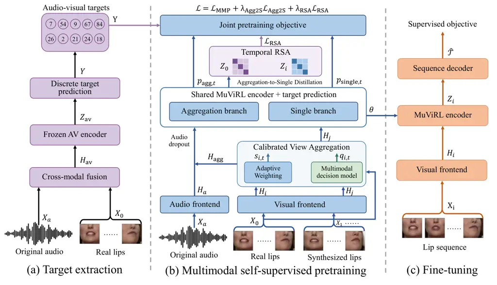
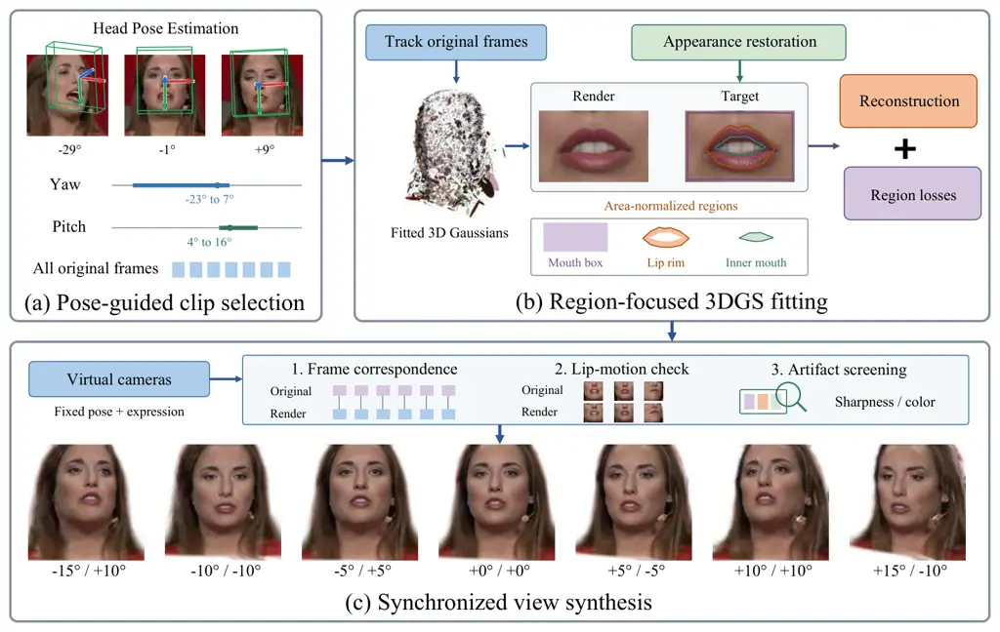
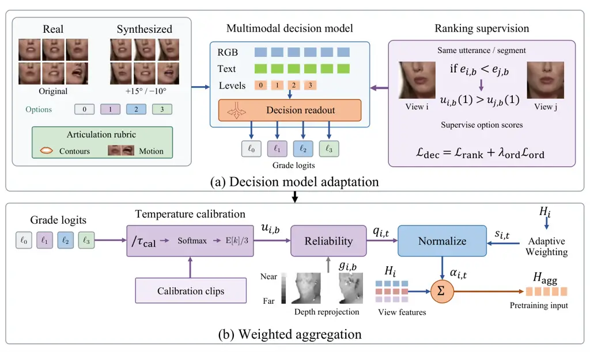
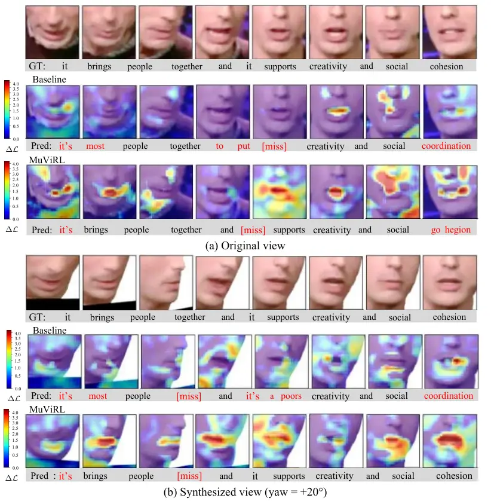
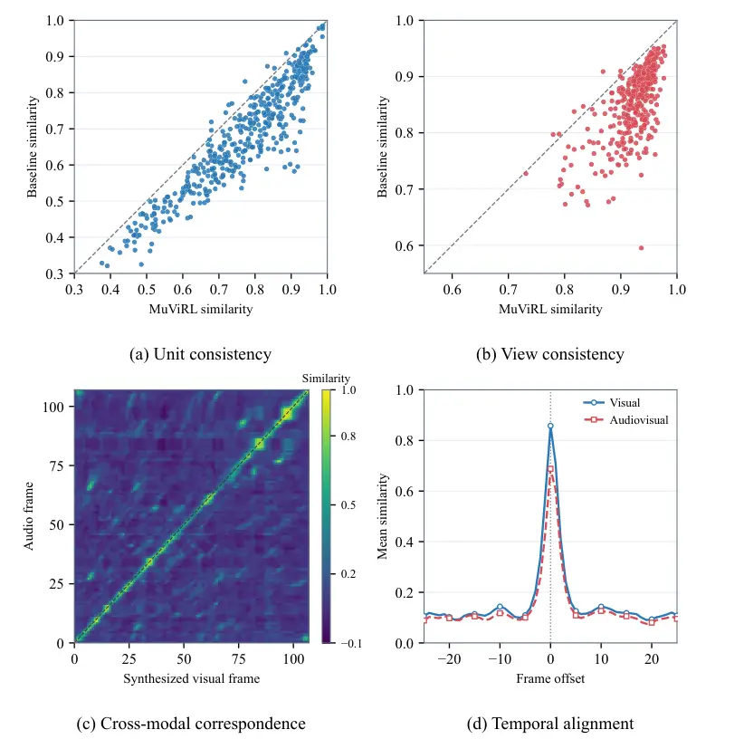

2026

# MuViRL: Multimodal View-Invariant Visual Speech Representation Learning via Calibrated View Aggregation

Fei Su Affiliation: School of Computer Science, Wuhan University, Wuhan,
China Affiliation: School of Artificial Intelligence, Wuhan University,
Wuhan, China    Kai Qiu Affiliation: Xiaomi EV Technology Co., Ltd.,
Beijing, China    Juan Liu Affiliation: School of Computer Science,
Wuhan University, Wuhan, China Affiliation: School of Artificial
Intelligence, Wuhan University, Wuhan, China

###### Abstract

Multimodal representation learning combines complementary signals to
capture shared semantic information. For dynamic scenes, these
representations need to remain consistent across views while preserving
distinctions between temporal states. In visual speech representation
learning, view variation changes the visibility and reliability of
articulation cues, making it difficult to learn such representations
from synchronized audio and video. To address this challenge, we propose
MuViRL, a self-supervised framework for multimodal view-invariant visual
speech representation learning via calibrated view aggregation. The
framework combines synchronized 3D Gaussian view synthesis with
multimodal self-supervision to learn consistent representations from
real and synthesized data. A multimodal decision model learns relative
view utility from teacher prediction losses, and its calibrated scores
guide the aggregation of complementary information.
Aggregation-to-Single Distillation transfers the aggregated predictions
to a single branch. Real-synthetic alignment matches synchronized
windows across views while preserving their temporal relations.
Experiments on real and synthesized multiview data demonstrate that
MuViRL improves multimodal representation consistency and visual speech
recognition performance across views.

###### keywords

Multimodal representation learning, self-supervised learning, calibrated
view aggregation, multimodal decision model, 3D Gaussian splatting

## 1 Introduction

Multimodal representation learning combines complementary observations
to capture semantic information shared across modalities.
Self-supervised MultiModal Versatile networks Alayrac et al. (2020) and
ImageBind Girdhar et al. (2023) use naturally paired signals to learn
transferable representations. In dynamic scenes, these representations
must also preserve changes over time. Visual speech representation
learning draws on synchronized sound and lip motion to capture evolving
articulation. The same articulation can appear different across views,
while distinct states may differ only in subtle lip movements. Learning
useful representations requires separating variation caused by viewpoint
from changes that distinguish articulation states.

Multiview learning provides mechanisms for both view invariance and the
fusion of complementary information. MVContrast Wang et al. (2023) and
ViewCLR Das and Ryoo (2023) learn consistency across object views and
generated latent video views, respectively. For heterogeneous inputs,
robust multiview learning Xu et al. (2025b) combines sample-level
attention with alignment under simulated perturbations. Decomposition
and composition Wang et al. (2026) jointly train fused and individual
modality features for skeleton-based action learning. Applying these
ideas to visual speech requires correspondence within an utterance. Two
segments can share the same utterance identity yet depict different
articulation states. Agreement between whole-sequence representations
does not establish which segments correspond across views or explicitly
constrain their temporal relations.

Audiovisual pretraining supplies temporal supervision within a
recording. AV-HuBERT Shi et al. (2022) predicts masked multimodal units,
while RAVen Haliassos et al. (2023) and BRAVEn Haliassos et al. (2024)
learn through prediction across modalities. CAV-MAE Sync Araujo et al.
(2025) models fine-grained correspondence between sound and video. These
approaches associate audio with visible events along an observed
sequence. However, monocular datasets such as LRS3 Afouras et al. (2018)
and VoxCeleb2 Chung et al. (2018) lack synchronized visual observations
of the same articulation from different viewpoints. Synchronization
between audio and video does not directly supervise how that
articulation should be represented from another view.

Synchronized view synthesis can supply these observations, but matching
timestamps does not ensure that each view retains useful articulation
cues. Occlusion can hide mouth structures, and reconstruction errors can
distort their shape or motion. Giving such views equal influence can
propagate these errors through aggregation and alignment. Research on
prediction quality Zhang et al. (2023b) and uncertainty Gao et al.
(2024) addresses unreliable inputs in multimodal fusion. For synthesized
visual speech, image sharpness alone cannot determine whether a view
preserves the articulation needed for prediction. A sharp rendering may
still distort a lip contour, while a valid perspective change may lower
pixel similarity. The challenge is to assess predictive usefulness at
corresponding times and use it to guide learning across views while
preserving temporal distinctions.

To address these challenges, we propose MuViRL, a self-supervised
framework for multimodal view-invariant visual speech representation
learning via Calibrated View Aggregation. Region-Focused 3D Gaussian
Splatting (3DGS) View Synthesis uses dynamic head reconstruction Qian et
al. (2024); Zhao et al. (2026) to generate synchronized observations,
with fitting focused on articulatory structures. A frozen teacher
derives unit targets from the original audio and video. We use these
targets to supervise corresponding sequences and measure each view’s
predictive usefulness.

Calibrated View Aggregation uses a multimodal decision model to assess
synchronized lip grids under a language rubric for articulation. Teacher
prediction losses provide grade and ranking supervision, and temperature
calibration adjusts the resulting grade probabilities. Calibrated scores
and geometric correspondence guide Adaptive Weighting, linking each
view’s contribution to its usefulness for multimodal prediction.

Aggregation-to-Single Distillation (Agg2S) transfers aggregated
predictions to a single branch that shares the encoder and unit targets.
Temporal Real–Synthetic Representation Alignment (RSA) matches
synchronized windows and their temporal relations. Reliability weighting
reduces the influence of unreliable synthesized features during
alignment. The encoder processes an individual video at inference
without view aggregation or decision scoring.

The main contributions are as follows:

1.  1.  We propose MuViRL for multimodal view-invariant visual speech
        representation learning. Synchronized 3DGS views and shared
        audiovisual targets extend self-supervision across viewpoints while
        retaining temporal correspondence.
2.  2.  We introduce Calibrated View Aggregation to learn view utility from
        a frozen teacher’s prediction losses. Calibrated decision scores,
        geometric correspondence, and Adaptive Weighting jointly determine
        each view’s contribution.
3.  3.  We combine Agg2S with Temporal RSA to transfer aggregated
        predictions to individual views and align synchronized
        representations and their temporal relations. The learned encoder
        operates on a single video at inference.
4.  4.  We evaluate MuViRL on real and synthesized multiview data through
        representation analyses and recognition experiments. The results
        demonstrate improved correspondence across viewpoints and modalities
        while preserving discriminative information.

## 2 Related Work

### 2.1 Multimodal Representation Learning

Multimodal representation learning uses correspondence between inputs to
learn shared content and retain complementary information. Shared
embeddings in MultiModal Versatile networks Alayrac et al. (2020) and
ImageBind Girdhar et al. (2023) connect modalities through paired
observations. This principle supports multilingual pretraining Zhang et
al. (2023a) and image–text retrieval Lu et al. (2023), and supplies
semantic correspondences for object navigation Yuan et al. (2025).
Reconstruction and fusion complement semantic matching by retaining cues
that can help recover or interpret another modality. MultiMAE Bachmann
et al. (2022) learns to reconstruct masked inputs across modalities,
whereas attention bottlenecks Nagrani et al. (2021) restrict feature
exchange during fusion. Decomposition and composition Wang et al. (2026)
supervise both fused and individual representations, linking the
information retained by each for action learning.

For audiovisual sequences, synchronization provides correspondence at
the level of temporal states. AV-HuBERT Shi et al. (2022) uses shared
unit targets, while RAVen Haliassos et al. (2023) and BRAVEn Haliassos
et al. (2024) learn through feature prediction. CAV-MAE Sync Araujo et
al. (2025) and AlignVSR Liu et al. (2025) explicitly align local audio
and visual information. Temporal attention Kim et al. (2024) further
models their dependencies. Synthetic supervision in SynthVSR Liu et al.
(2023) expands recognition training data through speech-driven lip
animation. Although these methods exploit the relationship between sound
and visible articulation, pairing modalities within a recording does not
supply observations of the same articulation from different viewpoints.
MuViRL extends this supervision to synchronized original and synthesized
views, using shared audiovisual targets to preserve articulation
distinctions across views.

### 2.2 Self-Supervised Multiview Learning

The choice of paired views determines which variations a self-supervised
objective suppresses. Contrastive Multiview Coding Tian et al. (2020)
extracts shared information from sensory channels. For physical
viewpoint variation, MVContrast Wang et al. (2023) learns associations
within views, across views, and between aggregated shape
representations. ViewCLR Das and Ryoo (2023) generates latent viewpoints
for video learning. Robust multiview learning Xu et al. (2025b) targets
imperfect heterogeneous inputs, combining sample attention with
alignment under simulated noise and missing information. Beyond matching
paired views, aggregation determines how their complementary information
is retained. Deep Sets Zaheer et al. (2017) formalizes invariance to
input order, while Set Transformer Lee et al. (2019) models interactions
among unordered inputs.

For dynamic sequences, aggregation must also preserve the information
needed to distinguish temporal states. Supervised multiview lipreading
combines synchronized streams Petridis et al. (2017) or shares
information through multitask learning Han et al. (2017). Temporal
prediction captures dependencies within a sequence. Model
compression Buciluă et al. (2006) transfers ensemble predictions to a
single model, while similarity-preserving distillation Tung and Mori
(2019) transfers relations among representations. However, agreement
between whole sequences does not specify which articulation states
should match across views. MuViRL combines shared target prediction and
Agg2S with Temporal RSA to align synchronized windows and their
relations. This preserves temporal correspondence during multiview
learning while supporting inference from a single video.

### 2.3 Calibrated Multimodal Decisions

Reliability estimation guides fusion when inputs differ in quality.
QMF Zhang et al. (2023b) relates dynamic fusion weights to prediction
losses, while EAU Gao et al. (2024) uses aleatoric uncertainty to
stabilize unimodal features before fusion. For ocular recognition, image
quality estimation Yan et al. (2024) weights fusion using embedding
robustness. Geometric alignment also matters for fusion: cooperative
segmentation of LiDAR and image inputs Guan et al. (2025) preserves
semantic and geometric correspondence during feature interaction. For
synthesized speech views, reliability assessment must distinguish
reconstruction defects from valid appearance changes across viewpoints.

Language-guided assessment specifies which visual structures should be
preserved. MLLM-as-a-Judge Chen et al. (2024a) examines scoring and
ranking, while Q-Align Wu et al. (2024) and DeQA-Score You et al. (2025)
express image quality through ordered levels and score distributions.
SmolVLM Marafioti et al. (2025) provides compact image–language
encoding. Pairwise logistic ranking Burges et al. (2005) learns relative
order, whereas temperature scaling Guo et al. (2017) and Dirichlet
calibration Kull et al. (2019) adjust probabilities. For synthesized
speech views, general quality scores may miss articulation cues needed
for multimodal prediction. We therefore use a frozen teacher’s
prediction losses to supervise utility grades and rankings, then
calibrate the grade probabilities. Calibrated View Aggregation combines
these scores with geometric correspondence and learned feature weights.

### 2.4 Dynamic 3D Gaussian View Synthesis

View synthesis provides additional observations when recordings cover
few head orientations. Pose augmentation for lipreading Cheng et al.
(2020) uses a fitted 3D morphable model to generate training views for
supervised recognition. Dynamic avatars model facial motion and
appearance: FLAME Li et al. (2017) parameterizes facial shape and
expression, and Neural Head Avatars Grassal et al. (2022) combines
deformable geometry with learned appearance. With efficient rendering
provided by 3D Gaussian Splatting Kerbl et al. (2023), mesh binding in
GaussianAvatars Qian et al. (2024) and separate face and mouth
deformations in TalkingGaussian Li et al. (2024) preserve facial
structure during animation. STAvatar Zhao et al. (2026) further improves
motion and occluded detail through soft binding and temporal density
control.

Geometric consistency also determines whether synthesized observations
can be aligned across views. Two-dimensional Gaussian splatting Huang et
al. (2024) emphasizes surface accuracy, and VCR-GauS Chen et al. (2024b)
couples depth and normal regularization. DepthSplat Xu et al. (2025a)
connects depth estimation with Gaussian rendering. Robust cross-view
consistency Zhao et al. (2024) and video depth adaptation Xia et al.
(2026) further constrain geometry across observations. Reconstruction
fidelity, however, does not establish whether rendered articulation
remains informative for audiovisual prediction. MuViRL uses
region-focused fitting and rendering along the original timeline to
preserve local articulation and audio correspondence. The synchronized
views supervise multimodal representations, and their rendered geometry
supplies reliability evidence for aggregation and alignment.

## 3 Method

We consider multimodal representation learning from audiovisual videos.
Each video provides an original lip image sequence $`X_{0}`$ and a
synchronized audio signal $`X_{a}`$. The objective is to learn
representations that remain consistent across views while distinguishing
different articulation states.

An overview of our framework is shown in Fig. 1. Synchronized 3DGS
synthesis provides corresponding views for multimodal masked prediction
(MMP). Calibrated View Aggregation integrates features from these views.
Aggregation-to-Single Distillation (Agg2S) transfers aggregated
predictions to a single branch, while Temporal Real–Synthetic
Representation Alignment (RSA) preserves synchronized states and their
temporal relations.



Figure 1: Overview of the proposed framework. (a) Target extraction uses
a frozen audiovisual teacher to generate shared unit targets $`Y`$. (b)
Multimodal self-supervised pretraining uses Calibrated View Aggregation
to combine visual features according to reliability $`q_{i,t}`$ and
learned coefficients $`s_{i,t}`$. Aggregation-to-Single Distillation
transfers aggregated predictions to the single branch, while MMP and
Temporal RSA provide target supervision and temporal alignment. (c)
Fine-tuning optimizes the pretrained encoder and a sequence decoder with
transcript supervision.

### 3.1 Region-Focused 3DGS View Synthesis

We generate synchronized view sequences to expand viewpoint coverage
while preserving lip structure and temporal correspondence. As
illustrated in Fig. 2, head rotations guide clip selection to expose
complementary surfaces Grassal et al. (2022); Hempel et al. (2022).
Foreground masks Lin et al. (2022) and landmarks Zhou et al. (2023)
support tracking with VHAP¹¹ 1
[https://github.com/ShenhanQian/VHAP](https://github.com/ShenhanQian/VHAP)
and FLAME Li et al. (2017). The recovered pose and expression remain
fixed during appearance fitting.

After motion tracking, we restore the appearance targets using
CodeFormer Zhou et al. (2022) while preserving the original frame
indices. With the mesh binding strategy of STAvatar Zhao et al. (2026),
a U-Net Ronneberger et al. (2015) predicts dynamic Gaussian attributes
from appearance, UV positions, and frame displacements. Gaussian
projection and compositing Kerbl et al. (2023) produce the renderings.
The regional constraint
$`\mathcal{L}_{\mathrm{region}}=\sum_{r}\lambda_{r}\operatorname{MAE}(I_{\mathrm{render}}[\Omega_{r}],I_{\mathrm{target}}[\Omega_{r}])`$
emphasizes the mouth box, lip rim, and inner mouth. Here, $`\Omega_{r}`$
selects region $`r`$, $`\lambda_{r}`$ weights its error, and MAE
averages over its pixels and color channels. This constraint complements
image reconstruction, SSIM Wang et al. (2004), LPIPS Zhang et al.
(2018), and Gaussian regularization during avatar fitting.

Using the fitted avatar, we render each facial state from multiple
virtual viewpoints at its original timestamp, retaining frame order and
correspondence with the audio. Frame counts, lip motion, and rendering
artifacts are checked before constructing training pairs. The resulting
lip sequences are denoted by $`X_{i}=\{X_{i,t}\}_{t=1}^{T}`$,
$`i=1,\ldots,V`$, where $`V`$ is the number of synthesized views and
$`t`$ indexes the $`T`$ frames. View index zero denotes the original
sequence. Rendered geometry supports reliability assessment.
Section S1.1 of the supplementary material (Online Resource 1) provides
fitting and selection details, and Fig. S1 illustrates the synthesized
views and mouth reconstructions.



Figure 2: Region-Focused 3DGS View Synthesis pipeline. (a) Pose-guided
clip selection identifies clips with complementary yaw and pitch
coverage from head pose trajectories. (b) Region-focused 3DGS fitting
uses original motion and restored appearance for reconstruction, with
errors averaged over the mouth box, lip rim, and inner mouth regions.
(c) Synchronized view synthesis renders the same facial state through
virtual cameras at each timestamp. Frame correspondence, lip motion, and
rendering artifacts are then checked.



Figure 3: Calibrated View Aggregation. (a) Decision model adaptation
uses synchronized lip grids and a language rubric to predict
articulation grades, supervised by teacher loss ordering and ordinal
grades. (b) Weighted aggregation converts grade logits $`\ell_{k}`$ into
calibrated utility $`u_{i,b}`$, then combines it with depth
correspondence to obtain reliability $`q_{i,t}`$. Here, $`u_{i,b}`$
abbreviates $`u_{i,b}(\tau_{\mathrm{cal}})`$, and $`\mathrm{E}[k]/3`$
denotes the normalized expected grade. Reliability and learned
coefficients $`s_{i,t}`$ determine weights $`\alpha_{i,t}`$ for
aggregating view features into $`H_{\mathrm{agg}}`$.

### 3.2 Calibrated View Aggregation

To integrate complementary visual information for multimodal target
prediction, we aggregate synchronized view features according to
calibrated reliability. A multimodal decision model uses a language
rubric to assess articulatory structures and motion in lip images
affected by blur, occlusion, or rendering artifacts. Predictive utility
supervises these assessments during adaptation. Temperature calibration
adjusts the grade probabilities used to calculate reliability. As
illustrated in Fig. 3, calibrated reliability and Adaptive Weighting
jointly determine each view’s contribution. A shared visual frontend
$`F_{v}`$ produces feature sequence $`H_{i}`$, with frame features
$`\mathbf{h}_{i,t}`$, for aggregation.

Multimodal decision model adaptation. For each temporal segment $`b`$,
paired original and candidate RGB grids contain frames at matching
timestamps. The decision model $`Q_{\eta}`$ uses the Laya Vision²² 2
[https://github.com/r33drichards/laya-vision](https://github.com/r33drichards/laya-vision)
readout with SmolVLM Marafioti et al. (2025) to jointly encode the
grids, view angles, a language rubric, and four ordered options. The
rubric specifies lip contours, opening changes, and visible teeth,
allowing normal viewpoint variation and occlusion. Following Q-Align Wu
et al. (2024), the four grades $`k\in\{0,1,2,3\}`$ range from
insufficient to clearly preserved articulation. The model returns one
logit $`\ell_{k}`$ per grade in a single forward pass. Applying softmax
at temperature $`\tau`$ gives grade probabilities. Their expected grade,
divided by three, defines the predictive utility score
$`u_{i,b}(\tau)\in[0,1]`$ Wu et al. (2024). A temperature of one gives
the uncalibrated distribution, and $`\tau_{\mathrm{cal}}`$ gives the
calibrated distribution.

Adaptation uses shared unit targets $`Y=\{y_{t}\}_{t=1}^{T}`$ generated
by the frozen audiovisual teacher from the original pair
$`(X_{0},X_{a})`$. Its visual prediction path evaluates each candidate
at the same masked positions, producing segment loss $`e_{i,b}`$. Lower
loss indicates greater predictive utility Zhang et al. (2023b). For
$`e_{i,b}<e_{j,b}`$, pairwise logistic ranking Burges et al. (2005)
encourages $`u_{i,b}(1)>u_{j,b}(1)`$ by minimizing
$`\log(1+\exp((u_{j,b}(1)-u_{i,b}(1))/\tau_{\mathrm{rank}}))`$, where
$`\tau_{\mathrm{rank}}>0`$ controls score differences. Averaging the
pairwise losses with weights derived from teacher loss differences gives
$`\mathcal{L}_{\mathrm{rank}}`$. Candidate ranks define relative utility
grades on the ordered readout scale within each segment, supplying soft
targets for ordinal cross-entropy $`\mathcal{L}_{\mathrm{ord}}`$. After
ordinal initialization, the readout and score head parameters $`\eta`$
are updated with
$`\mathcal{L}_{\mathrm{dec}}=\mathcal{L}_{\mathrm{rank}}+\lambda_{\mathrm{ord}}\mathcal{L}_{\mathrm{ord}}`$.
Temperature scaling Guo et al. (2017) on independent calibration
utterances determines $`\tau_{\mathrm{cal}}`$. We then freeze the
decision model and cache its scores for student training. Supplementary
Section S2 details the prompts, grade targets, and calibration.

Depth reprojection. Rendered geometry supplies complementary evidence
for correspondence Zhao et al. (2024); Chen et al. (2024b). Mouth pixels
are backprojected and transformed between views to compare depth and
surface normals. Valid support, coverage, and residual errors determine
a coefficient $`g_{i,b}\in[0,1]`$ using training statistics for each
angle. The coefficient is one for geometrically consistent pairs and
decreases as discrepancies increase. Views without rendered geometry
also use one. Supplementary Section S1.3 specifies the construction.
Segment reliability is

```math
q_{i,b}=q_{\min}+(1-q_{\min})u_{i,b}(\tau_{\mathrm{cal}})g_{i,b}. \tag{1}
```

Here, $`q_{\min}\in(0,1)`$ sets a positive floor. Segment values map to
frame weights $`q_{i,t}`$ by timestamp, with $`q_{0,t}=1`$ for the
original view. Utility estimates the candidate’s relative teacher grade.
Geometry reduces the contribution of views with inconsistent
correspondence.

Weighted aggregation. Adaptive Weighting learns each view’s contribution
from the selected group Wang et al. (2023); Xu et al. (2025b). Let
$`\mathcal{S}`$ denote the sampled aggregation subset and
$`\mathcal{S}_{t}`$ its valid views at time $`t`$. A temporal
convolution produces local descriptors. Each descriptor is concatenated
with its difference from the group mean, then processed by a linear
mapping, ReLU, and a two-layer MLP with a sigmoid output to obtain
$`s_{i,t}>0`$. The final weights and aggregated features are

```math
\alpha_{i,t}=\frac{s_{i,t}\sqrt{q_{i,t}}}{\sum_{j\in\mathcal{S}_{t}}s_{j,t}\sqrt{q_{j,t}}},\qquad\mathbf{h}_{\mathrm{agg},t}=\sum_{i\in\mathcal{S}_{t}}\alpha_{i,t}\mathbf{h}_{i,t}. \tag{2}
```

The square root moderates reliability ratios. Temperature scaling
changes the contrast among candidate scores and their weights relative
to the original view when it is included. Cached $`q_{i,t}`$ remains
fixed, whereas student gradients update Adaptive Weighting through
$`s_{i,t}`$. Aggregation retains the timestamp and feature dimension,
yielding sequence $`H_{\mathrm{agg}}`$. Jointly reordering views and
their scores leaves the result unchanged Zaheer et al. (2017).

### 3.3 Aggregation-to-Single Distillation (Agg2S)

Agg2S transfers complementary information learned during multiview
training to representations extracted from an individual video. The
aggregation and single branches share the student encoder and predict
the same unit targets. A separately sampled synthesized view $`j`$,
which may also belong to the aggregation subset, supplies features
$`H_{j}`$ to the single branch.

The audio frontend $`F_{a}`$ maps $`X_{a}`$ to synchronized features
$`H_{a}`$. The aggregation branch combines $`H_{a}`$ and
$`H_{\mathrm{agg}}`$ through concatenation, normalization, projection,
masking, and temporal encoding. Audio dropout sets $`H_{a}`$ to zero on
sampled updates. The single branch uses $`H_{j}`$ with audio fixed to
zero. With student parameters $`\theta`$, the shared prediction path
$`F_{\theta}`$ produces $`p_{\mathrm{agg},t}(\tau)`$ and
$`p_{\mathrm{single},t}(\tau)`$ by applying softmax to logits divided by
temperature $`\tau`$. Both branches predict targets at the same valid
masked positions $`\mathcal{M}`$.

Agg2S matches their predictive distributions using Kullback–Leibler (KL)
divergence Kim et al. (2021):

```math
\mathcal{L}_{\mathrm{Agg2S}}=\frac{\tau_{\mathrm{d}}^{2}}{N_{\mathrm{m}}}\sum_{t\in\mathcal{M}}\operatorname{KL}\!\left(p_{\mathrm{agg},t}(\tau_{\mathrm{d}})\,\middle\|\,p_{\mathrm{single},t}(\tau_{\mathrm{d}})\right). \tag{3}
```

Here, $`\tau_{\mathrm{d}}>0`$ is the distillation temperature and
$`N_{\mathrm{m}}`$ counts shared valid masked positions. The temperature
squared compensates for gradient rescaling. The aggregation distribution
is held fixed in this loss, so gradients update the single prediction
path through the shared parameters. In the same iteration, the
aggregation branch learns from target prediction, while the single
branch learns from both unit targets and predictions based on
complementary views. At inference, the shared encoder extracts
representations from an individual video without view aggregation or
decision scoring.

### 3.4 Reliability-Aware Real–Synthetic Alignment

Alignment encourages consistent representations of the same articulation
across original and synthesized views while preserving distinctions
between successive states. Temporal RSA aligns synchronized windows and
their relations, combining correspondence across views Wang et al.
(2023); Xu et al. (2025b) with similarity supervision Tung and Mori
(2019). Calibrated reliability weights both constraints to reduce the
influence of unreliable synthesized frames.

Synchronized window alignment. To align articulation at corresponding
times, we encode visual sequences without feature masking to obtain
$`Z_{0}`$ and $`Z_{i}`$. Pooling jointly valid frames within window
$`w`$ and applying L2 normalization gives original vector
$`\mathbf{z}_{\mathrm{ref},i,w}`$ and candidate vector
$`\mathbf{z}_{i,w}`$. The original vector is pooled over the same
timestamps as candidate $`i`$ and detached along the alignment path.
Weight $`a_{i,w}`$ averages cached $`q_{i,t}`$ over these frames.
Invalid windows are excluded, and uniform alignment uses $`a_{i,w}=1`$.
The weighted cosine distance between corresponding windows is

```math
\mathcal{L}_{\mathrm{sync}}=\frac{\sum_{i,w}a_{i,w}\left[1-\mathbf{z}_{\mathrm{ref},i,w}^{\top}\mathbf{z}_{i,w}\right]}{\sum_{i,w}a_{i,w}}. \tag{4}
```

The inner product measures similarity between normalized vectors.
Normalization by the total weight preserves the loss scale across valid
windows. Gradients update the synthesized representation to align
corresponding states.

Temporal relation alignment. To preserve distinctions between states, we
also match the similarities between windows within each sequence:

```math
\mathcal{L}_{\mathrm{relation}}=\frac{\displaystyle\sum_{i,w,w^{\prime}}a_{i,w}a_{i,w^{\prime}}\left[\mathbf{z}_{\mathrm{ref},i,w}^{\top}\mathbf{z}_{\mathrm{ref},i,w^{\prime}}-\mathbf{z}_{i,w}^{\top}\mathbf{z}_{i,w^{\prime}}\right]^{2}}{\displaystyle\sum_{i,w,w^{\prime}}a_{i,w}a_{i,w^{\prime}}}. \tag{5}
```

Here, $`w,w^{\prime}`$ identify windows of the same utterance. The
squared difference compares temporal relations in the original and
synthesized sequences, while $`a_{i,w}a_{i,w^{\prime}}`$ weights both
endpoints. Sums include valid pairs across the minibatch. The combined
objective is

```math
\mathcal{L}_{\mathrm{RSA}}=\beta_{\mathrm{sync}}\mathcal{L}_{\mathrm{sync}}+\beta_{\mathrm{rel}}\mathcal{L}_{\mathrm{relation}}. \tag{6}
```

Nonnegative $`\beta_{\mathrm{sync}}`$ and $`\beta_{\mathrm{rel}}`$
balance the two reliability weighted constraints on synchronized windows
and temporal relations.

Decision model adaptation

$`\mathcal{D}_{\mathrm{tr}},\mathcal{D}_{\mathrm{cal}}`$ and frozen
teacher.

Adapted $`Q_{\eta}`$ and $`\tau_{\mathrm{cal}}`$.

Initialize: $`\eta\leftarrow\eta_{0}`$.

Extract $`Y`$ and candidate losses $`\{e_{i,b}\}`$.

Form pairs with $`e_{i,b}<e_{j,b}`$.

Construct ordinal targets.

Initialize $`Q_{\eta}`$ with $`\mathcal{L}_{\mathrm{ord}}`$.

for $`n_{\mathrm{dec}}=1,\ldots,N_{\mathrm{dec}}`$ do

 Sample candidate groups from $`\mathcal{D}_{\mathrm{tr}}`$.

 $`\mathcal{L}_{\mathrm{dec}}\leftarrow\mathcal{L}_{\mathrm{rank}}+\lambda_{\mathrm{ord}}\mathcal{L}_{\mathrm{ord}}`$.

 Update $`\eta`$ using $`\nabla_{\eta}\mathcal{L}_{\mathrm{dec}}`$.

end for

Fit $`\tau_{\mathrm{cal}}`$ on $`\mathcal{D}_{\mathrm{cal}}`$ and freeze
$`Q_{\eta}`$.

Multimodal self-supervised pretraining

$`\{X_{i}\},X_{a},Y`$, geometry, and $`Q_{\eta}`$.

Pretrained student parameters $`\theta`$.

Initialize: $`\theta\leftarrow\theta_{0}`$. Freeze $`F_{v},F_{a}`$.

Cache $`\{q_{i,t}\}`$ using Eq. (1).

for $`n_{\mathrm{train}}=1,\ldots,N_{\mathrm{train}}`$ do

 Sample a minibatch and views $`\mathcal{S},j`$.

 Sample shared mask $`\mathcal{M}`$.

 for $`i\in\mathcal{S}\cup\{0,j\}`$ do

  $`H_{i}\leftarrow F_{v}(X_{i})`$.

 end for

 $`H_{a}\leftarrow F_{a}(X_{a})`$. Apply audio dropout.

 $`\{\alpha_{i,t}\},H_{\mathrm{agg}}\leftarrow`$ Eq. (2).

 $`p_{\mathrm{agg}}\leftarrow F_{\theta}(H_{\mathrm{agg}},H_{a};\mathcal{M})`$.

 $`p_{\mathrm{single}}\leftarrow F_{\theta}(H_{j},0;\mathcal{M})`$.

 Encode $`Z_{0},\{Z_{i}\}`$ without masking.

 Evaluate
$`\mathcal{L}_{\mathrm{MMP}},\mathcal{L}_{\mathrm{Agg2S}},\mathcal{L}_{\mathrm{RSA}}`$.

 Update $`\theta`$ using $`\nabla_{\theta}\mathcal{L}`$ \[Eq. (8)\].

end for

Algorithm 1 Self-supervised optimization of MuViRL

### 3.5 Real–Synthetic Self-Supervised Pretraining

Target extraction. The frozen audiovisual teacher fuses each original
audio and lip sequence into $`H_{\mathrm{av}}`$, encodes it as
$`Z_{\mathrm{av}}`$, and selects the most probable unit at each
timestamp. The resulting targets $`Y`$ also supervise synthesized
sequences through their shared frame indices.

Multimodal masked prediction. At shared positions $`\mathcal{M}`$,
projected features are replaced by features from other valid timestamps.
The aggregation branch uses audiovisual context with audio dropout, and
the single branch uses visual context Shi et al. (2022). Their target
cross-entropies form

```math
\mathcal{L}_{\mathrm{MMP}}=\frac{\mathcal{L}_{\mathrm{agg}}+\lambda_{\mathrm{single}}\mathcal{L}_{\mathrm{single}}}{1+\lambda_{\mathrm{single}}}. \tag{7}
```

Here, $`\lambda_{\mathrm{single}}\geq 0`$ controls the single branch
contribution. Normalization preserves the combined loss scale.

Overall objective. Prediction, distillation, and alignment jointly
optimize the student:

```math
\mathcal{L}=\mathcal{L}_{\mathrm{MMP}}+\lambda_{\mathrm{Agg2S}}\mathcal{L}_{\mathrm{Agg2S}}+\lambda_{\mathrm{RSA}}\mathcal{L}_{\mathrm{RSA}}. \tag{8}
```

The coefficients $`\lambda_{\mathrm{Agg2S}}`$ and
$`\lambda_{\mathrm{RSA}}`$ balance distillation and alignment.

For recognition, a sequence decoder maps $`Z_{i}`$ to the predicted
transcript $`\widehat{\mathcal{T}}`$ and is fine-tuned with the encoder
using transcript supervision.

Optimization. Algorithm 1 separates decision adaptation from student
updates. Training and calibration utterances are denoted by
$`\mathcal{D}_{\mathrm{tr}}`$ and $`\mathcal{D}_{\mathrm{cal}}`$.
Student parameters $`\theta`$ comprise the updated encoder, projection,
and aggregation parameters. The initial parameters are
$`\eta_{0},\theta_{0}`$, and $`N_{\mathrm{dec}},N_{\mathrm{train}}`$
specify the respective numbers of updates.

## 4 Experiments

### 4.1 Experimental Setup

Datasets. We evaluate our proposed framework on LRS3 Afouras et al.
(2018), VoxCeleb2 Chung et al. (2018), TCD-TIMIT Harte and Gillen
(2015), and OuluVS2 Anina et al. (2015). LRS3 provides 433 h of
transcribed English speech. Following the AV-HuBERT Shi et al. (2022)
protocol, we combine pretrain and trainval for training, reserve
approximately 1 h from trainval for validation, and use the official
test set. We assess label efficiency using the 30 h trainval subset.
LRS3 and 1,326 h of English VoxCeleb2 Chung et al. (2018) data form a
1,759 h collection used for large-scale pretraining. TCD-TIMIT contains
6,913 sentences from 62 speakers, recorded from frontal and
$`30^{\circ}`$ viewpoints. OuluVS2 provides synchronized video at five
fixed viewpoints ($`0^{\circ}`$, $`30^{\circ}`$, $`45^{\circ}`$,
$`60^{\circ}`$, $`90^{\circ}`$). Both datasets support evaluation of
robustness to view variation on real multiview data. ORL Samaria and
Harter (1994), Yale Belhumeur et al. (1997), Notting Hill Cao et al.
(2015), and MEAD Wang et al. (2020) provide quality grade supervision
for decision model fine-tuning. The first three provide static face
crops with variations in pose, expression, illumination, and occlusion,
while MEAD provides synchronized multiview facial sequences.

Multiview data synthesis. We fit dynamic 3DGS avatars Zhao et al. (2026)
with 1.5 million Gaussians for 300 epochs, followed by 30 refinement
epochs. Original mouth pixels are retained in the reconstruction
targets. Each selected original clip yields twelve synchronized
sequences, with horizontal offsets at $`5^{\circ}`$ intervals within
$`[-25^{\circ},25^{\circ}]`$ and pitch offsets within
$`[-10^{\circ},15^{\circ}]`$. View-Augmented (VA) training draws 60% of
base samples from original clips and 40% from synthesized clips. VA-30h,
VA-433h, and VA-1759h denote the respective original data collections.
Original and synthesized views of an utterance remain in the same
dataset partition. Supplementary Section S1 provides synthesis and
sampling details, and Fig. S1 shows synthesized inputs.

Metrics. We use accuracy, recall, and cosine similarity to evaluate
representation learning and aggregation. Visual speech recognition (VSR)
uses word error rate (WER),
$`\mathrm{WER}=(S+D+I)/N_{\mathrm{ref}}\times 100\%`$, where $`S`$,
$`D`$, and $`I`$ count substitutions, deletions, and insertions, and
$`N_{\mathrm{ref}}`$ counts reference words.

### 4.2 Implementation Details

Backbone and initialization. We initialize from the 5th-iteration
AV-HuBERT model Shi et al. (2022), which provides cluster pseudo-labels
for the 6th iteration. Base and Large use 12 layers of dimension 768 and
24 layers of dimension 1,024, respectively, with a ResNet-18 He et al.
(2016) visual frontend. Preprocessing converts $`96\times 96`$ lip crops
to grayscale $`88\times 88`$ inputs. Audio preprocessing follows the
AV-HuBERT configuration. Experiments are conducted on NVIDIA GeForce RTX
4090 GPUs.

Decision inputs and prompts. We use the Laya Vision 201M checkpoint. We
divide each clip into three chronological segments and sample up to six
evenly spaced frames per segment. Synchronized original and candidate
frames are arranged in separate $`2\times 3`$ RGB grids. The text
specifies frame order, view angles, the assessment criterion, and four
ordered grades. The predictive utility instruction includes “Judge how
useful the second view is for recovering the articulation shown in the
reference: changes in lip contour, opening and visible teeth.” The
rubric accepts normal viewpoint variation and occlusion. The structural
variant assesses preservation under blur, occlusion, and rendering
defects. The model returns four logits for either prompt in one forward
pass. Grades range from zero to three, and temperature scaling followed
by the normalized expected grade produces the utility score.
Supplementary Section S2.1 provides the complete prompts.

Decision adaptation and calibration. Vision and language backbones
remain frozen while approximately 8.31M readout and score head
parameters are updated. Ordinal initialization uses 300 steps at
$`10^{-4}`$ with batch size eight, followed by $`N_{\mathrm{dec}}=300`$
ranking steps at $`3\times 10^{-5}`$ using twelve synchronized
candidates. We set $`\lambda_{\mathrm{ord}}=0.1`$ and
$`\tau_{\mathrm{rank}}=0.25`$, cap normalized pair weights at three, and
apply label smoothing of 0.05. For the quality grade experiment, MEAD
and the auxiliary face datasets supply original inputs and three levels
of blur or occlusion. We fine-tune the readout for 1,500 updates at
$`3\times 10^{-5}`$ with four ordered examples per update. Calibration
and evaluation use separate utterances or identities, and pixelation is
reserved for evaluation. With the decision model frozen, we fit
$`\tau_{\mathrm{cal}}`$ by minimizing grade negative log-likelihood and
cache scores. Reliability uses $`q_{\min}=0.25`$ and geometric
coefficient one when rendered geometry is unavailable. Supplementary
Section S2 gives label construction and partition details.

Self-supervised pretraining and fine-tuning. MuViRL uses the full
objective in Eq. 8, with teacher grade and ranking supervision followed
by temperature calibration. Reliability weights guide both view
aggregation and Temporal RSA. The MuViRL configurations in Table 4.3 use
Large encoders pretrained on VA-433h or VA-1759h and fine-tuned on 433 h
of labeled data. Optimization and recognition decoding follow
AV-HuBERT Shi et al. (2022). OuluVS2 fine-tuning follows the protocol of
Han et al. Han et al. (2017). Representation, distillation, and ablation
comparisons share twenty LRS3 training and eight validation utterances,
with 600 pretraining updates and 150 recognition fine-tuning updates.
AdamW Loshchilov and Hutter (2019) updates the final two Base encoder
layers, projection, normalization, and Adaptive Weighting while frontend
features and unit prototypes remain frozen. We set
$`\lambda_{\mathrm{single}}=2`$, $`\lambda_{\mathrm{Agg2S}}=0.1`$,
$`\lambda_{\mathrm{RSA}}=0.5`$, $`\tau_{\mathrm{d}}=2`$, and
$`\beta_{\mathrm{sync}}=\beta_{\mathrm{rel}}=1`$. Supplementary
Section S1.2 gives optimization budgets, sampling, and evaluation
settings.

### 4.3 Overall Performance Comparison

To evaluate MuViRL’s view-invariant multimodal representations, we
compare its performance with representative supervised and
self-supervised methods on LRS3. Table 4.3 presents results for Base and
Large encoders to assess the effect of model capacity. MuViRL and
AV-HuBERT are compared using the same Large encoder and VA training
data.

|                                  |             |           |                   |           |                        |                        |                         |                         |
| -------------------------------- | ----------- | --------- | ----------------- | --------- | ---------------------- | ---------------------- | ----------------------- | ----------------------- |
| \topruleMethod                   | Encoder     | Criterion | Training data (h) |           | WER (%) $`\downarrow`$ |                        |                         |                         |
| \cmidrule(lr)4-5\cmidrule(lr)6-9 |             |           | Labeled           | Unlabeled | $`\mathbf{0^{\circ}}`$ | $`\mathbf{5^{\circ}}`$ | $`\mathbf{10^{\circ}}`$ | $`\mathbf{15^{\circ}}`$ |
| \midrule Supervised              |             |           |                   |           |                        |                        |                         |                         |
| CM-seq2seq Ma et al. (2021)      | Conformer   | CTC+S2S   | 433               | –         | 43.3                   | 64.6                   | 70.8                    | 83.9                    |
| XMD Afouras et al. (2020)        | CNN         | CTC       | 433               | –         | 68.8                   | 74.1                   | 78.6                    | 82.0                    |
| MSR Xu et al. (2020)             | RNN         | S2S       | 433               | –         | 57.8                   | 66.4                   | 72.5                    | 77.6                    |
| Auto-AVSR Ma et al. (2023)       | Conformer   | CTC+S2S   | 818               | –         | 33.0                   | 51.5                   | 64.8                    | 73.0                    |
| \midrule Self-supervised         |             |           |                   |           |                        |                        |                         |                         |
| CMA Kim et al. (2024)            | Transformer | S2S       | 433               | 1,759     | 32.5                   | 40.4                   | 50.5                    | 73.8                    |
| RAVen Haliassos et al. (2023)    | Transformer | CTC+S2S   | 433               | 1,759     | 27.8                   | 35.9                   | 49.1                    | 52.3                    |
| AV-HuBERT-B Shi et al. (2022)    | Transformer | S2S       | 433               | 1,759     | 34.8                   | 45.7                   | 66.2                    | 72.1                    |
| AV-HuBERT-L Shi et al. (2022)    | Transformer | S2S       | 433               | 1,759     | 28.2                   | 36.3                   | 43.6                    | 50.5                    |
| AV-HuBERT-L (VA-433h)            | Transformer | S2S       | 433               | 433       | 44.6                   | 63.7                   | 71.5                    | 82.4                    |
| AV-HuBERT-L (VA-1759h)           | Transformer | S2S       | 433               | 1,759     | 28.6                   | 40.2                   | 46.6                    | 52.7                    |
| \midrule Our Method              |             |           |                   |           |                        |                        |                         |                         |
| MuViRL-L (VA-433h)               | Transformer | S2S       | 433               | 433       | 42.2                   | 61.4                   | 68.1                    | 71.4                    |
| MuViRL-L (VA-1759h)              | Transformer | S2S       | 433               | 1,759     | 27.0                   | 34.3                   | 40.8                    | 46.9                    |
| \bottomrule                      |             |           |                   |           |                        |                        |                         |                         |

| \toprule Configuration            | LRS3                                 |                                    |                                     | OuluVS2                              |                                    |                                     |
| --------------------------------- | ------------------------------------ | ---------------------------------- | ----------------------------------- | ------------------------------------ | ---------------------------------- | ----------------------------------- |
| \cmidrule (lr)2-4\cmidrule(lr)5-7 | Prediction accuracy (%) $`\uparrow`$ | Cross-view Recall (%) $`\uparrow`$ | Cross-modal Recall (%) $`\uparrow`$ | Prediction accuracy (%) $`\uparrow`$ | Cross-view Recall (%) $`\uparrow`$ | Cross-modal Recall (%) $`\uparrow`$ |
| \midrule Baseline                 | $`3.85\pm 0.03`$                     | $`64.59\pm 0.27`$                  | $`53.56\pm 0.23`$                   | $`29.17\pm 0.41`$                    | $`83.40\pm 0.35`$                  | $`64.02\pm 0.60`$                   |
| Random view                       | $`\mathbf{3.93}\pm 0.06`$            | $`65.32\pm 0.34`$                  | $`53.93\pm 0.28`$                   | $`32.84\pm 0.48`$                    | $`85.68\pm 0.51`$                  | $`67.23\pm 1.08`$                   |
| MuViRL                            | $`3.91\pm 0.05`$                     | $`\mathbf{67.64}\pm 0.06`$         | $`\mathbf{55.32}\pm 0.09`$          | $`\mathbf{35.09}\pm 0.33`$           | $`\mathbf{88.66}\pm 0.22`$         | $`\mathbf{68.60}\pm 0.67`$          |
| \bottomrule                       |                                      |                                    |                                     |                                      |                                    |                                     |

Table 2: Multimodal representation evaluation. Here, MuViRL denotes the
configuration trained without decision or depth weighting. Values are
means $`\pm`$ standard deviations over three pretraining seeds.

With synthesized yaw offsets up to $`\pm 15^{\circ}`$, MuViRL-L
pretrained on VA-1759h achieves 46.9% WER, outperforming CMA (73.8%) and
RAVen (52.3%). Using the same Large encoder and VA-1759h training data,
it achieves 27.0% WER on the original test set and 46.9% with the
$`\pm 15^{\circ}`$ range, compared with 28.6% and 52.7% for AV-HuBERT-L.
The relative improvement is greater with synthesized views than on the
original test set, averaging 10.9% across the four settings.
Improvements are also obtained with VA-433h, where MuViRL-L achieves
71.4% WER with the $`\pm 15^{\circ}`$ range, compared with 82.4% for
AV-HuBERT-L. The improvements under both pretraining settings, with
encoder capacity and training data matched, indicate robustness to
viewpoint variation.

### 4.4 Evaluation of Multimodal View-Invariant Representations

We use AV-HuBERT as the baseline to assess view invariance and
generalization. The qualitative and quantitative comparisons cover
recognition on real multiview data, spatial responses, feature
distributions, and temporal correspondence.

Qualitative evaluation. We adopt a spatiotemporal occlusion sensitivity
method similar to receptive-field visualization approaches Zeiler and
Fergus (2014); Zhou et al. (2015) to identify regions contributing to
prediction. As shown in Fig. 4, the baseline’s spatial responses vary
across views, with additional prediction errors. In the illustrated
sequence, MuViRL maintains sensitivity around the mouth opening and lip
contours and makes fewer word prediction errors. These localized
responses and predictions indicate preserved articulatory evidence
across views.



Figure 4: Qualitative evaluation of view-invariant representations. We
overlay sensitivity heatmaps on an LRS3 test sequence for (a) the
original view and (b) a synthesized view with yaw $`+20^{\circ}`$,
showing the contribution of different mouth regions to prediction.
Colors range from blue (low sensitivity) to red (high sensitivity),
according to the loss change $`\Delta\mathcal{L}`$ under local
occlusion. Word predictions are aligned below the frames. Red words mark
transcript mismatches, and \[miss\] denotes a deletion.

Quantitative evaluation. Fig. 5 presents results on real and synthesized
multiview data. After OuluVS2 fine-tuning from matched VA-1759h
pretraining and VA-433h recognition checkpoints, MuViRL-L achieves 3.65%
overall WER on OuluVS2, compared with 4.47% for the baseline, an 18.3%
relative improvement. WER is also lower at $`60^{\circ}`$ and
$`90^{\circ}`$, and the overall improvement remains with VA-30h
fine-tuning. Direct transfer to TCD-TIMIT uses all 5,782 paired
utterances from 59 volunteers with identical preprocessing and decoding.
Overall WER is 79.85% and 59.78% with 30 h and 433 h fine-tuning,
compared with 81.48% and 61.06% for the baseline. Lower WER at both
viewpoints without additional training on the transfer corpus indicates
generalization to real multiview data. Evaluation on synthesized data
covers different angular offsets and proportions of synthesized test
clips. With 433 h fine-tuning, both Base and Large configurations
outperform the baseline in most settings. The recognition gains extend
across different angular ranges and proportions of synthesized clips.

Figure 5: Quantitative evaluation on multiview data. B-30h/B-433h denote
AV-HuBERT Base pretrained on 433 h and fine-tuned on 30 h/433 h,
respectively. L-30h/L-433h denote AV-HuBERT Large pretrained on 1,759 h
and fine-tuned on 30 h/433 h, respectively. MuViRL uses the
corresponding view augmented data. (a,c) Angular Offset: performance as
the range of synthesized yaw offsets expands. (b,d) Random Proportions:
performance with varying proportions of synthesized test clips. (e,f)
Results on TCD-TIMIT and OuluVS2, respectively.

Representation structure analysis. We assess whether representations
remain consistent within multimodal units and across synchronized views
while preserving temporal distinctions. Table 2 presents prediction and
retrieval results, and Fig. 6 shows feature structure. Experiments on
both datasets use the Base configurations. Baseline continues prediction
on the original view, Random view samples one view per update, and
MuViRL uses MMP, Adaptive Weighting, Agg2S, and Temporal RSA without
decision or depth weighting.



Figure 6: Multimodal representation structure. (a) Unit consistency and
(b) view consistency on OuluVS2. Points below the diagonal indicate
higher similarity with MuViRL. (c) Correspondence between audio and
synthesized visual frames on LRS3. The bright diagonal indicates
matching timestamps. (d) Mean similarity at different frame offsets for
visual and audiovisual pairs from the same sequence. Peaks at zero
offset indicate temporal alignment.

Prediction accuracy is the proportion of valid masked positions with a
correctly predicted unit. Both retrieval metrics Lu et al. (2023);
Araujo et al. (2025) report Recall@1. For each candidate view, cosine
similarity ranks its valid frames within the same utterance. Cross-view
Recall uses original visual queries, and Cross-modal Recall uses audio
queries. A query is correct when the highest-ranked frame has the same
timestamp. As shown in Table 2, Cross-view Recall improves from 64.59%
to 67.64% on LRS3 and from 83.40% to 88.66% on OuluVS2. OuluVS2
Cross-modal Recall increases from 64.02% to 68.60%. The gains in both
recalls indicate more accurate temporal matching across viewpoints and
modalities.

Unit consistency averages cosine similarity between distinct normalized
features sharing a teacher label. View consistency averages it over
synchronized feature pairs within each utterance. MuViRL improves
similarity for 436 of 447 units and 353 of 360 test utterances in
Fig. 6(a,b). Across three seeds, the respective means increase from
0.6379 to 0.6997 and from 0.8514 to 0.9202. Unit centers also become
more separated, with squared distance increasing from 1.0403 to 1.1300.
For the same LRS3 sequence, the bright diagonal and peaks at zero offset
in Fig. 6(c,d) indicate temporal alignment. Offsets are synthesized
visual frame indices minus original visual or audio frame indices.
Supplementary Table S2 reports prediction and retrieval results for
component comparisons.

### 4.5 Evaluation of Calibrated View Aggregation

To assess how Calibrated View Aggregation supports multimodal
representation learning, we evaluate aggregate prediction and
recognition from individual views. Table 3 presents aggregation results
with the encoder and Adaptive Weighting fixed, and Fig. 7 shows weight
allocation and prediction.

Decision model adaptation analysis. The aggregation comparison uses
scores from a decision model fine-tuned with four quality grades on ORL,
Yale, Notting Hill, and MEAD. Training uses blur and occlusion, while
evaluation on pixelation tests generalization. Actors and identities are
disjoint across adaptation, calibration, and evaluation. Supplementary
Table S1 presents grading accuracy across the four datasets. Aggregation
evaluation uses 120 OuluVS2 test utterances covering all twelve test
speakers. Distortion is applied to two oblique views at one of three
levels.

Figure 7: View aggregation analysis. (a) Weight gains for views without
added distortion. Boxes show quartiles and medians, and diamonds mark
means. (b) Changes in similarity and accuracy per utterance relative to
aggregation without reliability weighting. Similarity on the horizontal
axis is the paired change, scaled by $`10^{3}`$. Points in the upper
right indicate improved stability and prediction.

[TABLE]

Table 3: Aggregation evaluation with different input configurations.
Original inputs are evaluated without added distortion. Adaptation means
fine-tuning with four quality grades. w/o reliability means
$`q_{i,t}=1`$. Similarity means cosine agreement with the reference
aggregate computed from original inputs, with larger values indicating
greater stability.

View aggregation analysis. As shown in Table 3, aggregation with the
adapted decision model achieves 37.87% accuracy under blur and
occlusion, compared with 36.82% without adaptation and 36.23% without
reliability weighting. It also gives the highest accuracy on original
inputs (38.22%) and similarity to the reference aggregate (0.9926). The
reference uses inputs without added distortion and uniform reliability.
Table 3 pools frame contributions across distortion conditions within
each seed, then averages over three seeds. Fig. 7 shows weight
allocation and paired changes per utterance, averaged over three
distortion types, three severity levels, and three seeds. Under unseen
pixelation, pixel similarity gives the highest accuracy (37.11%),
compared with 36.93% using adapted decisions. The adapted decision
scores improve aggregate prediction under blur and occlusion.

Evaluation of decision scores. Supplementary Table S3 evaluates teacher
supervision, ranking, and temperature calibration under matched data,
initialization, and training budgets. Ranking improves pairwise accuracy
from 52.90% to 54.02%, while calibration lowers expected calibration
error from 0.68% to 0.49%. We compare aggregation using uniform
reliability, ranking scores, and calibrated scores on the same OuluVS2
split. Base encoder initialization, view sampling, training budgets,
Agg2S, and uniformly weighted Temporal RSA remain fixed. Across three
seeds, mean WER is 17.52% with uniform reliability, 17.10% with ranking
scores, and 16.48% with calibrated scores. Calibrated scores also yield
the highest aggregate accuracy (37.56%). These results show that
calibrated decision scores improve aggregate prediction and reduce
recognition errors.

### 4.6 Evaluation of Aggregation-to-Single Distillation

To evaluate Agg2S, we compare prediction objectives and aggregation
methods in Table 4.6. Both comparisons reuse the LRS3 split and Base
training settings from Section 4.4, with uniform reliability and
Temporal RSA disabled. Adaptive Weighting is used for the aggregation
branch in the objective comparison. The aggregation comparison retains
MMP and Agg2S.

Table 4: Evaluation of Aggregation-to-Single Distillation (Agg2S).
$`\mathcal{L}_{\mathrm{single}}`$ and $`\mathcal{L}_{\mathrm{agg}}`$
mean target prediction from one view and aggregated views, respectively.

|                                    |                                    |                        |
| ---------------------------------- | ---------------------------------- | ---------------------- |
| \topruleConfiguration              | Cross-view Recall (%) $`\uparrow`$ | WER (%) $`\downarrow`$ |
| \midrule      Prediction objective |                                    |                        |
| $`\mathcal{L}_{\mathrm{single}}`$  | 65.32                              | 69.50                  |
| $`\mathcal{L}_{\mathrm{agg}}`$     | 64.42                              | 68.84                  |
| MMP                                | 65.25                              | 69.50                  |
| MMP + Agg2S                        | 67.63                              | 66.21                  |
| \midrule      Aggregation method   |                                    |                        |
| Mean                               | 66.18                              | 69.47                  |
| Learned                            | 67.21                              | 69.55                  |
| Cross-view Attention               | 67.32                              | 69.43                  |
| Adaptive Weighting                 | 67.63                              | 66.21                  |
| \bottomrule                        |                                    |                        |

Prediction objective comparison. MMP with Agg2S achieves 67.63%
Cross-view Recall and 66.21% WER, compared with 65.25% and 69.50% for
MMP alone. The OuluVS2 comparison reuses the representation experiment’s
split and training settings, with uniform reliability and Temporal RSA
disabled. Increasing the Agg2S coefficient from zero to 0.1 raises mean
Cross-view Recall from 86.73% to 86.91% over three seeds (Supplementary
Table S2). The retrieval gains on both datasets and lower LRS3 WER
support transferring aggregated predictions to individual views.

Aggregation method comparison. Mean assigns equal weights to all views.
Learned estimates weights from individual views, while Cross-view
Attention models interactions across views. Adaptive Weighting achieves
the highest recall and lowest WER. Cross-view Recall increases from
66.18% with Mean to 67.63% with Adaptive Weighting. With the
distillation objective fixed, Adaptive Weighting improves temporal
correspondence and reduces recognition errors.

### 4.7 Ablation Study

We conduct an ablation study of MuViRL using the LRS3 dataset. As shown
in Table 4.7, all configurations use the same data, initialization, and
training settings. Baseline uses MMP and Adaptive Weighting with uniform
aggregation reliability. Decision and Depth apply utility $`u_{i,b}`$
and geometry $`g_{i,b}`$ to RSA weights.

[TABLE]

Agg2S. As shown in Table 4.7, Agg2S improves Cross-view Recall from
65.25% to 67.63% and Cross-modal Recall from 53.93% to 55.12%. WER falls
from 69.50% to 66.21%. With Temporal RSA retained, Agg2S further
improves WER from 68.54% to 65.87%. This improvement indicates that
prediction distillation provides supervision beyond temporal feature
alignment.

Reliability-Aware Real–Synthetic Alignment. Temporal RSA alone achieves
66.22% Cross-view Recall, 54.30% Cross-modal Recall, and 68.54% WER,
improving all three metrics over Baseline. When combined with Agg2S, WER
improves from 66.21% to 65.87%, with recalls of 67.64% and 55.32%. The
joint window and relation objective improves recognition when used with
distillation. With decision weighting of Temporal RSA, WER falls from
65.87% to 65.07%, while both recalls increase to 68.17% and 56.03%.
Depth weighting alone achieves 67.84% and 55.35% recall but gives 65.95%
WER. Combining decision and depth weighting yields 68.69% and 56.40%
recall and 64.75% WER. Weighting alignment by both predictive usefulness
and geometric consistency improves correspondence across views and
modalities.

Compared with Baseline, Agg2S with weighted Temporal RSA increases
Cross-view Recall from 65.25% to 68.69% and Cross-modal Recall from
53.93% to 56.40%. WER decreases from 69.50% to 64.75%. With masked
prediction supervision held fixed, these gains support the combined use
of Agg2S and reliability weighted temporal alignment for learning
consistent and discriminative representations.

## 5 Conclusion

In this paper, we proposed MuViRL, a self-supervised framework for
multimodal view-invariant visual speech representation learning.
Synchronized 3DGS synthesis provides corresponding views for learning
from shared audiovisual targets. Calibrated View Aggregation uses
calibrated multimodal decisions and Adaptive Weighting to select
informative visual features. Agg2S transfers aggregated predictions to
individual views, and Temporal RSA preserves temporal correspondence
between original and synthesized representations. Experiments show
improved multimodal representation consistency and visual speech
recognition under view variation, including generalization to real
multiview data. Ablation studies support the contributions of Agg2S and
reliability weighted alignment.

## Declarations of Conflict of Interest

The authors declare that they have no financial or nonfinancial
conflicts of interest related to this work.

## References

- Afouras et al. (2018) T. Afouras, J. S. Chung, and A. Zisserman
  LRS3-TED: A large-scale dataset for visual speech recognition. Note:
  Dataset technical report, arXiv:1809.00496 External Links: 1809.00496,
  [Link](https://www.robots.ox.ac.uk/%7Evgg/data/lip_reading/lrs3.html)
  Cited by: §1, §4.1.
- Afouras et al. (2020) T. Afouras, J. S. Chung, and A. Zisserman ASR is
  all you need: Cross-modal distillation for lip reading. In IEEE
  International Conference on Acoustics, Speech and Signal Processing,
  pp. 2143–2147. Cited by: §4.3.
- Alayrac et al. (2020) J.-B. Alayrac, A. Recasens, R. Schneider, R.
  Arandjelović, J. Ramapuram, J. De Fauw, L. Smaira, S. Dieleman, and A.
  Zisserman Self-supervised MultiModal versatile networks. In Advances
  in Neural Information Processing Systems, Vol. 33, pp. 25–37. Cited
  by: §1, §2.1.
- Anina et al. (2015) I. Anina, Z. Zhou, G. Zhao, and M. Pietikäinen
  OuluVS2: A multi-view audiovisual database for non-rigid mouth motion
  analysis. In IEEE International Conference and Workshops on Automatic
  Face and Gesture Recognition, pp. 1–5. External Links:
  [Document](https://dx.doi.org/10.1109/FG.2015.7163155) Cited by: §4.1.
- Araujo et al. (2025) E. Araujo, A. Rouditchenko, Y. Gong, S. Bhati, S.
  Thomas, B. Kingsbury, L. Karlinsky, R. Feris, J. R. Glass, and H.
  Kuehne CAV-MAE Sync: Improving contrastive audio-visual mask
  autoencoders via fine-grained alignment. In IEEE/CVF Conference on
  Computer Vision and Pattern Recognition, pp. 18794–18803. Cited by:
  §1, §2.1, §4.4.
- Bachmann et al. (2022) R. Bachmann, D. Mizrahi, A. Atanov, and A.
  Zamir MultiMAE: Multi-modal multi-task masked autoencoders. In
  European Conference on Computer Vision, pp. 348–367. External Links:
  [Document](https://dx.doi.org/10.1007/978-3-031-19836-6%5F20) Cited
  by: §2.1.
- Belhumeur et al. (1997) P. N. Belhumeur, J. P. Hespanha, and D. J.
  Kriegman Eigenfaces vs. Fisherfaces: Recognition using class specific
  linear projection. IEEE Transactions on Pattern Analysis and Machine
  Intelligence 19 (7), pp. 711–720. External Links:
  [Document](https://dx.doi.org/10.1109/34.598228) Cited by: §4.1.
- Buciluă et al. (2006) C. Buciluă, R. Caruana, and A. Niculescu-Mizil
  Model compression. In ACM SIGKDD International Conference on Knowledge
  Discovery and Data Mining, pp. 535–541. External Links:
  [Document](https://dx.doi.org/10.1145/1150402.1150464) Cited by: §2.2.
- Burges et al. (2005) C. Burges, T. Shaked, E. Renshaw, A. Lazier, M.
  Deeds, N. Hamilton, and G. Hullender Learning to rank using gradient
  descent. In International Conference on Machine Learning, pp. 89–96.
  External Links:
  [Link](https://www.microsoft.com/en-us/research/publication/learning-to-rank-using-gradient-descent/),
  [Document](https://dx.doi.org/10.1145/1102351.1102363) Cited by: §2.3,
  §3.2.
- Cao et al. (2015) X. Cao, C. Zhang, C. Zhou, H. Fu, and H. Foroosh
  Constrained multi-view video face clustering. IEEE Transactions on
  Image Processing 24 (11), pp. 4381–4393. Cited by: §4.1.
- Chen et al. (2024a) D. Chen, R. Chen, S. Zhang, Y. Wang, Y. Liu, H.
  Zhou, Q. Zhang, Y. Wan, P. Zhou, and L. Sun MLLM-as-a-Judge: Assessing
  multimodal LLM-as-a-judge with vision-language benchmark. In
  International Conference on Machine Learning, pp. 6562–6595. External
  Links: [Link](https://proceedings.mlr.press/v235/chen24h.html) Cited
  by: §2.3.
- Chen et al. (2024b) H. Chen, F. Wei, C. Li, T. Huang, Y. Wang,
  and G. H. Lee VCR-GauS: View consistent depth-normal regularizer for
  Gaussian surface reconstruction. In Advances in Neural Information
  Processing Systems, Vol. 37, pp. 139725–139750. External Links:
  [Document](https://dx.doi.org/10.52202/079017-4434) Cited by: §2.4,
  §3.2.
- Cheng et al. (2020) S. Cheng, P. Ma, G. Tzimiropoulos, S. Petridis, A.
  Bulat, J. Shen, and M. Pantic Towards pose-invariant lip-reading. In
  IEEE International Conference on Acoustics, Speech and Signal
  Processing, pp. 4357–4361. External Links:
  [Document](https://dx.doi.org/10.1109/ICASSP40776.2020.9054384) Cited
  by: §2.4.
- Chung et al. (2018) J. S. Chung, A. Nagrani, and A. Zisserman
  VoxCeleb2: Deep speaker recognition. In Interspeech, pp. 1086–1090.
  Cited by: §1, §4.1.
- Das and Ryoo (2023) S. Das and M. S. Ryoo ViewCLR: Learning
  self-supervised video representation for unseen viewpoints. In
  IEEE/CVF Winter Conference on Applications of Computer Vision,
  pp. 5573–5583. Cited by: §1, §2.2.
- Gao et al. (2024) Z. Gao, X. Jiang, X. Xu, F. Shen, Y. Li, and H. T.
  Shen Embracing unimodal aleatoric uncertainty for robust multimodal
  fusion. In IEEE/CVF Conference on Computer Vision and Pattern
  Recognition, pp. 26876–26885. Cited by: §1, §2.3.
- Girdhar et al. (2023) R. Girdhar, A. El-Nouby, Z. Liu, M. Singh, K. V.
  Alwala, A. Joulin, and I. Misra ImageBind: One embedding space to bind
  them all. In IEEE/CVF Conference on Computer Vision and Pattern
  Recognition, pp. 15180–15190. Cited by: §1, §2.1.
- Grassal et al. (2022) P.-W. Grassal, M. Prinzler, T. Leistner, C.
  Rother, M. Nießner, and J. Thies Neural head avatars from monocular
  RGB videos. In IEEE/CVF Conference on Computer Vision and Pattern
  Recognition, pp. 18653–18664. Cited by: §2.4, §3.1.
- Guan et al. (2025) H. Guan, C. Song, and Z. Zhang LiDAR-camera
  cooperative semantic segmentation. Machine Intelligence Research 22
  (5), pp. 956–968. External Links:
  [Document](https://dx.doi.org/10.1007/s11633-024-1508-2) Cited by:
  §2.3.
- Guo et al. (2017) C. Guo, G. Pleiss, Y. Sun, and K. Q. Weinberger On
  calibration of modern neural networks. In International Conference on
  Machine Learning, pp. 1321–1330. Cited by: §2.3, §3.2.
- Haliassos et al. (2023) A. Haliassos, P. Ma, R. Mira, S. Petridis,
  and M. Pantic Jointly learning visual and auditory speech
  representations from raw data. In International Conference on Learning
  Representations, Cited by: §1, §2.1, §4.3.
- Haliassos et al. (2024) A. Haliassos, A. Zinonos, R. Mira, S.
  Petridis, and M. Pantic BRAVEn: Improving self-supervised pre-training
  for visual and auditory speech recognition. In IEEE International
  Conference on Acoustics, Speech and Signal Processing,
  pp. 11431–11435. Cited by: §1, §2.1.
- Han et al. (2017) H. Han, S. Kang, and C. D. Yoo Multi-view visual
  speech recognition based on multi task learning. In IEEE International
  Conference on Image Processing, pp. 3983–3987. External Links:
  [Document](https://dx.doi.org/10.1109/ICIP.2017.8297030) Cited by:
  §2.2, §4.2.
- Harte and Gillen (2015) N. Harte and E. Gillen TCD-TIMIT: An
  audio-visual corpus of continuous speech. IEEE Transactions on
  Multimedia 17 (5), pp. 603–615. Cited by: §4.1.
- He et al. (2016) K. He, X. Zhang, S. Ren, and J. Sun Deep residual
  learning for image recognition. In IEEE Conference on Computer Vision
  and Pattern Recognition, pp. 770–778. Cited by: §4.2.
- Hempel et al. (2022) T. Hempel, A. A. Abdelrahman, and A. Al-Hamadi 6D
  rotation representation for unconstrained head pose estimation. In
  IEEE International Conference on Image Processing, pp. 2496–2500.
  Cited by: §3.1.
- Huang et al. (2024) B. Huang, Z. Yu, A. Chen, A. Geiger, and S. Gao 2D
  Gaussian splatting for geometrically accurate radiance fields. In ACM
  SIGGRAPH Conference Papers, External Links:
  [Document](https://dx.doi.org/10.1145/3641519.3657428) Cited by: §2.4.
- Kerbl et al. (2023) B. Kerbl, G. Kopanas, T. Leimkühler, and G.
  Drettakis 3D Gaussian splatting for real-time radiance field
  rendering. ACM Transactions on Graphics 42 (4). Cited by: §2.4, §3.1.
- Kim et al. (2024) S. Kim, K. Jang, S. Bae, H. Kim, and S.-Y. Yun
  Learning video temporal dynamics with cross-modal attention for robust
  audio-visual speech recognition. In IEEE Spoken Language Technology
  Workshop, pp. 447–454. Cited by: §2.1, §4.3.
- Kim et al. (2021) T. Kim, J. Oh, N. Y. Kim, S. Cho, and S.-Y. Yun
  Comparing Kullback-Leibler divergence and mean squared error loss in
  knowledge distillation. In International Joint Conference on
  Artificial Intelligence, pp. 2628–2635. External Links:
  [Document](https://dx.doi.org/10.24963/ijcai.2021/362) Cited by: §3.3.
- Kull et al. (2019) M. Kull, M. Perello-Nieto, M. Kängsepp, T. Silva
  Filho, H. Song, and P. Flach Beyond temperature scaling: Obtaining
  well-calibrated multiclass probabilities with Dirichlet calibration.
  In Advances in Neural Information Processing Systems, Vol. 32,
  pp. 12295–12305. Cited by: §2.3.
- Lee et al. (2019) J. Lee, Y. Lee, J. Kim, A. R. Kosiorek, S. Choi,
  and Y. W. Teh Set Transformer: A framework for attention-based
  permutation-invariant neural networks. In International Conference on
  Machine Learning, pp. 3744–3753. Cited by: §2.2.
- Li et al. (2024) J. Li, J. Zhang, X. Bai, J. Zheng, X. Ning, J. Zhou,
  and L. Gu TalkingGaussian: Structure-persistent 3D talking head
  synthesis via Gaussian splatting. In European Conference on Computer
  Vision, pp. 127–145. External Links:
  [Document](https://dx.doi.org/10.1007/978-3-031-72684-2%5F8) Cited by:
  §2.4.
- Li et al. (2017) T. Li, T. Bolkart, M. J. Black, H. Li, and J. Romero
  Learning a model of facial shape and expression from 4D scans. ACM
  Transactions on Graphics 36 (6). Cited by: §2.4, §3.1.
- Lin et al. (2022) S. Lin, L. Yang, I. Saleemi, and S. Sengupta Robust
  high-resolution video matting with temporal guidance. In IEEE/CVF
  Winter Conference on Applications of Computer Vision, pp. 238–247.
  Cited by: §3.1.
- Liu et al. (2023) X. Liu, E. Lakomkin, K. Vougioukas, P. Ma, H.
  Chen, R. Xie, M. Doulaty, N. Moritz, J. Kolář, S. Petridis, M. Pantic,
  and C. Fuegen SynthVSR: Scaling up visual speech recognition with
  synthetic supervision. In IEEE/CVF Conference on Computer Vision and
  Pattern Recognition, pp. 18806–18815. Cited by: §2.1.
- Liu et al. (2025) Z. Liu, X. Li, C. Chen, L. Guo, L. Li, and D. Wang
  AlignVSR: Audio-visual cross-modal alignment for visual speech
  recognition. In 11th International Conference on Communication and
  Information Processing, pp. 161–165. External Links:
  [Document](https://dx.doi.org/10.1145/3784833.3784842) Cited by: §2.1.
- Loshchilov and Hutter (2019) I. Loshchilov and F. Hutter Decoupled
  weight decay regularization. In International Conference on Learning
  Representations, Cited by: §4.2.
- Lu et al. (2023) H. Lu, Y. Huo, M. Ding, N. Fei, and Z. Lu Cross-modal
  contrastive learning for generalizable and efficient image-text
  retrieval. Machine Intelligence Research 20 (4), pp. 569–582. External
  Links: [Document](https://dx.doi.org/10.1007/s11633-022-1386-4) Cited
  by: §2.1, §4.4.
- Ma et al. (2023) P. Ma, A. Haliassos, A. Fernandez-Lopez, H. Chen, S.
  Petridis, and M. Pantic Auto-AVSR: Audio-visual speech recognition
  with automatic labels. In IEEE International Conference on Acoustics,
  Speech and Signal Processing, pp. 1–5. External Links:
  [Document](https://dx.doi.org/10.1109/ICASSP49357.2023.10096889) Cited
  by: §4.3.
- Ma et al. (2021) P. Ma, S. Petridis, and M. Pantic End-to-end
  audio-visual speech recognition with Conformers. In IEEE International
  Conference on Acoustics, Speech and Signal Processing, pp. 7613–7617.
  Cited by: §4.3.
- Marafioti et al. (2025) A. Marafioti, O. Zohar, M. Farré, M. Noyan, E.
  Bakouch, P. Cuenca, C. Zakka, L. Ben Allal, A. Lozhkov, N. Tazi, V.
  Srivastav, J. Lochner, H. Larcher, M. Morlon, L. Tunstall, L. von
  Werra, and T. Wolf SmolVLM: Redefining small and efficient multimodal
  models. In Second Conference on Language Modeling, External Links:
  [Link](https://openreview.net/forum?id=qMUbhGUFUb) Cited by: §2.3,
  §3.2.
- Nagrani et al. (2021) A. Nagrani, S. Yang, A. Arnab, A. Jansen, C.
  Schmid, and C. Sun Attention bottlenecks for multimodal fusion. In
  Advances in Neural Information Processing Systems, Vol. 34,
  pp. 14200–14213. Cited by: §2.1.
- Petridis et al. (2017) S. Petridis, Y. Wang, Z. Li, and M. Pantic
  End-to-end multi-view lipreading. In British Machine Vision
  Conference, pp. 161.1–161.12. External Links:
  [Document](https://dx.doi.org/10.5244/C.31.161) Cited by: §2.2.
- Qian et al. (2024) S. Qian, T. Kirschstein, L. Schoneveld, D.
  Davoli, S. Giebenhain, and M. Nießner GaussianAvatars: Photorealistic
  head avatars with rigged 3D Gaussians. In IEEE/CVF Conference on
  Computer Vision and Pattern Recognition, pp. 20299–20309. Cited by:
  §1, §2.4.
- Ronneberger et al. (2015) O. Ronneberger, P. Fischer, and T. Brox
  U-Net: Convolutional networks for biomedical image segmentation. In
  Medical Image Computing and Computer-Assisted Intervention,
  pp. 234–241. Cited by: §3.1.
- Samaria and Harter (1994) F. S. Samaria and A. C. Harter
  Parameterisation of a stochastic model for human face identification.
  In IEEE Workshop on Applications of Computer Vision, pp. 138–142.
  External Links: [Document](https://dx.doi.org/10.1109/ACV.1994.341300)
  Cited by: §4.1.
- Shi et al. (2022) B. Shi, W.-N. Hsu, K. Lakhotia, and A. Mohamed
  Learning audio-visual speech representation by masked multimodal
  cluster prediction. In International Conference on Learning
  Representations, Cited by: §1, §2.1, §3.5, §4.1, §4.2, §4.2, §4.3,
  §4.3.
- Tian et al. (2020) Y. Tian, D. Krishnan, and P. Isola Contrastive
  multiview coding. In European Conference on Computer Vision,
  pp. 776–794. External Links:
  [Document](https://dx.doi.org/10.1007/978-3-030-58621-8%5F45) Cited
  by: §2.2.
- Tung and Mori (2019) F. Tung and G. Mori Similarity-preserving
  knowledge distillation. In IEEE/CVF International Conference on
  Computer Vision, pp. 1365–1374. Cited by: §2.2, §3.4.
- Wang et al. (2026) H. Wang, H. Fei, B. Dai, and J. Gui Multimodal
  skeleton-based action representation learning via decomposition and
  composition. Machine Intelligence Research 23 (5), pp. 1028–1040.
  External Links:
  [Document](https://dx.doi.org/10.1007/s11633-025-1583-z) Cited by: §1,
  §2.1.
- Wang et al. (2020) K. Wang, Q. Wu, L. Song, Z. Yang, W. Wu, C.
  Qian, R. He, Y. Qiao, and C. C. Loy MEAD: A large-scale audio-visual
  dataset for emotional talking-face generation. In European Conference
  on Computer Vision, pp. 700–717. External Links:
  [Document](https://dx.doi.org/10.1007/978-3-030-58589-1%5F42) Cited
  by: §4.1.
- Wang et al. (2023) L. Wang, H. Xu, and W. Kang MVContrast:
  Unsupervised pretraining for multi-view 3D object recognition. Machine
  Intelligence Research 20 (6), pp. 872–883. External Links:
  [Document](https://dx.doi.org/10.1007/s11633-023-1430-z) Cited by: §1,
  §2.2, §3.2, §3.4.
- Wang et al. (2004) Z. Wang, A. C. Bovik, H. R. Sheikh, and E. P.
  Simoncelli Image quality assessment: From error visibility to
  structural similarity. IEEE Transactions on Image Processing 13 (4),
  pp. 600–612. Cited by: §3.1.
- Wu et al. (2024) H. Wu, Z. Zhang, W. Zhang, C. Chen, L. Liao, C.
  Li, Y. Gao, A. Wang, E. Zhang, W. Sun, Q. Yan, X. Min, G. Zhai, and W.
  Lin Q-Align: Teaching LMMs for visual scoring via discrete
  text-defined levels. In International Conference on Machine Learning,
  pp. 54015–54029. Cited by: §2.3, §3.2.
- Xia et al. (2026) J. Xia, L. Sun, I. Reid, and J.-W. Bian
  Self-supervised video depth adaptation for efficient sparse-view NeRF.
  Machine Intelligence Research 23 (5), pp. 969–979. External Links:
  [Document](https://dx.doi.org/10.1007/s11633-025-1592-y) Cited by:
  §2.4.
- Xu et al. (2020) B. Xu, C. Lu, Y. Guo, and J. Wang Discriminative
  multi-modality speech recognition. In IEEE/CVF Conference on Computer
  Vision and Pattern Recognition, pp. 14433–14442. Cited by: §4.3.
- Xu et al. (2025a) H. Xu, S. Peng, F. Wang, H. Blum, D. Barath, A.
  Geiger, and M. Pollefeys DepthSplat: Connecting Gaussian splatting and
  depth. In IEEE/CVF Conference on Computer Vision and Pattern
  Recognition, pp. 16453–16463. Cited by: §2.4.
- Xu et al. (2025b) J. Xu, N. Zhao, G. Niu, M. Sugiyama, and X. Zhu
  Robust multi-view learning via representation fusion of sample-level
  attention and alignment of simulated perturbation. In IEEE/CVF
  International Conference on Computer Vision, pp. 4232–4241. Cited by:
  §1, §2.2, §3.2, §3.4.
- Yan et al. (2024) Z. Yan, Y. Wang, K. Zhang, Z. Sun, and L. He
  Boosting multi-modal ocular recognition via spatial feature
  reconstruction and unsupervised image quality estimation. Machine
  Intelligence Research 21 (1), pp. 197–214. External Links:
  [Document](https://dx.doi.org/10.1007/s11633-023-1415-y) Cited by:
  §2.3.
- You et al. (2025) Z. You, X. Cai, J. Gu, T. Xue, and C. Dong Teaching
  large language models to regress accurate image quality scores using
  score distribution. In IEEE/CVF Conference on Computer Vision and
  Pattern Recognition, pp. 14483–14494. External Links:
  [Document](https://dx.doi.org/10.1109/CVPR52734.2025.01350) Cited by:
  §2.3.
- Yuan et al. (2025) H. Yuan, Y. Huang, N. Yu, D. Zhang, Z. Du, Z. Liu,
  and K. Zhang Multimodal pretrained knowledge for real-world object
  navigation. Machine Intelligence Research 22 (4), pp. 713–729.
  External Links:
  [Document](https://dx.doi.org/10.1007/s11633-024-1537-x) Cited by:
  §2.1.
- Zaheer et al. (2017) M. Zaheer, S. Kottur, S. Ravanbakhsh, B.
  Póczos, R. Salakhutdinov, and A. J. Smola Deep sets. In Advances in
  Neural Information Processing Systems, Vol. 30, pp. 3391–3401. Cited
  by: §2.2, §3.2.
- Zeiler and Fergus (2014) M. D. Zeiler and R. Fergus Visualizing and
  understanding convolutional networks. In European Conference on
  Computer Vision, pp. 818–833. External Links:
  [Document](https://dx.doi.org/10.1007/978-3-319-10590-1%5F53) Cited
  by: §4.4.
- Zhang et al. (2023a) L. Zhang, L. Ruan, A. Hu, and Q. Jin Multimodal
  pretraining from monolingual to multilingual. Machine Intelligence
  Research 20 (2), pp. 220–232. External Links:
  [Document](https://dx.doi.org/10.1007/s11633-022-1414-4) Cited by:
  §2.1.
- Zhang et al. (2023b) Q. Zhang, H. Wu, C. Zhang, Q. Hu, H. Fu, J. T.
  Zhou, and X. Peng Provable dynamic fusion for low-quality multimodal
  data. In International Conference on Machine Learning,
  pp. 41753–41769. Cited by: §1, §2.3, §3.2.
- Zhang et al. (2018) R. Zhang, P. Isola, A. A. Efros, E. Shechtman,
  and O. Wang The unreasonable effectiveness of deep features as a
  perceptual metric. In IEEE/CVF Conference on Computer Vision and
  Pattern Recognition, pp. 586–595. Cited by: §3.1.
- Zhao et al. (2024) H. Zhao, J. Zhang, Z. Chen, B. Yuan, and D. Tao On
  robust cross-view consistency in self-supervised monocular depth
  estimation. Machine Intelligence Research 21 (3), pp. 495–513.
  External Links:
  [Document](https://dx.doi.org/10.1007/s11633-023-1474-0) Cited by:
  §2.4, §3.2.
- Zhao et al. (2026) J. Zhao, X. Zhu, Z. Wang, and Z. Lei STAvatar: Soft
  binding and temporal density control for monocular 3D head avatars
  reconstruction. In IEEE/CVF Conference on Computer Vision and Pattern
  Recognition, pp. 10996–11005. Cited by: §1, §2.4, §3.1, §4.1.
- Zhou et al. (2015) B. Zhou, A. Khosla, A. Lapedriza, A. Oliva, and A.
  Torralba Object detectors emerge in deep scene CNNs. In International
  Conference on Learning Representations, Cited by: §4.4.
- Zhou et al. (2022) S. Zhou, K. C. K. Chan, C. Li, and C. C. Loy
  Towards robust blind face restoration with codebook lookup
  Transformer. In Advances in Neural Information Processing Systems,
  Vol. 35, pp. 30599–30611. External Links:
  [Document](https://dx.doi.org/10.52202/068431-2218) Cited by: §3.1.
- Zhou et al. (2023) Z. Zhou, H. Li, H. Liu, N. Wang, G. Yu, and R. Ji
  STAR loss: Reducing semantic ambiguity in facial landmark detection.
  In IEEE/CVF Conference on Computer Vision and Pattern Recognition,
  pp. 15475–15484. Cited by: §3.1.

Table 5: Ablation studies of MuViRL on LRS3. Decision and Depth mean
decision and geometric weighting of Temporal RSA, respectively.

Table 1: Overall performance on LRS3. The $`0^{\circ}`$ column uses
original test data. Other columns add synthesized views up to the
indicated yaw magnitude in both directions, with zero pitch offset. VA
denotes pretraining with synthesized multiview data.
