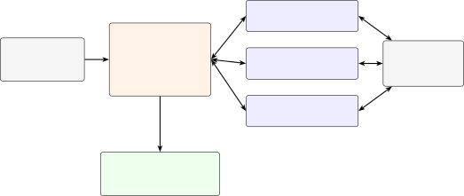
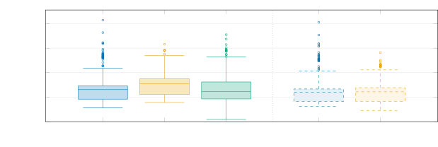
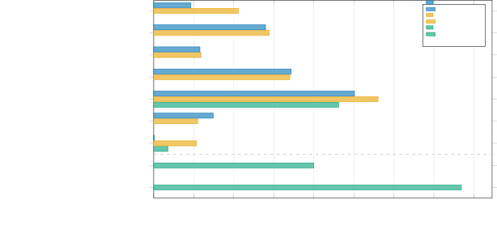
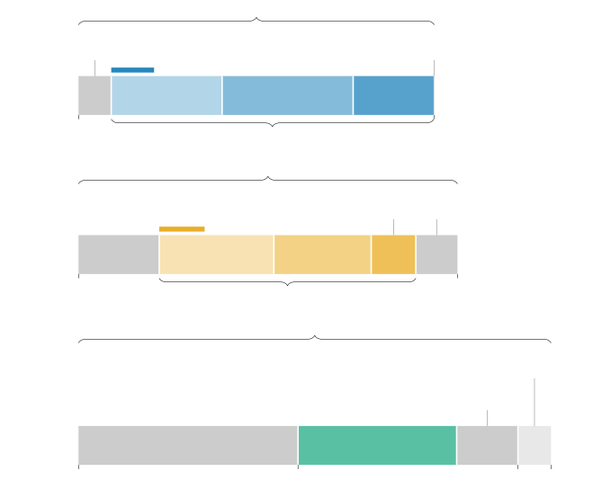
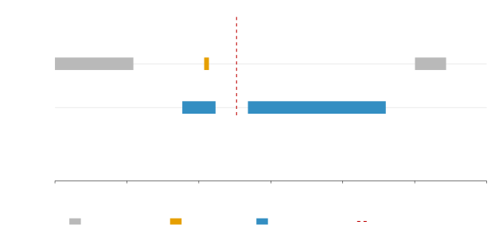

# Latency, Speech Recognition and Turn-Taking in Voice Agents for Spanish Phone Negotiation: An Externally Measured Comparison of Pipecat, LiveKit and GPT-Live

Jovan Popoca Moran Affiliation: AI Lab, Freight Technologies Inc.,
Monterrey, N.L., Mexico    Eduardo de
Avila-Armenta [](https://orcid.org/0000-0003-3461-7722)
Affiliation: AI Lab, Freight Technologies Inc., Monterrey, N.L., Mexico
Affiliation: Tecnológico de Monterrey, School of Engineering and
Sciences, Monterrey, N.L., Mexico    Raúl Alejandro Aquino-Ibarra
Affiliation: AI Lab, Freight Technologies Inc., Monterrey, N.L., Mexico
   Jorge Octavio Nicolás-Díaz Affiliation: AI Lab, Freight Technologies
Inc., Monterrey, N.L., Mexico    Umberto
Leon-Dominguez [](https://orcid.org/0000-0001-5170-2553)
Affiliation: AI Lab, Freight Technologies Inc., Monterrey, N.L., Mexico
Affiliation: School of Psychology, University of Monterrey, Monterrey,
N.L., Mexico

November 14, 2026

###### Abstract

A voice agent that negotiates by phone must answer quickly, understand
spoken amounts and cope with a caller who talks over it. We compared
three architectures for such an agent, negotiating freight rates in
Spanish: two cascades (speech recognition, language model and speech
synthesis) orchestrated by Pipecat and by LiveKit Agents, and GPT-Live,
an OpenAI speech model that listens and speaks without separate stages.
A program played the carrier with the same 47 recordings of one speaker
for all agents, without the telephone network, in 77 calls per
architecture over five negotiation scenarios, and measured latency on
the listener’s side with a validated instrument. Median latency to the
content response was 2,616.0 ms (Pipecat), 3,090.0 ms (LiveKit) and
2,444.8 ms (GPT-Live); the confidence interval of GPT-Live’s 171.2 ms
advantage over Pipecat includes zero. According to its own timestamps,
GPT-Live began to answer 800 ms after the end of the line, close to the
0.8 s published by OpenAI; most of the remaining wait, about 1,367 ms
and nearly constant, is the audio’s round trip through OpenAI’s service.
A tool call added 0.9–1.1 s in every architecture, more than any
difference between them, and the frameworks’ self-reported latency fell
short of the listener’s wait by 9 % (Pipecat) and 22 % (LiveKit). Word
error rates were low (6.03, 4.93 and 1.47 %), but the error on amounts
was 13.01 % and 12.61 % in the cascades, against 2.86 % in GPT-Live.
With default settings, Pipecat and LiveKit stopped at almost every
backchannel and often took it as the carrier’s answer: an “ok” spoken
over the agent ended in a registered agreement in 3 of 15 Pipecat calls,
2 of 15 LiveKit calls and no GPT-Live call (descriptive counts, not
tested). Latency should therefore be measured on the listener’s side,
and a cascade needs safeguards for spoken amounts and backchannels.

Keywords: voice agents $`\cdot`$ speech-to-speech models $`\cdot`$
response latency $`\cdot`$ turn-taking $`\cdot`$ backchannels $`\cdot`$
speech recognition

^(\*)^(\*)footnotetext: Corresponding author. Email:
umberto.leon@udem.edu

## 1 Introduction

Spoken dialogue agents built around large language models (LLMs) are
usually assembled in one of two ways \[1\]. In a cascade, a speech
recognizer (speech-to-text, STT) turns the caller’s audio into text, an
LLM decides the response and a synthesizer (text-to-speech, TTS) turns
that response into audio. Each stage can be chosen, measured and
replaced separately, but their delays add up, and the system needs a
separate detector to decide when the person has finished speaking. In a
native speech model, a single model takes audio in and produces audio
out, and full-duplex models of this kind can listen while they
speak \[2, 3, 4\]; their internal stages, however, cannot be observed or
tuned. Open-source frameworks such as Pipecat \[5\] and LiveKit
Agents \[6\] orchestrate cascades, and providers now offer native speech
models through their APIs \[7\], so a team that builds a voice agent has
to choose between the two.

Speaking in real time raises problems that a text-based agent does not
face. In human conversation, the gap between one speaker’s turn and the
next is short: across ten typologically diverse languages, the most
frequent gap lies between 0 and 200 ms \[8\], which implies that
listeners plan their reply while the other person is still
speaking \[9\]. Overlaps are also frequent \[10\], and many of them are
backchannels, short tokens such as “uh-huh” or “ok” with which the
listener signals attention without claiming the floor \[11, 12\]. A
spoken agent must therefore decide when the caller has finished, when to
yield to an interruption and when to keep talking through a backchannel,
problems that a large body of work on turn-taking addresses \[13, 14,
15\]. How long the agent takes to answer also shapes how users judge it,
and short fillers can soften a longer wait \[16, 17\]. Speech
recognition adds a further difficulty: the word error rate (WER) is a
weak indicator of how well a system understands what was said \[18,
19\], and errors on a few critical words, such as named entities, can
matter far more than the overall rate suggests \[20\].

These requirements are concrete in the application that motivated this
study. SPOTS, a system for spot freight, already negotiates rates with
carriers over WhatsApp, a task that belongs to the broader family of
negotiation dialogues \[21\]. Each negotiation starts from a
configuration with a target price and a maximum price. Transitioning
this negotiation to a voice channel, however, introduces a significant
architectural challenge. If there is no agreement after 30 minutes on
WhatsApp, a voice agent calls the carrier on behalf of the shipper,
inheriting the same configuration to negotiate in Spanish. This modality
adds two critical requirements absent in text-based communication: the
agent must answer in real time, before the silence becomes
uncomfortable, and it must accurately process speech over a telephone
line, which presents poorer audio quality than a standard recording. To
determine which architectural approach best addresses these constraints,
an experiment was designed to compare three distinct voice architectures
under identical conditions. The first architecture is a cascade
orchestrated by the open-source framework Pipecat \[5\]. The second
architecture is an identical cascade, using the same underlying
providers, orchestrated by LiveKit Agents \[6\]. The third architecture
employs GPT-Live \[7\], an OpenAI speech model that listens and speaks
without separate STT or TTS stages, and which delegates tool calls to
the same LLM used by the other two architectures. Hereafter, each
architecture is named after its framework or model: Pipecat, LiveKit and
GPT-Live.

Comparisons between voice frameworks are usually based on
demonstrations, on tests of a single component or on the latency that
each framework reports about itself. Benchmarks for full-duplex models
evaluate turn-taking behaviours such as pause handling, backchannelling
and interruptions \[22\], and the latency that OpenAI publishes for
GPT-Live comes from one such benchmark \[7\]. In the present study, the
three agents heard exactly the same audio: recorded carrier lines,
played by a program instead of a person. Latency was measured outside
the frameworks, on the listener’s side, with the same instrument for all
three (a software measurement harness: a program that plays the
carrier’s lines and timestamps the end of each line and the start of the
agent’s response), and that instrument was checked against a simulated
agent with a known delay over the audio path of each architecture.

The study measures what distinguishes one voice technology from another:
response latency, speech recognition and turn-taking, including what
each agent does when the carrier talks over it. It does not measure
whether the agent negotiates well. The negotiation is the vehicle of the
conversation: it brings domain vocabulary (amounts, places, trade terms)
and forces the agent to call tools in the middle of its response. The
three agents use the same instructions and tools, but not the same
conversational model: in Pipecat and LiveKit the conversation is handled
by gpt-4.1-mini, and in GPT-Live by gpt-live-1, which hands tools over
to gpt-4.1-mini. Each architecture is compared as a whole, with its
default configuration.

The study makes four contributions. First, it provides an external,
validated measurement protocol that can be repeated with other
architectures. Second, it compares latency while separating the weight
of transport and of tool calls. Third, it shows the gap between the WER
and the error on amounts, which are the words that cost money in a
negotiation. Fourth, it describes what each architecture does, with its
default configuration, when the carrier says “ajá” (“uh-huh”) while the
agent is speaking. The results support one central message: under
identical, externally measured conditions, the three architectures
differed less in latency than in how they handled spoken amounts and
backchannels, and the latency that the frameworks reported about
themselves hid most of the transport cost. Section 2 describes the
materials and methods, Section 3 presents the results, Section 4
discusses them together with their limitations, and Section 5 concludes.

## 2 Materials and methods

### 2.1 The three architectures

Table 1 lists what changes between the three architectures. Where the
code of an architecture does not set a parameter, the default of the
framework (Pipecat or LiveKit) or of the service (Deepgram, OpenAI)
applies. Those defaults were not changed, so each architecture runs as
its vendor ships it.

|                         | Pipecat                          | LiveKit Agents                                    | GPT-Live                                                                            |
| ----------------------- | -------------------------------- | ------------------------------------------------- | ----------------------------------------------------------------------------------- |
| Framework               | Pipecat 1.6.0                    | LiveKit Agents 1.6.8                              | None: an in-house bridge to the OpenAI API                                          |
| Conversational model    | gpt-4.1-mini                     | gpt-4.1-mini                                      | gpt-live-1                                                                          |
| Tool calls              | gpt-4.1-mini, from the framework | gpt-4.1-mini, from the framework                  | GPT-Live hands each one to gpt-4.1-mini and can keep talking while it waits         |
| Speech recognition      | Deepgram nova-3, multi mode      | Deepgram nova-3, multi mode                       | Inside the model; a transcript arrives separately                                   |
| Speech synthesis        | ElevenLabs eleven_flash_v2_5     | ElevenLabs eleven_flash_v2_5, same voice          | Inside the model, its default voice                                                 |
| Voice activity detector | Silero, 0.2 s minimum silence    | Silero, 0.55 s minimum silence                    | Internal, not configurable                                                          |
| End-of-turn detector    | Smart Turn v3, local             | TurnDetector v1-mini, local                       | Internal, not configurable                                                          |
| Audio path in the tests | WebSocket on the same machine    | Room on a LiveKit Cloud server, over the internet | Local WebSocket to the bridge; the bridge talks to the OpenAI API over the internet |

Table 1: What changes between the three architectures. Everything else
was the same (Section 2.2)

The study compared orchestrators, not speech recognizers, so Pipecat and
LiveKit used the same STT. Deepgram was chosen because it was the best
integrated with both frameworks, and because in the public comparison of
real-time recognizers maintained by the Pipecat team \[23\] its nova-3
model was among the three fastest and in the more accurate half of the
table (consulted in September 2026). In GPT-Live, when the model decides
that a tool is needed, it opens a request that the OpenAI service hands
to gpt-4.1-mini; the bridge executes it on the same negotiation engine
as the other two architectures and returns the result, and the text with
which gpt-4.1-mini responds goes back to GPT-Live, which says it aloud.
The token counts reported by the service (median of 2,811 input tokens
per request) confirmed that, as in Pipecat and LiveKit, the model that
resolves the tools receives the instructions and the conversation.

### 2.2 Controlled variables

Everything that was not the voice technology was the same in the three
architectures. All three used a single system prompt, unchanged during
the tests and containing the same trip data (Supplementary Material,
Section S1); in GPT-Live, the same text was passed as the session
instructions. All three also used the same four tools, with the same
descriptions and the same negotiation engine. The tool proponer_precio
(propose price) validates an amount before the agent says it and answers
only “accepted” or “rejected”; it rejects an amount above the maximum
price (21,000 pesos, known only to this function) or one that breaks the
rule of decreasing concessions. The tool
ofrecer_compensacion_no_monetaria (offer non-monetary compensation)
records a compensation from the authorized list and returns its exact
wording. The tool registrar_acuerdo (register agreement) closes the call
with an agreement, and finalizar_sin_acuerdo (end without agreement)
closes it without one. The measurement harness and the analysis program
were also the same (Sections 2.4 and 2.9). Finally, all runs used the
same equipment: a PC with Windows 11 (10.0.26200), an AMD Ryzen 5 3400G
with Radeon Vega Graphics processor (8 logical cores) and 16 GB of RAM,
connected to the internet over Wi-Fi.

### 2.3 Stimulus and scenarios

In every call, the carrier (the trucking company with which the agent
negotiates) was simulated: instead of a person, the harness played a set
of 47 recorded lines. A person never says the same sentence twice in the
same way, and over hundreds of calls that variation is as large as the
differences to be measured. With recorded audio, each line sounds the
same in the three architectures, the instant at which the carrier’s
speech ends is known rather than estimated, and the correct text for the
error rate comes from the audio that was played. One of the authors
(J. P. M.) recorded all the lines once, with a headset microphone. Each
file went through the same steps: a gain to bring the speech to
$`-18`$ dBFS, conversion to 8 kHz with an anti-aliasing filter, trimming
of the silence at both ends, $`\mu`$-law encoding (ITU-T G.711, the
telephone format) and the end-of-speech mark, which is the zero of that
line’s latency. Under the speech, the harness added uniform noise at
$`-60`$ dBFS, like the noise floor of a telephone line, and kept sending
it between lines.

Five scenarios of eight turns each confronted the agent with a different
type of carrier (Table 2); all of them used the same trip data. The
lines were written in the Spanish of Mexican carriers. In 6 of the 40
turns, the line that played depended on what the agent said in its
previous response (for example, whether it had already offered 18,000),
so that the conversation still makes sense. The harness decided with
fixed rules, the same in the three architectures, based on what the
agent said, as a carrier would. These branches added 7 alternative lines
to the 40 base lines. A scenario is therefore only the carrier’s side of
the call: the agent was not told which scenario it was in, and every
call started with the same instructions, trip data and tools
(Section 2.2). Fig. 1 shows how a scenario is played and how the harness
chooses each line; amounts were read with the same extractor as the
error on amounts (Section 2.6), so “dieciocho mil” and “18,000” count as
the same number. All lines and rules are listed in the Supplementary
Material (Section S2).


Figure 1: How a scenario is played. A scenario is the carrier’s side of
the call: a script of eight lines, played by the harness one per turn.
The agent does not know which scenario it is in. After each response the
harness reads what the agent said and, in the turns with branches, picks
the next recording with fixed rules, the same for the three
architectures.

| \#  | Scenario                | What it demands from the voice technology                                                                                                                               |
| --- | ----------------------- | ----------------------------------------------------------------------------------------------------------------------------------------------------------------------- |
| 1   | Cooperative             | Baseline: a clean conversation, without pressure and without amounts; it ends in agreement.                                                                             |
| 2   | Moderate haggler        | Several consecutive turns that call proponer_precio; amounts requested again and again, and a self-correction (“Diecisiete… no, dieciocho”, “Seventeen… no, eighteen”). |
| 3   | Aggressive, high anchor | Amounts above the maximum (28,000, 25,000), direct pressure on the ceiling, curt tone; it ends without agreement.                                                       |
| 4   | Non-monetary objection  | Responses that depend on understanding the objection rather than the price: waiting time, delivery date; no amounts.                                                    |
| 5   | Recognition stress test | Long amounts in words, a self-correction of an amount (18,000 to 18,500), place names and trade terms (_tara_, tare; _carta porte_, waybill; _casetas_, toll booths).   |

Table 2: The five scenarios, the same in the three architectures

### 2.4 Harness and latency measurement

Pipecat and LiveKit compute their own latency, but that figure measures
a different interval. It starts when the framework itself detects that
the carrier has stopped speaking, which happens after the actual end of
speech, and it stops when the framework releases the first audio of its
response, before that audio travels to the carrier. The GPT-Live API
does not report the latency of each response, and the figure that OpenAI
publishes for the model, a turn-taking latency of 0.8 s \[7\], measures
the time from when the user finishes a turn until the model starts to
respond, but does not say at which point of the audio path those two
instants are taken (Section 3.3). A harness was therefore built: a
program that played the carrier, listened to the agent and timestamped
both ends on the listener’s side, with the clock of the same computer
and the same rule for the three architectures (Fig. 2, Table 3). Only
the connection to each architecture changed.



Figure 2: Experimental setup. The harness replaces the carrier and is
the same for the three architectures; only the architecture it connects
to changes. Double arrows are audio in both directions.

| Parameter                   | Value                                                                                                                                                                                                                                                                                                              |
| --------------------------- | ------------------------------------------------------------------------------------------------------------------------------------------------------------------------------------------------------------------------------------------------------------------------------------------------------------------ |
| Audio sending               | 20-ms frames ($`\mu`$-law, 8 kHz), each sent at a fixed instant computed from the start of the call, so that delays do not accumulate.                                                                                                                                                                             |
| End of the carrier’s speech | Instant at which the first frame of the line was sent, plus the end-of-speech mark of that audio.                                                                                                                                                                                                                  |
| Agent speech                | A 20-ms frame counts as speech if its level (RMS) reaches $`-44.3`$ dBFS; speech frames separated by less than 0.3 s form a run.                                                                                                                                                                                   |
| Content response            | The first run that starts after the end of the carrier’s audio and lasts at least 0.6 s. If it lasts less than 2.0 s, it is also discarded when its text is a backchannel (three words or fewer from a fixed list: “ajá”, “mm”, “sí”, “ok”, among others), and latency is measured to the next run that qualifies. |
| Next line                   | When the agent has answered and has been silent for 2.0 s; if it does not answer, after 25 s at most.                                                                                                                                                                                                              |

Table 3: Harness parameters, the same in the three architectures

For each line $`i`$, the latency is

```math
L_{i}=t^{\text{agent}}_{i}-t^{\text{end}}_{i}, \tag{1}
```

where $`t^{\text{end}}_{i}`$ is the end of the carrier’s speech and
$`t^{\text{agent}}_{i}`$ the first audible frame of the agent’s content
response. The unit of analysis was the line and not the framework’s
turn, because each end-of-turn detector segments differently. Latency to
the first sound was also reported: up to the agent’s first run of any
kind, whether a filler (“un segundo…”, “one second…”), a short “mm” or
the start of the response. The first measure tells how long the carrier
waits for content; the second, how long until the carrier knows that the
agent has heard. Both ends of the agent’s response rest on the speech
rule of Table 3. A 20-ms frame $`f`$ of the agent’s audio, with samples
$`x_{f,1},\dots,x_{f,n}`$ normalized to $`[-1,1]`$ ($`n=160`$ at 8 kHz),
was counted as speech when

```math
20\log_{10}\sqrt{\frac{1}{n}\sum_{k=1}^{n}x_{f,k}^{2}}\;\geq\;-44.3~\text{dBFS}, \tag{2}
```

and consecutive speech frames separated by less than 0.3 s were joined
into one run.

Observed latency includes the time the audio spends on the way, and that
time is not the same in the three architectures. It was measured in two
parts: inbound transport, from the actual end of speech to the instant
the framework records as that end, and outbound transport, from when the
framework releases its audio until the harness hears it. Both come from
subtracting harness and framework marks taken with the clock of the same
computer. GPT-Live does not publish when it detects that the carrier has
finished, so in GPT-Live only outbound transport can be measured.
Writing $`\tau^{\text{in}}_{i}`$ and $`\tau^{\text{out}}_{i}`$ for the
inbound and outbound transport of line $`i`$, and $`P_{i}`$ for the time
between the two framework marks, the observed latency decomposes as

```math
L_{i}=\tau^{\text{in}}_{i}+P_{i}+\tau^{\text{out}}_{i}, \tag{3}
```

and the latency without transport is
$`\tilde{L}_{i}=L_{i}-\tau^{\text{in}}_{i}-\tau^{\text{out}}_{i}`$,
computed response by response. A line was marked with a tool if there
was any tool call during the whole response, before or after the agent
started speaking. If $`\mathcal{T}`$ is the set of lines with a tool in
a given architecture, the cost of a tool call is estimated as

```math
\Delta_{\text{tool}}=\operatorname*{med}_{i\in\mathcal{T}}L_{i}-\operatorname*{med}_{i\notin\mathcal{T}}L_{i}. \tag{4}
```

Since the LLM decides when to use a tool, the two groups may also differ
in other respects, and the cost is approximate.

In Pipecat and LiveKit, the harness computed latency during the call. In
GPT-Live it was computed after each call, on the harness recording, with
the same two ends; the turns that the bridge log could not locate were
measured directly on the recording with the rule of Table 3 (49 turns,
9 % of those of GPT-Live). When measured in the same way on their
recordings, Pipecat and LiveKit give practically the same medians as
when measured live (2,620.2 versus 2,616.0 ms, and 3,092.1 versus
3,090.0 ms).

For each word that the model hears or says, the GPT-Live API returns its
start and end times in milliseconds (fields start_ms and end_ms). We
call them GPT-Live’s timestamps. They are not clock times: they indicate
where in the session audio each word lies, so they do not include the
time the audio takes to reach the model or to come back, and they
advance somewhat faster than the computer’s clock (in a typical call,
811 ms more over the 119 s between the first and the last line). They
were therefore used only to measure intervals within a single response.
With them, and with the time at which each message from the service
reaches the computer, the wait for each GPT-Live response was split into
four segments that add up to it (Section 3.3). To know which word was
playing when the measured speech started, the audio received from the
service was played back in sequence and in real time from its arrival
time. In addition, to find out whether the connection method matters,
separate GPT-Live sessions were opened over WebSocket, the server-side
method used in the campaign, and over WebRTC, the method that ChatGPT
uses in the browser: 3 alternating sessions per method, with one-line
instructions, without tools, and the same 4 recorded lines in each
session.

### 2.5 Harness validation

A measurement instrument is checked by measuring something whose value
is known; because these checks establish the validity of the instrument
rather than answer the study’s questions, their outcomes are reported
here, with the method. The check was needed for two reasons. First, the
harness decides when the agent starts to speak from the level of its
audio (Eq. 2), so a quiet voice or a soft onset could be detected late.
Second, each architecture reaches the harness over a different audio
path, so a check on one path would not hold for the others. The known
value therefore came from a simulated agent, run over the path of each
architecture: a program that takes the place of the agent, recognizes
which line it is hearing and starts speaking exactly $`d`$ ms after that
line’s end of speech. Six conditions (three delays, two speech levels
and a soft onset, in which an “mm” 12 dB lower precedes the sentence)
were run over the five scenarios, 30 calls and 240 turns per path, and
what the harness reported was compared with what the simulated agent
did, over the actual audio path of each architecture (Table 4). For a
turn $`j`$ in which the harness reported the latency $`\hat{L}_{j}`$,
the measurement error is

```math
e_{j}=\hat{L}_{j}-d, \tag{5}
```

and Table 4 gives the median of $`e_{j}`$ in each condition.

[TABLE]

Table 4: Harness validation against a simulated agent with known delay
$`d`$. Error: latency reported by the harness minus the actual one (ms,
median of each condition). Measured: turns with a latency, out of those
run

On the Pipecat path, which does not depend on any external service, the
largest error in any turn was 86.4 ms, well below the 200 ms margin used
to judge differences (Section 2.9). The negative medians, about
$`-40`$ ms with normal speech, are the distance between two criteria for
the start of speech and not a measurement error. On the LiveKit path the
error is the internet trip to the LiveKit server and back (137.0 ms on
the way in and 117.7 ms on the way back with normal speech), which is
also present in the campaign and is part of what is called transport
here. On the GPT-Live path, the direct measurement on the recording
measured every response, with the same errors as on the Pipecat path.

### 2.6 Speech recognition

The word error rate (WER) counts the substitutions $`S`$, deletions
$`D`$ and insertions $`I`$ needed to turn the transcript into the
correct text (the reference), over the number of words in the reference
$`N_{\text{ref}}`$. The error on amounts, $`E_{\text{amt}}`$, was the
same count restricted to sums of money:

```math
\mathrm{WER}=\frac{S+D+I}{N_{\text{ref}}},\qquad E_{\text{amt}}=\frac{S_{a}+D_{a}+I_{a}}{N_{a}}, \tag{6}
```

where the subscript $`a`$ restricts each count to the amounts and
$`N_{a}`$ is the number of amounts in the reference. Amounts were
singled out because in a negotiation those are the words that cost
money. WER was computed once per call: all the lines the carrier said
and everything the system transcribed were joined in order, and the two
texts were compared, because each system segments turns in its own way.
The rate reported for each architecture adds up the errors of all its
calls and divides them by the reference words of those calls. The last
line was left out if the call closed less than 4 s after it finished
playing, because its transcript did not have time to arrive in full (0
calls in Pipecat, 4 in LiveKit and 13 in GPT-Live). Before comparison,
the texts were normalized: lower case, no accents except “ñ”, no
punctuation, and numbers written in words or in digits treated as equal.

The error on amounts measures the transcript. To compare, with the same
criterion, what each agent understood, the self-correction in
scenario 5, turn 4 was used: _“Yo andaba pensando en dieciocho mil… no,
dieciocho mil quinientos”_ (“I was thinking eighteen thousand… no,
eighteen thousand five hundred”). J. P. M. read the agent’s response to
that line in every call, in random order and blind to the architecture,
and classified it: the agent understood 18,500 if it names or offers
that amount; it understood 18,000 if it attributes that amount to the
carrier (“I understand you are looking for 18,000”); and it cannot be
told if the response only makes a counteroffer or gives no amount.

### 2.7 Interruptions and backchannels

In the main campaign, the carrier never talked over the agent. A
separate scenario tested what each agent does when the carrier does. In
six turns of each call, when the agent had been speaking for 1 s without
a pause, the harness did one of three things: an interruption, a line
with which the carrier takes the floor (“Oiga, ¿eso incluye las
casetas?”, “Listen, does that include the tolls?”), to which the agent
should stop and answer; a backchannel (“ajá”, “mjm”, “sí”), during which
it should keep talking; or a control, in which nothing plays and which
gives the rate at which the agent stops on its own at that moment. Each
call had two events of each type. The agent stopped if its speech broke
off with a silence of at least 0.7 s that starts within 3 s of the
event; the threshold was set before the runs. The time to stop, the
latency of the answer to an interruption, the length of the pause and
whether the agent spoke again within 8 s were also measured.

When the agent stopped at a backchannel and spoke again, what it said
before and after was taken from the recording and the resumption was
classified as: continued the sentence where it left off; repeated an
offer, a clause or the start of the sentence; said something new; took
it as an answer, if it responded as if the backchannel were the
carrier’s answer (for example, it took an “ok” as acceptance of the
price); or cannot tell. J. P. M. classified them, listening to an audio
clip of each resumption and reading its transcript, in random order and
without knowing the architecture; the blinding is not complete, because
the GPT-Live voice is different. In each call that the agent closed with
registrar_acuerdo, what the carrier said just before was also checked: a
line that accepts, a backchannel, a fragment of a line that in full did
not accept, or a line that did not yet accept. The three architectures
ran with the default interruption handling: Pipecat stops at any speech
confirmed by its detector (0.2 s), with no minimum number of words;
LiveKit stops after 0.5 s of speech, with no minimum number of words;
GPT-Live has no options. Before the campaign, a simulated agent that
stops a known time after the interruption was run over the actual path
of each architecture, and the harness detected every interruption with
no false positives.

### 2.8 Procedure and populations

The harness played a line, waited for the agent’s response and played
the next one when the agent had been silent for 2.0 s. Pipecat and
LiveKit ran in one night, alternating one call of each, with the
scenarios cycling from 1 to 5. Alternation spreads any change in the
network or in the providers evenly across the two, and allows each
Pipecat call to be compared with its LiveKit pair, which has the same
scenario and repetition. GPT-Live ran 18 days later, with the same
harness, audio and cycle, on the public GPT-Live API with $`\mu`$-law at
8 kHz, the telephone format. A first GPT-Live campaign with the alpha
version of the API was replaced by this one, because that version was
withdrawn and cannot be repeated; no conclusion rests on it.

After each call, the harness checked five criteria: that every line
played completely, that the agent’s recognizer produced text for every
line, that there are at least five measurable turns, that the agent
answered every line and that no response had text without a single
speech frame. A call that failed any of them was excluded before its
latency was examined. In addition, a combination of scenario and
repetition was included only if its call passed the criteria in all
three architectures, so that the three were compared on exactly the same
set. A total of 90 calls were run per architecture; 2 Pipecat calls, 5
LiveKit calls and 8 GPT-Live calls failed at least one criterion. Since
a combination that fails in one architecture is removed from all three,
77 calls per architecture remained, with 558 measured responses in
Pipecat, 536 in LiveKit and 563 in GPT-Live. The interruption scenario
had three repetitions of the five scenarios per architecture, 15 calls
each, all of them included.

### 2.9 Statistical analysis

Latency was summarized by its median (p50) and its 95th percentile
(p95), with linear interpolation (method 7 of Hyndman and Fan \[24\]): a
few very slow responses, such as those that wait for a tool, raise the
mean, while the median does not move with them. Intervals were 95 %
confidence intervals (95 % CI) obtained by resampling (bootstrap \[25\])
with 10,000 replicates and a fixed seed, drawing whole calls rather than
individual responses, because the responses of one call share the
connection, the provider sessions and the network state. Pipecat and
LiveKit were run in pairs, so their comparison resamples pairs; GPT-Live
ran on another day, so its comparisons are unpaired. Formally, for two
architectures $`A`$ and $`B`$ with sets of calls $`\mathcal{C}_{A}`$ and
$`\mathcal{C}_{B}`$, the estimated difference is

```math
\hat{\Delta}=m(\mathcal{C}_{A})-m(\mathcal{C}_{B}), \tag{7}
```

where $`m(\cdot)`$ is the median of all the responses in a set of calls.
In replicate $`b=1,\dots,n_{\text{rep}}`$, with
$`n_{\text{rep}}=10{,}000`$, the calls of each set are drawn with
replacement (pairs of calls for Pipecat versus LiveKit), giving
$`\hat{\Delta}^{*}_{b}`$, and the 95 % CI is $`[q_{0.025},q_{0.975}]`$,
the 2.5th and 97.5th percentiles of $`\{\hat{\Delta}^{*}_{b}\}`$.

A difference can be real and still too small to change the choice of
technology. Before any comparison was computed, a margin of 200 ms was
set. It is a criterion of this study, not a standard: no standard states
from how many milliseconds a latency difference becomes noticeable in a
call. Each difference was read according to where its 95 % CI fell
(Table 5).

| If the 95 % CI of the difference…                            | Verdict                                           |
| ------------------------------------------------------------ | ------------------------------------------------- |
| includes zero and lies entirely within $`\pm 200`$ ms        | equivalent in practice                            |
| includes zero and extends beyond $`\pm 200`$ ms on some side | not distinguishable from zero                     |
| excludes zero and lies entirely within $`\pm 200`$ ms        | different from zero, below 200 ms                 |
| excludes zero and lies entirely outside $`\pm 200`$ ms       | different from zero, above 200 ms                 |
| excludes zero and crosses $`\pm 200`$ ms                     | different from zero; may or may not exceed 200 ms |

Table 5: How the 95 % CI of a difference is read against the 200 ms
margin

As a second check, rank tests were applied to the median of each call
($`N=231`$), because the responses of one call are not independent:
Kruskal–Wallis \[26\] for the three architectures, the Wilcoxon
signed-rank test \[27\] for Pipecat versus LiveKit (paired) and the
rank-sum test for GPT-Live versus each of the others (unpaired), with
Bonferroni correction \[28\] over the three pairs, so that a raw
$`p`$-value is reported as $`p_{\text{corr}}=\min(1,3p)`$. The same
tests were applied to the WER, the character error rate and the error on
amounts of each call (for amounts, only the calls whose reference
contains at least one), each with its effect size: ordinal epsilon
squared, $`\varepsilon^{2}_{R}=H/(N-1)`$, for Kruskal–Wallis, and
$`r=Z/\sqrt{N}`$ for each pair, where $`Z`$ is the standardized
statistic of the test and $`N`$ the number of calls compared (of pairs,
in the paired test) \[29\]. Because each architecture heard a somewhat
different mix of lines, owing to the branches and to the point at which
each agent closes, the latency comparisons were repeated in two ways:
resampling the calls within each scenario, so that the two architectures
compared have the same mix of scenarios, and giving equal weight to each
of the 38 lines heard by all three architectures. The second uses the
estimator

```math
\Delta_{\text{line}}=\frac{1}{|\mathcal{K}|}\sum_{k\in\mathcal{K}}\bigl(m_{A,k}-m_{B,k}\bigr), \tag{8}
```

where $`\mathcal{K}`$ is the set of lines heard by all three
architectures ($`|\mathcal{K}|=38`$) and $`m_{A,k}`$ is the median
latency of line $`k`$ in architecture $`A`$. Its interval resamples
whole calls of each architecture, as in the other comparisons. In the
interruption scenario, eight hypotheses set before the campaign were
tested, each with one value per call, paired by scenario and repetition,
with the signed-rank test and Bonferroni correction (each requires
$`p<\alpha^{\prime}=0.05/8=0.00625`$). All eight hypotheses, with their
variables, comparisons, $`p`$-values and decisions, are listed in the
Supplementary Material (Section S3). Everything else was descriptive,
and counts that were not tested are flagged as such.

### 2.10 Uncontrolled differences

No comparison between three different architectures is fully symmetric,
and five differences remain. The first is transport. Pipecat ran on the
same machine as the harness, the LiveKit audio went over the internet to
a LiveKit Cloud server and back, and the GPT-Live bridge talked to the
OpenAI API over the internet. This favours Pipecat, so both the observed
latency and the latency without transport are reported. The second is
the silence that the voice activity detector waits for: 0.2 s in
Pipecat, 0.55 s in LiveKit and unknown in GPT-Live. It favours Pipecat
in latency and LiveKit in mid-sentence cuts. The third is the Deepgram
configuration: each framework sends its own defaults (profanity filter,
filler words, end-of-speech wait), and these were not equalized. The
fourth concerns tools and fillers. GPT-Live can speak while it waits for
a tool result and sometimes opens with a filler, whereas Pipecat and
LiveKit usually wait in silence; latency is therefore reported with and
without a tool, up to the tool result and to the first sound. The fifth
concerns days and voices: GPT-Live ran on another day, and its voice is
the model’s own rather than ElevenLabs’.

The code of the three architectures, of the harness, of the simulated
agents and of the analysis is publicly available, together with the
exported tables behind each figure (see Declarations). Every number in
Section 3 is written into this document by the analysis program; none
was typed by hand.

## 3 Results

### 3.1 Response latency

Table 6 summarizes the latency of the three architectures and Fig. 3
shows its distribution. Table 7 gives the differences between them, with
their verdicts. The boxes are wide for different reasons. In Pipecat the
width comes mostly from tool calls: without them, its interquartile
range shrinks from 1,074 to 310 ms. In LiveKit it comes from the
end-of-turn detector, which in 31.2 % of the responses judged that the
carrier had not finished and waited its maximum of 2.5 s (median
2,501 ms) instead of the usual 578 ms. In GPT-Live it comes from the
time the model took to start answering according to its timestamps
(segment 2 in Table 8), since the rest of the wait was nearly constant
(Section 3.3).

[TABLE]

¹GPT-Live does not publish when it detects that the carrier has
finished, so its inbound transport cannot be measured.

Latency without transport is computed response by response and its
median is then taken, so it is not the difference of the medians above.
Own figure: Pipecat’s marks and LiveKit’s e2e_latency metric. Cost of a
tool call: median with a tool minus median without one, within the same
architecture.

Table 6: Response latency (ms). Under each median, in brackets, its 95 %
CI



Figure 3: Distribution of the latency to the content response. Boxes
span the 25th to the 75th percentile, the line is the median and the
whiskers reach the last value within 1.5 times the box height; the
values beyond the whiskers are drawn as points, and no response was left
out. On the right, Pipecat and LiveKit without transport; GPT-Live has
no such figure.

|                                             |            |                            |                                                   |
| ------------------------------------------- | ---------- | -------------------------- | ------------------------------------------------- |
| Comparison                                  | Difference | 95 % CI                    | Verdict                                           |
| Pipecat $`-`$ LiveKit (paired, 77 pairs)    |            |                            |                                                   |
| All responses                               | $`-`$474.0 | \[$`-`$583.0, $`-`$404.5\] | different from zero, above 200 ms                 |
| Without transport                           | $`-`$25.2  | \[$`-`$106.6, 43.1\]       | equivalent in practice                            |
| Pipecat $`-`$ GPT-Live (unpaired)           |            |                            |                                                   |
| All responses                               | 171.2      | \[$`-`$3.2, 322.5\]        | not distinguishable from zero                     |
| Without outbound transport¹¹footnotemark: 1 | 239.5      | \[74.1, 396.9\]            | different from zero; may or may not exceed 200 ms |
| Resampling within each scenario             | 171.2      | \[52.1, 295.5\]            | different from zero; may or may not exceed 200 ms |
| Equal weight per line                       | $`-`$19    | \[$`-`$172, 127\]          | equivalent in practice                            |
| Up to the tool result                       | 83.0       | \[$`-`$156.6, 279.0\]      | not distinguishable from zero                     |
| To the first sound                          | 471.4      | \[348.1, 559.0\]           | different from zero, above 200 ms                 |
| LiveKit $`-`$ GPT-Live (unpaired)           |            |                            |                                                   |
| All responses                               | 645.2      | \[475.1, 825.3\]           | different from zero, above 200 ms                 |
| Equal weight per line                       | 497        | \[323, 600\]               | different from zero, above 200 ms                 |

¹The median of its outbound transport is subtracted from each
architecture; the inbound transport of GPT-Live cannot be measured.

Up to the tool result: in the three architectures, responses that
started before the result of a price or compensation tool arrived are
measured up to that result. Equal weight per line: the median of each
line in each architecture, averaged over the 38 lines heard by all
three.

Table 7: Differences in median latency (ms), first architecture minus
second. A negative value means that the first architecture answers
sooner

#### LiveKit was the slowest, because of its transport.

LiveKit was 474.0 ms behind Pipecat and 645.2 ms behind GPT-Live, with
intervals entirely outside the 200 ms margin, and it remains the slowest
under every way of counting. Its two transports add up to about 637 ms
(423.1 inbound and 213.8 outbound), against 188 ms in Pipecat (Fig. 4).
Without transport, Pipecat and LiveKit are equivalent in practice
($`-`$25.2 ms). The language model and the recognizer took almost the
same time in both cascades (687 versus 680 ms to the first LLM chunk,
and 231 versus 237 ms to the final transcript): neither framework sped
up or slowed down its providers. The recognizer’s time agrees with the
public benchmark maintained by the Pipecat team, which measures it in
the same way, from the end of speech to the final transcript, although
on a different set of recordings, and reports a median of 247 ms for
nova-3 \[23\]. Recognition does not lengthen the wait, because it runs
while the end-of-turn detector decides, and it finished before the
detector in 99.3 % of the responses in Pipecat and 100.0 % in LiveKit
(Fig. 5).



Figure 4: Where the time of a response goes: median of each stage, in
ms. In the cascades, the stages come from the internal marks of Pipecat
and LiveKit (end of turn: from the end of speech to the decision that
the turn has ended; recognition: to the final transcript; language
model: to the first chunk of the response, without a tool; synthesis: to
the first chunk of audio), and transport and the cost of a tool call
come from the harness. GPT-Live does not separate those stages: its two
rows are what it took according to its own timestamps and what those
timestamps do not include (Section 3.3). The bars cannot be added up,
because some stages run at the same time (the recognizer transcribes
while the detector decides whether the carrier has finished) and each
was measured separately.

#### There is no clear winner between Pipecat and GPT-Live.

Taking the median of all responses, GPT-Live is 171.2 ms ahead of
Pipecat, but the interval includes zero (not distinguishable from zero).
Two ways of counting do exclude zero: removing outbound transport, which
favours Pipecat (2.6 versus 71.0 ms), and resampling within each
scenario. The others give no winner: with equal weight for each line of
the script the two are equivalent in practice, and Pipecat was faster on
23 of the 38 lines; up to the tool result the difference is not
distinguishable from zero; and the rank test on the median of each call
does not separate them either ($`p=1.000`$, corrected). GPT-Live’s
advantage in the overall median comes from the lines that were heard
most often, not from all of them. By scenario, GPT-Live had the lowest
median in scenarios 1 and 4, the two in which the carrier says no
amounts, and Pipecat in scenarios 2, 3 and 5.

### 3.2 Latency reported by the frameworks

With their own metrics, Pipecat reported a median of 2,371.0 ms when the
listener waited 2,616.0 ms, 245 ms (9 %) less, and LiveKit 2,417.3 ms
against 3,090.0 ms, 673 ms (22 %) less. What is missing is mostly the
two transports: the heard latency minus them is 2,414.3 ms in Pipecat
and 2,439.6 ms in LiveKit, close to what each framework reports. With
the frameworks’ own figures the two would have looked almost the same
(2,371.0 versus 2,417.3 ms), and the 474.0 ms that, as deployed, LiveKit
made the carrier wait beyond Pipecat would have remained hidden. Fig. 5
shows where the difference lies in a typical response without a tool:
each framework counts the end of turn, the language model and synthesis,
and leaves out the two transports.

### 3.3 The published GPT-Live figure and the measured wait

OpenAI announces a turn-taking latency of 0.798 s for GPT-Live, counted
from when the user finishes a turn until the model starts to
respond \[7\]; the announcement does not say at which point of the audio
path those two instants are taken. In the campaign, the listener waited
a median of 2,444.8 ms. The two figures do not contradict each other:
they measure different segments of the same path, which runs from the
end of the carrier’s speech to the moment the carrier hears the answer.
Table 8 gives the median of each segment for the 560 GPT-Live responses
in which the word that started the speech could be located (out of 563),
and Fig. 5 draws a typical response next to a typical response of each
cascade. The wait divides into four consecutive segments, numbered as in
the table. The first, and the longest, runs from the end of speech until
the OpenAI service returns the text of the last word of the line
(1,082 ms). The second, measured with GPT-Live’s timestamps, runs from
the end of that last word to the start of the answer (800 ms; 600 ms
without a tool and 1,400 ms with one); it is the time the model took to
answer, and the segment that resembles the published figure. The third
is the time the answer took to reach the study computer beyond the two
previous segments (297 ms). The fourth runs from the computer to the
carrier’s ear, including the playback queue (171 ms).

Segments 1 and 3 take place in the network and in the OpenAI service and
add up to 1,367 ms, almost the same in every response (interquartile
range from 1,284 to 1,464 ms) and with or without a tool. The network is
a small part of this: opening a connection to the entry server of the
API takes about 42 ms round trip. GPT-Live’s timestamps do not include
these two segments, because they indicate where each word lies in the
audio, not when the service processed it (Section 2.4). This is why the
published figure resembles segment 2 and not the whole wait.

|                                                          | All                    | Without a tool | With a tool |
| -------------------------------------------------------- | ---------------------- | -------------- | ----------- |
| Responses                                                | 560                    | 376            | 184         |
| 1. Until the service returns the text of the last word   | 1,082 \[990, 1,178\]   | 1,085          | 1,078       |
| 2. According to GPT-Live’s timestamps                    | 800 \[400, 1,600\]     | 600            | 1,400       |
| 3. Until the answer reaches the computer, beyond 1 and 2 | 297 \[233, 344\]       | 291            | 309         |
| 4. From the computer to the ear                          | 171 \[115, 209\]       | 169            | 185         |
| Measured wait                                            | 2,448 \[1,866, 3,234\] | 2,147          | 3,068       |
| in the network and the OpenAI service (1 and 3)          | 1,367 \[1,284, 1,464\] | 1,358          | 1,380       |
| outside GPT-Live’s timestamps (1, 3 and 4)               | 1,537 \[1,424, 1,656\] | 1,526          | 1,563       |

In each response, the four segments add up to the measured wait. Their
medians, however, do not add up to the median of the wait (2,350 versus
2,448 ms), because each median comes from a different response. Segment
3: from the arrival of the text of the last word to the arrival of the
word that starts the answer, minus segment 2. Segment 4: includes the
playback queue.

Table 8: The four segments of the wait for a GPT-Live response. Median
\[25th percentile, 75th percentile\], in ms



Figure 5: The segments of a typical response of each architecture,
without a tool and with each segment close to its median, on the same
time scale. In colour, what each architecture’s own figure covers: in
Pipecat and LiveKit, the latency that the framework reports (end of
turn, language model and synthesis); in GPT-Live, in green, the segment
measured by its timestamps, which resembles the figure published by
OpenAI. In grey, what those figures leave out. In the cascades, the thin
bar above the end of turn is speech recognition (STT): it starts at the
same end of speech and runs while the detector decides whether the turn
has ended, so it does not lengthen the response. In LiveKit the language
model starts before the end of the turn is confirmed (preemptive
generation, on by default) and synthesis waits for the confirmation, so
its bar shows only the part of the language model that comes after it;
in the median, 189 ms of the language model ran during the end-of-turn
wait.

The separate sessions confirm that segments 1 and 3 do not depend on
what the agent says. With one-line instructions and no tools, the model
began to answer almost as the line ended, according to its timestamps
(median of $`-`$200 ms over WebSocket and 0 ms over WebRTC). Even so,
its first audio arrived 1,228 and 1,342 ms after the end of speech: the
part not covered by its timestamps was 1,394 and 1,368 ms (12 lines per
method), almost the same as segments 1 and 3 in the campaign. Those
sessions seem faster only because the model hardly took any time to
decide what to say. Connecting over WebRTC did not shorten the path.

From the outside it cannot be determined in which part of the service
those 1,367 ms are spent: receiving the audio, transcription, waiting
for computation or encoding the voice. The split between segments 1 and
3 also assumes that the service returns the text of a word as soon as
the model hears it; if it returns it later, part of segment 1 would
belong to segment 3, and the sum of the two would not change.

### 3.4 Tool calls

In Pipecat and LiveKit, about two out of three responses included a tool
call (65.2 % in Pipecat and 65.1 % in LiveKit), and each call added
about one second (Table 6): it is the most expensive layer of the wait
in both cascades (Fig. 4). Without a tool, Pipecat was the fastest
(1,807.0 ms), and GPT-Live (2,145.1 ms) was close to LiveKit
(2,110.0 ms). The overall median of GPT-Live is low mainly because it
uses tools in fewer responses (32.9 %). It is not that it uses them
later: counting only the calls made before the agent starts to speak
lowers the proportion to 58.4 % in Pipecat and 59.1 % in LiveKit, but
leaves GPT-Live at 32.5 %. In 79 of the 121 GPT-Live responses that
waited for a price or compensation result (65 %), the agent had already
started to speak before it had the result, a median of 653 ms earlier.
Measured up to the result in all three, the medians are 2,623.5 ms in
Pipecat, 3,095.0 ms in LiveKit and 2,540.5 ms in GPT-Live.

### 3.5 Latency to the first sound

In most responses the first sound is the response. A short preceding
sound appeared in 25.0 % of the GPT-Live responses, 12.4 % of the
Pipecat responses and 4.7 % of the LiveKit responses, but it is not the
same thing in all of them. In Pipecat it is not a filler: it is the
start of the response itself (“Perfecto, Carlos.”, “Perfect, Carlos.”),
followed by a short pause and the rest; since it lasts less than 0.6 s,
the harness measures to what follows, which counts against Pipecat. In
GPT-Live it is a filler (“mm”, “déjame revisar”, “let me check”),
sometimes while it waits for a tool. Measured to the first sound,
GPT-Live is 471.4 ms ahead of Pipecat (different from zero, above
200 ms): the carrier hears the agent sooner, even though the content
does not arrive sooner.

### 3.6 Speech recognition

[TABLE]

¹Only the calls whose reference contains at least one amount: scenarios
1 and 4 have none.

Size of the reference: 5,905, 5,725 and 5,913 words, and 123, 111 and
140 amounts, in Pipecat, LiveKit and GPT-Live. Tests: Kruskal–Wallis
among the three architectures; Wilcoxon signed-rank test for Pipecat
versus LiveKit (paired by scenario and repetition) and rank-sum test for
each cascade against GPT-Live, with Bonferroni correction over the three
pairs ($`p_{\text{corr}}=\min(1,3p)`$). Effect sizes:
$`\varepsilon^{2}_{R}=H/(N-1)`$ for Kruskal–Wallis and $`r=Z/\sqrt{N}`$
for each pair, with $`N`$ the calls compared (the pairs, in the paired
test) \[29\]; an $`r`$ of 0.1, 0.3 and 0.5 is conventionally read as
small, medium and large.

Table 9: Recognition errors by architecture (%), computed per whole
call, and the tests between architectures. Under each error, in
brackets, its 95 % CI

GPT-Live made fewer recognition errors (Table 9): Pipecat made 4.1 times
as many errors per word and LiveKit 3.3 times as many. Kruskal–Wallis on
the WER of each call gives $`p<0.001`$; with Wilcoxon and Bonferroni,
Pipecat versus GPT-Live gives $`p<0.001`$ ($`r=0.73`$), LiveKit versus
GPT-Live $`p<0.001`$ ($`r=0.69`$) and Pipecat versus LiveKit $`p=0.001`$
($`r=0.40`$); the character error rate gives the same picture (Table 9).
Pipecat and LiveKit use the same recognizer, but each framework sends it
its own defaults. Two of those differences do not explain the gap
between them: Pipecat’s profanity filter did not mask any word, and
removing filler words (“eh”, “mmm”) lowers the WER by the same amount in
both, so that Pipecat versus LiveKit still gives $`p=0.003`$. GPT-Live
had the lowest WER in all five scenarios.

The error on amounts is where the difference matters most, because those
are the words that cost money. Compared call by call, both cascades
misheard more amounts than GPT-Live (Pipecat $`p=0.006`$, $`r=0.32`$;
LiveKit $`p=0.018`$, $`r=0.29`$), and the two cascades did not differ
from each other ($`p=1.000`$). The effect sizes are medium rather than
large because each call contains only a few amounts, so most calls had
no error on amounts in any architecture. The errors of Pipecat and
LiveKit are concentrated in scenario 5, with long amounts and
self-corrections, and in scenario 3, with repeated high amounts. When
the response shows what the agent understood (Table 10), Pipecat and
LiveKit understood 18,000 almost always (7 of 8 in Pipecat and 4 of 4 in
LiveKit), and GPT-Live understood 18,500 in all of them (7 of 7). The
error comes from the transcript and not from the language model:
Deepgram lost the “quinientos” (five hundred) in most Pipecat and
LiveKit calls, and in every response that understood 18,000 the
transcript said “dieciocho mil” without it. The language model repeated
what it read. This is a single line of the script, with 13 calls per
architecture: enough to see the difference, not to estimate its size
precisely.

|          |           |                              |                               |                   |                   |
| -------- | --------- | ---------------------------- | ----------------------------- | ----------------- | ----------------- |
|          | Responses | Transcript with “quinientos” | The response shows the amount | Understood 18,500 | Understood 18,000 |
| Pipecat  | 13        | 2                            | 8                             | 1                 | 7                 |
| LiveKit  | 13        | 4                            | 4                             | 0                 | 4                 |
| GPT-Live | 13        | 13                           | 7                             | 7                 | 0                 |

Transcript: the one received by the language model (in GPT-Live, the
service’s transcript, which the delegate reads).

Table 10: Which amount the agent understood when the carrier said
_“dieciocho mil… no, dieciocho mil quinientos”_ (scenario 5, turn 4)

### 3.7 Turn-taking

Each architecture fails in a different way. Pipecat’s detector cut 513
times in the middle of a line, almost one extra cut per line, but
Pipecat joined the pieces before answering, and there was only 1 speech
overlap in 77 calls. LiveKit cut in the middle of a line 43 times: its
0.55 s wait buys fewer cuts at the price of waiting longer in every
turn. GPT-Live does not allow its cuts to be counted, and it was the
only one in which the two voices overlapped with some frequency: 26
times, in 20 of its 77 calls. In 22 of them the agent had paused in the
middle of its response, the harness took the 2 s of silence as the end
of the turn and played the next line, and the agent resumed its response
just as the line began: it was the harness that talked over the agent.

### 3.8 Interruptions and backchannels

|                                          |             |             |             |
| ---------------------------------------- | ----------- | ----------- | ----------- |
|                                          | Pipecat     | LiveKit     | GPT-Live    |
| Calls                                    | 15          | 15          | 15          |
| A. Stopping behaviour                    |             |             |             |
| Interruption (expected: stop and answer) |             |             |             |
| Stopped                                  | 26/27       | 22/22       | 25/26       |
| Time to stop, median (ms)                | 344         | 878         | 1,242       |
| interquartile range                      | 234–448     | 856–903     | 391–1,387   |
| Backchannel (expected: keep talking)     |             |             |             |
| Stopped                                  | 26/28       | 21/22       | 20/29       |
| Spoke again within 8 s                   | 26/26       | 21/21       | 19/20       |
| Pause length, median (ms)                | 2,149       | 3,331       | 1,241       |
| interquartile range                      | 1,534–2,923 | 2,458–4,142 | 1,008–2,038 |
| Control (nobody speaks: base rate)       |             |             |             |
| Stopped on its own                       | 0/28        | 0/22        | 13/29       |
| B. Resumptions and agreements            |             |             |             |
| Resumptions after a backchannel          | 26          | 21          | 19          |
| continued the sentence                   | 5           | 5           | 10          |
| repeated or restarted                    | 5           | 3           | 4           |
| said something new                       | 6           | 7           | 2           |
| took it as an answer                     | 10          | 5           | 1           |
| Calls closed with an agreement           | 12          | 13          | 10          |
| without the carrier’s acceptance         | 5           | 7           | 1           |
| after an “ok” spoken over the agent      | 3           | 2           | 0           |

Fractions count the events that played while the agent was speaking,
excluding those during the farewell. “Spoke again” counts, among the
times the agent stopped, those in which it spoke again within 8 s.
LiveKit and GPT-Live times include the path between the harness and the
agent.

Table 11: Interruption scenario: how often each agent stopped, how long
it took, what it said when it resumed and which agreements it
registered. Fractions are events in which the agent stopped out of the
events played while it was speaking

Faced with an interruption, all three stopped and answered (Table 11).
Pipecat stopped fastest (median of 344 ms); the 878 ms of LiveKit
include its transport, and GPT-Live took the longest (1,242 ms). Faced
with a backchannel, Pipecat and LiveKit almost always stopped: with
their default settings they treated the “ajá” as an interruption (26/28
backchannels in Pipecat and 21/22 in LiveKit) and spoke again after a
median pause of 2,149 ms in Pipecat and 3,331 ms in LiveKit. They never
stopped in a control: they deliver their response in full, without
pauses. GPT-Live stopped at 20/29 backchannels, but also in 13/29
controls, with nobody speaking: it makes pauses of about one second
(median of 1,308 ms) in the middle of its responses.

When resuming, GPT-Live continued the sentence where it had left off in
10 of 19 resumptions, Pipecat in 5 of 26 and LiveKit in 5 of 21. The
most common outcome in Pipecat was to take the backchannel as the
carrier’s answer (10 cases), and GPT-Live did so in 1. One example of
each case, with the backchannel in brackets: Pipecat took it as an
answer in “Carlos, le puedo ofrecer” \[Mjm\] “Entonces, para confirmar,
le ofrezco diecisiete mil quinientos pesos por el viaje de Monterrey a
Laredo…” (“Carlos, I can offer you” \[Mm-hm\] “So, to confirm, I offer
you seventeen thousand five hundred pesos for the trip from Monterrey to
Laredo…”); GPT-Live continued in “Me da gusto que lo vea así.” \[Ajá\]
“Y para hacerlo todavía más atractivo, también le puedo dar prioridad
para la siguiente ruta disponible en la zona.” (“I am glad you see it
that way.” \[Uh-huh\] “And to make it even more attractive, I can also
give you priority for the next available route in the area.”). The
behaviour is what one would expect from each architecture: in Pipecat
and LiveKit the backchannel cuts the response in progress and the
language model writes a new one, with the “ajá” as one more carrier
turn; GPT-Live listens while it speaks and can resume where it was.

Reviewing the resumptions revealed an effect that the scenario was not
looking for: in Pipecat and LiveKit, an “ok” or a “sí, sí” spoken over
the agent could close the deal. Pipecat registered the agreement right
after a backchannel in 3 of its 15 calls, LiveKit in 2 and GPT-Live in
none. In one Pipecat call (Fig. 6) the carrier had asked for 18,000; the
agent began “Carlos, puedo subir la oferta a dieciséis…” (“Carlos, I can
raise the offer to sixteen…”), an “Ok” was heard and the agent
registered the agreement at 16,500. In the conversation log, the agent’s
message appears in full, with the question “¿Quedamos así, con ese monto
y esas condiciones?” (“Do we agree on that amount and those
conditions?”), even though only its beginning was heard, and the “Ok.”
comes right after it as a carrier turn: for the language model, the
backchannel reads as the answer to that question. In total, an agreement
was registered without the carrier’s acceptance in 5 of the 12
agreements of Pipecat, 7 of the 13 of LiveKit and 1 of the 10 of
GPT-Live. These are counts over 15 calls per architecture and were not
tested.



Figure 6: The Pipecat call in which an “ok” spoken over the agent closed
the deal (lines translated from Spanish). Bars show each side’s speech,
coloured as in the legend. The recognizer returned “Ándele, una buena
ruta y se la hago rápida. Diecisiete, no.” and dropped the “dieciocho
mil” (eighteen thousand). The agent stopped 0.8 s after the “Ok.” began,
registered the agreement 2.3 s later, before asking for confirmation,
and hung up as the next line started.

Of the eight hypotheses tested, only one passes the correction: when it
stops at a backchannel, GPT-Live makes a shorter pause than LiveKit
(1,241 versus 3,331 ms median, $`p`$ $`<`$0.001). That pause lasts as
long as the pauses it makes without a backchannel, so it does not show
that the “ajá” causes it. That GPT-Live stops less often than the other
two, that the backchannel makes it stop more often than the control
($`p=0.130`$) and that it continues the sentence more often ($`p=0.031`$
against Pipecat and $`p=0.090`$ against LiveKit) point in the same
direction, but these results do not pass the correction. That Pipecat
and LiveKit take the backchannel as an answer more often than GPT-Live
was not among the hypotheses and was not tested.

## 4 Discussion

Under identical, externally measured conditions, the three architectures
differed less in latency than in how they handled spoken amounts and
backchannels, and the latency that the frameworks reported about
themselves hid most of the transport cost. The paragraphs below take
each part of this message in turn.

#### Why listening matters more than speed.

Three arguments support this reading of the results. First, the
consequences differ in kind: a misheard amount or an agreement closed on
an “ok” changes the outcome of the negotiation, whereas the latency
differences between the architectures were fractions of a second
(Table 7). Second, a wait can be softened and a misheard word cannot:
fillers make a delay feel shorter \[16, 17, 30\], but no filler repairs
an amount that the agent did not hear. Third, the median wait of the
three architectures, from 2,444.8 to 3,090.0 ms, stayed below the 4 s
beyond which delays degraded the quality of experience with LLM-powered
virtual agents \[17\], although in all three the 95th percentile
exceeded that threshold (Table 6). Listening while speaking therefore
covers three abilities, and the architectures differed in all of them:
hearing the words that matter, knowing when to stop and when to keep
talking, and filling the wait while a tool runs.

#### Expected and observed latency.

GPT-Live was expected to be the fastest, because it has no separate
stages. Measured with the same instrument as the other two, it cannot be
said to be: with the median of all responses it is 171.2 ms ahead of
Pipecat, a difference that is not distinguishable from zero; with equal
weight per line the two are equivalent in practice; and without tools
Pipecat is faster. GPT-Live’s overall median does not come from faster
processing, but from using tools in fewer responses and from the
scenarios without amounts. What GPT-Live does do is make itself heard
sooner: it opens with a filler and responds to the first sound 471.4 ms
before Pipecat. This difference between being heard and answering could
explain why a conversation with a native speech model feels more fluid
than its latency suggests, in line with earlier findings that fillers
soften the perception of a delayed response \[16, 17\]. In a recent
study with embodied agents in virtual reality, conversational and
gestural fillers during the wait improved the perceived response time
and the perceived humanlikeness and naturalness of the agent \[30\];
that study combined speech with gestures, whereas a telephone call
carries only speech. Nor is there a contradiction with the figure
published for GPT-Live: according to its own timestamps it took 800 ms,
close to the announced 0.8 s. The difference with what the carrier
waited is the time the audio takes to travel through the network and the
OpenAI service and back, about 1,367 ms and nearly constant, which those
timestamps do not include: most of it passes before the service returns
the text of the last word of the line, and it did not change when
connecting over WebRTC (Section 3.3).

#### External measurement of latency.

The metrics that Pipecat and LiveKit report about themselves fell short
of the carrier’s wait, by 9 % in Pipecat and 22 % in LiveKit, and with
them the two frameworks would have looked the same. The figure published
for GPT-Live falls short in the same way: it resembles how long the
model takes according to its own timestamps, not what the caller waits,
and the difference is the trip of the audio through the network and the
service, the largest part of that wait. To compare architectures, and to
monitor in production what the caller actually waits, latency has to be
measured on the listener’s side and the instrument checked against a
known delay, as was done here. The protocol does not depend on the
architecture: it is enough to connect the harness to the new agent and
repeat the validation over its audio path.

#### Composition of the wait.

Fig. 4 shows, stage by stage, where the time of a response goes, and
three points stand out. First, the tool call is the most expensive
stage: in all three architectures it added 0.9 to 1.1 s, more than any
difference between frameworks. Second, the stages that the frameworks
orchestrate (end of turn, recognition, language model and synthesis)
took similar median times in Pipecat and LiveKit, so what separates the
two cascades is transport (188 ms in Pipecat against 637 ms in LiveKit).
Third, most of GPT-Live’s wait lies outside its own timestamps, in the
trip of the audio through the network and the service. A negotiation
uses tools in many of its turns, so the changes with the greatest effect
on the carrier’s wait do not depend on the architecture: a faster LLM
for the tools, validating prices in advance, or a brief filler as soon
as a tool is called (“un segundo”, “one second”), which would not
shorten the wait but, according to the studies cited above, would make
it feel shorter \[17, 30\]. GPT-Live already starts to speak before it
has the result in 65 % of the responses that wait for one. That speed
has a cost in control: GPT-Live called the compensation tool 31 times,
against 122 and 123 times for Pipecat and LiveKit, although it offered
compensations verbally as often as they did, and in 61 of its 77 calls
it stated at least one compensation that the tool did not record (16 in
Pipecat and 20 in LiveKit); in one call it offered 24,000 pesos, above
the maximum, after the tool had rejected the amounts it tried. These
counts were not tested, but they indicate that a model that speaks while
it waits for the tool can say what the tool did not validate.

#### Deployment and transport.

Compared with LiveKit, all of Pipecat’s advantage lies in transport, and
part of it is the trip to a cloud server that Pipecat did not make,
because it ran on the same computer as the harness. In production all
three would also pay for the transport of the telephone network, so
Pipecat’s local advantage would not carry over as it is. Much of
LiveKit’s latency depends on where its media server is deployed, which
the framework requires by design. A published comparison of the two
frameworks \[31\] describes this difference: LiveKit is used with its
cloud service or with a self-hosted server, whereas with Pipecat the
team provides the infrastructure and can develop and test everything on
a single computer, which is the condition under which Pipecat ran.

#### Recognition of spoken amounts.

Overall WER was low in all three, but the error on amounts was not:
Pipecat misheard 13.01 % of the amounts and LiveKit 12.61 %, against
2.86 % for GPT-Live. Table 10 shows that the error reaches the agent’s
decisions: when the carrier corrected eighteen thousand to eighteen
thousand five hundred, Pipecat went on with 18,000 in 7 of the 8
responses that showed the amount and LiveKit in 4 of 4, whereas GPT-Live
used 18,500 in 7 of 7. In a negotiation a misheard amount costs money,
and WER does not show it, which agrees with earlier evidence that WER is
a weak proxy for understanding and for the recognition of critical
words \[18, 20\]. The result corresponds to the chosen recognizer and
its configuration, not to cascades in general. If a cascade is chosen,
it needs a safeguard, such as having the agent repeat the amount and ask
for confirmation before it calls proponer_precio.

#### Handling of backchannels.

Telling a backchannel from an attempt to take the floor is a
long-standing problem in conversational systems \[13, 15\], and the
results show what happens when it is not solved. With default settings,
if the carrier says “ajá”, “sí” or “ok” while the agent is speaking,
Pipecat and LiveKit cut the sentence, may carry on as if the backchannel
were an answer, and may even close a deal that was not accepted. Both
frameworks have options to keep a backchannel from cutting the agent (a
minimum number of words before yielding the turn, or a mode that
recognizes backchannels with a model); they were not tested, because the
study compares the default configuration, and a minimum number of words
would also let a flat “no” through. GPT-Live performed better without
any configuration: it stopped at fewer backchannels and, when it did
stop, it continued the sentence in 10 of 19 resumptions; but if it
failed there would be nothing to tune. Whatever the architecture,
registrar_acuerdo should check in code, and not only request in its
description, that the final amount was heard in full and that the
carrier accepted it with more than a backchannel spoken over the agent.

### 4.1 Limitations

The study has six main limitations. First, the carrier was simulated.
All lines were recorded by a single person, with a headset microphone,
and processed to sound like a call. A real carrier speaks differently,
interrupts and calls from noisy places, so the recognition results are
an optimistic estimate. The audio also did not go through the telephone
network, which adds delay and packet loss.

Second, GPT-Live ran on another day, 18 days after Pipecat and LiveKit,
because its campaign was repeated on the public API when the alpha
version was withdrawn (Section 2.8). Its differences with Pipecat and
LiveKit therefore include any change in the network or in the providers
between those dates, which cannot be separated. In addition, the
GPT-Live figures correspond to the version of the model in service in
October 2026 (gpt-live-1); another version could give different results.

Third, not all architectures heard the same lines. Because of the
branches and the point at which each agent closes the call, each
architecture heard a different mix. Between Pipecat and GPT-Live this
matters: GPT-Live is ahead in the overall median (verdict: not
distinguishable from zero), whereas with equal weight per line the two
are equivalent in practice.

Fourth, the harness did not hear GPT-Live as a telephone would. The
recording places each block of the GPT-Live voice at the time it
arrived, whereas a telephone plays the blocks in sequence. When that
player is simulated with the bridge logs, the GPT-Live median goes from
2,444.8 to 2,455.6 ms, and the verdict for Pipecat $`-`$ GPT-Live does
not change (160.4 ms: not distinguishable from zero).

Fifth, a single rater, J. P. M., classified the resumptions and the
amount each agent understood. How far two raters would agree is unknown,
and the comprehension measure rests on one line of the script, with 13
calls per architecture.

Sixth, each framework ran with a single configuration, its default one,
and only in Spanish. Other settings could change the turn-taking and
backchannel results, and no script tested the switch to English that the
instructions allow.

## 5 Conclusion

This study compared Pipecat, LiveKit Agents and GPT-Live under the same
conditions, with the same recorded carrier and an external harness,
validated against a known delay, that measures what the listener waits.
The architectures differed most in how they listened. GPT-Live misheard
2.86 % of the amounts, against 13.01 % in Pipecat and 12.61 % in
LiveKit, and when the carrier corrected eighteen thousand to eighteen
thousand five hundred, it used the corrected amount in every response
that showed one, whereas the cascades mostly kept eighteen thousand.
With default settings, Pipecat and LiveKit stopped at backchannels and
often took them as an answer, to the point of registering agreements
that the carrier had not accepted, whereas all three yielded the floor
to a real interruption. Latency separated them less. No architecture was
clearly faster for the content response: GPT-Live was 171.2 ms ahead of
Pipecat in the overall median (95 % CI from $`-`$3.2 to 322.5 ms),
LiveKit’s extra wait lay in its transport, and a tool call cost about
one second in all three architectures, more than any difference between
frameworks. The latency that Pipecat and LiveKit report about themselves
fell short of the listener’s wait by 9 % and 22 %, and the 0.8 s
published for GPT-Live matches what its own timestamps measure (800 ms),
not the 2,444.8 ms that the listener waited, so latency must be measured
from outside the agent. These results hold for one recorded speaker,
audio without the telephone network and the default configuration of
each framework; cost, platform maturity and integration with SPOTS were
outside the scope of this study.

Future work will repeat the measurements with real telephone calls and
with several voices, accents and noise levels, and will test the changes
that do not depend on the architecture: a faster LLM for the tools,
validating prices in advance and a brief filler while a tool runs. For
the cascades, it will add a confirmation of every amount before
proponer_precio is called, measure how much this reduces the error, and
test the Pipecat and LiveKit options that keep a backchannel from
cutting the agent; in every architecture, registrar_acuerdo will check
in code that the amount was heard in full and accepted. Finally, a
second rater will classify the resumptions and the understood amounts
without seeing the first rating, and the provider will be asked in which
part of its service the 1,367 ms that GPT-Live’s timestamps do not
include are spent.

#### Supplementary information

The Supplementary Material contains the agent’s instructions, the trip
data and the tools (S1), all carrier lines by scenario, with the
branches and the lines of the interruption scenario (S2), and the eight
hypotheses tested in the interruption scenario, with their $`p`$-values
(S3).

## Declarations

Funding. This research was conducted as part of the authors’ work in the
AI Lab at Freight Technologies Inc. and received no external grant
funding.

Competing interests. Jovan Popoca Moran, Eduardo de Avila-Armenta, Raúl
Alejandro Aquino-Ibarra, Jorge Octavio Nicolás-Díaz, and Umberto
Leon-Dominguez are employed by Freight Technologies Inc., a company that
develops automated freight-brokering and negotiation technology directly
related to the subject matter of this paper. This relationship is
disclosed as a potential competing interest.

Data and code availability. The code and data supporting this study are
openly available at
[https://github.com/AILabFr8tech/voice-negotiation-agents](https://github.com/AILabFr8tech/voice-negotiation-agents)
under the Apache License 2.0. The repository contains the three agent
architectures (Pipecat, LiveKit and GPT-Live), the shared negotiation
engine, system prompt and tools, the harness that played the carrier’s
recorded lines, the simulated agents used to validate the latency and
interruption instruments, and the analysis code. It also contains the
exported per-call and per-turn tables from which every result is
computed, and the scripts that regenerate each number and figure in this
paper from those tables; the numbers in the text are written by those
scripts, not by hand. The audio recordings of the carrier’s lines and
the raw per-call logs and transcripts are not included, because they
contain the voice of the person who recorded the lines; the repository
lists the cryptographic hash of every audio clip, which shows that the
three architectures heard the same audio. API keys for the commercial
services are not included, and running the agents against those services
requires the user’s own accounts.

## References

- \[1\] Arora, S., Chang, K.-W., Chien, C.-M., Peng, Y., Wu, H., Adi,
  Y., Dupoux, E., Lee, H.-y., Livescu, K., Watanabe, S.: On the
  landscape of spoken language models: A comprehensive survey.
  Transactions on Machine Learning Research (2025)
- \[2\] Nguyen, T.A., Kharitonov, E., Copet, J., Adi, Y., Hsu, W.-N.,
  Elkahky, A., Tomasello, P., Algayres, R., Sagot, B., Mohamed, A.,
  Dupoux, E.: Generative spoken dialogue language modeling. Transactions
  of the Association for Computational Linguistics 11, 250–266 (2023)
  [https://doi.org/10.1162/tacl_a_00545](https://doi.org/10.1162/tacl_a_00545)
- \[3\] Zhang, D., Li, S., Zhang, X., Zhan, J., Wang, P., Zhou, Y., Qiu,
  X.: SpeechGPT: Empowering large language models with intrinsic
  cross-modal conversational abilities. In: Findings of the Association
  for Computational Linguistics: EMNLP 2023, pp. 15757–15773.
  Association for Computational Linguistics, Singapore (2023).
  [https://doi.org/10.18653/v1/2023.findings-emnlp.1055](https://doi.org/10.18653/v1/2023.findings-emnlp.1055)
- \[4\] Défossez, A., Mazaré, L., Orsini, M., Royer, A., Pérez, P.,
  Jégou, H., Grave, E., Zeghidour, N.: Moshi: a speech-text foundation
  model for real-time dialogue. arXiv preprint arXiv:2410.00037 (2024).
  [https://doi.org/10.48550/arXiv.2410.00037](https://doi.org/10.48550/arXiv.2410.00037)
- \[5\] Pipecat: open-source framework for voice agents.
  [https://github.com/pipecat-ai/pipecat](https://github.com/pipecat-ai/pipecat).
  Accessed September 2026
- \[6\] LiveKit Agents: open-source framework for voice agents.
  [https://github.com/livekit/agents](https://github.com/livekit/agents).
  Accessed September 2026
- \[7\] OpenAI: Build more natural voice experiences with GPT-Live-1 in
  the API.
  [https://openai.com/index/introducing-gpt-live-1-in-the-api/](https://openai.com/index/introducing-gpt-live-1-in-the-api/).
  Published 10 September 2026; section “Measuring the full-duplex
  advantage”, chart “Full Duplex Bench v1 Turn-taking latency”. Accessed
  October 2026 (2026)
- \[8\] Stivers, T., Enfield, N.J., Brown, P., Englert, C., Hayashi, M.,
  Heinemann, T., Hoymann, G., Rossano, F., de Ruiter, J.P., Yoon, K.-E.,
  Levinson, S.C.: Universals and cultural variation in turn-taking in
  conversation. Proceedings of the National Academy of Sciences 106(26),
  10587–10592 (2009)
  [https://doi.org/10.1073/pnas.0903616106](https://doi.org/10.1073/pnas.0903616106)
- \[9\] Levinson, S.C., Torreira, F.: Timing in turn-taking and its
  implications for processing models of language. Frontiers in
  Psychology 6, 731 (2015)
  [https://doi.org/10.3389/fpsyg.2015.00731](https://doi.org/10.3389/fpsyg.2015.00731)
- \[10\] Heldner, M., Edlund, J.: Pauses, gaps and overlaps in
  conversations. Journal of Phonetics 38(4), 555–568 (2010)
  [https://doi.org/10.1016/j.wocn.2010.08.002](https://doi.org/10.1016/j.wocn.2010.08.002)
- \[11\] Yngve, V.H.: On getting a word in edgewise. In: Papers from the
  Sixth Regional Meeting of the Chicago Linguistic Society, pp. 567–578.
  Chicago Linguistic Society, Chicago (1970)
- \[12\] Ward, N., Tsukahara, W.: Prosodic features which cue
  back-channel responses in English and Japanese. Journal of Pragmatics
  32(8), 1177–1207 (2000)
  [https://doi.org/10.1016/S0378-2166(99)00109-5](<https://doi.org/10.1016/S0378-2166(99)00109-5>)
- \[13\] Skantze, G.: Turn-taking in conversational systems and
  human-robot interaction: A review. Computer Speech & Language 67,
  101178 (2021)
  [https://doi.org/10.1016/j.csl.2020.101178](https://doi.org/10.1016/j.csl.2020.101178)
- \[14\] Ekstedt, E., Skantze, G.: TurnGPT: a transformer-based language
  model for predicting turn-taking in spoken dialog. In: Findings of the
  Association for Computational Linguistics: EMNLP 2020, pp. 2981–2990.
  Association for Computational Linguistics, Online (2020).
  [https://doi.org/10.18653/v1/2020.findings-emnlp.268](https://doi.org/10.18653/v1/2020.findings-emnlp.268)
- \[15\] Ekstedt, E., Skantze, G.: Voice activity projection:
  Self-supervised learning of turn-taking events. In: Proc. Interspeech
  2022, pp. 5190–5194 (2022).
  [https://doi.org/10.21437/Interspeech.2022-10955](https://doi.org/10.21437/Interspeech.2022-10955)
- \[16\] Shiwa, T., Kanda, T., Imai, M., Ishiguro, H., Hagita, N.: How
  quickly should a communication robot respond? Delaying strategies and
  habituation effects. International Journal of Social Robotics 1(2),
  141–155 (2009)
  [https://doi.org/10.1007/s12369-009-0012-8](https://doi.org/10.1007/s12369-009-0012-8)
- \[17\] Maslych, M., Katebi, M., Lee, C., Hmaiti, Y., Ghasemaghaei, A.,
  Pumarada, C., Palmer, J., Segarra Martinez, E., Emporio, M., Snipes,
  W., McMahan, R.P., LaViola Jr., J.J.: Mitigating response delays in
  free-form conversations with LLM-powered intelligent virtual agents.
  In: Proceedings of the 7th ACM Conference on Conversational User
  Interfaces (CUI ’25) (2025).
  [https://doi.org/10.1145/3719160.3736636](https://doi.org/10.1145/3719160.3736636)
- \[18\] Wang, Y.-Y., Acero, A., Chelba, C.: Is word error rate a good
  indicator for spoken language understanding accuracy. In: Proc. IEEE
  Workshop on Automatic Speech Recognition and Understanding (ASRU), pp.
  577–582 (2003).
  [https://doi.org/10.1109/ASRU.2003.1318504](https://doi.org/10.1109/ASRU.2003.1318504)
- \[19\] Morris, A.C., Maier, V., Green, P.: From WER and RIL to MER and
  WIL: improved evaluation measures for connected speech recognition.
  In: Proc. Interspeech 2004 (ICSLP), pp. 2765–2768 (2004).
  [https://doi.org/10.21437/Interspeech.2004-668](https://doi.org/10.21437/Interspeech.2004-668)
- \[20\] Ben Jannet, M.A., Galibert, O., Adda-Decker, M., Rosset, S.:
  How to evaluate ASR output for named entity recognition? In: Proc.
  Interspeech 2015, pp. 1289–1293 (2015).
  [https://doi.org/10.21437/Interspeech.2015-322](https://doi.org/10.21437/Interspeech.2015-322)
- \[21\] Lewis, M., Yarats, D., Dauphin, Y., Parikh, D., Batra, D.: Deal
  or no deal? End-to-end learning of negotiation dialogues. In:
  Proceedings of the 2017 Conference on Empirical Methods in Natural
  Language Processing, pp. 2443–2453. Association for Computational
  Linguistics, Copenhagen, Denmark (2017).
  [https://doi.org/10.18653/v1/D17-1259](https://doi.org/10.18653/v1/D17-1259)
- \[22\] Lin, G.-T., Lian, J., Li, T., Wang, Q., Anumanchipalli, G.,
  Liu, A.H., Lee, H.-y.: Full-Duplex-Bench: A benchmark to evaluate
  full-duplex spoken dialogue models on turn-taking capabilities. In:
  Proc. IEEE Automatic Speech Recognition and Understanding Workshop
  (ASRU) (2025). arXiv:2503.04721
- \[23\] Pipecat: STT Benchmark: comparison of real-time speech
  recognition services.
  [https://github.com/pipecat-ai/stt-benchmark](https://github.com/pipecat-ai/stt-benchmark).
  Accessed September 2026
- \[24\] Hyndman, R.J., Fan, Y.: Sample quantiles in statistical
  packages. The American Statistician 50(4), 361–365 (1996)
- \[25\] Efron, B., Tibshirani, R.J.: An Introduction to the Bootstrap.
  Chapman & Hall, New York (1993)
- \[26\] Kruskal, W.H., Wallis, W.A.: Use of ranks in one-criterion
  variance analysis. Journal of the American Statistical Association
  47(260), 583–621 (1952)
- \[27\] Wilcoxon, F.: Individual comparisons by ranking methods.
  Biometrics Bulletin 1(6), 80–83 (1945)
- \[28\] Dunn, O.J.: Multiple comparisons among means. Journal of the
  American Statistical Association 56(293), 52–64 (1961)
- \[29\] Peres, F.F.: Effect sizes for nonparametric tests. Biochemia
  Medica 36(1), 010101 (2026)
  [https://doi.org/10.11613/BM.2026.010101](https://doi.org/10.11613/BM.2026.010101)
- \[30\] Gonzales, D.M., Kalamkar, S., Jörg, S., Grubert, J.: Behavioral
  and symbolic fillers as delay mitigation for embodied conversational
  agents in virtual reality. IEEE Transactions on Visualization and
  Computer Graphics 31(11), 9783–9791 (2025)
  [https://doi.org/10.1109/TVCG.2025.3616865](https://doi.org/10.1109/TVCG.2025.3616865)
- \[31\] Grover, D.: Pipecat vs LiveKit: the trade-offs that lock you
  in. Chanl blog, 3 April 2026.
  [https://www.channel.tel/es/blog/pipecat-vs-livekit-voice-framework-decision](https://www.channel.tel/es/blog/pipecat-vs-livekit-voice-framework-decision).
  Accessed September 2026 (2026)
