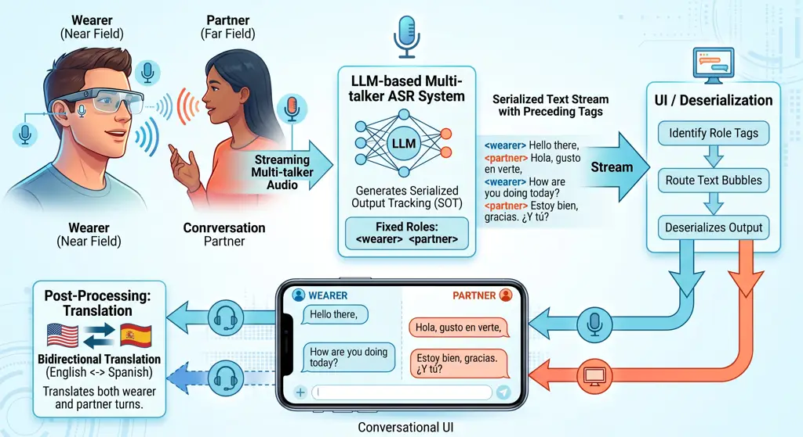

# Low-Latency LLM-Based Streaming Multi-Talker ASR with Verifiable Rewards

Jing Pan    Ruizhi Li    Ju Lin    Jing Zheng    Florian Metze

###### Abstract

LLM-based architectures offer strong generalization and
instruction-following capabilities for streaming automatic speech
recognition (ASR), but multi-talker use introduces coupled
transcription, attribution, and latency challenges. Our wearable setting
requires real-time transcription of a conversation between a near-field
device wearer and a far-field partner. Because partial hypotheses are
rendered on persistent sides of a dialogue UI, speaker roles cannot be
permuted and each speaker tag must precede its turn. These sparse tags
are weakly optimized by supervised fine-tuning (SFT), while committing
to a leading tag can delay the text that follows. We therefore
post-train a streaming LLM-based ASR model with reinforcement learning
with verifiable rewards (RLVR), combining a fixed-role
Speaker-Attributed WER (SA-WER) grader with a turn-level onset-delay
reward. On an eight-direction multi-talker cohort, SA-WER RL reduces
SA-WER from $`20.51\%`$ for SFT to $`13.14\%`$. Adding the delay
objective reduces onset $`p50`$ by $`65\%`$ (from $`0.918\,\text{s}`$ to
$`0.320\,\text{s}`$) and $`p90`$ by $`44\%`$ (from $`1.389\,\text{s}`$
to $`0.780\,\text{s}`$) relative to SA-WER-only RL, while achieving
$`12.70\%`$ SA-WER. These results demonstrate that fixed-role
recognition quality and streaming responsiveness can be improved
jointly.

###### Index Terms: 

streaming speech recognition, multi-talker, reinforcement learning,
verifiable reward

^(†)^(†)address: Meta, USA

## 1 Introduction

Large language model (LLM)-based architectures are increasingly used for
automatic speech recognition (ASR), motivated by their generalization,
contextual modeling, and instruction-following capabilities \[15, 12,
16, 9, 1\]. Recent streaming speech LLMs have demonstrated competitive
transcription and translation quality under real-time constraints \[11,
7, 5\]. Extending this paradigm to multi-talker ASR requires both
recognizing overlapping or alternating speech and determining _who spoke
what_. Prior streaming systems address these challenges with dedicated
multi-channel or speech-unmixing architectures, including specialized
Recurrent Neural Network Transducers (RNN-Ts) \[6\]. Meng et al. \[8\]
demonstrates that speech LLM can understand overlapped human speech
following versatile human instructions. Serialized Output Training (SOT)
instead linearizes multiple speakers’ transcriptions into one sequence
separated by speaker-change tokens \[3\], making it naturally compatible
with autoregressive LLM decoders. Our wearable use case transcribes a
real-time two-party conversation between the device wearer (near field)
and a conversation partner (far field), while the UI deserializes the
output stream into the two sides of a dialogue, as illustrated in
Fig. 1. Speaker identities must therefore be fixed semantic
roles—\<wearer\> and \<partner\>—rather than labels that may be permuted
during scoring. Moreover, each role tag must _precede_ its turn so the
UI can route partial words to the correct side as they arrive; a suffix
tag would require buffering the complete turn before displaying it.
Recent LLM-based multi-talker ASR combines neural beamforming with SOT
supervision \[4\], but is not natively streaming and requires an
additional streaming harness.



Figure 1: Wearable two-party streaming pipeline with fixed-role SOT,
dialogue-side routing, and downstream bidirectional translation.

Supervised Fine-Tuning (SFT) can teach this SOT format, but token-level
cross-entropy is inefficient for optimizing multi-talker recognition
quality. It does not directly optimize sequence-level metrics such as
word error rate (WER), and sparse speaker tags contribute little to the
total loss. A model can therefore achieve low lexical loss while
omitting the quieter speaker or assigning words to the wrong role.
Reinforcement learning with verifiable rewards (RLVR) is a natural
post-training alternative because ASR hypotheses admit automatic,
quantitative scoring against references. Prior work has explored
sequence-level reinforcement learning for ASR and reward-based
post-training for speech models \[13, 2\]. We use group-relative reward
normalization, following Group Relative Policy Optimization (GRPO)
\[10\], to optimize multiple sampled transcripts per audio prompt.

These constraints motivate two rewards. Because cpWER \[14\] can permute
speakers to minimize error, we use fixed-role Speaker-Attributed WER
(SA-WER) to score transcription and attribution. Since each turn must
begin with a role tag, the model may delay all text while confirming the
speaker; an onset-delay reward encourages earlier commitment without
sacrificing recognition quality. Our contributions are: 1) Fixed-role
quality alignment: We formulate an RLVR objective around a fixed-role
SA-WER grader, directly optimizing transcription and speaker attribution
for streaming SOT output. 2) Coverage-aware latency optimization: We
introduce a bounded onset delay factor that rewards timely emission of
aligned turns without allowing latency to dominate quality.

On our 2-speaker conversational evaluation sets, RLVR with SA-WER grader
reduced the streaming SA-WER from $`20.51\%`$ for SFT to $`13.14\%`$.
Adding the delay objective reduces onset latency relative to SA-WER-only
RL: $`p50`$ decreases by $`65\%`$, from $`0.918\,\text{s}`$ to
$`0.320\,\text{s}`$, and $`p90`$ by $`44\%`$, from $`1.389\,\text{s}`$
to $`0.780\,\text{s}`$. The resulting model achieves $`12.70\%`$ WER,
demonstrating joint improvements in speaker-aware quality and streaming
responsiveness.

## 2 Methodology

### 2.1 RLVR Framework

We initialize the policy $`\pi_{\theta}`$ from a supervised fine-tuned
model and post-train it with reinforcement learning with verifiable
rewards (RLVR). For each audio prompt, we sample multiple transcript
rollouts and score them with the graders described below. Our objective
is similar to GRPO \[10\], except that it directly weights each sampled
transcript’s log-likelihood by its group-normalized advantage instead of
using a clipped surrogate. We additionally apply full-distribution
reverse KL regularization to the frozen SFT policy.

### 2.2 Fixed-Role Speaker-Attributed WER

Our SOT transcript begins each turn with a fixed-role tag for the wearer
($`s=0`$) or partner ($`s=1`$). After normalization, each word is
represented as $`(w,s)`$. A joint edit-distance alignment compares the
serialized hypothesis against separate wearer and partner reference
streams without permitting role permutation. Besides insertion ($`I`$),
deletion ($`D`$), and substitution ($`S`$), it identifies $`A`$, a
correct word assigned to the wrong speaker, and $`X`$, an error in both
word and speaker. For $`N`$ reference words,

```math
\mathrm{SA\text{-}WER}=\frac{I+D+S+A+X}{N},\qquad\mathrm{SAE}=\frac{A+X}{N}. \tag{1}
```

We also define the deletion rate $`\mathrm{DR}=(D_{0}+D_{1})/N`$ to
capture the overall deletion errors.

### 2.3 SA-WER Grader

The fixed-role alignment already includes attribution errors and
deletion errors in $`\mathrm{SA\text{-}WER}`$. To emphasize these
product-critical failures during RL, our grader up-weights them through
the combined error

```math
E=\frac{\mathrm{SA\text{-}WER}+\alpha_{\mathrm{SAE}}\,\mathrm{SAE}+\alpha_{\mathrm{DR}}\,\mathrm{DR}}{1+\alpha_{\mathrm{SAE}}+\alpha_{\mathrm{DR}}}, \tag{2}
```

The denominator keeps the combined quantity on the scale of an error
rate. We convert it to a bounded quality reward using

```math
R_{\mathrm{SA}}=\left(1-\operatorname{clip}(E,0,1)\right)^{2}. \tag{3}
```

A perfect transcript receives reward 1, while hypotheses with combined
error at or above 1 receive reward 0. This sequence-level reward
directly exposes lexical accuracy, fixed-role attribution, and
transcription retention to RL optimization.

### 2.4 Turn-Level Onset-Delay Regularization

Our streaming decoder interleaves audio consumption and text generation.
Each advancing audio marker, including empty-audio markers after stream
exhaustion, increments the model-time clock by $`80\,\text{ms}`$.
Predicted and reference turns are paired by aligning their fixed-role
speaker-tag sequences and retaining only matching subsequences.
Unmatched predicted or reference turns receive no latency credit and do
not shift every subsequent pairing.

For a paired predicted turn $`i`$ and reference turn $`j`$, let
$`\hat{t}^{\mathrm{start}}_{i}`$ be the model-time at which the leading
speaker tag is emitted and $`t^{\mathrm{start}}_{j}`$ the oracle turn
start. We define onset delay as

```math
d_{ij}=\hat{t}^{\mathrm{start}}_{i}-t^{\mathrm{start}}_{j}. \tag{4}
```

For an onset buffer $`b`$ and decay scale $`\tau`$, the turn receives
score

```math
s(d_{ij};b,\tau)=\exp\left(-\frac{\max(0,d_{ij}-b)}{\tau}\right). \tag{5}
```

Emission within the buffer receives full credit, while excess delay
decays exponentially. Negative delay is not penalized by Eq. (5), but is
tracked separately as premature emission. Let $`\mathcal{M}`$ be the set
of matched turn pairs. The coverage-aware onset factor is

```math
F_{\mathrm{on}}=\frac{\sum_{(i,j)\in\mathcal{M}}s(d_{ij};b,\tau)}{\max(N_{\mathrm{hyp}},N_{\mathrm{ref}})}. \tag{6}
```

The denominator ensures that missing and hallucinated turns reduce the
factor.

Finally, the onset factor acts as a bounded multiplicative regularizer
on the quality reward:

```math
\displaystyle M_{\mathrm{delay}} \displaystyle=\frac{1+\lambda F_{\mathrm{on}}}{1+\lambda}, \tag{7}
```

```math
\displaystyle R_{\mathrm{final}} \displaystyle=R_{\mathrm{SA}}\times M_{\mathrm{delay}}.
```

Here, $`\lambda`$ controls the latency-reward strength. The multiplier
equals 1 at full onset credit and is bounded below by $`1/(1+\lambda)`$,
making onset latency a secondary regularizer on the speaker-aware
recognition objective.

## 3 Experiments

### 3.1 Experimental Setup

#### 3.1.1 Base Model

We use a streaming mixture-of-experts (MoE) speech LLM initialized from
a checkpoint pretrained for multilingual single-talker ASR. Its 32
transformer layers are all MoE layers, each containing 256 routed
experts with top-8 routing. The model activates approximately 5.5B
backbone parameters per token. The model consumes a 24-kHz waveform and
represents each $`1{,}920`$-sample ($`80\,\text{ms}`$) audio block with
one audio token. We continue SFT on multi-talker conversations while
retaining the fixed-role SOT tags, and then apply RLVR. This setup
isolates the effects of sequence-level quality and latency optimization
from changes to the model architecture or acoustic front end.

#### 3.1.2 Data

The multi-talker training corpus is generated through simulation. We
sample two single-talker utterances from a multilingual ASR pool and
randomly assign their speakers to the wearer (near-field) and partner
(far-field) roles. To reproduce the role-dependent acoustics of the
wearable microphone array, we convolve the utterances with corresponding
near- and far-field room impulse responses. We then apply stochastic
temporal offsets and overlap the two signals to form a simulated
conversation. The simulator produces five-channel audio; we extract
microphone channel 0 for both SFT and RLVR.

The evaluation corpus consists of real-world, scripted conversations
recorded through the wearable device for live translation scenario. The
corpus contains $`1{,}181`$ five-channel recordings between strictly 2
speakers speaking different languages, across eight language pairs. They
are German, Spanish, French, and Italian paired bidirectionally with
English. The average duration per conversation is around $`210`$
seconds.

#### 3.1.3 Training Setup

SFT uses 64 H100 GPUs, a global batch size of 64, a maximum sequence
length of 16,384, and a peak learning rate of $`1\!\times\!10^{-5}`$
with cosine decay and 20 warm-up steps. The SFT runs for 450 steps. RLVR
initializes from the last checkpoint of the SFT job and also uses it as
the frozen reverse-KL reference. RLVR uses 120 H100 GPUs, 512 rollouts
per batch, a maximum sequence length of 4,096, the same learning rate,
and up to $`1{,}000`$. Each prompt produces eight samples at $`T=1.0`$
and top-$`p=1.0`$. Group-normalized rewards optimize group-normalized
policy-gradient objective with full-distribution reverse KL of weight
$`0.1`$; non-finite, effectively zero-variance, and truncated groups are
removed. We set $`\alpha_{\mathrm{SAE}}=\alpha_{\mathrm{DR}}=0.2`$.
Unless varied below, delay-controlled runs use a $`700\,\text{ms}`$
onset buffer, and a $`400\,\text{ms}`$ decay scale.

#### 3.1.4 Evaluation Setup

All headline results use whole-conversation streaming recognition on the
$`1{,}181`$ recordings described above. The first channel is extracted
for decoding, matching the training. Greedy decoding uses temperature
$`0`$. For the stochastic SFT study, we draw eight samples per recording
using temperature $`1.0`$, top-$`p=1.0`$, and top-$`k=50`$. Oracle@8
selects the minimum-SA-WER candidate for each recording and uses the
same candidate for latency; it therefore measures latent model
capability rather than deployable single-decode performance.

We report fixed-role SA-WER on untouched hypotheses using the official
multi-talker scorer, together with wearer and partner WER where
relevant. For latency, hypothesis and reference turns are paired through
matching blocks of their fixed-role tag sequences. Onset delay is the
speaker-tag emission time minus the oracle turn start time. We report
pooled $`p50`$, $`p90`$, and $`p95`$ over paired turns, the fraction
with negative onset delay, and selected long-tail rates. Negative onset
denotes premature emission rather than low latency. Missing, inserted,
or misattributed turns remain unpaired, so latency percentiles are
interpreted together with SA-WER and turn coverage.

### 3.2 Experiment Results

#### 3.2.1 From SFT to SA-WER-RL

Table 1 decomposes the SFT and RL models’ performance into the error
terms targeted by Eq. (2). SA-WER RL reduces overall error from
$`20.51\%`$ to $`13.14\%`$. More importantly, wearer/partner SAE falls
from $`3.2\%/5.0\%`$ to $`0.5\%/0.3\%`$, showing that RL suppresses
fixed-role inversions. Wearer/partner deletion also decreases from
$`12.2\%/14.4\%`$ to $`9.5\%/8.1\%`$, which validates explicitly
upweighting deletion errors.

| System       | SA-WER | $`\mathrm{SAE}_{0}`$ | $`\mathrm{SAE}_{1}`$ | $`D_{0}`$ | $`D_{1}`$ |
| ------------ | ------ | -------------------- | -------------------- | --------- | --------- |
|              | (%)    | (%)                  | (%)                  | (%)       | (%)       |
| SFT          | 20.51  | 3.2                  | 5.0                  | 12.2      | 14.4      |
| SFT oracle@8 | 14.61  | –                    | –                    | –         | –         |
| SA-WER RL    | 13.14  | 0.5                  | 0.3                  | 9.5       | 8.1       |

| SFT sampling statistic | Pass@1 (%) | Pass@8 (%) |
| ---------------------- | ---------- | ---------- |
| Exact ($`0\%`$ SA-WER) | 0.00       | 0.00       |
| $`\leq 5\%`$ SA-WER    | 9.70       | 25.62      |
| $`\leq 10\%`$ SA-WER   | 33.55      | 58.09      |

Table 1: Quality decomposition. $`\mathrm{SAE}_{r}`$ and $`D_{r}`$ are
normalized by reference words for role $`r\in\{0,1\}`$; Eq. (2) uses
their reference-weighted SAE aggregate and $`D`$. Speaker-level
breakdowns were not retained for oracle@8.

Oracle@8 and pass@8 are complementary: oracle@8 reports corpus SA-WER
after selecting the lowest-SA-WER candidate for each recording, whereas
pass@8 is the probability that at least one of eight candidates meets a
specified threshold. Sampling at $`T=1`$ does not improve the expected
SFT output: candidate-corpus SA-WER rises to $`24.96\%`$. Nevertheless,
oracle@8 reaches $`14.61\%`$, and Table 1 shows substantial pass@8 gains
at the $`5\%`$ and $`10\%`$ thresholds. Thus SFT already assigns
probability mass to better transcripts, but individual samples are worse
on average and oracle selection is unavailable at inference. SA-WER RL
converts this latent capability into greedy behavior, improving over
greedy SFT by $`7.37`$ absolute points ($`35.9\%`$ relative) and
surpassing SFT oracle@8 by $`1.47`$ points with one decode. However,
when we measure the onset delay, its onset $`p50`$ remains close to SFT
($`0.918`$ versus $`0.906\,\text{s}`$), confirming that this gain is
only for the fixed-role quality objective and that latency requires an
explicit reward.

#### 3.2.2 Effect of Onset-Delay Regularization

Table 2 and Fig. 2 separate recognition quality from latency for
representative checkpoints. By Eq. (5), onset credit is constant for
$`d\leq b`$ and decays exponentially beyond buffer $`b`$ with
$`\tau=400\,\text{ms}`$. The no-delay baseline has $`\lambda=0`$, so
$`M_{\mathrm{delay}}=1`$ regardless of emission time. Under its observed
$`p50=0.918\,\text{s}`$, the onset credit would be $`1.00/0.27`$ for
buffers of $`1{,}300/400\,\text{ms}`$. Smaller buffers therefore expose
more of the baseline delay distribution to reward decay and provide
stronger pressure for earlier emission. Quality remains near the
SA-WER-only baseline across the stable $`\lambda=0.2`$ runs. The
$`400\,\text{ms}`$ model obtains the lowest SA-WER and self/other
deletion rates, while the diagnostic $`1{,}000\,\text{ms}`$ run is
degraded mainly by partner attribution error.

| Buffer | SA-WER | $`\mathrm{SAE}_{0}`$ | $`\mathrm{SAE}_{1}`$ | $`D_{0}`$ | $`D_{1}`$ |
| ------ | ------ | -------------------- | -------------------- | --------- | --------- |
| (ms)   | (%)    | (%)                  | (%)                  | (%)       | (%)       |
| None   | 13.14  | 0.5                  | 0.3                  | 9.5       | 8.1       |
| 1,300  | 13.41  | 0.3                  | 1.1                  | 9.6       | 8.2       |
| 1,000  | 15.51  | 1.1                  | 4.8                  | 9.7       | 8.1       |
| 700    | 13.36  | 0.5                  | 1.3                  | 9.2       | 7.8       |
| 400    | 12.70  | 0.3                  | 1.0                  | 8.8       | 7.4       |

Table 2: Recognition-quality decomposition for the onset-buffer sweep
($`\lambda=0.2`$ except the no-delay baseline). The $`1{,}000`$-ms run
is diagnostic.

Figure 2: Pooled onset-delay percentiles for the same checkpoints.
Smaller buffers monotonically improve $`p50`$ and $`p90`$; $`p95`$ is
less stable.

Figure 2 shows that reducing the buffer from $`1{,}300`$ to
$`400\,\text{ms}`$ lowers pooled $`p50`$ from $`0.880`$ to
$`0.320\,\text{s}`$ and $`p90`$ from $`1.360`$ to $`0.780\,\text{s}`$.
Relative to SA-WER-only RL, the $`400\,\text{ms}`$ model reduces
$`p50/p90/p95`$ by $`65\%/44\%/40\%`$, but raises negative onset from
$`2.11\%`$ to $`5.49\%`$. Its pooled $`p95`$ is $`0.890\,\text{s}`$.
Thus, smaller buffers reliably accelerate typical turns with stronger
regularization, while premature emission remains checkpoint-selection
safeguards.

#### 3.2.3 Delay-Reward Weight Ablation

Table 3 isolates reward strength at a fixed $`700\,\text{ms}`$ onset
buffer. Increasing $`\lambda`$ from $`0.05`$ to $`0.2`$ lowers onset
$`p50`$ by $`170\,\text{ms}`$ and both $`p90`$ and $`p95`$ by
approximately $`190\,\text{ms}`$. SA-WER changes by only $`0.19`$
absolute points, while the negative-onset rate remains nearly unchanged.
The stronger bounded regularizer therefore supplies a materially clearer
latency signal without a comparable degradation in recognition quality.
Together with the buffer sweep, this motivates $`\lambda=0.2`$ for the
lowest-latency operating point while preserving SA-WER as the dominant
objective through the multiplier’s $`16.7\%`$ maximum reward reduction.

| $`\lambda`$ | SA-WER | $`p50`$ | $`p90`$ | $`p95`$ | Neg. |
| ----------- | ------ | ------- | ------- | ------- | ---- |
|             | (%)    | \(s\)   | \(s\)   | \(s\)   | (%)  |
| 0.05        | 13.17  | 0.850   | 1.336   | 1.427   | 2.46 |
| 0.20        | 13.36  | 0.680   | 1.149   | 1.240   | 2.50 |

Table 3: Delay-reward weight ablation at a fixed $`700\,\text{ms}`$
onset buffer.

## 4 Conclusion

We presented an RLVR approach for low-latency LLM-based streaming
multi-talker ASR. A fixed-role SA-WER reward directly optimizes
recognition and speaker attribution, while a bounded, coverage-aware
onset-delay regularizer encourages timely turn emission without allowing
latency to dominate quality. Our results show that sequence-level
verifiable rewards can jointly improve fixed-role recognition quality
and streaming responsiveness without modifying the underlying model
architecture. Future work will extend evaluation to unscripted
conversations and broader language coverage while improving robustness
to premature emissions and direction-specific latency tails.

## References

- \[1\] A. Abouelenin, A. Ashfaq, A. Atkinson, H. Awadalla, N. Bach, J.
  Bao, A. Benhaim, M. Cai, V. Chaudhary, C. Chen, et al. (2025)
  Phi-4-mini technical report: compact yet powerful multimodal language
  models via mixture-of-loras. arXiv preprint arXiv:2503.01743. Cited
  by: §1.
- \[2\] C. Gao, Y. Li, K. An, Z. Gao, Z. Du, H. Zhao, and X. Li (2025)
  Explore the reinforcement learning for the llm based asr and tts
  system. arXiv preprint arXiv:2509.18569. Cited by: §1.
- \[3\] N. Kanda, Y. Gaur, X. Wang, Z. Meng, and T. Yoshioka (2020)
  Serialized output training for end-to-end overlapped speech
  recognition. arXiv preprint arXiv:2003.12687. Cited by: §1.
- \[4\] J. Lin, J. Pan, R. Li, M. Sun, Y. Liu, A. Hassan, J. Zheng,
  and F. Metze (2026) Equipping llm with directional multi-talker speech
  understanding capabilities. arXiv preprint arXiv:2602.07211. Cited by:
  §1.
- \[5\] A. H. Liu, A. Ehrenberg, A. Lo, C. Sun, G. Lample, J.
  Delignon, K. R. Chandu, P. von Platen, P. R. Muddireddy, R. Arora, et
  al. (2026) Voxtral realtime. arXiv preprint arXiv:2602.11298. Cited
  by: §1.
- \[6\] L. Lu, N. Kanda, J. Li, and Y. Gong (2021) Streaming end-to-end
  multi-talker speech recognition. IEEE Signal Processing Letters 28,
  pp. 803–807. External Links: ISSN 1558-2361,
  [Link](http://dx.doi.org/10.1109/LSP.2021.3070817),
  [Document](https://dx.doi.org/10.1109/lsp.2021.3070817) Cited by: §1.
- \[7\] Z. Ma, G. Yang, W. Chen, Z. Gao, Y. Du, X. Li, Z. Zheng, H.
  Zhu, J. Zhuo, Z. Song, R. Xu, T. Wang, Y. Yang, Y. Zhu, Z. Niu, L.
  Xue, Y. Ma, R. Yuan, S. Zhang, K. Yu, E. S. Chng, and X. Chen (2026)
  SLAM-llm: a modular, open-source multimodal large language model
  framework and best practice for speech, language, audio and music
  processing. IEEE Journal of Selected Topics in Signal Processing 20
  (1), pp. 63–76. External Links: ISSN 1941-0484,
  [Link](http://dx.doi.org/10.1109/JSTSP.2026.3653157),
  [Document](https://dx.doi.org/10.1109/jstsp.2026.3653157) Cited by:
  §1.
- \[8\] L. Meng, S. Hu, J. Kang, Z. Li, Y. Wang, W. Wu, X. Wu, X. Liu,
  and H. Meng (2025) Large language model can transcribe speech in
  multi-talker scenarios with versatile instructions. In ICASSP
  2025-2025 IEEE International Conference on Acoustics, Speech and
  Signal Processing (ICASSP), pp. 1–5. Cited by: §1.
- \[9\] J. Pan, J. Wu, Y. Gaur, S. Sivasankaran, Z. Chen, S. Liu, and J.
  Li (2024) COSMIC: data efficient instruction-tuning for speech
  in-context learning. In Interspeech 2024, interspeech 2024,
  pp. 4164–4168. External Links:
  [Link](http://dx.doi.org/10.21437/Interspeech.2024-1346),
  [Document](https://dx.doi.org/10.21437/interspeech.2024-1346) Cited
  by: §1.
- \[10\] Z. Shao, P. Wang, Q. Zhu, R. Xu, J. Song, X. Bi, H. Zhang, M.
  Zhang, Y. K. Li, Y. Wu, and D. Guo (2024) DeepSeekMath: pushing the
  limits of mathematical reasoning in open language models. arXiv.
  External Links:
  [Document](https://dx.doi.org/10.48550/ARXIV.2402.03300),
  [Link](https://arxiv.org/abs/2402.03300) Cited by: §1, §2.1.
- \[11\] X. Shi, X. Wang, Z. Guo, Y. Wang, P. Zhang, X. Zhang, Z.
  Guo, H. Hao, Y. Xi, B. Yang, J. Xu, J. Zhou, and J. Lin (2026)
  Qwen3-asr technical report. arXiv. External Links:
  [Link](https://arxiv.org/abs/2601.21337) Cited by: §1.
- \[12\] C. Sun, Z. Ahmed, Y. Ma, Z. Liu, L. Kabela, Y. Pang, and O.
  Kalinli (2024) Contextual biasing of named-entities with large
  language models. In ICASSP 2024 - 2024 IEEE International Conference
  on Acoustics, Speech and Signal Processing (ICASSP), pp. 10151–10155.
  External Links:
  [Link](http://dx.doi.org/10.1109/ICASSP48485.2024.10445918),
  [Document](https://dx.doi.org/10.1109/icassp48485.2024.10445918) Cited
  by: §1.
- \[13\] A. Tjandra, S. Sakti, and S. Nakamura (2019) End-to-end speech
  recognition sequence training with reinforcement learning. IEEE Access
  7, pp. 79758–79769. External Links: ISSN 2169-3536,
  [Link](http://dx.doi.org/10.1109/ACCESS.2019.2922617),
  [Document](https://dx.doi.org/10.1109/access.2019.2922617) Cited by:
  §1.
- \[14\] T. von Neumann, C. Boeddeker, M. Delcroix, and R.
  Haeb-Umbach (2025) Word error rate definitions and algorithms for
  long-form multi-talker speech recognition. IEEE Transactions on Audio,
  Speech and Language Processing 33, pp. 3174–3188. External Links: ISSN
  2998-4173, [Link](http://dx.doi.org/10.1109/TASLPRO.2025.3589862),
  [Document](https://dx.doi.org/10.1109/taslpro.2025.3589862) Cited by:
  §1.
- \[15\] J. Wu, Y. Gaur, Z. Chen, L. Zhou, Y. Zhu, T. Wang, J. Li, S.
  Liu, B. Ren, L. Liu, and Y. Wu (2023) On decoder-only architecture for
  speech-to-text and large language model integration. In 2023 IEEE
  Automatic Speech Recognition and Understanding Workshop (ASRU),
  pp. 1–8. External Links:
  [Link](http://dx.doi.org/10.1109/ASRU57964.2023.10389705),
  [Document](https://dx.doi.org/10.1109/asru57964.2023.10389705) Cited
  by: §1.
- \[16\] G. Yang, Z. Ma, Z. Gao, S. Zhang, and X. Chen (2024)
  CTC-assisted llm-based contextual asr. In 2024 IEEE Spoken Language
  Technology Workshop (SLT), pp. 126–131. External Links:
  [Link](http://dx.doi.org/10.1109/SLT61566.2024.10832154),
  [Document](https://dx.doi.org/10.1109/slt61566.2024.10832154) Cited
  by: §1.
