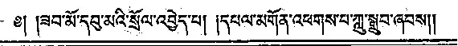
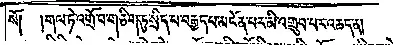
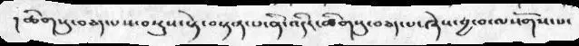
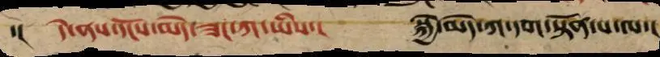

# Syllable- and Word-Level Evaluation of Tibetan OCR

CCS: Applied computing Optical character recognitionCCS: Computing
methodologies Natural language processingCCS: General and
reference Empirical studies

Jacob Moore email: <jmoore10@ltu.edu> Affiliation: Lawrence
Technological University, Southfield, Michigan, USA and Paula Lauren
email: <plauren@ltu.edu> Affiliation: Lawrence Technological University,
Southfield, Michigan, USA

###### Abstract.

Optical character recognition (OCR) for Tibetan is evaluated
predominantly by character error rate (CER). Tibetan marks syllable
boundaries but does not mark word boundaries, so a word error rate
requires a segmenter. This study evaluates nine recognizer
configurations on typeset, woodblock and two handwritten script styles,
alone and in combination, and reports syllable- and word-level error
rates, to our knowledge the first for Tibetan OCR. The configurations
span CTC models, TrOCR encoder–decoders with and without post-training
quantization, and a vision-language model, and each is scored under CER,
the syllable error rate (SER) and three segmented word error rates
(SWER). CER ranks systems largely as the higher-level rates do (Kendall
$`\tau\geq 0.833`$), with one pair ordered oppositely. On the effect of
joint training, CER and SER record significant changes of opposite sign
in 7 of 64 comparisons. SER needs no segmenter and ranks systems as SWER
does under two of the three segmenters ($`\tau\geq 0.889`$). The output
of each configuration is also tagged for part of speech, annotated for
named entities and machine translated, and each result is compared with
that obtained on the reference text. As rough guidance, translation chrF
of 60 is reached at SER of 0.047 or below and part-of-speech
preservation of 0.8 at 0.078 or below, while no error rate separates the
systems that reach entity preservation of 0.6 from those that do not.

###### Keywords: 

Tibetan, optical character recognition, handwritten text recognition,
evaluation metrics, character error rate, word error rate, low-resource
languages

## 1. Introduction

Optical character recognition (OCR) and handwritten text recognition are
applied to Tibetan prints and manuscripts, including to make large
collections of Buddhist texts searchable (Luo and Chuang, 2024;
Griffiths, 2024; Erhard, 2025). Recognition of continuous Tibetan text
is typically evaluated by character error rate (CER) (Griffiths, 2024;
Erhard, 2025; Sabbagh, 2025; Xu et al., 2026). The orthography of
Tibetan makes word error rates, typical in other languages (Neudecker
et al., 2021; Vesalainen et al., 2026), difficult to compute.

In scripts that delimit a unit larger than the character, CER and an
error rate over that unit can rank systems differently (Agbeti-Messan
et al., 2026; Le et al., 2025). OCR error also degrades the downstream
tasks that use the recognized text (van Strien et al., 2020).
Named-entity recognition falls sharply once word-level error reaches
8–20% (Hamdi et al., 2019), and corrupting named-entity spans reduces
keyword search performance while CER and word error rate remain low
(Jaud et al., 2025).

Tibetan explicitly marks syllable boundaries, chiefly with the tsheg
(\tibetanfont་), but does not mark word boundaries. A word error rate
therefore requires a segmenter. The syllable is an intermediate unit
that requires none, and segmented word error rates have been applied to
Tibetan speech recognition (Moore et al., 2026). To our knowledge, no
error rate above the character has been reported for Tibetan OCR. It is
therefore not known whether CER leads an evaluator to the same choices
as a syllable- or word-level rate would, or which rate best predicts the
quality of downstream tasks.

Nine recognizer configurations are evaluated, spanning CTC models, TrOCR
encoder–decoders with and without post-training quantization, and a
vision-language model. They are trained on four datasets, covering
modern typeset text, woodblock print and two handwritten styles, and on
three mixed-domain combinations of them to compare joint with
single-domain training. This gives 60 configuration $`\times`$ condition
cells. Each cell is scored under CER, the syllable error rate (SER) and
three segmented word error rates (SWER). On the four single-domain
conditions, recognizer output is also tagged for part of speech,
annotated for named entities and machine translated into English, and
each result is scored against the result obtained on the reference
transcription. These _preservation_ scores measure the effect of
recognition error on each task.

This study makes three contributions.

1.  (1)
    A comparative evaluation of Tibetan OCR across architectures,
    quantization and script domains. Configurations are compared on
    page-grouped held-out splits with bootstrap intervals, under
    syllable- and word-level error rates that are, to our knowledge, the
    first publicly reported for Tibetan OCR.
2.  (2)
    A comparison of CER with syllable- and word-level rates. CER ranks
    systems largely as the higher-level rates do (Kendall
    $`\tau\geq 0.833`$), but on the effect of joint training it records
    significant changes of opposite sign to SER in 7 of 64 comparisons.
    Word-level rankings agree across three segmenters at
    $`\tau\geq 0.833`$ (§4.2, §5.1, §5.2).
3.  (3)
    Approximate error rates for downstream use. The SER needed for a
    rough preservation target ranges from 0.007 for entities to 0.078
    for part-of-speech tags, so no single rate serves every task. LLM
    annotation also fails more often as OCR error rises (§4.4, §5.3).

Sections 2 and 3 give the background and methods, Section 4 the results
and Section 5 their interpretation. Section 6 states limitations and
future work, Section 7 concludes, and Appendix A gives the prompts used.

## 2. Background and Prior Work

### 2.1. Tibetan Script

#### 2.1.1. Structure

Tibetan is written in an _abugida_, a writing system whose base unit is
a consonant carrying an inherent vowel, modified by diacritics. The
fundamental unit of written Tibetan is the syllable, built from a root
consonant that may carry superscript and subscript letters, a vowel
diacritic, and prefix and suffix consonants (Huang et al., 2025). The
root and its superscript and subscript form a single visual column,
called a _stack_. Unicode encodes a stack as a sequence of codepoints
rather than as a unit, so one visual column may consist of several
codepoints.

Syllables are separated by the tsheg (\tibetanfont་, U+0F0B) (van
Schaik, 2014). Word boundaries are not marked. Nearly every word
boundary is also a syllable boundary, but words may be polysyllabic
(Brown, 2024), as also in Dzongkha (Norbu et al., 2010). Punctuation is
sparse: the only mark occurring throughout running text is the shad
(\tibetanfont།, U+0F0D), which separates units larger than the syllable,
roughly sentences (van Schaik, 2014), and so also ends the syllable
before it. Syllable-level tokenization therefore splits on the tsheg,
the shad and whitespace. Word-level tokenization requires a more complex
segmentation step.

#### 2.1.2. Varieties and Media

Written Tibetan divides into two script families, distinguished by the
presence or absence of a _head_, a short horizontal stroke along the top
of many letters (van Schaik, 2014). _Uchen_ (‘headed script’) is the
formal block script and the basis for woodblock-carved prints and modern
digital typesetting. _Ume_ (‘headless script’) is the cursive family,
whose letters lack a head and are written with more connected strokes,
with substantially greater variability in letterform shape and
positioning. Within Ume, _Drutsa_ is a handwritten cursive (Erhard,
2025), and _Betsug_ (‘book form’) is a calligraphic style (van Schaik,
2014). The two families differ enough that recognition does not
necessarily transfer between them (Griffiths, 2024).

The physical medium varies independently of script variety. In woodblock
prints each character is carved by hand, so letterforms vary more than
in machine print, and manual printing can merge the strokes of
neighbouring characters (Hedayati et al., 2010). Modern typeset text is
uniform in letterform, while handwriting varies between writers (Zhou
et al., 2026).

### 2.2. Recognition Architectures

#### 2.2.1. Recognizers

Early Tibetan OCR systems decoded with hidden Markov models (Hedayati
et al., 2010; Rowinski and Keutzer, 2016). More recent Tibetan
recognition is neural, including convolutional and
convolutional-recurrent networks (Zhang et al., 2022; Wang and Wang,
2024; Zhou et al., 2026), an encoder–decoder for scene text (Ke et al.,
2025), the PyLaia engine of Transkribus (Griffiths, 2024; Erhard, 2025)
and a vision-language model adapted to Tibetan (Xu et al., 2026). This
study compares three kinds of neural recognizer. Connectionist temporal
classification (Graves et al., 2006, CTC;) trains a sequence model to
maximize the likelihood of the target over all valid frame-to-character
alignments. Convolutional-recurrent networks (Shi et al., 2017) and
Easter2.0 (Chaudhary and Bali, 2022), which replaces the recurrence with
convolutions, are both trained with CTC. Autoregressive encoder-decoders
generate over the encoder output instead, as in TrOCR (Li et al., 2023).
Vision-language models pair a vision encoder with a language decoder
pretrained on a large multilingual corpus rather than on the recognition
task; Qwen3-VL (Bai et al., 2025), whose decoder is built on Qwen3 (Yang
et al., 2025), is one such model.

#### 2.2.2. Quantization and Adaptation

Quantization stores weights at lower numerical precision and may be
applied to an already-trained model (Dettmers et al., 2022a). Quantized
low-rank adaptation (Dettmers et al., 2023, QLoRA;) quantizes a frozen
base model and trains only small low-rank adapter matrices (Hu et al.,
2022), which reduces the memory needed to fine-tune a large model.

### 2.3. Edit-Distance Error Rates

In a full OCR pipeline, layout analysis and line segmentation precede
recognition. This study takes line images as given and evaluates
recognition alone. The recognized text of each line is scored against a
reference transcription by the number of edits needed to turn one into
the other, relative to the length of the reference.

Character, syllable and word error rates share the same formula,

```math
\mathrm{ER}=\frac{S+D+I}{N},
```

where $`S`$, $`D`$ and $`I`$ are the substitutions, deletions and
insertions in the _hypothesis_ with respect to the _reference_, and
$`N`$ is the count of units in the reference. _Character error rate_
(CER) tokenizes over Unicode characters, _syllable error rate_ (SER)
over syllables delimited by the tsheg, the shad or whitespace, and
_segmented word error rate_ (SWER) over words, which for Tibetan
requires a segmenter (§2.1.1). Three SWER variants were introduced for
Tibetan automatic speech recognition (ASR) by Moore et al. (2026).
BoTok-SWER segments with the dictionary-based botok tokenizer, BERT-SWER
with a Tibetan BERT token classifier (tibetan-bert-base-upos), and
Gem-SWER with Gemini 2.5 Flash Lite, prompted at temperature 0.0. Their
agreement with human word-boundary annotation on speech transcripts, as
reported there, is Cohen’s $`\kappa`$ = 0.027, 0.372 and 0.656
respectively. For all of the error rates described here, lower
error-rate values indicate better performance. Values above 1.0 occur
when the edits outnumber the reference units, which requires insertions.

Because the three levels differ only in tokenization, they are not
independent measurements, but errors falling on unit boundaries affect
them differently: a single inserted or deleted delimiter counts as one
character edit but corrupts both units it separates.

### 2.4. Prior Work

#### 2.4.1. Evaluation Practice in Tibetan OCR

Early Tibetan OCR systems scored output in units of Tibetan orthography
rather than codepoints. Hedayati et al. (2010) evaluate a woodblock
recognizer by Levenshtein distance over stack characters rather than
codepoints, and Rowinski and Keutzer (2016) reports isolated-character
accuracy and scores each page by a syllable validity ratio, the
proportion of syllables that follow Tibetan spelling rules or appear in
a list of accepted exceptions.

Recent OCR and handwritten text recognition (HTR) on continuous Tibetan
text typically reports CER. Much of this work is built on Transkribus,
which returns CER (Griffiths, 2024; Erhard, 2025), and Sabbagh (2025)
reports mean and median CER on a held-out set. FTibSuite (Xu et al., 2026) pairs CER with Exact Match, a whole-line binary, and notes that
changes in the two are not perfectly aligned. Other tasks use other
measures: work on isolated characters reports classification accuracy
Wang and Wang, 2024; Zhang et al., 2022; see also the survey by Gongqu
et al., 2024. Work on scene text, evaluated on photographs of street
views and outdoor environments, reports line accuracy, character
accuracy and a normalized edit distance (Ke et al., 2025).

To our knowledge, no syllable- or word-level error rate has been
reported for Tibetan OCR, though SER has been reported in Tibetan ASR
(Wang et al., 2020; Zhao et al., 2019).

#### 2.4.2. Character and Word Error Rates in Other Scripts

CER requires no tokenization beyond the codepoint and is computable for
any script, including those that do not delimit words with whitespace.
Thennal et al. (2025) advocate it as the preferred metric for
multilingual ASR, on the grounds that for languages without word
separators “the WER can only be applied after a subjective and
potentially inaccurate word segmentation process”. Similar reasoning
appears in OCR. Clérice (2022) judges WER “complicated to apply” to Old
French and Medieval Latin, where spaces vary in size or are absent.

Where whitespace does delimit words, word error rate is reported
alongside CER and comparison across the two levels is normal. The two
levels often agree. Neudecker et al. (2021) plot CER and WER side by
side, WER exceeding CER throughout, and the two systems compared by
Vesalainen et al. (2026) are ranked the same way by both, though they
differ in the kind of edits they make. Agreement is not general.
Agbeti-Messan et al. (2026), benchmarking historical newspaper OCR on
Latin script, report a different best system under CER than under WER on
each of their two subcorpora, though under 0.1 percentage points
separates the CER of their leading models.

An intermediate unit has been used in scripts where word boundaries are
ambiguous: Naing et al. (2015) propose a syllable error rate for Myanmar
speech recognition. Vietnamese words often span several space-separated
syllables (Le et al., 2025), so a word error rate over space-delimited
tokens is in effect a syllable error rate. In that survey’s line-level
results the system with the lower CER (3.24% against 4.67%) has the
higher syllable-level rate (14.11% against 13.33%).

For Tibetan, the only comparison against a word-level metric is in
speech recognition. Moore et al. (2026) benchmark five ASR architectures
and six adaptation strategies under CER, SER and the three SWER
variants, and report ranking differences between SER and CER, the same
architectural ranking under all three word-level metrics, and a fall in
the CER–SER correlation under parameter-efficient fine-tuning.

#### 2.4.3. Downstream Use of Recognition Output

Recognition output is often the input to a further process, and its
quality has been measured by the degradation it causes there. van Strien
et al. (2020) evaluate six tasks across OCR output of varying quality
and report a consistent impact across all six. Hamdi et al. (2019) find
named-entity F-score falling from roughly 90% to 60% once word-level
error rates reach the 8–20% range. Jaud et al. (2025) report that
corrupting named-entity spans sharply reduces keyword search performance
while CER and WER remain low, whereas corrupting the same proportion of
non-entity tokens raises both rates and leaves retrieval comparatively
stable.

Downstream resources for Tibetan are limited. Meelen and Hill (2017) tag
Classical Tibetan under a purpose-built tagset. A 20,215-sentence
Tibetan named-entity corpus is available on request rather than publicly
released, and recent entity recognition work on it fine-tunes a large
language model with domain prompts (Zhang et al., 2025). Tibetan machine
translation has concentrated on the Tibetan–Chinese pair Moore and
Lauren, 2025; e.g. Zhou et al., 2024, with few studies of
Tibetan–English (Shu et al., 2024; Nehrdich and Keutzer, 2026; Moore and
Lauren, 2025).

Griffiths (2024) notes that a CER under 10% is “considered efficient”
for automatic transcription, and sets 5% as the project’s target for
text mining, though neither threshold is explicitly validated.

## 3. Methods

Nine recognizer configurations are evaluated on seven data conditions,
four single-domain and three mixed-domain (§3.1–§3.3). Each of the
resulting 60 cells is scored on a held-out test split under five error
rates (§3.4). Error concentration is measured per cell (§3.5), and the
rates are compared across systems, lines and training conditions (§3.6).
On the four single-domain conditions, recognizer output is also passed
to three downstream tasks (§3.7).

### 3.1. Datasets and Splits

Four publicly available datasets from the Hugging Face Hub are used,
spanning the principal script domains of historical and contemporary
Tibetan OCR (§2.1.2): KhyentseWangpo (BDRC/KhyentseWangpo, modern
typeset), Karmapa8 (BDRC/Karmapa8, woodblock print), Drutsa
(openpecha/OCR-Drutsa, cursive _dbu med_ handwriting) and Betsug
(openpecha/OCR-Betsug, semi-cursive _dbu med_ handwriting). All four
supply pre-cropped line images paired with transcriptions. Statistics
are given in Table 1 and example lines in Figure 1.

| Dataset                 | Total  | Train  | Test  | Train | Test  | Mean  | Max   | Vocab |
| ----------------------- | ------ | ------ | ----- | ----- | ----- | ----- | ----- | ----- |
|                         | lines  | lines  | lines | pages | pages | chars | chars |       |
| KhyentseWangpo          | 13,527 | 12,172 | 1,355 | 2,102 | 234   | 167   | 312   | 112   |
| Karmapa8                | 24,973 | 22,476 | 2,497 | 4,048 | 449   | 212   | 401   | 122   |
| Drutsa                  | 32,360 | 29,116 | 3,244 | 2,901 | 318   | 128   | 457   | 135   |
| Betsug                  | 28,318 | 25,485 | 2,833 | 4,337 | 480   | 148   | 314   | 131   |
| Drutsa+Betsug           | 60,678 | 54,601 | 6,077 |       |       |       |       |       |
| KhyentseWangpo+Karmapa8 | 38,500 | 34,648 | 3,852 |       |       |       |       |       |
| All four                | 99,178 | 89,249 | 9,929 |       |       |       |       |       |

Table 1. Dataset statistics. Mean chars and Vocab are computed on the
training split. Identifiers refer to public Hugging Face repositories.
The three mixed-domain conditions concatenate components, and their line
counts are the sums of the component counts.Table of line counts, page
counts, mean and maximum character lengths, and vocabulary size for the
four single-domain datasets, followed by combined line counts for the
three mixed-domain conditions.

KhyentseWangpo — modern typeset

\tibetanfont

༅། །ཟབ་མོ་དབུ་མའི་སྲོལ་འབྱེད་པ། །དཔལ་མགོན་འཕགས་པ་ཀླུ་སྒྲུབ་ཞབས།།

Karmapa8 — woodblock print

\tibetanfont

སོ། །གལ་ཏེ་འགྲོ་བ་གཅིག་ཏུ་སྲིད་པ་བརྒྱད་པ་མངོན་པར་མི་འགྲུབ་པར་འཆད་ན།

Drutsa — cursive handwriting

\tibetanfont

། ཚིགསུ་བཅད་པས་བསྡུས་སྟེ་བསྟན་པ་ནི་འདིར་ཚིགསུ་བཅད་པ་ཞེས་བྱ་བ་ལསོགས་པ་

Betsug — semi-cursive handwriting

\tibetanfont

་། དེ་ནས་དངོས་མེད་ཟང་ཀ་ཡིས་། སྐྱེ་མེད་ཀ་དག་སྟོན་པ་ལ་།

Figure 1. One test line from each script domain, with its reference
transcription.Four line images, one per script domain, each shown above
its reference transcription in Tibetan script.

All datasets are split 90/10 by page, pages drawn randomly until the
test set first reaches the target size. A mixed condition is the
concatenation of its components’ splits, so each mixed test set is the
union of the corresponding single-domain test sets.

### 3.2. Models

Five architectures are evaluated (Table 2), spanning the CTC,
autoregressive encoder-decoder and vision-language classes of §2.2.1.

| Architecture | Type                                                | Params |
| ------------ | --------------------------------------------------- | ------ |
| CRNN         | CNN + BiLSTM, CTC                                   | 8.8M   |
| Easter2.0    | 1D conv + SE, CTC                                   | 6.2M   |
| TrOCR-small  | DeiT-Small (Touvron et al., 2021) + 6-layer decoder | 28.7M  |
| TrOCR-base   | BEiT-Base (Bao et al., 2022) + 12-layer decoder     | 281.6M |
| Qwen3-VL-2B  | ViT + 28-layer LLM decoder                          | 2.13B  |

Table 2. Model architectures. TrOCR checkpoints are stage-1 pretrained
on synthetic printed text-line images (Li et al., 2023).Table of the
five model architectures, their type, and parameter counts.

##### CTC models

Both follow their published specifications with two exceptions. CRNN
takes input 64 px high rather than 32 px, because Tibetan stacks up to
four glyph components vertically. Easter2.0 is reimplemented without its
TACo augmentation and weighted CTC loss, so that the two CTC models
share one training procedure. Line images are resized to
$`64\times 2048`$ px, and both models produce about 512 output frames
per line, more than the number of characters in any reference line.

##### TrOCR

The pretrained decoders are initialized from RoBERTa and MiniLM (Li
et al., 2023), whose subword vocabularies were not built for Tibetan.
The decoder vocabulary is replaced with a Tibetan character vocabulary
before fine-tuning: embed_tokens and output_projection are resized and
randomly reinitialized, while all encoder and decoder weights are
retained. Images are resized to $`384\times 384`$ by the checkpoint’s
processor.

##### Qwen3-VL

Its byte-level BPE covers the Tibetan block (U+0F00–0FFF) at
$`\sim`$1.33 tokens per character. The model is prompted with a fixed
instruction (Appendix A.1) and the line image. Qwen3-VL is trained only
on the four single-domain datasets, with 4-bit QLoRA: adapters ($`r=8`$,
$`\alpha=16`$, dropout $`0.1`$) on the attention and feed-forward
projections.

### 3.3. Adaptation and Training

Each TrOCR size is used in three configurations: standard fine-tuning,
and 8-bit and 4-bit quantization (§2.2.2) of the fine-tuned checkpoint
after training, which are not trained separately. CRNN and Easter2.0
receive standard fine-tuning only, and Qwen3-VL 4-bit QLoRA only.

| Architecture | Train batch | Eff. batch | Epochs    | Learning rate           | Optimizer     |
| ------------ | ----------- | ---------- | --------- | ----------------------- | ------------- |
| CRNN         | 16          | 128        | 17.6–42.1 | $`1{\times}10^{-3}`$    | AdamW         |
| Easter2.0    | 16          | 128        | 17.6–42.1 | $`1{\times}10^{-3}`$    | AdamW         |
| TrOCR-small  | 4           | 32         | 4.4–10.5  | $`3.75{\times}10^{-5}`$ | AdamW (8-bit) |
| TrOCR-base   | 2           | 16         | 2.2–5.3   | $`2.5{\times}10^{-5}`$  | AdamW (8-bit) |
| Qwen3-VL-2B  | 1           | 8          | 1.1–2.6   | $`1{\times}10^{-4}`$    | AdamW (8-bit) |

Table 3. Per-architecture hyperparameters. The 8-bit optimizer is that
of Dettmers et al. (2022b). _Epochs_ is the number of passes over the
training set implied by a 4,000-step single-domain run at the given
effective batch size, as a range over the four single-domain
datasets.Table of per-architecture training batch size, effective batch
size, implied epoch count, learning rate, and optimizer.

Shared across every run: 4,000 / 8,000 / 16,000 total steps for 1 / 2 /
4 datasets, scaled so that the number of epochs per example is
approximately constant across conditions; a linear warmup over the first
12.5% of the budget followed by linear decay to zero; and seed 42. CRNN,
Easter2.0, TrOCR-small standard and TrOCR-base standard are additionally
retrained at seeds 43 and 44 on Karmapa8 and Drutsa, and Qwen3-VL at
both seeds on Drutsa; their quantized variants inherit the seed of the
checkpoint they quantize. Decoding is greedy, with TrOCR capped at 460
generated tokens and Qwen3-VL at 768.

CRNN, Easter2.0 and TrOCR share a character-level vocabulary built from
the training split. Out-of-vocabulary test characters count as errors
but no test split contains more than ten of them, at most 0.0013% of
test characters. Qwen3-VL keeps its pretrained vocabulary unchanged.

Where results are aggregated above individual configurations, the nine
configurations are grouped into four families: _CTC_ (CRNN, Easter2.0),
_TrOCR-small_ and _TrOCR-base_ (the standard, 8-bit and 4-bit variants
of each), and _Qwen3-VL_. The two TrOCR sizes are kept apart, differing
by a factor of ten in parameters.

All experiments ran on a single NVIDIA RTX 4050 Laptop GPU with 6 GB of
VRAM, which restricts Qwen3-VL to QLoRA.

### 3.4. Metrics

All metrics are defined in §2.3 and computed directly on hypothesis and
reference strings, following the tibetan-wer package¹¹ 1
[https://pypi.org/project/tibetan-wer/](https://pypi.org/project/tibetan-wer/).
Rates are macro-averaged, each line weighted equally, except for the
paired per-component comparisons of transfer, which are micro-averaged.

Leading and trailing whitespace is stripped from every reference and
hypothesis before scoring. CER is computed over the codepoints of the
stored strings, with no Unicode normalization or punctuation stripping.
A syllable for SER is a maximal run of characters between delimiters:
whitespace, the tsheg and tsheg bstar (U+0F0B–0F0C), the shad and the
other head, clause and section marks (U+0F04–0F14 and U+0F34,
U+0F3A–0F3D, U+0FD0–0FD4, U+0FD9–0FDA). The delimiters are not scored.

The three SWER variants use the segmenters of §2.3. On the reference
lines of the downstream subset, BoTok and BERT words average 1.3
syllables and Gemini words 2.9. Because of API cost, Gem-SWER is
computed on a seeded random sample of 500 lines per condition, with the
prompt of Appendix A.2. On the mixed conditions the 500 lines are
allocated across the components in proportion to their test-split sizes,
and each component’s lines are drawn from that component’s single-domain
sample. Before segmentation, strings whose _character-type repetition
ratio_ — length divided by number of distinct characters — exceeds 10
are excluded, because API calls time out. A line is dropped if either
its reference or hypothesis trips the filter.

### 3.5. Error Concentration

_Error concentration_ is the share of error-free lines and the share of
summed error contributed by the worst decile of lines, computed per cell
over the per-line CER array and over the per-line SER array. It requires
no segmenter.

### 3.6. Statistical Analysis

Two systems compared on the same lines are tested with a paired
bootstrap over test pages: pages are resampled 10,000 times, the
difference is recomputed on the lines of the sampled pages, and it is
significant when its 95% interval excludes zero. No multiple-comparison
correction is applied.

Transfer between the mixed and single-domain conditions is measured per
component: the mixed-trained and single-domain-trained models are scored
on the identical lines the split makes common to both (§1) and the
difference assessed by the paired bootstrap above.

A _ranking reversal_ is a pair of configurations that CER and every
metric above the character level order in opposite directions. Gem-SWER
is excluded from the search and from the paired transfer comparisons,
being measured on a different sample (§3.4); where it differs from the
other three, this is reported. The search is exhaustive over every pair
of configurations in every condition, so a pair may differ in
quantization, in size or in architecture. A reversal is _significant_
when the paired difference is significant on CER and, in the opposite
direction, on at least two of SER, BoTok-SWER and BERT-SWER.

Correlations are quantified at two levels. Between per-line metric
arrays we report Spearman $`\rho`$, computed within each model–condition
cell separately. At the ranking level, models are ordered by each metric
within each condition and the orderings compared with Kendall’s
$`\tau`$. The same procedure across the three SWER variants measures
whether the segmenter changes the ordering.

### 3.7. Downstream Task Evaluation

No gold English translation and no gold Tibetan entity annotation exist
for these test sets, so absolute downstream quality cannot be measured.
Following van Strien et al. (2020), a downstream system’s output on
clean text is taken as the ground truth for its output on OCR’d text.
Downstream figures are therefore _preservation_ scores, measuring the
effect of recognition error on the task, not the system’s accuracy.

Evaluation uses the 500-line sample of each single-domain condition, the
same lines as Gem-SWER, and all nine configurations (Table 4).
Part-of-speech and entity preservation are F₁ over per-line items,
repeated items counted separately, averaged over lines; translation
preservation is corpus chrF (Popović, 2015) ($`\beta=2`$, character
6-grams) and BLEU, both via sacreBLEU 2.6.0 (Post, 2018) with default
settings, and sentence chrF and BLEURT (Sellam et al., 2020), a learned
metric rather than surface overlap, from the original BLEURT checkpoint,
whose scores fall below zero for inadequate translations, each averaged
over lines. Where the annotator returns no usable output for a
hypothesis, the hypothesis is scored as empty output rather than
dropped, so the failure counts against the system that produced the
line. A line whose _reference_ the annotator could not process has no
gold target and drops out. Downstream targets are set at round values of
each measure (0.8 and 0.9 for part-of-speech F₁, 0.6 and 0.8 for entity
F₁, 60 for chrF, 0.60 for BLEURT), chosen as reasonable levels of
preservation for rough guidance; an error rate _separates_ a target when
every cell meeting it has a lower rate than every cell missing it.

| Task           | Annotator              | Measures reported                                                |
| -------------- | ---------------------- | ---------------------------------------------------------------- |
| Part-of-speech | tibetan-bert-base-upos | F₁ over (word, tag) pairs and over tags; tag-sequence error rate |
| Named entities | Gemini 2.5 Flash Lite  | F₁ over (span, type) pairs and over types                        |
| Translation    | Gemini 2.5 Flash Lite  | corpus and sentence chrF, BLEU, BLEURT                           |

Table 4. Downstream tasks. All are scored as preservation against
reference-derived output. Entity labels are PER, LOC, ORG and WORK, the
last for text titles.Table of the three downstream tasks, the annotator
used for each, and the measures reported.

##### Part-of-speech

Tagging uses tibetan-bert-base-upos, the model that also supplies the
BERT-SWER segmentation, run locally: the word boundaries it induces are
kept together with their UPOS labels, so each string becomes a sequence
of (word, tag) pairs. The reference and every hypothesis are tagged this
way, truncated to 800 characters and subject to the repetition filter of
§3.4.

Entities and translation are annotated by Gemini 2.5 Flash Lite
(§2.4.3). Requests are batched four lines at a time under the repetition
filter of §3.4, each line truncated to 500 characters; prompts are in
Appendix A.3.

##### Annotator coverage

For every string, whether usable output was returned is recorded, with
reference lines as the control, separating strings excluded by the
repetition filter from strings queried without parseable output. A
failing request is retried, finally without the translation field
(Appendix A.4).

## 4. Results

### 4.1. Error Rates

|                   |       |       |       |       |       |
| ----------------- | ----- | ----- | ----- | ----- | ----- |
| Configuration     | CER   | SER   | BoTok | BERT  | Gem   |
| _KhyentseWangpo_  |       |       |       |       |       |
| CRNN              | 0.002 | 0.004 | 0.005 | 0.009 | 0.010 |
| Easter2.0         | 0.005 | 0.007 | 0.008 | 0.010 | 0.031 |
| TrOCR-base std    | 0.007 | 0.017 | 0.023 | 0.054 | 0.109 |
| Qwen3-VL          | 0.017 | 0.026 | 0.038 | 0.060 | 0.235 |
| TrOCR-base 4-bit  | 0.028 | 0.078 | 0.119 | 0.194 | 0.507 |
| TrOCR-small std   | 0.200 | 0.440 | 0.622 | 0.646 | 1.075 |
| TrOCR-small 4-bit | 0.653 | 0.989 | 1.168 | 1.110 | 1.365 |
| _Karmapa8_        |       |       |       |       |       |
| CRNN              | 0.013 | 0.031 | 0.043 | 0.105 | 0.290 |
| Easter2.0         | 0.014 | 0.032 | 0.045 | 0.092 | 0.358 |
| TrOCR-base std    | 0.175 | 0.355 | 0.435 | 0.524 | 1.169 |
| TrOCR-base 4-bit  | 0.353 | 0.633 | 0.733 | 0.756 | 1.494 |
| Qwen3-VL          | 0.415 | 0.696 | 0.761 | 0.784 | 1.489 |
| TrOCR-small std   | 0.551 | 0.910 | 0.958 | 0.975 | 1.614 |
| TrOCR-small 4-bit | 0.726 | 1.125 | 1.246 | 1.237 | 3.026 |
| _Drutsa_          |       |       |       |       |       |
| CRNN              | 0.047 | 0.073 | 0.104 | 0.175 | 0.622 |
| Easter2.0         | 0.078 | 0.133 | 0.187 | 0.234 | 0.849 |
| TrOCR-base std    | 0.175 | 0.254 | 0.311 | 0.393 | 0.946 |
| Qwen3-VL          | 0.251 | 0.434 | 0.517 | 0.580 | 1.243 |
| TrOCR-base 4-bit  | 0.282 | 0.409 | 0.479 | 0.541 | 1.320 |
| TrOCR-small std   | 0.645 | 0.944 | 0.980 | 0.958 | 1.491 |
| TrOCR-small 4-bit | 0.726 | 1.021 | 1.092 | 1.037 | 1.635 |
| _Betsug_          |       |       |       |       |       |
| CRNN              | 0.024 | 0.045 | 0.066 | 0.142 | 0.393 |
| Easter2.0         | 0.025 | 0.047 | 0.067 | 0.131 | 0.347 |
| TrOCR-base std    | 0.109 | 0.171 | 0.221 | 0.321 | 0.660 |
| Qwen3-VL          | 0.182 | 0.328 | 0.411 | 0.498 | 1.002 |
| TrOCR-base 4-bit  | 0.212 | 0.344 | 0.425 | 0.512 | 0.843 |
| TrOCR-small std   | 0.688 | 0.994 | 0.993 | 0.942 | 1.320 |
| TrOCR-small 4-bit | 0.691 | 1.151 | 1.114 | 1.061 | 1.420 |

Table 5. Macro-averaged error rates on the single-domain conditions,
ordered by CER within each condition; lowest per condition in bold. The
8-bit variants, which differ from their standard counterparts by at most
0.014 in CER and 0.034 in SER, BoTok-SWER and BERT-SWER, are
omitted.Table of macro-averaged CER, SER, BoTok-SWER, BERT-SWER and
Gem-SWER for each configuration, grouped by condition.

CRNN records the lowest CER in all four single-domain conditions
(Table 5) and in two of the three mixed ones, Easter2.0 in the third. On
Karmapa8 and Betsug CRNN leads Easter2.0 by 0.001 CER, and on Karmapa8
the two exchange places at one training seed (§4.2.1).

### 4.2. Agreement Between Metric Levels

#### 4.2.1. Model rankings

|                         |       | CER against |       |       |       | Segmenter pairs   |                  |                 |
| ----------------------- | ----- | ----------- | ----- | ----- | ----- | ----------------- | ---------------- | --------------- |
| Condition               | $`n`$ | SER         | BoTok | BERT  | Gem   | BoTok$`\sim`$BERT | BoTok$`\sim`$Gem | BERT$`\sim`$Gem |
| KhyentseWangpo          | 9     | 1.000       | 1.000 | 1.000 | 1.000 | 1.000             | 1.000            | 1.000           |
| Karmapa8                | 9     | 0.944       | 1.000 | 0.944 | 0.889 | 0.944             | 0.889            | 0.833           |
| Drutsa                  | 9     | 0.944       | 0.889 | 0.944 | 0.944 | 0.944             | 0.833            | 0.889           |
| Betsug                  | 9     | 0.944       | 0.944 | 0.889 | 0.833 | 0.944             | 0.889            | 0.944           |
| Drutsa+Betsug           | 8     | 1.000       | 1.000 | 1.000 | 1.000 | 1.000             | 1.000            | 1.000           |
| KhyentseWangpo+Karmapa8 | 8     | 0.929       | 0.929 | 0.929 | 0.929 | 1.000             | 1.000            | 1.000           |
| All four                | 8     | 0.929       | 0.929 | 0.929 | 0.929 | 1.000             | 1.000            | 1.000           |

Table 6. Kendall $`\tau`$ between model rankings of the configurations:
under CER against under each syllable- and word-level metric, and under
each pair of segmenters.Table of Kendall tau between model rankings
under CER and under each syllable- and word-level metric, and between
the rankings produced by each pair of segmenters, per condition.

Kendall $`\tau`$ between the CER ranking and each syllable- or
word-level ranking ranges from 0.833 to 1.000 across the 28 condition
$`\times`$ metric cells of Table 6. The three segmenters produce
rankings that agree at a minimum $`\tau`$ of 0.833, a median of 1.000
and a maximum of 1.000. The minimum is shared by the Karmapa8 pairing of
BERT-SWER and Gem-SWER and the Drutsa pairing of BoTok-SWER and
Gem-SWER; BoTok and BERT agree at 0.944–1.000 in every condition, and
SER ranks systems as BoTok-SWER and BERT-SWER do at 0.889–1.000.

At two further training seeds for CRNN, Easter2.0, TrOCR-small standard
and TrOCR-base standard, $`\tau`$ between seeds is 1.000 on Drutsa under
CER, SER and BoTok-SWER. On Karmapa8 it is 0.667 for two of the three
seed pairs under all three metrics: CRNN and Easter2.0, whose CERs
differ by 0.001, exchange places at one seed. Per-configuration CER
varies across seeds by 0.000–0.009 for the CTC models, 0.021–0.072 for
the TrOCR configurations and 0.007 for Qwen3-VL.

#### 4.2.2. Per-line agreement and the error rate

Scatter plot of per-line CER-SER correlation against mean CER on a
logarithmic axis, coloured by architecture family. Agreement falls with
mean CER, to between 0.26 and 0.77 for the TrOCR-small cells above mean
CER 0.5. The CTC cells on the handwriting conditions lie at 0.60--0.75
at mean CER 0.02--0.08, below the TrOCR-base cells at comparable error
rates.

Figure 2. Per-line Spearman correlation between CER and SER against the
mean CER of the same cell, for all 60 configuration $`\times`$ condition
cells. Legend entries give the correlation within each family. Agreement
falls with mean CER and, at comparable mean CER, is lower for the CTC
cells on the conditions containing handwriting, much of whose character
error falls on whitespace.Scatter plot of per-line CER-SER correlation
against mean CER on a logarithmic axis, coloured by architecture family.
Agreement falls with mean CER, to between 0.26 and 0.77 for the
TrOCR-small cells above mean CER 0.5. The CTC cells on the handwriting
conditions lie at 0.60–0.75 at mean CER 0.02–0.08, below the TrOCR-base
cells at comparable error rates.

Across the 60 configuration $`\times`$ condition cells, a cell’s mean
CER and its per-line CER$`\sim`$SER agreement correlate at
$`\rho=-0.447`$, and within each family separately at CTC $`-0.873`$ (14
cells), TrOCR-small $`-0.843`$ (21), TrOCR-base $`-0.216`$ (21) and
Qwen3-VL $`-0.800`$ (4). At comparable error rates, families differ
(Figure 2): the CTC cells on the conditions containing handwriting
record agreement of 0.598–0.746 at mean CER 0.022–0.077, and the three
TrOCR-base cells in that range 0.940–0.975. A median of 30.9% of a CTC
cell’s character edits fall on whitespace, which SER does not score
(§3.4), against 11.3% for TrOCR-base, 4.7% for TrOCR-small and 1.9% for
Qwen3-VL. The correlation between mean CER and per-line agreement is
$`-0.588`$ for CER$`\sim`$BoTok-SWER, $`-0.500`$ for
CER$`\sim`$BERT-SWER, $`-0.693`$ for SER$`\sim`$BoTok-SWER, $`-0.346`$
for SER$`\sim`$BERT-SWER and $`-0.318`$ for BoTok-SWER$`\sim`$BERT-SWER.
Agreement among SER, BoTok-SWER and BERT-SWER is positive in all 60
cells, with a minimum of 0.256.

#### 4.2.3. Reversals and sign disagreements

One configuration pair is a significant reversal (§3.6). On Drutsa, CER
ranks Qwen3-VL ahead of TrOCR-base 4-bit by 0.031 $`[0.007,0.058]`$.
BoTok-SWER and BERT-SWER rank TrOCR-base 4-bit ahead by 0.037 and 0.039,
and SER by 0.024, whose interval includes zero. Across the nine pairings
of the two configurations at seeds 42–44, CER and the three higher-level
rates order the pair oppositely in all nine. On the downstream sample,
sentence chrF favours the higher-level ordering by 5.37 $`[2.53,8.33]`$,
and part-of-speech and entity F₁ do not differ.

Joint training was compared with single-domain training per component on
the 64 configuration $`\times`$ component cells, each a component’s full
test split of 1,355–3,244 lines (§3.6). CER records a significant
reduction in 48 cells and a significant increase in 11; SER 46 and 13,
BoTok-SWER 46 and 10, BERT-SWER 43 and 15. In ten cells CER and a
syllable- or word-level metric record significant changes of opposite
sign. Eight are TrOCR-small 4-bit cells, in each of which CER records
the reduction. The other two are TrOCR-base standard and 8-bit on the
Betsug component of Drutsa+Betsug, in which CER records the increase. No
CTC cell disagrees on sign. By pair, CER disagrees in sign with SER in
seven cells, five of them TrOCR-small 4-bit, with BoTok-SWER in five and
with BERT-SWER in eight; SER, BoTok-SWER and BERT-SWER disagree with one
another in two or three cells per pair.

### 4.3. Error Concentration

|             |       | Per-line CER |                | Per-line SER |                |
| ----------- | ----- | ------------ | -------------- | ------------ | -------------- |
| Family      | $`n`$ | Clean %      | Worst decile % | Clean %      | Worst decile % |
| CTC         | 8     | 28.2         | 49.8           | 38.2         | 46.0           |
| TrOCR-small | 12    | 0.1          | 14.9           | 0.1          | 13.1           |
| TrOCR-base  | 12    | 7.9          | 42.9           | 12.5         | 30.1           |
| Qwen3-VL    | 4     | 1.9          | 26.8           | 2.8          | 22.7           |

Table 7. Concentration of per-line error, median over each family’s
cells. _Clean_ is the share of lines with no error and _worst decile_
the share of all error falling in the worst tenth of lines.Table of
error-free line share and worst-decile error share per architecture
family, for per-line CER and per-line SER.

Lorenz curves for 36 cells, faint, with one bold median curve per
architecture family. The CTC and TrOCR-base medians rise steeply,
reaching about 50 and 43 percent of error at 10 percent of lines; the
TrOCR-small median lies close to the uniform diagonal, with Qwen3-VL
between them.

Figure 3. Concentration of character error across lines, for the 36
single-domain cells. Each curve is the cumulative share of summed
per-line CER against the cumulative share of lines, worst first; bold
curves are family medians and the dashed diagonal is a uniform
distribution. A curve’s value at the dotted line is its worst-decile
share (Table 7). CTC and TrOCR-base concentrate error in few lines;
TrOCR-small spreads it almost uniformly.Lorenz curves for 36 cells,
faint, with one bold median curve per architecture family. The CTC and
TrOCR-base medians rise steeply, reaching about 50 and 43 percent of
error at 10 percent of lines; the TrOCR-small median lies close to the
uniform diagonal, with Qwen3-VL between them.

Concentration differs by family (Table 7, Figure 3). CTC places 49.8% of
its character error in the worst tenth of lines and leaves 28.2% of
lines clean, TrOCR-base 42.9% and 7.9%, and Qwen3-VL 26.8% and 1.9%.
TrOCR-small spreads error almost uniformly, 14.9% in the worst decile,
and leaves 0.1% clean. The ordering is the same under SER, with every
worst-decile share lower; the CTC clean share rises to 38.2%, since
lines whose only errors fall on whitespace or punctuation are clean
under SER. By domain, CTC leaves 90.9–95.0% of lines unchanged on
KhyentseWangpo and 35.7–37.6% on Karmapa8; on Drutsa and Betsug every
configuration has at least 79.3% of lines differing from the reference.

### 4.4. Downstream Consequences

#### 4.4.1. Downstream preservation

|                  |       |       |       |        |        |      |        |
| ---------------- | ----- | ----- | ----- | ------ | ------ | ---- | ------ |
| Family           | $`n`$ | CER   | SER   | POS F₁ | NER F₁ | chrF | BLEURT |
| _KhyentseWangpo_ |       |       |       |        |        |      |        |
| CTC              | 2     | 0.003 | 0.005 | 0.995  | 0.946  | 96.4 | +0.835 |
| TrOCR-small      | 3     | 0.214 | 0.465 | 0.451  | 0.241  | 28.8 | -0.738 |
| TrOCR-base       | 3     | 0.007 | 0.019 | 0.952  | 0.794  | 83.1 | +0.517 |
| Qwen3-VL         | 1     | 0.017 | 0.026 | 0.955  | 0.688  | 75.3 | +0.339 |
| _Karmapa8_       |       |       |       |        |        |      |        |
| CTC              | 2     | 0.014 | 0.032 | 0.919  | 0.704  | 70.8 | +0.250 |
| TrOCR-small      | 3     | 0.552 | 0.910 | 0.271  | 0.322  | 19.8 | -1.047 |
| TrOCR-base       | 3     | 0.185 | 0.372 | 0.555  | 0.429  | 37.1 | -0.637 |
| Qwen3-VL         | 1     | 0.415 | 0.696 | 0.371  | 0.315  | 26.6 | -0.932 |
| _Drutsa_         |       |       |       |        |        |      |        |
| CTC              | 2     | 0.063 | 0.103 | 0.818  | 0.619  | 52.6 | -0.153 |
| TrOCR-small      | 3     | 0.648 | 0.944 | 0.177  | 0.438  | 15.2 | -1.181 |
| TrOCR-base       | 3     | 0.185 | 0.256 | 0.662  | 0.568  | 41.9 | -0.332 |
| Qwen3-VL         | 1     | 0.251 | 0.434 | 0.518  | 0.501  | 35.4 | -0.713 |
| _Betsug_         |       |       |       |        |        |      |        |
| CTC              | 2     | 0.024 | 0.046 | 0.888  | 0.594  | 62.7 | +0.036 |
| TrOCR-small      | 3     | 0.688 | 0.998 | 0.194  | 0.180  | 16.8 | -1.211 |
| TrOCR-base       | 3     | 0.110 | 0.176 | 0.722  | 0.488  | 49.4 | -0.324 |
| Qwen3-VL         | 1     | 0.182 | 0.328 | 0.598  | 0.397  | 39.4 | -0.602 |

Table 8. Downstream preservation, median over each family’s
configurations, on the 500-line seeded random subset of each
single-domain condition. POS F₁ is over (word, tag) pairs, NER F₁ over
(surface form, type) pairs; chrF and BLEURT score the translation
against the one produced from the reference. CER and SER are family
medians of the full test-set rates. Bold: the downstream target of
§4.4.1 is met (POS and NER F₁ 0.8, chrF 60).Table of part-of-speech,
named-entity and translation preservation by architecture family and
condition, beside the corresponding character and syllable error rates.

Two scatter panels of downstream preservation against error rate on
logarithmic axes, with a fitted curve per task and dashed lines at 0.8
and 0.6. Named-entity preservation lies below part-of-speech
preservation in 30 of the 36 cells.

Figure 4. Preservation of the reference annotation on three downstream
tasks, against (a) CER and (b) SER on logarithmic axes, over the 36
configuration $`\times`$ condition cells for which downstream measures
were computed. Curves are LOWESS fits on the logarithm of the rate, one
per task; dashed lines mark the targets of §4.4.1 (0.8 for
part-of-speech and entity preservation, 60 for chrF). Translation chrF
is divided by 100 to share the axis. SER’s association with each measure
is within 0.005 of the strongest of the five rates (Table 9).Two scatter
panels of downstream preservation against error rate on logarithmic
axes, with a fitted curve per task and dashed lines at 0.8 and 0.6.
Named-entity preservation lies below part-of-speech preservation in 30
of the 36 cells.

Preservation declines as the error rate rises on all three tasks —
part-of-speech tagging, named-entity recognition and translation — and
declines furthest on named-entity recognition (Table 8, Figure 4). The
CTC models on typeset text, at a median CER of 0.003, score 0.995 on
part-of-speech preservation, 0.946 on entity preservation and 96.4 chrF.
The same models on Betsug, at CER 0.024–0.025, score 0.880–0.895 on
part-of-speech preservation while entity preservation falls to
0.587–0.602. At the other end, TrOCR-small on the two handwriting
conditions reaches CER 0.65–0.73, with entity preservation of
0.142–0.494 and BLEURT of $`-1.39`$ to $`-1.18`$. Entity preservation is
below part-of-speech preservation in 30 of the 36 measurements, by a
median of 0.09.

Downstream targets are set at round values (§3.7). Every target except
entity preservation of 0.6 is separated by CER, SER, BoTok-SWER and
BERT-SWER. The seven cells reaching part-of-speech preservation of 0.9
are set apart from the remaining 29 at CER 0.017–0.024 and at SER
0.032–0.045. Entity preservation of 0.8 is reached only at SER 0.007 or
below (CER 0.005–0.007), chrF 60 at SER 0.047 or below (CER
0.025–0.028), and part-of-speech preservation of 0.8 at SER 0.078 or
below (CER 0.047–0.078). BLEURT 0.60 is reached only at SER 0.007 or
below (CER 0.005–0.007). No rate separates the nine cells reaching
entity preservation of 0.6 from those missing it: Drutsa CRNN reaches it
at SER 0.073 (CER 0.047), and Betsug CRNN misses it at SER 0.045 (CER
0.024).

#### 4.4.2. Predictors of downstream degradation

| Downstream measure  | CER    | SER    | BoTok  | BERT   | Gem    |
| ------------------- | ------ | ------ | ------ | ------ | ------ |
| POS (word, tag) F₁  | -0.986 | -0.993 | -0.996 | -0.992 | -0.956 |
| POS tag-only F₁     | -0.992 | -0.991 | -0.988 | -0.982 | -0.960 |
| POS tag-sequence ER | 0.982  | 0.991  | 0.993  | 0.996  | 0.963  |
| NER (form, type) F₁ | -0.854 | -0.887 | -0.889 | -0.877 | -0.790 |
| NER type-only F₁    | -0.932 | -0.955 | -0.956 | -0.946 | -0.886 |
| MT chrF             | -0.985 | -0.993 | -0.995 | -0.992 | -0.956 |
| MT sentence chrF    | -0.979 | -0.991 | -0.993 | -0.990 | -0.950 |
| MT BLEU             | -0.985 | -0.994 | -0.997 | -0.990 | -0.947 |
| MT BLEURT           | -0.981 | -0.994 | -0.995 | -0.988 | -0.944 |

Table 9. Spearman correlation of each error rate with each downstream
preservation score over the 36 cells, strongest per row in bold. SER is
within 0.005 of the strongest rate on every measure.Table of Spearman
correlations between each error rate and each downstream preservation
measure.

The three part-of-speech measures are tagged locally and do not depend
on an LLM annotator. On every measure CER, SER, BoTok-SWER and BERT-SWER
correlate with preservation within 0.035 of one another (Table 9;
Figure 4 plots CER and SER against three of the measures). Gem-SWER,
computed on the same 500 lines but with lines dropped by its repetition
filter, is the weakest rate on all nine measures.

#### 4.4.3. Annotator coverage

The entity and translation scores reported above come from Gemini 2.5
Flash Lite; part-of-speech preservation is tagged locally and does not
depend on it. A line the annotator cannot process is scored as empty
output (§3.7), so every measure covers at least 493 of the 500 lines per
cell; the lines that drop out are those whose _reference_ it could not
process. The annotator returns no usable output, an empty or unparseable
response, for up to 1.4% of a cell’s lines, at a rate that correlates
with CER at $`\rho=+0.622`$.

## 5. Discussion

### 5.1. Ranking Agreement

In general, rankings of systems agree across the metric levels. Kendall
$`\tau`$ between the CER ranking and each syllable- or word-level
ranking never falls below 0.833 (§4.2.1). This is consistent with
Vesalainen et al. (2026), but contrasts with the ranking reversals seen
elsewhere (Agbeti-Messan et al., 2026; Le et al., 2025; Moore et al.,
2026). We find only one reversal, which holds across training seeds. On
it, downstream translation favours the ordering given by the segmented
word error rates (§4.2.3).

Rankings computed over the three segmenters agree at a median pairwise
$`\tau`$ of 1.000 (§4.2.1). Which segmenter is used does not change
which system a word-level rate judges better, as Moore et al. (2026)
found for automatic speech recognition.

Line by line, CER and SER diverge for two reasons. Across cells,
per-line CER$`\sim`$SER agreement falls with mean CER at $`\rho=-0.447`$
(§4.2.2). At a given error rate, it also depends on how much of a
system’s character error falls on whitespace, which CER counts and SER
does not: the CTC models, with a median of 30.9% of character edits on
whitespace, agree at 0.598–0.746 on the conditions containing
handwriting, where TrOCR-base cells at comparable CER agree at
0.940–0.975. A CER-only evaluation of such a system therefore ranks its
lines partly by whitespace errors, which SER does not score. Agreement
among SER, BoTok-SWER and BERT-SWER is positive in every cell. Moore
et al. (2026) report the CER–SER correlation falling under
parameter-efficient fine-tuning; here it falls with the error rate
within the CTC and TrOCR-small families.

### 5.2. Disagreement Between the Rates

On a decision about a single system, CER can give the opposite answer
from the rates above it. Comparing joint with single-domain training on
identical lines, CER and a syllable- or word-level rate record
significant changes of opposite sign in ten of the 64 cells, eight of
them TrOCR-small 4-bit cells, where CER records an improvement (§4.2.3).

Conveniently, SER requires no segmenter, but ranks systems as BoTok-SWER
and BERT-SWER do at Kendall $`\tau\geq 0.889`$ (§4.2.1, §3.4); the words
of those two segmenters average 1.3 syllables. The same reasoning led
Naing et al. (2015) to a syllable error rate for Myanmar speech
recognition, where the definition of a word is ambiguous.

### 5.3. Error Rate and Downstream Use

As rough guidance, with arbitrary but reasonable targets, part-of-speech
preservation of 0.8 is reached only at SER 0.078 or below and
translation chrF of 60 at 0.047 or below; the corresponding CER bands
are 0.047–0.078 and 0.025–0.028 (§4.4). No rate separates the systems
that reach entity preservation of 0.6 from those that miss it. The 5%
CER that Griffiths (2024) sets for text mining falls within the tagging
band; the 10% described there as efficient for automatic transcription
lies above it.

Across the three tasks, the SER needed ranges from 0.007 for entity
preservation of 0.8 to 0.078 for part-of-speech preservation of 0.8, so
no single acceptable rate serves every downstream use of Tibetan OCR at
either the character or the syllable level. Entity preservation degrades
fastest of the three tasks and is the hardest to predict, at
$`\rho=-0.854`$ for CER and $`-0.887`$ for SER (Table 9). Hamdi et al.
(2019) also report entity extraction degrading sharply under OCR error,
and Jaud et al. (2025), using simulated OCR noise, find the loss
concentrated in errors that fall on entity spans.

Entity extraction and translation are performed by an LLM, Gemini 2.5
Flash Lite, which fails to return usable output more often as its input
degrades (§4.4.3). Unreliable behaviour of language and translation
models on noisy OCR text, on perturbed source input and in low-resource
translation has been reported before (Piryani et al., 2025; Raunak
et al., 2021; Guerreiro et al., 2023). Failures are scored as empty
output, so they count against the score. An evaluation that places an
LLM annotator downstream of OCR ought thus to report the annotator’s
coverage and how its failures are scored.

## 6. Limitations and Future Work

### 6.1. Limitations

Splits are grouped by page, not by text or scribe. Other pages of a test
page’s text, and other lines in its scribe’s hand, can occur in
training, so the error rates reported may be lower than those on unseen
texts or hands, particularly on handwriting.

Training settings differ by architecture: batch size, learning rate and
the number of passes over the training data were each set by hardware
constraints and training stability (Table 3). Differences between
architecture families therefore include differences in optimization.

Part-of-speech tagging and BERT-SWER use the same model, so the two are
not independent. Gem-SWER, entity extraction and translation use a
hosted model that cannot be pinned to a version.

The downstream figures are preservation against a fixed annotator’s
output on the reference rather than accuracy, as no gold Tibetan entity
annotation or English translation exists for these test sets (§3.7).
They cover the nine configurations on a 500-line random sample of each
single-domain test split (§3.4). Gem-SWER is computed on the same lines.
The reliability of LLMs as evaluators varies across models and tasks
(Bavaresco et al., 2025), particularly in low-resource and multilingual
settings (Fu and Liu, 2025; Doğruöz et al., 2026), and the same may hold
for LLM annotators. A single annotator is used, so its errors are not
separated from those caused by recognition. About 4% of entity spans, on
references and hypotheses alike, are returned as English renderings that
cannot match a Tibetan span, so the entity bands in particular are
relative quantities. The downstream targets are round values chosen for
rough guidance.

### 6.2. Future Work

Future work should extend this analysis to other scripts that leave word
boundaries unmarked, such as other Tibetic languages (e.g. Dzongkha) or
the Brahmic abugidas of mainland Southeast Asia (Thai, Lao, Khmer and
Burmese).

Evaluation should also be extended to the full pipeline, with layout
detection and line segmentation before recognition, where the page-level
measures of Bourne et al. (2026) apply; this study assumes correct line
segmentation (§2.3). Scoring one recognizer on gold and on predicted
line crops would separate segmentation error from recognition error,
particularly on handwriting.

Post-editing effort should be measured directly and related to per-line
error concentration. Correction time has been measured for OCR (Rijhwani
et al., 2023) and transcription time with ASR output visible for speech
(Sperber et al., 2017), and for machine translation edit distance to the
post-edited output has been compared with perceived effort (Koponen,
2012).

## 7. Conclusion

This study reports syllable- and word-level error rates for Tibetan OCR,
to our knowledge for the first time. Nine configurations from three
architecture classes, CTC recognizers, TrOCR encoder–decoders with and
without post-training quantization and a vision-language model adapted
with QLoRA, were evaluated on seven conditions drawn from typeset,
woodblock and two handwritten script styles. Each was scored under CER,
SER and three segmented word error rates on page-grouped held-out splits
with bootstrap intervals. The rates were compared to one another, to the
distribution of error over lines, and to the preservation of
part-of-speech tags, named entities and translations computed from the
output.

Tibetan OCR evaluations should report SER alongside CER. SER requires no
segmenter, lexicon or model. CER broadly agrees with the higher-level
rates on rankings, with one reversal, on which translation quality
favours the ordering given by the segmented rates (§5.1). On decisions
about a single system, such as whether joint training helped, CER and
SER can disagree in sign (§5.2).

Where an LLM is used to annotate OCR output for downstream evaluation,
we recommend that its coverage be reported and its failures scored
rather than dropped. Gemini 2.5 Flash Lite returned no usable output for
up to 1.4% of lines, more often as its input degraded (§5.3).

As rough guidance for downstream use, the SER needed ranges from 0.078
or below for part-of-speech preservation of 0.8 to 0.007 or below for
entity preservation of 0.8, so no single acceptable rate serves every
downstream use. No rate separates the systems that reach entity
preservation of 0.6 from those that do not (§5.3).

###### Acknowledgements.

We thank the Buddhist Digital Resource Center (BDRC) and WeBuddhist
(formerly OpenPecha) for making the KhyentseWangpo, Karmapa8, Drutsa and
Betsug datasets publicly available.Claude (Anthropic), used through
Claude Code, assisted with writing code for training and analysis,
generating figures and tables, and drafting and revising the text.

## Data Availability

The four datasets are public Hugging Face repositories (Table 1). TrOCR
is fine-tuned from the public checkpoints microsoft/trocr-small-stage1
and microsoft/trocr-base-stage1, and Qwen3-VL from
Qwen/Qwen3-VL-2B-Instruct; CRNN and Easter2.0 are trained from random
initialization. BERT-SWER segmentation and part-of-speech tagging use
the public KoichiYasuoka/tibetan-bert-base-upos. CER, SER and the three
SWER variants are computed with the public tibetan-wer package
([https://pypi.org/project/tibetan-wer/](https://pypi.org/project/tibetan-wer/)).
All prompts are given in Appendix A. Training and evaluation code,
trained checkpoints and recognizer outputs are available from the
authors on reasonable request.

## References

- Agbeti-Messan et al. (2026) Merveilles Agbeti-Messan, Pierrick
  Tranouez, Stéphane Nicolas, Clément Chatelain, and Thierry
  Paquet. 2026. A Benchmark of State-Space Models vs. Transformers and
  BiLSTM-based Models for Historical Newspaper OCR.
  arXiv:2604.00725 \[cs.CV\]
  [https://arxiv.org/abs/2604.00725](https://arxiv.org/abs/2604.00725)
- Bai et al. (2025) Shuai Bai, Yuxuan Cai, Ruizhe Chen, Keqin Chen,
  Xionghui Chen, Zesen Cheng, Lianghao Deng, Wei Ding, Chang Gao,
  Chunjiang Ge, Wenbin Ge, Zhifang Guo, Qidong Huang, Binyuan Hui,
  Junyang Lin, Dayiheng Liu, Rui Men, Xuancheng Ren, Peng Wang, Haiyang
  Xu, An Yang, Bowen Yu, Jingren Zhou, et al. 2025. Qwen3-VL Technical
  Report. arXiv:2511.21631 \[cs.CV\]
  [https://arxiv.org/abs/2511.21631](https://arxiv.org/abs/2511.21631)
- Bao et al. (2022) Hangbo Bao, Li Dong, Songhao Piao, and Furu
  Wei. 2022. BEiT: BERT Pre-Training of Image Transformers. In
  _International Conference on Learning Representations (ICLR)_.
  OpenReview.net, Virtual Event. arXiv:2106.08254 \[cs.CV\]
  [https://arxiv.org/abs/2106.08254](https://arxiv.org/abs/2106.08254)
- Bavaresco et al. (2025) Anna Bavaresco, Raffaella Bernardi, Leonardo
  Bertolazzi, Desmond Elliott, Raquel Fernández, Albert Gatt, Esam
  Ghaleb, Mario Giulianelli, Michael Hanna, Alexander Koller, Andre
  Martins, Philipp Mondorf, Vera Neplenbroek, Sandro Pezzelle, Barbara
  Plank, David Schlangen, Alessandro Suglia, Aditya K. Surikuchi, Ece
  Takmaz, and Alberto Testoni. 2025. LLMs instead of Human Judges? A
  Large Scale Empirical Study across 20 NLP Evaluation Tasks. In
  _Proceedings of the 63rd Annual Meeting of the Association for
  Computational Linguistics (Volume 2: Short Papers)_. Association for
  Computational Linguistics, Vienna, Austria, 238–255.
  [doi:10.18653/v1/2025.acl-short.20](https://doi.org/10.18653/v1/2025.acl-short.20)
- Bourne et al. (2026) Jonathan Bourne, Mwiza Simbeye, and Joseph
  Nockels. 2026. The Character Error Vector: Decomposable Errors for
  Page-Level OCR Evaluation. arXiv:2604.06160 \[cs.CV\]
  [https://arxiv.org/abs/2604.06160](https://arxiv.org/abs/2604.06160)
- Brown (2024) Collin J. Brown. 2024. Improved Neural Word Segmentation
  for Standard Tibetan. In _Proceedings of the 2nd Workshop on Resources
  and Technologies for Indigenous, Endangered and Lesser-resourced
  Languages in Eurasia (EURALI) @ LREC-COLING 2024_. ELRA and ICCL,
  Torino, Italia, 12–17.
  [https://aclanthology.org/2024.eurali-1.2](https://aclanthology.org/2024.eurali-1.2)
- Chaudhary and Bali (2022) Kartik Chaudhary and Raghav Bali. 2022.
  Easter2.0: Improving Convolutional Models for Handwritten Text
  Recognition. arXiv:2205.14879 \[cs.CV\]
  [https://arxiv.org/abs/2205.14879](https://arxiv.org/abs/2205.14879)
- Clérice (2022) Thibault Clérice. 2022. Ground-truth Free Evaluation of
  HTR on Old French and Latin Medieval Literary Manuscripts. In
  _Proceedings of the Computational Humanities Research Conference (CHR 2022)_ _(CEUR Workshop Proceedings, Vol. 3290)_. CEUR-WS.org, Antwerp,
  Belgium, 1–24.
  [https://ceur-ws.org/Vol-3290/](https://ceur-ws.org/Vol-3290/)
- Dettmers et al. (2022a) Tim Dettmers, Mike Lewis, Younes Belkada, and
  Luke Zettlemoyer. 2022a. LLM.int8(): 8-bit Matrix Multiplication for
  Transformers at Scale. In _Advances in Neural Information Processing
  Systems (NeurIPS 2022)_, Vol. 35. Curran Associates, Inc., Red Hook,
  NY, USA, 30318–30332. arXiv:2208.07339
  [https://arxiv.org/abs/2208.07339](https://arxiv.org/abs/2208.07339)
- Dettmers et al. (2022b) Tim Dettmers, Mike Lewis, Sam Shleifer, and
  Luke Zettlemoyer. 2022b. 8-bit Optimizers via Block-wise Quantization.
  In _10th International Conference on Learning Representations (ICLR 2022)_. OpenReview.net, Virtual Event. arXiv:2110.02861
  [https://arxiv.org/abs/2110.02861](https://arxiv.org/abs/2110.02861)
- Dettmers et al. (2023) Tim Dettmers, Artidoro Pagnoni, Ari Holtzman,
  and Luke Zettlemoyer. 2023. QLoRA: Efficient Finetuning of Quantized
  LLMs. In _Advances in Neural Information Processing Systems (NeurIPS 2023)_, Vol. 36. Curran Associates, Inc., Red Hook, NY, USA,
  10088–10115. arXiv:2305.14314
  [https://arxiv.org/abs/2305.14314](https://arxiv.org/abs/2305.14314)
- Doğruöz et al. (2026) A. Seza Doğruöz, Xixian Liao, Verena Blaschke,
  Jakob Prange, Senyu Li, and David Ifeoluwa Adelani. 2026. Challenges
  and Recommendations for LLM-as-a-Judge in Multilingual Settings and
  for Low-Resource Languages. arXiv:2607.02235 \[cs.CL\]
  [https://arxiv.org/abs/2607.02235](https://arxiv.org/abs/2607.02235)
- Erhard (2025) Franz Xaver Erhard. 2025. Text and Information
  Extraction for Modern (post-1950) Tibetan Newspapers and Print
  Publications with Transkribus. _Revue d’Études Tibétaines_ 74 (Feb.
  2025), 128–171.
  [https://d1i1jdw69xsqx0.cloudfront.net/digitalhimalaya/collections/journals/ret/pdf/ret_74_04.pdf](https://d1i1jdw69xsqx0.cloudfront.net/digitalhimalaya/collections/journals/ret/pdf/ret_74_04.pdf)
- Fu and Liu (2025) Xiyan Fu and Wei Liu. 2025. How Reliable is
  Multilingual LLM-as-a-Judge? arXiv:2505.12201 \[cs.CL\]
  [https://arxiv.org/abs/2505.12201](https://arxiv.org/abs/2505.12201)
- Gongqu et al. (2024) Zhuome Gongqu, Jia Cairang, Cairang Duojie,
  Dongzhou Jiayang, and Peng Luo. 2024. A Survey of Character
  Recognition in Tibetan Historical Documents. In _Proc. SPIE 13288,
  Fourth International Conference on Computer Graphics, Image, and
  Virtualization (ICCGIV 2024)_. SPIE, Chengdu, China, 132880L.
  [doi:10.1117/12.3045881](https://doi.org/10.1117/12.3045881)
- Graves et al. (2006) Alex Graves, Santiago Fernández, Faustino Gomez,
  and Jürgen Schmidhuber. 2006. Connectionist Temporal Classification:
  Labelling Unsegmented Sequence Data with Recurrent Neural Networks. In
  _Proceedings of the 23rd International Conference on Machine Learning
  (ICML 2006)_. ACM, Pittsburgh, Pennsylvania, USA, 369–376.
  [doi:10.1145/1143844.1143891](https://doi.org/10.1145/1143844.1143891)
- Griffiths (2024) Rachael M. Griffiths. 2024. Handwritten Text
  Recognition (HTR) for Tibetan Manuscripts in Cursive Script. _Revue
  d’Études Tibétaines_ 72 (July 2024), 43–51.
  [https://archivenepal.s3.amazonaws.com/digitalhimalaya/collections/journals/ret/pdf/ret_72_03.pdf](https://archivenepal.s3.amazonaws.com/digitalhimalaya/collections/journals/ret/pdf/ret_72_03.pdf)
- Guerreiro et al. (2023) Nuno M. Guerreiro, Duarte M. Alves, Jonas
  Waldendorf, Barry Haddow, Alexandra Birch, Pierre Colombo, and André
  F. T. Martins. 2023. Hallucinations in Large Multilingual Translation
  Models. _Transactions of the Association for Computational
  Linguistics_ 11 (2023), 1500–1517.
  [doi:10.1162/tacl_a_00615](https://doi.org/10.1162/tacl_a_00615)
- Hamdi et al. (2019) Ahmed Hamdi, Axel Jean-Caurant, Nicolas Sidère,
  Mickaël Coustaty, and Antoine Doucet. 2019. An Analysis of the
  Performance of Named Entity Recognition over OCRed Documents. In _2019
  ACM/IEEE Joint Conference on Digital Libraries (JCDL)_. IEEE,
  Champaign, IL, USA, 333–334.
  [doi:10.1109/JCDL.2019.00057](https://doi.org/10.1109/JCDL.2019.00057)
- Hedayati et al. (2010) Fares Hedayati, Jike Chong, and Kurt
  Keutzer. 2010. _Recognition of Tibetan Wood Block Prints with
  Generalized Hidden Markov and Kernelized Modified Quadratic Distance
  Function_. Technical Report UCB/EECS-2010-138. Electrical Engineering
  and Computer Sciences, University of California at Berkeley.
  [https://www2.eecs.berkeley.edu/Pubs/TechRpts/2010/EECS-2010-138.html](https://www2.eecs.berkeley.edu/Pubs/TechRpts/2010/EECS-2010-138.html)
- Hu et al. (2022) Edward J. Hu, Yelong Shen, Phillip Wallis, Zeyuan
  Allen-Zhu, Yuanzhi Li, Shean Wang, Lu Wang, and Weizhu Chen. 2022.
  LoRA: Low-Rank Adaptation of Large Language Models. In _10th
  International Conference on Learning Representations (ICLR 2022)_.
  OpenReview.net, Virtual Event. arXiv:2106.09685
  [https://arxiv.org/abs/2106.09685](https://arxiv.org/abs/2106.09685)
- Huang et al. (2025) Cheng Huang, Nyima Tashi, Fan Gao, Yutong Liu,
  Jiahao Li, Hao Tian, Siyang Jiang, Thupten Tsering, Ban Ma-bao, Renzeg
  Duojie, Gadeng Luosang, Rinchen Dongrub, Dorje Tashi, Jin Zhang, Xiao
  Feng, Hao Wang, Jie Tang, Guojie Tang, Xiangxiang Wang, Jia Zhang,
  Tsengdar Lee, and Yongbin Yu. 2025. Tibetan Language and AI: A
  Comprehensive Survey of Resources, Methods and Challenges.
  arXiv:2510.19144 \[cs.CL\]
  [https://arxiv.org/abs/2510.19144](https://arxiv.org/abs/2510.19144)
- Jaud et al. (2025) Alexandre Jaud, Ahmed Hamdi, Antoine Doucet, Adam
  Jatowt, and Mickaël Coustaty. 2025. Beyond CER and WER: How Does OCR
  Really Impact Information Retrieval?. In _Proceedings of the 2025
  ACM/IEEE Joint Conference on Digital Libraries (JCDL ’25)_. IEEE,
  DeKalb, IL, USA, 30–39.
  [doi:10.1109/JCDL67857.2025.00014](https://doi.org/10.1109/JCDL67857.2025.00014)
- Ke et al. (2025) W. Ke, Y. Liu, X. Yang, J. Wei, and Q. Hou. 2025.
  Align, Enhance and Read: Scene Tibetan Text Recognition with
  Cross-Sequence Reasoning. _Applied Soft Computing_ 169 (2025), 112548.
  [doi:10.1016/j.asoc.2024.112548](https://doi.org/10.1016/j.asoc.2024.112548)
- Koponen (2012) Maarit Koponen. 2012. Comparing Human Perceptions of
  Post-Editing Effort with Post-Editing Operations. In _Proceedings of
  the Seventh Workshop on Statistical Machine Translation_. Association
  for Computational Linguistics, Montréal, Canada, 181–190.
  [https://aclanthology.org/W12-3123/](https://aclanthology.org/W12-3123/)
- Le et al. (2025) Anh Le, Thanh Lam, and Dung Nguyen. 2025. A Survey on
  Vietnamese Document Analysis and Recognition: Challenges and Future
  Directions. arXiv:2506.05061 \[cs.CV\]
  [https://arxiv.org/abs/2506.05061](https://arxiv.org/abs/2506.05061)
- Li et al. (2023) Minghao Li, Tengchao Lv, Jingye Chen, Lei Cui, Yijuan
  Lu, Dinei Florencio, Cha Zhang, Zhoujun Li, and Furu Wei. 2023. TrOCR:
  Transformer-based Optical Character Recognition with Pre-trained
  Models. In _Proceedings of the 37th AAAI Conference on Artificial
  Intelligence (AAAI 2023)_, Vol. 37. AAAI Press, Washington, DC, USA,
  13094–13102. arXiv:2109.10282
  [doi:10.1609/aaai.v37i11.26538](https://doi.org/10.1609/aaai.v37i11.26538)
- Luo and Chuang (2024) Queenie Luo and Yung-Sung Chuang. 2024.
  Cleansing Jewel: A Neural Spelling Correction Model Built On Google
  OCR-ed Tibetan Manuscripts. _ACM Transactions on Asian and
  Low-Resource Language Information Processing_ 23, 5, Article 73 (May
  2024), 11 pages.
  [doi:10.1145/3654811](https://doi.org/10.1145/3654811)
- Meelen and Hill (2017) Marieke Meelen and Nathan W. Hill. 2017.
  Segmenting and POS Tagging Classical Tibetan Using a Memory-Based
  Tagger. _Himalayan Linguistics_ 16, 2 (2017), 64–89.
  [doi:10.5070/H916234501](https://doi.org/10.5070/H916234501)
- Moore and Lauren (2025) Jacob Moore and Paula Lauren. 2025. Optimizing
  T5 for Lightweight Tibetan-English Translation. Research Square
  preprint.
  [doi:10.21203/rs.3.rs-7409829/v1](https://doi.org/10.21203/rs.3.rs-7409829/v1)
- Moore et al. (2026) Jacob Moore, Sheng Li, and Paula Lauren. 2026.
  Evaluating Tibetan ASR With Segmented Word Error Rate: Beyond
  Character-Level Metrics. _IEEE Access_ 14 (2026), 101790–101805.
  [doi:10.1109/ACCESS.2026.3709206](https://doi.org/10.1109/ACCESS.2026.3709206)
- Naing et al. (2015) Hay Mar Soe Naing, Aye Mya Hlaing, Win Pa Pa,
  Xinhui Hu, Ye Kyaw Thu, Chiori Hori, and Hisashi Kawai. 2015. A
  Myanmar Large Vocabulary Continuous Speech Recognition System. In
  _Asia-Pacific Signal and Information Processing Association Annual
  Summit and Conference (APSIPA ASC)_. IEEE, Hong Kong, 320–327.
- Nehrdich and Keutzer (2026) Sebastian Nehrdich and Kurt Keutzer. 2026.
  MITRA: A Large-Scale Parallel Corpus and Multilingual Pretrained
  Language Model for Machine Translation and Semantic Retrieval for
  Pāli, Sanskrit, Buddhist Chinese, and Tibetan.
  arXiv:2601.06400 \[cs.CL\]
  [https://arxiv.org/abs/2601.06400](https://arxiv.org/abs/2601.06400)
- Neudecker et al. (2021) Clemens Neudecker, Konstantin Baierer, Mike
  Gerber, Christian Clausner, Apostolos Antonacopoulos, and Stefan
  Pletschacher. 2021. A survey of OCR evaluation tools and metrics. In
  _Proceedings of the 6th International Workshop on Historical Document
  Imaging and Processing (HIP ’21)_. ACM, Lausanne, Switzerland, 13–18.
  [doi:10.1145/3476887.3476888](https://doi.org/10.1145/3476887.3476888)
- Norbu et al. (2010) Sithar Norbu, Pema Choejey, Tenzin Dendup, Sarmad
  Hussain, and Ahmed Muaz. 2010. Dzongkha Word Segmentation. In
  _Proceedings of the 8th Workshop on Asian Language Resources (COLING 2010)_. Coling 2010 Organizing Committee, Beijing, China, 95–102.
  [https://aclanthology.org/W10-3213/](https://aclanthology.org/W10-3213/)
- Piryani et al. (2025) Bhawna Piryani, Jamshid Mozafari, Abdelrahman
  Abdallah, Antoine Doucet, and Adam Jatowt. 2025. Evaluating Robustness
  of LLMs in Question Answering on Multilingual Noisy OCR Data. In
  _Proceedings of the 34th ACM International Conference on Information
  and Knowledge Management (CIKM)_. ACM, Seoul, Republic of Korea,
  2366–2376.
  [doi:10.1145/3746252.3761295](https://doi.org/10.1145/3746252.3761295)
- Popović (2015) Maja Popović. 2015. chrF: Character n-gram F-score for
  Automatic MT Evaluation. In _Proceedings of the Tenth Workshop on
  Statistical Machine Translation_. Association for Computational
  Linguistics, Lisbon, Portugal, 392–395.
  [doi:10.18653/v1/W15-3049](https://doi.org/10.18653/v1/W15-3049)
- Post (2018) Matt Post. 2018. A Call for Clarity in Reporting BLEU
  Scores. In _Proceedings of the Third Conference on Machine
  Translation: Research Papers_. Association for Computational
  Linguistics, Brussels, Belgium, 186–191.
  [doi:10.18653/v1/W18-6319](https://doi.org/10.18653/v1/W18-6319)
- Raunak et al. (2021) Vikas Raunak, Arul Menezes, and Marcin
  Junczys-Dowmunt. 2021. The Curious Case of Hallucinations in Neural
  Machine Translation. In _Proceedings of the 2021 Conference of the
  North American Chapter of the Association for Computational
  Linguistics: Human Language Technologies_. Association for
  Computational Linguistics, Online, 1172–1183.
  [doi:10.18653/v1/2021.naacl-main.92](https://doi.org/10.18653/v1/2021.naacl-main.92)
- Rijhwani et al. (2023) Shruti Rijhwani, Daisy Rosenblum, Michayla
  King, Antonios Anastasopoulos, and Graham Neubig. 2023. User-Centric
  Evaluation of OCR Systems for Kwak’wala. In _Proceedings of the Sixth
  Workshop on the Use of Computational Methods in the Study of
  Endangered Languages_. Association for Computational Linguistics,
  Remote, 19–29.
  [https://aclanthology.org/2023.computel-1.4/](https://aclanthology.org/2023.computel-1.4/)
- Rowinski and Keutzer (2016) Zach Rowinski and Kurt Keutzer. 2016.
  Namsel: An Optical Character Recognition System for Tibetan Text.
  _Himalayan Linguistics_ 15, 1 (2016), 12–30.
  [doi:10.5070/H915129937](https://doi.org/10.5070/H915129937)
- Sabbagh (2025) Christina Sabbagh. 2025. Enhanced HTR Accuracy for
  Tibetan Historical Texts: Optimising Image Pre-processing for Improved
  Transcription Quality. _Revue d’Études Tibétaines_ 74 (Feb. 2025),
  81–127.
  [https://d1i1jdw69xsqx0.cloudfront.net/digitalhimalaya/collections/journals/ret/pdf/ret_74_03.pdf](https://d1i1jdw69xsqx0.cloudfront.net/digitalhimalaya/collections/journals/ret/pdf/ret_74_03.pdf)
- Sellam et al. (2020) Thibault Sellam, Dipanjan Das, and Ankur P.
  Parikh. 2020. BLEURT: Learning Robust Metrics for Text Generation. In
  _Proceedings of the 58th Annual Meeting of the Association for
  Computational Linguistics_. Association for Computational Linguistics,
  Online, 7881–7892.
  [doi:10.18653/v1/2020.acl-main.704](https://doi.org/10.18653/v1/2020.acl-main.704)
- Shi et al. (2017) Baoguang Shi, Xiang Bai, and Cong Yao. 2017. An
  End-to-End Trainable Neural Network for Image-based Sequence
  Recognition and Its Application to Scene Text Recognition. _IEEE
  Transactions on Pattern Analysis and Machine Intelligence_ 39, 11
  (2017), 2298–2304.
  [doi:10.1109/TPAMI.2016.2646371](https://doi.org/10.1109/TPAMI.2016.2646371)
- Shu et al. (2024) Peng Shu, Junhao Chen, Zhengliang Liu, Hui Wang,
  Zihao Wu, Tianyang Zhong, Yiwei Li, Huaqin Zhao, Hanqi Jiang, Yi Pan,
  Yifan Zhou, Constance Owl, Xiaoming Zhai, Ninghao Liu, Claudio Saunt,
  and Tianming Liu. 2024. Transcending Language Boundaries: Harnessing
  LLMs for Low-Resource Language Translation. arXiv:2411.11295 \[cs.CL\]
  [https://arxiv.org/abs/2411.11295](https://arxiv.org/abs/2411.11295)
- Sperber et al. (2017) Matthias Sperber, Graham Neubig, Jan Niehues,
  Satoshi Nakamura, and Alex Waibel. 2017. Transcribing Against Time.
  _Speech Communication_ 93 (2017), 20–30.
  [https://arxiv.org/abs/1709.05227](https://arxiv.org/abs/1709.05227)
- Thennal et al. (2025) D. K. Thennal, Jesin James, Deepa Padmini
  Gopinath, and Muhammed Ashraf K. 2025. Advocating Character Error Rate
  for Multilingual ASR Evaluation. In _Findings of the Association for
  Computational Linguistics: NAACL 2025_. Association for Computational
  Linguistics, Albuquerque, New Mexico, 4941–4950. arXiv:2410.07400
  [doi:10.18653/v1/2025.findings-naacl.277](https://doi.org/10.18653/v1/2025.findings-naacl.277)
- Touvron et al. (2021) Hugo Touvron, Matthieu Cord, Matthijs Douze,
  Francisco Massa, Alexandre Sablayrolles, and Hervé Jégou. 2021.
  Training Data-Efficient Image Transformers & Distillation Through
  Attention. In _Proceedings of the 38th International Conference on
  Machine Learning (ICML)_ _(Proceedings of Machine Learning Research,
  Vol. 139)_. PMLR, Virtual Event, 10347–10357.
  [https://proceedings.mlr.press/v139/touvron21a/touvron21a.pdf](https://proceedings.mlr.press/v139/touvron21a/touvron21a.pdf)
- van Schaik (2014) Sam van Schaik. 2014. Towards a Tibetan
  Palaeography: Developing a Typology of Writing Styles in Early Tibet.
  In _Manuscript Cultures: Mapping the Field_, Jörg Quenzer, Dmitry
  Bondarev, and Jan-Ulrich Sobisch (Eds.). De Gruyter, Berlin, 299–338.
  [doi:10.1515/9783110225631.299](https://doi.org/10.1515/9783110225631.299)
- van Strien et al. (2020) Daniel van Strien, Kaspar Beelen, Mariona
  Coll Ardanuy, Kasra Hosseini, Barbara McGillivray, and Giovanni
  Colavizza. 2020. Assessing the Impact of OCR Quality on Downstream NLP
  Tasks. In _Proceedings of the 12th International Conference on Agents
  and Artificial Intelligence (ARTIDIGH)_. SciTePress, Valletta, Malta,
  484–496.
  [doi:10.5220/0009169004840496](https://doi.org/10.5220/0009169004840496)
- Vesalainen et al. (2026) Ari Vesalainen, Eetu Mäkelä, Laura
  Ruotsalainen, and Mikko Tolonen. 2026. Error Patterns in Historical
  OCR: A Comparative Analysis of TrOCR and a Vision–Language Model.
  arXiv:2602.14524 \[cs.CV\]
  [https://arxiv.org/abs/2602.14524](https://arxiv.org/abs/2602.14524)
- Wang et al. (2020) Hui Wang, Fei Gao, Yue Zhao, Li Yang, Jianjian Yue,
  and Huilin Ma. 2020. Multitask Learning with Local Attention for
  Tibetan Speech Recognition. _Complexity_ 2020 (2020), 8894566.
  [doi:10.1155/2020/8894566](https://doi.org/10.1155/2020/8894566)
- Wang and Wang (2024) Xiaojuan Wang and Weilan Wang. 2024. An
  Unsupervised Character Recognition Method for Tibetan Historical
  Document Images Based on Deep Learning. _Applied Sciences_ 14, 5
  (2024), 2142.
  [doi:10.3390/app14052142](https://doi.org/10.3390/app14052142)
- Xu et al. (2026) Guixian Xu, Yide Liang, Zeli Su, Xuexian Song, Ziyin
  Zhang, Yushuang Dong, Ting Zhang, and Xu Han. 2026. FTibSuite: A
  Comprehensive Resource Suite for Tibetan Vision–Language Modeling.
  arXiv:2605.26601 \[cs.CL\]
  [https://arxiv.org/abs/2605.26601](https://arxiv.org/abs/2605.26601)
- Yang et al. (2025) An Yang, Anfeng Li, Baosong Yang, Beichen Zhang,
  Binyuan Hui, Bo Zheng, Bowen Yu, Chang Gao, Chengen Huang, Chenxu Lv,
  Chujie Zheng, Dayiheng Liu, et al. 2025. Qwen3 Technical Report.
  arXiv:2505.09388 \[cs.CL\]
  [https://arxiv.org/abs/2505.09388](https://arxiv.org/abs/2505.09388)
- Zhang et al. (2022) Ce Zhang, Weilan Wang, and Guowei Zhang. 2022.
  Construction of a Character Dataset for Historical Uchen Tibetan
  Documents under Low-Resource Conditions. _Electronics_ 11, 23
  (2022), 3919.
  [doi:10.3390/electronics11233919](https://doi.org/10.3390/electronics11233919)
- Zhang et al. (2025) Jin Zhang, Fan Gao, Lobsang Yeshi, Dorje Tashi,
  Xiangshi Wang, Nyima Tashi, and Gadeng Luosang. 2025. Cross-Domain
  Tibetan Named Entity Recognition via Large Language Models.
  _Electronics_ 14, 1 (2025), 111.
  [doi:10.3390/electronics14010111](https://doi.org/10.3390/electronics14010111)
- Zhao et al. (2019) Yue Zhao, Jianjian Yue, Xiaona Xu, Licheng Wu, and
  Xiali Li. 2019. End-to-End-Based Tibetan Multitask Speech Recognition.
  _IEEE Access_ 7 (2019), 162519–162529.
  [doi:10.1109/ACCESS.2019.2952406](https://doi.org/10.1109/ACCESS.2019.2952406)
- Zhou et al. (2024) M. Zhou, Q. Gesang, N. Qun, T. Nyima, and D.
  Rinchen. 2024. Tibetan-Chinese Machine Translation Enhanced on
  Cross-Lingual Pre-Trained Model. In _2024 IEEE International
  Conference on Systems, Man, and Cybernetics (SMC)_. IEEE, Kuching,
  Malaysia, 1618–1623.
  [doi:10.1109/SMC54092.2024.11169736](https://doi.org/10.1109/SMC54092.2024.11169736)
- Zhou et al. (2026) Maoke Zhou, Xiaoke Qi, Wei Bao, and Xiaobing
  Zhao. 2026. TibHCR: A Large-Scale Dataset for Offline Handwritten
  Tibetan Character Recognition. _IEICE Transactions on Information and
  Systems_ E109-D, 1 (2026), 193–205.
  [doi:10.1587/transinf.2025EDP7098](https://doi.org/10.1587/transinf.2025EDP7098)

## Appendix A Prompts

All prompts are reproduced verbatim. Placeholders in braces are filled
at call time. The Gemini prompts are issued at temperature 0.0 under a
constrained JSON response schema.

### A.1. Line transcription (Qwen3-VL)

Issued in the model’s native chat format alongside the line image
(§3.2):

> Transcribe the Tibetan text in this line image. Output only the text.

### A.2. Word segmentation for Gem-SWER

> Segment the following Tibetan text into words. Output ONLY the
> segmented text with words separated by a pipe character (\|). Keep the
> original Tibetan characters and tsek marks (\tibetanfont་) intact
> within each word. Do not add any explanation or punctuation beyond the
> pipe separators. Text: {text}

### A.3. Translation and entity extraction

One call returns both fields for a batch of four numbered lines (§3.7):

> You are processing lines of Tibetan text, some of which are noisy OCR
> output and may be garbled or nonsensical.
>
> For EACH numbered line below, return:
>
> "translation": a literal English translation, AT MOST 40 WORDS. Never
> repeat a word, phrase, whitespace or punctuation mark to pad the
> output. If the line is too garbled to translate, give the best partial
> translation you can in a few words; return "" only if nothing at all
> is recoverable.
>
> "entities": named entities appearing in that line, each as {"text":
> \<the Tibetan substring\>, "type": one of "PER" (person, including
> teachers, lineage holders and deities), "LOC" (place), "ORG"
> (monastery, school, institution), "WORK" (title of a text or
> scripture)}. Return an empty list if there are none.
>
> Do not merge or reorder lines. Return exactly one result object per
> input line, in order.
>
> Lines:
>
> {lines}

### A.4. Entity-only fallback

Issued to a single line when the combined request above returns no
parseable output. It is the prompt of Appendix A.3 with the translation
field and its instruction removed, so only the entity list is requested;
this recovers entity coverage on degraded lines whose translation runs
to the output-token cap.
