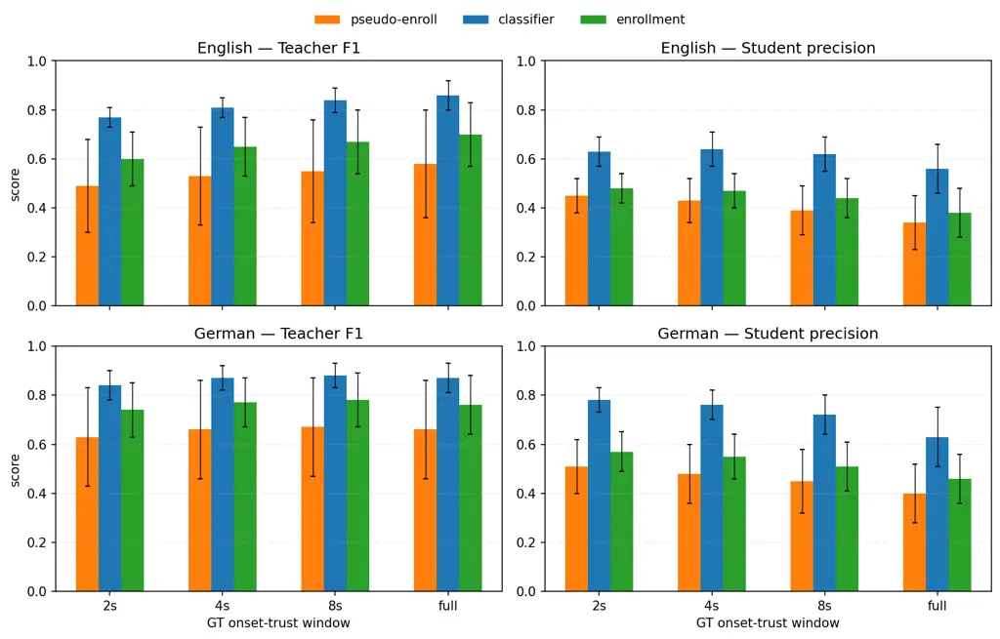

# Label-Free Role-Aware Segmentation of Classroom Recordings: Recovering the Teacher from Transferable Structure

Nitin Jain    Tim Fütterer    Babette Bühler    Çağatay Yıldız

###### Abstract

How much the teacher talks and when are among the most informative and
costly-to-measure signals of teaching. Yet, classroom audio is among the
most sensitive data an AI system can process: recordings capture minors
and fall under GDPR, preventing raw audio from leaving the recording
device. We present a teacher-student segmentation pipeline designed to
meet exactly this constraint: label-free at inference, running on a
recording device, and requiring no per-session calibration. The pipeline
chains a lightweight voice activity detector, compactly pretrained
speaker embeddings, agglomerative clustering, and a small logistic
regression that assigns the teacher role based on session-relative
structure rather than voice identity. We show that our structural cue
transfers across classrooms, languages, and acoustic conditions.

In leave-one-teacher-out cross-validation on 292 recordings from 63
teachers across English and German corpora, our pipeline achieves
teacher F1 of 0.81 and 0.87, respectively, outperforming both
enrollment-based baselines and a 30-second supervised enrollment
ceiling. On a commodity smartphone, its performance matches pyannote, a
strong neural diarization tool, while running 4.8$`\times`$ faster at
comparable peak memory at a real-time factor of $`\sim`$0.18. We also
find that transcribing filtered audio only marginally increases
teacher’s word error rate from $`0.26`$ to $`0.28`$. Residual failures
concentrate where teacher and student voices are not acoustically
separable. However, we show how to flag these sessions label-free at
inference so that they can be routed to human review, enabling
selective, privacy-preserving deployment.

¹Hector Research Institute of Education Sciences and Psychology,
University of Tübingen

²Chair of Human-Centered Technologies for Learning, Technical University
of Munich

³Tübingen AI Center, University of Tübingen

nitin96.jain@gmail.com, babette.buehler@tum.de,  {tim.fuetterer,
cagatay.yildiz}@uni-tuebingen.de

## 1 Introduction

How much a teacher talks, and when, provides informative but
costly-to-measure signals of teaching (Tao and Chen 2024).
Distinguishing teacher from student speech enables analyses of talk-time
balance, turn-taking, and instructional dialogue, but still requires
intensive human annotation (Wang et al. 2025; Kelly et al. 2018;
Donnelly et al. 2017). Automating this distinction supports scalable
feedback and downstream analyses of classroom discourse and student
engagement (Schlotterbeck et al. 2021; Hou et al. 2025).

Speaker diarization identifies _who spoke when_ (Anguera et al. 2012;
Park et al. 2022), but classroom deployment adds two requirements.
First, a deployed system meets a new, unknown teacher in every session,
and it must identify the teacher in unseen classrooms without enrollment
audio or speaker-specific fine-tuning. Second, recordings are among the
most sensitive data because they involve minors and sensitive
interactions. In our intended downstream workflow, teacher speech must
leave the device for further processing, making it necessary to identify
and filter teacher segments locally before transmission. This motivates
local processing without transferring raw audio or retaining reference
voiceprints (Sümer et al. 2020; Granqvist et al. 2020). Together, these
constraints rule out the commonly used large, cloud-based GPU neural
diarization pipelines with enrollment and demand a label-free, CPU-based
inference system.

We present such a system. Our pipeline combines lightweight voice
activity detection (Silero Team 2024), compact pretrained speaker
embeddings (Wang et al. 2023), and agglomerative clustering with a small
logistic regression that assigns teacher/student roles using
session-relative features. The strongest cue we consider is centrality:
the cosine similarity between speech segments in a lesson and a lesson’s
mean embedding. When the teacher is a recurrent, acoustically coherent
voice in a classroom, this mean provides an in-session reference for
recovering the teacher across fragmented segments. The role classifier
is trained on annotated recordings; inference uses only audio and the
frozen models.

We evaluate on 292 recordings from 63 teachers: 151 close-microphone
English lessons and 141 far-field German lessons. Leave-one-teacher-out
teacher F1 reaches $`0.81`$ and $`0.87`$, respectively, exceeding
pseudo-enrollment and supervised enrollment baselines and remaining
competitive with pyannote (Plaquet and Bredin 2023; Bredin 2023).
Training on either language transfers to the other with no loss or
target-language supervision. On Samsung Galaxy S24+ smartphone, the
pipeline runs at real-time factor $`\approx 0.18`$, $`4.8\times`$ faster
than the matched pyannote reference at comparable memory. We
additionally show minimal degradation in a downstream transcription
task, audit ground-truth transcript-derived labels, and evaluate
label-free diagnostics for routing unreliable sessions to human review.

#### Task and constraints.

We assign every instant of a single-channel recording one of three
labels: silence, teacher, or student, grouping all students into a
single role rather than distinguishing individuals. Labels are used only
to train and calibrate the classifier; inference requires neither
enrollment audio nor per-session tuning. The overall system is to be
deployed on smartphones.

Figure 1: 35 s segment of a classroom recording, ground truth transcript
annotation (who spoke), and the output of the VAD stage of our pipeline,
identifying silent moments.

## 2 Datasets and problems with their labels

We use two corpora in two acoustic regimes:

- •
  Virginia (English, Pianta and Burchinal (2016)). Classroom videos in
  which teachers wear a microphone. 151 lessons have human transcripts
  (24 distinct teachers).
- •
  GTI (German, Global Teaching InSights OECD (2020)) Room-microphone
  recordings, 141 transcribed lessons and tutoring sessions (39 distinct
  teachers). This dataset was initially referred to as the Teaching and
  Learning International Survey (TALIS) Video Study.

Onset-anchored labels.   Transcript timestamps mark turn onsets, not
offsets. For instance, a span labeled Teacher 38 $`\rightarrow`$ 56 ends
only where the next speaker begins, and hides pauses, backchannels, and
interjections that never received their own onset. VAD confirms that
only $`69\%`$ (English) and $`46\%`$ (German) of teacher-labeled
interval time is actually voiced. Treating entire intervals as teacher
speech therefore contaminates training labels and distorts evaluation.
At _training_ we intersect transcript intervals with VAD (Section 3.1);
at _evaluation_ we trust only the first $`4`$ s after each onset
(Section 3.5). The strategy ranking remains stable across alternative
window lengths (Appendix C).

Boundary timing noise.   Onset timestamps are recorded to whole-second
resolution, so the final $`\sim`$$`1`$ s before each speaker change is
still credited to the outgoing speaker although the incoming one has
usually begun. Excluding that second from the ground truth raises
teacher F1 from $`0.85`$ to $`0.87`$. Because the model is already
correct on these frames and only the label is wrong, we do not revise
our numbers upward and treat the reported F1 as a conservative floor,
with roughly two points of residual error attributable to
transition-zone label noise rather than model error.

Human audit.   We sampled $`5{,}000`$ clips across six groups: two where
our pipeline and the transcript disagree on the speaker’s role, two
where they agree on teacher or student, and two containing
VAD-designated silence. A trained annotator, blind to both pipeline
outputs and transcripts, labeled the clips. Duration-weighted estimates
indicate substantial transcript error: $`63\%`$ of sampled duration
labeled teacher by our pipeline but student by the transcript was judged
to be teacher speech. Corrections almost entirely improve teacher
precision without degrading recall. Appendix B details the sampling,
annotation, and corrected metrics.

## 3 Method

1: A classroom audio recording

2: Each cluster labelled teacher or student

3: Step 1: Embed and cluster. Run VAD to filter out the silent regions.
Then, split the active regions into 1.25 s speech windows, embed each
window with WeSpeaker english_resnet34, and group the window embeddings
into speaker clusters by agglomerative clustering.

4: Step 2: Describe each cluster. For every cluster, compute eight
structural features from the audio (no labels). centrality is defined in
Sec. 3.4; the rest in App. F.

5: Step 3: Score each cluster. Pass these features through a logistic
regression model trained to predict if a summary is student or teacher.
The model returns a _teacher probability_ $`\hat{p}_{c}\in[0,1]`$ for
each cluster $`c`$.

6: Step 4: Assign teacher role. Label as teacher all clusters with
$`\hat{p}_{c}\geq\tau`$. Label all remaining clusters student. We find
that the optimal $`\tau=0.45`$

Algorithm 1 Assign teacher/student roles to speaker clusters

The inference pipeline is four stages: voice activity detection (VAD),
embedding, clustering, and teacher selection.

### 3.1 Voice activity detection and why we need it

Silero VAD (Silero Team 2024) identifies speech regions, assigning the
silence label and restricting embedding extraction at _inference_.
During _training_, we intersect detected speech with transcript
intervals and assign each retained sub-span the interval’s role label.

A human audit, stratified by frame energy in VAD-designated silence,
estimates speech recall at $`93.8\%`$. Missed speech is distributed
proportional to teacher and student talk time, suggesting no
role-specific bias in speech retention.

### 3.2 Segmentation and embedding

Each VAD-speech region is sliced into 1.25 s windows (0.5 s hop), and
each window is embedded with a generic pretrained speaker model
(WeSpeaker english_resnet34, 256-dimensional, Wang et al. (2023)). We
deliberately use _one_ embedder for both languages since speaker
embeddings encode voice timbre rather than language, and we confirm
below that the resulting features transfer.

### 3.3 Clustering

Window embeddings are clustered with agglomerative clustering (cosine
distance, average linkage, and distance threshold $`0.5`$). We
cross-validate the distance threshold jointly with the classifier in
App. E and find accuracy flat across $`0.4`$–$`0.85`$ before the
clusters collapse near $`0.9`$. In practice, the teacher’s voice is
_fragmented_ across many clusters (often hundreds per 45-minute lesson),
because content, distance, and channel drift push the same voice past
the cosine threshold.

### 3.4 Per-cluster structural features

For each cluster we compute a set of label-free, _session-relative_
features that capture the structural role of a voice without any
annotation. The most important of these is centrality, the cosine
similarity between the cluster centroid and the duration-weighted
session-global centroid. Centrality of cluster $`c`$ is defined as:

```math
\texttt{centrality}(c)=\cos\!\big(\mu_{c},\;\mu_{\text{session}}\big),\quad\mu_{c}=\frac{\sum_{i\in c}d_{i}\,e_{i}}{\sum_{i\in c}d_{i}},
```

where $`e_{i}`$ is the embedding of window $`i`$, $`d_{i}`$ its
duration, $`\mu_{c}`$ the cluster centroid, and $`\mu_{\text{session}}`$
the average over _all_ windows in the session. Because
$`\mu_{\text{session}}`$ is duration-weighted, it is pulled toward
whoever talks most, usually the teacher, so a cluster that resembles the
session’s dominant voice scores high.

We also compute complementary cues: talk-time share, temporal coverage
and spread, turn count, cluster size, embedding consistency, and
relative energy. These describe each cluster’s share of the lesson’s
total speech duration, its temporal distribution across the lesson, and
its acoustic consistency, capturing role-related patterns without
requiring speaker identity. We select features by treating clusters as
labeled teacher/student examples under leave-one-teacher-out cross
validation, optimizing the lower per-cluster labeling accuracy across
English and German. After ranking individual features, we perform greedy
forward selection, adding the feature that most improves the current
set. Centrality is the strongest single predictor in both languages, and
additional cues provide little improvement. App. F details the feature
definitions, selection procedure, and per-feature results (Figure 7).

|                       | Method            | TchP                      | TchR                      | TchF1                     | StuP                      | StuR                      |
| --------------------- | ----------------- | ------------------------- | ------------------------- | ------------------------- | ------------------------- | ------------------------- |
| English (24 teachers) | pseudo_enroll     | $`0.79\pm 0.12`$          | $`0.43\pm 0.20`$          | $`0.53\pm 0.20`$          | $`0.43\pm 0.09`$          | $`\mathbf{0.80\pm 0.10}`$ |
|                       | enrollment        | $`0.83\pm 0.03`$          | $`0.55\pm 0.15`$          | $`0.65\pm 0.12`$          | $`0.47\pm 0.07`$          | $`0.75\pm 0.11`$          |
|                       | our pipeline      | $`0.76\pm 0.06`$          | $`\mathbf{0.87\pm 0.04}`$ | $`0.81\pm 0.04`$          | $`\mathbf{0.64\pm 0.07}`$ | $`0.46\pm 0.11`$          |
|                       | pyannote-diar^(†) | $`\mathbf{0.86\pm 0.06}`$ | $`0.83\pm 0.03`$          | $`\mathbf{0.84\pm 0.08}`$ | $`0.40\pm 0.04`$          | $`0.58\pm 0.05`$          |
| German (39 teachers)  | pseudo_enroll     | $`0.90\pm 0.04`$          | $`0.55\pm 0.22`$          | $`0.66\pm 0.20`$          | $`0.48\pm 0.12`$          | $`\mathbf{0.87\pm 0.06}`$ |
|                       | enrollment        | $`\mathbf{0.92\pm 0.03}`$ | $`0.67\pm 0.14`$          | $`0.77\pm 0.10`$          | $`0.55\pm 0.09`$          | $`0.85\pm 0.07`$          |
|                       | our pipeline      | $`0.83\pm 0.08`$          | $`\mathbf{0.91\pm 0.04}`$ | $`\mathbf{0.87\pm 0.05}`$ | $`\mathbf{0.76\pm 0.06}`$ | $`0.60\pm 0.10`$          |
|                       | pyannote-diar^(†) | $`0.84\pm 0.10`$          | $`0.80\pm 0.09`$          | $`0.82\pm 0.09`$          | $`0.53\pm 0.05`$          | $`0.74\pm 0.07`$          |

Table 1: Teacher (Tch) and student (Stu) precision/recall and teacher F1
under leave-one-teacher-out cross-validation (mean $`\pm`$ std). Our
pipeline outperforms enrollment-based approaches and has the lowest
variance; against the external pyannote reference, it wins on German but
is edged on English. ^(†)pyannote (pyannote speaker-diarization-3.1,
teacher chosen by our dominance rule) is a deployable CPU reference
($`\sim`$8 M params) but requires license-gated diarization weights; it
is scored once per corpus (no folds), with precision/recall from the
aggregate teacher-vs-rest confusion.

### 3.5 Evaluation metric

We compare pipeline predictions with transcript-derived role labels on
$`0.1`$ s frames. For each role, precision is the fraction of predicted
frames that match the reference, and recall is the fraction of reference
frames correctly identified. Teacher precision thus measures the purity
of extracted teacher speech, while teacher recall measures how much
reference teacher speech is retained within the evaluated frames. We
also report F1, the harmonic mean of precision and recall. Frame-level
evaluation weights speech by duration rather than by cluster count, and
results are reported separately for English and German. All experiments
use _leave-one-teacher-out cross-validation_: in each fold, the
classifier is trained on all recordings from the remaining teachers and
evaluated on the held-out teacher, whose voice and session statistics
are excluded from training.

### 3.6 Three alternative teacher-selection strategies

We compare our pipeline against a hand-designed rule, a supervised upper
bound, and an SOTA diarization tool: (i) Pseudo-enrollment builds a
teacher centroid from the dominant speaker in the opening minutes and
labels clusters within a cosine-distance threshold as teacher. It can
select the wrong voice when the teacher does not dominate the opening.
(ii) Enrollment uses the same threshold rule but builds its centroid
from the teacher’s first $`30`$ s of labeled speech, providing a
supervised reference that requires per-session annotation. (iii)
pyannote speaker-diarization-3.1 is a strong external system that first
diarizes an entire lesson. We pick the teacher with a dominance rule
detailed in App. A.

## 4 Findings

We address six deployment questions. Does it work? Our pipeline
outperforms enrollment approaches (Sec. 4.1, Table 1). Why? A
session-relative feature, centrality, carries the signal across
languages (Sec. 4.2); an embedder ablation supports discourse
_structure_ as the key cue (App. D). Does it generalize and deploy?
Cross-lingual transfer requires no retraining (Sec. 4.3), and the
pipeline runs $`\sim 4.8\times`$ faster than a matched pyannote
reference at equal memory on a commodity Android smartphone (Sec. 4.4).
How does filtering affect transcription? Filtering reduces substitutions
and insertions but deletes some teacher speech, increasing teacher word
error rate by $`2\%`$ compared to unfiltered audio (Sec. 4.5). Can
failures be detected? Failures arise when teacher and student embeddings
do not separate (Sec. 4.6); and they are _detectable at inference_, so
low-confidence sessions can be routed to human review (Sec. 4.7). What
did not help? Sec. 4.8 reports three unsuccessful interventions.

### 4.1 Our pipeline outperforms enrollment methods

Main findings.   Table 1 compares four teacher-identification strategies
under leave-one-teacher-out cross-validation across 24 English and 39
German teachers. Our Pipeline achieves teacher F1 (TchF1) of $`0.81`$
and $`0.87`$, respectively, outperforming both enrollment approaches
with the lowest variability across folds. The gain comes primarily from
_recall_: supervised enrollment recovers just over half of teacher
speech in English and two-thirds in German, whereas our pipeline reaches
$`0.87`$ and $`0.91`$. Under reverberation, the teacher’s voice
fragments across clusters that can fall outside a fixed cosine
threshold; our structural classifier evaluates each cluster and recovers
more of these fragments.

Accounting for wrong labels.   The human audit described in Sec. 2
reveals substantial transcript errors. Using human judgments and
weighting each sampling stratum by its corpus duration raises estimated
teacher F1 from $`0.84`$ to $`0.94`$ (App. B). The correction is much
larger for precision than recall: nearly two-thirds of the speech
flagged as teacher false positives is actually teacher speech. Errors
also persist where the pipeline and transcript agree. Teacher-labeled
agreement regions are largely reliable, but $`56.5\%`$ of the audited
student-labeled agreement regions contain teacher speech or non-speech.
The student channel’s apparent weakness in Table 1 therefore reflects
substantial reference-label noise. Since the audit covers full
transcript intervals, its correction is an upper bound for the
onset-restricted main evaluation.

Pyannote comparison.   Pyannote reaches TchF1 of $`0.84`$ in English and
$`0.82`$ in German, slightly outperforming our pipeline on English but
trailing it on German. Both systems use the same WeSpeaker ResNet34
embedder. What distinguishes our pipeline is not model size, but that it
recovers the teacher from a _generic_ embedder and session-relative
structure, without gated diarization weights or the neural segmentation
stage, pyannote runs ahead of clustering.

Overall, our approach generalizes to unseen teachers and improves recall
over supervised enrollment through structural cluster features. App. D
tests whether this advantage persists with a stronger embedder.

### 4.2 Why it works: centrality is the dominant, transferable cue

Figure 2 visualizes cluster centroids coloured by their majority
ground-truth role. In successful recordings, teacher clusters are
compact and well separated from student clusters, placing the
session-global mean near the teacher clusters. Consequently, centrality
assigns high scores (cosine similarity) to multiple teacher fragments.
In difficult recordings, teacher and student clusters overlap, weakening
this cue.

Single-feature ablations support this explanation: centrality alone
achieves teacher F1 of $`0.85`$, and adding other features through
greedy forward selection provides little improvement (App. F, Figure 7).
Embedding using $`6\times`$ larger ResNet221 also improves F1 by less
than $`0.01`$ in either language (App. D). These support using a compact
embedder with session-relative features for on-device inference.

Figure 2: t-SNE embeddings of _cluster centroids_, coloured by majority
ground-truth role. Two good cases (left two): the teacher clusters are
tight, and the global mean falls inside the teacher mass, so a single
global centroid recovers the teacher. Two bad cases (right two): the
teacher clusters are fragmented, and the global mean drifts off the
teacher mass, so the same proxy fails.

### 4.3 Cross-lingual transfer is free

The main experiments train a single role classifier jointly on German
and English recordings. Training on either language alone and evaluating
on a held-out teacher (same language) and lessons in the other language
yields the same English/German TchF1 of $`0.81/0.87`$ (Table 1). Thus,
the session-relative cue captured by centrality transfers across these
corpora despite different recording conditions and classroom practices,
allowing deployment in the other language without modification or
additional annotation.

### 4.4 Deployability: runtime, footprint, and clustering robustness

The full pipeline (VAD, embedding, clustering, and role classification)
runs locally on CPU, allowing audio and intermediate speaker
representations to remain on the device. Having established competitive
accuracy against pyannote (Sec. 4.1), we compare their runtime and
memory requirements.

We benchmark both pipelines end-to-end on a laptop CPU and a commodity
Android smartphone using matched inference settings. Fig. 3 shows the
results, and App. J provides the hardware and protocol. On the laptop,
our pipeline achieves a real-time factor (RTF) of $`0.022`$:
approximately $`25\times`$ faster than pyannote and $`45\times`$ faster
than real time. On the phone, where the baseline is itself an optimised
ONNX build((Next-gen Kaldi Team 2026)), it is $`4.8\times`$ faster. Both
approaches use the same RSS peak resident memory (872 MB on laptop vs
356 MB on phone (Figure 3)). We also benchmark the parallelisability of
our pipeline by increasing the number of threads (Table 9, Fig. 3). We
find that while there are efficiency gains on the phone with RTF nearly
halving on 8 threads, the efficiency on laptop CPU stays flat or
decreases.

Figure 3: Efficiency of the proposed pipeline versus pyannote. Left:
Real-time factor at matched accuracy (recording A, single thread); error
bars span the recorded min–max, the dashed line is real time, the boxed
figure is the within-environment speed-up. Right: Thread scaling
(recording B): the phone nearly halves its RTF from one to eight threads
as embedding parallelises, while the laptop is already fast enough that
RTF is flat. Lower is faster.

### 4.5 Downstream transcription analysis

We assess how role filtering affects teacher transcription by running
Whisper-large-v2 (Radford et al. 2023) on all 292 recordings in fixed
$`30`$ s chunks. We compare unfiltered audio with audio retaining only
spans the pipeline labels as teacher. Both conditions are evaluated
against the teacher’s transcript turns using the teacher-word scoring
protocol in App. K.

Filtering modestly increases average teacher word error rate (WER), from
$`0.26`$ to $`0.28`$ across the two languages. The effect differs by
corpus: English WER rises from $`0.160`$ to $`0.213`$, with most
recordings worsening, while German performance remains essentially
unchanged.

Filtering reduces substitutions and insertions in both corpora, but also
removes some genuine teacher speech. The resulting deletions outweigh
the recognition gains, particularly in English. Frequently deleted words
include fillers, backchannels, and discourse markers, e.g., _okay_,
_right_, _ja_, and _mhm_ (Figure 10). Although they carry little
content, their loss may still matter for analyses of classroom
interaction.

| F1 stratum        | $`n`$   | pipeline | oracle   | $`\Delta`$ | GT sil.  |
| ----------------- | ------- | -------- | -------- | ---------- | -------- |
| $`<0.70`$         | $`12`$  | $`0.63`$ | $`0.78`$ | $`+0.15`$  | $`0.09`$ |
| $`0.70`$–$`0.80`$ | $`34`$  | $`0.76`$ | $`0.78`$ | $`+0.02`$  | $`0.05`$ |
| $`0.80`$–$`0.90`$ | $`116`$ | $`0.86`$ | $`0.85`$ | $`-0.01`$  | $`0.11`$ |
| $`\geq 0.90`$     | $`128`$ | $`0.94`$ | $`0.92`$ | $`-0.02`$  | $`0.18`$ |
| all               | $`290`$ | $`0.87`$ | $`0.87`$ | $`-0.00`$  | $`0.13`$ |

Table 2: Embedding-level oracle vs. our pipeline. Oracle is a supervised
logistic probe on the raw embeddings (the ceiling extractable from the
representation), and GT sil. is the cosine silhouette of the _true_
teacher/student partition. Overall, the two match; only the low-accuracy
tail leaves a recoverable signal, and it remains a low-separability
regime.

### 4.6 When the pipeline fails: separability sets the ceiling

Per-recording accuracy depends strongly on how clearly teacher and
student speech separate in the embedding space. We measure this without
reference labels using the _silhouette_ of the predicted role partition:
for each embedding, the difference between its mean cosine distance to
the other role and to its own role, normalized by the larger of these
distances and averaged across embeddings. Teacher F1 correlates strongly
with this measure ($`\rho=0.76`$) and drops sharply below a silhouette
of $`0.10`$ (Figure 4), linking the poorest-performing recordings to
weak separation between the two roles.

To examine how much signal remains recoverable, we train a supervised,
within-recording linear probe on the raw $`256`$-dimensional window
embeddings. Using ground-truth role labels, this probe assesses how well
a linear classifier can distinguish teacher from student speech directly
from the embeddings (Table 2). Its overall teacher F1 matches the
pipeline at $`0.87`$. In the lowest-performing group, however, it
improves F1 from from $`0.63`$ to $`0.78`$, indicating that our pipeline
does not recover some linearly separable signal. Yet, even there, it
reaches only $`0.78`$, i.e., some recordings are hard because the true
embeddings barely separate.

### 4.7 Failures are detectable at inference: routing to human review

The difficult recordings in Sec. 4.6 can often be flagged without
reference labels. Two inference-time diagnostics correlate strongly with
teacher F1: the _classifier margin_, the mean distance of the teacher
probability from $`0.5`$, and the _predicted teacher share_, the
fraction of speech assigned to the teacher (Spearman $`\rho=0.82`$ and
$`0.73`$; see App. G, Table 8).

Classifier margin is particularly useful for review routing. Flagging
the lowest-margin $`20\%`$ of recordings captures $`85\%`$ of those with
teacher F1 below $`0.70`$ and raises mean F1 among retained recordings
from $`0.87`$ to $`0.92`$. Predicted teacher share shows a similar
association: recordings with lower shares tend to have lower accuracy
(Figure 8). These diagnostics offer a practical way to prioritize human
review; App. G compares their predictive strength.

### 4.8 What does not help

Three interventions do not change the results significantly. We defer
the details of these negative results to appendices.

Accumulating a teacher voiceprint across lessons.    Pooling predicted
teacher clusters from earlier lessons provides little benefit: teacher
F1 increases by only $`0.01`$ in German and remains unchanged in
English. Similarity to the accumulated voiceprint closely tracks
similarity to the session-global mean, suggesting that it adds little
information beyond centrality. Label-free accumulation also matches
supervised enrollment, supporting its use when a cross-lesson voiceprint
is available to avoid enrollment (App. H, Figure 9).

Masking mixed windows.    Roughly $`9\%`$ of English and $`4\%`$ of
German speech are flagged by pyannote/segmentation-3.0 as overlapping
speech. Excluding these windows from the feature calculations changes
teacher F1 by at most $`0.002`$ across separability strata. This
suggests that the aggregate features are insensitive to this masking
intervention, so we retain the simpler pipeline without overlap
detection (App. I).

Varying the onset-trust window.   As noted in Sec. 2, transcripts mark
turn onsets rather than true speech offsets. So, we restrict evaluation
to a short window after each onset to reduce incorrect attribution of
later pauses, backchannels, and other-speaker speech. Re-scoring the
predictions with onset-trust windows of $`\{2,4,8\}`$ s and full
transcript intervals preserves the strategy ranking. Student precision
falls as the window widens, consistent with longer interval tails
introducing incorrect role labels. The main comparison is therefore
robust to the window choice, while student precision remains sensitive
to transcript span inflation (App. C).

## 5 Related work

Speaker diarization.    Speaker diarization determines _who spoke when_
(Anguera et al. 2012; Park et al. 2022), commonly through speaker
embeddings and clustering (Snyder et al. 2018; Desplanques et al. 2020;
Wang et al. 2023; Landini et al. 2022) or end-to-end neural approaches
(Fujita et al. 2019; Horiguchi et al. 2020; Plaquet and Bredin 2023;
Park et al. 2024). Related systems use enrollment audio to detect target
speakers (Medennikov et al. 2020) or combine diarization with ASR (Bain
et al. 2023). Our task adds role assignment to this setting: the
pipeline must identify teacher speech without enrollment and operate
within a smartphone CPU budget.

Classroom and child-adult audio.    Teacher-talk analysis spans wearable
adult/child tagging (Xu et al. 2009; Ganek and Eriks-Brophy 2018) and
classroom-discourse analytics that rely on teacher/student segmentation
(Owens et al. 2017; Wang et al. 2014; Donnelly et al. 2017; Kelly et al.
2018; Schlotterbeck et al. 2021). Short turns, cross-talk, and limited
representation of children’s speech in pretrained systems make this
setting challenging (Kothalkar et al. 2024). Related work explores
simulated child-adult conversations to reduce dependence on sensitive
recordings (Xu et al. 2025), therapist-role identification in
psychotherapy (Flemotomos et al. 2020), and video-assisted classroom
speaker identification (Chen et al. 2019; Chrzan et al. 2026). Our
pipeline uses audio alone and assigns roles through session-relative
features.

Closest systems.    Wang et al. (2025) study a cluster-ing-based
pipeline for classroom group discussions using ECAPA-TDNN embeddings,
Whisper-derived segmentation, and enrollment audio. Our pipeline instead
combines dedicated VAD with explicit teacher-role classification and
requires no enrollment. Khan et al. (2025) address classroom noise
through a multi-stage pipeline combining denoising, neural VAD, and ASR
timestamps, resulting in a server-side and GPU-scale setting. We focus
on a compact inference path that runs faster than real time on a
commodity smartphone CPU. Speech-privacy research also studies federated
learning (Granqvist et al. 2020; Woubie and Bäckström 2021) and
anonymisation (Sümer et al. 2020). Our deployment approach complements
these directions by keeping audio and speaker representations on the
device during inference.

## 6 Discussion and Conclusion

Our results suggest that teacher-role recovery can rely on
session-relative structure without speaker enrollment. Centrality
supplies most of the predictive signal, transfers between the two
evaluated languages, and gains little from a larger embedder or
accumulated teacher voiceprints. This supports a compact, on-device
design for classroom role segmentation, although its value for
educational feedback remains to be established in operational use.

Reliability remains conditional on teacher/student acoustic
separability. Low classifier margins identify many difficult sessions,
supporting selective human review rather than uniformly trusting every
output. Filtering also introduces a downstream trade-off: average
teacher WER rises from $`0.26`$ to $`0.28`$, with greater degradation in
English. Deleted backchannels and discourse markers may matter for
interaction analysis even when they contribute little lexical content.

Our findings are restricted to two corpora in which language and
microphone regime vary together. The timestamp audit also shows that
transcript-derived labels are imperfect to measure accuracy. Future work
should prioritize precisely timed role annotations, prospective
evaluation of thresholds, and testing in more diverse classrooms.
Overall, the pipeline provides a practical basis for local
teacher/student segmentation, with explicit reliability checks and
task-specific validation remaining essential for deployment.

## Ethical Statement

We use two existing research corpora, collected under their originating
studies’ informed-consent procedures and ethics approvals and accessed
under their data-use agreements. These recordings involve minors and are
not redistributed. Our analysis distinguishes discourse roles without
identifying individual students. Segmentation runs locally, allowing raw
recordings and intermediate speaker embeddings to remain on the device.
However, filtering does not anonymize speech: teacher segments remain
identifiable, and classification errors can retain student speech.

The pipeline is intended to support aggregate classroom-discourse
analysis for research and formative feedback. Its outputs should not
serve as standalone measures of teaching quality or support high-stakes
decisions about teachers or students. Errors may distort talk-time
estimates and remove meaningful speech, while performance beyond the
evaluated classrooms remains uncertain. Deployments should limit data
access and retention and provide human oversight. Our inference-time
diagnostics can prioritize potentially unreliable sessions for review
(Sec. 4.7), but do not guarantee accurate role assignments or prevent
privacy-sensitive errors.

#### Acknowledgements

Çağatay Yıldız is a member of the Machine Learning Cluster of
Excellence, funded by the Deutsche Forschungsgemeinschaft (DFG, German
Research Foundation) under Germany’s Excellence Strategy – EXC number
2064/1 – Project number 390727645. This research utilized compute
resources at the Tübingen Machine Learning Cloud, DFG FKZ INST 37/1057-1
FUGG.

## References

- Anguera et al. (2012) X. Anguera, S. Bozonnet, N. Evans, C.
  Fredouille, G. Friedland, and O. Vinyals Speaker diarization: a review
  of recent research. IEEE Transactions on Audio, Speech, and Language
  Processing 20 (2), pp. 356–370. External Links:
  [Document](https://dx.doi.org/10.1109/TASL.2011.2125954) Cited by: §1,
  §5.
- Bain et al. (2023) M. Bain, J. Huh, T. Han, and A. Zisserman WhisperX:
  time-accurate speech transcription of long-form audio. In Proc.
  Interspeech, Cited by: §5.
- Bredin (2023) H. Bredin Pyannote.audio 2.1 speaker diarization
  pipeline: principle, benchmark, and recipe. In Proc. Interspeech,
  pp. 1983–1987. Cited by: §1.
- Chen et al. (2019) J. Chen, H. Li, W. Wang, W. Ding, G. Y. Huang,
  and Z. Liu A multimodal alerting system for online class quality
  assurance. In Artificial Intelligence in Education (AIED 2019),
  Lecture Notes in Computer Science, Vol. 11626, pp. 381–385. Cited by:
  §5.
- Chrzan et al. (2026) M. L. Chrzan, M. Krishnaswamy, R. Gibboni, K.
  Wetstone, W. Ai, and J. Liu Multimodal speaker identification in
  classroom environments. arXiv preprint arXiv:2606.13712. Cited by: §5.
- Desplanques et al. (2020) B. Desplanques, J. Thienpondt, and K.
  Demuynck ECAPA-TDNN: emphasized channel attention, propagation and
  aggregation in TDNN based speaker verification. In Proc. Interspeech,
  pp. 3830–3834. Cited by: §5.
- Donnelly et al. (2017) P. J. Donnelly, N. Blanchard, B. Samei, A. M.
  Olney, X. Sun, B. Ward, S. Kelly, M. Nystrand, and S. K. D’Mello Words
  matter: automatic detection of teacher questions in live classroom
  discourse using linguistics, acoustics, and context. In Proc. 7th
  International Learning Analytics & Knowledge Conference (LAK),
  pp. 218–227. External Links:
  [Document](https://dx.doi.org/10.1145/3027385.3027417) Cited by: §1,
  §5.
- Flemotomos et al. (2020) N. Flemotomos, P. Georgiou, and S. Narayanan
  Linguistically aided speaker diarization using speaker role
  information. In Proc. Odyssey: The Speaker and Language Recognition
  Workshop, Note: arXiv:1911.07994 Cited by: §5.
- Fujita et al. (2019) Y. Fujita, N. Kanda, S. Horiguchi, K. Nagamatsu,
  and S. Watanabe End-to-end neural speaker diarization with
  permutation-free objectives. In Proc. Interspeech, pp. 4300–4304.
  Cited by: §5.
- Ganek and Eriks-Brophy (2018) H. Ganek and A. Eriks-Brophy Language
  environment analysis (LENA) system investigation of day long
  recordings in children: a literature review. Journal of Communication
  Disorders. Cited by: §5.
- Granqvist et al. (2020) F. Granqvist, M. Seigel, R. van Dalen, Á.
  Cahill, S. Shum, and M. Paulik Improving on-device speaker
  verification using federated learning with privacy. In Proc.
  Interspeech, Note: arXiv:2008.02651 Cited by: §1, §5.
- Horiguchi et al. (2020) S. Horiguchi, Y. Fujita, S. Watanabe, Y. Xue,
  and K. Nagamatsu End-to-end speaker diarization for an unknown number
  of speakers with encoder-decoder based attractors. In Proc.
  Interspeech, pp. 269–273. Cited by: §5.
- Hou et al. (2025) R. Hou, B. Bühler, T. Fütterer, E. Bozkir, P.
  Gerjets, U. Trautwein, and E. Kasneci Multimodal assessment of
  classroom discourse quality: a text-centered attention-based
  multi-task learning approach. arXiv preprint arXiv:2505.07902. Cited
  by: §1.
- Kelly et al. (2018) S. Kelly, A. M. Olney, P. Donnelly, M. Nystrand,
  and S. K. D’Mello Automatically measuring question authenticity in
  real-world classrooms. Educational Researcher 47 (7), pp. 451–464.
  External Links:
  [Document](https://dx.doi.org/10.3102/0013189X18785613) Cited by: §1,
  §5.
- Khan et al. (2025) A. S. Khan, T. Ogunremi, A. A. Attia, and D.
  Demszky Multi-stage speaker diarization for noisy classrooms. arXiv
  preprint arXiv:2505.10879. Cited by: §5.
- Kothalkar et al. (2024) P. V. Kothalkar, J. H. L. Hansen, D. Irvin,
  and J. Buzhardt Child-adult speech diarization in naturalistic
  conditions of preschool classrooms using room-independent ResNet model
  and automatic speech recognition-based re-segmentation. The Journal of
  the Acoustical Society of America 155 (2), pp. 1198–1215. Cited by:
  §5.
- Landini et al. (2022) F. Landini, J. Profant, M. Diez, and L. Burget
  Bayesian HMM clustering of x-vector sequences (VBx) in speaker
  diarization: theory, implementation and analysis on standard tasks.
  Computer Speech & Language 71, pp. 101254. External Links:
  [Document](https://dx.doi.org/10.1016/j.csl.2021.101254) Cited by: §5.
- Medennikov et al. (2020) I. Medennikov, M. Korenevsky, T. Prisyach, Y.
  Khokhlov, M. Korenevskaya, I. Sorokin, T. Timofeeva, A. Mitrofanov, A.
  Andrusenko, I. Podluzhny, A. Laptev, and A. Romanenko Target-speaker
  voice activity detection: a novel approach for multi-speaker
  diarization in a dinner party scenario. In Proc. Interspeech,
  pp. 274–278. Cited by: §5.
- Next-gen Kaldi Team (2026) Next-gen Kaldi Team Sherpa-onnx:
  speech-to-text, text-to-speech, and speaker diarization using next-gen
  kaldi with onnxruntime. Note:
  https://github.com/k2-fsa/sherpa-onnxVersion 1.13.4 Cited by: Appendix
  J, §4.4.
- OECD (2020) OECD Global teaching insights: a video study of teaching.
  OECD Publishing, Paris. External Links:
  [Document](https://dx.doi.org/10.1787/20d6f36b-en) Cited by: 2nd item.
- Owens et al. (2017) M. T. Owens, S. B. Seidel, M. Wong, T. E.
  Bejines, S. Lietz, J. R. Perez, S. Sit, Z. Subedar, G. N. Acker, S. F.
  Akana, et al. Classroom sound can be used to classify teaching
  practices in college science courses. Proceedings of the National
  Academy of Sciences 114 (12), pp. 3085–3090. External Links:
  [Document](https://dx.doi.org/10.1073/pnas.1618693114) Cited by: §5.
- Park et al. (2022) T. J. Park, N. Kanda, D. Dimitriadis, K. J. Han, S.
  Watanabe, and S. Narayanan A review of speaker diarization: recent
  advances with deep learning. Computer Speech & Language 72,
  pp. 101317. External Links:
  [Document](https://dx.doi.org/10.1016/j.csl.2021.101317) Cited by: §1,
  §5.
- Park et al. (2024) T. J. Park, N. R. Koluguri, W. Wang, J. Balam,
  and B. Ginsburg Sortformer: seamless integration of speaker
  diarization and ASR by bridging timestamps and tokens. Note: arXiv
  preprint arXiv:2409.06656 Cited by: §5.
- Pianta and Burchinal (2016) R. Pianta and M. Burchinal National center
  for research on early childhood education teacher professional
  development study (2007-2011). Inter-university Consortium for
  Political and Social Research \[distributor\]. External Links:
  [Document](https://dx.doi.org/10.3886/ICPSR34848.v2),
  [Link](https://doi.org/10.3886/ICPSR34848.v2) Cited by: 1st item.
- Plaquet and Bredin (2023) A. Plaquet and H. Bredin Powerset
  multi-class cross entropy loss for neural speaker diarization. In
  Proc. Interspeech, pp. 3222–3226. External Links:
  [Document](https://dx.doi.org/10.21437/Interspeech.2023-205) Cited by:
  §1, §5.
- Radford et al. (2023) A. Radford, J. W. Kim, T. Xu, G. Brockman, C.
  McLeavey, and I. Sutskever Robust speech recognition via large-scale
  weak supervision. In International conference on machine learning,
  pp. 28492–28518. Cited by: §4.5.
- Schlotterbeck et al. (2021) D. Schlotterbeck, P. Uribe, A. Jiménez, R.
  Araya, J. Van der Molen Moris, and D. Caballero TARTA: teacher
  activity recognizer from transcriptions and audio. In Artificial
  Intelligence in Education (AIED 2021), Lecture Notes in Computer
  Science, Vol. 12748, pp. 369–380. External Links:
  [Document](https://dx.doi.org/10.1007/978-3-030-78292-4%5F30) Cited
  by: §1, §5.
- Silero Team (2024) Silero Team Silero VAD: pre-trained
  enterprise-grade voice activity detector (VAD), number detector and
  language classifier. Note: GitHub repository:
  https://github.com/snakers4/silero-vad Cited by: Appendix J, §1, §3.1.
- Snyder et al. (2018) D. Snyder, D. Garcia-Romero, G. Sell, D. Povey,
  and S. Khudanpur X-vectors: robust DNN embeddings for speaker
  recognition. In Proc. IEEE ICASSP, pp. 5329–5333. External Links:
  [Document](https://dx.doi.org/10.1109/ICASSP.2018.8461375) Cited by:
  §5.
- Sümer et al. (2020) Ö. Sümer, P. Gerjets, U. Trautwein, and E. Kasneci
  Automated anonymisation of visual and audio data in classroom studies.
  arXiv preprint arXiv:2001.05080. External Links:
  [Document](https://dx.doi.org/10.48550/arXiv.2001.05080) Cited by: §1,
  §5.
- Tao and Chen (2024) Y. Tao and G. Chen The relationship between
  teacher talk and students’ academic achievement: a meta-analysis.
  Educational Research Review 45, pp. 100638. External Links: ISSN
  1747-938X,
  [Document](https://dx.doi.org/https%3A//doi.org/10.1016/j.edurev.2024.100638),
  [Link](https://www.sciencedirect.com/science/article/pii/S1747938X24000472)
  Cited by: §1.
- Wang et al. (2023) H. Wang, C. Liang, S. Wang, Z. Chen, B. Zhang, X.
  Xiang, Y. Deng, and Y. Qian Wespeaker: a research and production
  oriented speaker embedding learning toolkit. In Proc. IEEE ICASSP,
  Cited by: Appendix J, §1, §3.2, §5.
- Wang et al. (2025) J. Wang, S. Dudy, X. He, Z. Wang, R. Southwell,
  and J. Whitehill Optimizing speaker diarization for the classroom:
  applications in timing student speech and distinguishing teachers from
  children. Journal of Educational Data Mining 17 (1), pp. 98–125.
  External Links:
  [Link](https://jedm.educationaldatamining.org/index.php/JEDM/article/view/841)
  Cited by: §1, §5.
- Wang et al. (2014) Z. Wang, X. Pan, K. F. Miller, and K. S. Cortina
  Automatic classification of activities in classroom discourse.
  Computers & Education 78, pp. 115–123. External Links:
  [Document](https://dx.doi.org/10.1016/j.compedu.2014.05.010) Cited by:
  §5.
- Woubie and Bäckström (2021) A. Woubie and T. Bäckström Federated
  learning for privacy preserving on-device speaker recognition. In 2021
  ISCA Symposium on Security and Privacy in Speech Communication (SPSC),
  pp. 1–5. External Links:
  [Document](https://dx.doi.org/10.21437/SPSC.2021-1) Cited by: §5.
- Xu et al. (2025) A. Xu, T. Feng, H. Tager-Flusberg, C. Lord, and S.
  Narayanan Data efficient child-adult speaker diarization with
  simulated conversations. In ICASSP 2025 - IEEE International
  Conference on Acoustics, Speech and Signal Processing, Cited by: §5.
- Xu et al. (2009) D. Xu, U. Yapanel, and S. Gray Reliability of the
  LENA Language Environment Analysis system in young children’s natural
  home environment. Technical report Technical Report LTR-05-2, LENA
  Foundation. Cited by: §5.

|          |                                                                                                 |                |
| -------- | ----------------------------------------------------------------------------------------------- | -------------- |
| Item     | Description                                                                                     | Complements    |
| Figure 4 | Relationship between teacher/student embedding separability and per-recording teacher F1        | Sec. 4.6       |
| App. A   | Details of how we map pyannote annotations to teacher/student labels                            | Secs. 3.6,4.1  |
| App. B   | Human audit of transcript labels: sampling, annotation, and duration-weighted corrected metrics | Secs. 2, 4.1   |
| App. C   | Sensitivity of teacher F1 and student precision to the onset-trust window                       | Secs. 2, 4.8   |
| App. D   | ResNet34 versus ResNet221 embeddings for our pipeline and supervised enrollment                 | Sec. 4.2       |
| App. E   | Accuracy and cluster-count sensitivity to the clustering distance threshold                     | Sec. 3.3       |
| App. F   | Structural feature definitions, feature selection, and single-feature performance               | Secs. 3.4, 4.2 |
| App. G   | Label-free session diagnostics and their association with teacher F1                            | Sec. 4.7       |
| App. H   | Cross-lesson teacher accumulation and its limited benefit beyond centrality                     | Sec. 4.8       |
| App. I   | Effect of excluding overlap-detected windows from feature computation                           | Sec. 4.8       |
| App. J   | Runtime implementations, benchmark protocol, hardware, and thread scaling                       | Sec. 4.4       |
| App. K   | Teacher transcription protocol, corpus-level error breakdowns, and frequently deleted words     | Sec. 4.5       |

Table 3: Overview of appendix sections and supplementary analyses.

#### A note on data preprocessing.

We start by noting the audio preprocessing. All audio is decoded to
16 kHz mono float32. Video sources are converted with a fixed ffmpeg
recipe (-vn -ac 1 -ar 16000 -c:a pcm_s16le). For the English close-mic
case, we additionally check for a separate loud channel that would give
teacher activity directly; our recordings are mono, so the mixed-down
path is used throughout.

## Appendix A Assigning roles to pyannote speakers.

pyannote partitions a lesson into anonymous speakers but does not
identify their roles. We therefore map its output to teacher and student
labels using a label-free _dominance rule_. Each VAD window is assigned
to the speaker with the greatest temporal overlap. We then score each
speaker using
$`D=\texttt{talk\_time\_frac}\times\texttt{coverage}\times turn\_count`$.
For English recordings, where teachers wear a close-talk microphone, we
additionally multiply this score by a shifted energy_z term. We decided
this rule after cross validating the individual factors and combining
pairs/triplets.

The speaker with the highest score is labeled teacher, and all remaining
speakers are labeled student. The product favors speakers who combine
three properties: they account for a large share of speech, participate
throughout the lesson, and take many turns. Together, these cues help
distinguish the teacher from a talkative student who may score highly on
one component but is less likely to score highly on all three. This rule
is particularly suitable for pyannote, whose output aims to group each
speaker’s speech under a single identity, making the selection of one
highest-scoring speaker a natural way to assign the teacher role.

Figure 4: Per-recording tchF1 against teacher/student embedding
separability (silhouette). The relationship is tight (Spearman
$`\rho=0.80`$) and tchF1 collapses once separability falls below
$`\approx 0.10`$: the low-F1 recordings are the ones whose teacher and
student voices the embeddings fail to pull apart.

## Appendix B A human-labeled audit of the ground truth

Sections 2 and 4.1 claim that a large share of the residual error in
Table 1 is label error. This appendix gives the measurement behind that
claim.

#### Design.

We sampled $`5{,}000`$ clips from $`202`$ of our recordings ($`134`$
German, $`68`$ English) and had a single trained annotator label each
one by ear as teacher/adult (t), student/child (s), non-speech (n), or
unclear (u), with a separate binary flag for audible overlap. The
annotator saw neither the model output nor the transcript, and clip
order was shuffled, so no stratum was identifiable during labeling.
$`4{,}998`$ clips were returned labeled.

Sampling is stratified into six strata, chosen so that the estimator can
correct the _agreement_ regions rather than only the disagreements. Two
strata cover the frames where the pipeline and the transcript disagree
(FP: pipeline teacher, transcript student; FN: pipeline student,
transcript teacher); two are agreement controls (ctrlT, ctrlS), which
measure the transcript’s error rate where nothing flags a problem; and
two cover the regions the VAD discards as silence, split at the median
frame energy (silHigh, silLow) so that quiet regions are measured rather
than assumed non-speech. Sampling is budgeted by clip _count_, since
annotation effort scales with the number of decisions rather than with
audio duration.

|         |                       |           |          |          |          |          |          |
| ------- | --------------------- | --------- | -------- | -------- | -------- | -------- | -------- |
| stratum | pipeline / transcript | tot (ks)  | clips    | t        | s        | n        | ov       |
| FP      | teacher / student     | $`26.5`$  | $`950`$  | $`0.63`$ | $`0.11`$ | $`0.26`$ | $`0.12`$ |
| FN      | student / teacher     | $`35.0`$  | $`1520`$ | $`0.24`$ | $`0.16`$ | $`0.60`$ | $`0.15`$ |
| ctrlT   | teacher / teacher     | $`165.4`$ | $`559`$  | $`0.96`$ | $`0.00`$ | $`0.03`$ | $`0.02`$ |
| ctrlS   | student / student     | $`46.4`$  | $`560`$  | $`0.18`$ | $`0.44`$ | $`0.38`$ | $`0.16`$ |
| silHigh | VAD silence, loud     | $`58.2`$  | $`870`$  | $`0.09`$ | $`0.05`$ | $`0.86`$ | $`0.06`$ |
| silLow  | VAD silence, quiet    | $`126.4`$ | $`539`$  | $`0.07`$ | $`0.02`$ | $`0.91`$ | $`0.10`$ |

Table 4: The six sampling strata: total duration in the corpus, clips
sampled, and the duration-weighted distribution of human labels within
each stratum. ov is the fraction of _speech-labeled_ clip time carrying
the overlap flag. Rows sum to $`1`$ up to the unused u label (see the
caveat below).

#### Estimator.

Each stratum is a uniform sample of a known total duration, so a
duration-weighted fraction within a stratum extrapolates to the corpus
by scaling with that total. Writing $`T(\cdot)`$ for a stratum’s total
seconds and $`f_{x}(\cdot)`$ for the fraction of its sampled clip-time
labeled $`x`$, the corrected teacher confusion is

```math
\displaystyle\mathrm{TP} \displaystyle=T(\text{ctrlT})f_{t}(\text{ctrlT})+T(\text{FP})f_{t}(\text{FP}),
```

```math
\displaystyle\mathrm{FP} \displaystyle=T(\text{ctrlT})f_{s}(\text{ctrlT})+T(\text{FP})f_{s}(\text{FP}),
```

```math
\displaystyle\mathrm{FN} \displaystyle=T(\text{ctrlS})f_{t}(\text{ctrlS})+T(\text{FN})f_{t}(\text{FN}),
```

and symmetrically for the student role. VAD recall compares the retained
speech total against the speech recovered from the two silence strata,
$`T(\text{silHigh})f_{\mathrm{sp}}(\text{silHigh})+T(\text{silLow})f_{\mathrm{sp}}(\text{silLow})`$
with $`f_{\mathrm{sp}}=f_{t}+f_{s}`$. Confidence intervals are the
$`2.5`$/$`97.5`$ percentiles of $`1000`$ bootstrap resamples drawn
within each stratum.

|                         |            |                   |                   |
| ----------------------- | ---------- | ----------------- | ----------------- |
|                         | transcript | human             | $`95\%`$ CI       |
| teacher precision       | $`0.86`$   | $`0.98`$          | $`[0.97,0.99]`$   |
| teacher recall          | $`0.83`$   | $`0.91`$          | $`[0.90,0.92]`$   |
| teacher F1              | $`0.84`$   | $`\mathbf{0.94}`$ | $`[0.94,0.95]`$   |
| student F1              | $`0.60`$   | $`0.71`$          | —                 |
| transcript error, ctrlT | —          | $`0.035`$         | $`[0.023,0.048]`$ |
| transcript error, ctrlS | —          | $`0.565`$         | $`[0.513,0.621]`$ |
| VAD recall              | —          | $`0.928`$         | $`[0.910,0.945]`$ |

Table 5: Human-corrected metrics. “transcript” scores the same
recordings with the transcript taken as truth; “human” treats the
annotator as truth. Both are pooled across corpora and scored over full
transcript intervals, so the transcript column is the like-for-like
reference.

#### Results.

Table 5 collects the estimates. Correcting the labels moves teacher F1
from $`0.84`$ to $`0.94`$, i.e. roughly two thirds of the counted
teacher error is not model error, and the correction lands on precision
rather than recall. The two control strata explain why: where the
transcript and the model agree on teacher it is right $`96.5\%`$ of the
time, but where they agree on student the label is wrong on $`56.5\%`$
of the audited time—only $`44\%`$ of it is a student speaking, the rest
being teacher speech ($`18\%`$) or non-speech ($`38\%`$). The student
label is thus closer to a residual class than to a positive one, which
depresses every student-side number in the main text.

The silence strata bound what the VAD discards: $`92.8\%`$ of speech is
retained, and the missed $`7\%`$ divides between the roles in proportion
to their talk time ($`72.8\%`$ of it teacher, against a $`73.3\%`$
teacher base rate), so it does not bias the teacher/student comparison.

#### Caveats.

Two limitations apply to our inspection. First, the labels come from a
_single_ annotator. We report no inter-annotator agreement; the
direction of the result replicates a smaller pilot audit by one of the
authors on disjoint clips, but the magnitudes should be read as one
rater’s judgment. Second, the pool was drawn against ground truth over
full transcript intervals, whereas the main results trust only the first
$`h=4`$ s after each onset (Section 3.5). Since that window already
removes part of the same label noise, the correction reported here is an
upper bound on what applies to Table 1.

## Appendix C Sensitivity to the ground-truth onset-trust window

The evaluation metric (Section 3.5) trusts only the first $`h=4`$ s of
speech after each transcript onset as ground truth since the transcripts
are onset-anchored. More concretely, an interval marks _when_ a turn
begins, not how long the speaker talks, so the interval tail silently
contains pauses, backchannels, and overlapping speeches from the other
party. The $`4`$ s window is therefore a hyperparameter, and a natural
worry is that the reported results are an artifact of that particular
choice. To rule this out, we re-score the _same_ per-fold predictions
against ground truth computed at $`h\in\{2,4,8\}`$ s and at the full
interval ($`h\to\infty`$, i.e. every frame from one onset to the next is
attributed to the named speaker). Figure 5 reports teacher F1 and
student precision for all three strategies, leading to two clear
patterns:



Figure 5: Effect of the ground-truth onset-trust window on the
evaluation. Rows are languages, columns are teacher F1 and student
precision; within each panel the bars are grouped by window
($`2`$/$`4`$/$`8`$ s and full interval) and coloured by strategy (error
bars: std across leave-one-teacher-out folds). Teacher F1 (left) is
flat-to-rising as the window widens, and the ranking of strategies is
preserved at every window. Student precision (right) falls
monotonically. The signature of inflated interval tails being folded
into the dominant speaker’s ground truth.

Teacher F1 is essentially flat.   For our pipeline, it moves from
$`0.77`$ to $`0.86`$ (English) and $`0.84`$ to $`0.87`$ (German) as
$`h`$ grows from $`2`$ s to the full interval. More importantly, the
ranking of the three strategies is identical at every window: our
pipeline wins, enrollment is the next best, and then pseudo-enrollment.
The main-text conclusions do not depend on the value of $`h`$.

Student precision, by contrast, falls monotonically  . As the window
widens, our pipeline drops from $`0.63`$ to $`0.56`$ (English) and
$`0.78`$ to $`0.63`$ (German) between $`h=2`$ s and the full interval.
This is exactly the inflated-tail effect the metric is designed to
avoid. As $`h`$ grows, more of each interval’s tail, which in reality
contains silence and short turns by the other speaker, is credited to
the named speaker in the ground truth. Frames the pipeline _correctly_
assigns to the student are then scored against a label that has been
overwritten as teacher, so student precision is penalized for being
right. Full-interval scoring, therefore, does not measure the system
more realistically; it measures the system against noisier labels,
under-crediting student purity. The $`h=4`$ s window sits where teacher
recovery has already saturated, but tail contamination is still small,
and we adopt it for the main results on that basis. We note that this
robustness check uses the existing onset-anchored transcripts; a
frame-accurate evaluation of sustained turns would require a small
subset re-labeled with true speech offsets, which we leave to future
work.

## Appendix D Embedding-model robustness: ResNet34 vs. ResNet221

All results in the main text use a compact VoxCeleb ResNet34 speaker
embedder, chosen for its small footprint. A natural question is whether
the method is bottlenecked by embedding capacity. In particular, whether
the supervised enrollment ceiling and the gap between it and our
label-free pipeline would shrink with a stronger model. To probe this,
we rebuild both caches with a $`6\times`$ larger embedder from the same
family, VoxCeleb ResNet221, and re-run the entire leave-one-teacher-out
evaluation.

The main finding is that our pipeline is essentially invariant to the
embedder (Table 6): teacher F1 changes by less than $`0.01`$ in either
language, and every other cell moves within fold-level noise. By
contrast, every cosine-distance strategy improves with the larger model.
The clearest gain is for supervised enrollment (Table 7), whose teacher
recall rises by $`+0.05`$ (English) and $`+0.04`$ (German) and F1 by
$`+0.03`$/$`+0.02`$; pseudo-enrollment shifts in the same direction. The
better embedding flows into exactly the mechanisms that decide
membership by voiceprint geometry, and not into the structural-feature
classifier.

|         | Embedder  | TchP             | TchR             | TchF1            | StuP             | StuR             |
| ------- | --------- | ---------------- | ---------------- | ---------------- | ---------------- | ---------------- |
| English | ResNet34  | $`0.76\pm 0.06`$ | $`0.87\pm 0.04`$ | $`0.81\pm 0.04`$ | $`0.64\pm 0.07`$ | $`0.46\pm 0.11`$ |
|         | ResNet221 | $`0.77\pm 0.05`$ | $`0.87\pm 0.04`$ | $`0.81\pm 0.04`$ | $`0.64\pm 0.06`$ | $`0.48\pm 0.11`$ |
| German  | ResNet34  | $`0.83\pm 0.08`$ | $`0.91\pm 0.04`$ | $`0.87\pm 0.05`$ | $`0.76\pm 0.06`$ | $`0.60\pm 0.10`$ |
|         | ResNet221 | $`0.83\pm 0.08`$ | $`0.92\pm 0.04`$ | $`0.87\pm 0.05`$ | $`0.77\pm 0.06`$ | $`0.60\pm 0.10`$ |
| Joint   | ResNet34  | $`0.81\pm 0.08`$ | $`0.89\pm 0.04`$ | $`0.85\pm 0.06`$ | $`0.71\pm 0.08`$ | $`0.55\pm 0.13`$ |
|         | ResNet221 | $`0.81\pm 0.08`$ | $`0.90\pm 0.05`$ | $`0.85\pm 0.06`$ | $`0.72\pm 0.08`$ | $`0.55\pm 0.12`$ |

Table 6: Embedding-model ablation for our pipeline: ResNet34 vs. a
$`6\times`$ larger ResNet221, frame-level mean $`\pm`$ std across
leave-one-teacher-out folds ($`h=4`$ s). The classifier is invariant to
the embedder.

|         | Embedder  | TchP             | TchR             | TchF1            | StuP             | StuR             |
| ------- | --------- | ---------------- | ---------------- | ---------------- | ---------------- | ---------------- |
| English | ResNet34  | $`0.83\pm 0.03`$ | $`0.55\pm 0.15`$ | $`0.65\pm 0.12`$ | $`0.47\pm 0.07`$ | $`0.75\pm 0.11`$ |
|         | ResNet221 | $`0.82\pm 0.03`$ | $`0.60\pm 0.15`$ | $`0.68\pm 0.11`$ | $`0.49\pm 0.07`$ | $`0.72\pm 0.12`$ |
| German  | ResNet34  | $`0.92\pm 0.03`$ | $`0.67\pm 0.14`$ | $`0.77\pm 0.10`$ | $`0.55\pm 0.09`$ | $`0.85\pm 0.07`$ |
|         | ResNet221 | $`0.91\pm 0.03`$ | $`0.71\pm 0.13`$ | $`0.79\pm 0.10`$ | $`0.57\pm 0.09`$ | $`0.84\pm 0.07`$ |
| Joint   | ResNet34  | $`0.88\pm 0.05`$ | $`0.63\pm 0.15`$ | $`0.72\pm 0.12`$ | $`0.52\pm 0.09`$ | $`0.81\pm 0.10`$ |
|         | ResNet221 | $`0.88\pm 0.05`$ | $`0.67\pm 0.15`$ | $`0.75\pm 0.12`$ | $`0.54\pm 0.09`$ | $`0.80\pm 0.11`$ |

Table 7: Same ablation for the supervised _enrollment_ upper bound,
which decides cluster membership by cosine distance to a
confirmed-teacher centroid. Unlike our pipeline, it benefits from the
stronger embedder (especially in recall) yet still trails our pipeline
of Table 6 by $`\sim`$$`0.10`$ joint F1.

Two conclusions follow these observations. First, the larger embedder
_raises_ the supervised geometry ceiling, and the label-free classifier
still beats it by roughly $`0.10`$ F1 and $`0.22`$ recall. Thus, we
conclude that the recall gap reported in Section 4 is not an artefact of
a weak embedder, but a property of voiceprint-distance aggregation
itself: a stronger model cannot close it. Second, that the structural
classifier is unmoved while clustering thresholds were left
un-recalibrated indicates its inputs are robust to the embedding change,
consistent with the features being session-relative rather than tied to
any particular embedding geometry. Both observations reinforce the
central claim that the teacher is recoverable from discourse structure
rather than acoustic detail. In practice, they justify using the smaller
ResNet34, which matches the larger model on the deployment path at a
fraction of the cost.

## Appendix E Sensitivity to the clustering cut

The agglomerative distance threshold (Section 3.3) is the most important
clustering parameter. Setting it too low shatters each speaker into
noise-level micro-clusters, and too high merges teacher and student into
one cluster that no role rule can separate. We sweep the cut over
$`\{0.4,0.5,0.6,0.7,0.75,0.8,0.85,0.9\}`$. At each cut, we re-cluster,
regenerate the structural features and per-cluster labels, and run the
full leave-one-teacher-out evaluation. We score each language by the
symmetric _macro role-F1_ (the mean of teacher and student F1) and take
the best decision threshold $`\tau`$ per cut.

Figure 6: Clustering-cut sensitivity. Top: best macro role-F1 (mean of
teacher and student F1, leave-one-teacher-out) per language as the
cosine-distance threshold varies. Accuracy is flat to within
$`\sim`$$`0.006`$ across the entire $`0.4`$–$`0.85`$ range for both
languages. Bottom: the total cluster count (log scale) falls from
$`3.5{\times}10^{5}`$ to $`5.7{\times}10^{3}`$ over the same range. At
$`0.9`$ the clusters collapse as teacher and student voices merge, and
macro F1 drops sharply. The deployed $`0.5`$ (dashed) sits in the middle
of the flat plateau, far from the cliff.

Figure 6 shows the result. The macro objective is flat to within
$`\sim`$$`0.006`$ across the whole $`0.4`$–$`0.85`$ range. English moves
only between $`0.686`$ and $`0.692`$, German between $`0.78`$ and
$`0.81`$ despite the cluster count falling by more than two orders of
magnitude (from $`\sim`$$`3.5{\times}10^{5}`$ clusters at $`0.4`$ to
$`\sim`$$`5.7{\times}10^{3}`$ at $`0.85`$). This is the same robustness
shown by the embedder ablation from a different angle: the
session-relative structural features the classifier relies on survive
substantial changes in clustering granularity. Only at $`0.9`$, the
recordings collapse to $`\sim`$$`5`$ clusters per recording, making the
teacher and student no longer separable. These observations confirm that
the cut matters as a _safety floor_ rather than an accuracy lever. We
therefore keep the calibrated $`0.5`$, which sits in the middle of the
plateau and well clear of the collapse, and decline the $`\leq 0.005`$
macro-F1 that the coarsest safe cuts would buy at the cost of operating
one step from breakdown.

## Appendix F Feature set, selection, and per-feature analysis

This appendix gives the full structural feature set that complements
centrality (Section 3.4), the selection procedure summarised in
Section 3.4, and the per-feature results that establish centrality as
the dominant, language-transferable cue.

### F.1 Complementary structural features

Beyond centrality, each cluster is described by the following
label-free, session-relative features. We chose features that capture
the teacher’s _behavioral_ signature in a lesson (speaking the most,
throughout the session, from the acoustic center of the room) rather
than any voice-identity or acoustic cue tied to a specific speaker.
Because every feature is session-relative and label-free, the same set
transfers across rooms, speakers, and both languages, letting a single
learned rule generalize without per-recording tuning.

- •
  talk_time_frac: share of total speech time held by the cluster.
  Computed on VAD-cleaned window durations (not raw transcript
  intervals) to avoid inflating teacher dominance.
- •
  coverage: fraction of $`20`$ equal session-time bins in which the
  cluster appears. A teacher presents from bell to bell, scores 1; a
  student who speaks only in one group activity scores much lower.
- •
  spread: temporal standard deviation of window midpoints, normalized by
  session length. It complements coverage since high coverage with low
  spread indicates a bursty cluster whose bins happen to be spread,
  while high spread confirms sustained presence.
- •
  turn_count: number of contiguous speaking runs in the time-ordered
  label sequence. Teachers typically hold many short turns (e.g.,
  questions, transitions, corrections); students hold fewer.
- •
  size: raw window count. It correlates with talk time, but is
  separately informative when window duration varies.
- •
  consistency: mean cosine similarity of the cluster’s windows to their
  own centroid $`\mu_{c}`$. A tight cluster (one voice) scores close to
  1; a cluster polluted by mis-assigned voices scores lower.
- •
  energy_z: each window’s log-RMS energy standardized within the
  recording (standard deviations above the session-mean level). It has a
  high score when teachers wear a microphone to record their lessons.

#### Why pooling across rooms is legitimate.

To choose features, we pool every cluster from every recording, rank
single features, and run greedy forward selection under
leave-one-teacher-out cross-validation so that no teacher leaks between
train and test. We optimize the _worse_ of the two languages, ensuring
that the chosen set works for both languages. Pooling works even though
the teacher is a different person each session because every feature is
_session-relative_. In other words, a teacher cluster lands in roughly
the same region of feature space in every recording, whoever the teacher
is. Pooling across hundreds of rooms, therefore, gives the classifier
many labeled examples of that region, from which it learns a single
decision boundary (“this region corresponds to the teacher”) that
transfers frozen to a new room with no labels.

### F.2 Per-feature results

Figure 7: Single-feature teacher F1. Centrality dominates and transfers
across languages.

To understand which acoustic and structural signals actually drive
teacher identification, we evaluate each feature in isolation: we train
the classifier on a single feature at a time, which is equivalent to
reducing the teacher-identification step to that one cue alone. Figure 7
shows the resulting teacher F1 per feature for both languages. The key
finding is that the same compact feature set generalizes across both
languages despite differences in recording setup and classroom culture,
which is a necessary condition for a single deployable system.

centrality dominates across both languages (F1 $`=0.85`$), confirming
that the teacher’s structural position in the turn-taking graph is the
single most reliable cue: the teacher addresses every student, whereas
students mostly address the teacher, making the teacher’s centrality
score a clear outlier among the clusters. Running greedy forward
selection on top of this baseline adds almost no further gain,
indicating that the remaining features are largely redundant once
centrality is known.

energy_z, the z-scored speaking energy relative to the session mean, is
a useful second feature. Its contribution for German is mildly
surprising given the far-field, reverberant recording condition;
nonetheless, teachers in both corpora tend to speak with consistently
higher energy than students, and that contrast survives acoustic
degradation sufficiently to contribute marginal but consistent
improvement.

The dominance-style features (coverage, talk_time_frac, and turn_count)
exhibit a characteristic high-precision, low-recall profile. They
reliably identify the teacher when that speaker produces one large,
contiguous dominant segment, but fail when teacher speech is fragmented
across many short turns or when a verbose student temporarily matches
the teacher’s activity level. Because these features assign a high score
to at most one cluster, they crown the right cluster but miss the
scattered remainder of teacher speech, suppressing recall.

## Appendix G Session diagnostics: what predicts per-recording teacher F1

Section 4.6 argues that per-recording accuracy is governed by
teacher/student separability. Here we substantiate that with a broader
set of _label-free_ session descriptors. These quantities are computed
at inference from the embeddings, the clustering, and the classifier’s
own outputs, using no ground-truth roles. For each of the $`291`$
recordings, we correlate every descriptor with the recording’s teacher
F1 (Spearman $`\rho`$).

| diagnostic                             | $`\rho`$  |
| -------------------------------------- | --------- |
| classifier margin (mean)               | $`0.82`$  |
| separability (silhouette)              | $`0.80`$  |
| predicted teacher share $`\hat{T}`$    | $`0.73`$  |
| 1-NN cluster-label agreement           | $`0.73`$  |
| teacher-cluster cohesion               | $`0.70`$  |
| global-mean$`\to`$teacher cosine       | $`0.65`$  |
| teacher-cluster fragmentation rate     | $`-0.58`$ |
| cluster-belief entropy                 | $`-0.55`$ |
| teacher-duration Gini                  | $`0.48`$  |
| teacher/student centroid separation    | $`0.30`$  |
| embedding effective rank               | $`0.19`$  |
| speech-vs-silence SNR proxy            | $`0.19`$  |
| centrality bimodality ($`d^{\prime}`$) | $`-0.08`$ |

Table 8: Label-free session diagnostics vs. per-recording teacher F1
(Spearman $`\rho`$). Sorted by $`|\rho|`$. Descriptors above the rule
track teacher F1; those below do not.

The strongest predictors, by a clear margin, are the classifier’s own
confidence and the separability of the split it produces. The mean
_classifier margin_ (how far cluster scores sit from the decision
boundary, 0.5) leads at $`\rho=0.82`$, with the cosine _silhouette_ of
the predicted teacher/student partition close behind ($`0.80`$). Both
are label-free and both say the same thing: teacher F1 is high exactly
when the two roles separate cleanly in the representation and the
classifier is confident about which cluster is which, which is the
mechanism Section 4.6 identifies. A second group of geometry measures
follows: 1-NN cluster-label agreement ($`0.73`$), teacher-cluster
cohesion ($`0.70`$), the fragmentation of the teacher’s speech across
clusters ($`-0.58`$), and cluster-belief entropy ($`-0.55`$). Two
dominance-flavoured descriptors also predict teacher F1: the predicted
teacher share $`\hat{T}`$ ($`0.73`$) and the global-mean$`\to`$teacher
cosine ($`0.65`$). This is expected, since a teacher who holds more of
the floor is more fully sampled and easier to recover. These are useful,
interpretable flags (we use $`\hat{T}`$ for exactly this in Figure 8),
but they trail the separability and confidence measures rather than
leading them.

Several intuitive descriptors carry little signal. Teacher/student
centroid separation, despite being a separability measure, correlates
only weakly ($`\rho=0.30`$), as the silhouette already captures the same
geometry more faithfully. Embedding _effective rank_ (a
participation-ratio measure of anisotropy) was hypothesised to fall
under reverberant channel collapse; it does not track teacher F1
($`\rho=0.19`$). Centrality bimodality is essentially noise ($`-0.08`$,
wrong sign). Most notably, the _acoustic_ signal-to-noise ratio proxy,
the ratio of mean frame log-energy in VAD-speech vs. VAD-silence
regions, is only weakly correlated with F1 ($`\rho=0.19`$), far below
every geometry or confidence measure. This bears directly on the
cross-language comparison in Section 4: the German corpus has the
_lower_ SNR proxy ($`8.9`$ vs. $`12.3`$ dB for English) yet the _higher_
F1, so the English$`\leftrightarrow`$German difference is structural
(session composition and separability), not a matter of recording
quality.

Figure 8: Mean per-recording teacher F1 with recordings binned by the
model’s predicted teacher share $`\hat{T}`$, which is a label-free
quantity available at inference. Teacher F1 increases with $`\hat{T}`$
in both corpora, from about $`0.80`$ in the lowest bin to
$`0.92`$–$`0.97`$ in the highest, so the low-scoring recordings
concentrate at low $`\hat{T}`$ and can be flagged for human review
without any labels.

## Appendix H Online cross-lesson accumulation

Figure 9: Online cross-lesson teacher enrollment. Held-out teacher F1
vs. the number of prior lessons $`k`$ pooled into the teacher centroid.
The blue curve pools only the teacher’s prior lessons, selecting each
lesson’s teacher speech without labels. The green line is
pseudo-enrollment (the label-free floor) and the orange line is the
$`30`$-sec enrollment setting. Accumulation climbs from the
pseudo-enrollment floor and saturates within two to three lessons,
reaching the $`30`$-sec enrollment seed without ever using labels on the
past lessons.

The enrollment strategies of the main text treat each recording in
isolation. But in the deployment we target, earlier recordings of the
same teacher are available, which invites an _online_ variant:
accumulate a teacher embedding from past lessons and use it to diarise
the next one. We test this by grouping recordings by teacher and
building the teacher centroid from the teacher’s _previous_ lessons (we
sweep the number of prior lessons $`k`$ and average over $`30`$ random
lesson orderings per teacher). Figure 9 plots held-out teacher F1
against $`k`$. It depicts two references: pseudo-enrollment (the fully
label-free floor of Table 1) and the $`30`$-sec enrollment seed (which
needs a hand-marked teacher clip). The accumulated centroid itself uses
_no labels_ on any lesson, so the online curve is deployable end-to-end.
Error bars are $`\pm 1`$ SE across teachers.

A single prior lesson already clears the label-free floor: at $`k=1`$
both languages sit above pseudo-enrollment, and accuracy then climbs
monotonically as more history is pooled. German saturates within two to
three lessons, reaching $`0.81`$ at $`k=3`$ and meeting the $`30`$-sec
enrollment seed; English rises more gradually but overtakes the
enrollment approach. The practical implication is the following: given a
handful of a teacher’s earlier recordings, label-free cross-lesson
accumulation matches or exceeds the hand-seeded within-session
enrollment. Hence, the manual enrollment clip and the labels behind it
can be dropped entirely in the online deployment.

We now ask whether our approach benefits from incorporating a teacher’s
previous lessons. For this, we pool each teacher’s predicted-teacher
clusters across their earlier lessons into a single voiceprint and score
every cluster by its cosine to it. This lifts German teacher F1 only
from $`0.87`$ to $`0.88`$ and student F1 from $`0.61`$ to $`0.63`$ (no
change in English). Interestingly, a _single_ prior lesson already
yields this gain, with more history adding nothing. We attribute this to
redundancy: across all clusters, a cluster’s cosine to the pooled
cross-lesson teacher voiceprint and to the session-global mean embedding
track each other at $`\rho=0.97`$ (still $`0.89`$ in the rooms with
students speaking longer than teachers). In other words, a more accurate
teacher voiceprint buys little: the teacher is recovered from discourse
structure, not from the precision of a voiceprint.

## Appendix I Masking mixed frames does not help

A natural suspect for the low-separability of some of the recordings is
the _mixed frames_: with $`1.25`$ s windows at $`0.5`$ s hop, any window
may include a speaker change or genuine cross-talk. This would then
produce a blended embedding that could drag cluster centroids off-target
and corrupt the centrality feature. We tested this directly with a
trained overlap detector (pyannote segmentation-3.0), which marks
$`8.7\%`$ (English) / $`3.9\%`$ (German) of speech as overlapped, with
the flagged windows over-representing students by $`\sim`$$`1.7\times`$,
consistent with cross-talk over the teacher. Excluding every flagged
window from the two embedding averages that feed centrality and
consistency (leaving cluster assignment and all timing features
untouched) moves teacher F1 by at most $`0.002`$ in either direction,
across masking thresholds $`0.1`$–$`0.5`$ and across every low/mid/high
separability stratum in both languages. This means a clean negative
result, with no benefit even on the mixed-frame-heavy low-separability
sessions that the intervention was meant to help. We believe that a
duration-weighted mean over hundreds of clusters is barely perturbed by
dropping $`4`$–$`9\%`$ of its members, so mixed-frame contamination
never propagates through the centroid pathway far enough to matter. This
reinforces Section 4.6: the tail is bounded by the _separability_ of the
representation, not by frame-level label noise, so cleaning that noise
upstream buys nothing and we keep the simpler pipeline without an
overlap-detection stage.

## Appendix J Deployability Test Implementation Details

| Threads | Phone                        | Laptop                |
| ------- | ---------------------------- | --------------------- |
| $`1`$   | $`0.228{\pm}0.001`$          | $`0.027{\pm}0.0001`$  |
| $`2`$   | $`0.190{\pm}0.008`$          | $`0.031{\pm}0.0002`$  |
| $`4`$   | $`0.137{\pm}0.005`$          | $`0.027{\pm}0.00002`$ |
| $`8`$   | $`\mathbf{0.133{\pm}0.008}`$ | $`0.036{\pm}0.0004`$  |

Table 9: Thread scaling of the proposed pipeline (recording B, CPU
execution provider): RTF (median $`\pm`$ standard deviation over
$`N{=}3`$ passes, lower is faster) as the CPU thread budget varies.

#### Implementations.

We benchmark the pipeline described in Sec. 3. The PyTorch
implementation used for the accuracy experiments Silero VAD (Silero Team
2024), the WeSpeaker english_resnet34 256-d ResNet34-LM embedder (Wang
et al. 2023), agglomerative clustering at cosine cut $`0.5`$, and the
role classifier which uses eight-feature session-relative. The Android
implementation runs VAD and the exported embedder through ONNX Runtime,
with clustering and role classification implemented natively. Both
process one $`1.25`$ s speech window per embedding call, with a
$`0.5`$ s hop and batch size one. The ONNX embedder returns an embedding
of shape $`[1,256]`$. Its outputs have mean cosine similarity of
$`0.9993`$ with the PyTorch outputs on held-out speech. We test the CPU,
XNNPACK, and NNAPI execution providers on Android.

#### Baselines.

The laptop baseline runs pyannote through pyannote.audio 3.1 in PyTorch,
with evaluation mode, inference mode, and batch size one. The Android
baseline uses sherpa-onnx (Next-gen Kaldi Team 2026) to run
segmentation-3.0 and WeSpeaker through the same ONNX Runtime environment
as our application. We report speedups separately for the laptop and
phone because their baseline implementations differ.

#### Protocol.

We measure real-time factor (RTF), peak resident set size (RSS), and
processing time by pipeline stage. RTF is processing time divided by
audio duration, so values below one indicate processing faster than real
time. Model loading is timed separately and excluded from RTF. Each
configuration receives one warm-up pass, followed by five timed passes
for recording A or three for recording B. We report median RTF, with
standard deviations in Table 9 and minimum-to-maximum ranges in Fig. 3

#### Hardware and data.

We run the benchmarks on a 12-core Apple M4-Pro Macbook Pro laptop and a
Samsung Galaxy S24+(SM-S926B, 10-core s5e9945 SoC, Android 16).
Recordings A and B are two held-out $`10`$-minute clips from the German
GTI corpus, recorded with room microphones and processed as $`16`$ kHz
mono audio. The primary runtime comparison uses one inference thread. We
separately test thread counts of $`\{1,2,4,8\}`$ on both devices. On the
phone, we also compare execution providers at one thread, obtaining RTFs
of $`0.228`$ for CPU, $`0.221`$ for XNNPACK, and $`0.263`$ for NNAPI.

#### Per-stage cost.

Speaker embeding accounts for approximately $`96\%`$ of processing time
on the phone and $`91\%`$ on the laptop. VAD accounts for $`3`$-$`9\%`$,
while clustering and role assignment together account for less than
$`2\%`$. The pyannote baseline takes approximately $`507`$ s per pass on
the phone. We report its total runtime without a per-stage breakdown.

## Appendix K Downstream transcription analysis

#### Protocol.

All $`292`$ recordings are transcribed with Whisper-large-v2 in fixed
$`30`$ s chunks whose returned text is concatenated, under two
conditions: _no filtering_ (the whole recording) and _pipeline_ (only
the spans the classifier labels teacher, at the deployed operating point
$`\tau{=}0.45`$). Both are scored against the teacher’s turns in the
human transcript, and _only teacher words are counted_: student speech
is neither credited when recognised nor charged when transcribed from
unfiltered audio, so the comparison isolates recognition of the
teacher’s own words rather than rewarding the removal of student speech.

| Corpus  | Condition    | WER   | Sub   | Del   | Ins   | Kept |
| ------- | ------------ | ----- | ----- | ----- | ----- | ---- |
| English | no filtering | 0.160 | 0.059 | 0.040 | 0.061 | 100% |
|         | pipeline     | 0.213 | 0.049 | 0.135 | 0.029 | 52%  |
| German  | no filtering | 0.361 | 0.144 | 0.145 | 0.073 | 100% |
|         | pipeline     | 0.352 | 0.124 | 0.192 | 0.036 | 40%  |

Table 10: Teacher word error rate with and without role filtering,
pooled over reference words within each corpus. Substitutions and
insertions fall under filtering in both corpora; deletions rise and
dominate, because an imperfect filter mutes some genuine teacher speech
that the recogniser then never sees. On German the two conditions are
statistically indistinguishable (macro-averaged over recordings:
$`0.3635`$ without filtering versus $`0.3631`$ with; $`69`$ recordings
improve and $`71`$ worsen).

Figure 10: The teacher words most often lost under role filtering (top
$`20`$ per corpus, counts normalised to one $`45`$-minute lesson). Each
bar is split into two: the lower segment is celetions already present
_without_ filtering, i.e. imperfect transcription because of the
recorded audio, and the upper segment the additional loss filtering
causes. The distinction matters, because Whisper already omits many
German fillers from untouched audio (_eh_ is $`77\%`$ deleted with no
filtering at all). The lost vocabulary is dominated by fillers,
backchannels and discourse markers in both languages.
