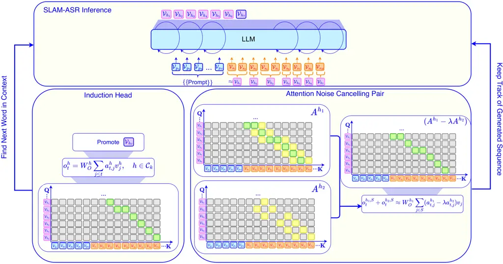

# Induction Head Origins of SLAM-ASR Speech Recognition Models

Artem Fedorchenko\sthanksCorresponding author:
artem.fedorchenko@taltech.ee    Tanel Alumäe

###### Abstract

What makes a small trained map from encoder states to the embedding
space of a frozen language model sufficient for competitive speech
recognition? The premise of the SLAM-ASR architecture is that a frozen
language model possesses linguistic knowledge rich enough to perform the
recognition task. This assumption, while reasonable, provides little
insight into the mechanisms underlying these models. We therefore seek
the concrete internal structures on which they rely. This work shows
that SLAM-ASR models rely on induction heads of the frozen language
model: the same heads that copy repeated token sequences in text are
also important for mapping speech embeddings to transcript tokens.
Moreover, we find pairs of heads that behave as a constrained form of
differential attention, cancelling attention noise and sharpening
attention onto the previously generated word. Finally, we show how
induction heads could be used to improve transcription quality under
noisy audio.

###### Index Terms: 

speech recognition, SLAM-ASR, hallucination

^(†)^(†)address: Tallinn University of Technology, Estonia

## 1 Introduction

Figure 1: SLAM-ASR architecture. Speech projector is the only component
being trained, while LLM and speech encoder remain frozen.



Figure 2: Per-head contribution to generated sequence at token
$`{\color[rgb]{0,0,1}\mathcal{V}_{h_{i}}}`$, which predicts
$`{\color[rgb]{0,0,1}\mathcal{V}_{h_{i+1}}}`$. Bottom left: induction
heads attend to the speech embeddings of
$`{\color[rgb]{0,0,1}\mathcal{V}_{h_{i+1}}}`$. Bottom right: an
attention noise cancelling pair jointly sharpens attention on the speech
embeddings of $`{\color[rgb]{0,0,1}\mathcal{V}_{h_{i}}}`$.

Integrating features representing the input audio with language models
is at the core of automatic speech recognition (ASR) \[14\]. Recently,
both of these constituents improved vastly, but separately, largely due
to the widespread use of the Transformer architecture \[32\]. Speech
encoder and language model fusion approaches were suggested in \[15, 11,
31\]; see \[30\] for details. An alternative method is to use a
general-purpose large language model (LLM) to generate a corrected
transcript for an ASR hypothesis \[35, 7\]. However, the most popular
method in recent years, commonly referred to as speech LLM (SLLM), is to
train an LLM to also accept acoustic information from an audio encoder
as input, through a learnable speech projector.

Early works of this kind \[34, 6, 2\] trained the encoder and adapted
the LLM through low-rank updates, together with the speech projector.
SLAM-ASR \[22\] (Fig. 1), however, trains only the projector, with both
encoder and LLM being frozen, yet still achieves competitive
recognition. The outputs of such a projector need not coincide with
token embeddings, and its sequence length differs from the text
counterpart, so linguistic modelling and alignment between two sequences
are to be solved by the LLM. The premise of SLAM-ASR, that the frozen
LLM suffices for the linguistic task, does not name the mechanisms on
which it relies, in particular, what makes the frozen decoder capable of
reading the projected speech embeddings.

Previous studies in internal analysis of SLLMs \[13\] found that in a
spoken question answering context, speech and text states are similar in
a broad band of middle layers. In \[9\], the authors applied mechanistic
interpretability tools to ASR models to analyze encoder representations
and error modes such as repetition hallucination, which they linked to a
single attention head in Whisper \[29\]. In a frozen-decoder setting
like ours, many decoder layers were found redundant for ASR \[25\],
which suggests that recognition capability is concentrated, possibly at
the head level. In this vein, text-to-speech in-context learning (ICL)
work \[28\] considered the role of induction heads \[5, 26\], showing
that, as in text, ablating them hurts ICL more than ablating random
heads. In the audio LLM domain, \[4\] considered using text-backbone
heads to steer speaker attribution. Another work \[12\] learned head
masks to specify tasks, including ASR. For the frozen LLM decoder
scenario as in SLAM-ASR, to the best of our knowledge, per-head impact
on ASR has not been studied. Building upon the soft-prompting view \[18,
19\], in which the decoder is presented with a noisy and redundant
version of the embedded transcript, we consider the following research
questions (RQs):

(RQ1) _Does ASR quality depend on induction heads present in the frozen
LLM?_

(RQ2) _Are there heads responsible for mitigating redundancy of speech
embeddings?_

(RQ3) _Does scaling induction heads at inference help recover
recognition quality under noisy audio?_

We show that: (1) ASR in SLAM-ASR models depends on induction heads of
the frozen LLM, (2) the decoder contains pairs of heads that act
together as a constrained form of differential attention \[36\],
sharpening attention on the speech embeddings of the previously
generated word; and (3) scaling heads of (1) at inference reduces WER
and insertions under noisy audio in 2 of 3 LLMs.

## 2 Background

This work connects SLAM-ASR speech recognition models with induction
heads and differential attention. We therefore give a brief intuition
behind these two notions; for a more complete picture, see \[5\]
and \[36\], respectively.

Induction heads. On a sequence of repeated tokens
$`\dots A\,B\dots\allowbreak A`$, an induction head is an attention head
that, at the second occurrence of $`A`$, attends to the token $`B`$ that
followed its first occurrence (_prefix matching_) and raises the logit
of $`B`$ (_copying_), so that the model continues the sequence with
$`B`$ \[5, 26\]. Mechanistically, a previous-token head in an earlier
layer writes the token that precedes each position into it, so the key
$`{\color[rgb]{0,0,1}\mathbf{K}}`$ at $`B`$ carries “preceded by $`A`$”
information, which the query $`{\color[rgb]{0,0,1}\mathbf{Q}}`$ at the
second occurrence of $`A`$ matches. Such heads emerge during text
pretraining of an LLM, together with ICL \[26\], and can be found in a
trained model via the prefix-matching score (Sec. 3). In our context,
the speech embeddings play the role of the first occurrence (Fig. 2):
the speech embeddings $`{\color[rgb]{1,0,0}\mathcal{V}_{s_{j}}}`$ of
each word approximate its generated token
$`{\color[rgb]{0,0,1}\mathcal{V}_{h_{i}}}`$, e.g.,
$`{\color[rgb]{1,0,0}\mathcal{V}_{s_{1}}},{\color[rgb]{1,0,0}\mathcal{V}_{s_{2}}}\approx{\color[rgb]{0,0,1}\mathcal{V}_{h_{1}}}`$,
and are followed by those of the next word. At a generated token
$`{\color[rgb]{0,0,1}\mathcal{V}_{h_{i}}}`$, the second occurrence, an
induction head therefore attends to the speech embeddings approximating
$`{\color[rgb]{0,0,1}\mathcal{V}_{h_{i+1}}}`$, which is the pattern
shown in the bottom left of Fig. 2.

Differential attention. Differential attention, proposed in \[36\], is
an enhancement of the canonical Transformer, which mitigates attention
noise, i.e., the non-negligible attention that softmax assigns to
irrelevant context. Differential attention computes two softmax
attention maps and subtracts the second, scaled by $`\lambda`$, from the
first:

```math
\big(\mathrm{softmax}({\color[rgb]{0,0,1}\mathbf{Q}}_{1}{\color[rgb]{0,0,1}\mathbf{K}}_{1}^{\top}/\sqrt{d})-\lambda\,\mathrm{softmax}({\color[rgb]{0,0,1}\mathbf{Q}}_{2}{\color[rgb]{0,0,1}\mathbf{K}}_{2}^{\top}/\sqrt{d})\big){\color[rgb]{0,0,1}\mathbf{V}}. \tag{1}
```

As in a differential amplifier, whose output is proportional to the
difference of its two inputs, $`G\,(v_{+}-v_{-})`$, so that the signal
common to both is rejected \[36\], attention that both maps assign to
the same positions cancels, and the resulting attention is sharper on
the relevant context. In \[36\], the two maps and $`\lambda`$ are built
into the architecture and trained from scratch; a pretrained LLM has no
such component. In our context, attention noise can be expected to grow
with the redundancy of speech embeddings: each word spans several of
them, so a head reading the speech sees more keys than for the same
transcript as text, each receiving some attention. Two heads of the same
layer can nevertheless act together as a constrained form of
differential attention (Sec. 3); such a pair is shown in the bottom
right of Fig. 2, where its joint attention concentrates on the speech
embeddings of the previously generated word,
$`{\color[rgb]{0,0,1}\mathcal{V}_{h_{i}}}`$.

## 3 Methodology

### 3.1 Induction heads

Denote by $`(l,h)`$ head $`h`$ of layer $`l`$, by $`t`$ and $`j`$ the
query and key positions, by $`q^{l,h}_{t}`$, $`k^{l,h}_{j}`$,
$`v^{l,h}_{j}`$ its query, key and value vectors, and by $`S`$ the set
of positions of the speech embeddings, i.e., the outputs of the
projector. The prefix-matching score of a head is computed on inputs
$`x=(\textsc{bos},r_{1},\dots,r_{N},r_{1},\dots,r_{N})`$ with $`N=50`$
and $`r_{i}`$ drawn uniformly from the vocabulary, so that the query at
$`t=N+i`$ is the second occurrence of $`r_{i}`$:

```math
\mathrm{PM}(l,h)=\frac{1}{N-1}\sum_{t=N+1}^{2N-1}a^{l,h}_{t,\,t-N+1}, \tag{2}
```

where
$`a^{l,h}_{t,j}=\mathrm{softmax}_{j\leq t}\big(q^{l,h\top}_{t}k^{l,h}_{j}/\sqrt{d}\big)`$,
averaged over 40 sequences. Let $`\mathcal{C}_{k}`$ be the set of the
top-$`k`$ heads by $`\mathrm{PM}`$. As in \[3, 28\], we identify these
as induction heads. The contribution of a set of heads to ASR is
measured by setting their attention logits to $`-\infty`$ for
$`j\in S`$, so that each head’s attention is redistributed over the rest
of the context, and by comparing the resulting increase in word error
rate (WER) with that of random sets of $`k`$ heads drawn from the same
layers, outside of $`\mathcal{C}_{k}`$.

### 3.2 Attention noise cancelling

Two heads of the same layer that attend to the same speech embeddings
but project what they read in opposite directions cancel part of each
other’s output. If the cancelled part is the attention that both heads
assign to irrelevant positions, the pair as a whole attends more sharply
to the relevant ones, as differential attention does (Sec. 2). Below, we
state how such pairs are selected, the approximation under which a pair
acts as one head whose attention is the difference of the two, and how
we compare its sharpness with that of $`h_{1}`$ alone.

Without layer index, the output of head $`h`$ at position $`t`$ is
$`o^{h}_{t}=W_{O}^{h}\sum_{j\leq t}a^{h}_{t,j}v^{h}_{j}`$, where
$`W_{O}^{h}`$ is the head’s chunk of the output projection. Let
$`h_{1}`$ be the head with the largest ASR importance, i.e., the largest
increase in loss when only its logits for $`j\in S`$ are set to
$`-\infty`$ (blocking), and $`h_{2}`$ the head of the same layer whose
output is most anti-aligned with that of $`h_{1}`$. We consider such
pairs (Fig. 2) if both heads put on average at least half of their
attention on $`S`$ and $`h_{2}`$ is far more anti-aligned with $`h_{1}`$
than any other head of the layer, measured by the mean of
$`\cos(o^{h_{1}}_{t},o^{h_{2}}_{t})`$ over generated positions. In the
pairs we find, the two heads share a key/value group of grouped-query
attention (Sec. 4.1), $`k^{h_{1}}_{j}=k^{h_{2}}_{j}`$ and
$`v^{h_{1}}_{j}=v^{h_{2}}_{j}=v_{j}`$, so they read the same values and
differ only in where they attend, through their queries, and in how they
project the result, through their output chunks. Denote by
$`o^{h,S}_{t}`$ the output $`o^{h}_{t}`$ with the sum restricted to
$`j\in S`$. The joint output of the pair on the speech embeddings is
then, exactly,

```math
o^{h_{1},S}_{t}+o^{h_{2},S}_{t}=\sum_{j\in S,\,j\leq t}\big(a^{h_{1}}_{t,j}\,W_{O}^{h_{1}}+a^{h_{2}}_{t,j}\,W_{O}^{h_{2}}\big)v_{j}. \tag{3}
```

Anti-aligned outputs alone do not make this a subtraction of attention
maps. Our reading rests on one approximation: $`h_{2}`$ projects each
value in the direction opposite to $`h_{1}`$,
$`W_{O}^{h_{2}}v_{j}\approx-\lambda\,W_{O}^{h_{1}}v_{j}`$, with

```math
\lambda=\operatorname*{arg\,min}_{\lambda^{\prime}}\sum_{j}\big\lVert W_{O}^{h_{2}}v_{j}+\lambda^{\prime}W_{O}^{h_{1}}v_{j}\big\rVert^{2}, \tag{4}
```

where $`j`$ ranges over the positions in $`S`$ of all evaluation
utterances; how well it holds is given by
$`\cos(W_{O}^{h_{1}}v_{j},W_{O}^{h_{2}}v_{j})`$. Under it,

```math
o^{h_{1},S}_{t}+o^{h_{2},S}_{t}\approx W_{O}^{h_{1}}\sum_{j\in S,\,j\leq t}\big(a^{h_{1}}_{t,j}-\lambda\,a^{h_{2}}_{t,j}\big)v_{j}, \tag{5}
```

i.e., the pair acts as one head with effective attention
$`a^{h_{1}}_{t,j}-\lambda\,a^{h_{2}}_{t,j}`$: attention that $`h_{1}`$
and the $`\lambda`$-scaled $`h_{2}`$ assign alike to a position cancels.
This is the form of differential attention \[36\], constrained in that
the keys are shared, $`\lambda`$ is determined by the output chunks, and
there is no per-head normalisation; in particular, the effective
attention can be negative and need not sum to one. To measure what the
subtraction does, let $`T`$ be the set of query positions at which a
token of a word other than the first is generated, and
$`F_{t}\subseteq S`$ the positions aligned to the previously generated
word. We call the attention on $`S\setminus F_{t}`$ attention noise and
measure the sharpness of an attention matrix $`A`$ by the share of its
positive part that falls on $`F_{t}`$,

```math
\rho(A)=\frac{\sum_{t\in T}\sum_{j\in F_{t}}[A_{t,j}]_{+}}{\sum_{t\in T}\sum_{j\in S}[A_{t,j}]_{+}}, \tag{6}
```

where $`[x]_{+}=\max(x,0)`$, comparing the pair’s effective attention
$`A^{h_{1}}-\lambda A^{h_{2}}`$ with that of $`h_{1}`$ alone, where
$`A^{h}=(a^{h}_{t,j})`$.

### 3.3 Inference-time head scaling

The performance of SLAM-ASR degrades significantly under additive
noise \[17\]. To make use of $`\mathcal{C}_{k}`$, we consider a common
ASR hallucination mode under such noise: an increased insertion rate
$`I`$, the number of inserted words relative to the number of reference
words. The decoder may then continue generating from its language prior;
raising the output of heads that read the speech is expected to give the
audio more weight against the prior. For each head
$`(l,h)\in\mathcal{C}_{k}`$, we scale its output at every position,
$`o^{l,h}_{t}\mapsto\alpha\,o^{l,h}_{t}`$, and compare the resulting WER
and $`I`$ with those of the unscaled model, of equally many
layer-matched random heads, and of all remaining heads of the same
layers, each scaled by the same $`\alpha`$.

## 4 Experiments

### 4.1 Models

We use the instruction-tuned Llama 3.2-3B \[10\], Gemma 2-2B \[8\] and
Ministral 3-3B \[20\] models as decoders; for Ministral, only the text
decoder is used. All three decoders use grouped-query attention \[1\]:
the heads of a layer are split into groups, and the heads of a group
share keys and values. The SLAM-ASR models use the Whisper turbo
encoder \[29\]. The projector design follows \[22\]: concatenate every
$`5`$ consecutive encoder states and pass through a two-layer MLP with
hidden size $`2048`$ and ReLU activation to the decoder’s embedding
space; we append a trainable end-of-speech embedding, initialised from
the decoder’s end-of-turn token. Encoder and decoder are frozen. The
prompt
$`{\color[rgb]{0,0,1}\mathcal{V}_{p_{1}},\dots,\mathcal{V}_{p_{N}}}`$ is
“Transcribe the speech:” in each decoder’s chat template.

### 4.2 Datasets

Each projector is trained on the train-clean-100 subset of
LibriSpeech \[27\] and validated on 500 utterances from dev-other.
Evaluation uses test-clean and test-other.

### 4.3 Training Details

Optimisation follows \[22\]: AdamW \[21\] with learning rate $`10^{-4}`$
and no weight decay, $`1{,}000`$ warm-up steps followed by a constant
learning rate, and early stopping with patience $`3`$, evaluated every
$`500`$ steps. Unlike \[22\], we use batch size $`32`$ instead of $`4`$
and train for at most $`5`$ epochs instead of $`100{,}000`$ steps. Each
decoder is trained with three seeds.

### 4.4 Evaluation Protocol

Decoding is done greedily. $`h_{1}`$ is selected by ASR importance on
200 dev-clean utterances. Blocking and the head pairs are evaluated on
300 test-clean utterances with Montreal Forced Aligner
alignments \[23\]: these give the word boundaries for $`F_{t}`$ and
attention peaks. Each speech embedding covers 100 ms and is assigned to
the word whose boundaries contain its centre. ASR importance, head-pair
quantities and attention peaks use teacher forcing. Blocking uses
$`k=10`$ in all decoders. Scaling uses $`\alpha=1.5`$ and $`k`$ equal to
3 % of the decoder’s heads (20 in Llama, 6 in Gemma, 25 in Ministral).
Scaling is evaluated on 400 test-clean and 400 test-other utterances not
used for blocking. We use five audio conditions: clean audio, and babble
and white noise at 5 and 0 dB SNR.

### 4.5 Results

WER under attention head blocking is reported for each decoder in
Table 1. Blocking $`\mathcal{C}_{10}`$ increases WER in all three
decoders. The increase is much larger in Gemma, where 10 heads are about
5 % of all heads, against 1.5 and 1.2 % in Llama and Ministral, and
varies heavily between seeds. In Llama and Ministral it is milder, yet
still above that of random sets of heads of the same size. Moreover,
$`\mathcal{C}_{k}`$ makes up 40, 33 and 40 % of the 3 % of heads with
the largest ASR importance in Llama, Gemma and Ministral, against 4–9 %
for random heads of the same layers. Within the speech embeddings, the
attention of $`\mathcal{C}_{k}`$ peaks on the word being generated for
64–76,% of tokens, against 45–56,% for equally many heads with the
largest attention mass on $`S`$. These results show that ASR in SLAM-ASR
models is concentrated in induction heads of the frozen decoder.

| decoder   | intact  | $`\mathcal{C}_{10}`$ blocked | random  |
| --------- | ------- | ---------------------------- | ------- |
| Llama     | 3.3–3.6 | 7.1–8.3                      | 3.3–3.6 |
| Gemma     | 3.8–4.0 | 23.2–53.5                    | 4.0–4.2 |
| Ministral | 3.0–3.4 | 3.9–5.5                      | 3.1–3.4 |

Table 1: WER (%) when the attention logits of $`\mathcal{C}_{10}`$ on
$`S`$ are set to $`-\infty`$; random: mean WER over 10 sets of 10 heads
from the same layers, blocked in the same way. Ranges are over 3 seeds
throughout.

[TABLE]

Table 2: Attention noise cancelling head pairs, given as layer:
$`h_{1}`$, $`h_{2}`$. The pair is the same in all three seeds.
$`-\cos`$: negated median cosine between $`W_{O}^{h_{1}}v_{j}`$ and
$`W_{O}^{h_{2}}v_{j}`$, $`j\in S`$; $`\lambda`$: scaling factor between
the two; $`\rho`$: share of positive attention on speech embeddings of
the previously generated word, for $`h_{1}`$ alone and for the pair
(eff.); WER (%) with attention to speech blocked for $`h_{1}`$ alone or
both.

Head pairs that meet the conditions of an attention noise cancelling
pair are reported for each decoder in Table 2. In all three decoders,
the $`h_{2}`$ output for each speech embedding is approximately a
negative multiple of the $`h_{1}`$ output, as the $`-\cos`$ column
shows, indicating that the two heads act as one head with differential
attention \[36\]. The effective attention of the pairs also supports
this view: as the eff. column shows, it is sharper on the speech
embeddings of the previously generated word than the attention of
$`h_{1}`$ alone in all decoders, though only slightly in Ministral.
Blocking $`h_{1}`$ alone increases WER far more than blocking both
heads, whereas blocking $`h_{2}`$ alone leaves it unchanged in Gemma and
Ministral: the two heads act as a unit, and blocking one leaves the
output of the other uncancelled. Blocked together, the pair costs little
in Llama and Ministral and more in Gemma; its sharper attention
describes how the pair reads the speech rather than how much recognition
depends on it.

WER and insertion rate $`I`$ under scaling are reported for each decoder
in Table 3. Under noisy audio, scaling $`\mathcal{C}_{k}`$ results in
lower WER and $`I`$ than scaling the same number of random heads (by
1.4–2.6 WER in the noisy mean) or the remaining heads of the same layers
(by 4.6–10.9) in all three decoders, which indicates that the reduction
is not an effect of scaling heads in these layers as such. Scaling
instead equally many heads with the largest ASR importance reduces WER
less than scaling $`\mathcal{C}_{k}`$ in Llama (by 2.4, noisy mean),
about as much in Ministral, and more in Gemma (by 4.5). Compared to the
unscaled model, scaling $`\mathcal{C}_{k}`$ reduces WER and $`I`$ in
Llama and Ministral almost only under babble noise at 0 dB, where
insertions are most frequent; under the other noisy conditions WER
changes by less than 1 point. In Gemma, scaling heads of these layers
increases WER, and scaling $`\mathcal{C}_{k}`$ increases it least. On
clean audio, scaling $`\mathcal{C}_{k}`$ increases WER by at most 0.2
points.

|           |                     |       | babble 0 dB |       | noisy (mean) |       |
| --------- | ------------------- | ----- | ----------- | ----- | ------------ | ----- |
| decoder   | scaled              | clean | WER         | $`I`$ | WER          | $`I`$ |
| Llama     | none                | 4.6   | 89.0        | 40.4  | 41.9         | 15.0  |
|           | $`\mathcal{C}_{k}`$ | 4.7   | 81.8        | 32.1  | 39.9         | 12.4  |
|           | random              | 4.5   | 89.9        | 41.3  | 42.4         | 15.5  |
|           | same layers         | 4.8   | 111.8       | 63.6  | 50.8         | 23.8  |
| Gemma     | none                | 4.7   | 148.6       | 94.9  | 66.9         | 37.9  |
|           | $`\mathcal{C}_{k}`$ | 4.8   | 150.0       | 94.7  | 67.4         | 37.7  |
|           | random              | 4.8   | 153.6       | 99.0  | 70.0         | 40.7  |
|           | same layers         | 5.2   | 156.2       | 101.5 | 72.0         | 42.6  |
| Ministral | none                | 4.2   | 86.0        | 39.3  | 39.6         | 14.1  |
|           | $`\mathcal{C}_{k}`$ | 4.4   | 81.8        | 34.4  | 38.5         | 12.6  |
|           | random              | 4.3   | 86.0        | 39.6  | 39.9         | 14.4  |
|           | same layers         | 4.6   | 94.0        | 45.6  | 43.4         | 16.6  |

Table 3: WER and $`I`$ (%) with heads scaled by $`\alpha=1.5`$: none
(unscaled model), $`\mathcal{C}_{k}`$ ($`k`$ = 3 % of heads), equally
many random heads from the same layers (mean over 10 sets), or all
remaining heads of the same layers. Clean: WER without added noise on
400 test-clean and 400 test-other utterances; noisy (mean): over babble
and white noise at 5 and 0 dB SNR added to the same utterances. Means
over 3 seeds; in each seed, $`\mathcal{C}_{k}`$ gives lower noisy WER
and $`I`$ than random heads. Bold: lowest per decoder under noise.

### 4.6 Discussion

The link between SLAM-ASR models and induction heads of the frozen LLM
gives a concrete answer to the question we posed in Sec. 1: it suggests
that a small map suffices because its outputs only need to be readable
by the LLM’s existing context-reading circuits, which perform prefix
matching on them. This raises the empirical question of how projector
training should be done, especially when done jointly with the decoder.
For instance, updating only the heads with the highest $`\mathrm{PM}`$
score, rather than the whole decoder, is a potentially promising
approach.

The attention noise cancelling pairs we found show that text-pretrained
LLMs contain heads that act together to cancel attention noise on
redundant input, without being explicitly trained for it, while \[16\]
has to add differential attention to a pretrained LLM through
adaptation. Heads that read the same input and project in opposite
directions are known in text LLMs as negative and copy-suppression
heads \[33, 24\], which act on the logits of copied tokens; the pairs we
found share keys and values, and their subtraction acts on attention. It
is not clear how these heads emerge during text pretraining, which is a
promising direction for mechanistic interpretability research.

## 5 Conclusion

In this work, we have shown that speech recognition with LLMs in models
such as SLAM-ASR depends on induction heads of the frozen LLM. In the
decoders we considered, pairs of attention heads act together as a
constrained form of differential attention, cancelling attention noise
and sharpening attention on the speech embeddings of the previously
generated word. Induction heads also matter when doing recognition on
noisy audio: scaling them at inference mitigates hallucinations in two
of the three decoders we consider.

## References

- \[1\] J. Ainslie, J. Lee-Thorp, M. de Jong, Y. Zemlyanskiy, F. Lebrón,
  and S. Sanghai (2023) GQA: training generalized multi-query
  transformer models from multi-head checkpoints. In Proc. EMNLP,
  pp. 4895–4901. External Links:
  [Document](https://dx.doi.org/10.18653/v1/2023.emnlp-main.298) Cited
  by: §4.1.
- \[2\] Z. Chen, H. Huang, A. Andrusenko, O. Hrinchuk, K. C. Puvvada, J.
  Li, S. Ghosh, J. Balam, and B. Ginsburg (2024) SALM: speech-augmented
  language model with in-context learning for speech recognition and
  translation. In Proc. IEEE ICASSP, pp. 13521–13525. External Links:
  [Document](https://dx.doi.org/10.1109/ICASSP48485.2024.10447553) Cited
  by: §1.
- \[3\] J. Crosbie and E. Shutova (2025) Induction heads as an essential
  mechanism for pattern matching in in-context learning. In Findings of
  NAACL, pp. 5034–5096. External Links:
  [Document](https://dx.doi.org/10.18653/v1/2025.findings-naacl.283)
  Cited by: §3.1.
- \[4\] B. Das (2026) Inherited heads: audio language models track
  speakers with their text backbone’s attention, and an attention-mass
  ranking retrieves a different set. arXiv preprint arXiv:2609.14174.
  Cited by: §1.
- \[5\] N. Elhage, N. Nanda, C. Olsson, T. Henighan, N. Joseph, B.
  Mann, A. Askell, Y. Bai, A. Chen, T. Conerly, N. DasSarma, D.
  Drain, D. Ganguli, Z. Hatfield-Dodds, D. Hernandez, A. Jones, J.
  Kernion, L. Lovitt, K. Ndousse, D. Amodei, T. Brown, J. Clark, J.
  Kaplan, S. McCandlish, and C. Olah (2021) A mathematical framework for
  transformer circuits. Transformer Circuits Thread. Note:
  [https://transformer-circuits.pub/2021/framework/index.html](https://transformer-circuits.pub/2021/framework/index.html)
  Cited by: §1, §2, §2.
- \[6\] Y. Fathullah, C. Wu, E. Lakomkin, J. Jia, Y. Shangguan, K.
  Li, J. Guo, W. Xiong, J. Mahadeokar, O. Kalinli, C. Fuegen, and M.
  Seltzer (2024) Prompting large language models with speech recognition
  abilities. In Proc. IEEE ICASSP, pp. 13351–13355. External Links:
  [Document](https://dx.doi.org/10.1109/ICASSP48485.2024.10447605) Cited
  by: §1.
- \[7\] A. Fedorchenko and T. Alumäe (2025) Optimizing Estonian TV
  subtitles with semi-supervised learning and LLMs. In Proc.
  NoDaLiDa/Baltic-HLT, pp. 136–141. External Links:
  [Link](https://aclanthology.org/2025.nodalida-1.14/) Cited by: §1.
- \[8\] Gemma Team (2024) Gemma 2: improving open language models at a
  practical size. arXiv preprint arXiv:2408.00118. Cited by: §4.1.
- \[9\] N. Glazer, Y. Segal-Feldman, H. Segev, A. Shamsian, A.
  Buchnick, G. Hetz, E. Fetaya, J. Keshet, and A. Navon (2026) Beyond
  transcription: mechanistic interpretability in ASR. In Proc. AAAI,
  pp. 37407–37416. External Links:
  [Document](https://dx.doi.org/10.1609/aaai.v40i44.41073) Cited by: §1.
- \[10\] A. Grattafiori et al. (2024) The Llama 3 herd of models. arXiv
  preprint arXiv:2407.21783. Cited by: §4.1.
- \[11\] C. Gulcehre, O. Firat, K. Xu, K. Cho, L. Barrault, H. Lin, F.
  Bougares, H. Schwenk, and Y. Bengio (2015) On using monolingual
  corpora in neural machine translation. arXiv preprint
  arXiv:1503.03535. Cited by: §1.
- \[12\] Y. Guo, B. Li, H. Wang, Z. Li, S. Wang, X. Chen, and K.
  Yu (2026) AHAMask: reliable task specification for large audio
  language models without instructions. In Proc. AAAI, Vol. 40,
  pp. 21513–21521. External Links:
  [Document](https://dx.doi.org/10.1609/aaai.v40i26.39299) Cited by: §1.
- \[13\] M. Hsu, X. Tian, J. Zhang, L. Lu, Y. Wang, and Z. Wu (2026)
  Geometric alignment without functional equivalence: a layer-wise
  analysis of the speech-text modality gap. In Proc. NeurIPS, External
  Links: 2603.01502 Cited by: §1.
- \[14\] F. Jelinek (1976) Continuous speech recognition by statistical
  methods. Proceedings of the IEEE 64, pp. 532–556. Cited by: §1.
- \[15\] S. Karita, N. E. Y. Soplin, S. Watanabe, M. Delcroix, A. Ogawa,
  and T. Nakatani (2019) Improving Transformer-based end-to-end speech
  recognition with connectionist temporal classification and language
  model integration. In Proc. Interspeech, pp. 1408–1412. External
  Links: [Document](https://dx.doi.org/10.21437/Interspeech.2019-1938),
  ISSN 2958-1796 Cited by: §1.
- \[16\] C. Kong, J. Jang, and N. Kwak (2025) Understanding Differential
  Transformer unchains pretrained self-attentions. In Proc. NeurIPS,
  Vol. 38, pp. 87064–87092. External Links:
  [Document](https://dx.doi.org/10.52202/085713-2912) Cited by: §4.6.
- \[17\] S. Kumar, I. Thorbecke, S. Burdisso, E. Villatoro-Tello, K. E.
  Manjunath, K. Hacioglu, P. Rangappa, P. Motlicek, A. Ganapathiraju,
  and A. Stolcke (2025) Performance evaluation of SLAM-ASR: the good,
  the bad, the ugly, and the way forward. In Proc. IEEE ICASSP
  Workshops, External Links:
  [Document](https://dx.doi.org/10.1109/ICASSPW65056.2025.11010998)
  Cited by: §3.3.
- \[18\] B. Lester, R. Al-Rfou, and N. Constant (2021) The power of
  scale for parameter-efficient prompt tuning. In Proc. EMNLP,
  pp. 3045–3059. Cited by: §1.
- \[19\] X. L. Li and P. Liang (2021) Prefix-tuning: optimizing
  continuous prompts for generation. In Proc. ACL, pp. 4582–4597. Cited
  by: §1.
- \[20\] A. H. Liu et al. (2026) Ministral 3. arXiv preprint
  arXiv:2601.08584. Cited by: §4.1.
- \[21\] I. Loshchilov and F. Hutter (2019) Decoupled weight decay
  regularization. In Proc. ICLR, Cited by: §4.3.
- \[22\] Z. Ma, G. Yang, Y. Yang, Z. Gao, J. Wang, Z. Du, F. Yu, Q.
  Chen, S. Zheng, S. Zhang, and X. Chen (2024) An embarrassingly simple
  approach for LLM with strong ASR capacity. arXiv preprint
  arXiv:2402.08846. Cited by: §1, §4.1, §4.3.
- \[23\] M. McAuliffe, M. Socolof, S. Mihuc, M. Wagner, and M.
  Sonderegger (2017) Montreal forced aligner: trainable text-speech
  alignment using Kaldi. In Proc. Interspeech, pp. 498–502. External
  Links: [Document](https://dx.doi.org/10.21437/Interspeech.2017-1386)
  Cited by: §4.4.
- \[24\] C. S. McDougall, A. Conmy, C. Rushing, T. McGrath, and N.
  Nanda (2024) Copy suppression: comprehensively understanding a motif
  in language model attention heads. In Proc. BlackboxNLP Workshop,
  pp. 337–363. External Links:
  [Document](https://dx.doi.org/10.18653/v1/2024.blackboxnlp-1.22) Cited
  by: §4.6.
- \[25\] A. Moumen, G. Sun, and P. C. Woodland (2026) Measuring the
  redundancy of decoder layers in SpeechLLMs. In Proc. Interspeech,
  pp. 7286–7291. External Links:
  [Document](https://dx.doi.org/10.21437/Interspeech.2026-1873) Cited
  by: §1.
- \[26\] C. Olsson, N. Elhage, N. Nanda, N. Joseph, N. DasSarma, T.
  Henighan, B. Mann, A. Askell, Y. Bai, A. Chen, T. Conerly, D.
  Drain, D. Ganguli, Z. Hatfield-Dodds, D. Hernandez, S. Johnston, A.
  Jones, J. Kernion, L. Lovitt, K. Ndousse, D. Amodei, T. Brown, J.
  Clark, J. Kaplan, S. McCandlish, and C. Olah (2022) In-context
  learning and induction heads. Transformer Circuits Thread. Note:
  [https://transformer-circuits.pub/2022/in-context-learning-and-induction-heads/index.html](https://transformer-circuits.pub/2022/in-context-learning-and-induction-heads/index.html)
  Cited by: §1, §2.
- \[27\] V. Panayotov, G. Chen, D. Povey, and S. Khudanpur (2015)
  LibriSpeech: an ASR corpus based on public domain audio books. In
  Proc. IEEE ICASSP, pp. 5206–5210. External Links:
  [Document](https://dx.doi.org/10.1109/ICASSP.2015.7178964) Cited by:
  §4.2.
- \[28\] C. Pouw, H. Mohebbi, A. Alishahi, and W. Zuidema (2026)
  In-context learning in speech language models: analyzing the role of
  acoustic features, linguistic structure, and induction heads. arXiv
  preprint arXiv:2604.06356. Cited by: §1, §3.1.
- \[29\] A. Radford, J. W. Kim, T. Xu, G. Brockman, C. McLeavey, and I.
  Sutskever (2023) Robust speech recognition via large-scale weak
  supervision. In Proc. ICML, PMLR, Vol. 202, pp. 28492–28518. Cited by:
  §1, §4.1.
- \[30\] R. Schmitt, A. Zeyer, M. Zeineldeen, R. Schlüter, and H.
  Ney (2026) LLMs and speech: integration vs. combination. arXiv
  preprint arXiv:2603.15045. Cited by: §1.
- \[31\] A. Sriram, H. Jun, S. Satheesh, and A. Coates (2018) Cold
  fusion: training Seq2Seq models together with language models. In
  Proc. Interspeech, pp. 387–391. External Links:
  [Document](https://dx.doi.org/10.21437/Interspeech.2018-1392), ISSN
  2958-1796 Cited by: §1.
- \[32\] A. Vaswani, N. Shazeer, N. Parmar, J. Uszkoreit, L.
  Jones, A. N. Gomez, Ł. Kaiser, and I. Polosukhin (2017) Attention is
  all you need. In Proc. NeurIPS, Cited by: §1.
- \[33\] K. Wang, A. Variengien, A. Conmy, B. Shlegeris, and J.
  Steinhardt (2023) Interpretability in the wild: a circuit for indirect
  object identification in GPT-2 small. In Proc. ICLR, Cited by: §4.6.
- \[34\] J. Wu, Y. Gaur, Z. Chen, L. Zhou, Y. Zhu, T. Wang, J. Li, S.
  Liu, B. Ren, L. Liu, and Y. Wu (2023) On decoder-only architecture for
  speech-to-text and large language model integration. In Proc. IEEE
  ASRU, pp. 1–8. External Links:
  [Document](https://dx.doi.org/10.1109/ASRU57964.2023.10389705) Cited
  by: §1.
- \[35\] C. H. Yang, Y. Gu, Y. Liu, S. Ghosh, I. Bulyko, and A.
  Stolcke (2023) Generative speech recognition error correction with
  large language models and task-activating prompting. In Proc. IEEE
  ASRU, pp. 1–8. Cited by: §1.
- \[36\] T. Ye, L. Dong, Y. Xia, Y. Sun, Y. Zhu, G. Huang, and F.
  Wei (2025) Differential Transformer. In Proc. ICLR, Cited by: §1, §2,
  §2, §2, §3.2, §4.5.
