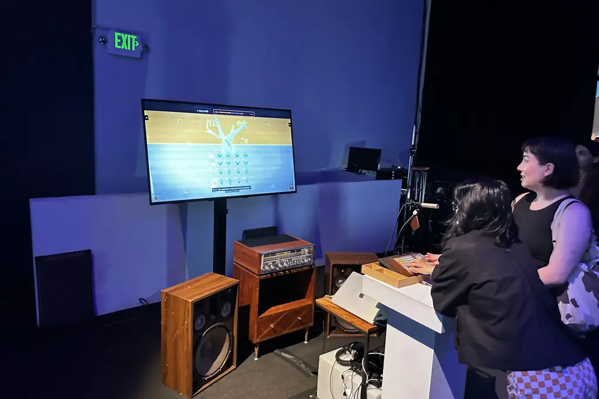
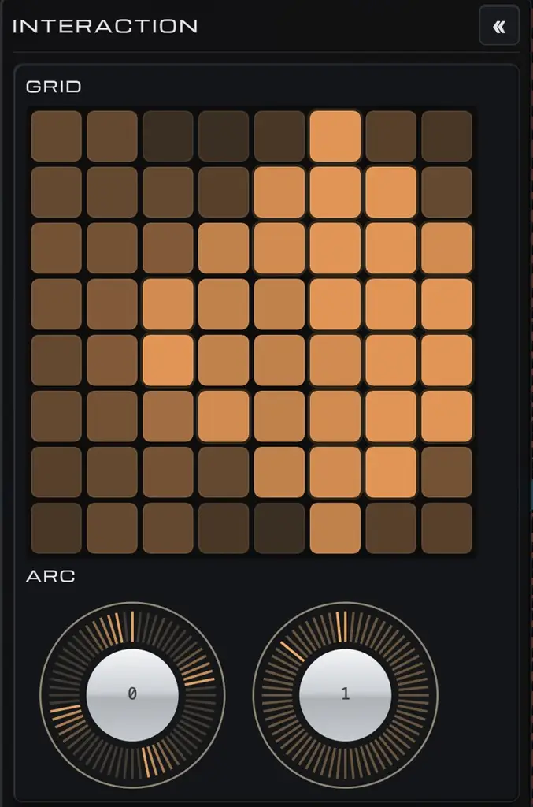
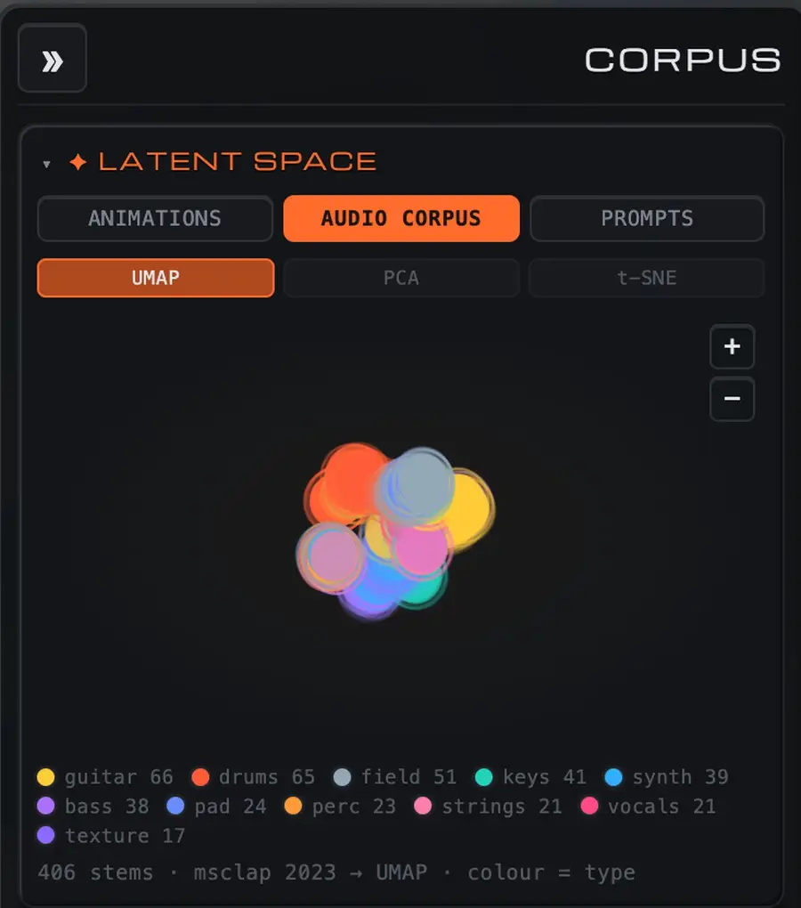
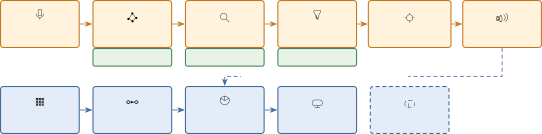

# Windchime: an Audiovisual Installation with Audio-Language Model implementations

Trent Eriksen Affiliation: Independent Researcher Affiliation: San
Francisco, USA Email: [starduststereo@gmail.com](mailto:)    Celeste
Betancur Affiliation: CCRMA, Stanford University Affiliation: Stanford,
USA Email: [celeste@ccrma.stanford.edu](mailto:)

###### Abstract

Windchime is an audiovisual installation in which spoken language
retrieves music and interactive animations from an artist authored
corpus. A local Automatic Speech Recognition (ASR) model transcribes
each prompt while an audio-language model (ALM) embeds it and retrieval
over 406 audio stems returns a soundscape with live coded Strudel
fragments that layer into audio output. Simultaneously each spoken input
results in retrieval of interactive Three.js animation scenes each
containing unique tactile control via monome grid and arc hardware.
Windchime distributes agency in three distinct directions; across the
artist who authored the possible outputs, the ALM that influences what
areas of the corpus can be retrieved, and the visitor whose spoken
inputs result in multimodal embodied interaction.

## 1 Description of the Work

The project’s namesake is inspired by the tubular bells of a physical
wind chime. Although these bells are fixed, when coming in contact with
the wind, infinite outcomes are produced in the form of an evolving
algorithmic melody. From this everyday object that exemplifies a
physical algorithm, Windchime seeks to expand on this type of phenomenon
where a corpus of artist authored audiovisual material becomes subject
to emergent recombination based on spoken input.

The installation comprises a screen based visual field, a microphone,
monome grid and arc tactile controllers (Vallis et al., 2010), and a
vintage hi-fi sound system (Figure 1). These components enable embodied
interaction through voice, touch, vision and sound. The interaction
design is organized into segments consisting of intro and outro
sequences and four spoken inputs during which the visitor is free to
control animations and explore the interface for further legibility. The
four spoken inputs are limited to 15 seconds each and can range from
descriptive to imagistic, performative and open phrasings. Each spoken
input surfaces a unique combination of audio and controllable animations
after which a summary of the interaction is shown with latent space
animations and the installation resets for the next visitor. This
interaction loop is designed to ensure accessibility to multiple
visitors in a public venue. Windchime debuted at the [Gray Area Cultural
Incubator
Showcase](https://grayarea.org/event/cultural-incubator-showcase-2026/)
from August 5 to 7, 2026 in San Francisco, California with video demo
available [here](https://youtu.be/j3XyW2ynH5Y).

In the retrieval pipeline four sound modes called ’Peak’, ’Soundscape’,
’Immediate’ and ’Settled’ shape which audio file sections become
audible. ’Peak’ starts at the most energetic 30 seconds of the file,
’Soundscape’ plays from the beginning, ’Immediate’ from the first
audible section and ’Settled’ at the earliest 30 seconds with two-thirds
of peak energy. Windchime is configurable with different sound modes on
each prompt and the aforementioned order is what appeared in the public
installation. This choice has a substantial effect as the audio files
vary in length and content leading to distinct sonic outputs based on
the combination of ALM, sound mode and live coded audio in Strudel (Roos
and McLean, 2023) a popular choice for music creation among creative
coders and audiovisual artists.

The audio corpus consists of musical audio and field recordings from
Trent Eriksen’s projects. Musical audio examples contain stems, which
are isolated recordings of instruments like guitars, bass, drums,
percussion, orchestral strings, synthesizers, vocals and sound effects.
Field recordings were captured onsite in Japan, Korea, the European
Union and the United States in both urban and rural settings, allowing
for unique multicultural outputs. It has been shown that natural
language descriptions of music range from the technical to the
situational (Salganik et al., 2025), making this heterogeneous corpus
well suited to various types of prompts.

Additionally, the animation corpus consists of 135 Three.js scenes
primarily of an abstract style inspired by experimental animation,
absolute film and early computer graphics. The monome grid and arc are
chosen for their distinct minimalist aesthetic and fully programmable
interactivity which allows for distinct application control and LED
feedback per animation. This customization uniquely enables tactile
gestural variety as a defining component of Windchime’s embodied
interaction. The user interface contains two collapsible rails that
expose additional system information for increased legibility, with the
left containing a responsive digital twin of the monome hardware and on
the right, interactive 3D multimodal embeddings for audio, animation and
prompts latent spaces.

Figure 1: Windchime at the Gray Area Cultural Incubator Showcase. On the
left are two visitors with the installation. In the center the
interaction rail mirrors the connected monome hardware as a digital
twin. On the right, the corpus rail places the audio stems in the latent
space of the active audio-language model, colored by instrument role.

## 2 Role of AI and ML

Machine Learning (ML) operates at three points in the system (Figure 2).
A local faster-whisper model first transcribes the spoken prompt
(Radford et al., 2023), then the selected ALM projects the transcript
into a shared embedding space. The installation is configurable with
multiple ALMs for example a landmark model based on Contrastive Language
Audio Pretraining (Elizalde et al., 2023; Wu et al., 2023), and a model
that supports multilingual input (Wu et al., 2025) among others. Cosine
similarity over a FAISS index (Johnson et al., 2021) of precomputed stem
embeddings ranks the corpus and a selection policy admits at most one
stem per instrument role among the forty nearest. Descriptors of the
retrieved set follow, computed with librosa (McFee et al., 2015) as
energy, brightness, key, tempo, and onset density. A planner then reads
them and chooses a Strudel template and its parameters to complement the
retrieved audio. The planner queries a hosted large language model,
falling back to a local model, then to a deterministic template, so the
work degrades gracefully without network access and remains configurable
to multiple settings.

Figure 2: Amber is the audio path from speech to soundscape, the three
green tabs are the author’s choices and constraints, while blue is the
tactile and visual path controlled by monome hardware. Audio features
interact with animations through the dashed coupling the visitor
enables. Dashed rails are the observation surfaces of Section 1.

The ALM is interchangeable while the corpus, index, similarity, and
selection policy are fixed. The available ALMs are a general LAION-CLAP
model as the default, a re-indexed copy of it, a checkpoint trained for
music (Wu et al., 2023), the 2022 and 2023 releases of MS-CLAP (Elizalde
et al., 2023; Elizalde et al., 2024), and the multilingual CLaMP 3 (Wu
et al., 2025). This selection of models exemplifies a broad array of
state of the art Music Information Retrieval (MIR) tools. While
developing the installation it was noted that changing the ALM alters
corpus retrieval making it a curatorial choice and a promising direction
for further inquiry. The auditing of ML implementations in retrieval
based artworks like this is a viable future research direction in the
vein of other retrieval based creative tools (Brade et al., 2024).

## 3 Addressing the Theme of Agency

The choice of ALM conditions which parts of the audio corpus a prompt
can reach as some models retrieve more distinct stems than others,
giving it substantial influence on the experience of the installation.
These models distribute agency away from both the artist and the
visitor. The artist no longer selects what plays from their own material
as the visitor’s words set the query without fixing the outcome. The
introduction of audio file directory categories and preset creation for
animations act as artistic guardrails and limitations that constrain the
installation to certain aesthetic bounds of audiovisual output. These
kinds of choices reassert the artist’s agency.

This distribution of agency has the potential to result in structured
surprise as visitors may naturally contemplate the connection between
their utterance and the installation’s response. Windchime’s audio
retrieval architecture contains three elements that directly explore
agency. The ALM that maps words to sounds, the sound mode that decides
which parts of retrieved stems become audible, and the stem category
folders the selection policy draws from. Some pairings of ALM and sound
mode elicit more musical assemblages while others are frenetic, dynamic
or ambient. Calibrating these components is an artistic task that
displays how ML implementations can become compelling creative tools
when embedded into interactive audiovisual installations.

In addition to voice input, the visitor’s agency is sustained through
tactile monome interaction mapped to animation control. This separation
of language impacting audio output and tactility controlling animation
provides a unique interaction design. Interactive AI art can draw every
visitor toward one narrow region of a model’s range (Qiu and Legrady, 2023) and Windchime explores this problem space directly by enabling ALM
interchangeability. This practice facilitates interpretability via
differing latent representations demonstrated by animation sequences and
the user interface. For example, Windchime’s UMAP in (Figure 1) can
allow for artists and visitors working with experiential AI to
understand the effects of different ML implementations on agency
(Hemment et al., 2023). In Windchime agency is intentionally
distributed. The artist authors the corpus and sets the configuration.
The visitor initiates every retrieval and the model settles the
correspondence between spoken utterances and the artist’s material.
Supplemental material is provided
[here](https://drive.google.com/drive/folders/1ELRImHqsBoD5yinlUPNVbSsZ8j_NPn58?usp=drive_link).

## 4 Author Biography

Trent Eriksen is an artist and researcher working across Music
Information Retrieval, live coding, and audiovisual installations. His
work has been shown across North America, Europe, and Asia with
documentation collected at
[https://grashopr-888.github.io/current-projects](https://grashopr-888.github.io/current-projects).

Celeste Betancur is a PhD candidate at Stanford University’s Center for
Computer Research in Music and Acoustics whose portfolio is located at
[https://www.celestebetancur.com/](https://www.celestebetancur.com/).

## References

- Brade et al. (2024) S. Brade, B. Wang, M. Sousa, G. L. Newsome, S.
  Oore, and T. Grossman SynthScribe: deep multimodal tools for
  synthesizer sound retrieval and exploration. In Proceedings of the
  29th International Conference on Intelligent User Interfaces (IUI),
  pp. 51–65. Note: arXiv:2312.04690 External Links:
  [Document](https://dx.doi.org/10.1145/3640543.3645158) Cited by: §2.
- Elizalde et al. (2023) B. Elizalde, S. Deshmukh, M. Al Ismail, and H.
  Wang CLAP: learning audio concepts from natural language supervision.
  In IEEE International Conference on Acoustics, Speech and Signal
  Processing (ICASSP), pp. 1–5. Note: arXiv:2206.04769 External Links:
  [Document](https://dx.doi.org/10.1109/ICASSP49357.2023.10095889) Cited
  by: §2, §2.
- Elizalde et al. (2024) B. Elizalde, S. Deshmukh, and H. Wang Natural
  language supervision for general-purpose audio representations. In
  IEEE International Conference on Acoustics, Speech and Signal
  Processing (ICASSP), pp. 336–340. Note: arXiv:2309.05767 External
  Links:
  [Document](https://dx.doi.org/10.1109/ICASSP48485.2024.10446636) Cited
  by: §2.
- Hemment et al. (2023) D. Hemment, M. Vidmar, D. Panas, D.
  Murray-Rust, V. Belle, and R. Aylett Agency and legibility for artists
  through experiential AI. In Proceedings of the 1st International
  Workshop on Explainable AI for the Arts (XAIxArts), ACM Creativity and
  Cognition, Note: arXiv:2306.02327 Cited by: §3.
- Johnson et al. (2021) J. Johnson, M. Douze, and H. Jégou Billion-scale
  similarity search with GPUs. IEEE Transactions on Big Data 7 (3),
  pp. 535–547. Note: arXiv:1702.08734 External Links:
  [Document](https://dx.doi.org/10.1109/TBDATA.2019.2921572) Cited by:
  §2.
- McFee et al. (2015) B. McFee, C. Raffel, D. Liang, D. P. W. Ellis, M.
  McVicar, E. Battenberg, and O. Nieto Librosa: audio and music signal
  analysis in Python. In Proceedings of the 14th Python in Science
  Conference (SciPy), pp. 18–24. External Links:
  [Document](https://dx.doi.org/10.25080/Majora-7b98e3ed-003) Cited by:
  §2.
- Qiu and Legrady (2023) W. Qiu and G. Legrady Combating the “sameness”
  in AI art: reflections on the interactive AI installation fencing
  hallucination. In NeurIPS 2023 Workshop on Machine Learning for
  Creativity and Design, Note: arXiv:2311.17080 Cited by: §3.
- Radford et al. (2023) A. Radford, J. W. Kim, T. Xu, G. Brockman, C.
  McLeavey, and I. Sutskever Robust speech recognition via large-scale
  weak supervision. In Proceedings of the 40th International Conference
  on Machine Learning (ICML), pp. 28492–28518. Note: arXiv:2212.04356
  Cited by: §2.
- Roos and McLean (2023) F. Roos and A. McLean Strudel: live coding
  patterns on the web. In Proceedings of the 7th International
  Conference on Live Coding (ICLC), Utrecht, Netherlands. External
  Links: [Document](https://dx.doi.org/10.5281/zenodo.7842142) Cited by:
  §1.
- Salganik et al. (2025) R. Salganik, T. Tu, F. Chen, X. Liu, K. Lu, E.
  Luvisia, Z. Duan, G. Salha-Galvan, A. Kahng, Y. Ma, and J. Kang
  MusicSem: a semantically rich language–audio dataset of natural music
  descriptions. In NeurIPS 2025 Workshop on AI for Music, Note:
  arXiv:2602.17769 Cited by: §1.
- Vallis et al. (2010) O. Vallis, J. Hochenbaum, and A. Kapur A shift
  towards iterative and open-source design for musical interfaces. In
  Proceedings of the International Conference on New Interfaces for
  Musical Expression (NIME), Sydney, Australia. External Links:
  [Document](https://dx.doi.org/10.5281/zenodo.1177919) Cited by: §1.
- Wu et al. (2025) S. Wu, Z. Guo, R. Yuan, J. Jiang, S. Doh, G. Xia, J.
  Nam, X. Li, F. Yu, and M. Sun CLaMP 3: universal music information
  retrieval across unaligned modalities and unseen languages. In
  Findings of the Association for Computational Linguistics: ACL 2025,
  pp. 2605–2625. Note: arXiv:2502.10362 External Links:
  [Document](https://dx.doi.org/10.18653/v1/2025.findings-acl.133) Cited
  by: §2, §2.
- Wu et al. (2023) Y. Wu, K. Chen, T. Zhang, Y. Hui, T.
  Berg-Kirkpatrick, and S. Dubnov Large-scale contrastive language-audio
  pretraining with feature fusion and keyword-to-caption augmentation.
  In IEEE International Conference on Acoustics, Speech and Signal
  Processing (ICASSP), pp. 1–5. Note: arXiv:2211.06687 External Links:
  [Document](https://dx.doi.org/10.1109/ICASSP49357.2023.10095969) Cited
  by: §2, §2.
