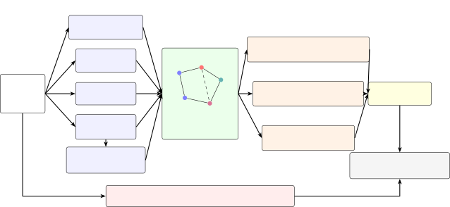
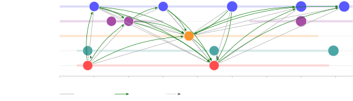

# What Helps Language-Model Agents Review Violent Video? A Controlled Comparison with a Human Evidence Reference

Mohammed El Amine Mokhtari    Matei Mancas    Virginie Vandenbulcke
Affiliation: University of Mons

###### Abstract

Systems that flag violent video for a human operator can now be built
from language models without training, by combining perception models
and letting a language model decide. We ask how the observations of the
perception models should reach the decision, and which evidence matters.
On the XD-Violence test set (799 clips) we fix one set of perception
agents (video description, object detection, sound tagging, speech
recognition and speech tagging) and one reasoning model, and compare
three interfaces: messages between agents, a typed evidence graph
explored with tools, and flat text read in one pass; and a single
audio-visual model given the raw clip. Two annotators provide a human
reference that records the decision, the incident segments and whether
they relied on sight, sound or speech. Flat text matches the single
model (F1 0.967 against 0.968), while the graph agent and message
passing are less accurate; a variant of the graph agent developed on a
separate set did not close the gap, and both graph summaries and
multi-turn tool use lowered accuracy. These results hold with reworded
prompts and with a larger reasoning model, except that the larger model
weakens message passing enough for the graph agent to beat it. Sound
events improve F1 by +0.012 \[+0.004, +0.021\], in line with the
annotators, who used sound or speech on most violent clips. Citations of
stored observations are faithful, changing about half of the decisions
when removed, but no more so with the graph than with flat text, and the
agent pipeline costs about 3 times the GPU time of the single model. We
also report two artefacts of vision-language describers that mislead
pipelines built on them.

   

A Preprint

|     |
| --- |
|     |

## 1 Introduction

Operators who review video footage for violence work under a budget:
they cannot watch everything, so a system that ranks or flags clips is
useful only if its decisions are accurate and can be checked. Large
language models now make such systems possible without training. A video
can be described in text and judged by a language model (Zanella et al.,
2024), an agent can call tools and query a vision model (Yang et al.,
2025; Bekit et al., 2026), and several agents can share observations
before one of them decides (Duan et al., 2026). In parallel, single
audio-visual language models can now take a whole clip, picture and
sound, and answer directly (Qwen Team, 2025a).

Two questions are rarely asked of these designs. First, _how_ should the
observations of several perception models reach the model that decides?
Recent work proposes ever richer interfaces: shared boards (Salemi et
al., 2025; Han and Zhang, 2025), registries of evidence, multi-turn
exploration with tools. These designs are usually compared with other
systems that differ in many ways at once, so it is hard to tell what the
interface itself contributes; and in other domains, multi-agent designs
often fail to beat a single well-prompted model (Wang et al., 2024; Kim
et al., 2025). Second, _which evidence_ matters? Language-model
pipelines for violence and anomaly detection read frames or captions;
sound and speech are at most named in a prompt (Bekit et al., 2026),
although the benchmark they are evaluated on, XD-Violence (Wu et al.,
2020), was built as an audio-visual dataset.

We address both questions with a controlled study on the XD-Violence
test set. We fix one set of perception agents (a video describer, object
detectors, a sound tagger, speech recognition and a speech tagger) and
one reasoning model, and vary only how their observations reach the
decision: as messages between agents, as a typed evidence graph explored
with tools, or as flat text read in one pass. We compare these with a
single audio-visual model given the raw clip. To know what the right
answer and the right evidence are, we built a human reference: two
annotators answered the operator’s question on clips of the test set,
marked the incidents in time, and recorded whether they relied on what
they saw, on sound or on speech. Hypotheses and decision rules were
fixed before any system was run, and when the graph agent underperformed
we developed it further only on a separate development set drawn from
the training videos.

The findings are mostly about what does _not_ help:

- •
  The single audio-visual model and flat text are equally accurate (F1
  0.968 and 0.967; difference $`-`$0.001 \[$`-`$0.014, +0.012\]). The
  structured interfaces are less accurate: the graph agent minus flat
  text is $`-`$0.032 F1 \[$`-`$0.046, $`-`$0.019\], and the graph agent
  does not beat message passing (+0.005 \[$`-`$0.011, +0.020\]). With
  paraphrased prompts the picture is the same; with a larger reasoning
  model flat text still leads, but the graph agent now beats message
  passing.
- •
  On the development set, adding graph summaries to flat text lowers F1
  from 0.946 to 0.926, and turning the same information into a
  multi-turn exploration with tools lowers it to 0.896. Edges built from
  the agents’ observations do not help, and in one variant they hurt.
- •
  The graph agent does not fail for lack of information. On the violent
  clips it missed, it had usually been shown the evidence that flat text
  relied on (all of it in 12 of 27 clips, some of it in 11). Its tools
  hand it fragments: it stops before opening the span that holds the
  incident, decides against evidence it has read, or, on normal clips,
  follows object detections taken out of the context that would discount
  them.
- •
  Sound helps. On clips with sound, flat text with the sound events
  scores +0.012 F1 \[+0.004, +0.021\] above flat text without them,
  consistent with the human reference, where sound or speech was used on
  85.5 % and 93.9 % of the violent clips with sound.
- •
  The systems that cite stored observations cite evidence their
  decisions depend on: hiding the cited observations changes 49 % of
  flat-text decisions against 0.6 % for random ones. This holds as much
  for flat text as for the graph agent, and the single model offers
  nothing comparable to check.
- •
  Counting the perception models, the agent pipeline costs about 3 times
  the GPU time of the single model; it saves only when stored
  observations are reused.

Our contributions are: (i) a human reference for XD-Violence that
records the operator decision, the incident segments and the evidence
modality used, with agreement between two annotators (Section 3); (ii) a
controlled comparison of four ways for the same perception agents to
reach a decision, with a development-set protocol, deletion tests of
faithfulness and an analysis of why the graph agent errs (Sections 4
and 5); and (iii) evidence that, on this task, flat text matches a
strong single audio-visual model while structured agent interfaces cost
accuracy, together with two artefacts of vision-language describers that
can mislead any pipeline built on them (Section 5.8).

## 2 Related work

#### Violence and anomaly detection with language models.

XD-Violence (Wu et al., 2020) pairs video with its soundtrack, and
trained audio-visual models exploit both (Ghadiya et al., 2024; Wu et
al., 2025). Trained vision-language methods reach high frame-level AP on
it, 84.5 for VadCLIP (Wu et al., 2024) and 87.7 for the
instruction-tuned Holmes-VAU (Zhang et al., 2025). Training-free methods
trade accuracy for not needing labelled data: LAVAD describes frames and
lets a language model score them (62.0 AP, Zanella et al., 2024);
EventVAD builds a graph over frames before asking a multimodal model
(64.0, Shao et al., 2025); QVAD lets an agent pose questions to a small
vision model (68.5, Bekit et al., 2026); PANDA adds retrieval, tools and
reflection to a single agent (70.2, Yang et al., 2025); AgenticVAU has
several agents share observations in a registry before deciding (Duan et
al., 2026); VTO trains a tool-using agent with reinforcement learning
and reports that such agents tend to stop exploring too early (Wang et
al., 2026), a failure we also observe without training (Section 5.5).
These pipelines read frames or captions; in the training-free ones sound
is at most mentioned in the prompt, and none we know of feeds
transcribed speech to a violence or anomaly decision. Transcripts are
used for a neighbouring task: MARS gives a vision-language model sampled
frames and a transcription to detect hateful video without training
(Yang et al., 2026). Our systems are training-free and give one score
per clip, so they are not built to compete on frame-level AP; we report
it for comparability (Section 5.1) and focus on the decision an operator
needs.

#### How agents share information.

Blackboard architectures, in which agents post observations to a shared
store read by others, have returned in language-model systems and were
reported to beat agents directing each other (Salemi et al., 2025; Han
and Zhang, 2025). Other work questions whether several agents help at
all: a single agent with strong prompts nearly matches multi-agent
discussion (Wang et al., 2024), coordination helps on parallel tasks and
hurts on sequential ones (Kim et al., 2025), and multi-agent systems
fail in recurring ways that can be catalogued (Cemri et al., 2025).
These studies are text-only. To our knowledge, no study holds a set of
multimodal perception agents fixed and varies only the interface through
which their observations reach the decision, which is what Section 5
does.

#### Human references for explanation.

Benchmarks for video anomaly detection label which frames are abnormal;
they do not say which evidence a person would use to decide. Our human
reference adds that, so that a system’s reliance on sound or speech, and
the segments it cites, can be compared with people’s.

## 3 Human reference

The XD-Violence test set (Wu et al., 2020) labels each clip as normal or
as showing one or more classes of violence. The decision our systems
support is a different one: _would a security operator need to look at
this clip?_ We call a clip for which the answer is yes _review
warranted_. Before using the violence labels as a stand-in, or proxy,
for this decision, we asked human annotators to make it directly. The
human reference serves three purposes. It measures how well the labels
match the decision we care about; it records which kinds of evidence
(what is seen, non-speech sound, speech) people rely on; and it gives
time segments against which the explanations of the systems can be
checked.

### 3.1 Protocol

For each clip the annotator answers one question, “Would a security
operator need to look at this clip?”, with Yes, No or Unsure, and gives
a confidence from 1 (guess) to 3 (certain). The protocol defines Yes as
a clip that shows, or gives credible signs of, violence or danger to
people: fighting, assault or abuse; weapons used or pointed at people;
explosions or fire that threaten people; crowds attacking people or
property; serious traffic or industrial accidents. Sound or speech alone
can be enough, for example screams of fear, gunshots or explicit
threats. No covers normal activity, crowds without aggression and sport
played under its rules. Unsure is reserved for clips the annotator
honestly cannot decide, such as ambiguous play fighting or a distant
event that cannot be made out. Clips are judged as if they were real
footage from a monitored place, even when they are clearly taken from a
film or a news report.

For a Yes, the annotator marks every incident as a time segment and
states, for each segment, the evidence they relied on: _visual_ (what is
seen), _sound_ (non-speech audio such as screams, gunshots or crashes)
or _speech_ (what people say). The question is what the annotator used,
not what the clip contains. A category (fighting, shooting, riot, abuse,
accident, explosion, other) and a short note are optional. For an
Unsure, the annotator states what caused the doubt; segments are
optional. A No needs nothing further.

Annotation was done in a local web application. Clips are shown with
sound under random codes, because the XD-Violence file names contain the
labels; the labels were not available to the annotators until all their
answers were final. The application records the share of each clip that
was played and the active time spent on it, saves every answer at once
and lets the annotator return to an earlier clip. The protocol was fixed
before annotation began, and each annotator’s answers were frozen before
they were compared with the labels or with the other annotator.

### 3.2 Sample and annotators

The test set has 800 clips. One shooting clip was used to explain the
task to the annotators and is excluded, which leaves 799. Annotator A
annotated 100 clips drawn at random within each XD-Violence class (the
first class listed for a clip), with at least 3 clips per class. To
measure consistency, 20 of these clips were shown a second time without
any marker, at least 20 positions after their first showing (the
smallest gap in the session was 23), for 120 items in total. Annotator B
annotated 50 clips, each shown once: 30 drawn at random within each
class from annotator A’s sample, to measure agreement between the two
annotators, and 20 that annotator A had not seen, drawn within each
class with at least 2 per class. Both kinds were mixed in random order
under new codes, and annotator B did not see annotator A’s answers.
Table 1 gives the sample by class: 120 distinct clips, 30 of them with
two annotators.

Annotator A is one of the authors and knew the design of the study;
annotator B took no part in the study and was new to the task.
Annotator A worked 6.0 hours (median 2.6 minutes per item), annotator B
2.3 hours (median 1.8 minutes). All of annotator A’s items were played
to at least 84 %; annotator B played one clip to 70 % and answered
Unsure on it, and every other clip to at least 80 %.

| XD-Violence class | Annotator A | B, shared with A | B, new | Distinct clips |
| ----------------- | ----------- | ---------------- | ------ | -------------- |
| Normal            | 36          | 9                | 6      | 42             |
| Fighting          | 15          | 4                | 3      | 18             |
| Shooting          | 10          | 3                | 2      | 12             |
| Riot              | 13          | 4                | 3      | 16             |
| Abuse             | 3           | 3                | 2      | 5              |
| Car accident      | 12          | 4                | 2      | 14             |
| Explosion         | 11          | 3                | 2      | 13             |
| Total             | 100         | 30               | 20     | 120            |

Table 1: Clips of the human reference by XD-Violence class (first class
listed for the clip).

### 3.3 Audio content of the test set

Every test clip has an audio track, but a track may hold only silence or
music. To know on which clips audio evidence can matter at all, we
measured the level of each second of audio and ran an audio event
tagger, the Audio Spectrogram Transformer (Gong et al., 2021) trained on
AudioSet (Gemmeke et al., 2017), on 10-second windows every 5 seconds.
With thresholds fixed before the run, a clip is _near-silent_ if fewer
than 10% of its seconds are louder than $`-50`$ dBFS; otherwise it
contains _speech_ if the speech classes score at least 0.5 in at least
10% of its windows, it is _music only_ if music scores at least 0.5 in
at least 80% of its windows, and it contains _other sound_ in all
remaining cases. We call clips with speech or other sound the
_with-sound subset_.

Table 2 shows that 765 of the 799 clips (95.7 %) belong to the
with-sound subset; 33 hold only music and 1 is near-silent. Speech is
present in most clips because most of the material comes from films.
Sound is spread evenly across classes: 96.0 % of violent clips and 95.3
% of normal clips belong to the with-sound subset (Fisher’s exact test,
$`p=0.72`$). A system therefore cannot separate violent from normal
clips by the mere presence of sound.

| XD-Violence class | Clips | Speech | Other sound | Music only | Near-silent |
| ----------------- | ----- | ------ | ----------- | ---------- | ----------- |
| Normal            | 300   | 256    | 30          | 14         | 0           |
| Fighting          | 120   | 97     | 15          | 8          | 0           |
| Shooting          | 83    | 63     | 17          | 3          | 0           |
| Riot              | 101   | 95     | 4           | 2          | 0           |
| Abuse             | 8     | 8      | 0           | 0          | 0           |
| Car accident      | 96    | 79     | 13          | 4          | 0           |
| Explosion         | 91    | 64     | 24          | 2          | 1           |
| All               | 799   | 662    | 103         | 33         | 1           |

Table 2: Audio content of the 799 test clips by XD-Violence class.

### 3.4 Results

#### Are the labels a valid proxy?

We compare Yes with a violent label and No with a normal label, on the
first showing of each clip, and report Cohen’s kappa (Cohen, 1960) with
a 95% bootstrap interval over clips (Efron and Tibshirani, 1993). On the
97 clips annotator A decided (3 answered Unsure), kappa is 0.95 (0.88 to
1.00) and agreement is 97.9 %. Counting Unsure as Yes gives 0.91,
counting it as No gives 0.93. Annotator B agrees with the labels on all
48 clips they decided and answered Unsure on 2. Table 3 shows that every
violent class agrees fully for both annotators.

All differences go in the same direction. Annotator A answered Yes on 2
normal clips, a girl in a tree with men trying to pull her down and
people on motorcycles closing in on a car to attack its occupants, and
Unsure on two normal clips showing threatening stares and a tense
confrontation. The one Unsure on a violent clip is an explosion: a dead
whale bursting while it is cut open, with no danger to people. Review
warranted is therefore slightly wider than violent, since it includes
threats and possible escalation, and it leaves out an explosion that
endangers no one. On this sample the violence labels are a valid proxy
for the decision, which supports their use as the main benchmark.

| XD-Violence class | A agrees | A unsure | B agrees | B unsure |
| ----------------- | -------- | -------- | -------- | -------- |
| Normal            | 32/34    | 2        | 14/14    | 1        |
| Fighting          | 15/15    | 0        | 7/7      | 0        |
| Shooting          | 10/10    | 0        | 5/5      | 0        |
| Riot              | 13/13    | 0        | 7/7      | 0        |
| Abuse             | 3/3      | 0        | 5/5      | 0        |
| Car accident      | 12/12    | 0        | 6/6      | 0        |
| Explosion         | 10/10    | 1        | 4/4      | 1        |

Table 3: Agreement with the XD-Violence labels by class. “Agrees” counts
decided clips (Yes or No) whose answer matches the label; Unsure answers
are listed separately.

#### Do two annotators agree?

On the 30 shared clips, the two annotators gave the same answer on 29
(kappa over Yes, No and Unsure 0.93, 95% interval 0.75 to 1.00; 0.91 on
the 28 clips where neither answered Unsure). Both answered Unsure,
independently, on the same 2 clips: the threatening stares and the
exploding whale. The only disagreement is the clip with motorcycles
around a car, which annotator A found review warranted and annotator B
did not.

On the 20 clips both annotators called Yes, we compare where they placed
the incidents. We take the union of each annotator’s segments on the
time axis and compute the intersection over union of the two. Its median
is 0.78 (mean 0.73, lowest 0.18), and 16 of the 20 clips reach 0.5 or
more. The evidence the two annotators relied on also matches: they agree
on whether visual evidence was used on 20 clips, on sound on 19 and on
speech on 17, and they share at least one segment category on 19.

#### Is an annotator consistent?

Annotator A gave the same answer to all 20 repeated clips (kappa 1.00).
This is an upper bound: the annotator recognised at least 3 repeats
during the session.

#### Which evidence do people use?

Annotator A relied on sound or speech for 86.2 % of the 65 clips they
found review warranted (sound 81.5 %, speech 21.5 %, visual evidence on
all of them), annotator B for 94.1 % of 34 (sound 94.1 %, speech 23.5
%). On the with-sound subset these shares are 85.5 % of 62 clips and
93.9 % of 33, almost unchanged. The annotators marked 171 and 113
segments on these clips, 2.6 and 3.3 per clip.

#### Does an audio tagger hear what people heard?

We checked the tagger of Section 3.3 against the segments of the clips
found review warranted. A segment counts as heard if one of the
violence-related event groups (gunshot, explosion, scream, crash, crowd,
siren, impact) scores at least 0.3 in a window that overlaps it. Of the
164 segments where an annotator ticked sound, 44 % are heard, against 12
% of the 120 segments where sound was not ticked (71 % and 41 % at a
threshold of 0.1). Table 4 shows that this depends strongly on the kind
of incident: the tagger hears most shootings and about half of the
explosions, but few fights and very little abuse, whose sounds (blows,
cries) are poorly covered by the AudioSet classes. Speech is detected in
85 % of the 27 segments where speech was ticked and in 74 % of the
others, so the presence of speech says little; what matters is what is
said.

| Segment category | Segments | Event at 0.3 (%) | Event at 0.1 (%) | Most frequent event |
| ---------------- | -------- | ---------------- | ---------------- | ------------------- |
| Shooting         | 37       | 76               | 95               | gunshot             |
| Explosion        | 21       | 52               | 81               | explosion           |
| Riot             | 25       | 40               | 72               | crowd               |
| Accident         | 34       | 38               | 53               | crash               |
| Fighting         | 24       | 25               | 83               | explosion           |
| Abuse            | 18       | 11               | 39               | crash               |

Table 4: Segments where an annotator ticked sound, by the category the
annotator gave, and the share in which the tagger finds a
violence-related sound event at two score thresholds.

#### Consequences for the evaluation.

Because the labels are a valid proxy on this sample, the systems are
evaluated against them on the full test set, and the human reference is
used for what the labels do not measure: where the evidence is and which
modality carries it. Questions about the value of audio are answered on
the with-sound subset and reported per class, since off-the-shelf audio
events are informative for shootings and explosions but not for fights
and abuse. Speech enters the systems through its content (transcription
and tagging of threats or distress), not through its presence.

### 3.5 Limitations of the human reference

The reference rests on two annotators, one of whom is an author who knew
the design of the study; the other was new to the task. Most sampled
clips are clear-cut, so near-perfect agreement with the labels says
little about borderline cases, and the abuse class has only 5 distinct
clips, too few for per-class claims. Annotator B saw no repeated clips,
so consistency is measured for annotator A only, and that measure is an
upper bound. The clips come mostly from films and online videos, not
from surveillance cameras. The audio categories depend on one tagger and
on thresholds that were fixed in advance but not tuned.

## 4 Method

Figure 1: The compared systems. Perception agents write their
observations into one evidence graph per clip. S2, S3 and S4 pass the
same observations to the same reasoning model in three ways; S1 gives
the raw clip to one audio-visual model. All four answer the same
question and return a decision, a score and time segments; S3 and S4
also cite the nodes their answer rests on.

Figure 1 shows the systems. All of them answer the same question about
each clip, the one the annotators answered: does the clip need a
security operator’s attention because it shows violence or danger? The
prompt names the six XD-Violence classes, asks the model to judge what
is shown even in films and news footage, and asks for Yes or No on the
first line and the time segments of the incident on the second. The
_score_ of a system on a clip is the probability of Yes divided by the
probability of Yes plus No on the first answer token; the _decision_ is
the first word of the answer. No model is trained.

### 4.1 Evidence graph

The perception agents described below do not talk to each other. Each
writes what it observes into an _evidence graph_, one per clip. A node
is one observation, never an entity: a description of four seconds of
video, an object detection, a sound event, a line of transcribed speech.
Each node carries a time span in the clip, a confidence, and its
provenance: the agent, the model and its version, and the position in
the input. Edges are typed relations between observations from different
agents whose time spans overlap: _same event_ (both nodes assert a
violence-related or scene concept, graded by the overlap of their
spans), _supports_ (their concepts agree, graded by the lower
confidence), _contradicts_ (a video description denies a
violence-related concept that the other node asserts, for example “no
weapons are visible” beside a gunshot), and _derived from_ (a speech tag
and the transcript line it was read from). Concepts are assigned by a
fixed word list per concept (gun, knife, fire, fight, crash, injury,
distress, threat, emergency, crowd, vehicle), applied sentence by
sentence, with a sentence containing a negation denying its concepts
instead of asserting them. Graphs are stored as append-only files, one
per agent and clip, under a neutral clip identifier, so that nothing a
system reads reveals the file name or label.

### 4.2 Perception agents

- •
  Video. One frame per second. An object detector for people and weapons
  (YOLOv8-L trained in earlier work of the authors on another domain)
  and an open-vocabulary detector (Cheng et al., 2024) for fire, smoke,
  vehicles and police; detections of the same object in nearby seconds
  form one node. A vision-language model (Qwen Team, 2025b) describes
  each four seconds of video in at most 40 words.
- •
  Sound. An AudioSet tagger (Gong et al., 2021) on 10-second windows
  every 5 seconds; consecutive windows in which a violence-related event
  (gunshot, explosion, scream, crash, crowd, siren, impact) scores at
  least 0.1 form one node, with the peak score as confidence.
- •
  Speech. Whisper large-v3 (Radford et al., 2023) transcribes speech in
  any language, one node per segment. The reasoning model then reads
  each line with its neighbours and labels it as a threat of violence,
  distress, a report of violence, or none; the label probabilities come
  from the next-token probabilities, so each tag carries a graded
  confidence.

The graphs of the 799 test clips hold 51,542 nodes (median 46 per clip):
24,808 video descriptions, 13,557 detections, 1,476 sound events, 10,634
transcript lines and 1,067 speech tags; and 30,530 same-event, 14,009
supports, 16 contradicts and 1,067 derived-from edges.

### 4.3 Compared systems

S1, one omni model.  
An audio-visual language model (Qwen Team, 2025a) receives the frames at
one per second (at most 240, evenly spaced on longer clips) and the
soundtrack, and answers directly. No agents, no graph. Because it often
gave times past the end of the clip, we also run S1-ts, in which the
clip is given in 20-second chunks, each preceded by a text label with
its start and end time, so that the model sees absolute time as the
text-based systems do.

S2, message passing.  
The agents are grouped into three (video, sound, speech), and each group
is played by the reasoning model given only that group’s nodes as text.
Each sends a short report; the reasoning agent may ask each agent
follow-up questions before answering. No graph and no shared node
identifiers.

S3, graph agent.  
The reasoning agent reads the graph through tools: nodes in a time
window, nodes asserting a concept, the edges of a node, the provenance
of a node. It may call up to eight tools before answering, and cites the
node identifiers its answer rests on. S3 v2 was developed afterwards on
a separate development set (Section 5.4): it starts from all video
descriptions, a timeline of the concepts each agent asserts per 10
seconds, and the groups of nodes from different agents joined by
supports edges, and may call up to twelve tools.

S4, flat text.  
Every node of every agent, one line each, sorted by time, in a single
prompt; one pass, no tools. It cites node identifiers like S3.

S2, S3 and S4 use the same reasoning model, Gemma 4 12B (Google, 2026)
in bfloat16, with greedy decoding; Section 5.3 repeats them with a
larger model. All four systems therefore differ only in how the same
evidence reaches the decision: as raw audio and video (S1), as messages
(S2), as a graph explored with tools (S3), or as flat text (S4).

### 4.4 Evaluation

The evaluation set is the whole test set, 799 clips (499 violent, 300
normal), fixed with a hash of the file list before any system was run.
We report, against the XD-Violence labels: the area under the ROC curve
(AUC) of the score; F1 of the decision; frame-level average precision
(AP) over every frame of every clip at 24 frames per second, where a
frame receives the clip score if it lies in a segment the system named
(or if the system named none) and 0 otherwise; and _grounding precision
and recall_, the share of predicted seconds that fall inside the
labelled violent frames and the share of labelled violent seconds that
are covered, on violent clips the system called Yes. Segments are cut at
the end of the clip for every system. We also report F1 against
annotator A’s decisions on the clips of Section 3. Differences between
systems are paired and come with 95% bootstrap confidence intervals over
clips. _Faithfulness_ is measured by deletion: we hide the nodes a
system cited and run it again, and compare how often its decision
changes with hiding as many randomly chosen uncited nodes. Hypotheses
and decision rules were fixed before any system was run.

## 5 Results

### 5.1 Main comparison

Table 5 compares the systems on the 799 test clips. The single omni
model is the most accurate (AUC 0.997, F1 0.968). Flat text (S4) is as
accurate: its F1 differs from S1’s by $`-`$0.001 \[$`-`$0.014, +0.012\],
and from S1-ts’s by +0.001 \[$`-`$0.012, +0.014\]. Both structured
designs are less accurate. The graph agent S3 is below flat text by
$`-`$0.032 F1 \[$`-`$0.046, $`-`$0.019\], and it does not beat message
passing: S3 minus S2 is +0.005 \[$`-`$0.011, +0.020\], so the hypothesis
that the shared graph improves on message passing is not supported with
this reasoning model (with a larger one it is; Section 5.3).

| System                  | AUC \[95% CI\]         | F1 \[95% CI\]          | Frame AP | Ground. prec. | Ground. rec. | Tokens | F1 vs A |
| ----------------------- | ---------------------- | ---------------------- | -------- | ------------- | ------------ | ------ | ------- |
| S1 omni                 | 0.997 \[0.994, 0.999\] | 0.968 \[0.956, 0.978\] | 0.523    | 0.645         | 0.560        | 9,395  | 0.954   |
| S1-ts omni, time labels | 0.997 \[0.994, 0.999\] | 0.966 \[0.954, 0.977\] | 0.573    | 0.551         | 0.803        | 9,097  | 0.985   |
| S2 messages             | 0.941 \[0.923, 0.957\] | 0.930 \[0.913, 0.946\] | 0.490    | 0.637         | 0.717        | 8,747  | 0.913   |
| S3 graph, v1            | 0.951 \[0.934, 0.966\] | 0.935 \[0.917, 0.950\] | 0.443    | 0.652         | 0.678        | 6,634  | 0.952   |
| S3 graph, v2            | 0.960 \[0.946, 0.972\] | 0.924 \[0.906, 0.941\] | 0.543    | 0.658         | 0.762        | 9,574  | 0.936   |
| S4 flat text            | 0.992 \[0.987, 0.996\] | 0.967 \[0.956, 0.978\] | 0.538    | 0.627         | 0.774        | 3,255  | 0.961   |

Table 5: Systems on the 799 test clips. Frame AP: every frame at 24
frames per second. Grounding: share of predicted seconds inside labelled
violent frames (precision) and share of labelled violent seconds covered
(recall), on violent clips called Yes. Tokens: reasoning tokens per clip
(prompt and answer); perception cost is in Table 12. F1 vs A: against
annotator A’s decisions on the clips of Section 3.

Grounding does not favour the graph. With absolute time given in the
input, the omni model covers more of the violent time than any other
system (S1-ts recall 0.803 against 0.774 for S4) and has the highest
frame-level AP (0.573). The text-based systems name tighter segments
(precision 0.658 for S3 v2, 0.627 for S4, against 0.551 for S1-ts). On
frame-level AP all systems stay below published training-free results on
this benchmark (Zanella et al., 2024), because each gives one score per
clip rather than a score per frame; naming segments changes frame AP
little (S4: 0.538 with segments, 0.535 without).

Against annotator A’s decisions the ranking is the same: S1-ts reaches
F1 0.985, S4 0.961, S3 0.952 and S2 0.913.

### 5.2 What helps and what does not

Table 6 lists the paired differences, each written as the first system
minus the second. Sound helps. On clips with sound, S4 with sound events
scores +0.012 F1 \[+0.004, +0.021\] above S4 without them, and +0.017
\[+0.007, +0.027\] above S4 without both sound events and speech; speech
alone adds +0.005 \[$`-`$0.001, +0.011\], which is not significant. This
agrees with the human reference, where sound or speech was used on 85.5
% (annotator A) and 93.9 % (annotator B) of the violent clips with
sound. For S3 v1 sound events add +0.013 \[+0.003, +0.024\]; for S3 v2
they add nothing measurable ($`-`$0.002 \[$`-`$0.012, +0.008\]).

Edges do not help. S3 v1 with edges scores +0.005 \[0.000, +0.011\]
above S3 v1 without them; S3 v1 asked for the edges of a node in only 3
of its 1,904 tool calls. For S3 v2, which builds its timeline and events
from the edges, they _lower_ F1: with minus without is $`-`$0.013
\[$`-`$0.024, $`-`$0.003\].

| Comparison                             | Clips      | $`\Delta`$F1 | 95% CI                     | $`\Delta`$AUC |
| -------------------------------------- | ---------- | ------------ | -------------------------- | ------------- |
| S3 v1 $`-`$ S2                         | all        | +0.005       | \[$`-`$0.011, +0.020\]     | +0.010        |
| S3 v2 $`-`$ S2                         | all        | $`-`$0.006   | \[$`-`$0.021, +0.009\]     | +0.019        |
| S3 v1 $`-`$ S4                         | all        | $`-`$0.032   | \[$`-`$0.046, $`-`$0.019\] | $`-`$0.041    |
| S4 $`-`$ S1                            | all        | $`-`$0.001   | \[$`-`$0.014, +0.012\]     | $`-`$0.005    |
| S4 $`-`$ S1-ts                         | all        | +0.001       | \[$`-`$0.012, +0.014\]     | $`-`$0.005    |
| S3 v2 $`-`$ S3 v1                      | all        | $`-`$0.011   | \[$`-`$0.027, +0.005\]     | +0.009        |
| S3 v1 with $`-`$ without edges         | all        | +0.005       | \[0.000, +0.011\]          | +0.004        |
| S3 v2 with $`-`$ without edges         | all        | $`-`$0.013   | \[$`-`$0.024, $`-`$0.003\] | +0.002        |
| S3 v1 with $`-`$ without sound events  | with sound | +0.013       | \[+0.003, +0.024\]         | +0.010        |
| S3 v2 with $`-`$ without sound events  | with sound | $`-`$0.002   | \[$`-`$0.012, +0.008\]     | +0.009        |
| S4 with $`-`$ without sound events     | with sound | +0.012       | \[+0.004, +0.021\]         | +0.005        |
| S4 with $`-`$ without speech           | with sound | +0.005       | \[$`-`$0.001, +0.011\]     | +0.001        |
| S4 with $`-`$ without sound and speech | with sound | +0.017       | \[+0.007, +0.027\]         | +0.009        |
| S3 v1, Qwen3.6 $`-`$ Gemma             | all        | +0.004       | \[$`-`$0.011, +0.020\]     | +0.028        |

Table 6: Paired differences in F1 and AUC, with 95% bootstrap confidence
intervals over clips. “With sound”: the clips whose soundtrack holds
speech or other sound (Section 3.3).

### 5.3 Robustness to the prompt and the reasoning model

Two checks, added after the main results and not part of the hypotheses
fixed in advance, ask whether the comparison depends on the wording of
the prompts or on the reasoning model (Table 7). First, we reran S3 v1
and S4 with paraphrased instructions: a reworded system prompt for S4
and a reworded opening paragraph for S3 (Appendix A), with the task
question unchanged. Neither system moves: paraphrased minus original is
+0.003 F1 \[$`-`$0.004, +0.009\] for S4 and +0.001 \[$`-`$0.011,
+0.014\] for S3, and with the paraphrases S3 is still below S4 by
$`-`$0.034 \[$`-`$0.048, $`-`$0.021\].

Second, we reran S2, S3 v1 and S4 with a larger reasoning model,
Qwen3.6-35B-A3B (Qwen Team, 2026), with its thinking mode off. Flat text
is again the most accurate: S3 minus S4 is $`-`$0.023 \[$`-`$0.037,
$`-`$0.010\], and S4 scores the same with either model ($`-`$0.005
\[$`-`$0.015, +0.005\]). The graph agent explores more with the larger
model (6.0 tool calls per clip against 2.4) and ranks clips better (AUC
0.979), but its F1 is no higher (+0.004 \[$`-`$0.011, +0.020\]) and it
reads 17,874 tokens per clip. One result does change: message passing
loses accuracy with the larger model (Qwen3.6 minus Gemma is $`-`$0.039
F1 \[$`-`$0.059, $`-`$0.020\]), so that with Qwen3.6 the graph agent
_does_ beat message passing (+0.048 \[+0.029, +0.068\]). Whether the
graph improves on message passing therefore depends on the reasoning
model, while the advantage of flat text over both does not.

|              | Gemma 4 12B |       | Gemma, paraphrased |       | Qwen3.6-35B-A3B |       |
| ------------ | ----------- | ----- | ------------------ | ----- | --------------- | ----- |
| System       | AUC         | F1    | AUC                | F1    | AUC             | F1    |
| S2 messages  | 0.941       | 0.930 | –                  | –     | 0.937           | 0.891 |
| S3 graph, v1 | 0.951       | 0.935 | 0.946              | 0.936 | 0.979           | 0.939 |
| S4 flat text | 0.992       | 0.967 | 0.988              | 0.970 | 0.988           | 0.962 |

Table 7: Robustness checks on the 799 test clips. Paraphrased: the same
model with reworded instructions (S2 not rerun). Qwen3.6: the same
prompts with a larger reasoning model; 2 S2 and 6 S3 answers could not
be parsed and count as errors.

### 5.4 Developing S3 on a separate set

Because S3 lost to flat text, we tried to improve it without touching
the test clips. We drew a development set of 152 clips from the
XD-Violence training videos (60 normal, 92 violent; half films and half
web videos, like the test set; no file in common with it) and ran the
same perception agents on it. One clip longer than any test clip was
left out, leaving 151. Before starting we fixed a rule: at most four
variants, and the one with the best development F1 is run once on the
test set. Table 8 shows the attempts. The selected variant reached 0.907
on the development set (a second run gave 0.907) against 0.893 for S3
v1, but 0.946 for flat text. On the test set S3 v2 did not improve on S3
v1 ($`-`$0.011 \[$`-`$0.027, +0.005\]).

The last two rows of Table 8 locate the loss. Adding the timeline and
the event groups to flat text, still in one pass, lowers F1 from 0.946
to 0.926; turning the same information into a multi-turn exploration
with tools lowers it further, to 0.896. Both the graph summaries and the
tool loop cost accuracy against reading everything at once.

| Variant                                           | F1    | Precision | Recall | Tokens |
| ------------------------------------------------- | ----- | --------- | ------ | ------ |
| S3 v1 (as run on the test set)                    | 0.893 | 0.929     | 0.859  | 6,544  |
| a: whole-clip timeline and event tool             | 0.880 | 0.849     | 0.913  | 6,831  |
| b: + corroborated detector cues, reading enforced | 0.888 | 0.919     | 0.859  | 11,010 |
| c: + all video descriptions up front (selected)   | 0.907 | 0.912     | 0.902  | 9,603  |
| d: + every item up front                          | 0.896 | 0.901     | 0.891  | 11,946 |
| S4 + timeline and events, one pass (diagnostic)   | 0.926 | 0.898     | 0.957  | 3,533  |
| S4 flat text                                      | 0.946 | 0.936     | 0.957  | 3,152  |

Table 8: Variants of S3 on the development set (151 clips), in the order
they were tried. The selected variant is the one run on the test set as
S3 v2. The S4 rows are references; the one-pass row is a diagnostic and
was not eligible for selection.

### 5.5 Why the graph agent errs

To see why the tool loop costs accuracy, we examined every test clip
that S3 v1 got wrong and flat text got right: 40 clips, 27 of them
violent clips that S3 missed and 13 normal clips that it flagged.
Because the tools are deterministic, we first replayed each trace
offline to recover exactly which nodes S3 was shown. Over all clips S3
saw about 50 % of a clip’s nodes, in 2.4 tool calls on average. On the
27 missed violent clips, S3 had been shown every node that flat text
cited in 12, some of them in 11, and none in only 4. Missing evidence is
therefore not the main cause.

We then read the 40 traces and assigned each to one category (Table 9);
the categories were fixed before reading, except “only faint evidence”,
which we added while reading. Three causes account for most errors. S3
stopped before opening the time span that held the incident (10 clips).
It read the decisive evidence and still answered No (9); Table 10 shows
one such clip, where every other system answered Yes. And on normal
clips it was led by false object detections (8 of the 13 false alarms):
a search for a concept returns the matching detections without the
descriptions around them, whereas flat text shows each detection next to
descriptions that make it implausible. In 9 clips the label itself is
debatable under the annotation protocol, for example a film scene in
which a man points a gun at a guard, which the protocol counts as Yes
but the dataset labels normal. No error came from searching with words
the lexicon does not cover. The tool interface thus hands the model
fragments: too little of the clip in some cases, evidence out of context
in others.

| Category                           | Clips | Example                                                 |
| ---------------------------------- | ----- | ------------------------------------------------------- |
| Stopped before the evidence        | 10    | stopped before the collision and the fight in the van   |
| Read the evidence, decided wrongly | 9     | read a hockey fight with a stick strike, answered No    |
| Led by false detections            | 8     | Yes from RPG and pistol detections only                 |
| Label debatable                    | 9     | small fires and battery sparks, no people at risk       |
| Only faint evidence                | 4     | only cue a faint boom (0.14); descriptions show nothing |
| Searched with the wrong words      | 0     | –                                                       |

Table 9: Errors of S3 v1 on test clips that flat text (S4) got right,
one category per clip.

|                                                                                                                                                                                                                                            |
| ------------------------------------------------------------------------------------------------------------------------------------------------------------------------------------------------------------------------------------------ |
| Evidence in the graph                                                                                                                                                                                                                      |
| \[n1\] 0-4s video description: A figure with a bright light emerges from a doorway. A man with bloodied face turns, then lunges forward. He stands in a dark, arched corridor, smoke billowing from his body.                              |
| \[n2\] 0-6s video detector saw ’person’ (up to 1 at once, 5 s, conf 0.96)                                                                                                                                                                  |
| \[n3\] 0-15s sound: gunshot (Machine gun, conf 0.28)                                                                                                                                                                                       |
| \[n4\] 1-2s speech (en, conf 0.40): "Oh, my God!"                                                                                                                                                                                          |
| \[n5\] 1-2s speech tagged distress, conf 1.00: "Oh, my God!"                                                                                                                                                                               |
| \[n6\] 2-16s speech (en, conf 0.40): "Jerks. They should have shot me in the head, and enough times to make sure."                                                                                                                         |
| \[n7\] 2-16s speech tagged report, conf 1.00: "Jerks. They should have shot me in the head, and enough times to make sure."                                                                                                                |
| \[n8\] 3-5s video detector saw ’pistol_hand_gun’ (up to 1 at once, 2 s, conf 0.64)                                                                                                                                                         |
| \[n9\] 4-8s video description: A bloodied, disfigured figure stands in a dark, stone-walled room. The figure’s head tilts back, mouth open as if screaming. The scene is dimly lit, with smoke or steam visible in the background.         |
| \[n10\] 8-12s video description: Four surgeons in blood-stained gowns and caps look down from above at surgical lights. Their heads are visible, suggesting they are focused on a procedure below.                                         |
| \[n11\] 11-17s video detector saw ’person’ (up to 2 at once, 6 s, conf 0.92)                                                                                                                                                               |
| \[n12\] 12-16s video description: Surgeons in blood-splattered scrubs and gloves perform surgery. One surgeon holds a scalpel, another a surgical instrument. Blood drips from their hands and clothing. The scene is intense and graphic. |
| \[n13\] 16-16s speech (en, conf 0.40): "It..."                                                                                                                                                                                             |
| \[n14\] 16-17s video description: Surgical team in white gowns and masks, blood-splattered, hunched over patient. Bright overhead lights illuminate scene. One surgeon holds instrument near patient’s body. Blood drips down gowns.       |
| The same nodes on a timeline, with the edges added by rules                                                                                                                                                                                |
|                                                                                                                                                                                  |
| Answers (first line, segments; score $`=`$ P(Yes))                                                                                                                                                                                         |
| S1: Yes / 0-4, 10-15, score 0.986                                                                                                                                                                                                          |
| S1-ts: Yes / 0-17, score 0.992                                                                                                                                                                                                             |
| S2: Yes / 0-17, score 1.000                                                                                                                                                                                                                |
| S3 v1: No / none, score 0.126; tools: window(0-17), search(gun), done                                                                                                                                                                      |
| S4: Yes / 0-17, score 1.000                                                                                                                                                                                                                |

Table 10: One test clip (17 seconds, from a film, labelled shooting).
Top: the 14 nodes of its graph, as S4 reads them. Middle: the same nodes
on a timeline, one lane per kind of observation, with the edges the
rules added (numbers as in the list above). Bottom: each system’s
answer. S3 opened the descriptions of the whole clip and searched for
weapons, then answered No; all other systems answered Yes.

### 5.6 Faithfulness of the cited evidence

The systems that cite nodes cite evidence their decisions depend on
(Table 11). Hiding the nodes S3 v1 cited changes its decision on 46 % of
the clips where it cited any, against 2.9 % when as many random nodes
are hidden; for S4 the figures are 49 % and 0.6 %. The citations are
therefore faithful, but this is a property of citing stored, identified
evidence, not of the graph interface: flat text is as faithful as the
graph agent. The omni model cites nothing that can be checked in this
way.

| System | Clips | Flips, cited (%) | Flips, random (%) | Score shift, cited | Score shift, random |
| ------ | ----- | ---------------- | ----------------- | ------------------ | ------------------- |
| S3 v1  | 485   | 46.4             | 2.9               | 0.455              | 0.032               |
| S3 v2  | 479   | 54.9             | 1.7               | 0.540              | 0.017               |
| S4     | 505   | 49.1             | 0.6               | 0.484              | 0.005               |

Table 11: Deletion faithfulness: how often the decision changes when the
cited nodes are hidden, against hiding as many random uncited nodes; and
the mean change of the score.

### 5.7 Cost

Flat text needs the fewest reasoning tokens (3,255 per clip against
9,395 for S1), but the perception agents are not free. Counting them, S4
takes about 20 GPU-seconds per clip against 6.2 for S1, roughly 3 times
more (Table 12; the stages ran on different GPUs, so the figures are
indicative). The agent pipeline is cheaper only when the stored
observations are reused, for example to answer several questions about
the same footage or to audit a decision later.

|                    |                |                                  |
| ------------------ | -------------- | -------------------------------- |
| Stage              | GPU s per clip | Hardware                         |
| Object detectors   | 4.9            | RTX 4090/3090                    |
| Video descriptions | 9.5            | mixed                            |
| Speech recognition | 1.6            | RTX 4090                         |
| Speech tags        | 0.9            | RTX PRO 4500                     |
| Sound tagger       | 2.6            | MacBook GPU                      |
| S4 reasoning       | 0.9            | RTX PRO 4500, vLLM batched       |
| S4 total           | 20.4           |                                  |
| S1 omni            | 6.2            | RTX PRO 6000, one clip at a time |

Table 12: GPU time per clip, averaged over the 799 test clips.

### 5.8 Two artefacts of the perception agents

Two problems found while checking the graphs by hand are worth reporting
for anyone using a vision-language model as a sensor. A first prompt
asked the describer to mention weapons, fire, vehicles or injuries only
if it saw them; it then ended 91 % of its descriptions with a sentence
such as “No weapons, fire, vehicles or injuries are visible”, sometimes
right after describing a gun. Those sentences produced 11,188
contradicts edges; with a neutral prompt, 6 % of descriptions contain a
negation and 16 contradicts edges remain. Real contradictions between
agents are rare in this domain. Similarly, a first definition of a
threat that included giving orders made the speech tagger mark 715 lines
as threats, many of them ordinary commands in film dialogue; a
definition limited to threats of violence gave 129. All results above
use the corrected versions.

## 6 Limitations

#### One task, one dataset.

All results are on XD-Violence, whose clips come mostly from films, web
videos and news, judged as if they were monitored footage. The violence
labels serve as a proxy for the operator decision; Section 3 shows the
proxy holds on the annotated sample, and the limits of that sample are
in Section 3.5. In this domain the agents rarely disagree (Section 5.8),
which leaves little for supports and contradicts edges to do. Whether
structure helps where sources do conflict, as in news verification, is
not tested here.

#### The graph and its interface.

Edges were built by fixed word lists and time overlap, not learned; a
learned relation model might give edges that help. The graph agent’s
tools, summaries and prompts are one design among many. We tried four
variants on a development set under a fixed rule and report all of them,
but other designs might do better. The development clips come from the
training videos of the same dataset; they share no file with the test
set but some come from the same films.

#### Models.

The text-based systems use one reasoning model, with one larger model
and one paraphrase of the instructions as checks (Section 5.3). S3 v2
was not rerun under either check, and the paraphrase covers the system
instructions, not the task question. The single-model baseline uses one
audio-visual model and one prompt, plus the time-labelled variant.
Scores come from the first answer token, which saturates near 0 and 1
for these models and limits how finely clips are ranked.

#### Metrics and cost.

Our systems give one score per clip, which caps frame-level AP; frame AP
and grounding are therefore secondary. Faithfulness is measured by
deletion only, and cannot be measured for the single audio-visual model,
which cites nothing. GPU times come from different GPUs and from batched
serving for the text systems against one clip at a time for the single
model, so the cost ratio is indicative.

## 7 Conclusion

We held a set of perception agents and a reasoning model fixed and
varied only how their observations reach the decision about a violent
clip. Reading every observation as flat text, in one pass, was as
accurate as a strong audio-visual model given the raw clip, and more
accurate than letting the agents exchange messages or letting the
reasoning model explore an evidence graph with tools; this held with
reworded prompts and with a larger reasoning model. The graph agent did
not lose for lack of information: it usually saw the evidence that flat
text relied on, but its tools handed it fragments, too little of the
clip or detections without their context, and it often stopped early or
decided against what it had read. Sound helped, as it did for the human
annotators, and citations of stored observations were faithful whichever
interface produced them.

For people building such pipelines, the lesson is to keep structure
where it pays: as a record. Typed, timed observations with their
provenance are what make citations checkable and let the same footage be
questioned again without rerunning the perception models. As the
interface through which the model reasons, the same structure cost
accuracy on this task. Whether it helps when sources genuinely disagree,
as they do in news verification, is the question we take up next.

## Data and code availability

The human reference of Section 3 is available on request at
[https://huggingface.co/datasets/amine0110/xd-violence-review](https://huggingface.co/datasets/amine0110/xd-violence-review)
under CC BY-NC 4.0. It contains annotations only: each record names the
XD-Violence clip it refers to, and users obtain the videos themselves
from the official XD-Violence page under its terms. Version v1.3 is the
one used in this paper. The code of all systems, the evaluation and the
scripts that produce every number in this paper are at
[https://github.com/amine0110/evidence-graph-agents](https://github.com/amine0110/evidence-graph-agents).

## Ethics statement

#### Footage.

XD-Violence consists of clips from films, web videos and news. We do not
redistribute any video or frame, and we report aggregate results only.
The systems decide whether a clip needs a human to look at it; they do
not identify people, infer intent, or act on their own, and we make no
claim about their use on real monitored footage.

#### Annotators.

Two people annotated the clips: one of the authors (A) and a volunteer
(B) with no background in video analysis or security, who took no part
in the study and received no payment. The first author explained the
protocol and the nature of the footage to annotator B before annotation
began. Both appear in the released data only as the letters A and B.
Annotator B agreed to the release of her annotations. No formal ethics
review was conducted.

#### Language models.

All models were run on the authors’ own computer and on university
servers; no clip or transcript was sent to an external model service.

## References

- Bekit et al. (2026) L. Bekit, H. Karim, N. T. Nguyen, and Y. Yilmaz
  QVAD: a question-centric agentic framework for efficient and
  training-free video anomaly detection. arXiv preprint
  arXiv:2604.03040. Cited by: §1, §1, §2.
- Cemri et al. (2025) M. Cemri, M. Z. Pan, S. Yang, L. A. Agrawal, B.
  Chopra, R. Tiwari, K. Keutzer, A. Parameswaran, D. Klein, K.
  Ramchandran, M. Zaharia, J. E. Gonzalez, and I. Stoica Why do
  multi-agent LLM systems fail?. arXiv preprint arXiv:2503.13657. Cited
  by: §2.
- Cheng et al. (2024) T. Cheng, L. Song, Y. Ge, W. Liu, X. Wang, and Y.
  Shan YOLO-World: real-time open-vocabulary object detection. In
  Proceedings of the IEEE/CVF Conference on Computer Vision and Pattern
  Recognition (CVPR), Cited by: 1st item.
- Cohen (1960) J. Cohen A coefficient of agreement for nominal scales.
  Educational and Psychological Measurement 20 (1), pp. 37–46. External
  Links: [Document](https://dx.doi.org/10.1177/001316446002000104) Cited
  by: §3.4.
- Duan et al. (2026) Y. Duan, H. Li, A. Li, S. Feng, L. Kong, N. Liu, J.
  Zhang, X. Sheng, and Y. Du AgenticVAU: multi-agent explore-verify
  reasoning for video anomaly understanding. arXiv preprint
  arXiv:2608.03779. Cited by: §1, §2.
- Efron and Tibshirani (1993) B. Efron and R. J. Tibshirani An
  introduction to the bootstrap. Chapman & Hall. Cited by: §3.4.
- Gemmeke et al. (2017) J. F. Gemmeke, D. P. W. Ellis, D. Freedman, A.
  Jansen, W. Lawrence, R. C. Moore, M. Plakal, and M. Ritter Audio set:
  an ontology and human-labeled dataset for audio events. In IEEE
  International Conference on Acoustics, Speech and Signal Processing
  (ICASSP), pp. 776–780. External Links:
  [Document](https://dx.doi.org/10.1109/ICASSP.2017.7952261) Cited by:
  §3.3.
- Ghadiya et al. (2024) A. Ghadiya, P. Kar, V. Chudasama, and P. Wasnik
  Cross-modal fusion and attention mechanism for weakly supervised video
  anomaly detection. In CVPR Workshop on Multimodal Learning and
  Applications (MULA), Cited by: §2.
- Gong et al. (2021) Y. Gong, Y. Chung, and J. Glass AST: audio
  spectrogram transformer. In Proc. Interspeech, pp. 571–575. External
  Links: [Document](https://dx.doi.org/10.21437/Interspeech.2021-698)
  Cited by: §3.3, 2nd item.
- Google (2026) Google Gemma 4 12B instruction-tuned. Note:
  [https://huggingface.co/google/gemma-4-12B-it](https://huggingface.co/google/gemma-4-12B-it)Model
  card Cited by: §4.3.
- Han and Zhang (2025) B. Han and S. Zhang Exploring advanced LLM
  multi-agent systems based on blackboard architecture. arXiv preprint
  arXiv:2507.01701. Cited by: §1, §2.
- Kim et al. (2025) Y. Kim, K. Gu, C. Park, C. Park, S.
  Schmidgall, A. A. Heydari, Y. Yan, Z. Zhang, Y. Zhuang, Y. Liu, M.
  Malhotra, P. P. Liang, H. W. Park, Y. Yang, X. Xu, Y. Du, S. Patel, T.
  Althoff, D. McDuff, and X. Liu Towards a science of scaling agent
  systems. arXiv preprint arXiv:2512.08296. Cited by: §1, §2.
- Qwen Team (2025a) Qwen Team Qwen3-Omni-30B-A3B-Instruct. Note:
  [https://huggingface.co/Qwen/Qwen3-Omni-30B-A3B-Instruct](https://huggingface.co/Qwen/Qwen3-Omni-30B-A3B-Instruct)Model
  card Cited by: §1, item S1, one omni model..
- Qwen Team (2025b) Qwen Team Qwen3-VL-8B-Instruct. Note:
  [https://huggingface.co/Qwen/Qwen3-VL-8B-Instruct](https://huggingface.co/Qwen/Qwen3-VL-8B-Instruct)Model
  card Cited by: 1st item.
- Qwen Team (2026) Qwen Team Qwen3.6-35B-A3B. Note:
  [https://huggingface.co/Qwen/Qwen3.6-35B-A3B](https://huggingface.co/Qwen/Qwen3.6-35B-A3B)Model
  card Cited by: §5.3.
- Radford et al. (2023) A. Radford, J. W. Kim, T. Xu, G. Brockman, C.
  McLeavey, and I. Sutskever Robust speech recognition via large-scale
  weak supervision. In Proceedings of the 40th International Conference
  on Machine Learning (ICML), Cited by: 3rd item.
- Salemi et al. (2025) A. Salemi, M. Parmar, P. Goyal, Y. Song, J.
  Yoon, H. Zamani, T. Pfister, and H. Palangi LLM-based multi-agent
  blackboard system for information discovery in data science. arXiv
  preprint arXiv:2510.01285. Cited by: §1, §2.
- Shao et al. (2025) Y. Shao, H. He, S. Li, S. Chen, X. Long, F.
  Zeng, Y. Fan, M. Zhang, Z. Yan, A. Ma, X. Wang, H. Tang, Y. Wang,
  and S. Li EventVAD: training-free event-aware video anomaly detection.
  In Proceedings of the 33rd ACM International Conference on Multimedia
  (ACM MM), Cited by: §2.
- Wang et al. (2024) Q. Wang, Z. Wang, Y. Su, H. Tong, and Y. Song
  Rethinking the bounds of LLM reasoning: are multi-agent discussions
  the key?. In Proceedings of the 62nd Annual Meeting of the Association
  for Computational Linguistics (Volume 1: Long Papers), pp. 6106–6131.
  External Links:
  [Document](https://dx.doi.org/10.18653/v1/2024.acl-long.331) Cited by:
  §1, §2.
- Wang et al. (2026) R. Wang, Y. Wu, X. Zhang, and M. Qi VTO: visual
  tool orchestration for video anomaly detection. In Proceedings of the
  34th ACM International Conference on Multimedia (ACM MM), Cited by:
  §2.
- Wu et al. (2020) P. Wu, J. Liu, Y. Shi, Y. Sun, F. Shao, Z. Wu, and Z.
  Yang Not only look, but also listen: learning multimodal violence
  detection under weak supervision. In European Conference on Computer
  Vision (ECCV), pp. 322–339. External Links:
  [Document](https://dx.doi.org/10.1007/978-3-030-58577-8%5F20) Cited
  by: §1, §2, §3.
- Wu et al. (2025) P. Wu, W. Su, G. Pang, Y. Sun, Q. Yan, P. Wang,
  and Y. Zhang AVadCLIP: audio-visual collaboration for robust video
  anomaly detection. arXiv preprint arXiv:2504.04495. Cited by: §2.
- Wu et al. (2024) P. Wu, X. Zhou, G. Pang, L. Zhou, Q. Yan, P. Wang,
  and Y. Zhang VadCLIP: adapting vision-language models for weakly
  supervised video anomaly detection. In Proceedings of the AAAI
  Conference on Artificial Intelligence, Cited by: §2.
- Yang et al. (2026) S. Yang, Y. Zhang, and Z. Fu Training-free and
  interpretable hateful video detection via multi-stage adversarial
  reasoning. In IEEE International Conference on Acoustics, Speech and
  Signal Processing (ICASSP), Cited by: §2.
- Yang et al. (2025) Z. Yang, C. Gao, and M. Z. Shou PANDA: towards
  generalist video anomaly detection via agentic AI engineer. In
  Advances in Neural Information Processing Systems (NeurIPS), Cited by:
  §1, §2.
- Zanella et al. (2024) L. Zanella, W. Menapace, M. Mancini, Y. Wang,
  and E. Ricci Harnessing large language models for training-free video
  anomaly detection. In Proceedings of the IEEE/CVF Conference on
  Computer Vision and Pattern Recognition (CVPR), Cited by: §1, §2,
  §5.1.
- Zhang et al. (2025) H. Zhang, X. Xu, X. Wang, J. Zuo, X. Huang, C.
  Gao, S. Zhang, L. Yu, and N. Sang Holmes-VAU: towards long-term video
  anomaly understanding at any granularity. In Proceedings of the
  IEEE/CVF Conference on Computer Vision and Pattern Recognition (CVPR),
  Cited by: §2.

## Appendix A Prompts

All prompts are exported from the code that ran them (the two replaced
versions are kept verbatim). In S3 the overview of Section 4.3 follows
the system prompt; in S4 the nodes follow it, one line each, in the
format of Table 10. Every system ends with the task question; S2, S3 and
S4 add the citation line.

#### Task question (all systems; the final turn of S2, S3 and S4).

> You are assisting a security operator who monitors video. Decide
> whether this clip needs the operator’s attention because it shows
> violence or danger: fighting, shooting, a riot, abuse, a car accident
> or an explosion. Films and news footage are included; judge what is
> shown, not whether it is staged.  
> Answer on the first line with Yes or No only. On the second line, give
> the time segments in seconds where it happens, like 12-20, 31-40, or
> write none.

#### Line added to the final turn of S2, S3 and S4.

> On a third line, list the ids of the evidence items your answer rests
> on, like n3, n17, or write none.

#### S4, system prompt (the nodes follow, one per line).

> You are the reasoning agent of a video review system. Perception
> agents have processed one video clip; below is everything they found,
> sorted by time: video descriptions (one per 4 seconds), object
> detections, sound events, speech transcripts, and speech tagged as
> threat, distress or report of violence. Detectors and descriptions can
> be wrong; weigh them against each other.

#### S4, paraphrased system prompt (prompt-sensitivity check).

> Your job is to judge one video clip for a review system. Before you,
> several perception models went through the clip; their findings are
> listed below in time order: a description of every 4 seconds of video,
> object detections, sound events, transcribed speech, and speech marked
> as a threat, as distress, or as a report of violence. Any of these
> models can be wrong, so compare their findings before deciding.

#### S3 v1, system prompt (the overview follows).

> You are the reasoning agent of a video review system. Perception
> agents have already processed one video clip and stored what they
> found as evidence items in a shared evidence graph: video descriptions
> (one per 4 seconds), object detections, sound events, speech
> transcripts, and speech tagged as threat, distress or report of
> violence. Items carry a time span and, where available, a confidence.
> Links between items say whether two items are the same event, support
> each other, or contradict each other. Detectors and descriptions can
> be wrong; weigh them against each other.
>
>    
> You read the graph with tools. Reply with exactly one JSON object per
> turn, nothing else:  
> {"tool": "window", "start": 10, "end": 30} items overlapping a time
> span  
> {"tool": "window", "start": 10, "end": 30, "kind": "caption"} same,
> one kind only (caption, detection, sound_event, transcript_segment,
> speech_tag)  
> {"tool": "search", "concept": "gun"} items asserting a concept: gun,
> knife, fire, fight, crash, injury, distress, threat, emergency, crowd,
> vehicle  
> {"tool": "links", "id": "n12"} items linked to n12 (same_event,
> supports, contradicts)  
> {"tool": "provenance", "id": "n12"} which agent and model produced
> n12  
> {"tool": "done"} you have enough evidence to answer  
> You have at most 8 tool calls.

#### S3 v1, paraphrased opening paragraph (prompt-sensitivity check).

> Your job is to judge one video clip for a review system. Before you,
> several perception models went through the clip and saved their
> findings in a shared evidence graph: a description of every 4 seconds
> of video, object detections, sound events, transcribed speech, and
> speech marked as a threat, as distress, or as a report of violence.
> Each finding has a time span and, when one exists, a confidence. Links
> tell you when two findings describe the same event, back each other
> up, or contradict each other. Any of these models can be wrong, so
> compare their findings before deciding.

#### S3 v2, system prompt.

> You are the reasoning agent of a video review system. Perception
> agents have already processed one video clip and stored what they
> found as evidence items in a shared evidence graph: video descriptions
> (one per 4 seconds), object detections, sound events, speech
> transcripts, and speech tagged as threat, distress or report of
> violence. Items carry a time span and, where available, a confidence.
> Links say whether items from different agents support each other.
> Detectors and descriptions can be wrong: an object detector alone is
> weak evidence, a description or several agents agreeing is stronger.
>
>    
> You start with the video descriptions of the whole clip, a timeline of
> what each agent found, and the corroborated events. The object
> detector is often wrong on films (it mistakes phones, cameras and
> tools for guns), so the timeline only shows its findings where another
> agent agrees. Use the tools to check the sound, speech and detections
> behind the flagged spans and events before answering.
>
>    
> Reply with exactly one JSON object per turn, nothing else:  
> {"tool": "window", "start": 10, "end": 30} items overlapping a time
> span  
> {"tool": "window", "start": 10, "end": 30, "kind": "caption"} same,
> one kind only (caption, detection, sound_event, transcript_segment,
> speech_tag)  
> {"tool": "event", "n": 2} all items of corroborated event 2  
> {"tool": "search", "concept": "gun"} items asserting a concept: gun,
> knife, fire, fight, crash, injury, distress, threat, emergency, crowd,
> vehicle  
> {"tool": "links", "id": "n12"} items linked to n12 (same_event,
> supports, contradicts)  
> {"tool": "done"} you have read enough to answer  
> You have at most 12 tool calls.

#### S2, reasoning agent.

> You are the reasoning agent of a video review system. Three perception
> agents processed one video clip and each sent you a report: video,
> sound and speech. Their tools can be wrong. You may ask an agent a
> follow-up question. Reply with exactly one JSON object per turn,
> nothing else:  
> {"ask": "video", "question": "..."} ask an agent (video, audio_events
> or speech)  
> {"done": true} you have enough to answer  
> You may ask at most 3 questions.

#### S2, request sent to each perception agent.

> Write a short report (at most 120 words) for the reasoning agent, who
> must decide whether the clip needs a security operator’s attention.
> Say what you found and when (in seconds), and how sure you are. Do not
> invent anything that is not in your data.

#### Speech tagger (version used).

> You read speech transcribed automatically from a short video clip; the
> transcript may contain errors and may be in any language. Classify the
> TARGET line only; the lines around it are context.
>
>    
> A: threat of violence: the speaker threatens to hurt or kill someone,
> or demands something under threat of violence. Ordinary orders,
> arguments, insults and rude remarks are not threats.  
> B: distress: the speaker screams, begs for help or mercy, or expresses
> pain or terror. Ordinary surprise, sadness or annoyance is not
> distress.  
> C: report of violence: the speaker describes violence, a weapon, an
> injury, an accident or an explosion.  
> D: none of these.
>
>    
> Before:  
> {before}  
> TARGET \[{start:.1f}-{end:.1f} s\]: {text}  
> After:  
> {after}
>
>    
> Answer with one letter: A, B, C or D.

#### Speech tagger, first version of the two labels that changed.

> A: threat or aggression: the speaker threatens someone, gives orders
> at weapon point, or verbally attacks someone.  
> B: distress: the speaker screams, begs, calls for help, or expresses
> pain or fear.

#### Video describer (version used).

> These are {n} frames, one second apart, from a video. In at most 40
> words, describe factually what the people do and what happens.
> Describe only what you see; do not list things that are absent.

#### Video describer, first version.

> These are {n} frames, one second apart, from a video. In at most 40
> words, describe factually what the people do and what happens. Mention
> weapons, fire, vehicles or injuries only if you see them.

#### S2, agent roles.

Each perception agent is told “You are the video agent: you hold
descriptions of the clip every 4 seconds and object detections.”, “You
are the sound agent: you hold the sound events an audio tagger found.”,
“You are the speech agent: you hold the transcript and the speech tagged
as threat, distress or report.”
