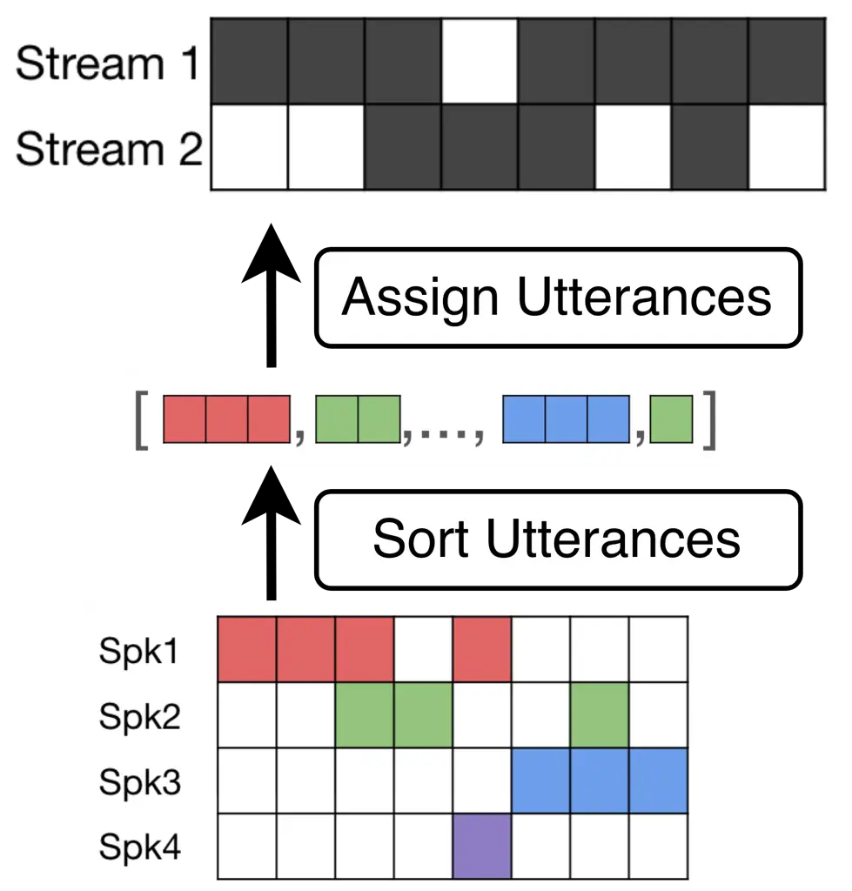
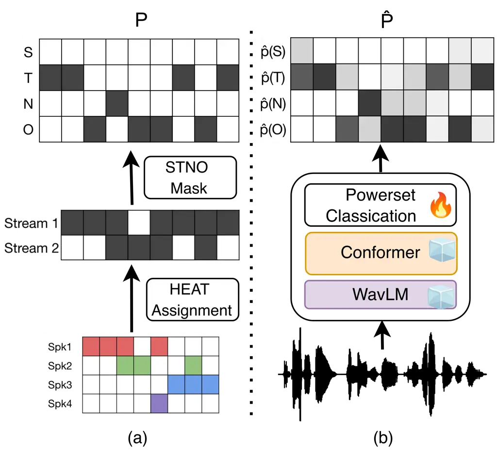
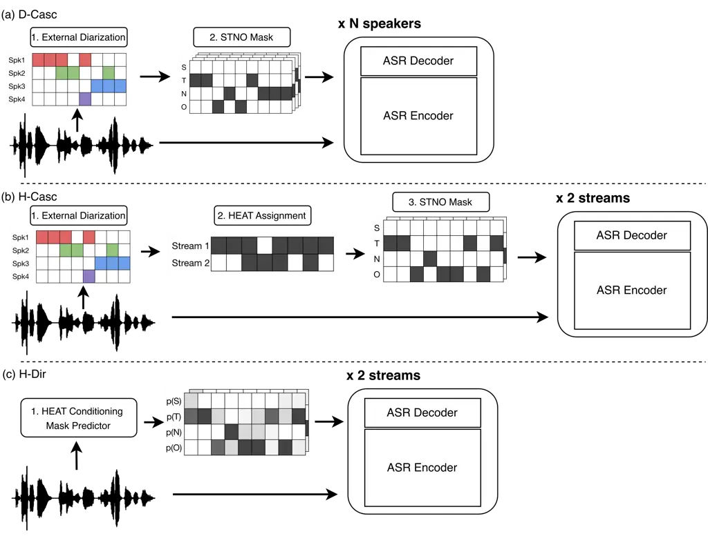
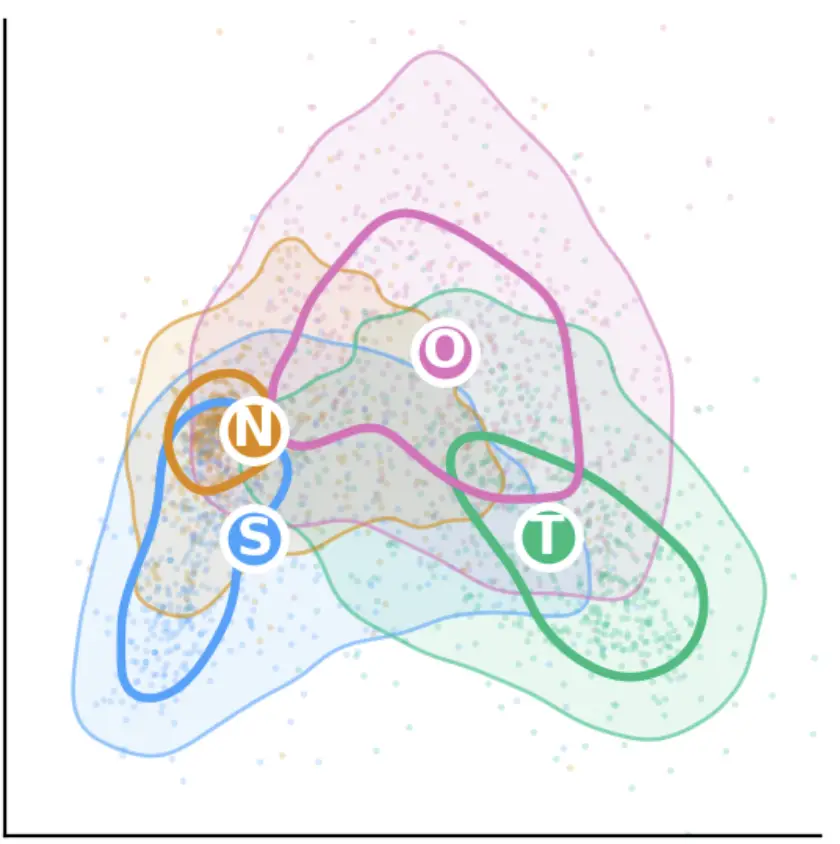
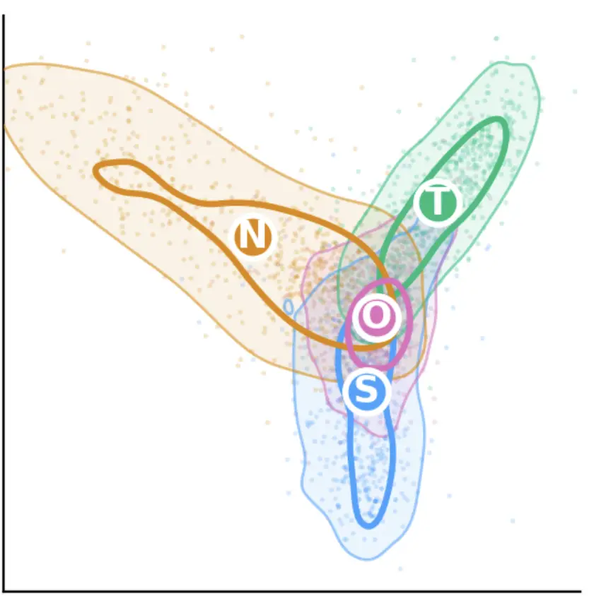
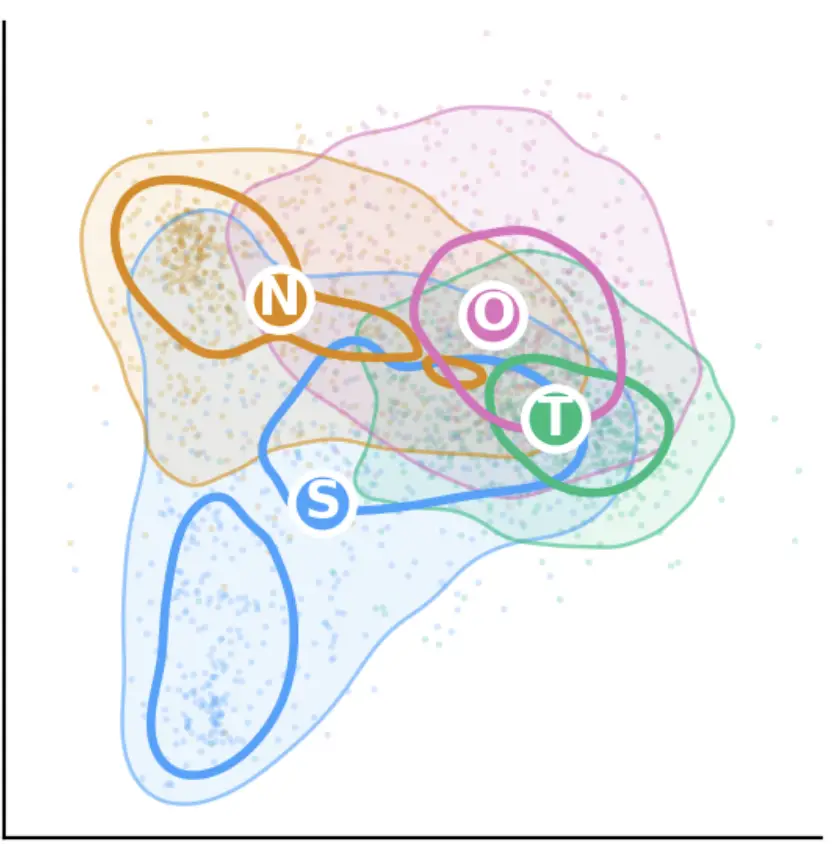
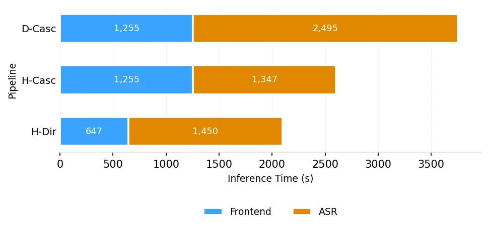

# Efficient Conversational Multi-Talker ASR with Predicted Speaker-Agnostic Activity Streams

Xiluo He    Magdalena Rybicka    Laureano Moro-Velazquez    Jesús
Villalba    Thomas Thebaud    Najim Dehak ^(†)^(†)thanks: X. He, J.
Villalba, and N. Dehak are with the Human Language Technology Center of
Excellence, Johns Hopkins University, Baltimore, Maryland, USA (e-mail:
xhe69@jhu.edu; ndehak3@jhu.edu).^(†)^(†)thanks: M. Rybicka is with AGH
University of Krakow, Kraków, Poland. She was supported by the National
Science Centre, Poland under Grants 2021/42/E/ST7/00452 and
2023/49/B/ST7/04100 and by program “Excellence initiative – research
university” for the AGH University of Krakow.^(†)^(†)thanks: L.
Moro-Velazquez is with the Department of Signal Theory and
Communications, Universidad Carlos III de Madrid, Leganes,
Spain.^(†)^(†)thanks: T. Thebaud is with the Agence Ministérielle pour
l’Intelligence Artificielle de Défense, Palaiseau,
France.^(†)^(†)thanks: Work done while M. Rybicka, L. Moro-Velazquez,
and T. Thebaud were with Johns Hopkins University.^(†)^(†)thanks: Xiluo
He and Najim Dehak are the corresponding authors.

###### Abstract

Multi-talker automatic speech recognition (ASR) can be performed by
conditioning a single-speaker recognizer on frame-level speaker
activity. However, this approach requires a complete diarization pass to
obtain the conditioning signals and one ASR pass per speaker, making
both the frontend and recognition costs dependent on the number of
speakers. We reduce these costs by using Heuristic Error Assignment
Training (HEAT) to merge the activities of an arbitrary number of
speakers into two speaker-agnostic streams. Conditioning on these
streams limits recognition to two ASR passes regardless of the number of
participants. Through an analysis of the resulting encoder
representations, we show that under a stream-assignment heuristic suited
to conversational speech, the recognizer represents a stream target much
as it does a speaker target. Because the streams do not encode
persistent speaker identities, we further replace the conventional
sliding-window diarization and clustering frontend with a model that
predicts both activity streams directly from the audio in a single pass.
A combination of arrival-order and permutation-invariant training
objectives over the two-stream powerset labels prevents the predictor
from collapsing to identical streams. We also investigate post-hoc
speaker attribution by matching decoded utterances to speaker activities
within their assigned streams. Experiments on corpora with diverse
conversational dynamics demonstrate a favorable efficiency–accuracy
tradeoff. On AMI and ICSI, two-stream conditioning is respectively 44%
and 87% faster than per-speaker conditioning using the same diarization
frontend, with less than 2% relative WER degradation. Direct activity
prediction increases these speedups to 79% and 132%, with relative WER
degradations of 10% and 21%, respectively.

###### Index Terms: 

Heuristic error assignment training, inference efficiency, multi-talker
ASR, speaker attribution, speaker diarization, target-speaker ASR,
Whisper.

## I Introduction

Processing conversational speech remains one of the central challenges
in automatic speech recognition (ASR). Multi-talker scenarios, such as
meetings, present difficulties including overlapping speech, diverse
turn-taking patterns, varying numbers of participants, and microphone
conditions \[1, 2, 3, 4\]. Large-scale pretraining and increasingly
powerful sequence modeling architectures have driven remarkable progress
in single-speaker recognition \[5, 6, 7\]. Capitalizing on these
improvements, target-speaker ASR has become a common paradigm for
multi-talker recognition, adapting single-speaker models to
conversational speech by processing the audio for each participant
individually \[8, 9\]. Among these, speech activity conditioned models
(SAC-ASR) have emerged as a particularly effective approach, in which
recognition is guided by temporal speech activity signals obtained from
an external diarization or voice activity detection (VAD) model \[10,
11, 12\].

Although the target-speaker paradigm has proven effective, the
scalability and practicality of these systems have received
comparatively less attention as both the frontend and the ASR halves of
the pipeline are expensive. On the frontend side, producing the speech
activity conditioning requires full diarization: a sliding-window
speaker model processes the recording in short overlapping chunks, and
speaker identities are resolved through clustering. On the ASR side, the
model must be executed once per participant, causing runtime to scale
directly with the number of speakers.

In this work, we address these limitations by applying Heuristic Error
Assignment Training (HEAT) \[13, 14, 15\] to both sides of the SAC-ASR
pipeline. HEAT merges utterances from any number of speakers into two
speaker-agnostic streams, assuming at most two speakers overlap at any
given time \[16\]. On the frontend side, speaker-agnostic streams make
the long-term identities that full diarization resolves irrelevant to
the conditioning mask, so we predict the mask directly from the audio
with a single model and remove the need for full diarization entirely.
On the ASR side, conditioning on HEAT streams rather than per-speaker
activities fixes the number of ASR passes at two regardless of the
number of participants.

The central challenge in this framework is model collapse, which arises
on both sides for different reasons. On the frontend side, the mask
predictor collapses by predicting what is effectively VAD for both
streams, which produces identical conditioning masks. On the ASR side,
naive merging of speaker activities into streams causes both streams to
decode to nearly the same transcript. The rule used in prior HEAT
systems sends each utterance to the first available stream, which is
usually the first, so one stream receives nearly all of the speech and
the resulting imbalance leaves the conditioning too weak to steer the
recognizer \[17\]. We examine what that conditioning writes into the
encoder and find that the four mask states become mutually
indistinguishable there, so the two passes are conditioned almost
identically, though this does not establish why the conditioning
parameters fail to differentiate them during training. We therefore
introduce a training objective that anchors stream identity to arrival
order, and adopt an assignment heuristic that keeps the streams
balanced, to prevent collapse on the frontend and ASR sides
respectively.

HEAT also discards speaker identity from the output diarization. In this
manuscript, we explore whether it can be recovered after the fact by
retaining the output diarization after HEAT and matching the decoded
utterances against the speaker labels. Matching-based speaker
attribution faces a major ambiguity at 2-speaker overlap, where both
speakers span the same interval and neither can be preferred on timing
alone. With HEAT, however, they have already been separated, since the
assignment routes overlapping speakers to different streams, so we
explore how far matching gets when each utterance is restricted to the
speakers on its own stream.

This work proposes a system that addresses the practical barriers of
SAC-ASR from several directions. Our contributions are as follows:

- •
  Direct prediction of HEAT conditioning masks. We replace the
  sliding-window diarization and clustering frontend with a single model
  that predicts the conditioning masks of both streams directly from the
  audio. Framing the prediction as a powerset posterior yields both
  masks in one pass, and training with arrival-order and
  permutation-invariant objectives keeps the predictor from collapsing
  to identical streams. This substantially reduces frontend cost and
  makes mask sharpness a decode-time setting rather than a training
  choice.
- •
  Analysis of HEAT-based conditioning. We examine what stream
  conditioning writes into the ASR encoder, and characterize the
  efficiency-accuracy tradeoff across speaker counts.
- •
  Post-hoc speaker attribution. We explore labeling the output by
  matching utterances to diarized speakers within each stream, which
  separates overlapping speakers.

This paper extends our previous work presented at ICASSP 2026 \[17\]. We
extend HEAT-based activity conditioning from the ASR model to the full
pipeline, replacing the diarization frontend with direct conditioning
mask prediction, examining what stream conditioning writes into the ASR
encoder, and exploring post-hoc speaker attribution.

## II Related Works

### II-A Multi-Talker ASR

A common approach to end-to-end multi-talker ASR involves systems
designed for a fixed number of speakers, typically targeting two-speaker
scenarios. One line of work employs frontend source separation to
produce speaker-specific streams before recognition, using learned masks
or neural separation modules to isolate individual speakers from the
mixture \[18, 19\]. A related line of work proposed multi-decoder
architectures that directly output transcriptions for a fixed number of
speakers without explicit separation, instead relying on permutation
invariant training (PIT) \[20, 21\] objectives to assign outputs to
speakers. PIT computes the training loss across all possible
output-target assignments to find the optimal permutation, which becomes
computationally expensive as the number of speakers grows. Both families
of approaches are inherently limited in the number of speakers they can
process, as the architecture must be designed for a specific speaker
count. HEAT-based methods \[13, 14, 15\] avoid this constraint by fixing
the number of output streams rather than the number of speakers, at the
cost of discarding speaker identity. In these systems the streams are
separated audio, so the assignment decides what the recognizer hears. We
instead apply the same rule to speech activity, so the recognizer
receives the unmodified mixture and the streams act only as
conditioning, which avoids the separation artifacts that degrade
downstream recognition.

Target-speaker ASR systems take a different approach, processing the
recording once per participant using a single-speaker recognizer adapted
to focus on a specific talker. Early approaches steered the recognizer
using speaker embeddings obtained from non-overlapping speech regions or
external speaker identification models \[22, 23, 24\]. A related
strategy employs frontend separation to isolate individual voices before
passing them to a standard recognizer \[25, 26\]. Activity-conditioned
models condition recognition on temporal speech activity from an
external diarization or VAD system \[12\]. In this paper, we build on
DiCoW \[10, 11\], which conditions a pretrained Whisper encoder on four
frame-level activity states and is described in Section III.

Serialized output training (SOT) \[27\] addressed the fixed speaker
count limitation by reformulating multi-talker ASR as a single sequence
generation task, interleaving the transcriptions of multiple speakers
with special tokens that mark speaker changes or local speaker
identities, and sequence transduction models train recognition and
diarization jointly under a similar regime \[28\]. The formulation has
since been extended to streaming through token-level SOT \[29\], to
large pretrained models through speaker token conditioning \[30, 31,
32\], to speech foundation models through lightweight adapters \[33\],
and to systems built on large language models, which leverage strong
language modeling for multi-talker transcription \[34, 35, 36\]. SOT
removes the per-speaker pass, but is sensitive to annotation format and
requires careful tuning to produce well-structured outputs across
varying speaker counts \[37\], and its extensions to target-speaker
systems may still require per-speaker encoding passes to produce the
activity conditioning \[31\], partially reintroducing the cost it aims
to avoid.

### II-B Speaker Attribution for ASR

Speaker attribution in multi-talker ASR is the task of associating
transcribed content with specific speakers, at either the word or frame
level. While diarization outputs can serve as an intermediate
representation to guide attribution, attribution itself does not require
full frame-level speaker activity estimation.

The target-speaker systems obtain frame-level speaker identity from an
external diarization model or from Target Speaker Voice Activity
Detection (TS-VAD) \[38\], so attribution follows from whichever speaker
the frontend recognizer was steered toward. On the other hand, joint
modeling approaches integrate speaker prediction more tightly with
recognition. SOT-style systems attribute implicitly, learning to
associate transcribed tokens with speaker change points or local speaker
indices without a dedicated prediction component, while others add an
explicit speaker prediction head alongside the ASR decoder. Sortformer
\[39\] proposes an encoder-based diarization model that resolves the
permutation problem using arrival-time sorting, ordering the per-speaker
outputs by the time each speaker first becomes active so that a single
pairing can be scored, and integrates speaker supervision directly into
the ASR encoder via sinusoidal kernel functions. Sorting removes the
need for a permutation-invariant objective, though the two are combined
in practice, since arrival-time estimation becomes less reliable as the
number of speakers grows. Speaker attribution has also been explored in
the context of HEAT-based systems, where \[40\] investigates recovering
speaker identity from the speaker-agnostic streams, demonstrating that
attribution can be reintroduced into a system that discards speaker
labels during training.



Fig. 1: Heuristic Error Assignment Training (HEAT): Per-speaker activity
assigned to one of two streams so that neither stream carries
overlapping speech.

## III Preliminaries

### III-A Heuristic Error Assignment Training (HEAT)

HEAT \[13, 14\] replaces the search over output-target assignments with
a deterministic rule, merging the utterances of any number of speakers
onto two streams under the assumption that at most two speakers are
active at any given time \[16\].

Figure 1 shows the assignment procedure. The standard heuristic used in
\[13, 14\] aims only to produce non-overlapping streams. A stream is
available for a given utterance if it contains no other speech activity
for the entire duration of that utterance, and the heuristic orders
utterances by start time and assigns each to the first available stream.
This guarantees non-overlapping streams, but the first stream is
available for most utterances, so it receives nearly all of the speech
while the second receives only what overlaps something already assigned.

Three criteria for an assignment rule suited to conversational speech
are set out in \[17\], which proposes the speaker-continuity heuristic
to meet them. The streams should carry balanced speech activity, because
single-speaker recognizers prioritize one speaker, with encoder states
optimized for that speaker’s accuracy \[12\], and an imbalanced pair of
streams produces weight adjustments too small to counteract the bias.
The standard rule produces such an imbalance, which collapses the
recognizer: both passes receive near-identical conditioning and emit
near-identical transcripts. The heuristic keeps the start-time order but
chooses between the streams whenever both are available, so the second
stream is no longer limited to overlap. The streams should also be
locally continuous, which lets language model decoding draw on local
context and mitigates diarization errors that fragment continuous speech
\[41, 42\]. The heuristic chooses accordingly, sending an utterance to
the stream whose most recent speech came from the same speaker and
otherwise falling back to whichever stream was active most recently,
which preserves speaker and conversational continuity respectively.

The third criterion is that, with one or two speakers, the streams
reproduce per-speaker conditioning. As originally proposed, the
heuristic does so for two speakers only once they overlap, since until
then the fallback places the second speaker on the first speaker’s
stream. We add one rule ahead of the fallback, under which each
speaker’s first utterance takes an empty stream where one exists. With
one speaker all speech then lands on one stream, and with two speakers
each owns a stream whether or not they overlap, so the HEAT mask
coincides with the per-speaker mask in both cases.



Fig. 2: Training the conditioning mask predictor. (a) The reference
$`\mathbf{P}`$ is built from reference speaker activity: the HEAT
assignment of Section III-A routes each utterance to one of two streams,
and the STNO states follow from which streams are active at each frame.
(b) The prediction $`\hat{\mathbf{P}}`$ comes from the audio through a
frozen WavLM encoder and Conformer, followed by a trained powerset
classifier.



Fig. 3: Deployable conditioning pipelines. (a) D-Casc runs the
recognizer once per diarized speaker. (b) H-Casc assigns the same
diarization output to two streams and runs the recognizer twice. (c)
H-Dir replaces diarization with a single frontend pass that predicts the
masks of both streams at once, then runs the recognizer twice.

### III-B Diarization-Conditioned Whisper (DiCoW)

DiCoW derives four mutually exclusive activity states at each frame,
defined relative to a target speaker: silence, only target active, only
non-target active, and overlapping speech (STNO labels). Writing
$`\mathcal{M}=\{\mathcal{S},\mathcal{T},\mathcal{N},\mathcal{O}\}`$ for
the four states, the mask at frame $`t`$ for a target speaker $`k`$
among $`K`$ speakers is

```math
\mathbf{y}_{k,t}=\left[\,y_{k,t}^{(\mathcal{S})},\ y_{k,t}^{(\mathcal{T})},\ y_{k,t}^{(\mathcal{N})},\ y_{k,t}^{(\mathcal{O})}\,\right],\qquad\sum_{m\in\mathcal{M}}y_{k,t}^{(m)}=1. \tag{1}
```

Conditioning is applied via the Frame-Level Diarization Dependent
Transformation (FDDT), which computes one affine transformation per
state and combines them through a convex combination weighted by the
mask:

```math
f\!\left(\mathbf{h}_{t},\mathbf{y}_{k,t}\right)=\sum_{m\in\mathcal{M}}\left(\mathbf{W}_{m}\mathbf{h}_{t}+\mathbf{b}_{m}\right)y_{k,t}^{(m)}, \tag{2}
```

where $`\mathbf{h}_{t}`$ is the hidden state at frame $`t`$ and
$`\{\mathbf{W}_{m},\mathbf{b}_{m}\}`$ are learned per state. The
transformation is applied at two points: once to the log-mel input
before the sinusoidal positional encoding, and again before each
transformer encoder layer, each application having its own parameter set
$`\{\mathbf{W}^{l}_{m},\mathbf{b}^{l}_{m}\}`$. We drop the layer index
in our equations, since our adaptation is the same at every application
point. The mask is derived from the output of an external diarization
system, and the encoder is run once for each of the $`K`$ speakers, so
the number of passes equals $`K`$.

### III-C Conditioning Configurations

We name each configuration by its conditioning scheme and the source of
its mask. The prefix D denotes per-speaker conditioning as in DiCoW, and
H denotes two-stream HEAT conditioning. The suffix Orc denotes an oracle
mask built from the reference annotation, Casc a cascaded mask built
from the output of an external diarization pass, and Dir a mask
predicted directly from the audio, as described in Section IV-A2. This
gives the five configurations we report, D-Orc, D-Casc, H-Orc, H-Casc
and H-Dir. Per-speaker conditioning has no direct variant, since its
mask is indexed by speaker and needs the speaker inventory that
diarization provides. The oracle configurations separate the
conditioning scheme from frontend errors, and the other three are the
deployable pipelines.

## IV Methods

In this section, we describe our approach for reducing inference cost on
both halves of the pipeline. The core idea is to condition the
recognizer on two speaker-agnostic streams rather than on per-speaker
activity, which fixes the number of recognition passes and, since the
resulting mask carries no identity, makes it predictable directly from
audio.

To condition an ASR model on HEAT activity, we adopt DiCoW’s STNO
formulation with streams in place of speakers. The four states of
Eq. (1) are defined relative to a target, so substituting a target
stream for a target speaker leaves the formulation intact. Conditioning
on stream $`c\in\{1,2\}`$ labels each frame $`\mathcal{S}`$ where
neither stream is active, $`\mathcal{T}`$ where only stream $`c`$ is
active, $`\mathcal{N}`$ where only the other stream is, and
$`\mathcal{O}`$ where both are. Silence and overlap do not depend on
which stream is the target, so the two streams’ masks differ only by
exchanging the $`\mathcal{T}`$ and $`\mathcal{N}`$ entries, an operation
we write $`\mathrm{swap}`$. One object therefore carries both streams:
we write $`\mathbf{p}_{c,t}`$ for the HEAT STNO mask at frame $`t`$
under stream $`c`$, $`\mathbf{P}`$ for a whole chunk of reference mask,
and $`\hat{\mathbf{P}}`$ for a predicted one. The recognizer runs once
per stream, so twice, regardless of how many speakers the recording
contains.

We first describe how the mask is constructed, then how the recognizer
consumes it, and finally how speaker labels can be recovered from the
speaker-agnostic output.

### IV-A Constructing the HEAT Conditioning Mask

Existing HEAT systems form their streams by applying a deterministic
assignment rule to reference or diarized segments. We use the heuristic
of Section III-A throughout, and describe two ways of turning its output
into a conditioning mask. The first, used by H-Casc, is a two-step
construction: the assignment rule routes diarized segments onto two
streams, and the STNO mask then follows from which streams are active at
each frame. The second, used by H-Dir, predicts the STNO mask directly
from the audio, with no segments and no assignment at inference.

#### IV-A1 Construction from Diarization Output

Let $`\mathbf{x}`$ denote the input audio and
$`\mathbf{y}_{\mathrm{spk}}=\mathrm{Diar}(\mathbf{x})\in[0,1]^{T\times K}`$
the per-speaker activity from an external diarization system. The
assignment procedure of Section III-A, written $`\mathrm{Heat}(\cdot)`$,
routes each speaker’s contiguous stretches of activity onto two streams,
giving the two-stream activity
$`\mathbf{y}_{\mathrm{heat}}=\mathrm{Heat}(\mathbf{y}_{\mathrm{spk}})\in[0,1]^{T\times 2}`$,
which records which streams are active but not who is speaking. Reading
stream $`c`$ as the target then fixes the four states at every frame, a
deterministic map $`\mathrm{Stno}(\cdot)`$, so the cascaded construction
is the composition

```math
\hat{\mathbf{P}}^{\mathrm{casc}}=\mathrm{Stno}\bigl(\mathrm{Heat}(\mathrm{Diar}(\mathbf{x}))\bigr), \tag{3}
```

the two-step construction used by H-Casc. Only $`\mathrm{Diar}`$ is
expensive, requiring a sliding-window pass and speaker clustering, so
this pipeline resolves long-term speaker identities and then discards
them.

#### IV-A2 Direct Prediction of the Conditioning Mask

Rather than performing full diarization, we train a single model
$`\mathrm{Mask}(\cdot)`$ to predict the HEAT STNO mask directly from the
audio, shown in Fig. 2(b),

```math
\hat{\mathbf{P}}^{\mathrm{dir}}=\mathrm{Mask}(\mathbf{x})\in\mathbb{R}^{4\times T}, \tag{4}
```

which replaces the whole composition of Eq. (3) with no diarization, no
stream activity, and no assignment at inference. The assignment is still
used in training, where the target $`\mathbf{P}`$ applies the same
$`\mathrm{Stno}(\mathrm{Heat}(\cdot))`$ construction to reference
speaker activity, as in Fig. 2(a). Both the cascaded and direct
constructions of the STNO HEAT conditioning mask yield the same object,
so they are interchangeable at the ASR conditioning step.

##### Predicting the mask as a powerset posterior

The FDDT consumes a distribution over the four STNO states at every
frame, so that is what $`\mathrm{Mask}`$ emits. Writing
$`\hat{\mathbf{p}}_{t}`$ for the column of $`\hat{\mathbf{P}}`$ at frame
$`t`$,

```math
\hat{\mathbf{p}}_{t}=\left(\hat{p}^{(\mathcal{S})}_{t},\ \hat{p}^{(\mathcal{T})}_{t},\ \hat{p}^{(\mathcal{N})}_{t},\ \hat{p}^{(\mathcal{O})}_{t}\right),\qquad\sum_{m\in\mathcal{M}}\hat{p}^{(m)}_{t}=1. \tag{5}
```

A 30-second input at a 20 ms frame rate gives $`T=1500`$, so
$`\hat{\mathbf{P}}`$ spans exactly one ASR input and needs no window
aggregation.

For two streams this is the powerset encoding used by diarization models
\[43\]: its four classes are the subsets that can be simultaneously
active, namely neither stream, stream 1 alone, stream 2 alone, and both.
Reading stream 1 as the target maps these onto $`\mathcal{S}`$,
$`\mathcal{T}`$, $`\mathcal{N}`$ and $`\mathcal{O}`$.

The posterior needs sharpening before it conditions the recognizer. The
predictor is trained for segmentation, so it spreads probability across
states even at frames where the evidence is clear, and the FDDT weights
each state’s transform by its probability, so that spread weakens the
target transform of Eq. (2). Conditioning enters the FDDT linearly, so
any transformation applied beforehand is a decode-time control requiring
no retraining, and we sharpen by temperature scaling in log space,

```math
\tilde{p}^{(m)}_{t}=\frac{\bigl(\hat{p}^{(m)}_{t}\bigr)^{\beta}}{\sum_{m^{\prime}\in\mathcal{M}}\bigl(\hat{p}^{(m^{\prime})}_{t}\bigr)^{\beta}}=\operatorname{softmax}\!\left(\beta\log\hat{\mathbf{p}}_{t}\right)^{(m)}, \tag{6}
```

with a single scalar $`\beta\geq 0`$, which returns the raw prediction
at $`\beta=1`$ and the one-hot mask as $`\beta\to\infty`$. Because it
acts on odds ratios, an intermediate $`\beta`$ drives confident frames
to effectively one-hot while leaving near-ties graded.

The two stream masks then follow from the sharpened posterior,

```math
\mathbf{p}_{1,t}=\tilde{\mathbf{p}}_{t},\qquad\mathbf{p}_{2,t}=\mathrm{swap}\bigl(\tilde{\mathbf{p}}_{t}\bigr). \tag{7}
```

##### Training objectives

We start from the loss used to train powerset diarization models \[43\].
Permutation-invariant cross-entropy (PIL-CE) computes the frame-averaged
cross-entropy once for every way of pairing predicted streams with
reference streams, and takes the smallest of those values as the loss.
The winning pairing is chosen per training example, so the model may
label the streams in either order and is never charged for whichever
order happens to fit. With two streams there are two pairings, differing
by the exchange of Eq. (7),

```math
\mathcal{L}_{\mathrm{PIL}}=\min\Bigl\{\,\mathrm{CE}\bigl(\mathbf{P},\hat{\mathbf{P}}\bigr),\;\;\mathrm{CE}\bigl(\mathrm{swap}(\mathbf{P}),\hat{\mathbf{P}}\bigr)\Bigr\}, \tag{8}
```

where $`\mathbf{P}`$ and $`\hat{\mathbf{P}}`$ are the reference and
predicted masks and $`\mathrm{CE}`$ the frame-averaged cross-entropy.

Taking the minimum never penalizes a labeling the model had no way to
infer, which is appropriate when speaker labels are arbitrary, but it is
also what allows the predictor to collapse. Distinguishing
$`\mathcal{T}`$ from $`\mathcal{N}`$ is not an acoustic decision: which
stream a speaker occupies is set by the assignment history, not by the
signal at that frame. A model minimizing PIL-CE alone can therefore
reduce its loss without ever committing to a stream, and two degenerate
solutions result. Predicting only $`\mathcal{S}`$ and $`\mathcal{O}`$
reduces the mask to VAD, and predicting only $`\mathcal{S}`$ and
$`\mathcal{T}`$ leaves one stream empty. Both give the two encoder
passes identical conditioning, so the recognizer emits the same
transcript twice.

We therefore add a second objective that resolves the permutation by
convention rather than by search. Sortformer \[39\] introduced
arrival-time sorting for diarization, ordering reference and predicted
speakers by the time each first becomes active so that one pairing can
be scored and no minimization is needed, applied to per-speaker
activities predicted independently of one another. Our mask is a
powerset distribution over four mutually exclusive states, so we apply
the same sorting to it, giving Sort-CE, and extend it with a term
charging the expected stream error,

```math
\mathcal{L}_{\mathrm{Sort}}=\frac{1}{T}\sum_{t=1}^{T}\sum_{m\in\mathcal{M}}\Bigl(-p^{(m)}_{t}\log\hat{p}^{(m)}_{t}+\lambda\,\kappa\bigl[y_{t},m\bigr]\,\hat{p}^{(m)}_{t}\Bigr), \tag{9}
```

where both sides have first been placed in arrival order, $`y_{t}`$ is
the reference state at frame $`t`$, and $`\kappa[y,m]`$ is the cost of
emitting $`m`$ when the reference is $`y`$. The second term charges only
$`\mathcal{T}\leftrightarrow\mathcal{N}`$ confusions, so it is the
probability mass the predictor places on the wrong stream and leaves
confusions involving silence and overlap uncosted. Being linear in
$`\hat{\mathbf{p}}_{t}`$ and bounded, unlike the cross-entropy beside
it, at $`\lambda=0.1`$ it applies steady pressure on the stream decision
without dominating the objective. It is meaningful only under a fixed
pairing, since minimizing over both pairings as PIL-CE does would turn
every $`\mathcal{T}\leftrightarrow\mathcal{N}`$ confusion into a match
and zero it out.

The heuristic of Section III-A seeds an empty stream on first use, so
its targets already arrive in this order and Eq. (9) anchors stream
identity to the convention the heuristic follows rather than imposing a
new one. Following Sortformer, we keep the permutation-invariant
objective alongside the sorted one and combine the two equally,

```math
\mathcal{L}=\tfrac{1}{2}\,\mathcal{L}_{\mathrm{Sort}}+\tfrac{1}{2}\,\mathcal{L}_{\mathrm{PIL}}, \tag{10}
```

letting PIL-CE carry early training, before stream identity is
established, while the sorted objective supplies the convention.

### IV-B Conditioning Whisper on HEAT Streams

Substituting the HEAT STNO mask $`\mathbf{p}_{c,t}`$ for the per-speaker
mask, Eq. (2) becomes

```math
f\!\left(\mathbf{h}_{t},\mathbf{p}_{c,t}\right)=\sum_{m\in\mathcal{M}}\left(\mathbf{W}_{m}\mathbf{h}_{t}+\mathbf{b}_{m}\right)p_{c,t}^{(m)}, \tag{11}
```

with the affine maps unchanged. The encoder runs once per stream, so the
number of passes is two rather than $`K`$. Figure 3 shows the three
deployable pipelines end to end.

### IV-C Recovering Speaker Attribution

HEAT discards speaker identity, but the pipeline has not. Under H-Casc,
the diarization pass that built the mask is still available at
inference. Under H-Dir, the mask predictor keeps the frozen WavLM
encoder and Conformer of the diarization model it was built from, and
replaces only that model’s diarization head with the mask head
(Section V-C). Placing the original head back beside the mask head
therefore recovers chunk-local speaker activity in the same forward pass
at inference, with no additional training. We explore whether that
information is enough to label the speaker-agnostic output after the
fact, without a per-speaker decoding pass.

We label the output with the orchestration step of \[44\], which matches
recognized speech to diarized speakers by timestamps alone. It
associates each word with the speaker whose segments have the largest
temporal overlap with it or, if no segment overlaps it, with the speaker
at the smallest temporal distance. We apply the same rule to whole
utterances, using the start and end times Whisper emits for each \[5\],
which makes the result less sensitive to diarization boundary errors
than matching word by word. We also add an intersection-over-union term
to the overlap, computed within a short margin of 0.5 seconds, so that a
speaker segment that matches the utterance outranks one that merely
contains it.

Timing alone cannot separate two speakers who are both active across an
utterance, since both overlap it fully. HEAT has already placed such
speakers on different streams, so stream-aware orchestration runs the
same matching once per stream, between the utterances decoded from that
stream and the speaker segments assigned to it. The co-active speaker is
then on the other stream and is never a candidate. Under H-Orc and
H-Casc, the HEAT assignment takes per-speaker activity as its input,
from the reference or from the diarization pass, so every segment it
places on a stream already carries a speaker label, which we keep. Under
H-Dir the mask is predicted from the audio without a per-speaker input,
so nothing links the diarized speakers to the streams, and we use
stream-agnostic orchestration only.

Orchestration needs diarization with session-level speaker identities,
which H-Casc has from its diarization pass. H-Dir needs two additions:
one for local diarization and another for global clustering. The
chunk-local diarization head supplies the speakers active within each
30-second chunk, which is long enough to separate them, but nothing ties
those labels to the next chunk, so they drift apart over a recording.
Linking them into session-level identities takes a sliding-window pass
over speaker embeddings with a step of a third of the chunk, so each
frame falls under three windows rather than the ten a full diarization
pass uses.

| Corpus                   | Sess. | Audio   | $`\bar{K}`$ | % $`\geq`$3-way |
| ------------------------ | ----- | ------- | ----------- | --------------- |
| AMI-SDM dev              | 18    | 9.67 h  | 4.00        | 1.4%            |
| AMI-SDM test             | 16    | 9.06 h  | 3.94        | 2.4%            |
| ICSI-SDM test            | 3     | 2.77 h  | 7.00        | 0.5%            |
| NOTSOFAR-1 dev           | 117   | 12.17 h | 4.68        | 3.6%            |
| CHiME-6 eval             | 2     | 5.21 h  | 4.00        | 8.4%            |
| SparseLibriMix $`K{=}2`$ | 500   | 1.18 h  | 2.00        | 0.0%            |
| SparseLibriMix $`K{=}3`$ | 500   | 1.13 h  | 3.00        | 1.3%            |

TABLE I: Evaluation corpora measured from the reference annotation on a
10 ms grid. $`\bar{K}`$ is the mean number of reference speakers per
session, and the last column the proportion of speech time with three or
more concurrent speakers, which the two-stream assumption cannot
represent. SparseLibriMix is used at $`\mathrm{ov}{=}0.1`$ throughout.

## V Data and Experimental Setup

### V-A Training data

We train the conditioning mask predictor on the joint AMI \[45\],
AliMeeting \[46, 47\], and AISHELL-4 \[48\] corpus following the
DiariZen protocol \[49\], which covers a broader range of meeting
conditions and speaker configurations than AMI alone. We train the ASR
model on AMI only, in the single distant microphone (SDM) condition,
which comprises approximately 100 hours of multi-speaker meetings with
four to five participants per session.

### V-B Evaluation data

We evaluate on AMI, ICSI, NOTSOFAR-1, CHiME-6 and SparseLibriMix \[45,
50, 3, 1, 51\], all single-channel, using the single distant microphone
(SDM) condition for AMI and ICSI and reducing the CHiME-6 arrays to one
distant channel. Table I reports statistics measured directly from the
evaluation manifests. AMI is our primary development corpus, on which we
perform model selection and tune the sharpening parameter $`\beta`$
using the dev split and report meeting-domain results on the test split.

The remaining corpora each isolate a property the two-stream assumption
is sensitive to. ICSI has the largest speaker inventory and the least
concurrent speech of any real corpus we use, which separates the number
of speakers a system must distinguish from the amount of simultaneous
speech it must transcribe. NOTSOFAR-1 gives 117 independent sessions
with a varying number of participants, so aggregate word error carries
tighter confidence and we can observe systems whose cost depends on the
speaker count across a mixed population. CHiME-6 is our stress case,
with sessions averaging 2.6 hours, nearly three times the length of the
next longest corpus we use, and the highest rate of
three-or-more-speaker overlap; we use the eval split. We note that the
diarization frontend hypothesizes only 66% of the annotated reference
speech there, against 92 to 96% elsewhere, which flatters error rates
dominated by insertions and substitutions, so we read its results as a
difficulty check rather than as a system comparison.

To evaluate performance under controlled speaker count and overlap, we
use SparseLibriMix, which mixes clean LibriSpeech \[52\] utterances on a
timeline with controlled silence and a controlled degree of speaker
overlap. We use $`K\in\{2,3\}`$ speakers at the overlap setting
$`\mathrm{ov}{=}0.1`$, both exact by construction. At $`K{=}2`$ the HEAT
mask coincides with the per-speaker mask (Section III-A), and $`K{=}3`$
is the smallest count at which speakers must share a stream.

### V-C Implementation Details

#### V-C1 Diarization Frontend

Both cascaded configurations obtain per-speaker activity from DiariZen
\[49\], which we run at the 16 s window and tenfold overlap it was
released with, followed by its speaker clustering stage. D-Casc
conditions on that output directly and H-Casc applies the heuristic of
Section III-A to the same output, so the two differ only in the
conditioning scheme. The mask predictor described next is built on the
same checkpoint, so the frontend it replaces and the backbone it
inherits are one model.

#### V-C2 HEAT Conditioning Mask Prediction Model

The mask predictor follows the DiariZen architecture. The acoustic
backbone is a WavLM-Large encoder (24 transformer layers plus the
convolutional feature extractor, yielding 25 hidden representations of
dimension 1024), and both it and the 4-layer Conformer above it are
initialized from a publicly available diarization-adapted checkpoint and
kept frozen, so the mask prediction head, which replaces the
checkpoint’s diarization head, is the only component trained. We obtain
frame-level features via a learnable softmax-weighted sum across all
WavLM layers, projected to 256 dimensions and layer-normalized before
the Conformer, which uses attention dimension 256, feed-forward
dimension 1024, 4 attention heads, and dropout 0.1. We use no positional
encoding, and pass the Conformer output to a linear classifier head that
produces the four-state posterior $`\hat{\mathbf{P}}`$ of Eq. (5). At
decode time we sharpen the posterior with the operator of Eq. (6) at
$`\beta{=}16`$, selected by sweeping $`\beta`$ on the development data
and applied unchanged across all corpora.

The training objective is Eq. (10). We fine-tune with AdamW using a
one-cycle schedule (10% warmup ratio) and peak learning rate
$`1\times 10^{-3}`$, for 10 epochs on the joint AMI, AliMeeting, and
AISHELL-4 corpus. During heuristic assignment we stochastically perturb
segment boundaries by up to 10 frames with probability 0.5.

#### V-C3 ASR Model: DiCoW v3.3

To keep the comparison with speaker conditioning fair, the recognizer,
its conditioning interface, and its training recipe are those of DiCoW
throughout, and the only difference between the two systems is whether
the mask indexes a speaker or a stream. In line with DiCoW, we use
Whisper-large-v3-turbo with the DiCoW v3.3 conditioning interface \[11,
10, 53\], applying FDDT layers at every encoder layer with diagonal
projection and the disparagement initialization that biases non-target
and silence frames toward attenuation, and a pre-positional FDDT layer
conditioning the log-mel input prior to the sinusoidal positional
embedding. Following DiCoW, we mount a Connectionist Temporal
Classification (CTC) head on the encoder output and combine it with the
standard cross-entropy decoder loss at a CTC weight of 0.3, stripping
timestamp tokens from the CTC target.

We train with AdamW at a base learning rate of $`5\times 10^{-7}`$ and a
$`100\times`$ learning-rate multiplier on the FDDT parameters, using a
100-step linear warmup followed by cosine decay and an effective batch
size of 64. We train for up to 10 epochs capped at 50k steps in bf16
precision, with gradient clipping at 1.0 and no weight decay. We augment
both the audio and the conditioning mask with SpecAugment ($`p{=}0.3`$),
MUSAN additive noise ($`p{=}0.3`$) \[54\], Gaussian-noise perturbation
of the mask (variance 0.2, $`p{=}0.75`$), and segment-flip augmentation
($`p{=}0.3`$, per-segment change probability 0.1, segment lengths 5–50
frames). Both systems are conditioned on masks built from the same
segments, HEAT on streams assigned by the heuristic of Section III-A and
DiCoW on the speakers those segments came from.

#### V-C4 Speaker Attribution

We label each decode with the diarization matching its own mask source,
recovering the stream assignment record offline from the preprocessing
for H-Orc and H-Casc. The chunk-local diarization head is the original
head of the DiariZen checkpoint, reattached without retraining, and
predicts up to $`K_{\max}{=}4`$ speakers per chunk, fixed across all
corpora. Under H-Dir, we lift these to session-level identities by
clustering speaker embeddings from a pretrained WeSpeaker \[55\]
ResNet-34 model over a sliding window with a 10 s step, extracted from
sub-segments of 1–2 s on frames where the frontend predicts a single
active speaker and the ASR output attests speech, with overlapping
regions excluded. We use agglomerative clustering on cosine distance
with soft must-link constraints within each chunk-local speaker, and
tune the threshold on the AMI development split.

### V-D Evaluation Metrics

##### Frontend error terms

We measure frontend quality along two axes: how much speech the system
finds, and how faithfully it reproduces the assignment the heuristic
would have made. We report these as separate terms rather than a single
aggregate. False alarm is speech predicted where none exists and missed
speech is speech present but not predicted. Both are defined identically
for diarization and for mask prediction, since the union of the two HEAT
streams is the total predicted speech, and both have direct recognition
consequences: false alarm becomes insertions and missed speech becomes
deletions.

The third component of diarization error is confusion, detected speech
given the wrong label, which for diarization is the wrong speaker among
$`K`$ candidates and for mask prediction the wrong one of two streams.
Confusion is frame-weighted, which suits speaker labels but not stream
labels: stream identity is set by the assignment history rather than by
the signal at each frame, so a single wrong decision early in an
utterance is charged for every frame that follows it, while a brief flip
to the other stream and back is charged for almost nothing. We therefore
also count stream swaps, the moments at which speech moves to the other
stream, reported per minute. A model swap with no reference swap within
0.5 s is unnecessary, typically a flip to the other stream and back
within a single utterance. A reference swap the model never makes is
missed, a stream change it does not reproduce at all. Confusion mixes
the two in one number, whereas the swap counts say which of them an
objective acts on.

##### Word error rates

We report two word error rates (WERs), both computed with
MeetEval \[56\] in a time-constrained form that forbids aligning
hypotheses and references across implausibly long temporal distances,
for which we use a 5-second collar. Where the output carries no speaker
labels we report tcORC-WER, the time-constrained \[57\] form of optimal
reference combination WER \[58\], which searches over assignments of
reference utterances to output streams subject to each speaker’s
utterances staying in order. Where the output is speaker-attributed we
report tcpWER, which concatenates the utterances of each speaker in both
reference and hypothesis and scores the permutation between them that
minimizes WER. Read against tcORC-WER on the same output, tcpWER
isolates the error attributable to speaker assignment rather than to
transcription. We micro-average both over the sessions of a corpus,
dividing total errors by total reference words, and report tcORC-WER
unless labeled otherwise.

##### Inverse Real-Time Factor (RTFx)

RTFx measures inference efficiency as the ratio of audio duration to
total processing time, including all preprocessing, encoding, decoding,
and postprocessing:

```math
\mathrm{RTFx}=\frac{\sum_{i=1}^{N}T^{(i)}_{\mathrm{audio}}}{\sum_{i=1}^{N}T^{(i)}_{\mathrm{proc}}}. \tag{12}
```

Higher RTFx indicates faster processing. The RTFx of a cascaded
configuration includes its diarization pass, and that of H-Dir includes
the mask predictor, which runs once per chunk and serves both streams.
The oracle configurations have no frontend, so their RTFx is an upper
bound rather than a deployable figure.

|                          |                  |                    |                     |                      |                      |
| ------------------------ | ---------------- | ------------------ | ------------------- | -------------------- | -------------------- |
|                          |                  |                    |                     | Stream swaps         |                      |
| System                   | FA$`\downarrow`$ | Miss$`\downarrow`$ | Conf.$`\downarrow`$ | Unnec.$`\downarrow`$ | Missed$`\downarrow`$ |
| _DiariZen_               |                  |                    |                     |                      |                      |
| 16 s window              | 3.99             | 6.04               | 02.23               | —                    | —                    |
| 30 s window              | 3.75             | 5.87               | 02.79               | —                    | —                    |
| _HEAT-STNO, 30 s window_ |                  |                    |                     |                      |                      |
| PIL-CE only              | 5.20             | 7.26               | 10.91               | 3.41                 | 2.93                 |
| + Sort-CE                | 5.03             | 3.98               | 09.58               | 3.12                 | 3.04                 |
|    + stream error        | 4.20             | 4.57               | 07.50               | 2.64                 | 3.14                 |

TABLE II: Frontend prediction quality on AMI-SDM test. FA, Miss and
Conf. are the three components of diarization error, as percentages of
reference speech. Conf. is detected speech given the wrong label: the
wrong speaker among $`K`$ for DiariZen, the wrong one of two streams for
the mask predictor. The last two columns count stream swaps per minute,
unnecessary and missed respectively, and are specific to two-stream
assignment. DiariZen is shown at its native 16 s window and again at the
30 s window the mask predictor uses.

## VI Results

We first evaluate each half of the pipeline on its own. Section VI-A
measures the mask predictor against the diarization frontend it
replaces, and Section VI-B examines what stream conditioning writes into
the recognizer’s encoder and how the assignment rule shapes it.
Section VI-C then reports the speedup and accuracy cost of each
configuration, and Section VI-D explores post-hoc speaker attribution.



(a) Per-speaker



(b) Standard heuristic \[13, 14\]



(c) Speaker-continuity heuristic

Fig. 4: Final-layer encoder embeddings under oracle conditioning,
projected onto the two leading Fisher discriminant directions of the
final-layer Whisper encoder output: (a) per-speaker conditioning, the
D-Orc configuration; (b) two-stream conditioning with the standard
heuristic; and (c) two-stream conditioning with the heuristic of
Section III-A, the H-Orc configuration of Table III. Panel (b) is
reported only here. Contours enclose 50% and 90% of each class over a
subsample of the underlying bins.

### VI-A Predicting the HEAT Conditioning Mask

Table II reports frontend prediction quality for the mask predictor of
Fig. 2(b) and for the diarization system whose output the cascaded
construction consumes. DiariZen is shown twice: at the 16 s window it
was released with, and at the 30 s window our mask predictor uses, since
the mask has to span one ASR input. All terms are measured within a
chunk, so they report local errors and do not indicate whether
identities are linked correctly across the recording.

False alarm and missed speech compare directly across the two systems,
since the union of the two streams is the total predicted speech. At the
matched 30 s window the predictor has slightly more false alarm than
DiariZen, 4.20 against 3.75, and less missed speech, 4.57 against 5.87,
despite observing each frame once rather than under ten overlapping
windows.

Confusion is not comparable across the two systems, since stream
identity follows the assignment history and one wrong decision is
charged for every frame after it. Within the predictor, building the
objective up from PIL-CE lowers confusion from 10.91 to 7.50, and the
swap counts show where that gain comes from. Unnecessary swaps decrease
while missed swaps rise slightly, so the added objectives make the
predictor hold its stream through an utterance rather than reproduce
more of the heuristic’s stream changes. False alarm and missed speech
together also fall, so the stream objectives do not trade against
detection.

### VI-B Conditioning Geometry in the Encoder

Conditioning on a stream rather than on a speaker changes what the mask
means without changing the interface it passes through, so it is not
obvious that the recognizer represents the two alike. We examine this
for the heuristic of Section III-A, whose effect on the recognizer was
not measured in \[17\]. Holding content fixed and varying only the
conditioning, we encode every one-second bin once per conditioning pass
and take the mean-pooled final-layer Whisper encoder output. Figure 4
projects these embeddings onto their two leading Fisher discriminant
directions over eight meetings of forty 30-second chunks, with one
contour per mask state. All three panels are given reference activity,
so they differ only in how the mask is built: per-speaker in Fig. 4(a),
and two assignment rules in (b) and (c).

Figure 4(a) is the reference. The four states are not reducible to
speech presence: a mask recording only that speech is present would
merge target with overlap and silence with non-target, and the
recognizer would lose the distinction it is conditioned on. Under
per-speaker conditioning the non-target state is separable from the
states it would be merged with, though at much lower amplitude than the
activity axis that dominates the projection.

Figure 4(c) shows that two-stream conditioning reproduces that
structure. Substituting a target stream for a target speaker leaves the
four states as distinguishable in the representation as per-speaker
conditioning does, so the recognizer treats a stream target much as it
treats a speaker target.

That equivalence is not automatic, and Fig. 4(b) shows it failing. Under
the standard heuristic the non-target state overlaps heavily with both
overlap and target, the four contours collapse toward a common region,
and the mask reaches the encoder in effectively one state for most of
its frames, which is close to no conditioning at all. Two passes
conditioned on almost the same mask produce almost the same transcript,
which is the collapse reported in \[17\]. The projection places that
failure in the conditioning signal itself, before the decoder sees
anything, though it does not establish why the conditioning parameters
fail to differentiate the states during training.

Finally, we note that the standard heuristic attains higher separability
than the rule of Fig. 4(c) along a purpose-fitted direction, despite
collapsing the recognizer, so separability along a fitted direction
should not be read as a measure of conditioning quality.

|                                                           |        |      |        |      |            |      |         |      |                    |      |                    |      |
| --------------------------------------------------------- | ------ | ---- | ------ | ---- | ---------- | ---- | ------- | ---- | ------------------ | ---- | ------------------ | ---- |
|                                                           | AMI    |      | ICSI   |      | NOTSOFAR-1 |      | CHiME-6 |      | SparseLM $`K{=}2`$ |      | SparseLM $`K{=}3`$ |      |
| System                                                    | WER    | RTFx | WER    | RTFx | WER        | RTFx | WER     | RTFx | WER                | RTFx | WER                | RTFx |
| _Oracle activity conditioning, RTFx on ASR_               |        |      |        |      |            |      |         |      |                    |      |                    |      |
| D-Orc                                                     | 0.1663 | 16.7 | 0.2274 | 9.3  | 0.2607     | 9.1  | 0.5366  | 17.4 | 0.0393             | 4.6  | 0.1255             | 3.0  |
| H-Orc                                                     | 0.1753 | 26.6 | 0.2397 | 23.7 | 0.2688     | 19.9 | 0.5252  | 19.8 | 0.0371             | 4.6  | 0.1736             | 4.1  |
| _Predicted activity conditioning, RTFx on Frontend + ASR_ |        |      |        |      |            |      |         |      |                    |      |                    |      |
| D-Casc                                                    | 0.1740 | 8.7  | 0.2550 | 6.3  | 0.2555     | 6.3  | 0.4804  | 9.2  | 0.0449             | 3.6  | 0.2219             | 3.0  |
| H-Casc                                                    | 0.1769 | 12.5 | 0.2570 | 11.8 | 0.2566     | 11.0 | 0.4828  | 11.8 | 0.0428             | 3.3  | 0.2068             | 3.1  |
| H-Dir                                                     | 0.1911 | 15.6 | 0.3088 | 14.6 | 0.2760     | 12.6 | 0.5007  | 15.0 | 0.0567             | 3.7  | 0.2020             | 3.3  |

TABLE III: Recognition accuracy and inference speed, beam-5 decoding.
WER is tcORC-WER and SparseLM is SparseLibriMix. D and H denote
per-speaker and HEAT conditioning of the DiCoW v3.3 recognizer of
Section V-C, and Orc, Casc and Dir the three mask sources of
Section III-C. AMI and ICSI are the SDM test splits, NOTSOFAR-1 the dev
split, and CHiME-6 the eval split.

### VI-C HEAT Speedup and Accuracy Cost

Table III reports word error and inference speed for all five
configurations, decoding with a beam of five throughout. The oracle rows
recover the tradeoff reported in \[17\]: H-Orc runs 1.6 times faster
than D-Orc on AMI and 2.6 times faster on ICSI, at a cost of 5.4%
relative word error on both. The speedup grows with the speaker
inventory, since HEAT fixes the recognizer at two passes while
per-speaker conditioning runs once per participant, and ICSI averages
seven speakers per session against AMI’s four. The accuracy cost is the
price of a less definite target: a HEAT stream’s overlap frames say that
both streams are active, but not which the current pass should
transcribe.

In the deployable comparison, H-Casc still runs 1.4 and 1.9 times faster
than D-Casc, and the accuracy cost falls to 1.7% relative on AMI and
0.8% on ICSI. A missed or misattributed speaker costs per-speaker
conditioning an entire recognition pass, whereas HEAT loses only the
frames routed to the wrong stream. The two systems therefore converge as
the frontend degrades rather than as it improves, so the gap measured
under reference activity overstates what a deployed system pays.



Fig. 5: Inference time in seconds on AMI-SDM test for D-Casc, H-Casc and
H-Dir, with beam-5 decoding. The totals correspond to the AMI RTFx in
Table III, which gives inference speed on the remaining corpora.

The remaining corpora probe where the two-stream assumption holds.
CHiME-6 has the highest rate of three-or-more-speaker overlap of any
corpus we use, and H-Orc is ahead of D-Orc there, since dense overlap is
where a per-speaker target is least well defined. Both cascaded
configurations improve on their oracle counterparts on that corpus,
which follows from the frontend coverage noted in Section V-B rather
than from anything the conditioning does.

SparseLibriMix controls the speaker count directly: H-Orc is ahead of
D-Orc at $`K{=}2`$, where its mask coincides with the per-speaker mask,
and behind at $`K{=}3`$, the smallest count at which speakers must share
a stream, as also found in \[17\]. That inversion reverses between
H-Casc and D-Casc, since the diarizer misses a speaker in 321 of 500
cuts at $`K{=}3`$. Per-speaker conditioning loses that speaker’s pass,
whereas HEAT, which never gave the speaker a stream of its own, loses
less.

H-Dir removes the diarization pass, which buys a further 1.2 times
speedup over H-Casc on AMI at a cost of 8.0% relative word error, and
leaves the pipeline with no diarizer at all. It is therefore the
appropriate choice where a modest accuracy cost is acceptable, and it is
the only configuration that removes the sliding window and the
clustering pass, neither of which can run causally. Its limit is speaker
count: on ICSI, which averages seven speakers per session against AMI’s
four, the cost rises to 20.2%. H-Casc is within 1% of D-Casc on that
corpus, so this is a limit of the predictor rather than of two-stream
conditioning, and the predictor is trained on corpora in the
four-to-five range while the cascaded frontend resolves any number of
speakers through clustering.

Figure 5 decomposes that speed into stages on AMI, showing that
conditioning the recognizer on HEAT streams addresses only half of the
problem. Moving from D-Casc to H-Casc cuts the ASR side almost in half
but leaves the diarization pass untouched, so the frontend rises from a
third of the chain to nearly half of it. H-Dir then halves the frontend,
running the mask predictor once per chunk within the ASR pass rather
than a sliding-window diarization followed by clustering, and brings the
complete chain to 56% of D-Casc.

|                        |                     |                        |                     |
| ---------------------- | ------------------- | ---------------------- | ------------------- |
|                        |                     | tcpWER                 |                     |
| Configuration          | tcORC$`\downarrow`$ | agnostic$`\downarrow`$ | aware$`\downarrow`$ |
| _Orchestration_        |                     |                        |                     |
| H-Orc                  | 0.1783              | 0.2017                 | 0.1954              |
| H-Casc                 | 0.1806              | 0.2266                 | 0.2184              |
| H-Dir                  | 0.1901              | 0.2542                 | —                   |
| _Built-in attribution_ |                     |                        |                     |
| D-Orc                  | 0.1673              | 0.1715                 |                     |
| D-Casc                 | 0.1754              | 0.2026                 |                     |

TABLE IV: Speaker attribution under three conditioning sources.
Comparison of stream-agnostic and stream-aware orchestration on AMI-SDM
test with greedy decoding, with each decode labeled by its own
source-consistent diarization. H-Dir links no speakers to streams, so it
has no stream-aware result. D-Orc and D-Casc obtain labels from their
per-speaker passes and have no matching step.

### VI-D Speaker Attribution

Table IV reports attributed word error under each conditioning source,
with and without the stream restriction, alongside DiCoW’s built-in
attribution.

Interval matching fails where two speakers are co-active, and this is
exactly the case HEAT is built to separate. The stream restriction helps
for both H-Orc and H-Casc, with the larger gain for H-Casc, where
predicted intervals produce more same-span ties than reference intervals
do. The restriction removes the tied rival because the assignment placed
it on the other stream, so the two-stream formulation that discards
speaker identity is also what makes the identity recoverable at overlap.

The question is what that recovery costs relative to the speedup it
comes with. Reading tcpWER against tcORC on the same output isolates the
attribution penalty: D-Orc and D-Casc pay 0.0042 and 0.0272, against
0.0171 and 0.0378 for H-Orc and H-Casc with stream-aware orchestration.
The per-speaker configurations are better on both, which is expected,
since their labels come free from passes they were already running while
HEAT recovers them from a pipeline trained for nothing else. The
relevant comparison is that an orchestration step adding under 1% of
runtime closes most of the gap on a system running a fraction of the
passes.

## VII Conclusion

In this study, we showed that HEAT reduces inference cost on both halves
of a SAC-ASR pipeline, in two steps. Conditioning DiCoW on two
speaker-agnostic streams fixes the recognizer at two passes regardless
of the number of participants, and with the same diarization frontend,
H-Casc runs 1.4 and 1.9 times faster than D-Casc on AMI and ICSI for
under 2% relative word error. Comparing encoder representations across
conditioning schemes, we found that the speaker-continuity heuristic
keeps the four mask states as distinguishable as per-speaker
conditioning does, whereas under the standard heuristic they merge.

That first step leaves the diarization pass untouched, and with it
nearly half of the runtime. Because the two-stream mask carries no
persistent speaker identity, a model built on a diarization backbone can
instead predict it directly from the audio, emitting the masks of both
streams in one pass. Permutation-invariant training alone lets that
model collapse to VAD, which an added arrival-order objective prevents.
The resulting H-Dir pipeline needs no sliding-window inference or
speaker clustering, and cuts the AMI runtime to 56% of D-Casc’s at a 10%
relative word error cost, rising to 21% on ICSI, the corpus with the
most speakers per session.

We also explored recovering speaker attribution by matching decoded
utterances to diarized speakers within each stream, which adds under 1%
of runtime and separates co-active speakers that timing alone cannot. Of
the two deployable HEAT pipelines, attribution is better served by
H-Casc, since global speaker clustering benefits from the sliding-window
inference that direct prediction removes. H-Dir is therefore the
appropriate choice when speaker-attributed output is not required, and
H-Casc when it is.

Future work includes testing other backbones for the mask predictor and
the recognizer, streaming ones in particular, where dropping long-term
speaker tracking is most valuable but the heuristic must assign each
utterance before the recording is complete. Additionally, the pipeline
is amenable to end-to-end training, in which the stream assignment could
be learned rather than reproduced from a fixed rule, and to combined
decoding of the two streams. Serialized output training is a natural
route to restoring speaker labels, letting the language model contribute
to speaker prediction in place of interval matching. Finally, the
two-speaker overlap assumption should be tested on other languages and
conversational styles, and other heuristics may better capture
conversational dynamics or bring the streams closer to the
single-speaker distribution the backbone was pretrained on.

## References

- \[1\] S. Watanabe, M. Mandel, J. Barker, E. Vincent, A. Arora, X.
  Chang, S. Khudanpur, V. Manohar, D. Povey, D. Raj, D. Snyder, A. S.
  Subramanian, J. Trmal, B. B. Yair, C. Boeddeker, Z. Ni, Y. Fujita, S.
  Horiguchi, N. Kanda, T. Yoshioka, and N. Ryant (2020) CHiME-6
  challenge: tackling multispeaker speech recognition for unsegmented
  recordings. In 6th International Workshop on Speech Processing in
  Everyday Environments (CHiME 2020), pp. 1–7. External Links:
  [Document](https://dx.doi.org/10.21437/CHiME.2020-1) Cited by: §I,
  §V-B.
- \[2\] S. Cornell, M. S. Wiesner, S. Watanabe, D. Raj, X. Chang, P.
  Garcia, Y. Masuyama, Z. Wang, S. Squartini, and S. Khudanpur (2023)
  The CHiME-7 DASR challenge: distant meeting transcription with
  multiple devices in diverse scenarios. In 7th International Workshop
  on Speech Processing in Everyday Environments (CHiME 2023), pp. 1–6.
  External Links: [Document](https://dx.doi.org/10.21437/CHiME.2023-1)
  Cited by: §I.
- \[3\] S. Cornell, T. J. Park, H. Huang, C. Boeddeker, X. Chang, M.
  Maciejewski, M. S. Wiesner, P. Garcia, and S. Watanabe (2024) The
  CHiME-8 DASR challenge for generalizable and array agnostic distant
  automatic speech recognition and diarization. In 8th International
  Workshop on Speech Processing in Everyday Environments (CHiME 2024),
  pp. 1–6. External Links:
  [Document](https://dx.doi.org/10.21437/CHiME.2024-1) Cited by: §I,
  §V-B.
- \[4\] I. Abramovski, A. Vinnikov, S. Shaer, N. Kanda, X. Wang, A.
  Ivry, and E. Krupka (2025) Summary of the NOTSOFAR-1 challenge:
  highlights and learnings. Computer Speech & Language 93, pp. 101796.
  Cited by: §I.
- \[5\] A. Radford, J. W. Kim, T. Xu, G. Brockman, C. McLeavey, and I.
  Sutskever (2023) Robust speech recognition via large-scale weak
  supervision. In International Conference on Machine Learning (ICML
  2023), pp. 28492–28518. Cited by: §I, §IV-C.
- \[6\] R. Prabhavalkar, T. Hori, T. N. Sainath, R. Schlüter, and S.
  Watanabe (2023) End-to-end speech recognition: a survey. IEEE/ACM
  Transactions on Audio, Speech, and Language Processing 32,
  pp. 325–351. Cited by: §I.
- \[7\] J. Li et al. (2022) Recent advances in end-to-end automatic
  speech recognition. APSIPA Transactions on Signal and Information
  Processing 11 (1). Cited by: §I.
- \[8\] L. Meng, J. Kang, Y. Wang, Z. Jin, X. Wu, X. Liu, and H.
  Meng (2024) Empowering Whisper as a joint multi-talker and
  target-talker speech recognition system. In Interspeech 2024,
  pp. 4653–4657. External Links:
  [Document](https://dx.doi.org/10.21437/Interspeech.2024-971) Cited by:
  §I.
- \[9\] D. Raj, P. Denisov, Z. Chen, H. Erdogan, Z. Huang, M. He, S.
  Watanabe, J. Du, T. Yoshioka, Y. Luo, et al. (2021) Integration of
  speech separation, diarization, and recognition for multi-speaker
  meetings: system description, comparison, and analysis. In IEEE Spoken
  Language Technology Workshop (SLT 2021), pp. 897–904. Cited by: §I.
- \[10\] A. Polok, D. Klement, M. Kocour, J. Han, F. Landini, B.
  Yusuf, M. Wiesner, S. Khudanpur, J. Černocký, and L. Burget (2026)
  DiCoW: diarization-conditioned Whisper for target speaker automatic
  speech recognition. Computer Speech & Language 95, pp. 101841.
  External Links:
  [Document](https://dx.doi.org/10.1016/j.csl.2025.101841) Cited by: §I,
  §II-A, §V-C3.
- \[11\] A. Polok, D. Klement, M. Wiesner, S. Khudanpur, J. Černocký,
  and L. Burget (2025) Target speaker ASR with Whisper. In IEEE
  International Conference on Acoustics, Speech and Signal Processing
  (ICASSP 2025), pp. 1–5. External Links:
  [Document](https://dx.doi.org/10.1109/ICASSP49660.2025.10887683) Cited
  by: §I, §II-A, §V-C3.
- \[12\] W. Wang, T. Park, I. Medennikov, J. Wang, K. Dhawan, H.
  Huang, N. R. Koluguri, J. Balam, and B. Ginsburg (2025) Speaker
  targeting via self-speaker adaptation for multi-talker ASR. In
  Interspeech 2025, pp. 5498–5502. External Links:
  [Document](https://dx.doi.org/10.21437/Interspeech.2025-2142) Cited
  by: §I, §II-A, §III-A.
- \[13\] L. Lu, N. Kanda, J. Li, and Y. Gong (2021) Streaming end-to-end
  multi-talker speech recognition. IEEE Signal Processing Letters 28,
  pp. 803–807. Cited by: §I, §II-A, §III-A, §III-A, 4(b), 4(b).
- \[14\] I. Sklyar, A. Piunova, and Y. Liu (2021) Streaming
  multi-speaker ASR with RNN-T. In IEEE International Conference on
  Acoustics, Speech and Signal Processing (ICASSP 2021), pp. 6903–6907.
  Cited by: §I, §II-A, §III-A, §III-A, 4(b), 4(b).
- \[15\] D. Raj, D. Povey, and S. Khudanpur (2023) SURT 2.0: advances in
  transducer-based multi-talker speech recognition. IEEE/ACM
  Transactions on Audio, Speech, and Language Processing 31,
  pp. 3800–3813. Cited by: §I, §II-A.
- \[16\] Ö. Çetin and E. Shriberg (2006) Analysis of overlaps in
  meetings by dialog factors, hot spots, speakers, and collection site:
  insights for automatic speech recognition. In Interspeech 2006,
  External Links:
  [Document](https://dx.doi.org/10.21437/Interspeech.2006-91) Cited by:
  §I, §III-A.
- \[17\] X. He, A. Polok, J. Villalba, T. Thebaud, and M.
  Maciejewski (2026) Scaling multi-talker ASR with speaker-agnostic
  activity streams. In IEEE International Conference on Acoustics,
  Speech and Signal Processing (ICASSP 2026), pp. 16727–16731. Cited by:
  §I, §I, §III-A, §VI-B, §VI-B, §VI-C, §VI-C.
- \[18\] T. Yoshioka, H. Erdogan, Z. Chen, X. Xiao, and F. Alleva (2018)
  Recognizing overlapped speech in meetings: a multichannel separation
  approach using neural networks. In Interspeech 2018, pp. 3038–3042.
  External Links:
  [Document](https://dx.doi.org/10.21437/Interspeech.2018-2284) Cited
  by: §II-A.
- \[19\] Z. Chen, N. Kanda, J. Wu, Y. Wu, X. Wang, T. Yoshioka, J.
  Li, S. Sivasankaran, and S. E. Eskimez (2023) Speech separation with
  large-scale self-supervised learning. In IEEE International Conference
  on Acoustics, Speech and Signal Processing (ICASSP 2023), pp. 1–5.
  Cited by: §II-A.
- \[20\] D. Yu, X. Chang, and Y. Qian (2017) Recognizing multi-talker
  speech with permutation invariant training. In Interspeech 2017,
  pp. 2456–2460. External Links:
  [Document](https://dx.doi.org/10.21437/Interspeech.2017-305) Cited by:
  §II-A.
- \[21\] D. Yu, M. Kolbæk, Z. Tan, and J. Jensen (2017) Permutation
  invariant training of deep models for speaker-independent multi-talker
  speech separation. In IEEE International Conference on Acoustics,
  Speech and Signal Processing (ICASSP 2017), pp. 241–245. Cited by:
  §II-A.
- \[22\] G. Saon, H. Soltau, D. Nahamoo, and M. Picheny (2013) Speaker
  adaptation of neural network acoustic models using i-vectors. In IEEE
  Automatic Speech Recognition and Understanding Workshop (ASRU 2013),
  pp. 55–59. Cited by: §II-A.
- \[23\] N. Kanda, S. Horiguchi, Y. Fujita, Y. Xue, K. Nagamatsu, and S.
  Watanabe (2019) Simultaneous speech recognition and speaker
  diarization for monaural dialogue recordings with target-speaker
  acoustic models. In IEEE Automatic Speech Recognition and
  Understanding Workshop (ASRU 2019), pp. 31–38. External Links:
  [Document](https://dx.doi.org/10.1109/ASRU46091.2019.9004009) Cited
  by: §II-A.
- \[24\] N. Kanda, J. Wu, Y. Wu, X. Xiao, Z. Meng, X. Wang, Y. Gaur, Z.
  Chen, J. Li, and T. Yoshioka (2022) Streaming speaker-attributed ASR
  with token-level speaker embeddings. In Interspeech 2022, pp. 521–525.
  External Links:
  [Document](https://dx.doi.org/10.21437/Interspeech.2022-253) Cited by:
  §II-A.
- \[25\] J. Kalda, C. Pagés, R. Marxer, T. Alumäe, and H. Bredin (2024)
  PixIT: joint training of speaker diarization and speech separation
  from real-world multi-speaker recordings. In The Speaker and Language
  Recognition Workshop (Odyssey 2024), pp. 115–122. External Links:
  [Document](https://dx.doi.org/10.21437/odyssey.2024-17) Cited by:
  §II-A.
- \[26\] L. Meng, J. Kang, M. Cui, H. Wu, X. Wu, and H. Meng (2023)
  Unified modeling of multi-talker overlapped speech recognition and
  diarization with a sidecar separator. In Interspeech 2023,
  pp. 3467–3471. External Links:
  [Document](https://dx.doi.org/10.21437/Interspeech.2023-1422) Cited
  by: §II-A.
- \[27\] N. Kanda, Y. Gaur, X. Wang, Z. Meng, and T. Yoshioka (2020)
  Serialized output training for end-to-end overlapped speech
  recognition. In Interspeech 2020, pp. 2797–2801. External Links:
  [Document](https://dx.doi.org/10.21437/Interspeech.2020-999) Cited by:
  §II-A.
- \[28\] L. El Shafey, H. Soltau, and I. Shafran (2019) Joint speech
  recognition and speaker diarization via sequence transduction. In
  Interspeech 2019, pp. 396–400. External Links:
  [Document](https://dx.doi.org/10.21437/Interspeech.2019-1943) Cited
  by: §II-A.
- \[29\] N. Kanda, J. Wu, Y. Wu, X. Xiao, Z. Meng, X. Wang, Y. Gaur, Z.
  Chen, J. Li, and T. Yoshioka (2022) Streaming multi-talker ASR with
  token-level serialized output training. In Interspeech 2022,
  pp. 3774–3778. External Links:
  [Document](https://dx.doi.org/10.21437/Interspeech.2022-7) Cited by:
  §II-A.
- \[30\] S. Cornell, J. Jung, S. Watanabe, and S. Squartini (2024) One
  model to rule them all? Towards end-to-end joint speaker diarization
  and speech recognition. In IEEE International Conference on Acoustics,
  Speech and Signal Processing (ICASSP 2024), pp. 11856–11860. External
  Links:
  [Document](https://dx.doi.org/10.1109/ICASSP48485.2024.10447957) Cited
  by: §II-A.
- \[31\] M. Kocour, M. Karafiat, A. Polok, D. Klement, L. Burget, and J.
  Černocký (2026) Adapting diarization-conditioned Whisper for
  end-to-end multi-talker speech recognition. Note: arXiv:2510.03723
  Cited by: §II-A.
- \[32\] J. Wang, W. Wang, K. Dhawan, T. Park, M. Kim, I. Medennikov, H.
  Huang, N. R. Koluguri, J. Balam, and B. Ginsburg (2025) META-CAT:
  speaker-informed speech embeddings via meta information concatenation
  for multi-talker ASR. In IEEE International Conference on Acoustics,
  Speech and Signal Processing (ICASSP 2025), pp. 1–5. External Links:
  [Document](https://dx.doi.org/10.1109/ICASSP49660.2025.10889841) Cited
  by: §II-A.
- \[33\] W. Wang, K. Dhawan, T. Park, K. C. Puvvada, I. Medennikov, S.
  Majumdar, H. Huang, J. Balam, and B. Ginsburg (2024)
  Resource-efficient adaptation of speech foundation models for
  multi-speaker ASR. In IEEE Spoken Language Technology Workshop (SLT
  2024), pp. 1224–1231. External Links:
  [Document](https://dx.doi.org/10.1109/SLT61566.2024.10832215) Cited
  by: §II-A.
- \[34\] L. Meng, S. Hu, J. Kang, Z. Li, Y. Wang, W. Wu, X. Wu, X. Liu,
  and H. Meng (2025) Large language model can transcribe speech in
  multi-talker scenarios with versatile instructions. In IEEE
  International Conference on Acoustics, Speech and Signal Processing
  (ICASSP 2025), pp. 1–5. External Links:
  [Document](https://dx.doi.org/10.1109/ICASSP49660.2025.10887642) Cited
  by: §II-A.
- \[35\] H. Shi, Y. Fujita, T. Mizumoto, L. Liu, A. Kojima, and Y.
  Sudo (2025) Serialized output prompting for large language model-based
  multi-talker speech recognition. In IEEE Automatic Speech Recognition
  and Understanding Workshop (ASRU 2025), pp. 1–8. External Links:
  [Document](https://dx.doi.org/10.1109/ASRU65441.2025.11434801) Cited
  by: §II-A.
- \[36\] M. Huo, Y. Shao, and Y. Zhang (2026) TagSpeech: end-to-end
  multi-speaker ASR and diarization with fine-grained temporal
  grounding. Note: arXiv:2601.06896 Cited by: §II-A.
- \[37\] A. S. Subramanian, A. Das, N. Kanda, J. Li, X. Wang, and Y.
  Gong (2025) Improving practical aspects of end-to-end multi-talker
  speech recognition for online and offline scenarios. In Interspeech
  2025, pp. 5508–5512. External Links:
  [Document](https://dx.doi.org/10.21437/Interspeech.2025-2414) Cited
  by: §II-A.
- \[38\] I. Medennikov, M. Korenevsky, T. Prisyach, Y. Khokhlov, M.
  Korenevskaya, I. Sorokin, T. Timofeeva, A. Mitrofanov, A.
  Andrusenko, I. Podluzhny, A. Laptev, and A. Romanenko (2020) The STC
  system for the CHiME-6 challenge. In 6th International Workshop on
  Speech Processing in Everyday Environments (CHiME 2020), pp. 36–41.
  External Links: [Document](https://dx.doi.org/10.21437/CHiME.2020-9)
  Cited by: §II-B.
- \[39\] T. Park, I. Medennikov, K. Dhawan, W. Wang, H. Huang, N. R.
  Koluguri, K. C. Puvvada, J. Balam, and B. Ginsburg (2025) Sortformer:
  a novel approach for permutation-resolved speaker supervision in
  speech-to-text systems. In International Conference on Machine
  Learning (ICML 2025), pp. 48153–48169. Cited by: §II-B, §IV-A2.
- \[40\] D. Raj, M. Wiesner, M. Maciejewski, P. Garcia, D. Povey, and S.
  Khudanpur (2024) On speaker attribution with SURT. In The Speaker and
  Language Recognition Workshop (Odyssey 2024), pp. 91–98. External
  Links: [Document](https://dx.doi.org/10.21437/odyssey.2024-14) Cited
  by: §II-B.
- \[41\] J. Linke, J. Winkler, and B. Schuppler (2025) Context is all
  you need? Low-resource conversational ASR profits from context, coming
  from the same or from the other speaker. In Interspeech 2025, Cited
  by: §III-A.
- \[42\] R. Masumura, N. Makishima, T. Yamane, Y. Yamazaki, S.
  Mizuno, M. Ihori, M. Uchida, K. Suzuki, H. Sato, T. Tanaka, A.
  Takashima, S. Suzuki, T. Moriya, N. Hojo, and A. Ando (2023)
  End-to-end joint target and non-target speakers ASR. In Interspeech
  2023, pp. 2903–2907. External Links:
  [Document](https://dx.doi.org/10.21437/Interspeech.2023-1640) Cited
  by: §III-A.
- \[43\] A. Plaquet and H. Bredin (2023) Powerset multi-class cross
  entropy loss for neural speaker diarization. In Interspeech 2023,
  pp. 3222–3226. External Links:
  [Document](https://dx.doi.org/10.21437/Interspeech.2023-205) Cited by:
  §IV-A2, §IV-A2.
- \[44\] Q. Wang, Y. Huang, G. Zhao, E. Clark, W. Xia, and H.
  Liao (2024) DiarizationLM: speaker diarization post-processing with
  large language models. In Interspeech 2024, pp. 3754–3758. External
  Links: [Document](https://dx.doi.org/10.21437/Interspeech.2024-209)
  Cited by: §IV-C.
- \[45\] W. Kraaij, T. Hain, M. Lincoln, and W. Post (2005) The AMI
  meeting corpus. In International Conference on Methods and Techniques
  in Behavioral Research (Measuring Behavior 2005), pp. 1–4. Cited by:
  §V-A, §V-B.
- \[46\] F. Yu, S. Zhang, Y. Fu, L. Xie, S. Zheng, Z. Du, W. Huang, P.
  Guo, Z. Yan, B. Ma, X. Xu, and H. Bu (2022) M2MeT: the ICASSP 2022
  multi-channel multi-party meeting transcription challenge. In IEEE
  International Conference on Acoustics, Speech and Signal Processing
  (ICASSP 2022), Cited by: §V-A.
- \[47\] F. Yu, S. Zhang, P. Guo, Y. Fu, Z. Du, S. Zheng, W. Huang, L.
  Xie, Z. Tan, D. Wang, Y. Qian, K. A. Lee, Z. Yan, B. Ma, X. Xu, and H.
  Bu (2022) Summary on the ICASSP 2022 multi-channel multi-party meeting
  transcription grand challenge. In IEEE International Conference on
  Acoustics, Speech and Signal Processing (ICASSP 2022), Cited by: §V-A.
- \[48\] Y. Fu, L. Cheng, S. Lv, Y. Jv, Y. Kong, Z. Chen, Y. Hu, L.
  Xie, J. Wu, H. Bu, X. Xu, J. Du, and J. Chen (2021) AISHELL-4: an open
  source dataset for speech enhancement, separation, recognition and
  speaker diarization in conference scenario. In Interspeech 2021,
  pp. 3665–3669. External Links:
  [Document](https://dx.doi.org/10.21437/Interspeech.2021-1397) Cited
  by: §V-A.
- \[49\] J. Han, F. Landini, J. Rohdin, A. Silnova, M. Diez, and L.
  Burget (2025) Leveraging self-supervised learning for speaker
  diarization. In IEEE International Conference on Acoustics, Speech and
  Signal Processing (ICASSP 2025), pp. 1–5. External Links:
  [Document](https://dx.doi.org/10.1109/ICASSP49660.2025.10889475) Cited
  by: §V-A, §V-C1.
- \[50\] A. Janin, D. Baron, J. Edwards, D. Ellis, D. Gelbart, N.
  Morgan, B. Peskin, T. Pfau, E. Shriberg, A. Stolcke, et al. (2003) The
  ICSI meeting corpus. In IEEE International Conference on Acoustics,
  Speech and Signal Processing (ICASSP 2003), pp. I-364–I-367. Cited by:
  §V-B.
- \[51\] J. Cosentino, M. Pariente, S. Cornell, A. Deleforge, and E.
  Vincent (2020) LibriMix: an open-source dataset for generalizable
  speech separation. Note: arXiv:2005.11262 Cited by: §V-B.
- \[52\] V. Panayotov, G. Chen, D. Povey, and S. Khudanpur (2015)
  Librispeech: an ASR corpus based on public domain audio books. In IEEE
  International Conference on Acoustics, Speech and Signal Processing
  (ICASSP 2015), pp. 5206–5210. External Links:
  [Document](https://dx.doi.org/10.1109/ICASSP.2015.7178964) Cited by:
  §V-B.
- \[53\] A. Polok, D. Klement, S. Cornell, M. Wiesner, J. Černocký, S.
  Khudanpur, and L. Burget (2026) SE-DiCoW: self-enrolled
  diarization-conditioned Whisper. In IEEE International Conference on
  Acoustics, Speech and Signal Processing (ICASSP 2026), Cited by:
  §V-C3.
- \[54\] D. Snyder, G. Chen, and D. Povey (2015) MUSAN: a music, speech,
  and noise corpus. Note: arXiv:1510.08484 Cited by: §V-C3.
- \[55\] H. Wang, C. Liang, S. Wang, Z. Chen, B. Zhang, X. Xiang, Y.
  Deng, and Y. Qian (2023) Wespeaker: a research and production oriented
  speaker embedding learning toolkit. In IEEE International Conference
  on Acoustics, Speech and Signal Processing (ICASSP 2023), pp. 1–5.
  External Links:
  [Document](https://dx.doi.org/10.1109/ICASSP49357.2023.10096626) Cited
  by: §V-C4.
- \[56\] T. von Neumann, C. Boeddeker, M. Delcroix, and R.
  Haeb-Umbach (2023) MeetEval: a toolkit for computation of word error
  rates for meeting transcription systems. In 7th International Workshop
  on Speech Processing in Everyday Environments (CHiME 2023), pp. 27–32.
  External Links: [Document](https://dx.doi.org/10.21437/CHiME.2023-6)
  Cited by: §V-D.
- \[57\] T. von Neumann, C. Boeddeker, M. Delcroix, and R.
  Haeb-Umbach (2025) Word error rate definitions and algorithms for
  long-form multi-talker speech recognition. IEEE Transactions on Audio,
  Speech, and Language Processing 33, pp. 3174–3188. External Links:
  [Document](https://dx.doi.org/10.1109/TASLPRO.2025.3589862) Cited by:
  §V-D.
- \[58\] T. von Neumann, C. Boeddeker, K. Kinoshita, M. Delcroix, and R.
  Haeb-Umbach (2023) On word error rate definitions and their efficient
  computation for multi-speaker speech recognition systems. In IEEE
  International Conference on Acoustics, Speech and Signal Processing
  (ICASSP 2023), pp. 1–5. External Links:
  [Document](https://dx.doi.org/10.1109/ICASSP49357.2023.10094784) Cited
  by: §V-D.
