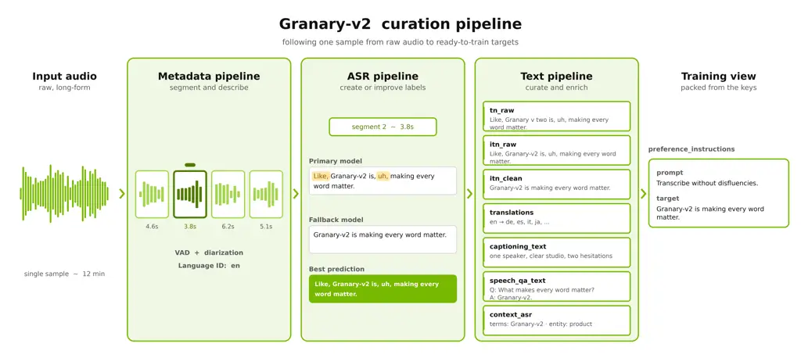
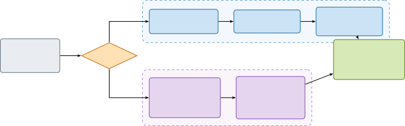
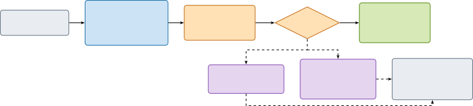
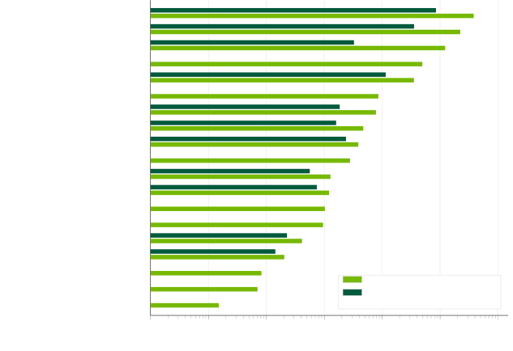
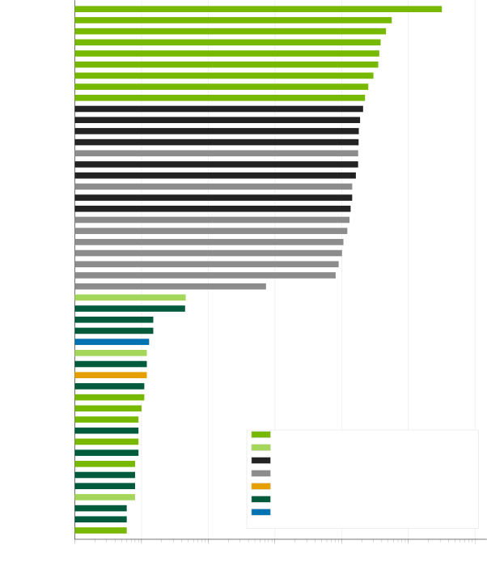

#   Granary-v2: Scalable Multilingual Speech Data Curation for Predictable and Controllable Model Outputs Technical Report  

NVIDIA Affiliation: [Dataset:
nvidia/Granary-v2](https://huggingface.co/datasets/nvidia/Granary-v2)

###### Abstract

Speech-language models that follow instructions need training data that
connects the same recording to different output forms and tasks. We
present Granary-v2, a multilingual speech dataset and reusable curation
system that provides a data foundation for these models. Granary-v2
extends Granary-v1 with aligned transcript variants and
instruction--target pairs for multi-task speech-language training.
Language coverage increases from 25 to 48 languages. Built with NeMo
Curator, the system combines language-dependent ASR labeling, transcript
improvement, and text label generation. It produces aligned targets for
speech-faithful transcription, written forms with and without
disfluencies, and code-switched transcription. Additional targets
include transcript-derived captions and question--answer pairs, with
context and translations for selected records. The full processed
collection contains approximately 843,600 unique audio hours, with
translations covering about 142,800 hours into English and about 55k
hours of English audio into 31 target languages. We evaluate
label-quality filtering with two English Transformer-TDT models under
the same training-step budget. Filtering reduces the unweighted mean
word error rate across nine benchmarks from 4.91% to 4.67%, with
improvements on six benchmarks. We also report curation throughput and
downstream ASR and speech translation results from
Nemotron-3.5-Transcribe, which uses Granary-v2 as part of its training
data. We release the Granary-v2 pipeline¹¹ 1
[https://github.com/NVIDIA-NeMo/Curator/tree/main/tutorials/audio/granary_v2](https://github.com/NVIDIA-NeMo/Curator/tree/main/tutorials/audio/granary_v2),
built with NeMo Curator, and model training recipes²² 2
[https://github.com/NVIDIA-NeMo/Speech](https://github.com/NVIDIA-NeMo/Speech)
as open source. We release a public subset of the generated labels and
instruction--target pairs through Hugging Face³³ 3
[https://huggingface.co/datasets/nvidia/Granary-v2](https://huggingface.co/datasets/nvidia/Granary-v2).



Figure 1: Illustrative Granary-v2 curation flow and instruction–target
packing.

###### Contents

1.  1 Introduction
2.  2 Related Work
    1.  2.1 Large and Multilingual Speech Datasets
    2.  2.2 Automated Speech Data Curation
    3.  2.3 Speech-Language and Contextual-ASR Data
3.  3 The Granary-v2 Curation System
    1.  3.1 Metadata Extraction Pipeline
    2.  3.2 ASR Labeling Pipeline
    3.  3.3 Text Label Generation Pipeline
        1.  3.3.1 Core Text Stages
        2.  3.3.2 Quality Filtering
        3.  3.3.3 Contextual-ASR Labels
        4.  3.3.4 Translation
        5.  3.3.5 Instruction Packing
    4.  3.4 Example Records and Training Targets
    5.  3.5 Reliability and Scale
4.  4 Applying the Pipelines to Granary-v2
    1.  4.1 Audio-Only ASR Labeling
    2.  4.2 Corpora with Existing Transcripts
5.  5 The Granary-v2 Dataset
    1.  5.1 Language, Source, and Duration Analysis
    2.  5.2 Label and Task Coverage
6.  6 Model Training and Downstream Results
    1.  6.1 Transformer-TDT Training
    2.  6.2 Downstream Use in Nemotron 3.5 Transcribe
7.  7 Limitations and Release Conditions
8.  8 Conclusion
9.  Contributors
10. References
11. A Corpus Entries and Translation Coverage
12. B Pipeline Configuration and Recovery
    1.  B.1 Reference Settings
    2.  B.2 Text Validation and Fallback
    3.  B.3 Compute Accounting Method
13. C Multilingual ASR Routing
14. D Label-Generation Prompts
    1.  D.1 Audio-Only ASR
    2.  D.2 ASR with a Human Reference
    3.  D.3 Entity Recovery and Punctuation
    4.  D.4 Normalization and Transcript Language
    5.  D.5 Captioning, Code Switching, and SpeechQA
    6.  D.6 Contextual ASR Extraction
    7.  D.7 Text Translation
15. E Release Record Schema and Quality Rules
    1.  E.1 Label Quality Checks
16. F Reference Training Recipes and Packing
    1.  F.1 Packing Rules and Context Sampling
17. G Reported Downstream Results and Evaluation Instructions
18. H Qualitative Text-Model Comparison

## 1 Introduction

Automatic speech recognition (ASR) serves applications with different
output requirements. A dictation system may need numbers written as
digits and hesitation markers removed. A transcript for linguistic
analysis may need spoken number forms, repetitions, and false starts.
Other applications need domain context, code-switched text, or
translation. Speech-language models can express these requirements
through natural language prompts, but training them requires examples
that connect each instruction to the appropriate output. Training for
these capabilities requires consistent targets derived from the same
speech, together with instructions that state the required task and
output form. But most of speech corpora typically provide one transcript
for each recording, and their transcription conventions differ. A single
reference does not show a model how to produce several valid output
forms or how to select among them.

We introduce Granary-v2, a multilingual speech dataset and reusable
curation system that provides a data foundation for speech-language
models. Granary-v2 supports two training stages: speech-encoder
pretraining and multi-task training with instruction–target pairs. These
pairs cover transcription conventions, disfluency control, contextual
ASR, code-switched transcription, transcript-derived captions and
question answering, and speech translation. Granary-v2 builds these
targets around a common _speech-faithful transcript_. This
representation preserves spoken content, including spoken number forms,
grammar, fillers, repetitions, and false starts. The text pipeline
derives written forms and other task targets from this common source.
Instructions specify which target a model must produce. This design
supports training for prompt-controlled outputs while maintaining a
common source for the labels. Three separate pipelines perform metadata
extraction, ASR labeling, and text label generation. Built with NeMo
Curator, the system supports language-specific labeling routes, quality
filtering, and restartable processing. This report describes the system,
the released data, and evaluations of label filtering and downstream
use.

We make the following contributions:

1.  1.  A multilingual curation system built with NeMo Curator, with
        separate metadata, ASR, and text pipelines.
2.  2.  Aligned text targets for spoken forms, written forms, code-switched
        text, and disfluency handling, with optional context and translation
        labels.
3.  3.  Processing methods that record label sources and quality decisions
        and support recovery after job failure.
4.  4.  A processed collection with 843,579.22 unique ASR hours across 48
        languages and 19 corpus entries, with 142,778.43 hours of
        translation into English. The public subset excludes labels and
        instruction pairs from YODAS2, YouTube-Commons, and
        ReazonSpeech-v2 \[33\].
5.  5.  An English ASR comparison of high-quality and all labels, measured
        curation throughput, and qualitative text-model comparisons.

We evaluate quality filtering by training English ASR on full dataset
and on the high-quality subset under the same training budget. Section 6
presents this comparison and describes downstream ASR and speech
translation results from a speech-language model trained with
Granary-v2.

## 2 Related Work

We compare Granary-v2 with large speech corpora, automated curation
systems, and datasets with several text targets per utterance in
Table 1.

### 2.1 Large and Multilingual Speech Datasets

|                               |                    |       |                                                                   |
| ----------------------------- | ------------------ | ----- | ----------------------------------------------------------------- |
| Dataset                       | Hours              | Langs | Text Supervision                                                  |
| Granary-v2 (processed) \[33\] | 843,579            | 48    | Multiple aligned transcript forms; contextual ASR and translation |
| Granary-v1 \[48\]             | 643,000            | 25    | ASR transcripts; speech translation                               |
| MOSEL \[11\]                  | 441,000            | 24    | ASR transcripts                                                   |
| YODAS \[27\]                  | $`\sim`$500,000    | 100+  | Captions (where available)                                        |
| YODAS v3 \[6\]                | $`>1{,}100{,}000`$ | 100+  | Captions; English translations (where available)                  |
| GigaSpeech 2 \[70\]           | $`\sim`$30,000     | 3     | ASR transcripts                                                   |
| Emilia \[17\]                 | 101,654            | 6     | ASR transcripts                                                   |
| Common Voice v26 \[28\]       | 28,893             | 294   | ASR transcripts                                                   |
| VoxPopuli \[64\]              | 1,800              | 23    | ASR transcripts                                                   |
| MLS \[44\]                    | $`\sim`$50,000     | 8     | ASR transcripts                                                   |

Table 1: Comparison of Granary-v2 with large-scale speech datasets.
Granary-v2 statistics describe the full processed collection, including
YODAS2, YouTube-Commons, and ReazonSpeech-v2. Labels from these three
sources are excluded from the public release.

Granary-v1 combines YODAS, YouTube-Commons, and MOSEL through
segmentation, ASR, hallucination filtering, punctuation restoration, and
translation \[48, 42\]. Granary-v2 extends this approach with several
text targets for the same audio. These include spoken forms and written
forms with and without disfluencies. Selected utterances also receive
context and translation labels.

YODAS collects online video audio with uploaded or automatic captions
where available \[27\]. YODAS v3 contains over 1.1 million hours of
48 kHz multichannel audio in more than 100 languages \[6\]. It provides
captions and English translations where available. MOSEL combines
European speech sources and uses automatic transcription \[11\].
GigaSpeech 2 uses iterative pseudo-labeling and filtering for Thai,
Indonesian, and Vietnamese \[70\]. Emilia uses segmentation,
transcription, and filtering for speech generation data \[17\]. MLS
aligns audiobook recordings with book text \[44\]. VoxPopuli includes
parliamentary speech, transcriptions, and aligned
interpretations \[64\]. Common Voice collects recordings of prompted
speech and uses community validation \[2, 28\].

### 2.2 Automated Speech Data Curation

Automated curation commonly combines speech segmentation, speaker
analysis, ASR, and filtering. AutoPrep uses speech enhancement, VAD,
speaker clustering, target-speaker extraction, and multilingual
ASR \[71\]. Emilia-Pipe uses source separation, diarization,
transcription, and filtering for speech generation \[17\].

Granary-v2 supports both audio without trusted text and recordings with
existing human transcripts. It adds language-dependent model selection
and retains intermediate predictions and quality decisions in internal
processing manifests. Released records expose the generated targets and
the high-quality selection flag. Section 3 describes these methods.

### 2.3 Speech-Language and Contextual-ASR Data

Transcription conventions affect how models handle spontaneous speech.
Fillers, repetitions, and self-corrections can be retained or removed.
Work on controllable verbatim ASR studies different transcript styles
and output selection \[63\]. Preference-ASR evaluates instruction
control of number forms, entities, disfluencies, and case \[23\].

Contextual ASR uses names, terms, or supporting material to guide
recognition. ConEC pairs earnings-call recordings with slides, news
releases, and participant names \[18\]. CoVoST 2 pairs speech with
transcripts and translations \[65\]. SALM studies speech recognition and
translation with in-context learning \[7\]. SpeechVerse uses
audio–instruction–response examples for ASR, translation, and speech
understanding \[9\].

Granary-v2 associates several aligned text targets with the same audio.
These targets support multi-task training for transcription, output
formatting, contextual ASR, question answering, and translation.

## 3 The Granary-v2 Curation System


Figure 2: Top-level Granary-v2 curation flow. The three pipelines are
reusable and independently selectable.

We build the curation system with NeMo Curator \[34\]. It accepts audio
with or without existing transcripts. Figure 2 shows how three separate
pipelines prepare audio, produce transcripts, and derive training
targets.

The metadata pipeline divides raw or long recordings into short speech
segments. It adds information about speakers, language, and sound
events. The ASR pipeline then generates or improves transcripts using
language-specific models and validation checks. The text pipeline
derives different transcript forms and task labels from these
transcripts. It applies quality checks, adds context and translations
for selected records, and assembles instruction–target pairs. These
pairs connect each recording to instructions that specify the task and
output form.

Each pipeline can run independently. Already segmented audio can enter
the ASR pipeline directly. This lets us select the processing steps for
the available inputs and required training targets.

The released records contain audio identifiers, source corpus and
language identifiers, text targets, optional context and translations,
instruction–target pairs, and a high_quality flag. Internal processing
manifests also retain intermediate model predictions and stage
decisions. Appendix E describes the released fields. The following
subsections describe each pipeline in detail.

### 3.1 Metadata Extraction Pipeline


Figure 3: Metadata extraction. Nemotron 3 Diarization processes the full
recording and saves a speaker timeline in RTTM format. VAD divides the
recording into speech segments. We derive each segment’s speaker count
from that timeline. Sound-event detection and language identification
run on the segments. Outputs include 16 kHz mono Opus clips, a JSONL
manifest, and the retained RTTM files.

The metadata pipeline converts raw or long recordings into short speech
segments. It accepts manifests that reference separate audio files or
tarred audio shards. Short recordings can bypass this pipeline or use it
to add metadata.

We decode each recording, convert it to mono, and resample it to 16 kHz.
The nvidia/Nemotron-3-Diarization checkpoint processes the full
recording \[29, 35\]. It supports up to eight speakers and records
speaker activity before segmentation. Appendix B.1 describes the
reference settings. The speaker timeline is saved in RTTM format and
retained for later use.

Silero voice activity detection (VAD) divides the recording into speech
segments between 0.5 and 40 seconds \[55\]. We match each segment to the
speaker timeline to derive its speaker count. PANNs CNN14 identifies
speech, music, and other sound events in each segment \[25\].
SpeechBrain’s VoxLingua107 ECAPA-TDNN model predicts the spoken language
and a confidence value between zero and one \[61, 56\].

The writer produces 16 kHz mono Opus clips and a JSONL manifest. Each
entry includes duration, source recording, segment interval, source
audio format, speaker count, language prediction, and sound events.
Existing transcripts and source identifiers are retained where
applicable.

Inputs with no detected speech receive a vad_empty entry. Inputs that
cannot be decoded receive a read_error entry. A completion marker is
written after every unique input in a shard has been accounted for. This
permits completeness checks before a job resumes. The measured rate is
about 23 audio-hours per GPU-hour for the documented workload.

### 3.2 ASR Labeling Pipeline



Figure 4: ASR-labeling pipeline. Inputs without human transcripts use
language-dependent primary and recovery ASR. Inputs with human
transcripts use audio-guided Qwen3-Omni improvement when supported and
retain aligned labels otherwise.

|                   |                                             |                                                                   |
| ----------------- | ------------------------------------------- | ----------------------------------------------------------------- |
| Property          | Full pseudo-label mode                      | Human-label-improvement mode                                      |
| Human transcript  | Not available                               | Available                                                         |
| ASR path          | Language-aware primary and recovery systems | Qwen3-Omni for supported languages; aligned human label otherwise |
| Quality reference | A second ASR model                          | The human transcript                                              |
| Main purpose      | Create a transcript                         | Improve output form while preserving trusted content              |

Table 2: The two ASR-labeling modes.

The ASR pipeline has two modes. Audio without a trusted reference uses
primary and recovery ASR models. Audio with a source transcript uses
that transcript as an additional reference. A language-dependent router
selects the models. Table 3 gives the routing groups. Appendix C lists
their languages and model names.

For audio-only Qwen3-Omni labeling \[68\], the prompt requests fillers,
repetitions, false starts, colloquial expressions, and spoken number
forms. An available source transcript can supply trusted spellings.
Appendix D.2 lists the reference-improvement prompts. For languages
outside the supported improvement path, the pipeline retains the aligned
source label.

The selection stage checks the primary and recovery predictions for
known hallucination patterns. It selects the primary prediction by
default and uses the recovery prediction when the primary fails
validation. If both trigger a hallucination rule but have zero pairwise
word or character error rate, the agreement exception retains the
primary.

Regular-expression cleaning removes invalid symbols, standardizes
punctuation, and collapses excess whitespace. A language-dependent stage
joins isolated uppercase letters in abbreviations, such as “A P I” to
“API”.

A record with no valid candidate, or with empty text after cleaning,
remains in the processing manifest. The pipeline records the reason and
excludes the record from later stages that need a valid transcript.

|                            |                        |                         |           |
| -------------------------- | ---------------------- | ----------------------- | --------- |
| Group                      | Primary model          | Recovery model          | Languages |
| A                          | Qwen3-Omni             | Qwen3-ASR \[54\]        | 15        |
| B                          | Qwen3-ASR              | Whisper \[47, 38\]      | 3         |
| C                          | Parakeet v3 \[53, 32\] | Whisper                 | 8         |
| D                          | Whisper                | Parakeet v3             | 9         |
| E                          | Hebrew Whisper \[19\]  | Whisper                 | 1         |
| F                          | Indic-Transcribe-core  | IndicConformer          | 11        |
| G                          | Indic-Transcribe-core  | Internal Hindi Parakeet | 1         |
| Total configured languages |                        |                         | 48        |

Table 3: Language-dependent ASR model routing. Appendix C lists
checkpoint identifiers and language membership.

The Indic primary model is bodhan-ai/indic-transcribe-core \[3\]. Group
F uses monolingual IndicConformer recovery models \[1\]. The router
selects a separate checkpoint for each language. Hindi uses Internal
Hindi Parakeet as its recovery model.

### 3.3 Text Label Generation Pipeline



Figure 5: Text and supervision pipeline. Quality decisions are retained
for processed records. Core text stages require a valid transcript.
Contextual-ASR labels use selected high-quality records. Most later
translation runs use the same selection; early translation runs used the
full data. Instruction packing is an optional downstream adapter.

The text pipeline reads the cleaned ASR transcript and produces separate
targets. Each task prompt defines a text transformation, such as
punctuation, number conversion, or disfluency removal.

We use Gemma-4-31B-it-FP8-dynamic for Indic languages \[14, 50\]. All
other languages use Qwen3.6-27B-FP8 \[46\]. We selected the latter based
on qualitative observations of word preservation and on processing cost.
Appendix H presents the comparison.

#### 3.3.1 Core Text Stages

|                                   |                                                                                            |                                        |
| --------------------------------- | ------------------------------------------------------------------------------------------ | -------------------------------------- |
| Output target                     | Required behavior                                                                          | Main use                               |
| Speech-faithful normalized text   | Preserve spoken words, number forms, grammar, and disfluencies                             | Verbatim ASR and translation source    |
| Written form with disfluencies    | Restore written conventions while retaining speech artifacts                               | Readable, speech-faithful transcripts  |
| Written form without disfluencies | Restore written conventions and remove fillers, repetitions, and false starts              | Clean display and downstream text use  |
| Code-switched text                | Restore English spelling while retaining native-language words, suffixes, and disfluencies | ASR with an explicit script convention |

Table 4: Curated output targets and their intended behavior.

##### Entity recovery.

For records with a trusted source transcript, we restore the spelling
and capitalization of letter-only names and acronyms. The stage compares
the ASR transcript with the source annotation. It is skipped when no
source reference is available or the selected transcript already matches
that reference.

##### Punctuation and capitalization.

The general prompt permits changes to punctuation and case while
retaining the words in their original order. Output is stored in
pnc_text. Validation checks can restore the input text after a failed
check. Appendix B.2 describes the checks and fallback rules.

##### Text normalization.

Text normalization expands numbers, dates, times, currencies, units,
percentages, and symbols into spoken forms. The prompt retains fillers,
repetitions, false starts, grammar, and code-switched content. The model
infers the spoken form from the transcript and stores it in tn_raw.

##### Transcript-language identification.

The language model reads pnc_text and returns the primary language name
and a list of languages present. A verification step resolves names and
codes before comparison with the source language. This check differs
from acoustic language identification. A mismatch excludes the record
from later stages unless a configured language-pair exception applies.

##### Inverse text normalization.

We derive two written forms from tn_raw. Standard inverse text
normalization (ITN) restores written numbers, dates, currencies, units,
and symbols while preserving disfluencies. Its output is itn_raw. A
separate stage reads itn_raw, removes disfluencies, and writes
itn_clean. The serial reference path checks word counts and can restore
the input written form after excessive deletion. Appendix B.2 gives the
word-count threshold and fallback rule.

##### Code-switched text.

Code-switching restoration reads tn_raw and writes a separate
code_switched_text target. It restores standard Latin spellings of
English-origin words represented phonetically in another script.
Native-language words retain their script. The prompt preserves word
order, punctuation, disfluencies, and native-script suffixes attached to
English roots. It leaves uncertain words unchanged.

##### Captioning and speech question answering.

Both stages read tn_raw. Caption generation writes a short summary to
captioning_text, with a prompt that requests the transcript language.
Speech question answering produces at most one question–answer pair
supported by the transcript. It stores the result in speech_qa_text, or
returns SKIP when the text is unsuitable. Both tasks use transcript
content as their source.

#### 3.3.2 Quality Filtering

Quality filtering runs on CPUs and selects records using structural and
transcript-agreement checks.

Quality checks cover incorrect abbreviation joins, script-dependent
filtering errors, character loss, and language mismatches. These checks
identify errors that can change labels or exclude valid records without
causing a processing failure.

##### Structural checks.

We check character rate, known hallucination phrases at the start of the
text, and residual ASCII digits in the spoken-form field. The default
character-rate interval is 4–30 characters per second. Configured
exceptions reduce the floor to 1.5 for Chinese, Japanese, Korean, and
Cantonese, and to 2.0 for Dusha and Golos. The ceiling remains 30. We
use these empirical thresholds to identify unusual text-to-duration
ratios. The digit rule matches the ASCII range \[0-9\].

##### Agreement scoring.

For newly generated labels, we compare the primary transcript as
reference with the recovery transcript as hypothesis. For label
improvement, we compare the source human transcript as reference with
the primary prediction. We avoid comparing a selected copy of the human
transcript with itself.

English uses the Open ASR Leaderboard English normalizer. Other
languages use its basic multilingual normalizer \[57\]. The same
normalizer is applied to both texts. Word error rate (WER) is used for
word-scored languages. Character error rate (CER) is used for the
configured character-scored languages. The CER set differs from the
character-rate exceptions. Appendix E gives the configured sets and
human-reference exceptions.

|                            |                                                                    |          |
| -------------------------- | ------------------------------------------------------------------ | -------- |
| Case                       | Condition                                                          | Decision |
| Character-scored language  | $`\mathrm{CER}\leq 0.05`$                                          | Accept   |
| Word-scored, ITN unchanged | $`\mathrm{WER}\leq 0.01`$                                          | Accept   |
| Word-scored, ITN modified  | $`\mathrm{WER}-\overline{\mathrm{WER}}_{\mathrm{group}}\leq 0.01`$ | Accept   |
| Other cases                | No applicable acceptance condition                                 | Reject   |

Table 5: Base agreement rules after structural checks. Human-reference
exceptions are described in Appendix E.

For modified ITN, the group is the corpus–language pair. Its mean
excludes skipped records and non-finite scores. We use agreement between
predictions, or agreement with a source reference, as a consistency
score for label selection.

#### 3.3.3 Contextual-ASR Labels

Context generation runs on records that pass quality filtering.
Qwen3.6-27B-FP8 extracts the domain, entities, entity categories, and
context terms \[46\]. It also generates plausible but irrelevant terms
as semantic distractors. Appendix D.6 gives the generation prompt.
Appendix F.1 gives the related training instructions, sampling rules,
and phonetic-matching settings. Where a phoneme vocabulary is available,
phonetic matching adds words that sound similar to the relevant terms.

|            |                                                                  |
| ---------- | ---------------------------------------------------------------- |
| Variant    | Information supplied in the prompt                               |
| Coarse     | Domain label                                                     |
| Fine       | Domain and relevant terms                                        |
| Distractor | Relevant terms mixed with irrelevant terms                       |
| Partial    | A subset of relevant terms                                       |
| Negative   | An unrelated domain, with the reference variant’s term selection |

Table 6: Context variants in the reference training adapter. The
transcript target stays tied to the audio.

The stage stores terms, categories, distractors, and five prompt
variants in context_asr. Table 6 describes the supplied context. Each
variant retains the transcript target for the same audio, including when
hints are incomplete or irrelevant. The measured rate is about 30
audio-hours per node-hour for the selected high-quality records.

#### 3.3.4 Translation

We translate speech-faithful normalized text using
Qwen3.5-122B-A10B-FP8 \[45\]. Early translation runs used the full data
rather than only the high-quality subset. Later runs mainly used
high-quality records. The release includes translations from both, so
translation coverage is not restricted to records with the final
high-quality flag.

In experiments on FLEURS \[8\], this model achieved higher COMET
scores \[51\] than the 27B and 35B variants, particularly for
translation from English into other languages. Translation quality
further improved when the prompt included a system instruction and the
full names of the source and target languages.

The prompt instructs the model to return only the translation, without
explanations or additional content, and to preserve incomplete
utterances present in speech-derived text. English records are
translated into 31 target languages, whereas non-English records are
translated into English. To reduce the computational cost of translating
English into many languages, we optionally translate a 10% sample of the
eligible English records. The system and user prompts are provided in
Appendix D.7.

We discard translations that are empty or exceed the length limits. For
each remaining translation, we use Cometoid22-WMT23 \[15\]
([marian-nmt/cometoid22-wmt23](https://huggingface.co/marian-nmt/cometoid22-wmt23))
through PyMarian to assign a reference-free quality-estimation score. We
store this score alongside the translation, enabling practitioners to
filter the data by increasingly strict quality thresholds during
training.

#### 3.3.5 Instruction Packing

A deterministic CPU stage assembles instruction–target pairs from
existing text targets, context prompts, and valid translations. Each
entry in preference_instructions contains an instruction, target text,
and tags for task and language. These pairs associate the same audio
with several training targets.

|                                   |                                                                        |
| --------------------------------- | ---------------------------------------------------------------------- |
| Instruction family                | Target                                                                 |
| Transcription                     | Prefer tn_raw; use the configured transcript fallback when absent      |
| Written form                      | itn_raw                                                                |
| Written form without disfluencies | itn_clean                                                              |
| Code-switched ASR                 | code_switched_text with the requested script convention                |
| Captioning                        | captioning_text                                                        |
| SpeechQA                          | Parsed question as instruction; parsed answer as target                |
| Contextual ASR                    | Context prompt paired with the transcript target                       |
| Speech translation                | Target-language translation_raw passing the configured score threshold |

Table 7: Instruction families and their targets in the reference packer.
A pair requires a usable target.

Table 7 maps instruction families to target fields. The reference packer
prefers spoken-form text for transcription and uses a configured
fallback when that field is absent. A translation-score threshold
selects training pairs after generation, while the translation manifest
retains the scored outputs. Appendix F.1 describes missing values,
sampling, and selected instructions.

### 3.4 Example Records and Training Targets

E. Code-switched text: constructed Russian example

Figure 6: Constructed examples of output targets and instruction-based
selection. Panels A–C show spoken numbers, written numbers, and
disfluency removal for the same English utterance. Panel D pairs
instructions with the corresponding target fields. Panel E illustrates
script restoration in Russian. These examples are illustrative and are
not released records.

Pairing each representation with a matching instruction lets a
speech-language model learn output selection from the same audio, as
illustrated in Figure 6.

### 3.5 Reliability and Scale

Production runs use sharded inputs, model-server reuse, completion
markers, output-count checks, and structured status files. Shard markers
avoid repeating completed shards. Field checks avoid repeating completed
stages within a record. We check expected row counts before treating a
marker as valid.

We divide work mainly by audio duration because shard and utterance
counts can hide large differences in workload. Job size must account for
model loading, initialization, and the available time limit. Utterance
length, per-record overhead, and optional-stage eligibility also affect
throughput.

Model servers use NVIDIA Dynamo and vLLM \[37, 26\]. Scaling combines
SLURM arrays, a streaming Ray graph, stage workers, GPU placement,
model-specific batching, and concurrent storage I/O \[52, 60\]. Separate
jobs with balanced durations reduced shared-writer and object-store
contention in the documented ASR workloads.

|                     |                                     |                                                    |
| ------------------- | ----------------------------------- | -------------------------------------------------- |
| Stage               | Rate                                | Workload                                           |
| Metadata extraction | $`\sim`$23 audio-h/GPU-h            | Depends on recording length and work balance       |
| ASR labeling        | $`\sim`$281 audio-h/node-h          | Measured short-utterance workload                  |
| Text enrichment     | $`\sim`$15–25 audio-h/node-h        | Range across job sizes; startup affects small jobs |
| Quality filtering   | $`\sim`$10,400 audio-h/CPU-node-h   | CPU-only workload                                  |
| Contextual ASR      | $`\sim`$30 audio-h/node-h           | Includes the gate, prompt variants, and I/O        |
| Translation         | $`\sim`$144 eligible audio-h/node-h | Japanese-to-English only                           |

Table 8: Processing rates for the listed workloads. GPU rates use A100
80 GB allocations.

The production measurements use A100 80 GB GPUs. The GPU-node rates
assume eight allocated GPUs. Metadata is measured per GPU, while quality
filtering runs on CPUs. ASR labeling processes about 281 audio-hours per
node-hour on the short-utterance workload.

Text-enrichment rates range from 15 to 25 audio-hours per node-hour
across workloads and job sizes. Context timing includes reading, the
quality gate, context generation, prompt variants, and writing.
Translation timing covers eligible Japanese audio translated into
English.

For a node-based rate $`R`$, processing $`H`$ audio hours takes an
estimated $`H/R`$ node-hours. With $`g`$ allocated GPUs, the
corresponding estimate is $`gH/R`$ GPU-hours. Logged compute uses
allocation times and includes failures and retries. Appendix B.3 defines
the accounting method.

## 4 Applying the Pipelines to Granary-v2

|                                    |          |                                    |                                                                 |                                             |
| ---------------------------------- | -------- | ---------------------------------- | --------------------------------------------------------------- | ------------------------------------------- |
| Input                              | Metadata | ASR                                | Text pipeline                                                   | Optional enrichment                         |
| Audio without a trusted transcript | Skipped  | Full pseudo-label mode             | Core stages and quality filtering                               | Context and translation on selected records |
| Audio with a source transcript     | Skipped  | Improve or retain the source label | Entity recovery when applicable, core stages, quality filtering | Context and translation on selected records |

Table 9: Dataset-specific paths through the reusable pipelines.

The current inputs contain short audio segments. We apply ASR labeling
and text processing without a metadata-extraction pass. Table 9 shows
the processing paths.

### 4.1 Audio-Only ASR Labeling

We generate new ASR labels for LibriLight, VoxPopuli with MOSEL labels,
the government-origin subset of People’s Speech, YODAS2, and
YouTube-Commons. The primary and recovery models provide candidate
transcripts from the audio for agreement checks. These sources describe
the processing scope. Labels and instruction pairs from YODAS2,
YouTube-Commons, and ReazonSpeech-v2 are excluded from the public
release.

### 4.2 Corpora with Existing Transcripts

For inputs with a trusted source transcript, we retain that transcript
as a reference. Supported languages use audio-guided Qwen3-Omni label
improvement. Other inputs retain the aligned source label. Entity
recovery uses the reference to restore trusted name spellings where
applicable.

Both paths use the same text stages and quality rules. Context labels
are generated for selected high-quality records. Translation selection
changed between runs: early runs used the full data, while later runs
mainly used high-quality records, as described in Section 3.3.4.

## 5 The Granary-v2 Dataset

|                                   |                       |               |
| --------------------------------- | --------------------- | ------------- |
| Measure                           | Full processed        | Public subset |
| Corpus entries                    | 19                    | 16            |
| Languages                         | 48                    | 48            |
| Unique ASR hours                  | 843,579.22            | 463,062.37    |
| Utterance records                 | $`\sim`$213.4 million | –             |
| High-quality ASR hours            | 317,724               | –             |
| Translation into English, hours   | 142,778.43            | 92,495.56     |
| Translation out of English, hours | 55,772                | –             |

Table 10: Full processed collection and public release subset.
Translation hours refer to audio already counted for ASR. Public subset
hours are calculated by excluding YODAS2, YouTube-Commons, and
ReazonSpeech-v2 from the reported corpus durations. A dash marks a
subset statistic not separately counted.

Table 10 distinguishes the full processed collection from the public
release subset \[33\]. Appendix A lists the corpus entries, their
durations, and their release status.

##### Public release scope.

The full processed collection contains 19 source entries. The public
release excludes all generated labels and instruction–target pairs
derived from YODAS2, YouTube-Commons, and ReazonSpeech-v2. This
exclusion covers transcripts, translations, captions, code-switched
text, question–answer pairs, and context labels. The remaining 16
entries correspond to 463,062.37 hours of source audio, with 92,495.56
hours of translation into English. These subset totals are calculated
from the corpus durations reported here. The Hugging Face repository
distributes label manifests. Source audio is obtained separately from
its distributors.

##### Counting conventions.

The full processed collection contains 843,579.22 hours of unique ASR
audio, of which 317,724 hours carry the high-quality flag. This total is
the sum of unique audio durations across the source corpora. The two
VoxPopuli variants remain separate entries, and LibriSpeech-PC is the
sole LibriSpeech contribution. Transcript variants and translations are
labels attached to these recordings and do not increase the audio-hour
total. Translation runs in both directions: 142,778.43 hours of
non-English audio are translated into English, and 55,772 hours of
English audio are translated into 31 target languages at once. Both
directions count distinct audio once per record, however many targets
that record carries, so neither double-counts and the two never sum past
a corpus’s hours. Translation coverage includes early runs on the full
data and later runs that mainly used high-quality records. We use only
the training splits of the source corpora. Source validation and test
splits are excluded from the training data.

### 5.1 Language, Source, and Duration Analysis



Figure 7: Unique ASR audio hours and translation coverage by corpus
entry in the full processed collection \[33\]. YODAS2, YouTube-Commons,
and ReazonSpeech-v2 are included in these statistics but excluded from
the public release. Translation into English uses a subset of the ASR
audio. Bar labels show ASR hours rounded to the nearest hour.



Figure 8: ASR hours by language in the full processed collection, using
the previously reported rounded values \[33\]. These statistics include
YODAS2, YouTube-Commons, and ReazonSpeech-v2, which are excluded from
the public release. Colors identify the primary and recovery model
routes in Table 3. English includes only LibriSpeech-PC for the
LibriSpeech contribution.

Figures 7 and 8 show the corpus and language distributions of the full
processed collection. The language chart also shows the ASR model
routes. VoxPopuli with MOSEL labels, YODAS2, YouTube-Commons,
LibriLight, and ReazonSpeech-v2 account for about 96.1% of reported ASR
hours. The remaining 14 entries account for about 3.9%. This
concentration makes corpus and language sampling important during
training.

### 5.2 Label and Task Coverage

Labels include transcript variants, captions, code-switched text, and
question–answer pairs. Selected records also receive context and
translations. Available targets depend on stage eligibility and
validation. Instruction–target pairs provide a training view of these
labels.

## 6 Model Training and Downstream Results

Granary-v2 supplies ASR training labels and instruction–target pairs for
speech-language models. We compare English ASR training with all labels
and with the high-quality subset. We then summarize downstream ASR and
translation results from Nemotron 3.5 Transcribe. The reported training
mixtures and results describe the experiments as run. They are separate
from the public release subset defined in Section 5. The release
exclusion does not change these training statistics or scores.

### 6.1 Transformer-TDT Training

|                                      |                     |            |
| ------------------------------------ | ------------------- | ---------- |
| Benchmark                            | High-quality labels | All labels |
| AMI-Cleaned \[4\]                    | 7.84                | 8.72       |
| Earnings22-Cleaned-AA-chunked \[10\] | 5.77                | 6.15       |
| Gigaspeech-Cleaned \[5\]             | 7.33                | 7.41       |
| LS Clean \[40\]                      | 1.13                | 1.10       |
| LS Other \[40\]                      | 2.67                | 2.61       |
| SPGISpeech \[39\]                    | 2.74                | 3.08       |
| Voice Arena Monsoon \[62\]           | 3.33                | 3.41       |
| Voxpopuli-AA-Cleaned \[64\]          | 1.68                | 1.57       |
| URGENT24 \[72\]                      | 9.56                | 10.11      |
| Average WER                          | 4.67                | 4.91       |

Table 11: English Transformer-TDT results with high-quality and all
labels. Scores are WER (%); lower is better. Average WER is the
unweighted mean across the nine benchmarks. Bold indicates the better
score for each benchmark.

To evaluate the effectiveness of quality filtering, we train two English
Transformer-TDT models with approximately 600M-parameter encoders: one
using all training data and the other using only the subset marked as
high quality. Both models use the same architecture and training recipe
and are trained for 300k steps, allowing us to compare the two data
selections under a fixed training-step budget. We use the
Token-and-Duration Transducer (TDT) objective \[67\].

The English training mixture contains 347,178.90 audio hours before
quality filtering. The high-quality subset contains 162,845.95 hours, or
46.91% of the mixture. These durations follow the flat English training
configuration. This mixture includes additional corpora beyond the full
processed Granary-v2 collection, which contains approximately 318,486
English audio hours before filtering in Figure 8. This figure includes
sources excluded from the public release; it is not the public subset’s
English duration.

Training uses BF16 precision and AdamW with a peak learning rate of
$`5\times 10^{-4}`$, betas $`(0.9,0.95)`$, and weight decay of
$`10^{-2}`$. A cosine learning-rate schedule uses 15,000 warmup steps
and decays to a minimum learning rate of $`10^{-6}`$. Both runs use
tn_raw as the training target. Detailed architecture, acoustic feature,
and tokenizer settings are provided in Appendix F.

Table 11 reports WER on the English ASR leaderboard benchmarks \[57\].
The high-quality subset yields lower WER on six of the nine reported
benchmarks, with the largest improvements on AMI, Earnings22, and
SPGISpeech. Training on all data performs slightly better on LibriSpeech
Clean, LibriSpeech Other, and VoxPopuli. Across these nine benchmarks,
the unweighted mean WER decreases from 4.91% to 4.67%. These results
show that quality filtering improves average recognition accuracy under
the same training-step budget, despite retaining less training data.

### 6.2 Downstream Use in Nemotron 3.5 Transcribe

|                                      |           |       |                  |
| ------------------------------------ | --------- | ----- | ---------------- |
| Evaluation                           | Languages | Score | Metric           |
| Multilingual ASR leaderboard         | 7         | 4.62  | WER (%)^(†)      |
| FLEURS ASR \[8\]                     | 37        | 9.29  | Mean WER/CER (%) |
| CoVoST 2 ASR \[65\]                  | 17        | 12.19 | Mean WER/CER (%) |
| FLEURS: other languages to English   | 36        | 29.20 | Mean BLEU        |
| FLEURS: English to other languages   | 36        | 26.54 | Mean BLEU^(∗)    |
| CoVoST 2: other languages to English | 16        | 33.67 | Mean BLEU        |
| CoVoST 2: English to other languages | 10        | 26.34 | Mean BLEU        |

Lower error rates and higher translation scores are better. ^(†)Hindi
uses orthographically informed WER on the public test set. ^(∗)Thai
targets use spBLEU. Other translation targets retain the source report’s
tokenizers. The leaderboard and standalone FLEURS evaluations use
different protocols. The 37-language FLEURS result includes Norwegian,
which the source report does not list as officially supported for
transcription.

Table 12: ASR and speech translation results for Nemotron 3.5
Transcribe, trained on a mixture that includes Granary-v2 \[36\].

Nemotron 3.5 Transcribe initializes its ASR encoder from a multilingual
TDT pretrained on Granary-v2 \[36\]. The encoder has about 600M
parameters and produces one representation per 80 ms. Transcribe jointly
trains this encoder, a projection, and a language-model decoder on a
mixture of speech datasets, followed by reinforcement learning.
Granary-v2 supplies transcript, context, question–answer, and
translation targets for multi-task training.

Table 12 summarizes the ASR and translation results from the Transcribe
technical report. The seven-language leaderboard comparison uses a
baseline snapshot dated 2 October 2026. The standalone FLEURS
evaluation \[8\] uses a separate protocol. Translation is scored against
the benchmark references with BLEU \[41\] or spBLEU \[16\]. The source
report uses SacreBLEU with language-specific tokenizers \[43\]. Thai
targets use the FLORES-200 SentencePiece tokenizer \[31\].

Appendix G gives per-language scores and evaluation instructions.

## 7 Limitations and Release Conditions

Language and source coverage are uneven. Teacher models can share
transcription errors, and source transcripts can contain recognition or
formatting errors. Entity recovery, normalization, context generation,
and translation can introduce unsupported changes. Text-only stages
infer these changes from transcripts. Audio-based assessment is needed
for ambiguous spoken forms, disfluencies, and code-switched words.
Generated captions can use a different language from the requested
target language.

The English filtering experiment covers one ASR architecture and a fixed
training-step budget. It measures label filtering and does not compare
individual instruction families. The instruction–target pairs provide
supervision for prompt-based output selection in speech-language models.
The text-model comparison uses qualitative samples from three languages.
Processing rates depend on workload, hardware, and timing boundaries.
Reference prompts and launch settings describe the configurations
supplied with the report.

The public release excludes all labels and instruction–target pairs
derived from YODAS2, YouTube-Commons, and ReazonSpeech-v2. Their
statistics describe processing and experimental scope only; they do not
indicate public availability. The repository distributes manifests
rather than source audio.

The release uses source training splits and excludes source validation
and test splits from training. Audio, generated labels, model
checkpoints, and software have their own access and license terms. The
dataset repository is
[nvidia/Granary-v2](https://huggingface.co/datasets/nvidia/Granary-v2) \[33\].
The high-quality flag measures structural validity and transcript
agreement; it is not a privacy or harmful-content label.

## 8 Conclusion

Granary-v2 processes 843,579.22 unique ASR hours across 48 languages.
The public subset excludes labels and instruction pairs derived from
YODAS2, YouTube-Commons, and ReazonSpeech-v2. It contains labels for 16
source entries, corresponding to 463,062.37 hours of source audio.
Aligned transcript forms and instructions support prompt-based output
selection. At 300,000 training steps, high-quality labels reduce English
Transformer-TDT mean WER from 4.91% to 4.67% across nine benchmarks. The
data also supports encoder pretraining and multi-task training in
Nemotron 3.5 Transcribe.

## Contributors

Nithin Rao Koluguri^(\*), Meline Mkrtchyan^(\*), Nune Tadevosyan^(\*),
Aaftab V, Sushmitha Deva, Fan Qian, Davit Karamyan, Kunal Dhawan, Taejin
Park, Piotr Żelasko, Arushi Dhingra, Viraj Karandikar, Shuoyang Ding,
Slyne Deng, Onur Yilmaz, Praateek Mahajan, Utkarsh Vaidya, Nikolay
Karpov, Jagadeesh Balam, Boris Ginsburg

Authors marked \* contributed equally and are listed alphabetically.

## References

- \[1\] AI4Bharat (n.d.) IndicConformer Monolingual ASR Models. Note:
  [https://huggingface.co/collections/ai4bharat/indicconformer](https://huggingface.co/collections/ai4bharat/indicconformer)Per-language
  hybrid CTC-RNNT checkpoints; accessed 23 October 2026 Cited by: Table
  16, §3.2.
- \[2\] R. Ardila, M. Branson, K. Davis, M. Kohler, J. Meyer, M.
  Henretty, R. Morais, L. Saunders, F. Tyers, and G. Weber (2020) Common
  Voice: a massively-multilingual speech corpus. In Proc. Language
  Resources and Evaluation Conference (LREC), pp. 4218–4222. Note:
  arXiv:1912.06670 Cited by: Table 13, §2.1.
- \[3\] Bodhan AI (2026) Indic-Transcribe-core. Note:
  [https://huggingface.co/bodhan-ai/indic-transcribe-core](https://huggingface.co/bodhan-ai/indic-transcribe-core)Hugging
  Face model card; accessed 21 October 2026 Cited by: Table 16, §3.2.
- \[4\] J. Carletta, S. Ashby, S. Bourban, M. Flynn, M. Guillemot, T.
  Hain, J. Kadlec, V. Karaiskos, W. Kraaij, M. Kronenthal, G.
  Lathoud, M. Lincoln, A. Lisowska, I. McCowan, W. Post, D. Reidsma,
  and P. Wellner (2006) The AMI meeting corpus: a pre-announcement. In
  Machine Learning for Multimodal Interaction (MLMI 2005), Lecture Notes
  in Computer Science, Vol. 3869, pp. 28–39. External Links:
  [Document](https://dx.doi.org/10.1007/11677482%5F3) Cited by: Table
  13, Table 11.
- \[5\] G. Chen, S. Chai, G. Wang, J. Du, W. Zhang, C. Weng, D. Su, D.
  Povey, J. Trmal, J. Zhang, M. Jin, S. Khudanpur, S. Watanabe, S.
  Zhao, W. Zou, X. Li, X. Yao, Y. Wang, Z. You, and Z. Yan (2021)
  GigaSpeech: an evolving, multi-domain ASR corpus with 10,000 hours of
  transcribed audio. In Proc. Interspeech, pp. 3670–3674. External
  Links: [Document](https://dx.doi.org/10.21437/Interspeech.2021-1965)
  Cited by: Table 11.
- \[6\] W. Chen, S. Takamichi, S. Shiota, S. Fukayama, S. Cornell,
  and S. Watanabe (2026) YODAS v3: over 1 million hours of
  high-bandwidth, stereophonic, multilingual speech. In Proc.
  Interspeech, pp. 5367–5372. External Links:
  [Document](https://dx.doi.org/10.21437/Interspeech.2026-386),
  [Link](https://arxiv.org/abs/2609.29448) Cited by: §2.1, Table 1.
- \[7\] Z. Chen, H. Huang, A. Andrusenko, O. Hrinchuk, K. C. Puvvada, J.
  Li, S. Ghosh, J. Balam, and B. Ginsburg (2024) SALM: speech-augmented
  language model with in-context learning for speech recognition and
  translation. In Proc. IEEE International Conference on Acoustics,
  Speech and Signal Processing (ICASSP), pp. 13521–13525. External
  Links:
  [Document](https://dx.doi.org/10.1109/ICASSP48485.2024.10447553) Cited
  by: §2.3.
- \[8\] A. Conneau, M. Ma, S. Khanuja, Y. Zhang, V. Axelrod, S.
  Dalmia, J. Riesa, C. Rivera, and A. Bapna (2022) FLEURS: few-shot
  learning evaluation of universal representations of speech. arXiv
  preprint arXiv:2205.12446. External Links:
  [Link](https://arxiv.org/abs/2205.12446) Cited by: Table 13, §3.3.4,
  §6.2, Table 12.
- \[9\] N. Das, S. Dingliwal, S. Ronanki, R. Paturi, Z. Huang, P.
  Mathur, J. Yuan, D. Bekal, X. Niu, S. M. Jayanthi, X. Li, K.
  Mundnich, M. Sunkara, S. Srinivasan, D. Garcia-Romero, K. J. Han,
  and K. Kirchhoff (2024) SpeechVerse: a large-scale generalizable
  audio-language model. Note: arXiv preprint arXiv:2405.08295 Cited by:
  §2.3.
- \[10\] M. Del Rio, P. Ha, Q. McNamara, C. Miller, and S.
  Chandra (2022) Earnings-22: a practical benchmark for accents in the
  wild. arXiv preprint arXiv:2203.15591. Cited by: Table 11.
- \[11\] M. Gaido, S. Papi, L. Bentivogli, A. Brutti, M. Cettolo, R.
  Gretter, M. Matassoni, M. Nabih, and M. Negri (2024) MOSEL: 950,000
  hours of speech data for open-source speech foundation model training
  on EU languages. In Proc. Conference on Empirical Methods in Natural
  Language Processing (EMNLP), pp. 13934–13947. Note: arXiv:2410.01036
  Cited by: Table 13, §2.1, Table 1.
- \[12\] D. Galvez, G. Diamos, J. Torres, K. Achorn, J. Cerón, A.
  Gopi, D. Kanter, M. Lam, M. Mazumder, and V. J. Reddi (2021) The
  People’s Speech: a large-scale diverse English speech recognition
  dataset for commercial usage. In Proc. NeurIPS Track on Datasets and
  Benchmarks, Note: arXiv:2111.09344 Cited by: Table 13.
- \[13\] G. V. Garcés Díaz-Munío, J. A. Silvestre-Cerdà, J. Jorge, A.
  Giménez, J. Iranzo-Sánchez, P. Baquero-Arnal, N. Roselló, A.
  Pérez-González-de-Martos, J. Civera, A. Sanchis, and A. Juan (2021)
  Europarl-ASR: a large corpus of parliamentary debates for streaming
  ASR benchmarking and speech data filtering/verbatimization. In Proc.
  Interspeech, pp. 3695–3699. External Links:
  [Document](https://dx.doi.org/10.21437/Interspeech.2021-1905) Cited
  by: Table 13.
- \[14\] Google (2026) Gemma 4 31B IT. Note:
  [https://huggingface.co/google/gemma-4-31B-it](https://huggingface.co/google/gemma-4-31B-it)Hugging
  Face model card; accessed 26 October 2026 Cited by: §3.3.
- \[15\] T. Gowda, T. Kocmi, and M. Junczys-Dowmunt (2023) Cometoid:
  distilling strong reference-based machine translation metrics into
  Even stronger quality estimation metrics. In Proceedings of the Eighth
  Conference on Machine Translation, P. Koehn, B. Haddon, T. Kocmi,
  and C. Monz (Eds.), Singapore, pp. 751–755. External Links:
  [Link](https://aclanthology.org/2023.wmt-1.62) Cited by: §3.3.4.
- \[16\] N. Goyal, C. Gao, V. Chaudhary, P. Chen, G. Wenzek, D. Ju, S.
  Krishnan, M. Ranzato, F. Guzmán, and A. Fan (2022) The FLORES-101
  evaluation benchmark for low-resource and multilingual machine
  translation. Transactions of the Association for Computational
  Linguistics 10, pp. 522–538. External Links:
  [Document](https://dx.doi.org/10.1162/tacl%5Fa%5F00474),
  [Link](https://aclanthology.org/2022.tacl-1.30/) Cited by: §6.2.
- \[17\] H. He, Z. Shang, C. Wang, X. Li, Y. Gu, H. Hua, L. Liu, C.
  Yang, J. Li, P. Shi, Y. Wang, K. Chen, P. Zhang, and Z. Wu (2025)
  Emilia: a large-scale, extensive, multilingual, and diverse dataset
  for speech generation. IEEE/ACM Transactions on Audio, Speech, and
  Language Processing 33, pp. 4044–4058. Note: arXiv:2501.15907; extends
  the SLT 2024 paper arXiv:2407.05361 Cited by: §2.1, §2.2, Table 1.
- \[18\] R. Huang, M. Yarmohammadi, J. Trmal, J. Liu, D. Raj, L. P.
  Garcia, A. Ivanov, P. Ehlen, M. Yu, A. Rastrow, D. Povey, and S.
  Khudanpur (2024) ConEC: earnings call dataset with real-world contexts
  for benchmarking contextual speech recognition. In Proceedings of the
  2024 Joint International Conference on Computational Linguistics,
  Language Resources and Evaluation, pp. 3700–3706. External Links:
  [Link](https://aclanthology.org/2024.lrec-main.328/) Cited by: §2.3.
- \[19\] ivrit.ai (2025) Hebrew Whisper Large v3. Note:
  [https://huggingface.co/ivrit-ai/whisper-large-v3](https://huggingface.co/ivrit-ai/whisper-large-v3)Hugging
  Face model card; accessed 26 October 2026 Cited by: Table 16, Table 3.
- \[20\] J. Kahn, M. Rivière, W. Zheng, E. Kharitonov, Q. Xu, P.
  Mazaré, J. Karadayi, V. Liptchinsky, R. Collobert, C. Fuegen, T.
  Likhomanenko, G. Synnaeve, A. Joulin, A. Mohamed, and E. Dupoux (2020)
  Libri-Light: a benchmark for ASR with limited or no supervision. In
  Proc. IEEE International Conference on Acoustics, Speech and Signal
  Processing (ICASSP), pp. 7669–7673. Note: arXiv:1912.07875 Cited by:
  Table 13.
- \[21\] N. Karpov, A. Denisenko, and F. Minkin (2021) Golos: Russian
  dataset for speech research. arXiv preprint arXiv:2106.10161. External
  Links: [Link](https://arxiv.org/abs/2106.10161) Cited by: Table 13.
- \[22\] J. X. Koh, A. Mislan, K. Khoo, B. Ang, W. Ang, C. Ng, and Y.
  Tan (2019) Building the Singapore English National Speech Corpus. In
  Proc. Interspeech, pp. 321–325. External Links:
  [Document](https://dx.doi.org/10.21437/Interspeech.2019-1525) Cited
  by: Table 13.
- \[23\] N. R. Koluguri, S. Meister, N. Karpov, P. Żelasko, D. Raj, J.
  Balam, and B. Ginsburg (2026) Preference-ASR: a preference-aware test
  set for benchmarking ASR in the era of speech LLMs. In Proc.
  Interspeech, pp. 6687–6691. External Links:
  [Document](https://dx.doi.org/10.21437/Interspeech.2026-728) Cited by:
  §2.3.
- \[24\] V. Kondratenko, A. Sokolov, N. Karpov, O. Kutuzov, N.
  Savushkin, and F. Minkin (2022) Large raw emotional dataset with
  aggregation mechanism. arXiv preprint arXiv:2212.12266. External
  Links: [Link](https://arxiv.org/abs/2212.12266) Cited by: Table 13.
- \[25\] Q. Kong, Y. Cao, T. Iqbal, Y. Wang, W. Wang, and M. D.
  Plumbley (2020) PANNs: large-scale pretrained audio neural networks
  for audio pattern recognition. IEEE/ACM Transactions on Audio, Speech,
  and Language Processing 28, pp. 2880–2894. Note: arXiv:1912.10211
  External Links:
  [Document](https://dx.doi.org/10.1109/TASLP.2020.3030497) Cited by:
  §3.1.
- \[26\] W. Kwon, Z. Li, S. Zhuang, Y. Sheng, L. Zheng, C. H. Yu, J.
  Gonzalez, H. Zhang, and I. Stoica (2023) Efficient memory management
  for large language model serving with pagedattention. Note:
  [https://arxiv.org/abs/2309.06180](https://arxiv.org/abs/2309.06180)
  Cited by: §3.5.
- \[27\] X. Li, S. Takamichi, T. Saeki, W. Chen, S. Shiota, and S.
  Watanabe (2023) YODAS: YouTube-oriented dataset for audio and speech.
  In Proc. IEEE Automatic Speech Recognition and Understanding Workshop
  (ASRU), Note: arXiv:2406.00899 External Links:
  [Document](https://dx.doi.org/10.1109/ASRU57964.2023.10389689) Cited
  by: Table 13, §2.1, Table 1.
- \[28\] MCV (2026) Common Voice Scripted Speech 26.0. Note:
  [https://github.com/common-voice/cv-dataset/blob/main/datasets/scripted-speech/cv-corpus-26.0-2026-06-12.json](https://github.com/common-voice/cv-dataset/blob/main/datasets/scripted-speech/cv-corpus-26.0-2026-06-12.json)Released
  June 2026; accessed September 2026 Cited by: Table 13, §2.1, Table 1.
- \[29\] I. Medennikov, T. Park, W. Wang, H. Huang, K. Dhawan, J.
  Wang, J. Balam, and B. Ginsburg (2025) Streaming Sortformer: speaker
  cache-based online speaker diarization with arrival-time ordering.
  Note: arXiv preprint arXiv:2507.18446Accepted to Interspeech 2025
  Cited by: §3.1.
- \[30\] A. Meister, M. Novikov, N. Karpov, E. Bakhturina, V. Lavrukhin,
  and B. Ginsburg (2023) LibriSpeech-PC: benchmark for evaluation of
  punctuation and capitalization capabilities of end-to-end ASR models.
  arXiv preprint arXiv:2310.02943. External Links:
  [Link](https://arxiv.org/abs/2310.02943) Cited by: Table 13.
- \[31\] NLLB Team, M. R. Costa-jussà, J. Cross, O. Çelebi, M.
  Elbayad, K. Heafield, K. Heffernan, et al. (2022) No language left
  behind: scaling human-centered machine translation. arXiv preprint
  arXiv:2207.04672. External Links:
  [Link](https://arxiv.org/abs/2207.04672) Cited by: §6.2.
- \[32\] NVIDIA (2025) Parakeet-TDT-0.6B-v3. Note:
  [https://huggingface.co/nvidia/parakeet-tdt-0.6b-v3](https://huggingface.co/nvidia/parakeet-tdt-0.6b-v3)Hugging
  Face model card; accessed 26 October 2026 Cited by: Table 16, Table 3.
- \[33\] NVIDIA (2026) Granary-v2. Note:
  [https://huggingface.co/datasets/nvidia/Granary-v2](https://huggingface.co/datasets/nvidia/Granary-v2)Hugging
  Face dataset repository Cited by: Appendix A, item 4, Table 1, Figure
  7, Figure 7, Figure 8, Figure 8, §5, §7.
- \[34\] NVIDIA (2026) NeMo Curator. Note:
  [https://github.com/NVIDIA/NeMo-Curator](https://github.com/NVIDIA/NeMo-Curator)Accessed
  September 2026 Cited by: §3.
- \[35\] NVIDIA (2026) Nemotron 3 Diarization. Note:
  [https://huggingface.co/nvidia/Nemotron-3-Diarization](https://huggingface.co/nvidia/Nemotron-3-Diarization)Hugging
  Face model card; accessed 20 October 2026 Cited by: §B.1, §3.1.
- \[36\] NVIDIA (2026) Nemotron 3.5 Transcribe: technical report.
  Technical report NVIDIA. External Links:
  [Link](https://huggingface.co/nvidia/NVIDIA-Nemotron-3.5-Transcribe-30B-A4B)
  Cited by: Table 20, Table 20, Appendix G, §6.2, Table 12.
- \[37\] NVIDIA (2026) NVIDIA Dynamo. Note:
  [https://github.com/ai-dynamo/dynamo](https://github.com/ai-dynamo/dynamo)Accessed
  September 2026 Cited by: §3.5.
- \[38\] OpenAI (2023) Whisper Large v3. Note:
  [https://huggingface.co/openai/whisper-large-v3](https://huggingface.co/openai/whisper-large-v3)Hugging
  Face model card; accessed 26 October 2026 Cited by: Table 16, Table 3.
- \[39\] P. K. O’Neill, V. Lavrukhin, S. Majumdar, V. Noroozi, Y.
  Zhang, O. Kuchaiev, J. Balam, Y. Dovzhenko, K. Freyberg, M. D.
  Shulman, B. Ginsburg, S. Watanabe, and G. Kucsko (2021) SPGISpeech:
  5,000 hours of transcribed financial audio for fully formatted
  end-to-end speech recognition. In Proc. Interspeech, pp. 1434–1438.
  External Links:
  [Document](https://dx.doi.org/10.21437/Interspeech.2021-1860) Cited
  by: Table 11.
- \[40\] V. Panayotov, G. Chen, D. Povey, and S. Khudanpur (2015)
  Librispeech: an ASR corpus based on public domain audio books. In
  Proc. IEEE International Conference on Acoustics, Speech and Signal
  Processing (ICASSP), pp. 5206–5210. External Links:
  [Document](https://dx.doi.org/10.1109/ICASSP.2015.7178964) Cited by:
  Table 13, Table 11, Table 11.
- \[41\] K. Papineni, S. Roukos, T. Ward, and W. Zhu (2002) BLEU: a
  method for automatic evaluation of machine translation. In Proc. 40th
  Annual Meeting of the Association for Computational Linguistics,
  pp. 311–318. External Links:
  [Document](https://dx.doi.org/10.3115/1073083.1073135),
  [Link](https://aclanthology.org/P02-1040/) Cited by: §6.2.
- \[42\] PleIAs (2024) YouTube-Commons: a corpus of Creative Commons
  YouTube audio and transcripts. Note:
  [https://huggingface.co/datasets/PleIAs/YouTube-Commons](https://huggingface.co/datasets/PleIAs/YouTube-Commons)Accessed
  September 2026 Cited by: Table 13, §2.1.
- \[43\] M. Post (2018) A call for clarity in reporting BLEU scores. In
  Proc. Third Conference on Machine Translation: Research Papers,
  pp. 186–191. External Links:
  [Document](https://dx.doi.org/10.18653/v1/W18-6319),
  [Link](https://aclanthology.org/W18-6319/) Cited by: §6.2.
- \[44\] V. Pratap, Q. Xu, A. Sriram, G. Synnaeve, and R.
  Collobert (2020) MLS: a large-scale multilingual dataset for speech
  research. In Proc. Interspeech, pp. 2757–2761. Note: arXiv:2012.03411
  Cited by: Table 13, §2.1, Table 1.
- \[45\] Qwen Team (2026) Qwen3.5: towards native multimodal agents.
  External Links: [Link](https://qwen.ai/blog?id=qwen3.5) Cited by:
  Appendix H, §3.3.4.
- \[46\] Qwen Team (2026) Qwen3.6-27B: flagship-level coding in a 27B
  dense model. External Links:
  [Link](https://qwen.ai/blog?id=qwen3.6-27b) Cited by: Appendix H,
  §3.3.3, §3.3.
- \[47\] A. Radford, J. W. Kim, T. Xu, G. Brockman, C. McLeavey, and I.
  Sutskever (2023) Robust speech recognition via large-scale weak
  supervision. In Proc. 40th International Conference on Machine
  Learning (ICML), Proceedings of Machine Learning Research, Vol. 202,
  pp. 28492–28518. Cited by: Table 16, Table 3.
- \[48\] N. Rao Koluguri, M. Sekoyan, G. Zelenfroynd, S. Meister, S.
  Ding, B. Ginsburg, et al. (2025) Granary: speech recognition and
  translation dataset in 25 European languages. In Proc. Interspeech,
  pp. 3923–3927. Note: arXiv:2505.13404 External Links:
  [Document](https://dx.doi.org/10.21437/Interspeech.2025-540) Cited by:
  §2.1, Table 1.
- \[49\] Reazon Human Interaction Lab (2024) ReazonSpeech v2: japanese
  speech corpus. Note:
  [https://huggingface.co/datasets/reazon-research/reazonspeech](https://huggingface.co/datasets/reazon-research/reazonspeech)Hugging
  Face dataset card; accessed 26 October 2026 Cited by: Table 13.
- \[50\] Red Hat AI (2026) Gemma-4-31B-it-FP8-dynamic. Note:
  [https://huggingface.co/RedHatAI/gemma-4-31B-it-FP8-dynamic](https://huggingface.co/RedHatAI/gemma-4-31B-it-FP8-dynamic)Hugging
  Face model card; accessed 26 October 2026 Cited by: §3.3.
- \[51\] R. Rei, C. Stewart, A. C. Farinha, and A. Lavie (2020) COMET: a
  neural framework for MT evaluation. In Proc. Conference on Empirical
  Methods in Natural Language Processing (EMNLP), pp. 2685–2702.
  External Links:
  [Document](https://dx.doi.org/10.18653/v1/2020.emnlp-main.213),
  [Link](https://aclanthology.org/2020.emnlp-main.213/) Cited by:
  §3.3.4.
- \[52\] SchedMD (2026) Slurm Workload Manager. Note:
  [https://slurm.schedmd.com/](https://slurm.schedmd.com/)Accessed
  September 2026 Cited by: §3.5.
- \[53\] M. Sekoyan, N. R. Koluguri, N. Tadevosyan, P. Żelasko, T.
  Bartley, N. Karpov, J. Balam, and B. Ginsburg (2025) Canary-1B-v2 &
  Parakeet-TDT-0.6B-v3: efficient and high-performance models for
  multilingual ASR and AST. arXiv preprint arXiv:2509.14128. External
  Links: [Link](https://arxiv.org/abs/2509.14128) Cited by: Table 16,
  Table 3.
- \[54\] X. Shi, X. Wang, Z. Guo, Y. Wang, P. Zhang, X. Zhang, Z.
  Guo, H. Hao, Y. Xi, B. Yang, J. Xu, J. Zhou, and J. Lin (2026)
  Qwen3-ASR technical report. arXiv preprint arXiv:2601.21337. Cited by:
  Table 16, Table 3.
- \[55\] Silero Team (2024) Silero VAD: pre-trained enterprise-grade
  voice activity detector, number detector, and language classifier.
  Note:
  [https://github.com/snakers4/silero-vad](https://github.com/snakers4/silero-vad)Software
  repository; accessed September 2026 Cited by: §3.1.
- \[56\] SpeechBrain (n.d.) VoxLingua107 ECAPA-TDNN spoken language
  identification model. Note:
  [https://huggingface.co/speechbrain/lang-id-voxlingua107-ecapa](https://huggingface.co/speechbrain/lang-id-voxlingua107-ecapa)Hugging
  Face model card; accessed September 2026 Cited by: §3.1.
- \[57\] V. Srivastav, S. Zheng, E. Bezzam, E. Le Bihan, N. R.
  Koluguri, P. Żelasko, S. Majumdar, A. Moumen, and S. Gandhi (2026)
  Open ASR leaderboard: towards reproducible and transparent
  multilingual and long-form speech recognition evaluation. In Proc.
  Interspeech, pp. 6692–6697. External Links:
  [Document](https://dx.doi.org/10.21437/Interspeech.2026-1902) Cited
  by: §3.3.2, §6.1.
- \[58\] SYSTRAN (n.d.) Faster whisper transcription with CTranslate2.
  Note:
  [https://github.com/SYSTRAN/faster-whisper](https://github.com/SYSTRAN/faster-whisper)Software
  repository Cited by: Table 16.
- \[59\] F. Teixeira, C. Carvalho, M. Julião, C. Botelho, R.
  Solera-Ureña, S. Paulo, T. Rolland, B. Peters, I. Trancoso, and A.
  Abad (2026) FalAR: a large-scale speaker-annotated European Portuguese
  speech corpus of parliamentary sessions. In Proc. International
  Conference on Language Resources and Evaluation (LREC), External
  Links: [Link](https://huggingface.co/datasets/inesc-id/FalAR) Cited
  by: Table 13.
- \[60\] The Ray Team (2026) Ray: a distributed computing framework.
  Note: [https://www.ray.io/](https://www.ray.io/)Accessed September
  2026 Cited by: §3.5.
- \[61\] J. Valk and T. Alumäe (2021) VoxLingua107: a dataset for spoken
  language recognition. In Proceedings of the IEEE Spoken Language
  Technology Workshop, Cited by: §3.1.
- \[62\] Voice Arena (2026) MonsoonASR: open ASR leaderboard English
  test set (en-IN). Note:
  [https://huggingface.co/datasets/VoiceArena/MonsoonASR-Open-ASR-leaderboard-en-IN](https://huggingface.co/datasets/VoiceArena/MonsoonASR-Open-ASR-leaderboard-en-IN)Hugging
  Face dataset card; accessed 26 October 2026 Cited by: Table 11.
- \[63\] L. Wagner, M. Zusag, and B. Thallinger (2026) Transcription
  policy as a latent variable: activating controllable verbatim ASR with
  word-level timing. Note: arXiv preprint arXiv:2607.18934 Cited by:
  §2.3.
- \[64\] C. Wang, M. Rivière, A. Lee, A. Wu, C. Talnikar, D. Haziza, M.
  Williamson, J. Pino, and E. Dupoux (2021) VoxPopuli: a large-scale
  multilingual speech corpus for representation learning,
  semi-supervised learning and interpretation. In Proc. Annual Meeting
  of the Association for Computational Linguistics (ACL), pp. 993–1003.
  Note: arXiv:2101.00390 External Links:
  [Document](https://dx.doi.org/10.18653/v1/2021.acl-long.80) Cited by:
  Table 13, Table 13, §2.1, Table 1, Table 11.
- \[65\] C. Wang, A. Wu, and J. Pino (2020) CoVoST 2 and massively
  multilingual speech-to-text translation. Note: arXiv preprint
  arXiv:2007.10310 Cited by: §2.3, Table 12.
- \[66\] P. Warden (2018) Speech commands: a dataset for
  limited-vocabulary speech recognition. arXiv preprint
  arXiv:1804.03209. External Links:
  [Link](https://arxiv.org/abs/1804.03209) Cited by: Table 13.
- \[67\] H. Xu, F. Jia, S. Majumdar, H. Huang, S. Watanabe, and B.
  Ginsburg (2023) Efficient sequence transduction by jointly predicting
  tokens and durations. In Proc. 40th International Conference on
  Machine Learning, Proceedings of Machine Learning Research, Vol. 202,
  pp. 38462–38484. External Links:
  [Link](https://proceedings.mlr.press/v202/xu23g.html) Cited by: §6.1.
- \[68\] J. Xu, Z. Guo, H. Hu, Y. Chu, X. Wang, J. He, Y. Wang, X.
  Shi, T. He, X. Zhu, Y. Lv, Y. Wang, D. Guo, H. Wang, L. Ma, P.
  Zhang, X. Zhang, H. Hao, Z. Guo, B. Yang, B. Zhang, Z. Ma, X. Wei, S.
  Bai, K. Chen, X. Liu, P. Wang, M. Yang, D. Liu, X. Ren, B. Zheng, R.
  Men, F. Zhou, B. Yu, J. Yang, L. Yu, J. Zhou, and J. Lin (2025)
  Qwen3-Omni technical report. arXiv preprint arXiv:2509.17765. Cited
  by: Table 16, §3.2.
- \[69\] J. Yamagishi, C. Veaux, and K. MacDonald (2019) CSTR VCTK
  Corpus: English multi-speaker corpus for CSTR voice cloning toolkit
  (version 0.92). Note: University of Edinburgh, Centre for Speech
  Technology Research External Links:
  [Document](https://dx.doi.org/10.7488/ds/2645),
  [Link](https://datashare.ed.ac.uk/handle/10283/3443) Cited by: Table 13.
- \[70\] Y. Yang, Z. Song, J. Zhuo, M. Cui, J. Li, B. Yang, Y. Du, Z.
  Ma, X. Liu, Z. Wang, K. Li, S. Fan, K. Yu, W. Zhang, G. Chen, and X.
  Chen (2025) GigaSpeech 2: an evolving, large-scale and multi-domain
  ASR corpus for low-resource languages with automated crawling,
  transcription and refinement. In Proc. Annual Meeting of the
  Association for Computational Linguistics (ACL), pp. 2673–2686. Note:
  arXiv:2406.11546 Cited by: §2.1, Table 1.
- \[71\] J. Yu, H. Chen, Y. Bian, X. Li, Y. Luo, J. Tian, M. Liu, J.
  Jiang, and S. Wang (2023) AutoPrep: an automatic preprocessing
  framework for in-the-wild speech data. Note: arXiv preprint
  arXiv:2309.13905 Cited by: §2.2.
- \[72\] W. Zhang, R. Scheibler, K. Saijo, S. Cornell, C. Li, Z. Ni, J.
  Pirklbauer, M. Sach, S. Watanabe, T. Fingscheidt, and Y. Qian (2024)
  URGENT challenge: universality, robustness, and generalizability for
  speech enhancement. In Proc. Interspeech, pp. 4868–4872. External
  Links: [Document](https://dx.doi.org/10.21437/Interspeech.2024-1239)
  Cited by: Table 11.

## Appendix A Corpus Entries and Translation Coverage

|                                            |       |            |                    |                  |                  |                |
| ------------------------------------------ | ----- | ---------- | ------------------ | ---------------- | ---------------- | -------------- |
| Corpus entry                               | Langs | ASR hours  | High-quality hours | X$`\to`$En hours | En$`\to`$X hours | Public release |
| VoxPopuli (MOSEL labels) \[64, 11\]        | 23    | 380,711.26 | 123,192            | 84,999.29        | 8,990            | Included       |
| YODAS2 \[27\]                              | 22    | 222,913.89 | 95,574             | 35,517.18        | 5,848            | Excluded       |
| YouTube-Commons \[42\]                     | 24    | 122,258.88 | 45,354             | 3,261.71         | 10,549           | Excluded       |
| LibriLight \[20\]                          | 1     | 49,334.35  | 25,898             | 0.00             | 25,725           | Included       |
| ReazonSpeech-v2 \[49\]                     | 1     | 35,344.08  | 11,504             | 11,503.98        | –                | Excluded       |
| People’s Speech (gov-origin subset) \[12\] | 1     | 8,597.76   | 3,807              | 0.00             | 826              | Included       |
| Multilingual LibriSpeech \[44\]            | 8     | 7,804.56   | 3,073              | 1,847.54         | 103              | Included       |
| FalAR \[59\]                               | 1     | 4,714.83   | 1,605              | 1,601.57         | –                | Included       |
| Common Voice 26.0 \[2, 28\]                | 39    | 3,871.23   | 2,837              | 2,371.89         | 496              | Included       |
| National Speech Corpus \[22\]              | 1     | 2,784.60   | 1,647              | 0.00             | 1,689            | Included       |
| VoxPopuli (re-labelled) \[64\]             | 16    | 1,276.96   | 527                | 562.21           | 160              | Included       |
| Golos \[21\]                               | 1     | 1,207.72   | 715                | 743.57           | –                | Included       |
| Europarl-ASR \[13\]                        | 1     | 1,022.70   | 605                | 0.00             | 613              | Included       |
| LibriSpeech-PC \[30, 40\]                  | 1     | 952.88     | 953                | 0.00             | 686              | Included       |
| FLEURS \[8\]                               | 48    | 412.18     | 213                | 226.48           | 5                | Included       |
| Dusha \[24\]                               | 1     | 203.73     | 104                | 143.01           | –                | Included       |
| VCTK \[69\]                                | 1     | 82.15      | 76                 | 0.00             | 76               | Included       |
| AMI Meeting Corpus \[4\]                   | 1     | 70.38      | 24                 | 0.00             | 4                | Included       |
| Google Speech Commands \[66\]              | 1     | 15.08      | 15                 | 0.00             | 2                | Included       |
| Total                                      | 48    | 843,579.22 | 317,724            | 142,778.43       | 55,772           | –              |

Table 13: Corpus entries and durations for the full processed
collection. The last column identifies public label availability;
YODAS2, YouTube-Commons, and ReazonSpeech-v2 are excluded. Only
LibriSpeech-PC is retained for LibriSpeech. Translation hours refer to
audio already counted for ASR. Translation runs in both directions:
non-English audio into English, and English audio into 31 target
languages. A dash marks a direction that does not apply to the corpus.
High-quality and translation-out hours follow the dataset card’s integer
rounding.

Table 13 lists corpus groups, language counts, and durations for the
full processed collection \[33\]. The public-release column identifies
which entries have released labels. YODAS2, YouTube-Commons, and
ReazonSpeech-v2 remain in the processing statistics but have no labels
or instruction pairs in the public release. VoxPopuli with MOSEL labels
and re-labelled VoxPopuli remain separate entries. LibriSpeech-PC is the
sole LibriSpeech contribution. Translation hours refer to labels
attached to the ASR recordings.

## Appendix B Pipeline Configuration and Recovery

Metadata extraction runs diarization on the full recording before VAD
segmentation. Segment speaker counts are derived from the retained RTTM
timeline. The output manifest records successful segments, empty VAD
results, and read errors. Completion checks account for every unique
input recording, including empty VAD results and read errors.

ASR and text stages retain intermediate outputs in separate fields. A
job can resume at a completed shard or stage. Row-count checks validate
completion markers. GPU placement and batching depend on the model. CPU
filtering and instruction packing can run separately from model
inference.

For People’s Speech, a 3,032-shard run reached 61% completion in its
first time window. Dependent resume jobs reached 100% without repeating
completed work.

### B.1 Reference Settings

The metadata pipeline uses nvidia/Nemotron-3-Diarization with
SpeechBrain language identification. The diarization model supports
streaming and offline inference with up to eight speakers \[35\]. The
settings below describe the reference metadata configuration for raw or
long recordings. Granary-v2’s short-form inputs bypass this stage.

The reference metadata launch uses VAD threshold 0.5, a 1,000 ms minimum
interval, and 100 ms speech padding. Segments remain within 0.5–40
seconds. The diarization batch size is 2. Reader and writer concurrency
are 3 and 4, respectively, with eight reader I/O threads.

|                         |                    |                    |                       |
| ----------------------- | ------------------ | ------------------ | --------------------- |
| Setting                 | Core text stages   | Contextual ASR     | Translation           |
| Model                   | Qwen3.6-27B-FP8    | Qwen3.6-27B-FP8    | Qwen3.5-122B-A10B-FP8 |
| Allocated GPUs per node | 8                  | 8                  | 8                     |
| Context / output limit  | 2,048 / 512 tokens | 8,192 / 512 tokens | 1,024 / 256 tokens    |
| Temperature / top-$`p`$ | 0 / 1              | 0.1 / 0.95         | 0.7 / 0.8             |
| Tensor parallelism      | 2                  | 2                  | 2 per NMT replica     |
| Replicas                | 4                  | 4                  | 2 NMT replicas        |
| Workers / batch         | 12 / 128           | 8 / 64             | 2 / 256               |
| GPU memory fraction     | 0.85               | 0.85               | 0.90                  |

Table 14: Text-generation launch defaults in the reference
configuration. The core-text column describes the Qwen configuration.

The translation layout reserves eight GPUs and uses four for translation
models and two for quality estimation. GPU-hour accounting includes all
eight allocated GPUs. Its reference settings include top-$`k`$ 20, seed
1234, and a length-ratio limit of 8. Appendix F.1 gives the
translation-pair selection threshold.

The official tutorial ASR example uses temperature 0, top-$`k`$ 1,
repetition penalty 1, and seed 1234. It sets a 4,096-token context and a
256-token output limit.

### B.2 Text Validation and Fallback

The reference text stage checks for empty output, new Latin words
outside its permitted set, and invalid word-count changes. Failed
validation restores the input text and records a fallback note. These
checks operate on vocabulary and word counts.

In the reference serial path, disfluency removal reads itn_raw. Its
word-count threshold is 0.5. For input of at least eight
whitespace-separated tokens, output with fewer than half the input token
count fails the deletion check. Other validation checks can also trigger
fallback. The original written form is retained after a failed check.

### B.3 Compute Accounting Method

For job $`j`$, let $`g_{j}`$ be its fixed GPU allocation and $`t_{j}`$
its elapsed allocation time in hours. Logged compute is

```math
G_{\mathrm{logged}}=\sum_{j}g_{j}t_{j}. \tag{1}
```

The calculation includes startup, failed work, and retries within each
allocation. Each allocation is counted once, including its nested job
steps. CPU-node-hours are reported separately. Queue delays and job
concurrency determine calendar time.

For work without a job record, compute can be estimated from the stage’s
input duration and processing rate. Context and translation estimates
use the eligible records, with a separate workload for each translation
direction. Pipeline processing, model training, and evaluation are
accounted for separately.

## Appendix C Multilingual ASR Routing

|       |     |                                                                                                                                                                                                                      |
| ----- | --- | -------------------------------------------------------------------------------------------------------------------------------------------------------------------------------------------------------------------- |
| Group | \#  | Languages                                                                                                                                                                                                            |
| A     | 15  | Arabic (ar), Chinese (zh), Dutch (nl), English (en), French (fr), German (de), Indonesian (id), Italian (it), Japanese (ja), Korean (ko), Portuguese (pt), Russian (ru), Spanish (es), Turkish (tr), Vietnamese (vi) |
| B     | 3   | Filipino (fil), Persian (fa), Thai (th)                                                                                                                                                                              |
| C     | 8   | Czech (cs), Danish (da), Finnish (fi), Greek (el), Hungarian (hu), Polish (pl), Romanian (ro), Swedish (sv)                                                                                                          |
| D     | 9   | Bulgarian (bg), Croatian (hr), Estonian (et), Latvian (lv), Lithuanian (lt), Maltese (mt), Slovak (sk), Slovenian (sl), Ukrainian (uk)                                                                               |
| E     | 1   | Hebrew (he)                                                                                                                                                                                                          |
| F     | 11  | Assamese (as), Bengali (bn), Gujarati (gu), Kannada (kn), Malayalam (ml), Marathi (mr), Odia (or), Punjabi (pa), Tamil (ta), Telugu (te), Urdu (ur)                                                                  |
| G     | 1   | Hindi (hi)                                                                                                                                                                                                           |

Table 15: Configured language membership of the ASR routing groups in
Table 3.

|                             |                                                                                                        |
| --------------------------- | ------------------------------------------------------------------------------------------------------ |
| Model                       | Checkpoint or implementation                                                                           |
| Qwen3-Omni \[68\]           | Qwen/Qwen3-Omni-30B-A3B-Instruct                                                                       |
| Qwen3-ASR \[54\]            | Qwen/Qwen3-ASR-0.6B                                                                                    |
| Parakeet v3 \[53, 32\]      | nvidia/parakeet-tdt-0.6b-v3                                                                            |
| Whisper \[47, 38\]          | Whisper Large v3 through faster-whisper \[58\]                                                         |
| Hebrew Whisper \[19\]       | ivrit-ai/whisper-large-v3                                                                              |
| Indic-Transcribe-core \[3\] | [bodhan-ai/indic-transcribe-core](https://huggingface.co/bodhan-ai/indic-transcribe-core)              |
| IndicConformer \[1\]        | ai4bharat/indicconformer_stt\_\<lang\>\_hybrid_ctc_rnnt_large; one monolingual checkpoint per language |
| Internal Hindi Parakeet     | Internal checkpoint used for Hindi recovery ASR                                                        |

Table 16: Checkpoint identifiers for the ASR routing groups. Internal
Hindi Parakeet is an internal checkpoint.

## Appendix D Label-Generation Prompts

|                                          |                    |
| ---------------------------------------- | ------------------ |
| Task                                     | Appendix reference |
| Audio-only ASR                           | D.1                |
| Human-reference ASR                      | D.2                |
| Entity recovery and punctuation          | D.3                |
| TN, language ID, ITN, disfluency removal | D.4                |
| Captioning, code switching, SpeechQA     | D.5                |
| Context extraction                       | D.6                |
| Text translation                         | D.7                |

Table 17: Prompt index. Label-generation prompts are separate from the
training instructions in Appendix F.1.

The listings reproduce the archived source prompts. Braced terms, such
as {text}, are substitution fields for the record’s text or language
name. The SYSTEM_PROMPT and USER_PROMPT_TEMPLATE markers identify the
system and user roles.

The source bundle contains the original UTF-8 prompt files and their
hashes. The listings show non-ASCII code points as Unicode escapes, such
as \u2014. Model inputs use the original UTF-8 files.

### D.1 Audio-Only ASR

The official tutorial reference provides separate English and
multilingual prompts. Both are user instructions followed by the audio,
using the model’s chat template.

English.

You receive English audio. The audio is the ground truth.

MAIN GOAL: Listen carefully to the audio and transcribe exactly what is
spoken, including all disfluencies present in the audio.

- Do NOT invent words or content not spoken in the audio.

- Do NOT remove substantive content that is spoken in the audio.

- Do NOT paraphrase, polish grammar or rewrite sentences.

ENTITIES (names, places, brands, titles, etc.):

- Keep every named entity as spoken. This includes names, places,
  brands, titles, acronyms, and other proper nouns.

- Do not ever transliterate, translate, re-spell, normalize, or
  "correct" an entity into another script.

- If enetities are part code switched data it should stay the same.

KEEP DISFLUENCIES:

- Keep fillers, repetitions, false starts, colloquial reductions, and
  grammatical errors spoken in the audio.

- Add hesitation markers and fillers natural to English wherever they
  are spoken in the audio.

- Do NOT clean up, normalize, or remove disfluencies spoken in the
  audio.

- Add consecutive instances of the same word or short phrase when spoken
  unintentionally.

- Example: "I I think" if that is what is spoken.

BACKGROUND / QUIET / OVERLAPPING SPEECH:

- Keep all audible speech, including quieter, distant, or overlapping
  voices \\u2014 not just the loudest speaker.

- Add background or secondary speech that is audible; do not drop words
  because they sound like background.

FALSE STARTS:

- Add incomplete words or phrases the speaker abandons, marked with a
  hyphen.

- Example: "I was go- going to the store."

- Do NOT remove false starts spoken in the audio.

COLLOQUIAL REDUCTIONS:

- If the speaker used reductions, use the spoken form: "want to" \\u2192
  "wanna", "going to" \\u2192 "gonna", etc.

- Preserve forms such as "wanna", "gonna", "kinda", "lemme", "lotta",
  "outta", "Imma", "sorta", "ya", "m’kay", "finna", "tryna", etc. Do NOT
  expand them.

WRONG GRAMMAR:

- Keep grammatical errors as spoken. Do NOT correct subject-verb
  agreement, tense errors, or other grammar issues.

NUMERICALS:

- Keep numbers as spoken in words. Do NOT convert them to digits.

- Example: keep "oh eleven" or "zero eleven".

Output format:

- Return ONLY the transcription text.

Multilingual.

You receive an audio file.

Goal: To transcribe the audio, normalize numbers into words, and include
any disfluencies that are present in the audio.

TRANSCRIPTION RULES:

1. Normalize numeric expressions into words exactly as they are SPOKEN
   in the audio.

- Mixed format is forbidden:

Bad: "5 percent", "2 zeros"

Good: "five percent", "two zeros"

- Normalize: percentages, currencies, units, ranges, decimals,
  dates/years \\u2014 ONLY if they are spoken.

- If a unit (for example \\u201cpercent\\u201d) is NOT spoken, do not
  add it.

2. Include any disfluencies present in the audio.

- Disfluencies as "um", "uh" that are present in the audio should be
  added to the text.

- If a word is repeated in the audio, include every repetition in the
  text.

ENTITIES (names, places, brands, titles, etc.):

- Keep every named entity as spoken. This includes names, places,
  brands, titles, acronyms, and other proper nouns.

OUTPUT FORMAT:

- Return only the final text.

- No explanations, no JSON, no lists.

### D.2 ASR with a Human Reference

The archived reference-label prompt supplies the source transcript in
{transcript}. The audio remains the source for spoken content. Entity
spellings can come from the reference.

English reference improvement.

You receive English audio and a reference transcript. The reference may
be cleaned, partially wrong, or missing speech artifacts. The audio is
the ground truth.

REFERENCE TRANSCRIPT:

"{transcript}"

MAIN GOAL: Listen carefully to the audio and revise the reference so it
faithfully reflects exactly what is spoken, including all disfluencies
present in the audio.

- Use the reference as a starting point; do not ignore it.

- When the reference matches the audio, keep it unchanged.

- When the reference conflicts with the audio, follow the audio.

- Do NOT invent words or content not spoken in the audio.

- Do NOT remove substantive content that is spoken in the audio (remove
  reference words only if they are not spoken).

- Do NOT paraphrase, polish grammar or rewrite sentences that already
  match the audio.

- Prefer minimal edits: fix mismatches and insert missing speech
  artifacts.

- Preserve named entities from the reference in their exact written
  form.

- Normalize numbers to their written form.

ENTITIES (names, places, brands, titles, etc.):

- Keep every named entity from the reference in its exact written form:
  spelling, casing, script, and punctuation. This includes names, places,
  brands, titles, acronyms, and other proper nouns.

- Do not ever transliterate, translate, re-spell, normalize, or
  "correct" an entity into another script.

- If enetities are part code switched data it should stay the same.

KEEP REFERENCE DISFLUENCIES:

- If the reference already has fillers, repetitions, false starts,
  colloquial reductions, or grammatical errors, keep them.

- Add hesitation markers and fillers natural to English wherever they
  are spoken in the audio but missing from the reference.

- Do NOT clean up, normalize, or remove disfluencies that are already in
  the reference and are spoken in the audio.

- Add consecutive instances of the same word or short phrase when spoken
  unintentionally.

- Example: reference "I think" \\u2192 "I I think" if that is what is
  spoken.

BACKGROUND / QUIET / OVERLAPPING SPEECH:

- Keep all audible speech in the reference, including quieter, distant,
  or overlapping voices \\u2014 not just the loudest speaker.

- Add background or secondary speech that is audible but missing; do not
  drop words because they sound like background.

FALSE STARTS:

- Add incomplete words or phrases the speaker abandons, marked with a
  hyphen.

- Example: "I was go- going to the store."

- Do NOT remove false starts already in the reference if they are spoken
  in the audio.

COLLOQUIAL REDUCTIONS:

- If the reference uses standard forms but the speaker used reductions,
  use the spoken form: "want to" \\u2192 "wanna", "going to" \\u2192
  "gonna", etc.

- Preserve forms such as "wanna", "gonna", "kinda", "lemme", "lotta",
  "outta", "Imma", "sorta", "ya", "m’kay", "finna", "tryna", etc. Do NOT
  expand them.

WRONG GRAMMAR:

- Keep grammatical errors as spoken. Do NOT correct subject-verb
  agreement, tense errors, or other grammar issues.

NUMERICALS:

- Keep numbers as spoken in words. Do NOT convert them to digits.

- Example: keep "oh eleven" or "zero eleven".

Output format:

- Return ONLY the revised transcription text.

The archived English reference prompt contains conflicting instructions
for written and spoken number forms.

Multilingual reference improvement.

You receive:

1. An audio file,

2. A Ground Truth Transcription of the audio {transcript}.

Goal: To normalize numbers from the text and add any disfluencies that
are present in the audio.

ALLOWED ONLY:

1. Normalize numeric expressions into words exactly as they are SPOKEN
   in the audio.

- Mixed format is forbidden:

Bad: "5 percent", "2 zeros"

Good: "five percent", "two zeros"

- Normalize: percentages, currencies, units, ranges, decimals,
  dates/years \\u2014 ONLY if they are spoken.

- If a unit (for example \\u201cpercent\\u201d) is NOT spoken, do not
  add it.

2. Add any disfluencies present in the audio.

- Disfluencies as "um", "uh" that are present in the audio should be
  added to the text.

- If word is repeated in the audio but missing from ground truth add it
  to the text.

ENTITIES (names, places, brands, titles, etc.) should be the same as
inGround Truth Transcription:

- Keep every named entity from the reference in its exact written form:
  spelling, casing, script, and punctuation. This includes names, places,
  brands, titles, acronyms, and other proper nouns.

OUTPUT FORMAT:

- Return only the final text.

- No explanations, no JSON, no lists.

### D.3 Entity Recovery and Punctuation

Entity recovery uses a system instruction and a user template with two
text fields. It runs only where a trusted human reference is available.

Entity recovery.

\# SYSTEM_PROMPT

You are given TWO transcriptions of the same audio clip:

- INITIAL: Initial reference with named entity spelling/casing.

- NORMALIZED: Normalized transcription.

Your task:

1. In the INITIAL text, identify ONLY proper-noun named entities made of
   letters/words only (no digits): people, places, organizations,
   companies, products, brands, and acronyms/initialisms.

2. If a candidate contains any digit (0-9), it is NOT an entity and must
   be excluded.

3. Titles/honorifics are NOT entities and must be excluded.

4. For each remaining entity, locate its match in the NORMALIZED text
   and substitute it with the INITIAL spelling/casing. Change ONLY the
   entity itself \\u2014 leave all normalization untouched: keep numbers,
   dates, times, money, units, and titles in their written form.

Return ONLY the resulting NORMALIZED text. No explanations, labels, or
extra formatting.

\# USER_PROMPT_TEMPLATE

INITIAL:

"{ground_truth}"

NORMALIZED:

"{normalized}"

General punctuation and capitalization.

Add punctuation and capitalization to the raw ASR transcription in
{language} below. That is the ONLY change you are allowed to make.

Raw ASR transcription in {language}:

{text}

RULES:

- Add periods, commas, question marks, exclamation marks where
  appropriate.

- Capitalize sentence starts and proper nouns only.

- Every single word from the input MUST appear in the output, unchanged
  and in the same order. Do not remove, add, replace, or reorder any words
  or characters.

Return ONLY the punctuated and capitalized transcription. No
explanations.

### D.4 Normalization and Transcript Language

Text normalization.

This prompt maps written expressions to spoken forms. It preserves
non-target words and speech disfluencies.

\# Text Normalization ({language})

Convert the written-form transcript below in \*\*{language}\*\* to
spoken form. \*\*Only\*\* apply conversions from the table (numbers,
dates, times, money, units, symbols, etc.). Use \*\*{language}\*\*
conventions; English examples show the pattern.

Return ONLY normalized text. No explanations or extra formatting.

\## Constraints

- Stay in \*\*{language}\*\*; preserve code-switching/script mix. Do NOT
  translate.

- Do NOT clean up speech: keep fillers (um, uh, \\u2026), repetitions,
  false starts (go- going), colloquial forms (gonna, wanna), grammar
  errors, and all non-target wording unchanged and in order.

- Do NOT add or remove words or punctuation except as required by
  conversions (e.g. ‘@‘ \\u2192 "at" in an email).

- Denormalize digits/symbols \*\*only\*\* when they match Conversion
  Rules. Leave idiomatic numbers, proper nouns, vague quantities,
  disfluencies, and text already spoken as words unchanged (e.g. keep "oh
  eleven" as-is; do not swap "oh" \\u2194 "zero" unless denormalizing a
  digit sequence).

- In stammers/false starts, denormalize only the final clean numeric
  token.

\## Conversion Rules

\| Category \| Written \| Spoken \|

\|---\|---\|---\|

\| Cardinal \| 14 / 1,030.5 / 2024 \| fourteen / one thousand thirty
point five / twenty twenty four \|

\| Ordinal \| 1st / 21st / 50th \| first / twenty first / fiftieth \|

\| Date \| January 22nd, 1847 / January 22, 1990 \| january twenty
second eighteen forty seven / january twenty two nineteen ninety \|

\| Time \| 3:05 PM / 10 AM / 1:45 / noon \| three o five PM / ten AM /
one forty five / noon \|

\| Money \| \$52 / \$249.99 \| fifty two dollars / two hundred forty
nine dollars and ninety nine cents \|

\| Percent \| 0.5% / 20% to 30% \| zero point five percent / twenty to
thirty percent \|

\| Units \| 5 kg / 90 km/h / 5’4" \| five kilograms / ninety kilometers
per hour / five foot four \|

\| Fractions \| 1/2 / 1/3 / 2/3 / 1 3/4 \| half / a third / two thirds /
one and three quarters \|

\| Phone \| 5558675309 / 18005550199 \| five five five eight six seven
five three zero nine / one eight hundred five five five oh one nine nine
\|

\| URL/Email \| example.com/pricing / john@gmail.com \| example dot com
slash pricing / john at gmail dot com \|

\| Titles \| Dr. Smith / Prof. Jones / vs. / w/o \| doctor smith /
professor jones / versus / without \|

\| Address \| 450 N. Main St. \| four fifty north main street \|

\| Roman num. \| King Henry VIII / Chapter IV \| king henry the eighth /
chapter four \|

\| Negative \| -12 / -5 degrees \| negative twelve / minus five degrees
\|

\| Decades \| 70s / 20s \| seventies / twenties \|

\| Letter+num \| Q2 / B12 \| q two / b twelve \|

Additional rules:

- Structural symbols (‘.‘, ‘@‘, ‘/‘, ‘:‘, ‘-‘) \\u2192 spoken words in
  URLs, emails, phones, using \*\*{language}\*\* forms ("dot", "at",
  "slash", \\u2026).

- Acronyms (NASA, FBI, AM, PM): keep natural spoken form; do not expand
  unrelated abbreviations.

- Phone/time "0" \\u2192 "oh" or "zero" per \*\*{language}\*\*;
  zip/house numbers \\u2192 digit-by-digit when denormalizing.

\## Ambiguity

- Denormalize digit/symbol form for quantities, measurements, ages,
  dates, and counts.

- Skip idioms, proper nouns ("One Direction"), vague quantities,
  temporal "quarter", and idiomatic "half".

- Convert 1/2 or 1/4 to "half" / "a quarter" only for true fractions.

Written-form transcript in {language}:

{text}

Transcript-language identification.

The model returns a primary language name and the languages present in
the text. Verification then resolves names and codes for comparison with
the source language. This text check is separate from acoustic language
ID.

\# Language Identification

You are given a transcript of spoken audio. Your task is to identify the
language(s) in which the text is written, including any code-switching.

Analyze the vocabulary, grammar, script, and word patterns. Spoken audio
can be code-switched as well \\u2014 a speaker may mix two or more
languages in a single utterance. Detect this instead of collapsing
everything to one label.

\## Guidelines

- Identify the PRIMARY language: the one that carries most of the
  meaningful content.

- Also list EVERY language present in the transcript, including the
  primary one.

- Return full English names of languages (e.g. English, Spanish, French,
  German, Hindi, Chinese). Do not return ISO codes, locale tags, or
  abbreviations (e.g. do not return "en", "es", or "fr-FR").

- Proper nouns and isolated loanwords do NOT count as a separate
  language; only count a language if it contributes real words or phrases.

- If only one language is present, list just that one.

- If the text is too short to identify confidently, choose the most
  likely language(s) based on the available words and script.

\## Output format

Return exactly two lines, nothing else. No explanations, quotes, or
extra formatting:

‘‘‘

Primary: \<primary language name\>

Languages: \<comma-separated language names, including the primary\>

‘‘‘

\## Examples

Transcript: "Bonjour, comment allez-vous aujourd’hui?"

Primary: French

Languages: French

Transcript: "El clima est\\u00e1 muy agradable esta ma\\u00f1ana."

Primary: Spanish

Languages: Spanish

Transcript: "\\u092e\\u0941\\u091d\\u0947 \\u0932\\u0917\\u0924\\u093e
\\u0939\\u0948 \\u0915\\u093f \\u0939\\u092e\\u0947\\u0902
\\u0907\\u0938 project \\u0915\\u094b \\u0915\\u0932 \\u0924\\u0915
finish \\u0915\\u0930 \\u0926\\u0947\\u0928\\u093e
\\u091a\\u093e\\u0939\\u093f\\u090f\\u0964"

Primary: Hindi

Languages: Hindi, English

Transcript: "I think we should schedule the meeting for next Tuesday."

Primary: English

Languages: English

Inverse text normalization.

\# Inverse Text Normalization

Convert spoken-form text to standard written form: numbers, dates,
times, currencies, measurements, and symbols become their conventional
written representations.

Return ONLY the converted text. No explanations, labels, or extra
formatting.

\## Constraints

- PRESERVE the input language. Do NOT translate.

- PRESERVE all original wording, disfluencies (um, uh, euh, \\u00e4hm),
  repetitions, false starts (go- going), colloquial forms (gonna, ’cause),
  mispronunciations, and grammatical errors.

- Do NOT add punctuation that wasn’t implied by the input.

- Do NOT paraphrase, add, or remove words beyond the conversions below.

- When a number word is idiomatic (not numeric), keep it as a word (see
  Ambiguity Resolution).

\## Conversion Rules

\| Category \| Spoken \| Written \|

\|---\|---\|---\|

\| Cardinal \| fourteen / one thousand thirty point five / twenty twenty
four \| 14 / 1,030.5 / 2024 \|

\| Ordinal \| first / twenty first / fiftieth \| 1st / 21st / 50th \|

\| Date \| january twenty second eighteen forty seven / january twenty
two nineteen ninety \| January 22nd, 1847 / January 22, 1990 \|

\| Time \| three o five PM / ten AM / one forty five / noon \| 3:05 PM /
10 AM / 1:45 / noon \|

\| Money \| fifty two dollars / two hundred forty nine dollars and
ninety nine cents \| \$52 / \$249.99 \|

\| Percent \| zero point five percent / twenty to thirty percent \| 0.5%
/ 20% to 30% \|

\| Units \| five kilograms / ninety kilometers per hour / five foot four
\| 5 kg / 90 km/h / 5’4" \|

\| Fractions \| half / a third / two thirds / one and three quarters \|
1/2 / 1/3 / 2/3 / 1 3/4 \|

\| Phone \| five five five eight six seven five three zero nine / one
eight hundred five five five oh one nine nine \| 5558675309 /
18005550199 \|

\| URL/Email \| example dot com slash pricing / john at gmail dot com \|
example.com/pricing / john@gmail.com \|

\| Titles \| doctor smith / professor jones / versus / without \| Dr.
Smith / Prof. Jones / vs. / w/o \|

\| Address \| four fifty north main street \| 450 N. Main St. \|

\| Roman num. \| king henry the eighth / chapter four \| King Henry VIII
/ Chapter IV \|

\| Negative \| negative twelve / minus five degrees \| -12 / -5 degrees
\|

\| Decades \| seventies / twenties \| 70s / 20s \|

\| Letter+num \| q two / b twelve \| Q2 / B12 \|

Additional rules:

- Symbols: "dot"\\u2192".", "at"\\u2192"@", "slash"\\u2192"/",
  "colon"\\u2192":", "dash"\\u2192"-".

- Acronyms (NASA, FBI, SQL, AM, PM): keep uppercase as-is.

- "zero" \\u2192 "0"; "oh"/"o" in phone/time contexts \\u2192 "0".

- Zip codes: spell digit by digit. House numbers: digits.

\## Ambiguity Resolution

- Prefer digits for quantities, measurements, ages, dates, counts.

- Keep as WORDS for idioms, proper nouns, and pronominal/indefinite
  uses:

- "one of the best", "the only one", "one another", "one by one"

- "One Direction" (proper noun), "a couple of things" (vague quantity)

- "quarter" in temporal/financial contexts stays as "quarter" ("fourth
  quarter", "quarter over quarter"). Only convert to 1/4 when it’s a true
  fraction ("a quarter of a cup" \\u2192 "1/4 of a cup").

- "half" \\u2192 1/2 only as a fraction; idiomatic use stays a word
  ("half the time", "half asleep").

- In stammers/false starts, keep number words as words: "o- o- one
  hundred" \\u2192 "o- o- 100" (digits only on the final clean token).

Disfluency removal.

The serial reference path applies this prompt to itn_raw after ITN to
remove disfluencies from the written-form transcript.

\# Disfluency Removal

Remove speech disfluencies from the following text. Do NOT change
anything else.

Return ONLY the cleaned text. No explanations, labels, or extra
formatting.

\## What to Remove

- \*\*Filler words\*\*: "um", "uh", "hm", "ah", "er", "eh", "like" (when
  used as filler), "you know" (when used as filler)

- \*\*Repeated words\*\*: "I I think" \\u2192 "I think", "the the
  problem" \\u2192 "the problem"

- \*\*False starts\*\*: incomplete words the speaker abandoned, e.g. "I
  was go- going to" \\u2192 "I was going to"

\## What to Keep \\u2014 Do NOT Change

- All numbers, dates, symbols, abbreviations \\u2014 leave exactly as
  they are

- Punctuation and capitalization \\u2014 leave exactly as they are

- Colloquial forms ("gonna", "wanna", "’cause") \\u2014 keep as-is

- Grammar \\u2014 do NOT correct grammatical errors

- Content words \\u2014 do NOT rephrase or paraphrase

- The language \\u2014 do NOT translate

The ONLY change you should make is removing filler words, repeated
words, and false starts. Everything else must remain identical.

### D.5 Captioning, Code Switching, and SpeechQA

These prompts use the speech-faithful transcript as their input. A
caption describes transcript content. A SpeechQA answer must be
supported by that content. The exact SKIP response is an allowed task
outcome. It is excluded from question–answer training pairs.

Captioning.

\# Audio Caption Generation

You are given a transcript of spoken audio. Generate a short,
descriptive caption that summarizes what is being said.

Return ONLY the caption. No explanations, labels, quotes, or extra
formatting.

\## Guidelines

- Write a concise summary (1-2 sentences) of the main topic or content

- Use third person (e.g. "A speaker discusses..." or "The conversation
  covers...")

- Capture the key subject matter, not every detail

- Keep it factual \\u2014 do not add opinions or interpretations

- If the transcript is too short or unclear, describe what little
  content there is

- PRESERVE the language of the input \\u2014 if the transcript is in
  Spanish, write the caption in Spanish

\## Examples

Transcript: "So today we’re going to talk about how photosynthesis works
in plants. The basic idea is that plants convert sunlight into chemical
energy."

Caption: A speaker explains how photosynthesis works, describing how
plants convert sunlight into chemical energy.

Transcript: "The stock market dropped three percent yesterday following
the Federal Reserve’s announcement about interest rates."

Caption: A news report about a stock market decline following a Federal
Reserve interest rate announcement.

Transcript: "First you need to preheat the oven to three fifty. Then mix
the flour and sugar together in a large bowl."

Caption: Instructions for a baking recipe, including oven temperature
and mixing dry ingredients.

Code-switching restoration.

This prompt reads tn_raw and writes code_switched_text. It preserves the
native-language words and changes supported English-origin forms to
Latin spelling. It also preserves native-script suffixes attached to
restored English roots. The model retains the input when no restoration
is needed. Appendix F.1 shows how this output becomes a separate
training target.

You are a {language} language expert. Your task is to restore
code-switching in a {language} transcript: whenever a word in the
transcript is actually an English word that was written phonetically in
{language} script, rewrite it using its original English (Latin)
spelling.

Context: the input transcript was produced by a human transcriber who
wrote everything in {language} script, including English words the
speaker actually pronounced in English. We want the transcript to
reflect the real code-switched utterance \\u2014 {language} words stay
in {language} script, English words appear in Latin script.

You are performing transliteration RESTORATION, NOT translation. This
distinction is the entire task.

THE PHONETIC TEST (apply to every single word):

For each word written in {language} script, ask: "If I pronounce this
word using {language} phonology, does the resulting sound resemble an
English word with the same meaning?"

- If YES \\u2014 the word is an English loanword spelled out
  phonetically in {language} script. Restore its standard English Latin
  spelling.

- If NO \\u2014 the word is a native {language} word. LEAVE IT EXACTLY
  AS WRITTEN. Do not translate it, even if you know what it means in
  English.

The phonetic test is about sound, not meaning. A {language}-native word
can mean the same thing as an English word and still be native. Native
vocabulary in any language has its own phonology that does not echo
English. Loanwords inherit English phonemes that show through the
transliteration.

WHEN IN DOUBT, LEAVE THE WORD UNCHANGED. Under-restoration is
acceptable; over-translation is not. If you cannot clearly hear the
English pronunciation in the {language}-script word, treat it as native.

Categories that ARE typically loanwords (restore to English):

- Modern technology terms, scientific/medical/chemical terminology

- Brand names, company names, product names

- Person names of non-{language} origin, place names of non-{language}
  origin

- Acronyms and abbreviations

- Recently borrowed concepts the language does not have indigenous words
  for

Categories that are typically NATIVE (leave unchanged):

- Everyday objects, common materials, basic concepts, body parts, family
  terms

- Native flora, fauna, foods, cultural/religious terms

- Place names native to the {language}’s region

- Words for which the {language} has used its own term for centuries

Grammatical rules:

1. If an English root carries a {language} grammatical suffix (plural,
   case marker, etc.), output the English root in its standard Latin
   spelling and keep the suffix attached in its original {language} script.
   Do NOT insert a space, hyphen, or any separator between the Latin root
   and the {language}-script suffix, and do NOT transliterate the suffix
   into Latin script.

2. Preserve original word order, punctuation, and sentence structure
   exactly. Do not paraphrase, summarize, or reorder.

3. If the input contains no English-origin transliterated words, return
   it unchanged.

4. Output ONLY the rewritten {language} text. No explanations, no
   quotation marks around the output, no commentary.

Apply the phonetic test to every word. When in doubt, leave the word
unchanged. Now rewrite the following {language} text:

{text}

SpeechQA.

You are given a transcript of a spoken audio segment in {language}.
Generate at most one question-answer (Q/A) pair grounded in the
transcript content.

The Q/A pair must be answerable from the transcript alone \\u2014 no
external knowledge, no information that is not stated or directly
implied in the transcript. The question and the answer must both be in
{language}, the same language as the transcript.

First decide whether the transcript is suitable for Q/A generation. The
transcript is NOT suitable if:

- It is too short or carries no substantive informational content (a few
  words, pure filler, disfluencies only, isolated single words).

- It is a pure conversational utterance with no information content
  (greetings, farewells, acknowledgments, agreements, fillers like "yeah",
  "okay", "thanks").

For everything else (borderline cases, edge cases, content of any genre
or style), use your own judgment based on whether a meaningful,
well-grounded Q/A pair can plausibly be produced. When borderline,
prefer SKIP over generating a weak or hallucinated pair.

Output format:

If the transcript IS suitable, output exactly two lines and nothing
else:

Q: \<one concrete question in {language}, not yes/no, not a trivial
restatement\>

A: \<a concise answer in {language}, a phrase or one short sentence,
directly supported by the transcript\>

If the transcript is NOT suitable, output exactly the single line:

SKIP

Do not output explanations, markdown, code fences, surrounding text,
blank lines before, or anything other than the two-line Q/A block or the
single word SKIP.

Transcript:

{text}

### D.6 Contextual ASR Extraction

The reference context stage reads the curated transcript and source
language. It emits the JSON object specified below. A CPU step can then
add acoustic distractors and form the training instructions in
Appendix F.1. Confidence and difficulty values in this response are
language-model estimates.

\# SYSTEM_PROMPT

You are an expert ASR data annotator. Given a transcript of an audio
clip in

the language specified by the user, extract contextual-ASR biasing
information

that a downstream ASR model can use as context hints. Preserve every
entity

name in its original form exactly as it appears in the transcript.

Return ONE JSON object with this shape (all 9 entity_categories keys
must be

present, possibly empty):

‘‘‘json

{

"coarse_context_terms": \[\],

"fine_context_terms": \[\],

"entity_categories": {

"person_name": \[\], "company_name": \[\], "product_name": \[\],

"drug_name": \[\], "location_name": \[\], "organization_name": \[\],

"event_name": \[\], "technical_term": \[\], "abbreviation": \[\]

},

"distractor_terms": \[\],

"confidence_coarse": 1, "confidence_fine": 1,

"speaking_style": "conversational",

"estimated_difficulty": 1

}

‘‘‘

\## Field rules

\*\*coarse_context_terms\*\* (1\\u20133 items): always pick the MOST
SPECIFIC domain

label you can justify from the transcript. Use ‘"Interventional
Cardiology"‘,

not ‘"Medicine"‘; ‘"Quarterly Earnings Call"‘, not ‘"Business"‘;

‘"Philosophy of Technology"‘, not ‘"General Knowledge"‘. Only fall back
to

‘"Daily Conversation"‘ / ‘"General Knowledge"‘ when the content is truly

everyday speech with no identifiable subject area, and set

‘confidence_coarse‘ low in that case.

\*\*fine_context_terms\*\*: flat list. MUST equal the union of the 9

‘entity_categories‘ lists. Use the exact form from the transcript
\\u2014 no

re-normalising case, spelling, or spacing.

\*\*entity_categories\*\* \\u2014 9 strict buckets. Each entity goes in
exactly ONE.

Capitalised \\u2260 named entity. When in doubt, leave the bucket empty.

\| Bucket \| Belongs here \| Counter-example (skip) \|

\|---\|---\|---\|

\| ‘person_name‘ \| individuals, titled names: ‘Dr. Patel‘, ‘Satya
Nadella‘ \| ‘the CEO‘, ‘my manager‘ \|

\| ‘company_name‘ \| for-profit companies: ‘NVIDIA‘, ‘Sony‘, ‘CD
Projekt‘ \| ‘the company‘ \|

\| ‘product_name‘ \| branded products / software / services: ‘iPhone‘,
‘ChatGPT‘, ‘PlayStation‘ \| ‘laptop‘, ‘phone‘ \|

\| ‘drug_name‘ \| drugs / compounds: ‘sitagliptin‘, ‘Aspirin‘, ‘Ozempic‘
\| ‘painkiller‘ \|

\| ‘location_name‘ \| cities / countries / landmarks: ‘San Francisco‘,
‘China‘ \| ‘the office‘ \|

\| ‘organization_name‘ \| non-commercial orgs / agencies / universities:
‘NASA‘, ‘WHO‘, ‘Stanford University‘ \| ‘the government‘ \|

\| ‘event_name‘ \| events / conferences / occurrences: ‘Olympics‘,
‘COVID‘, ‘CES‘ \| ‘the meeting‘ \|

\| ‘technical_term‘ \| rare specialised non-proper-noun tokens:
‘backpropagation‘, ‘arthroscopic‘, ‘sitagliptin‘ \| ‘system‘, ‘synergy‘
\|

\| ‘abbreviation‘ \| non-named-entity acronyms: ‘MRI‘, ‘USB‘, ‘API‘,
‘GPU‘ \| ‘ESG‘, ‘EBITDA‘, ‘KPI‘ (jargon \\u2192 exclude entirely) \|

Named-entity acronyms (‘NASA‘, ‘NVIDIA‘, ‘COVID‘) go in their entity
bucket,

NOT ‘abbreviation‘. Industry-jargon acronyms are excluded from all
buckets.

\*\*distractor_terms\*\* (3\\u20138 items): plausible same-domain
entities NOT present

in the transcript. Must be real named entities or real domain terms
\\u2014 never

generic phrases. Used to teach the ASR model not to copy hints blindly.

\*\*confidence_coarse / confidence_fine\*\* (1\\u20135): 5 = clear and
unambiguous; 3 =

some uncertainty / multiple plausible interpretations; 1 = ambiguous,
generic,

too short, or noisy.

\*\*speaking_style\*\*: pick one of ‘formal \| conversational \|
technical \| narrative \| instructional‘ based on register.

\*\*estimated_difficulty\*\* (1\\u20135): 5 = many rare words /
spelled-out acronyms /

dense numerics; 3 = moderate domain vocabulary; 1 = everyday speech.

\## Output

Return ONLY the JSON object. No markdown fences, no commentary. All 9

‘entity_categories‘ keys present. ‘fine_context_terms‘ = union of those
9

lists. Do not invent entities not supported by the transcript.

\# USER_PROMPT_TEMPLATE

Source language: {source_lang}

Transcript:

"{transcript}"

Extract contextual-ASR biasing information per the schema above and
return ONLY the JSON object.

### D.7 Text Translation

Translation reads tn_raw. The caller supplies full language names for
{source_lang} and {target_lang}. This is a text-label-generation prompt,
separate from the speech translation instruction presented to a trained
speech model.

System turn.

You are a professional translator.

- Output only the translation.

- The input may be incomplete. Preserve incompleteness.

User turn.

Translate the following {source_lang} segment into {target_lang},
without additional explanation.

{text}

The translation prompt requests preservation of incomplete input. The
translation-quality criteria in Table 19 also cover fillers,
repetitions, and false starts.

## Appendix E Release Record Schema and Quality Rules

|                         |                                                                           |
| ----------------------- | ------------------------------------------------------------------------- |
| Fields                  | Meaning                                                                   |
| audio_filepath          | Per-record identifier, not a resolvable path                              |
| duration                | Audio duration in seconds                                                 |
| corpus, source_lang     | Source corpus identifier and language code                                |
| tn_raw                  | Spoken-form transcript                                                    |
| itn_raw, itn_clean      | Written forms with and without disfluencies                               |
| captioning_text         | Short transcript summary                                                  |
| code_switched_text      | Transcript with restored English spelling where applicable                |
| speech_qa_text          | Question–answer text, or SKIP                                             |
| context_asr             | Context object, or null                                                   |
| translations            | Target-language translations, quality scores, and translation-stage notes |
| preference_instructions | List of instruction–target pairs and task tags                            |
| high_quality            | Boolean flag for high-quality label selection, or null                    |

Table 18: Fields in the released Granary-v2 manifests, in the order they
appear on disk. Optional task labels can be empty when no usable target
is available.

The source audio used for labeling is 16 kHz mono. The released
manifests contain audio identifiers rather than audio and carry no
per-record sample-rate or channel-count field.

##### Nested objects.

The context_asr object contains coarse and fine context terms, entity
categories, distractor terms, and five context prompts. Its confidence,
speaking-style, and difficulty values are language-model estimates. The
translations object is keyed by target-language code. Each translation
contains translation_raw, translation_quality_score, and
additional_notes with translation-stage status. Each
preference_instructions entry contains prompt, target, and tags. The
type and target_lang tags identify the task and requested target
language.

##### Missing targets.

Context can be null, and the translation object can be empty. SpeechQA
can return SKIP when the transcript does not support a suitable
question. The packer excludes empty values and skip responses from
training pairs. The high_quality flag supports filtering the released
records. Intermediate ASR hypotheses and the full processing history are
internal fields, separate from the release schema described here.

##### Character-scored languages.

The CER set is Chinese, Japanese, Thai, Cantonese, Lao, Khmer, and
Burmese. CER removes whitespace before comparison. Character-rate checks
use the language-specific floors given in Section 3.3.

##### Human-reference exceptions.

Where no supported Qwen3-Omni improvement is available, the aligned
human label can be retained. A further rescue rule applies to Ukrainian,
Filipino, Maltese, Persian, Estonian, Dutch, Croatian, Lithuanian,
Slovenian, Malayalam, Hebrew, Assamese, and Tamil. With a non-empty
human reference, a record can be rescued when either ASR candidate has
an error rate of at most 0.10 against that reference. Rescue also
depends on the structural checks and active exceptions.

##### Language-pair exceptions.

Declared and detected languages can differ for configured
Croatian/Bosnian and Filipino/Tagalog pairs. The rule accepts the
detected partner in the configured pair and rejects unrelated language
mismatches.

### E.1 Label Quality Checks

|                         |                                                                                                |
| ----------------------- | ---------------------------------------------------------------------------------------------- |
| Behavior                | Example measure                                                                                |
| Speech-faithful output  | WER or CER against a reference that preserves spoken forms and disfluencies                    |
| Text normalization      | Accuracy for numbers, dates, money, units, symbols, and written-to-spoken conversions          |
| Disfluency preservation | Precision and recall for fillers, repetitions, and false starts present in the audio           |
| Code-switched text      | English spelling and script accuracy; native-word and suffix preservation; unsupported changes |
| Output consistency      | Rate of format violations and inconsistent normalization choices                               |
| Translation fidelity    | Semantic adequacy plus preservation of disfluencies and spoken content                         |

Table 19: Evaluation dimensions for speech-faithful labels and
translation.

The label-quality protocol uses human-reference subsets to compare
primary and selected ASR outputs. It also compares single-model and
recovery-model selection, source and improved human labels, and outputs
before and after entity recovery. Results are grouped by script,
language, corpus, and filtering rule to identify sources of error.

Targeted checks cover character-rate rules, WER and CER selection,
human-reference exceptions, and language-pair exceptions. Human
assessment covers the relevance of generated context terms and
distractors. Translation-quality criteria include meaning, disfluencies,
and incomplete spoken content.

## Appendix F Reference Training Recipes and Packing

The Transformer-TDT encoder comprises 32 layers with a hidden dimension
of 1280 and 10 attention heads, totaling 630.9M encoder parameters. The
English and multilingual configurations share this architecture and use
tn_raw as the training target. The English tokenizer contains 1,024 BPE
units, while the multilingual tokenizer contains 16,384. English
training uses indexed inputs; the multilingual configuration uses
streaming inputs without indexes.

Audio is sampled at 16 kHz and represented by 128 log-mel features
computed with a 25 ms window and a 10 ms stride. The encoder uses
$`8\times`$ subsampling and rotary position embeddings. The TDT duration
set is $`\{0,1,2,3,4\}`$. The optimization settings and training
duration for both English runs in Table 11 are described in Section 11.

### F.1 Packing Rules and Context Sampling

Each preference_instructions entry has prompt, target, and tags. Task
and target-language tags describe the pair. The reference wrapper uses
seed 42 and can join translations by stable shard path and audio
identifier. It selects translations with a quality-estimation score of
at least 0.7 for training pairs. The translation manifest retains the
scored outputs.

The packer prefers tn_raw for transcription and uses pnc_text when the
spoken-form field is absent. Prompt selection also uses the recorded
punctuation-stage status. Written-form instructions use itn_raw;
disfluency-free instructions use itn_clean. SpeechQA parses the
generated question into the instruction and the answer into the target.
Empty text, invalid target-language codes, negative sentinel scores, and
skip responses are not valid training targets.

Partial-context sampling retains a fraction between 0.5 and 0.8 of the
relevant terms. The reference seed is 42. Phonetic matching can retain
up to three candidates per entity, eight acoustic distractors, and
sixteen combined distractors. Its normalized phonetic-distance interval
is 0.1–0.5. Acoustic matching uses the available phoneme vocabulary to
select distractors.

The following training instructions are selected from the archived pools
and presented to the speech model with audio.

Punctuation:

Transcribe the audio with proper punctuation and capitalization.

Spoken form:

Transcribe the audio as plain normalized text, without punctuation or
capitalization.

Written form:

Transcribe the audio in written form: render numbers, currencies, and
dates using digits and symbols.

Written form without disfluencies:

Transcribe the audio cleanly: remove filler words (’um’, ’uh’, ’you
know’), repetitions, and false starts. Also apply inverse text
normalization (digits, symbols).

Caption:

Provide a short caption that describes what this audio is about.

Code switching:

Transcribe the audio, preserving any English words in their original
Latin spelling and the rest in the native script.

Translation:

This is {source_lang} speech. Translate it into {target_lang}.

Coarse context:

This audio belongs to the {domain} field. Transcribe the audio into
text, ensuring all punctuation marks are included.

Fine context:

This audio belongs to the {domain} field and may contain the following
words or phrases: {entities}. Transcribe the audio into text, ensuring
all punctuation marks are included.

The full pools are in prompts/training_instruction_pools.md and
prompts/context_instruction_pools.md. Each target must match the
requested format. For example, an instruction for lowercase text without
punctuation requires a lowercase, unpunctuated target.

## Appendix G Reported Downstream Results and Evaluation Instructions

Table 20 presents per-language results from the Nemotron 3.5 Transcribe
technical report \[36\]. We use the report’s language-specific WER and
CER scoring, translation directions, and target tokenizers.

|            |          |           |                    |                    |                      |                    |
| ---------- | -------- | --------- | ------------------ | ------------------ | -------------------- | ------------------ |
|            | ASR      |           | FLEURS translation |                    | CoVoST 2 translation |                    |
| Language   | FLEURS   | CoVoST 2  | X$`\rightarrow`$En | En$`\rightarrow`$X | X$`\rightarrow`$En   | En$`\rightarrow`$X |
| Arabic     | 6.23     | 12.17     | 30.01              | 21.77              | 42.61                | 21.34              |
| Bulgarian  | 7.92     | –         | 35.09              | 34.00              | –                    | –                  |
| Chinese    | 8.73^(†) | 9.67^(†)  | 21.88              | 38.51              | 20.54                | 38.45              |
| Croatian   | 8.43     | –         | 32.80              | 25.98              | –                    | –                  |
| Czech      | 5.13     | –         | 35.07              | 27.33              | –                    | –                  |
| Danish     | 9.06     | –         | 38.70              | 39.32              | –                    | –                  |
| Dutch      | 3.81     | 5.37      | 29.74              | 25.47              | 44.34                | –                  |
| English    | 3.31     | 6.42      | –                  | –                  | –                    | –                  |
| Estonian   | 9.09     | 15.03     | 31.14              | 21.62              | 20.55                | 24.71              |
| Filipino   | 17.93    | –         | 6.40               | 9.46               | –                    | –                  |
| Finnish    | 6.24     | –         | 28.57              | 20.93              | –                    | –                  |
| French     | 3.24     | 4.77      | 38.19              | 42.51              | 41.14                | –                  |
| German     | 2.71     | 2.89      | 39.96              | 33.93              | 39.44                | 34.29              |
| Greek      | 27.09    | –         | 24.44              | 23.78              | –                    | –                  |
| Hebrew     | 20.36    | –         | 28.46              | 25.47              | –                    | –                  |
| Hindi      | 7.50     | –         | 29.62              | 22.09              | –                    | –                  |
| Hungarian  | 7.70     | –         | 28.33              | 20.69              | –                    | –                  |
| Indonesian | 14.71    | 43.85     | 8.83               | 18.44              | 6.95                 | 15.39              |
| Italian    | 1.39     | 3.03      | 29.10              | 27.14              | 38.77                | –                  |
| Japanese   | 4.51^(†) | 10.05^(†) | 23.00              | 29.73              | 28.93                | 29.92              |
| Korean     | 2.79^(†) | –         | 24.23              | 27.68              | –                    | –                  |
| Latvian    | 8.19     | 18.99     | 31.06              | 25.60              | 25.69                | 23.60              |
| Lithuanian | 12.66    | –         | 25.44              | 21.03              | –                    | –                  |
| Maltese    | 16.28    | –         | 31.76              | 23.51              | –                    | –                  |
| Norwegian  | 63.26    | –         | 29.74              | 17.24              | –                    | –                  |
| Polish     | 3.76     | –         | 26.54              | 18.56              | –                    | –                  |
| Portuguese | 3.05     | 2.85      | 44.33              | 42.65              | 54.46                | –                  |
| Romanian   | 6.02     | –         | 36.76              | 34.01              | –                    | –                  |
| Russian    | 3.72     | 2.34      | 32.73              | 25.83              | 49.31                | –                  |
| Slovak     | 5.27     | –         | 33.72              | 26.48              | –                    | –                  |
| Slovenian  | 11.13    | 32.97     | 26.83              | 23.54              | 22.46                | 29.49              |
| Spanish    | 2.20     | 2.82      | 28.70              | 25.60              | 41.70                | –                  |
| Swedish    | 7.29     | 14.67     | 39.79              | 38.61              | 40.51                | 38.97              |
| Thai       | 7.19^(†) | –         | 20.19              | 39.20^(∗)          | –                    | –                  |
| Turkish    | 6.88     | 19.37     | 23.66              | 8.70               | 21.31                | 7.20               |
| Ukrainian  | 5.98     | –         | 34.12              | 24.18              | –                    | –                  |
| Vietnamese | 2.88^(†) | –         | 22.21              | 24.81              | –                    | –                  |

Table 20: Transcribe per-language results reproduced from its technical
report \[36\]. ASR is WER or CER^(†) (%); lower is better. Translation
is BLEU, or spBLEU^(∗) for Thai targets; higher is better. Dashes mark
missing benchmark combinations. Norwegian is retained as reported but is
not officially supported for transcription.

The reported ASR evaluation disables reasoning and uses the following
base instruction:

Audio transcription. Language: as spoken. Wording: verbatim, including
fillers and repetitions. Formatting: punctuation and capitalization.
Output: transcript only.

For FLEURS, including its multilingual leaderboard subsets, the report
uses:

Audio transcription. Language: as spoken, in its standard writing
system. Wording: verbatim, including fillers and repetitions.
Formatting: punctuation and capitalization; numbers in their standard
written form. Output: transcript only.

The speech translation instruction is:

Please translate the given speech to {target language}.

During Transcribe evaluation, each instruction precedes the audio in the
model’s chat template.

## Appendix H Qualitative Text-Model Comparison

We compared Qwen3.6-27B-FP8, Qwen3.5-35B-A3B-FP8, and
Qwen3.5-122B-A10B-FP8 \[46, 45\]. The comparison covered punctuation,
capitalization, and inverse text normalization. Each model received the
same English AMI, Dutch MOSEL, and Russian YouTube-Commons samples.
Table 21 summarizes their observed editing behavior.

|                             |                             |                         |                         |
| --------------------------- | --------------------------- | ----------------------- | ----------------------- |
| Behavior                    | 35B                         | 27B                     | 122B                    |
| Dash normalization          | Uses em dashes              | Preserves hyphens       | Uses em dashes          |
| Fragment endings            | Usually preserves fragments | Frequently adds periods | Mixed behavior          |
| Number normalization        | Conservative                | Aggressive              | Moderate                |
| Commas after interjections  | Inconsistent                | Moderate                | Most frequent           |
| Spelling and ASR correction | Actively corrects           | Usually preserves input | Usually preserves input |
| Cyrillic transliteration    | Usually preserves Cyrillic  | Occasional              | Most frequent           |
| Quotation marks             | Adds when inferred          | Usually preserves input | Usually preserves input |
| Sentence joining            | More frequent               | Rare                    | Rare                    |

Table 21: Qualitative behavior in the text-model comparison. The column
names give model parameter counts in billions.

The 35B model changed the text most often. It corrected apparent
spelling and recognition errors, joined fragments, added quotation
marks, and changed typography. Such edits risk changing the spoken
content represented by the transcript.

The 27B model usually retained the input words. It added more
punctuation and converted more number expressions into digits. It
sometimes added a period to an incomplete fragment. One error converted
an expression meaning “half a day” to 1/2.

The 122B model made fewer spelling and sentence changes than the 35B
model. It used more em dashes and commas around interjections than the
27B model. It also converted Russian brand names and abbreviations into
Latin script more often.

We selected Qwen3.6-27B-FP8 based on its observed word preservation and
processing cost. The comparison also identified number-conversion and
fragment-punctuation errors, which motivate task-specific prompts and
validation.
