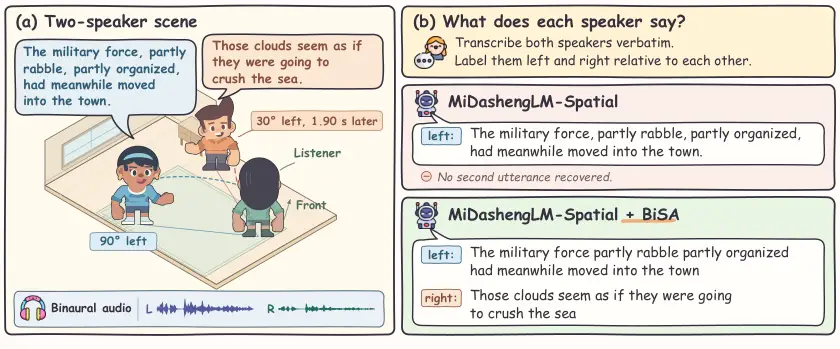
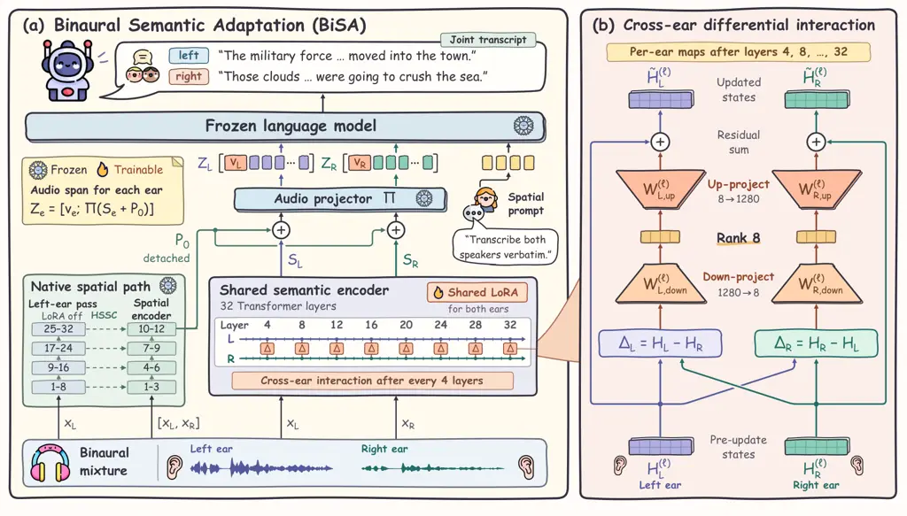

# From Spatial Perception to Speech Recovery: Binaural Semantic Adaptation for Spatially Grounded Multi-Talker Transcription

Wenxuan He    Shan Liang

###### Abstract

Spatial audio large language models increasingly combine general audio
understanding with spatial perception. Yet overlapping conversations
require more than locating speakers. A model must also recover what each
person says and match the words to their positions. We examine this
challenge in MiDashengLM-Spatial, a binaural model designed for both
spatial reasoning and general audio understanding. To test these
abilities, we introduce BiCP-Bench, a benchmark of overlapping
two-speaker binaural recordings that contrasts candidate-based
recognition, position-guided transcription, and joint transcription with
spatial attribution. The model can identify a target utterance among
candidates but struggles to transcribe it without them. Its semantic
encoder uses only one ear. Changing that ear shifts which side’s speech
is recovered more accurately, despite unchanged binaural input to the
spatial branch. We therefore propose Binaural Semantic Adaptation
(BiSA), which combines shared encoding of both ears with cross-ear
differential interactions. With the backbone frozen and 0.027% trainable
parameters, BiSA raises correctly attributed joint transcription success
from 0% to 57.81% for simultaneous onsets. For staggered onsets,
later-speaker word error rate falls from 109.47% to 29.58%. On
full-length Clarity CEC1 mixtures, word error rate falls from 59.33% to
39.60%. Spatial reasoning on MMAU-Pro improves by 9.54 percentage points
without updating the spatial encoder, and general audio performance
remains largely intact.

###### Index Terms: 

Spatial audio understanding, cocktail party problem, overlapping speech,
multi-talker transcription, spatial attribution.

^(†)^(†)address: ¹ Xi’an Jiaotong-Liverpool University  
² University of Liverpool  
[Wenxuan.He23@xjtlu.edu.cn](mailto:Wenxuan.He23@xjtlu.edu.cn) [Wenxuan.He@liverpool.ac.uk](mailto:Wenxuan.He@liverpool.ac.uk)  
^(∗)Corresponding author:
[Shan.Liang@xjtlu.edu.cn](mailto:Shan.Liang@xjtlu.edu.cn)

## 1 Introduction



Figure 1: Joint transcription in a same-side BiCP-Async mixture. Both
speakers are to the listener’s left. The speaker at $`30^{\circ}`$
starts 1.90 s after the speaker at $`90^{\circ}`$. MiDashengLM-Spatial
recovers only the earlier speaker’s utterance. BiSA recovers both
utterances, assigning relative left to the $`90^{\circ}`$ speaker and
right to the $`30^{\circ}`$ speaker.

Spatial hearing enables listeners to locate sound sources and understand
their content in complex acoustic environments. In multi-talker
conversations, spatial cues help listeners segregate overlapping speech
and associate individual utterances with their speakers. In recent
years, audio large language models (LLMs) have made substantial progress
in speech recognition, sound event recognition, and audio question
answering. BAT (Zheng et al., 2024) and OWL (Biswas et al., 2026) have
further extended the capabilities of audio LLMs to binaural spatial
perception, enabling sound source localization and reasoning about
spatial relations. More recently, MiDashengLM-Spatial (Hu et al., 2026)
has integrated spatial perception and general audio understanding within
a unified architecture, advancing the development of spatial audio LLMs.

Advances in spatial perception open new opportunities for audio LLMs to
understand complex multi-talker conversations. Previous studies have
shown that spatial information can guide the recognition of speech from
a specified direction (Tang et al., 2024; Dementyev et al., 2026). A
further challenge in overlapping speech is to recover each speaker’s
complete utterance and associate it with the correct spatial position.
We refer to this task as _spatially grounded multi-talker
transcription_. In the same-side mixture shown in Figure 1, the original
model recovers the earlier speaker’s utterance but omits the later
speaker’s speech. This raises a central question: can existing audio
LLMs translate their spatial perception capabilities into spatially
grounded speech understanding?

To investigate this question, we introduce the Binaural Cocktail Party
Benchmark (BiCP-Bench). The benchmark covers two-speaker mixtures with
simultaneous or staggered speech onsets. It evaluates candidate-based
utterance selection, position-conditioned target-speaker transcription,
and joint transcription with spatial attribution. We study the recently
introduced MiDashengLM-Spatial, an advanced binaural audio LLM with
strong spatial perception and general audio understanding capabilities.
Our experiments show that the model can select a target utterance from
candidates given the speaker’s position but struggles to produce its
complete transcript through free-form transcription. When both speakers
start speaking simultaneously, the original model fails to produce a
single successful joint transcription with correct spatial attribution.
These findings reveal a gap between spatial perception,
candidate-assisted recognition, and open-ended speech recovery.

We further examine how semantic encoding contributes to this capability
gap. Although MiDashengLM-Spatial receives binaural audio, its semantic
encoder processes only one ear signal. We switch the semantic input from
the left ear to the right while keeping the spatial branch’s acoustic
input unchanged. The transcription advantage shifts from the speaker on
the left to the speaker on the right. We further compare complementary
binaural representations with repeated single-ear representations at the
same input length. Providing representations from both ears improves the
recovery of both speakers’ utterances. These findings show that the two
ears provide complementary speech information about the same mixture,
which single-ear semantic encoding cannot fully exploit. Sound from each
speaker reaches the two ears differently depending on the speaker’s
position, providing an acoustic basis for this complementarity. This
motivates us to exploit cross-ear acoustic differences during semantic
encoding.

Building on these findings, we propose Binaural Semantic Adaptation
(BiSA). The core idea is to use complementary observations of the same
acoustic scene and incorporate binaural acoustic differences into the
construction of semantic representations. BiSA uses a shared semantic
encoder to extract representations from both ears and introduces
cross-ear differential interactions to enhance speech content
representations during encoding. Training first uses
position-conditioned target-speaker and joint transcription supervision
to learn complete utterance recovery. A second stage combines
transcription and spatial selection tasks to calibrate the model’s
spatial responses. BiSA improves spatially grounded multi-talker
transcription by training a small set of added parameters while keeping
the original backbone frozen.

BiSA adds trainable parameters amounting to only 0.027% of the original
model’s parameter count. On BiCP-Bench, joint transcription success with
correct spatial attribution rises from 0% to 57.81% when both speakers
start simultaneously. Under staggered overlap, joint transcription
success with correct spatial attribution rises from 0% to 53.65%. WER
for the later-starting speaker decreases from 109.47% to 29.58%. BiSA
also generalizes to the external Clarity CEC1 dataset, reducing
target-speaker WER on untrimmed mixtures from 59.33% to 39.60%. It
largely preserves the original model’s general audio understanding and
maintains near-baseline spatial reasoning performance on the STAR-Bench
spatial-reasoning subset. With the spatial encoder frozen, BiSA improves
spatial reasoning accuracy on MMAU-Pro by 9.54 percentage points. These
findings suggest that the information preserved during semantic encoding
can also shape spatial understanding. By exploiting complementary
binaural speech cues, BiSA improves utterance recovery, spatial
attribution, and spatial reasoning while keeping the spatial encoder
frozen.

Our main contributions are as follows:

1.  1.  Evaluation of spatially grounded speech understanding. We introduce
        BiCP-Bench to evaluate candidate-based utterance selection,
        position-conditioned target-speaker transcription, and joint
        transcription with spatial attribution under overlapping speech. Our
        evaluation reveals a gap between spatial perception and speech
        recovery.
2.  2.  Analysis of reference-ear dependence. We show that single-ear
        semantic encoding biases speech recovery toward speakers at
        particular positions, with the transcription advantage shifting when
        we switch the reference ear. Controlled experiments further
        demonstrate the value of complementary binaural representations for
        recovering both speakers’ utterances.
3.  3.  Parameter-efficient binaural semantic adaptation. We propose BiSA,
        which incorporates cross-ear differential interactions into semantic
        encoding. With the original backbone frozen, BiSA substantially
        improves spatially grounded multi-talker transcription and enhances
        spatial reasoning using only a small set of trainable parameters.
        These improvements further reveal that semantic representation
        construction is a key stage of spatial–semantic interaction.

## 2 Related Work

### 2.1 Spatial Audio Large Language Models

Recent audio large language models have expanded from general sound
recognition and question answering to spatial audio understanding. BAT
(Zheng et al., 2024) combines a binaural spatial encoder with a large
language model to support sound event recognition, source localization,
and spatial relation reasoning. OWL (Biswas et al., 2026) introduces
geometric supervision and multi-step spatial reasoning to improve the
understanding of source direction, distance, and relative spatial
relations. DSpAST (Wilkinghoff and Tan, 2026) improves spatial reasoning
through disentangled spatial acoustic representations. PhaseCoder
(Dementyev et al., 2026) uses multichannel audio and microphone
coordinates to construct array-independent spatial representations for
spatial question answering and target-speaker transcription. More
recently, MiDashengLM-Spatial (Hu et al., 2026) combines semantic and
spatial encoding in a unified model for general audio understanding and
binaural spatial perception. These studies have advanced spatial audio
models from source perception toward more complex spatial understanding,
providing a foundation for spatially grounded speech recovery in
overlapping speech.

### 2.2 Spatially Conditioned and Multi-Talker Speech Recognition

Overlapping speech recognition requires recovering the content of
multiple speakers and assigning each utterance to the corresponding
speaker. Serialized output training (Kanda et al., 2020) organizes
transcripts from multiple speakers into a single output sequence for
end-to-end multi-talker recognition. Meng et al. (2025) extend
instruction-driven language models to joint multi-talker transcription
and target transcription conditioned on speaker attributes. Tang et al.
(2024) use spatial cues for far-field speech recognition and target
speech extraction from specified directions. Xie et al. (2025) introduce
directional markers and multichannel training to enable speech language
models to jointly handle transcription and source direction information.
Lin et al. (2026) investigate cascaded systems incorporating directional
speech separation alongside end-to-end approaches based on serialized
outputs. More recently, Polok et al. (2026) condition a semantic encoder
on speaker activity to support target transcription and content
understanding in multi-talker speech. These studies demonstrate the
value of spatial conditions, speaker cues, and output organization for
overlapping speech processing. Building on this research, we examine
binaural semantic representations in pretrained spatial audio models. We
investigate how complementary cross-ear information during semantic
encoding can improve multi-talker speech recovery and spatial
attribution while retaining the original spatial encoding pathway.

### 2.3 Spatial Audio and Multi-Talker Understanding Benchmarks

Spatial audio evaluation has expanded from sound source localization to
spatial relations and language understanding. SpatialSoundQA (Zheng et
al., 2024) introduces questions covering sound event perception,
direction estimation, distance estimation, and spatial relation
reasoning. BiDepth (Biswas et al., 2026) further incorporates geometric
information and supervision for multi-step spatial reasoning. For
broader audio understanding, MMAU-Pro (Kumar et al., 2026) covers
speech, environmental sounds, music, and spatial reasoning. More
recently, MSU-Bench (Sun et al., 2026) introduces speaker reference,
content understanding, and cross-speaker reasoning tasks for multi-party
conversations, using multiple-choice questions to evaluate
speaker-centric understanding. These benchmarks provide complementary
perspectives on spatial audio and multi-talker understanding. Our
BiCP-Bench further distinguishes candidate-based utterance recognition,
open-ended recovery of complete utterances, and spatial attribution
under spatial conditions. Through simultaneous and staggered overlap
scenarios, it evaluates whether models can reliably associate each
speaker’s speech content with the corresponding spatial position.

## 3 BiCP-Bench: Evaluating Spatially Grounded Multi-Talker Transcription

Performance on sound source localization and spatial question answering
does not establish whether a model can fully transcribe overlapping
speakers. This requires recovering each speaker’s words and associating
them with the correct position within the same mixture. The Binaural
Cocktail Party Benchmark (BiCP-Bench) measures this gap by contrasting
candidate-based recognition with generated transcripts and assessing
their spatial attribution. Its two-speaker binaural mixtures cover
simultaneous and staggered onsets, with speakers on opposite sides, on
the same side, or directly ahead and to one side.

### 3.1 Task Formulation

The three tasks vary the linguistic support and output requirements.
They progress from selecting a supplied utterance to generating one
speaker’s transcript, then jointly transcribing both speakers with
spatial attribution.

Candidate-based Content Recognition. The first task probes speech
content recognition given the target speaker’s position. Along with a
binaural mixture and the target position, the model receives four
candidate sentences and selects the one spoken by the target speaker.
Both speakers’ reference utterances are included, together with two
distractors of similar length drawn from other utterance pairs.
Including the other speaker’s utterance makes recognizing speech content
alone insufficient: the model must also identify its spatial origin. We
evaluate candidate-based recognition on BiCP-Sync.

Position-conditioned Target Transcription. Recovering speech without
candidate sentences poses a further challenge. The model receives the
complete binaural mixture and a natural language instruction specifying
the target position. Its output is the target speaker’s complete
utterance. We query both speakers separately to examine whether the
model can recover the corresponding utterance when the spatial
instruction changes.

Joint Transcription with Spatial Attribution. The model must now recover
both speakers’ utterances and attribute them to their respective
positions in a single response. Given the binaural mixture, it
transcribes both utterances in full and labels the more leftward and
more rightward speakers. Unlike separate target queries, joint
transcription requires the model to organize the two utterances and
establish their spatial associations within one generation.

Spatial Position Descriptions. We use absolute directions to describe
source locations relative to the listener and relative positions to
distinguish the two speakers from each other. The frontal direction is
defined as 0°, with positive azimuths to the left and negative azimuths
to the right. Of the two speakers, the one with the larger azimuth is
designated as the more leftward speaker and the other as the more
rightward speaker. For instance, both speakers at +90° and +30° lie to
the listener’s left, but the former is more leftward than the latter.

Candidate-based recognition uses absolute directions. In BiCP-Sync,
target transcription uses absolute directions for speakers on opposite
sides and relative positions for speakers on the same side. Relative
positions are used throughout target transcription in BiCP-Async and
joint transcription in both subsets. They allow us to assess speech
recovery even when a coarse directional label cannot distinguish the
speakers.

### 3.2 Benchmark Construction

We construct binaural mixtures with variations in speaker positions,
speech levels, and onset times to assess spatially grounded speech
understanding across different acoustic conditions. BiCP-Bench comprises
two subsets distinguished by the speakers’ onset times. BiCP-Sync
contains 1,152 simultaneous-onset mixtures, and BiCP-Async contains 384
staggered-onset mixtures.

Speech Corpora and Binaural Rendering. We draw clean utterances from
LibriSpeech test-clean (Panayotov et al., 2015) and the English test
split of FLEURS (Conneau et al., 2023). The binaural responses come from
ARI and the University of Surrey. ARI provides measured head-related
impulse responses (HRIRs) from different listeners (Majdak et al.,
2010). Surrey provides binaural room impulse responses (BRIRs) measured
using a dummy head (Francombe, 2017). Reverberant conditions use room
responses simulated with pyroomacoustics (Scheibler et al., 2018) and
ARI directional responses, or complete measured Surrey BRIRs. Table 1
summarizes the three combinations of speech corpora and binaural
responses, covering different speech content, listener anatomies, and
acoustic environments.

Each clean utterance is convolved with the left- and right-ear impulse
responses corresponding to its source azimuth. We scale and mix the
resulting signals according to the prescribed speech levels and onset
times. The signal received at ear $`e`$ is given by:

```math
x_{e}(t)=g\sum_{i=1}^{2}a_{i}(s_{i}*h_{i,e})(t-\tau_{i}),\quad e\in\{L,R\}, \tag{1}
```

In Eq. (1), $`s_{i}`$ denotes the clean utterance of speaker $`i`$, and
$`h_{i,e}`$ denotes the acoustic impulse response from that speaker to
ear $`e`$. The coefficients $`a_{i}`$ and $`\tau_{i}`$ control the
speech level and onset time, respectively. The gain $`g`$ is applied
equally to both channels after mixing. All mixtures are stored as
two-channel audio at 16 kHz, preserving the acoustic differences between
the ears.

| Speech corpus                  | Binaural responses | BiCP-Sync | BiCP-Async |
| ------------------------------ | ------------------ | --------- | ---------- |
| LibriSpeech                    | ARI                | 384       | 128        |
| FLEURS                         | ARI                | 384       | 128        |
| FLEURS                         | Surrey             | 384       | 128        |
| Distinct clean utterance pairs |                    | 128       | 188        |
| Total mixtures                 |                    | 1,152     | 384        |

Table 1: Composition of BiCP-Bench.

In BiCP-Sync, the FLEURS groups rendered with ARI and Surrey share the
same utterance pairs, source azimuths, nominal gains, and evaluation
questions. This pairing enables comparisons across different binaural
responses. BiCP-Async distributes acoustic conditions across different
source pairs to cover a wider range of utterances and speaking orders.

BiCP-Sync. Aligning the speakers’ speech onsets reduces the influence of
speaking order. High overlap tests whether the model can recover both
complete utterances while the speakers are active together. We trim
leading and trailing silence and select utterance pairs of similar
duration with substantial overlap in their active speech regions. Both
trimmed utterances start at the same sample. We measure overlap as the
smaller of the two proportions of active speech frames shared with the
other utterance. The minimum overlap rates among the selected
LibriSpeech and FLEURS pairs are 90.78% and 77.09%, respectively.

Within each rendering group, six acoustic variants per utterance pair
vary spatial separation, speech levels, and reverberation to examine
speech recovery under different conditions. The basic condition places
the speakers at $`\pm`$30° with equal gains after active-speech level
normalization. In two further conditions, one speaker’s clean signal is
attenuated by 4 dB or 8 dB to examine recovery of weaker speech. To test
relative spatial distinctions within one side, we place both speakers at
+30° and +90° or $`-`$30° and $`-`$90°. Distinguishing these speakers
requires finer spatial information than coarse left–right
classification. The remaining conditions are a reverberant mixture and a
channel-swapped counterpart of the 8 dB attenuation condition.

Each acoustic variant contains 192 mixtures, yielding 1,152
simultaneous-onset mixtures in total. The speakers are on opposite sides
of the listener in 960 mixtures. In the other 192, both are on the left
or both are on the right.

BiCP-Async. By introducing staggered speech onsets, BiCP-Async examines
whether the model can recover speech from a specified position after
another speaker has already begun speaking.

At each ear, the active speech onsets differ by 1–2 seconds. At least
80% of the later speaker’s active speech overlaps with the earlier
speaker’s active speech. The earlier speaker also finishes 0.5–1 second
after the later speaker, measured from the end of active speech at each
ear. Most of the later utterance is therefore embedded within the
earlier speaker’s ongoing speech. We retain both utterances in full,
including the earlier speaker’s speech before and after the overlap.

The spatial configurations include speakers on opposite sides, one
directly ahead and the other to one side, and both on the same side.
Opposite-side mixtures test left–right separation, whereas the other
configurations require distinguishing positions within one side or
between the front and a side. Varying the strength of the later
speaker’s speech tests recovery when temporal and level differences
occur together. During overlapping active speech, the later-to-earlier
speaker energy ratio, aggregated over both ears, is set to 0, $`-`$4, or
$`-`$8 dB.

Each of the 192 original staggered-onset scenes has a channel-swapped
counterpart, giving 384 binaural mixtures. Unlike BiCP-Sync, which
expands each utterance pair across multiple acoustic variants,
BiCP-Async uses more distinct utterance pairs to cover a wider variety
of speech content.

Spatial Mirroring. Channel swapping provides paired scenes for examining
whether the model responds to changes in spatial position. Swapping the
left and right channels preserves both utterances, their speaking order,
and their timing. It reverses the represented source azimuths and
corresponding spatial labels. In BiCP-Sync, we apply this operation to
the 8 dB attenuation condition; in BiCP-Async, we apply it to every
original scene. These pairs allow us to examine whether changes in
spatial information lead to corresponding changes in the model’s
attribution of speech content.

Data Isolation. We separate the adaptation training data from the
BiCP-Bench test data to evaluate generalization to unseen speech content
and listener anatomies. There is no overlap in source recording
identifiers, normalized reference utterances, or verifiable speaker
identifiers between the training and test sets. Speaker-level
disjointness cannot be established for FLEURS because persistent speaker
identifiers are unavailable in its public manifest. The ARI listeners
used for training, validation, and testing are mutually disjoint.
BiCP-Sync and BiCP-Async share some source speech material, so benchmark
size is reported in terms of the resulting binaural mixtures.

### 3.3 Evaluation Protocol

Candidate-based content recognition is measured by the proportion of
correctly answered queries. This accuracy measures whether the model
selects the utterance associated with the requested position when
candidate content is available.

Target Transcription. We measure the discrepancy between the generated
text and the target speaker’s reference utterance using word error rate
(WER):

```math
\mathrm{WER}=\frac{S+D+I}{N}, \tag{2}
```

In Eq. (2), $`S`$, $`D`$, and $`I`$ denote the numbers of word
substitutions, deletions, and insertions, respectively, and $`N`$ is the
number of reference words. Corpus-level WER is the total number of word
errors divided by the total number of reference words. WER values are
reported as percentages.

A target transcription is considered successful when its WER does not
exceed 20%. We report the proportion of queries meeting this criterion.
For mixtures with two separate target queries, we also report the
proportion of mixtures for which both transcriptions succeed. On
BiCP-Async, results for the earlier and later speakers are reported
separately to examine speech recovery under different speaking orders.

Joint Transcription. Recovering both utterances and attributing them to
the correct positions are distinct aspects of joint transcription. We
measure them separately to distinguish incomplete speech recovery from
spatial attribution errors.

We first extract utterances and explicit position labels from the
response. Content recovery asks whether both speakers’ utterances are
present, regardless of their spatial labels. We find the best assignment
of distinct output segments to the two reference utterances. A mixture
counts as successful if an assignment achieves WER of at most 20% for
both utterances and leaves no unmatched output words.

For joint transcription with correct spatial attribution, we compare the
text assigned to each explicit left or right label against the
corresponding reference utterance. Multiple segments under the same
label are concatenated in their generated order. A mixture succeeds when
the WER for each position does not exceed 20%. This metric tests whether
the recovered utterances are associated with their correct relative
positions. The two success rates are computed and reported separately
because their text matching rules differ.

We also report overall WER for joint transcription. The assignment
between the reference utterances and distinct output segments minimizes
the total number of word errors, counting words in unmatched segments as
insertions. Missing utterances are matched to empty segments and counted
as deletions. Corpus-level WER is computed over all reference words.

This protocol provides controlled comparisons for the following analysis
of where spatial perception falls short of recovering and attributing
overlapping speech.

## 4 Diagnosing the Speech Recovery Gap

A model may locate sound sources without recovering the corresponding
speech content. This gap is particularly important in overlapping
speech. Even with spatial information available, the model may fail to
recover complete utterances from speakers at different locations. We
therefore examine whether the model’s ability to access speech content
limits spatially grounded transcription.

### 4.1 Recognition Does Not Imply Speech Recovery

MiDashengLM-Spatial shows markedly different performance on
candidate-assisted recognition and free-form transcription. BiCP-Sync
contains 1,152 binaural recordings of two speakers with simultaneous
onsets and overlapping speech. Both tasks query each speaker separately
in every recording, yielding 2,304 individually scored responses per
task. Given a target position, the model selects the corresponding
utterance from four candidates. It achieves 69.27% accuracy
(1,596/2,304), above the 25% chance level. Without candidate sentences,
only 26.91% (620/2,304) of position-conditioned transcriptions meet the
success criterion of a word error rate (WER) no greater than 20%. The
model can identify target utterances from candidates, but recovering
their complete content without candidates remains difficult.

Recovering both speakers’ utterances from the same mixture proves
particularly difficult. For each of the 1,152 recordings, we query the
two speakers separately, requesting one speaker’s transcript at a time.
None of these recordings yields two successful transcriptions. In joint
transcription, the model must provide both utterances in one response
and assign each to the correct relative left or right position. The
baseline succeeds on 0 of 1,152 recordings (0%). To examine whether
attribution errors alone explain these failures, we also evaluate the
same joint responses for content recovery without using spatial labels.
Generated utterances are matched to the two reference transcripts using
the best assignment, regardless of their predicted left or right labels.
Under this measure, successful recovery of both utterances also remains
at 0/1,152.

These results point to a limitation in speech content recovery itself.
The model struggles to recover both utterances from overlapping speech.
Candidate sentences help it identify target content, but complete
free-form transcription remains unreliable. This recovery gap directs
our attention to how the model constructs semantic representations.

### 4.2 Semantic Reference-Ear Dependence

MiDashengLM-Spatial receives binaural audio, but its semantic encoder
and spatial branch use different acoustic inputs. The spatial branch
processes both ears, while the semantic encoder uses only the fixed
left-ear signal. The two ears record acoustically different versions of
the same overlapping speech. We investigate the relationship between
semantic input and transcription by switching the semantic reference ear
from left to right. The original binaural recording and the spatial
branch’s input remain unchanged.

We compare 200 recordings containing two overlapping speakers, keeping
the model weights and other inference settings fixed. Both conditions
use joint transcription, requiring the model to produce the two
speakers’ utterances in one response. We assess content recovery for
left- and right-side utterances separately, using a WER of at most 20%
as the success criterion. Scoring ignores spatial labels and extra
output, checking whether each speaker’s content meets the transcription
criterion.

| Semantic reference ear | Left-side utterances recovered | Right-side utterances recovered |
| ---------------------- | ------------------------------ | ------------------------------- |
| Left ear               | 162/200 (81%)                  | 4/200 (2%)                      |
| Right ear              | 4/200 (2%)                     | 172/200 (86%)                   |

Table 2: Speech content recovery under semantic reference-ear switching.

Table 2 shows that switching the semantic reference ear produces a clear
reversal in content recovery performance. With left-ear input, 162 of
the 200 left-side utterances meet the criterion, compared with four from
the right side. Switching to right-ear input yields 172 successful
right-side utterances and four successful left-side utterances. Which
speaker’s speech is recovered more accurately depends strongly on
whether the semantic encoder uses the left or right ear.

The experiment reveals a strong dependence of speech content recovery on
the semantic reference ear. The spatial branch receives the same
binaural input in both conditions. Changing the semantic reference ear
alone shifts which side’s utterance is recovered more reliably. This
provides a more specific clue to the recovery gap observed in
Section 4.1. The existing semantic pathway does not fully exploit the
different observations of the same mixture available at the two ears.
Whether these observations contain complementary information remains to
be tested.

### 4.3 Complementary Semantic Information Across Ears

To test whether the two ears provide complementary information, we
compare binaural semantic representations with repeated single-ear
representations.

We keep the model weights, mixed recordings, spatial features, and task
instructions fixed. We compare four semantic input combinations:
left–right, right–left, left–left, and right–right. The first two
combine representations from different ears. The remaining two repeat
representations from a single ear, and all four inputs have the same
sequence length. We evaluate joint transcription on 200 recordings with
overlapping speech from two speakers, examining whether the responses
contain both speakers’ complete utterances. Generated utterances are
matched to the two reference transcripts using the best assignment.
Recovery succeeds when both speakers achieve a WER of at most 20%,
regardless of spatial labels.

| Input representations | Successful two-speaker content recovery |
| --------------------- | --------------------------------------- |
| Left + Right          | 66/200                                  |
| Right + Left          | 65/200                                  |
| Left + Left           | 2/200                                   |
| Right + Right         | 3/200                                   |

Table 3: Two-speaker content recovery with binaural and repeated
single-ear representations.

Table 3 shows that both binaural combinations recover the two speakers’
utterances more often than repeated single-ear representations. This
indicates that the two ears provide complementary information useful for
recovering individual utterances from overlapping speech.

Together with the reference-ear experiment, these results show that the
ear chosen for semantic encoding affects which speaker’s content is
recovered. Using both ears improves recovery of the two utterances.
These findings motivate changes to the current single-ear semantic
encoding pathway. How can we use the complementary information from both
ears when constructing semantic representations to improve the recovery
of individual utterances in overlapping speech? This question motivates
the method developed in the next section.

## 5 Binaural Semantic Adaptation (BiSA)

The analysis in Section 4 shows that the choice of semantic reference
ear strongly affects the model’s ability to recover speech from
different speakers. Complementary information from the two ears also
helps recover both utterances in overlapping speech. Based on these
findings, we propose Binaural Semantic Adaptation (BiSA) to improve
spatially grounded multi-talker transcription by changing how semantic
representations are constructed. BiSA extends the original single-ear
semantic encoding to shared-weight binaural encoding and introduces
cross-ear differential interaction during encoding, allowing acoustic
observations from both ears to contribute jointly to semantic
representation construction. BiSA leaves all pretrained weights
unchanged, including those of the audio projector and language model.
The adaptation is implemented through added LoRA parameters, cross-ear
differential modules, and two identity vectors. These parameters can be
stored and loaded separately from the pretrained backbone. Figure 2
summarizes the architecture and the cross-ear residual update.



Figure 2: BiSA architecture and cross-ear differential interaction. (a)
A shared semantic encoder processes both ears with shared LoRA and
cross-ear residual modules. The detached native spatial contribution
$`P_{0}`$ is added to both semantic sequences before projection. Each
projected audio span receives an ear-identity vector and enters the
frozen language model. All pretrained weights remain frozen. (b)
Independent rank-8 maps transform each ear’s difference from the other
ear into a residual update after layers 4, 8, …, 32. Both updates use
the same pre-update states.

### 5.1 Binaural Semantic Encoding

The semantic encoder in MiDashengLM-Spatial uses a fixed left-ear
signal, while the spatial branch independently processes the full
binaural audio. To exploit the different acoustic observations captured
by the two ears, BiSA feeds the left- and right-ear signals separately
into a shared semantic encoder. Both ears use the same pretrained
encoder weights to extract their respective semantic representations in
a common feature space.

Binaural input provides two sets of semantic representations, but the
pretrained encoder has not been adapted to recovering overlapping speech
from binaural recordings. We therefore freeze its pretrained weights and
introduce shared low-rank adaptation (LoRA) parameters (Hu et al.,
2022). These parameters allow the encoder to adjust its feature
transformations under transcription supervision while retaining its
pretrained representation capabilities. The two ears use the same LoRA
parameters. The original spatial encoding branch remains frozen and
continues to extract spatial information independently from the binaural
audio.

### 5.2 Cross-Ear Differential Interaction

With shared binaural encoding, the left- and right-ear representations
are still computed along separate paths, without explicit modeling of
their relationship during encoding. To model this relationship
explicitly during semantic encoding, BiSA introduces cross-ear
differential interaction. The two ears capture different acoustic
observations of the same scene, and the differences between their
representations provide a basis for modeling this relationship. We use
hidden-state differences to construct interaction signals, allowing each
ear’s semantic representation to be updated using information from the
other ear.

Let $`H_{L}^{(\ell)},H_{R}^{(\ell)}\in\mathbb{R}^{n_{\ell}\times d}`$
denote the left- and right-ear hidden states at layer $`\ell`$,
respectively. Here, $`n_{\ell}`$ is the number of aligned audio tokens
at layer $`\ell`$. The cross-ear differential module computes the
differences between the two representations at corresponding token
positions:

```math
\Delta_{L}^{(\ell)}=H_{L}^{(\ell)}-H_{R}^{(\ell)},\qquad\Delta_{R}^{(\ell)}=H_{R}^{(\ell)}-H_{L}^{(\ell)}. \tag{3}
```

For $`e\in\{L,R\}`$, the residual update using Eq. (3) is

```math
\widetilde{H}_{e}^{(\ell)}=H_{e}^{(\ell)}+\Delta_{e}^{(\ell)}\bigl(W_{e,\mathrm{down}}^{(\ell)}\bigr)^{\top}\bigl(W_{e,\mathrm{up}}^{(\ell)}\bigr)^{\top}. \tag{4}
```

In Eq. (4), $`W_{e,\mathrm{down}}^{(\ell)}\in\mathbb{R}^{r\times d}`$
and $`W_{e,\mathrm{up}}^{(\ell)}\in\mathbb{R}^{d\times r}`$ are the
down-projection and up-projection matrices, respectively, with hidden
dimension $`d=1280`$ and rank $`r=8`$. The two ears and different layers
use independent mapping parameters. Both residual updates use the same
pre-update states. The updated states enter the next Transformer layer,
or the encoder output processing at layer 32. The up-projection matrices
are initialized to zero, so the cross-ear differential modules leave the
original hidden states unchanged at the start of training.

The differential features from each ear pass through trainable low-rank
mappings to produce residual updates for their respective hidden states.
This allows each representation to incorporate cross-ear differences
during encoding. We insert cross-ear differential modules after
Transformer layers 4, 8, 12, 16, 20, 24, 28, and 32, enabling
interaction at different levels of semantic representation.

Let $`S_{e},P_{0}\in\mathbb{R}^{n_{s}\times d}`$ denote the final
semantic features and frozen native spatial features, respectively. The
same $`P_{0}`$ is added to both semantic sequences before the frozen
audio projector $`\Pi`$. The projected sequence for ear $`e`$, prefixed
by its identity vector, is

```math
Z_{e}=[v_{e};\Pi(S_{e}+P_{0})],\qquad e\in\{L,R\}. \tag{5}
```

Here, $`n_{s}`$ is the sequence length before projection, and $`n_{a}`$
is the number of projected audio tokens per ear. The projector includes
temporal subsampling. We have $`v_{e}\in\mathbb{R}^{1\times 3584}`$ and
$`\Pi(S_{e}+P_{0})\in\mathbb{R}^{n_{a}\times 3584}`$. Semicolons denote
concatenation along the token axis. Equation (5) supplies the left and
right audio spans to the frozen language model, retaining the native
prompt delimiters. The native spatial features are computed with
semantic LoRA disabled and detached from adaptation gradients.

### 5.3 Position-Conditioned Supervised Learning

Spatially grounded multi-talker transcription requires the model to
recover the utterances of different speakers, identify the target
speaker from spatial information, and assign the recovered content to
the correct position. We use two stages of supervised learning. The
first stage focuses on position-conditioned transcription, training BiSA
to generate the complete utterance of the speaker specified by a spatial
instruction. To establish a consistent correspondence between positions
and utterances, we adopt a spatial reference based on the speakers’
relative azimuths, defining them as the more leftward and the more
rightward speaker. For each two-speaker mixture, we construct separate
transcription instructions for the two relative positions, using the
corresponding speaker’s complete utterance as the training target. We
also introduce joint transcription supervision, requiring the model to
recover both utterances in a single response and assign them according
to the same relative left-right ordering.

The first-stage training examples include synchronous overlap, staggered
overlap, and single-speaker speech to cover content recovery under
different speaking conditions. We use an autoregressive text generation
objective and compute the training loss against reference answers. Given
binaural inputs $`x_{L},x_{R}`$, a task instruction $`q`$, and a target
answer sequence $`y=(y_{1},\ldots,y_{T})`$, the loss is defined as

```math
\mathcal{L}_{\mathrm{gen}}=-\frac{1}{T}\sum_{t=1}^{T}\log p_{\phi,\theta}(y_{t}\mid y_{<t},x_{L},x_{R},q), \tag{6}
```

In Eq. (6), $`\phi`$ denotes the frozen pretrained parameters,
$`\theta`$ the adaptation parameters, and $`y_{t}`$ the $`t`$-th answer
token. The target sequence includes the end-of-sequence token. Prompt
and audio-prefix tokens are excluded from the loss.

For a minibatch $`\mathcal{B}`$, let $`\mathcal{Q}_{b}`$ contain the
supervised queries associated with record $`b`$. The training objective
averages token-normalized losses within each record and then across
records:

```math
\mathcal{L}_{\mathrm{batch}}=\frac{1}{|\mathcal{B}|}\sum_{b\in\mathcal{B}}\frac{1}{|\mathcal{Q}_{b}|}\sum_{q\in\mathcal{Q}_{b}}\mathcal{L}_{\mathrm{gen}}^{(b,q)}. \tag{7}
```

For paired target transcription, $`\mathcal{Q}_{b}`$ contains one left
query and one right query; other records contain one query. Equation (7)
therefore gives equal weight to the two target directions within each
paired record.

In this stage, BiSA jointly optimizes the shared LoRA parameters in the
semantic encoder, the cross-ear differential modules, and two learnable
identity vectors. Because both ears use the same semantic encoder, we
prepend a learnable vector to each semantic feature sequence to identify
whether it comes from the left or right ear. During training, the
pretrained weights of the semantic encoder, spatial encoding branch, and
language model remain frozen. The generation loss is backpropagated
through the frozen language model and projector to update the adaptation
parameters; the native spatial features remain detached. BiSA has
2,300,928 trainable parameters in total, approximately 0.027% of the
base model.

Writing
$`\theta=(\theta_{\mathrm{LoRA}},\theta_{\mathrm{diff}},v_{L},v_{R})`$,
Stage 1 updates all four components. After joint adaptation, we perform
lightweight calibration of the two identity vectors. The second stage
retains position-conditioned transcription, joint transcription, and
noisy single-speaker transcription. It also introduces four-way
single-speaker direction classification and spatially guided
candidate-utterance selection, providing additional supervision for
spatial recognition and the association between position and speech
content. The two-speaker tasks continue to use the relative left-right
reference from the first stage, giving position-conditioned
transcription, joint transcription, and candidate-utterance selection a
consistent correspondence between positions and utterances. In this
stage, $`\theta_{\mathrm{LoRA}}`$ and $`\theta_{\mathrm{diff}}`$ are
fixed, and only the two identity vectors, comprising 7,168 parameters,
are updated. With the learned semantic encoding and cross-ear
interaction parameters held fixed, this calibration adjusts how the
language model reads semantic features from the two ears to better
select and organize transcription output according to spatial
instructions.

## 6 Experimental Results and Analysis

Binaural recordings contain complementary cues about speech content.
Whether cross-ear interactions during semantic encoding can exploit
these cues to recover complete utterances from different speakers in
overlapping speech warrants systematic investigation. This section
examines BiSA on spatially grounded multi-talker transcription and
further evaluates its cross-dataset applicability, effects on pretrained
model capabilities, and the contribution of cross-ear interactions.

### 6.1 Experimental Setup

We use MiDashengLM-Spatial as the base model and compare the original
model, untrained binaural input, and the two training stages of BiSA.
The untrained binaural configuration encodes the left and right ears
into separate semantic feature sequences without updating model
parameters or using the trained cross-ear differential module. BiSA
keeps the pretrained model parameters frozen and trains approximately
2.3 million adaptation parameters. The first stage uses 4,000 training
records for binaural semantic adaptation. The second stage uses 480
calibration records and updates only the two ear-identity vectors.
Models from both stages are selected using an independent development
set.

Training binaural speech is constructed from LibriSpeech recordings and
ARI head-related impulse responses. The main evaluation uses BiCP-Bench,
comprising 1,152 simultaneous-overlap recordings (BiCP-Sync) and 384
staggered-overlap recordings (BiCP-Async). These recordings cover
different relative speaker positions, speech materials, and acoustic
response conditions. Training and test sets use different ear profiles,
and overlap checks are performed on speech materials with verifiable
identifiers. We also evaluate external speech recovery on Clarity CEC1
and assess general audio understanding and spatial capabilities using
the STAR-Bench spatial-reasoning subset and MMAU-Pro. All models use the
same task prompts, generation settings, and scoring protocols.

### 6.2 Spatially Grounded Multi-Talker Transcription Performance

To examine whether binaural semantic adaptation can turn complementary
information from both ears into spatially grounded utterance recovery,
we compare the original MiDashengLM-Spatial, untrained binaural input,
and both BiSA stages on BiCP-Sync. The evaluation includes
candidate-based utterance selection, position-conditioned transcription,
and joint transcription of two speakers. Candidate-based selection asks
the model to identify the utterance corresponding to a target speaker’s
position from four candidates. Position-conditioned transcription makes
two independent requests for the same speech mixture, each specifying
one speaker’s position and requiring the complete utterance. Joint
transcription requires the model to recover both complete utterances in
a single response and assign their relative left-right positions.
Table 4 presents the results.

| Model                    | Four-choice accuracy $`\uparrow`$ | Position-conditioned WER $`\downarrow`$ | Both-query success $`\uparrow`$ | Joint transcription WER $`\downarrow`$ | Both-speaker content success $`\uparrow`$ | Left-right attribution success $`\uparrow`$ |
| ------------------------ | --------------------------------- | --------------------------------------- | ------------------------------- | -------------------------------------- | ----------------------------------------- | ------------------------------------------- |
| Original model           | 69.27                             | 65.96                                   | 0.00                            | 63.54                                  | 0.00                                      | 0.00                                        |
| Untrained binaural input | 58.33                             | 66.15                                   | 1.39                            | 54.23                                  | 5.12                                      | 5.03                                        |
| BiSA Stage 1             | 78.82                             | 17.82                                   | 53.47                           | 14.11                                  | 58.16                                     | 57.55                                       |
| BiSA Stage 2             | 80.51                             | 18.12                                   | 53.56                           | 14.02                                  | 58.85                                     | 57.81                                       |

Note. All values are percentages. The evaluation contains 1,152
two-speaker mixtures, with 2,304 queries for the four-choice task.
Both-query success requires the WER of each position-conditioned
transcription for the same recording to be at most 20%. For joint
transcription, both-speaker content success uses optimal text matching,
while left-right attribution success is scored using explicit position
labels. The two metrics are computed independently.

Table 4: Spatially grounded transcription performance on BiCP-Sync

In candidate-based utterance selection, the original model achieves
69.27% accuracy. However, in position-conditioned transcription without
candidate utterances, it achieves no recordings with successful recovery
of both speakers’ complete utterances. After binaural semantic
adaptation, BiSA Stage 2 increases candidate-selection accuracy to
80.51%. Successful individual position-conditioned transcriptions
increase from 620/2,304 to 1,675/2,304, and both-query success reaches
53.56% (617/1,152). Overall WER decreases from 65.96% to 18.12%. Among
192 recordings with both speakers on the same side of the listener, BiSA
successfully transcribes both speakers in 97 cases. The marked
difference between candidate-based recognition and open-ended
transcription reflects the distinct demands these tasks place on speech
content recovery. Joint adaptation of binaural semantic representations
substantially improves the recoverability of both speakers’ utterances
from the same mixture, enabling spatial instructions to guide complete
utterance generation for a specified speaker.

Joint transcription further requires the model to recover both
utterances in a single response and establish their correct spatial
attribution. The original model achieves no recordings in which both
speakers’ content meets the success criterion. In contrast, BiSA Stage 2
reaches 58.85% (678/1,152) both-speaker content success and 57.81%
(666/1,152) left-right attribution success. Overall WER decreases from
63.54% to 14.02%. The corresponding success rates for untrained binaural
input are 5.12% and 5.03%. This finding addresses the gap between
spatial perception and open-ended speech recovery. Effective semantic
modeling and supervised adaptation of complementary binaural information
help produce representations that support both content recovery and
spatial attribution.

We further evaluate speech recovery under staggered overlap using
BiCP-Async. In these recordings, one speaker begins speaking before the
other joins. The model must recover the complete utterance of the
spatially specified speaker while retaining the preceding speech of the
first speaker in the input. Table 5 reports transcription performance
for the later-starting speaker, content confusion, and joint
transcription results.

| Model                    | Later-speaker WER $`\downarrow`$ | Earlier-speaker substitutions $`\downarrow`$ | Both-query success $`\uparrow`$ | Both-speaker content success $`\uparrow`$ | Left-right attribution success $`\uparrow`$ | Joint transcription WER $`\downarrow`$ |
| ------------------------ | -------------------------------- | -------------------------------------------- | ------------------------------- | ----------------------------------------- | ------------------------------------------- | -------------------------------------- |
| Original model           | 109.47                           | 170                                          | 0.26                            | 0.00                                      | 0.00                                        | 57.11                                  |
| Untrained binaural input | 104.08                           | 89                                           | 5.73                            | 5.73                                      | 5.47                                        | 55.82                                  |
| BiSA Stage 1             | 30.27                            | 14                                           | 52.60                           | 52.34                                     | 52.08                                       | 16.92                                  |
| BiSA Stage 2             | 29.58                            | 14                                           | 53.39                           | 53.65                                     | 53.65                                       | 18.03                                  |

Note. The evaluation contains 384 complete staggered-overlap recordings.
All values are percentages except earlier-speaker substitutions, which
reports the number of recordings. An earlier-speaker substitution occurs
when a response to the later-speaker transcription query has WER above
20% against the later speaker’s reference but at most 20% against the
earlier speaker’s reference.

Table 5: Transcription performance under staggered overlap on BiCP-Async

For later-speaker transcription, the original model has a WER of
109.47%, with 170 of 384 responses meeting the criterion for
transcription of the earlier speaker instead. BiSA Stage 2 reduces
later-speaker WER to 29.58% and the number of earlier-speaker
substitutions to 14/384. Both-query success on the same recording also
increases from 0.26% to 53.39%. The sharp reduction in this error type
reflects a more accurate correspondence between speech onset order and
the target specified by spatial instructions. Even when the earlier
speaker has established substantial speech context, the model can select
the later-starting target according to spatial instructions and reduce
interference from the preceding utterance during content recovery.

For joint transcription under staggered overlap, BiSA Stage 2 achieves
53.65% (206/384) for both-speaker content success and left-right
attribution success. Overall WER decreases from 57.11% for the original
model to 18.03%. Together with the marked reduction in incorrect speaker
selection during later-speaker transcription, the joint transcription
performance reflects BiSA’s improved alignment of speaker content with
spatial positions in mixed speech. Spatial references guide
target-utterance recovery more effectively, reducing the influence of
speaking order on content selection and attribution.

### 6.3 External Generalization and Preservation of Pretrained Capabilities

The value of binaural semantic adaptation also lies in whether learned
representations support target-utterance recovery across acoustic
conditions and remain compatible with the pretrained model’s audio
understanding capabilities. We therefore evaluate BiSA from three
perspectives: external speech recovery, general audio understanding, and
spatial response consistency. We also examine how the two training
stages affect these capabilities.

To assess cross-dataset applicability, we evaluate speech recovery on
Clarity CEC1 (Graetzer et al., 2021). Originally developed for
hearing-aid speech enhancement, CEC1 uses binaural room impulse
responses to construct indoor acoustic scenes containing target speech
and interfering sources. We select all 750 recordings with speech
interference from the official evaluation set and use the mixtures from
the front-facing microphones of the binaural hearing aids.
Position-conditioned transcription prompts are constructed from the
relative directions of the target and interfering speakers. We evaluate
both full recordings and target-utterance windows. Full recordings
retain the interfering speaker’s speech before and after the target
utterance. Target-utterance windows contain only the target utterance
interval while preserving interference within that interval. WER is
computed against the official target transcripts for all models. This
evaluation introduces independent speech material and room acoustic
conditions to assess BiSA in external speech interference scenarios.

| Evaluation dimension        | Benchmark and metric                                      | Original model | BiSA Stage 1 | BiSA Stage 2 |
| --------------------------- | --------------------------------------------------------- | -------------- | ------------ | ------------ |
| External speech recovery    | CEC1 full-recording WER $`\downarrow`$                    | 59.33          | 38.52        | 39.60        |
|                             | CEC1 target-window WER $`\downarrow`$                     | 27.01          | 19.35        | 18.66        |
| Spatial understanding       | STAR-Bench spatial-reasoning subset accuracy $`\uparrow`$ | 70.25          | 68.33        | 69.06        |
| General audio understanding | MMAU-Pro overall score $`\uparrow`$                       | 56.44          | 55.94        | 56.04        |
| Spatial understanding       | MMAU-Pro spatial-question accuracy $`\uparrow`$           | 55.38          | 63.69        | 64.92        |
| Ear-swap consistency        | STAR-Bench ear-swap pair accuracy $`\uparrow`$            | 72.56          | 66.17        | 70.30        |
|                             | MMAU-Pro ear-swap pair accuracy $`\uparrow`$              | 33.11          | 31.08        | 33.78        |

Note. WER and accuracy are reported as percentages; the MMAU-Pro overall
score is reported on a 0–100 scale. CEC1 contains 750 official
recordings with speech interference. Ear-swap evaluations contain 266
input pairs for STAR-Bench and 148 for MMAU-Pro. The MMAU-Pro evaluation
protocol is detailed in Appendix A. Ear-swap pair accuracy requires
correct responses for both the original input and its channel-swapped
counterpart.

Table 6: External speech recovery, pretrained capabilities, and spatial
response consistency

As shown in Table 6, the original model obtains 59.33% WER on full CEC1
recordings. BiSA reduces this to 38.52% after Stage 1 and 39.60% after
Stage 2. On target-utterance windows, the corresponding WERs are 27.01%,
19.35%, and 18.66%. The clear improvements under both conditions show
that target-utterance recovery learned through binaural semantic
modeling and supervised adaptation transfers to independent speech
material and room acoustic conditions. In full recordings, BiSA also
follows spatial instructions to recover target utterances more
accurately despite the interfering speaker’s preceding and trailing
speech. This further demonstrates the effectiveness of the learned
capability in longer contexts of competing speech.

We further use the 502-question spatial-reasoning subset of STAR-Bench
(Liu et al., 2026) and MMAU-Pro (Kumar et al., 2026) to assess how
binaural adaptation affects the pretrained model’s audio understanding
capabilities. BiSA Stage 2 achieves 69.06% accuracy on the STAR-Bench
spatial-reasoning subset, close to the original model’s 70.25%. On
MMAU-Pro, spatial-question accuracy increases from 55.38% to 64.92%,
while overall score reaches 56.04%, close to the original model’s
56.44%. These results show that the capability expansion achieved
through binaural semantic encoding, cross-ear interaction, and
supervised adaptation improves spatial tasks while largely preserving
general audio understanding performance. The effective use of binaural
semantic information therefore offers benefits beyond multi-talker
transcription.

To further examine the model’s responses to changes in binaural spatial
information, we evaluate paired response accuracy under physical ear
swapping on STAR-Bench and MMAU-Pro. Swapping the left and right
channels preserves speech content while changing the corresponding
spatial direction relationships. From Stage 1 to Stage 2, ear-swap pair
accuracy increases from 66.17% to 70.30% on STAR-Bench and from 31.08%
to 33.78% on MMAU-Pro. Stage 2 freezes the shared low-rank adaptation
parameters and cross-ear differential module, updating only the two
ear-identity vectors. Further calibration of binaural input identities
can therefore improve response consistency under changes in spatial
input. Together with the external transcription and pretrained
capability evaluations, the two training stages serve distinct
adaptation roles. Stage 1 establishes binaural semantic recovery, while
Stage 2 further adjusts the model’s use of spatial information while
largely retaining that capability.

| Method                    | Position-conditioned WER $`\downarrow`$ | Both-query success $`\uparrow`$ | Joint transcription WER $`\downarrow`$ | Both-speaker content success $`\uparrow`$ | Left-right attribution success $`\uparrow`$ |
| ------------------------- | --------------------------------------- | ------------------------------- | -------------------------------------- | ----------------------------------------- | ------------------------------------------- |
| No cross-ear interaction  | 48.57                                   | 6.48                            | 40.52                                  | 11.11                                     | 10.65                                       |
| Same-ear self-interaction | 44.33                                   | 11.11                           | 37.64                                  | 14.35                                     | 13.43                                       |
| Full BiSA Stage 1         | 17.04                                   | 57.41                           | 13.81                                  | 58.80                                     | 58.33                                       |

Note. All values are percentages. Evaluation uses a fixed, stratified
subset of 216 simultaneous two-speaker recordings. The configuration
without cross-ear interaction contains 1,973,248 trainable parameters.
Same-ear self-interaction and full BiSA each contain 2,300,928 trainable
parameters. All three configurations use the same training data,
initialization protocol, and evaluation procedure. Results are based on
a single training seed.

Table 7: Ablation of cross-ear differential interaction on BiCP-Sync

### 6.4 Ablation and Mechanism Analysis

To assess the contribution of binaural semantic interaction to
multi-talker speech recovery, we construct two ablation baselines under
the same training protocol. The first removes the cross-ear differential
module, retaining shared binaural semantic encoding and low-rank
adaptation. The second retains the full module structure but replaces
cross-ear differencing with residual updates based on same-ear hidden
states, controlling for additional parameter capacity. All
configurations use the same training data and number of training steps.
Evaluation is conducted on a fixed subset of 216 recordings from
BiCP-Sync. Table 7 reports the results for both transcription tasks.

As shown in Table 7, removing cross-ear interaction yields 6.48%
both-query success, with 11.11% both-speaker content success and 10.65%
left-right attribution success in joint transcription. Same-ear
self-interaction increases these three rates to 11.11%, 14.35%, and
13.43%, respectively. In comparison, full BiSA achieves 57.41%
both-query success, 58.80% both-speaker content success, and 58.33%
left-right attribution success. Its WER decreases to 17.04% for
position-conditioned transcription and 13.81% for joint transcription.
Under the same binaural inputs and supervision, explicitly modeling
differences between the two ears’ semantic representations supports more
effective recovery and spatial attribution of both speakers’ utterances
than independent binaural encoding.

Compared with the parameter-matched same-ear self-interaction baseline,
full BiSA improves both-query success by 46.30 percentage points.
Both-speaker content success and left-right attribution success increase
by 44.44 and 44.91 percentage points, respectively. The two
configurations have identical parameter counts, module placement, and
training conditions. The additional gains therefore reflect the
contribution of cross-ear differential interaction beyond the effect of
added parameter capacity. The value of binaural semantic information
depends on both the complementary observations it provides and how their
differences are used during encoding. Cross-ear differencing allows
semantic representation updates to explicitly incorporate information
from the opposite ear, providing an effective approach to content
recovery and spatial attribution in overlapping speech.

## 7 Conclusion

We introduce BiCP-Bench and propose Binaural Semantic Adaptation (BiSA)
to investigate how spatial audio models recover complete utterances from
different speakers in overlapping speech. BiCP-Bench systematically
characterizes the gap between spatial perception and complete utterance
recovery through candidate-based utterance selection,
position-conditioned transcription, and joint transcription in
simultaneous and staggered overlap scenarios. Controlled reference-ear
experiments further reveal the complementarity of binaural semantic
information and the limitations of single-ear semantic encoding. Based
on this finding, BiSA uses a shared semantic encoder for both ears and
cross-ear differential interactions to combine complementary information
during semantic representation construction.

Experiments on BiCP-Bench show that BiSA substantially improves complete
utterance recovery and spatial attribution for multiple speakers under
simultaneous and staggered overlap. These gains extend to independent
speech material and acoustic conditions and remain evident in full
recordings that retain the earlier-starting interfering speaker’s
speech. BiSA also largely preserves the pretrained model’s general audio
understanding performance while further improving performance on spatial
tasks. These results reveal that reliably associating speaker positions
with utterance content in overlapping speech depends on spatial
perception and on how well semantic encoding preserves each speaker’s
speech content. By jointly modeling complementary binaural information,
BiSA improves spatially grounded multi-talker speech understanding even
with the original spatial encoding pathway unchanged.

Code and Benchmark Availability. The BiSA implementation, model weights,
and BiCP-Bench are being prepared for public release.

## References

- Biswas et al. (2026) S. Biswas, M. N. H. Khan, and B. Islam OWL:
  Geometry-Aware Spatial Reasoning for Audio Large Language Models. In
  International Conference on Learning Representations, External Links:
  [Link](https://arxiv.org/abs/2509.26140) Cited by: §1, §2.1, §2.3.
- Conneau et al. (2023) A. Conneau, M. Ma, S. Khanuja, Y. Zhang, V.
  Axelrod, S. Dalmia, J. Riesa, C. Rivera, and A. Bapna FLEURS: FEW-Shot
  Learning Evaluation of Universal Representations of Speech. In 2022
  IEEE Spoken Language Technology Workshop (SLT), pp. 798–805. External
  Links: [Document](https://dx.doi.org/10.1109/slt54892.2023.10023141),
  [Link](https://doi.org/10.1109/slt54892.2023.10023141) Cited by: §3.2.
- Dementyev et al. (2026) A. Dementyev, W. Zulfikar, S. Hersek, P.
  Getreuer, A. Kumar, and V. Kumar PhaseCoder: Microphone
  Geometry-Agnostic Spatial Audio Understanding for Multimodal LLMs. In
  International Conference on Machine Learning, External Links:
  [Link](https://arxiv.org/abs/2601.21124) Cited by: §1, §2.1.
- Francombe (2017) J. Francombe IoSR Listening Room Multichannel BRIR
  Dataset. Note: Institute of Sound Recording, University of Surrey
  External Links:
  [Document](https://dx.doi.org/10.15126/surreydata.00813511),
  [Link](https://github.com/IoSR-Surrey/IoSR_ListeningRoom_BRIRs) Cited
  by: §3.2.
- Graetzer et al. (2021) S. Graetzer, J. Barker, T. J. Cox, M.
  Akeroyd, J. F. Culling, G. Naylor, E. Porter, and R. Viveros Muñoz
  Clarity-2021 Challenges: Machine Learning Challenges for Advancing
  Hearing Aid Processing. In Interspeech 2021, pp. 686–690. External
  Links: [Document](https://dx.doi.org/10.21437/Interspeech.2021-1574),
  [Link](https://www.isca-archive.org/interspeech_2021/graetzer21_interspeech.html)
  Cited by: §6.3.
- Hu et al. (2022) E. J. Hu, Y. Shen, P. Wallis, Z. Allen-Zhu, Y. Li, S.
  Wang, L. Wang, and W. Chen LoRA: Low-Rank Adaptation of Large Language
  Models. In International Conference on Learning Representations,
  External Links: [Link](https://arxiv.org/abs/2106.09685) Cited by:
  §5.1.
- Hu et al. (2026) J. Hu, H. Su, L. Fan, H. Dinkel, G. Li, Z. Dai, Y.
  Zhang, C. Liu, P. Wang, J. Wu, J. Luan, C. Zou, and H. Qu
  MiDashengLM-Spatial: Unifying General Audio Understanding and Spatial
  Awareness. arXiv preprint arXiv:2610.11156. External Links:
  [Link](https://arxiv.org/abs/2610.11156) Cited by: §1, §2.1.
- Kanda et al. (2020) N. Kanda, Y. Gaur, X. Wang, Z. Meng, and T.
  Yoshioka Serialized Output Training for End-to-End Overlapped Speech
  Recognition. In Interspeech 2020, pp. 2797–2801. External Links:
  [Document](https://dx.doi.org/10.21437/Interspeech.2020-999),
  [Link](https://www.isca-archive.org/interspeech_2020/kanda20b_interspeech.html)
  Cited by: §2.2.
- Kumar et al. (2026) S. Kumar, Š. Sedláček, V. Lokegaonkar, F.
  López, W. Yu, N. Anand, H. Ryu, L. Chen, M. Plička, M. Hlaváček, W. F.
  Ellingwood, S. Udupa, S. Hou, A. Ferner, S. Barahona, C. Bolaños, S.
  Rahi, L. Herrera-Alarcón, S. Dixit, S. Patil, S. Deshmukh, L.
  Koroshinadze, Y. Liu, L. P. G. Perera, E. Zanou, T. Stafylakis, J. S.
  Chung, D. Harwath, C. Zhang, D. Manocha, A. Lozano-Diez, S.
  Kesiraju, S. Ghosh, and R. Duraiswami MMAU-Pro: A Challenging and
  Comprehensive Benchmark for Holistic Evaluation of Audio General
  Intelligence. Proceedings of the AAAI Conference on Artificial
  Intelligence 40 (27), pp. 22688–22697. External Links:
  [Document](https://dx.doi.org/10.1609/aaai.v40i27.39430),
  [Link](https://ojs.aaai.org/index.php/AAAI/article/view/39430) Cited
  by: §2.3, §6.3.
- Lin et al. (2026) J. Lin, J. Pan, R. Li, M. Sun, Y. Liu, A. Hassan, J.
  Zheng, and F. Metze Equipping LLM with Directional Multi-Talker Speech
  Understanding Capabilities. arXiv preprint arXiv:2602.07211. External
  Links: [Link](https://arxiv.org/abs/2602.07211) Cited by: §2.2.
- Liu et al. (2026) Z. Liu, Z. Niu, Q. Xiao, Z. Zheng, R. Yuan, Y.
  Zang, Y. Cao, X. Dong, J. Liang, X. Chen, L. Sun, D. Lin, and J. Wang
  STAR-Bench: Probing Deep Spatio-Temporal Reasoning as Audio 4D
  Intelligence. In International Conference on Learning Representations,
  External Links: [Link](https://arxiv.org/abs/2510.24693) Cited by:
  §6.3.
- Majdak et al. (2010) P. Majdak, M. J. Goupell, and B. Laback 3-D
  localization of virtual sound sources: Effects of visual environment,
  pointing method, and training. Attention, Perception, & Psychophysics
  72 (2), pp. 454–469. External Links:
  [Document](https://dx.doi.org/10.3758/app.72.2.454),
  [Link](https://doi.org/10.3758/app.72.2.454) Cited by: §3.2.
- Meng et al. (2025) L. Meng, S. Hu, J. Kang, Z. Li, Y. Wang, W. Wu, X.
  Wu, X. Liu, and H. Meng Large Language Model Can Transcribe Speech in
  Multi-Talker Scenarios with Versatile Instructions. In IEEE
  International Conference on Acoustics, Speech and Signal Processing
  (ICASSP), External Links:
  [Link](https://github.com/cuhealthybrains/MT-LLM) Cited by: §2.2.
- Panayotov et al. (2015) V. Panayotov, G. Chen, D. Povey, and S.
  Khudanpur LibriSpeech: An ASR Corpus Based on Public Domain Audio
  Books. In IEEE International Conference on Acoustics, Speech and
  Signal Processing (ICASSP), pp. 5206–5210. External Links:
  [Document](https://dx.doi.org/10.1109/ICASSP.2015.7178964),
  [Link](https://www.danielpovey.com/files/2015_icassp_librispeech.pdf)
  Cited by: §3.2.
- Polok et al. (2026) A. Polok, S. Cornell, S. Udupa, J. Černocký, S.
  Watanabe, and L. Burget Grounding Spoken LLMs in Multi-Speaker Audio
  via Diarization Conditioning. In Interspeech 2026, External Links:
  [Link](https://arxiv.org/abs/2606.18134) Cited by: §2.2.
- Scheibler et al. (2018) R. Scheibler, E. Bezzam, and I. Dokmanić
  Pyroomacoustics: A Python Package for Audio Room Simulation and Array
  Processing Algorithms. In IEEE International Conference on Acoustics,
  Speech and Signal Processing (ICASSP), pp. 351–355. External Links:
  [Link](https://arxiv.org/abs/1710.04196) Cited by: §3.2.
- Sun et al. (2026) Z. Sun, S. Wang, Z. Lin, C. Wang, D. Gao, Y. Cao, C.
  He, P. Zhou, and L. Xie MSU-Bench: Towards Speaker-Centric
  Understanding in Conversational Multi-Speaker Scenarios. In
  Interspeech 2026, External Links:
  [Link](https://arxiv.org/abs/2606.22868) Cited by: §2.3.
- Tang et al. (2024) C. Tang, W. Yu, G. Sun, X. Chen, T. Tan, W. Li, J.
  Zhang, L. Lu, Z. Ma, Y. Wang, and C. Zhang Can Large Language Models
  Understand Spatial Audio?. In Interspeech 2024, pp. 4149–4153.
  External Links:
  [Document](https://dx.doi.org/10.21437/Interspeech.2024-2419),
  [Link](https://www.isca-archive.org/interspeech_2024/tang24d_interspeech.html)
  Cited by: §1, §2.2.
- Wilkinghoff and Tan (2026) K. Wilkinghoff and Z. Tan DSpAST:
  Disentangled Representations for Spatial Audio Reasoning with Large
  Language Models. In ICASSP 2026 - 2026 IEEE International Conference
  on Acoustics, Speech and Signal Processing (ICASSP), pp. 14747–14751.
  External Links:
  [Document](https://dx.doi.org/10.1109/icassp55912.2026.11460926),
  [Link](https://doi.org/10.1109/icassp55912.2026.11460926) Cited by:
  §2.1.
- Xie et al. (2025) J. Xie, J. Lin, Y. Huang, T. Vuong, Z. Lin, Z.
  Yang, P. Su, P. Rawat, S. Srivastava, M. Sun, and F. Metze Thinking in
  Directivity: Speech Large Language Model for Multi-Talker Directional
  Speech Recognition. In Interspeech 2025, pp. 3898–3902. External
  Links: [Document](https://dx.doi.org/10.21437/Interspeech.2025-2388),
  [Link](https://www.isca-archive.org/interspeech_2025/xie25_interspeech.html)
  Cited by: §2.2.
- Zheng et al. (2024) Z. Zheng, P. Peng, Z. Ma, X. Chen, E. Choi, and D.
  Harwath BAT: Learning to Reason about Spatial Sounds with Large
  Language Models. In Proceedings of the 41st International Conference
  on Machine Learning, Proceedings of Machine Learning Research, Vol.
  235, pp. 61454–61469. External Links:
  [Link](https://proceedings.mlr.press/v235/zheng24i.html) Cited by: §1,
  §2.1, §2.3.

## Appendix A Task and Evaluation Details

Formal prompts. Table 8 gives the prompts used for the reported
BiCP-Bench results. Braced fields denote the queried direction or
candidate utterance. Candidate questions use absolute direction labels.
Target transcription uses _front-left_ and _front-right_ for
opposite-side BiCP-Sync mixtures, and relative _left_ and _right_ for
same-side mixtures and BiCP-Async.

[TABLE]

Table 8: Formal BiCP-Bench task prompts.

Scoring details. WER scoring lowercases text and ignores punctuation,
retaining word-internal apostrophes. Target transcription scores the
entire generated response.

The content-coverage diagnostics in Sections 4.2 and 4.3 ignore spatial
labels and allow extra output segments. Formal BiCP-Bench content
success requires no unmatched output words and evaluates explicit
left–right attribution separately, as defined in Section 3.3.

External evaluation. The reported STAR-Bench accuracy covers its
502-question spatial-reasoning subset, averaged over three option orders
per question. The MMAU-Pro overall score combines multiple-choice
accuracy, instruction-following scores, and normalized open-ended judge
scores, weighted by the number of evaluated questions.

BiSA keeps the pretrained audio projector and language model frozen,
with added adaptation parameters saved and loaded separately. This
permits a choice between the original and adapted configurations. In
MMAU-Pro evaluation, we select saved responses and scores according to
channel equality. Questions with identical left and right waveforms use
the original model’s saved response and score; other questions use
BiSA’s. We aggregate these selected results using the official scoring
protocol.
