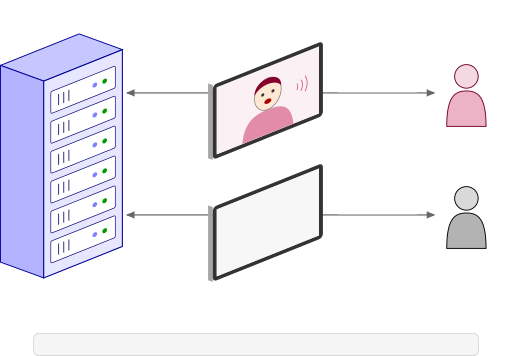
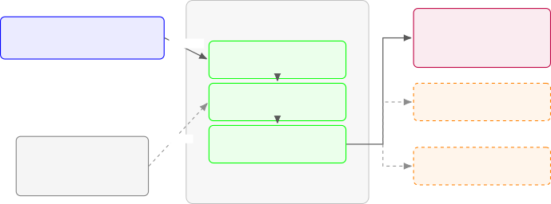
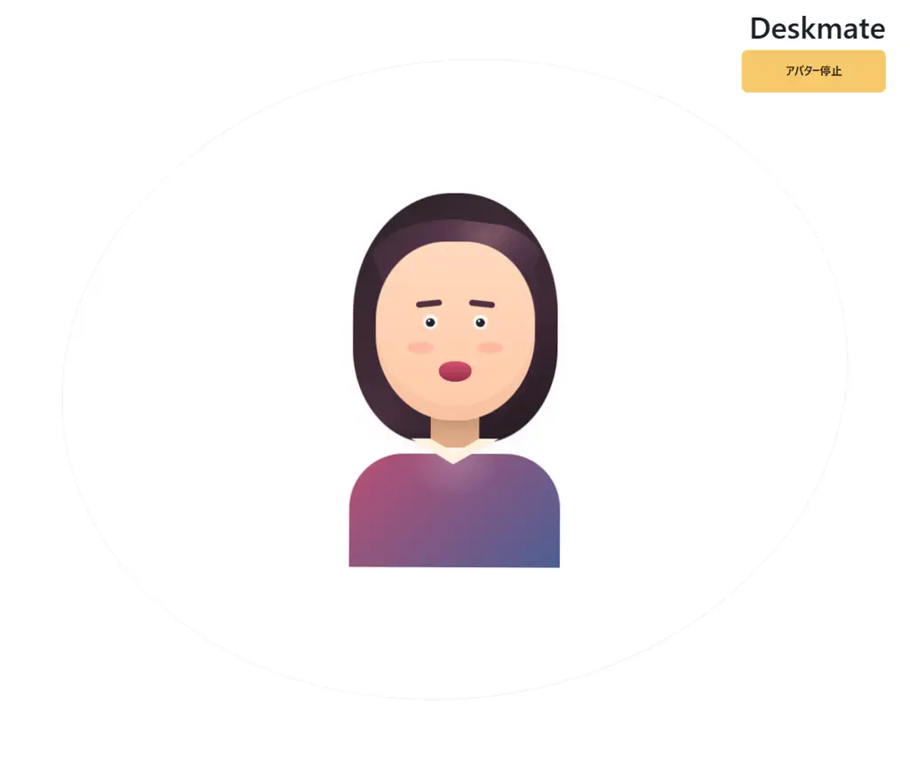
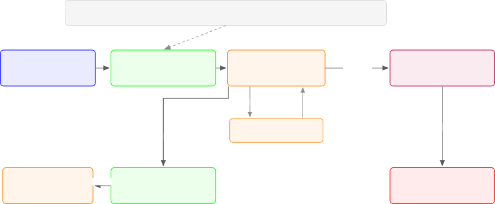

# An Experimental Apparatus for Embodied Conversational AI: A Simple Implementation Coupling a Commercial Voice AI with an Avatar

Hiroshi Hamada    Lin Gu

November 2026

###### Abstract

As generative AI becomes integrated into everyday life, understanding
how avatars shape human–AI interaction and the perception of AI as a
social partner is becoming increasingly important. This paper builds a
research instrument on audio-output coupling, which connects the audio
output of a generative AI to an external avatar. There are two
implementations: the browser implementation captures the audio of a tab
selected through screen sharing without installing additional software,
and the desktop implementation captures the audio of the service
embedded in the application. Both work with the voice AI as people
ordinarily use it, and as a method neither depends on a particular
service.

The implementation reported here, Deskmate, generates speech state,
mouth shape, and expression from low-level features such as voice-band
mean amplitude, RMS, peak, and transients. Because it uses no
microphone, speech recognition, or transcription, Deskmate acquires
neither the user’s voice nor the content of the conversation. Records of
the conversation remain with the voice AI provider, but none are kept
automatically on the side of Deskmate. This privacy-conscious design
minimises additional exposure of conversational data by processing audio
locally without automatically storing conversation records. Three
interchangeable backends are provided for rendering the avatar: 3D
(VRM), 2D (Live2D), and CSS.

Deskmate allows researchers to manipulate avatar presentation as an
experimental condition, without changing the commercial service’s
interface, voice, or response generation. Because conversation content
is not held fixed, the estimand is the total effect, including the
changes in the participant’s speech and the AI’s responses that the
presentation brings about. A server edition, served from the
researcher’s server for online experiments, is also provided. The
effectiveness of avatar presentation has not yet been evaluated; this
paper reports the design and implementation.

Keywords: generative AI, voice dialogue, audio-output coupling,
interface design, avatar, embodiment, mind attribution, experimental
instrument, knowledge-acquisition support, gamification, research
software

## 1 Introduction

The boundary between people and machines is already thinning in everyday
life. Since January 2015, memorial services have been held at Buddhist
temples for AIBO robot dogs that can no longer be repaired.¹¹ 1 The
first through thirteenth services (January 2015 to November 2024) were
held at Kofukuji in Isumi, Chiba Prefecture, whose head priest
memorialised nearly 900 units over more than ten years. From the
fourteenth service (December 11, 2025), the organizer, Aibo Dock, moved
the venue to Unmonji in Matsuyama, Ehime Prefecture. nippon.com,
Human-robot partnership: Funerals for AIBO (in Japanese), January 9,
2017,
[https://www.nippon.com/ja/views/b00909/](https://www.nippon.com/ja/views/b00909/)
(accessed September 24, 2026). Aibo Dock, After the 13th Aibo funeral
(in Japanese), December 16, 2024,
[https://www.a-fun.jp/2024/12/16/%E7%AC%AC13%E5%9B%9E%E3%82%A2%E3%82%A4%E3%83%9C%E8%91%AC%E3%82%92%E7%B5%82%E3%81%88%E3%81%A6/](https://www.a-fun.jp/2024/12/16/%E7%AC%AC13%E5%9B%9E%E3%82%A2%E3%82%A4%E3%83%9C%E8%91%AC%E3%82%92%E7%B5%82%E3%81%88%E3%81%A6/)
(accessed September 26, 2026). Aibo Dock, The 14th Aibo funeral (in
Japanese), February 5, 2026,
[https://www.a-fun.jp/2026/02/05/%E7%AC%AC14%E5%9B%9E%E3%82%A2%E3%82%A4%E3%83%9C%E8%91%AC/](https://www.a-fun.jp/2026/02/05/%E7%AC%AC14%E5%9B%9E%E3%82%A2%E3%82%A4%E3%83%9C%E8%91%AC/)
(accessed September 26, 2026). In 2025, a woman was reported to have
held a wedding ceremony at a venue in Okayama with an AI persona she had
created on ChatGPT.²² 2 RSK Sanyo Broadcasting, “I married ChatGPT” (in
Japanese), TBS NEWS DIG, November 8, 2025,
[https://newsdig.tbs.co.jp/articles/-/2271771](https://newsdig.tbs.co.jp/articles/-/2271771)
(accessed September 24, 2026). Embodied AI is also appearing as a
product. In July 2025, xAI added a companion feature to the app of its
dialogue AI Grok, letting paying subscribers converse with 3D animated
characters.³³ 3 A. Silberling, Elon Musk’s Grok is making AI companions,
including a goth anime girl, TechCrunch, July 14, 2025,
[https://techcrunch.com/2025/07/14/elon-musks-grok-is-making-ai-companions-including-a-goth-anime-girl/](https://techcrunch.com/2025/07/14/elon-musks-grok-is-making-ai-companions-including-a-goth-anime-girl/)
(accessed September 24, 2026). In January 2026, Razer announced an AI
companion presented as a 5.5-inch 3D hologram that sits on the desk.⁴⁴ 4
Razer, Razer AVA: 3D Hologram AI Companion,
[https://www.razer.com/concepts/project-ava](https://www.razer.com/concepts/project-ava)
(accessed September 24, 2026).

Researchers have also examined how people come to treat commercial AI
companions as relational partners. Interviews with 18 people who had
formed friendships with Replika described a progression from curiosity
towards relationships with affective and social value as trust and
self-disclosure deepened \[13\]. A mixed-method study of Replika users
supported a model in which perceived anthropomorphism and AI
authenticity were linked to attachment to the AI through interaction
intensity \[14\]. Two natural experiments exploiting the removal of
Replika’s erotic role-play feature and the rollout of GPT-5 further
analysed 54,861 posts and 1,452 participants across seven surveys;
negative reactions, loss framing, and demands to restore the previous
version increased after the updates \[15\]. These studies show that
relationships with AI can acquire psychological significance, but they
mainly examine accounts from users who formed such relationships or
reactions to product changes and do not isolate the effect of presenting
a body itself.

One of the questions we need to ask is how an AI with a body, also known
as an embodied conversational agent (ECA) \[16\], changes people’s
perception, judgement, and behaviour. Do people attribute a mind to an
embodied AI? Does continued interaction give rise to closeness? Do
people come to treat AI as a social other rather than a tool? These are
empirical questions that experiments can test, and they need to be
addressed from the standpoint of the humanities and social sciences.
Building a dialogue agent for research, however, means studying
something that differs in performance and experience from the commercial
services people use every day. Using a commercial service as it is
leaves no means of manipulating only the presented body. What is needed
is a simple experimental tool that changes only the presented body while
leaving the AI people actually use untouched.

Embodied conversational agents have also been investigated in
language-learning contexts. Speaking practice in English with
conversational agents is associated not only with learning outcomes but
with confidence, engagement, motivation, and speaking anxiety \[1\], and
a meta-analysis of comparative studies reports effects on second
language learning \[2\]. These reviews name embodiment and social
presence as design dimensions and argue that conversational agents can
function as conversation partners rather than teaching materials \[3,
4\]. Work treating embodied conversational agents as interactional
participants \[8\], and work manipulating avatar representation to
examine its effects on learning experience and speaking anxiety \[5,
6\], have also appeared. Meng compares combinations of voice modes and
instruction conditions within the same voice-dialogue service \[7\].

Voice dialogue itself is changing quickly. GPT-Live, released in July
2026, adopts a full-duplex design that handles audio input and output at
once and copes with backchannels and interruptions.⁵⁵ 5 OpenAI,
Introducing GPT-Live, published July 8, 2026,
[https://openai.com/index/introducing-gpt-live/](https://openai.com/index/introducing-gpt-live/)
(accessed September 14, 2026). A voice is a cue for judging that a
partner has a mind \[11\], and the conditions under which people
attribute mental states to nonhuman agents have been organised as a
theory of anthropomorphism \[12\]. Yet a four-week randomised controlled
trial comparing text with two voice modes found no significant effect of
the mode on loneliness or on socialisation with real people \[17\]. A
voice becoming more human-like and a change in people’s perception,
behaviour, or psychosocial outcomes need to be examined separately.
Similarly, the effects of adding visual embodiment to voice interaction
need to be examined empirically.

Among platforms for behavioural experiments with large language models,
LEXI handles agent configuration, participant registration,
questionnaires, and log collection in one place \[18\], and Mouakher et
al. present an environment in which task framing, stakes, and time
pressure can be manipulated during a dialogue \[19\]. Both focus on
text-based interactions with researcher-configured agents, rather than
on manipulating the visual presentation of an existing commercial voice
AI service. LEXI states that its disembodied agent can serve as the
control condition in experiments measuring the effects of embodiment.
Open-source tools such as Persona⁶⁶ 6 xikhar, Persona,
[https://github.com/xikhar/persona](https://github.com/xikhar/persona)
(accessed November 19, 2026). and AVATAR⁷⁷ 7 arpahls, AVATAR,
[https://github.com/arpahls/avatar](https://github.com/arpahls/avatar)
(accessed November 19, 2026). already drive a VRM avatar from the audio
that a voice AI plays.

The contributions of this paper are threefold. First, we build a
research instrument on audio-output coupling, which uses the audio
output played by a commercial voice AI as a coupling point to an
external system, and realise it in two ways: a browser implementation
that captures tab audio and a desktop implementation that captures audio
from an embedded frame. Neither modifies the existing service or
requires a developer API. The browser implementation worked with two
different services without any change to its code. Second, we convert
low-level features of the audio into an avatar state independent of
rendering technology, so that the same state can be rendered by three
backends using 3D, 2D, and CSS. Third, we position as an experimental
instrument the ability to manipulate only the avatar presentation while
leaving the commercial service’s interface, audio, and response
generation unchanged, and show how switching presentation conditions
lets it be used in randomised experiments. We call the software that
implements these contributions Deskmate. What this paper describes is
the version with all features as of November 2026 (hereafter the full
version); the published demo contains part of it.

## 2 Audio-Output Coupling

In this paper, the method of using the audio a service plays as the
coupling point to an external system is called audio-output coupling.
The browser implementation captures the audio of a tab selected through
screen sharing; we call this approach tab-audio coupling. The desktop
implementation captures the audio of the service embedded in the
application. Neither requires access to the provider’s developer API.
Audio delivered through such an API can be coupled in the same way, as
long as it is played.

The browser implementation uses the audio of a tab the user selects,
such as one running ChatGPT’s or Grok’s voice mode. The avatar responds
not to the user’s speech but to the audio that the shared tab plays.

The desktop implementation uses Electron, an application platform
combining Chromium with Node.js, in which the screen is built with HTML,
CSS, and JavaScript but runs as an independent window rather than a
browser tab. The desktop implementation opens the dialogue service’s
page as a frame embedded in that window and captures the audio that
frame plays. Because the source is designated by the application, no
dialog asking which tab to share ever appears.

In both implementations the video track is stopped immediately on
capture and only the audio track is analysed. Processing after capture
is shared and is described in Section 4. Table 1 compares the two
implementations.

|                                   |                              |                              |
| --------------------------------- | ---------------------------- | ---------------------------- |
|                                   | Browser implementation       | Desktop implementation       |
| Audio source                      | tab chosen by the user       | embedded frame               |
| Starting the session              | choose a tab each time       | one button                   |
| Scope of observation              | the chosen tab^(\*)          | the embedded frame           |
| Where the service runs            | the user’s browser           | inside the application       |
| Where credentials live            | the user’s browser           | the application’s storage    |
| Microphone captured               | no                           | no                           |
| Conversation stored automatically | no (manual saving available) | no (manual saving available) |

^(\*)If the whole screen is chosen for sharing and system audio is
included, every sound the PC plays.

Table 1: The two implementations compared

In the desktop implementation, the user must log in to the service
inside the application, and the login state of the existing browser is
not carried over. The desktop implementation states the URL of the page
it embeds and the sites the embedded frame is allowed to display. The
current desktop implementation is configured for a single service.
Because these settings are made per service, several services could be
registered in advance and one chosen at launch, but the choice would
still be limited to registered services: supporting another service
requires writing down, besides its URL, the authentication sites passed
through at sign-in and the sites permitted to use the microphone and
similar features.

The browser implementation’s code contains no processing that depends on
a particular service’s name, API, DOM structure, or internal protocol:
it is enough that the user selects a compatible browser tab that plays
audio. The same code can therefore be used with other dialogue services
that play audio in a browser. Generality as a method, and the ability to
support more services, are common to both; independence, in the sense of
connecting the avatar to any service without service-specific code,
belongs to the browser implementation alone.

This was confirmed in operation. With the same code, the browser
implementation drove the avatar from the voice dialogue of both ChatGPT
and Grok (October 2026). Only operation was confirmed; the quality of
the mouth movement was not compared across services. Thresholds such as
those for detecting speech were tuned on one service’s voice, so a
service whose voice differs in character may not behave in the same way.

Some dialogue services play their audio outside any browser tab. The
voice of Gemini running in Chrome’s side panel does not belong to a tab
and cannot be captured as tab audio. We therefore added to the browser
implementation an option that also captures system audio when the whole
screen is chosen for sharing. The option is a standard browser feature,
not processing written for a particular service. With it, the avatar
could also be driven by Gemini’s voice dialogue. What is captured in
this case, however, is every sound the PC plays. Notification sounds and
the audio of other applications enter the avatar’s responses as well,
and the property of limiting observation to the chosen tab is lost. The
microphone is still not opened, analysis still completes within the
browser, and audio is still not sent outside. For services whose tab
audio suffices, the tab should be chosen.

Deskmate does not directly access the user’s microphone. The captured AI
audio is only converted into features within the page that analyses it,
and is not sent outside that page, not even to the local server. Driving
the avatar needs only the AI audio the service plays, not the user’s
speech, so no call that acquires the microphone is implemented. Audio
analysis computes low-level features including RMS, voice-band mean
amplitude, amplitude envelope, and transients within the browser, and
does not automatically store the waveform or a transcript. A purpose
that evaluates the user’s own speech, such as gains in pronunciation,
would however require a separate input path.

## 3 Properties as an Experimental Instrument

Building a dialogue system for research allows content and presentation
to be controlled, but the result may differ in performance and feel from
the commercial services people ordinarily use. Using a commercial
service is closer to actual use, but its internals cannot be changed.
Deskmate leaves the commercial service’s interface, voice, and response
generation unchanged and allows avatar presentation to be manipulated
independently. Table 2 shows how it differs from existing experimental
platforms.

|                               | LEXI \[18\]                  | Built on a developer API     | Deskmate                                           |
| ----------------------------- | ---------------------------- | ---------------------------- | -------------------------------------------------- |
| Modality                      | text                         | voice possible               | voice                                              |
| Partner                       | configured by the researcher | configured by the researcher | the official service itself                        |
| Content                       | set by prompts               | set by prompts               | not intervened in                                  |
| Presented body                | none                         | must be built separately     | main object of manipulation                        |
| Extra usage fees              | depend on the model used     | usage-based                  | no fee added by Deskmate                           |
| Handling of conversation logs | collected by the platform    | collected by the builder     | not stored automatically (manual saving available) |

Table 2: An existing experimental platform, a system built on a
developer API, and Deskmate

A developer voice API allows voice and content to be controlled. The
interface, the segmentation of turns, the handling of interruptions, and
the voice settings, however, must then be implemented by the researcher,
and commercial usage-based APIs incur fees. With Deskmate, participants
use the official service as usual, and the experimenter changes only the
avatar presentation.

When Deskmate is launched for an experiment, the condition can be
specified by a URL parameter or by a start-up option of the desktop
implementation: for example, no avatar, the same model shown in a still
state, or the mouth synchronised with the audio. In every condition,
Deskmate leaves the dialogue service’s interface, audio, and responses
untouched. Synchronisation here means mouth movement based on low-level
audio features, not phoneme recognition. Figure 1 illustrates the idea
with two conditions.

Figure 1: Concept of Deskmate as an experimental instrument. The same
voice AI answers behind both screens. It may be the official service
used as usual or a model reached through a developer API; in either
case, Deskmate uses only the voice that is played. Participants are
randomly assigned to one screen: the treatment screen shows an avatar
that moves with the AI’s voice, and the control screen shows no avatar.

Served over HTTPS from the researcher’s server, the browser
implementation can also be used in online experiments. Participants open
a link and share the dialogue service’s tab on their own device; nothing
needs to be installed. Audio analysis completes within the participant’s
browser, so even when served from a server, the audio the participant
hears is not itself sent to the researcher. In addition, since the
panels in the side pane can be replaced according to purpose, a
questionnaire can be shown there to obtain participants’ responses
before and after the dialogue. Records such as usage time and the AI’s
speaking time, together with questionnaire responses, can thus be
collected from many participants without bringing them into a
laboratory. For this use we implemented a server edition that adds
condition assignment and the receipt of records; its configuration is
described in Section 4.3.

This design also has practical advantages over an alternative in which
the researcher runs speech recognition, a language model, and speech
synthesis locally and serves the dialogue from a laboratory machine.
First, many participants can take part at the same time. Speech
generation runs on the commercial service for each participant, so the
number of concurrent sessions is not limited by the researcher’s
computing resources. Second, the server can be a low-specification
machine. It only delivers static files and receives records; audio
analysis and rendering run in each participant’s browser, and no GPU is
required. Third, the avatar is added to the voice AI at its current best
performance. Models that can run on a single local machine generally
fall short of the latest commercial voice services in response quality,
latency, and naturalness of speech, and an effect of the avatar measured
with a weaker conversational partner may not carry over to the services
people actually use.

Leaving the dialogue to a commercial service has its drawbacks. The
experimenter does not control what is said in the conversation. If the
presentation changes the participant’s stance, the participant’s speech
changes, and so does the service’s reply. The content of the
conversation lies downstream of the treatment as a post-treatment
variable, and what is estimated is the total effect that includes this
process. Adding a post-treatment quantity such as how interesting the
conversation was as a covariate in a regression destroys the
comparability that randomisation secured \[20\]. Estimating the direct
effect of the body requires fixing the content at the design stage, for
example by presenting recorded audio to all participants. Deskmate
itself records no conversation, so what was said cannot be analysed;
where logs are needed, they must be obtained from the commercial service
with consent. Finally, results are tied to the service at the time of
the study. Because provider updates change the character of the voice
and the replies, the time of the study and the version of the service
need to be recorded.

## 4 System Architecture and Implementation

The browser implementation consists of a local Node.js server and a
browser client. The server provides static files, the avatar model file,
and an API for saving user-selected phrases. The client is implemented
in HTML, CSS, and JavaScript, and passes an avatar state computed from
local audio features to the rendering layer. Figure 2 shows the
architecture of the browser implementation.

Figure 2: Architecture of the browser implementation of Deskmate. The
voice-dialogue service runs in its official UI; Deskmate captures only
the tab audio in the browser and performs avatar control and general
knowledge-acquisition support locally.

server.mjs serves the static files and the model, and appends text the
user has asked to save to useful_phrases.md. Audio capture, feature
computation, speech detection, and avatar state generation complete
within the browser, and audio is not sent to the server. A local server
is used so that text can be appended to a file from the browser and the
model file can be loaded from the same origin.

The browser client consists of index.html, styles.css, and app.js under
public/. The screen has a stage area displaying the avatar and a side
pane holding panels for level and consecutive days of use, conversation
topics, review of previously saved phrases, and phrase saving. What each
panel does is described below. Drawing in the avatar area is the
responsibility of a rendering backend that takes the avatar state
produced by the audio analysis as input. Backends are interchangeable;
their configuration is described in Section 4.1. Figure 3 shows this
screen in the published demo: the learning-support panels are replaced
by a guide to getting started, and the stage is given more room.

Figure 3: The screen of the published demo, displayed in English. On the
right is the stage area drawn by the 3D backend; on the left is the
guide to getting started, shown collapsed. The panels can be replaced
according to purpose; in ordinary use they hold the learning-support
panels. The avatar faces at an angle because of its idle turn.

The browser implementation in the full version runs as a local Node.js
application. It assumes Node.js 20 or later and has no npm dependency at
run time. All libraries needed for rendering are loaded by the browser
from a CDN. A user who wants a different VRM model, or a Live2D sample
model for the 2D backend, obtains it from its distributor or makes it
themselves. Assets differ in their terms of use, and users are
responsible for checking the applicable licensing terms. The published
demo differs from the full version. It serves the same client as static
pages without a server; it omits the panels for saving and reviewing
phrases, which depend on the server, and the 2D backend, and fixes the
3D model to a single one. The full version is available from the author
on request for research purposes only.

### 4.1 Interchangeable Rendering Backends

The avatar state is a tuple of seven values: whether speech is in
progress, volume, energy, intensity, mouth opening, mouth shape, and
expression. It contains no term from any rendering technology. A
rendering backend receives this tuple together with gaze and blinking,
which are generated independently of the audio, and nothing else; the
audio analysis upstream does not know which backend is running. The
current implementation has the three shown in Table 3, each belonging to
a different technology family.

| Setting | Implementation       | Asset required | Intended use                            |
| ------- | -------------------- | -------------- | --------------------------------------- |
| vrm     | three.js + three-vrm | VRM model      | Where a 3D idiom is wanted              |
| live2d  | PixiJS + Cubism      | Cubism model   | Where a 2D idiom is wanted              |
| css     | CSS only             | none           | Where no external resource is available |

Table 3: The three rendering backends

Switching is done with a control in the corner of the stage, and the
choice is stored in the browser. A setting given in the URL query string
takes precedence over the stored value, so a single link can invoke a
particular backend without disturbing the stored choice. In the current
implementation, switching reloads the page.

The 3D and 2D backends accept user-supplied models. Although the three
backends differ in resources, coordinate systems, and rendering
parameters, they consume the same avatar state and require no change to
audio analysis. The 3D backend represents gaze and body orientation, the
2D backend can use existing Cubism assets, and the CSS backend requires
no external model asset. Figure 4 shows the 3D and CSS backends⁸⁸ 8 The
copyright of VRoid belongs to pixiv..

\(a\) vrm

\(b\) css

Figure 4: Two rendering backends consuming the same avatar state. (a) is
a VRM model created by the first author, drawn with three-vrm; (b) is
drawn with CSS alone. Both are cropped from the online-experiment
screen. The difference lies only on the rendering side; the path from
tab-audio capture to state generation is shared.

### 4.2 Audio Response and Knowledge-Acquisition Support

Audio analysis uses AudioContext and AnalyserNode from the Web Audio
API. Here, low-level features are short-window numerical descriptions of
waveform amplitude and change, rather than the meaning of the words
spoken. Voice-band mean amplitude is the mean of the amplitudes of
frequency components between 120 and 4200 Hz, the range designated as
the voice band in this implementation. RMS is the root mean square of
the waveform amplitudes in a short window, whereas peak is the maximum
amplitude in that window. For example, two windows can have similar RMS
values while the one containing a single large-amplitude sample has a
higher peak. A transient is a value representing a sudden rise in
amplitude. Each frame also computes high-band mean amplitude and
spectral centroid. Figure 5 shows the flow from feature extraction
through avatar state and rendering parameters to learning metrics. We
call this one-directional flow the pipeline: each stage takes only the
output of the stage before it, and whatever is not passed on does not
reach any point beyond.

Figure 5: The pipeline from audio analysis to avatar control and
continuity support. Speech activity and visual response are generated
from audio features, not from the content of what is said.

Speech detection compares the audio level with a threshold that follows
the noise level, which is estimated continuously during silence.

Mouth opening is computed from audio features, smoothed so that it does
not jump, and passed to the rendering layer as part of the avatar state.
Each backend maps this value to its own representation of the mouth.

Expression takes the states neutral, happy, thinking, surprise, and
concerned. These do not analyse the meaning of what is said; they are a
heuristic that visualises the rhythm of the conversation from audio
features.

The side pane can display learning-support panels suited to the purpose
of use. Possible panels include, for example, a display of experience
points and consecutive days of use based on usage time and amount of
speech, a panel suggesting conversation topics, and a review panel
showing expressions the user has saved manually; the current
implementation provides these as examples. The effects of such elements
that encourage continued use have been examined in prior work \[9, 10\].
The panels are independent of avatar state and can be replaced according
to purpose. None of them transcribes or analyses the meaning of speech,
and none evaluates learning attainment.

### 4.3 Server Edition for Online Experiments

The server edition is the browser implementation served from the
researcher’s server; it is not a third coupling method. The path from
audio capture to rendering is the same as in the browser implementation
and runs in the participant’s browser. What the server edition adds is
threefold: condition assignment, a study procedure, and the receipt of
records.

experiment/server.mjs wraps the handling of the ordinary server and adds
assignment and the receipt of submissions. The researcher runs it on
their own server and serves it over HTTPS, because tab-audio sharing
works only in a secure context. Each participant receives a link
containing a participant ID; the ID issued by a recruitment service can
be used as it is. The server picks a condition at random from among
those with the fewest participants assigned so far, and always returns
the same condition for the same ID. The name of the condition appears
neither in the URL nor on the screen.

Participants proceed through information and consent, a
pre-questionnaire, a connection check, the dialogue, and a
post-questionnaire, and finally submit their records and responses and
receive a completion code. In the connection check, the participant
shares the dialogue service’s tab, and cannot proceed to the dialogue
until Deskmate has received the AI’s voice for a set number of seconds.
The avatar is shown only during the dialogue. It is hidden during the
pre-questionnaire and the connection check, so that the treatment does
not leak into the baseline measurement, and during the
post-questionnaire, so that participants in every condition answer on
the same screen. A participant who closes the page partway can resume by
opening the same link.

The recording component opens the avatar screen inside a frame and
receives only in-page signals marking the start of capture, the end of
an utterance, and the end of capture. The signals carry durations and
nothing else. What reaches the server is the participant ID, the
condition, usage time for each stage, the AI’s speaking time and number
of utterances, the questionnaire responses, the browser type, and a list
of timestamped event types such as the start and end of capture and of
each utterance; the audio, its features, and the content of the
conversation do not. To remove stimuli unrelated to the experiment,
participants are not shown experience points, the panels for saving and
reviewing phrases, or the model switcher; the experiment instructions
and questionnaires take their place. The API for saving and reading
phrases is also disabled on the server side, and only the one configured
model is served.

On the participant’s side, what is needed is a desktop Chromium-based
browser, speakers or earphones, and an account for the dialogue service.

Many services offer voice dialogue only to logged-in users; with such a
service, participants have to provide an account and log in. Whether a
free account can use voice dialogue, and how far its usage time is
limited, need to be checked before a study is run. The researcher’s only
cost is running the server; no usage fee proportional to the amount of
dialogue arises. Providing an account may, however, be a barrier to
recruitment in online experiments.

There are three caveats. First, which plans can use voice dialogue, the
usage limits, and the model that serves it are decided by the provider
and may change without notice. A dialogue stops partway if a limit is
reached, so the length of the dialogue must be designed to fit within
it. Second, participants’ accounts differ in the plan subscribed to, the
voice selected, the memory of past conversations, and so on. These
become differences separate from the presentation condition.
Randomisation keeps them from being unbalanced across conditions; in
addition, the plan and similar attributes should be asked in the
questionnaire and recorded together with the time of the study. Third,
the conversation is sent to the provider under the participant’s account
and remains in that account’s history. Using the server edition still
adds no party that touches the conversation, but the fact that the
conversation reaches the provider and remains in the history should be
included in the explanation given to participants.

## 5 Limitations and Future Work

No user study has yet been conducted, and the effects of avatar
presentation on human–AI interaction remain untested. The specific
experimental design using the presentation conditions described in
Section 3, and its outcome variables, will be preregistered separately.

Deskmate has several limitations. First, where a rendering backend uses
a third party’s runtime or model asset, the applicable licensing and
usage terms must be checked. This, however, is a constraint specific to
the chosen backend, not a property of the side that generates the avatar
state; in a configuration using the CSS backend, which requires no
asset, or an open-source avatar, it does not arise. Second, the server
edition of Section 4.3 is a prototype. It has no authentication or rate
limiting, so anyone who knows a participant ID can submit (only the
first submission per ID is accepted). Records are stored in a file on
the server, and there is no mechanism for recovery from failure. These
must be added before the edition is used in a full study. The desktop
implementation does not support the server edition.

## Beta Demo and Inquiries

A beta demo of the browser implementation of Deskmate is available at
the following page. The demo includes a single VRM model.

[https://hiroshihamada.github.io/deskmate-web-beta/](https://hiroshihamada.github.io/deskmate-web-beta/)

The demo lets one try tab-audio coupling and the 3D and CSS backends.
The desktop implementation, the 2D backend, and the features for
experiments are included in the full version, available from the author
on request for research purposes only. Those interested in research or
commercial use of Deskmate should contact the author.

The text and figures of this paper are licensed under CC BY 4.0; the
software, including the demo, is not. Copyright in the software belongs
solely to Hiroshi Hamada. The VRM model used in the demo and shown in
the figures was made by the first author from VRoid Studio sample data.
It falls under neither licence, and the terms set by pixiv Inc. extend
to it.

## Acknowledgements

VRoid Studio was used to create the 3D model shown in the figures.

## Disclosure of AI Use

Generative AI assistance tools were used in part in preparing this paper
and in implementing the software. The authors have verified and are
responsible for the final text, the design decisions, the technical
claims, and the decision to publish.

## References

- \[1\] J. Du and B. K. Daniel. Transforming language education: A
  systematic review of AI-powered chatbots for English as a foreign
  language speaking practice. Computers and Education: Artificial
  Intelligence, 6:100230, 2024.
- \[2\] B. Lyu, C. Lai, and J. Guo. Effectiveness of chatbots in
  improving language learning: A meta-analysis of comparative studies.
  International Journal of Applied Linguistics, 35(2):834–851, 2025.
- \[3\] J. Jeon, S. Lee, and H. Choe. Beyond ChatGPT: A conceptual
  framework and systematic review of speech-recognition chatbots for
  language learning. Computers & Education, 206:104898, 2023.
- \[4\] W. Huang, K. F. Hew, and L. K. Fryer. Chatbots for language
  learning: Are they really useful? A systematic review of
  chatbot-supported language learning. Journal of Computer Assisted
  Learning, 38(1):237–257, 2022.
- \[5\] C. T. Tan, I. Atmosukarto, B. Tandianus, S. Shen, and S. Wong.
  Exploring the impact of avatar representations in AI chatbot tutors on
  learning experiences. In Proceedings of the 2025 CHI Conference on
  Human Factors in Computing Systems, 2025.
- \[6\] M. Pan, P. Liu, J. Zhang, R. Cao, V. Ariyawansa, Y. Li, B.
  Yao, D. Wang, P. Pasquier, A. Kitson, and M. Prpa. LLM-based embodied
  conversational agent for reducing foreign language speaking anxiety in
  social VR. In Proceedings of the 2026 CHI Conference on Human Factors
  in Computing Systems, pages 1–24, 2026.
- \[7\] F. Meng. Customizing ChatGPT for second language speaking
  practice: Genuine support or just a marketing gimmick?
  arXiv:2603.14884, 2026.
- \[8\] D. Han and J. Ryu. Exploring the applicability of embodied
  conversational agents for second language learning: A sociocultural
  theory perspective. In 2026 12th International Conference of the
  Immersive Learning Research Network (iLRN) Proceedings: Selected
  Academic Contributions. The Immersive Learning Research Network, 2026.
  [https://doi.org/10.56198/s7usiob7j](https://doi.org/10.56198/s7usiob7j).
- \[9\] M. Sailer and L. Homner. The gamification of learning: A
  meta-analysis. Educational Psychology Review, 32(1):77–112, 2020.
- \[10\] M. Shortt, S. Tilak, I. Kuznetcova, B. Martens, and B.
  Akinkuolie. Gamification in mobile-assisted language learning: A
  systematic review of Duolingo literature from public release of 2012
  to early 2020. Computer Assisted Language Learning,
  36(3):517–554, 2023.
- \[11\] J. Schroeder and N. Epley. Mistaking minds and machines: How
  speech affects dehumanization and anthropomorphism. Journal of
  Experimental Psychology: General, 145(11):1427–1437, 2016.
- \[12\] N. Epley, A. Waytz, and J. T. Cacioppo. On seeing human: A
  three-factor theory of anthropomorphism. Psychological Review,
  114(4):864–886, 2007.
- \[13\] M. Skjuve, A. Følstad, K. I. Fostervold, and P. B. Brandtzaeg.
  My chatbot companion—A study of human-chatbot relationships.
  International Journal of Human-Computer Studies, 149:102601, 2021.
- \[14\] I. Pentina, T. Hancock, and T. Xie. Exploring relationship
  development with social chatbots: A mixed-method study of Replika.
  Computers in Human Behavior, 140:107600, 2023.
- \[15\] J. De Freitas, N. Castelo, A. K. Uğuralp, and Z. Oğuz-Uğuralp.
  Mourning the loss of AI companions. Nature Human Behaviour, 2026.
  doi:10.1038/s41562-026-02569-3.
- \[16\] K. Kiuchi, K. Otsu, and Y. Hayashi. Psychological insights
  into the research and practice of embodied conversational agents,
  chatbots and social assistive robots: A systematic meta-review.
  Behaviour & Information Technology, 43(15):3696–3736, 2024.
  doi:10.1080/0144929X.2023.2286528.
- \[17\] C. M. Fang, A. R. Liu, V. Danry, E. Lee, S. W. T. Chan, P.
  Pataranutaporn, P. Maes, J. Phang, M. Lampe, L. Ahmad, and S. Agarwal.
  How AI and human behaviors shape psychosocial effects of extended
  chatbot use: A longitudinal randomized controlled study.
  arXiv:2503.17473v2, 2025.
- \[18\] G. Laban, T. Laban, and H. Gunes. LEXI: Large language models
  experimentation interface. In Proceedings of the 12th International
  Conference on Human-Agent Interaction, pages 250–259, 2024.
- \[19\] A. Mouakher, G. Leszczyński, P. Gaczek, and K. Nowosadko.
  Enhancing realism of scenario-based experiments on human-AI
  interactions with LLM. In Human-Computer Interaction, HCII 2026,
  Lecture Notes in Computer Science 16703, pages 175–188.
  Springer, 2026.
- \[20\] J. M. Montgomery, B. Nyhan, and M. Torres. How conditioning on
  posttreatment variables can ruin your experiment and what to do about
  it. American Journal of Political Science, 62(3):760–775, 2018.
